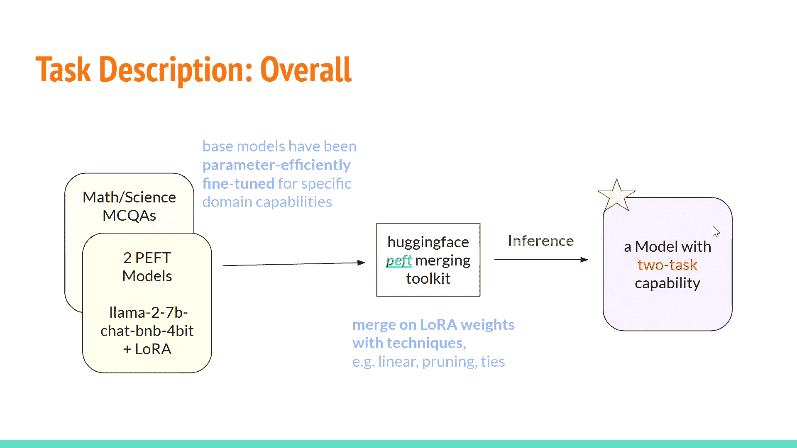
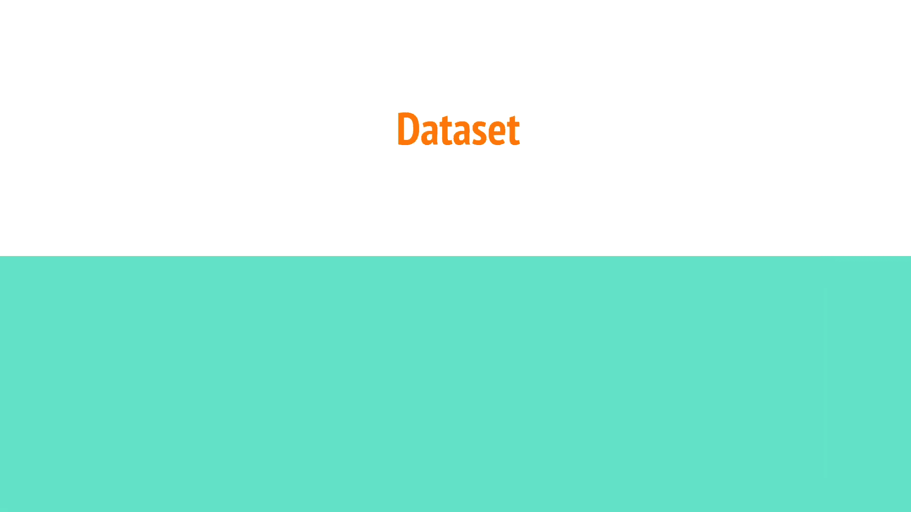
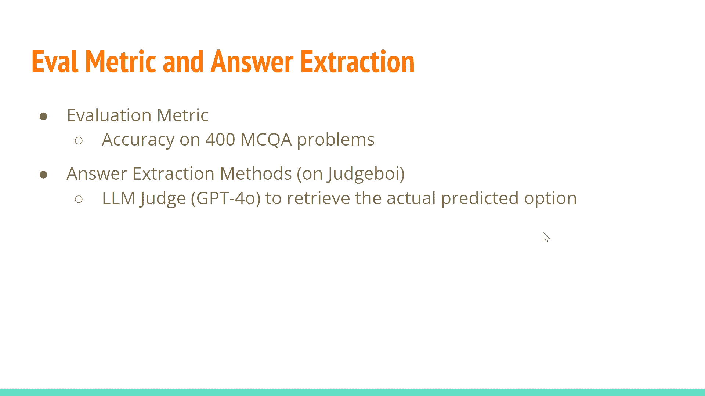
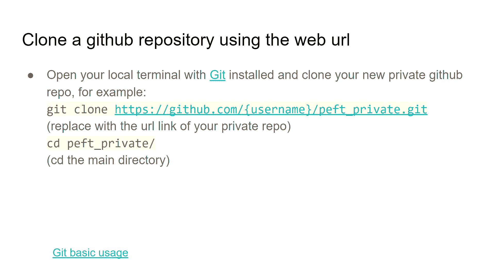
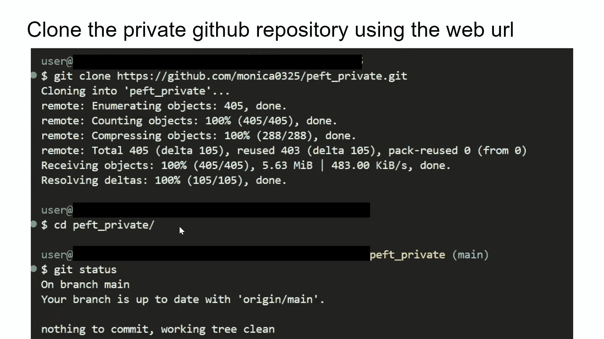
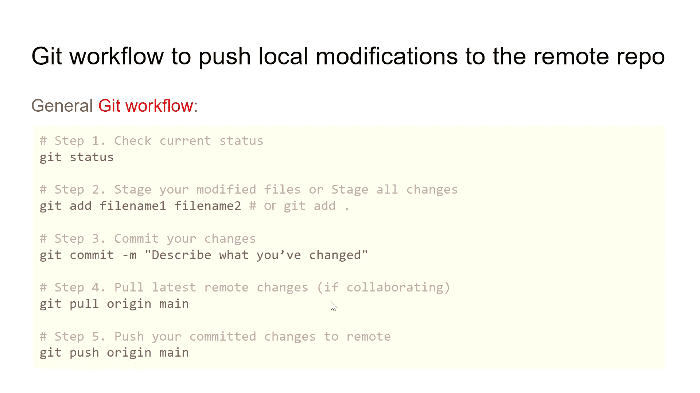
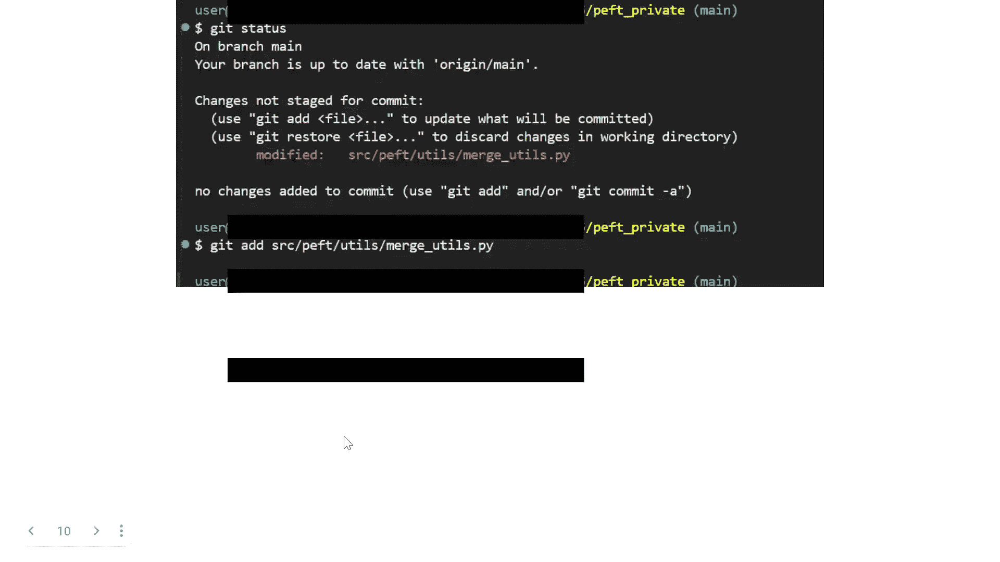
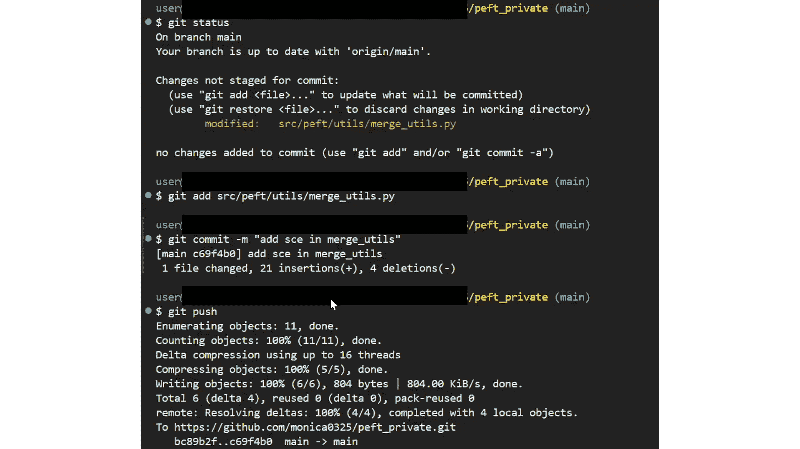
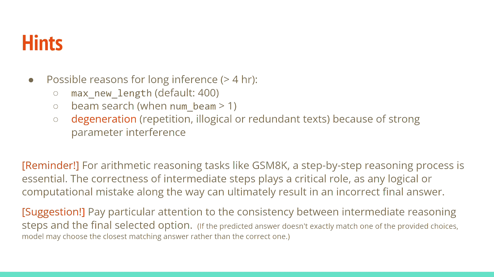
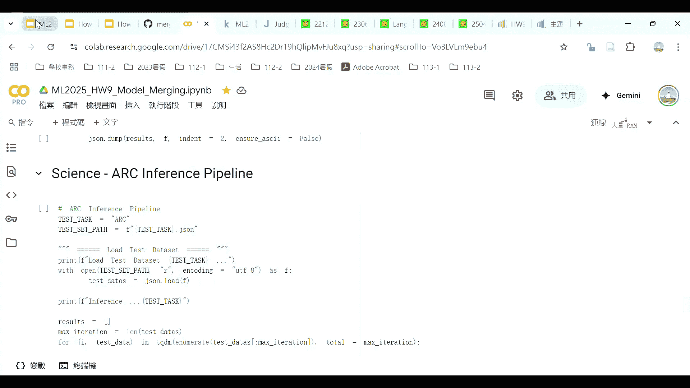

# 强推！(2026最新版) 李宏毅最新课程：智能体AI【AI Agent】71集全！人工智能／机器学习／深度学习／大模型／LLM - P21：20-作业：Model Merging - Ai人工智能工程师 - BV1QdzCB3Eu2

各位同学大家好，我是主教黄小颖，然后今天由我来讲解机器学习2025作业九，主题是model merging della，一样是在三个礼拜后，呃，首先在投影片最前方，列了几个和这份作业相关的link。

包含collab cargo的sample code，以及在HuggingFace it上的data Upset，这份作业会用到judge boy进行evaluation。

再来是助教环境的两个track point，分别是JIN8K跟A2C，然后是ta修改的PFT套件，最后就是一个tutorial的slide，教大家如何建立一个private cosmized。

的PEFT套件，接下来的online会是我会先介绍这份作业的，Test description，再来是用到的data set Eva evolation。

所需用到的metric跟extract answer的方式，下半部分我会简单介绍几个常见的merging方法，以及实现这些方法所要做的to do跟hits。

最后就是submission跟grading的部分，Test description，这份作业的目标就是希望同学学习，如何在参数空间上对不同能力的模型进行融合。

以建构一个具备多任务能力的unify model，不需进行额外的训练，所以期望同学在写作过程中，尽量探索各种不同的merging方法，使融合后的模型，同时在各个任务上维持不错的表现。

那先快速review一下VOMVERSION，这个技术，简单来说就是对模型本身和特定的任务能力，相关的参数做简单的运算操作，即能达成融合个人模型特定能力的效果，不需为了重新训练而去取得特定领域。

原先的训练资料或额外的运算资源，然后现今大型foundation model出现在浴室，没有微调这个框架下，像哈利FAA这种开源平台，已经有很多现存可以使用的EXPERMODEL，通过模型融合。

即能达成一个模型多任务学习的目标，也更加速model Ming的发展，不过模型融合过程中，最常见遇到的问题是参数干涉，Parameter interference，是因为不同模型间经常存在多余的参数。

或是正负号的冲突，使得融合后的模模型在各能力上表现下降对，然后这边先简单定一下test factor，因为等下投影片会经常常见到这个名词，其实它是其实它就是指呃，模型中和特定任务能力相关的参数。

所以我们是做运算操作，在这些操参数上，也就是text vector上，呃从刚才的呃参数干涉问题延伸，所以这份作业最重要的就是，希望同学在融合过程中，尽量避免像参数干涉这类问题的发生。

使得融合模型同时在数学和自然领域的推理，问题上维持不错的表现，然后ta目前已经用parameter efficient，FUNING的方式fire了，FIGHTUNE了两个个别的任务。

也就是我们freeze住了，face model只微调在LAURA的weight上面，那homework轴的base model会是lama to7，b chat的框，test版本。

LAURACONFIG是rank是八，然后我们只加在QKV的projection layer上面，好需要同学特别注意的是，这份作业是不不允许跟动base model跟lower conflict。

如果同学对laura said额的设定有任何问题，都可以参考作业五的投影片，再就是最后列了一下在PFT后额模型，在自然领域的表现，从原先的44percent的正确率提升到63，Percent。

在数学领域上则是从原先的37percent，提升到52。5percent，这个表现可以供大家merging之后呃的表现，自我参考，这样，好，接下来只是提供额，这个模型在PEFT之后的回答范例。

首先是在自然领域上呃，是arc的DATASET，然后问题同学可以回去仔细看一下，a arc的问题大概是怎样的，然后下面是呃PFT之后哦，模型的回答情形，然后特别提醒同学是啊。

模型通常在结束回答后会接一个u s token，再就是在数学数学领域上，也就是绝缘线，8KDA线上模型在PEFT之后的回答情形，然后一样是像数学推理这种这类型的任务模型，需要先有一串的解题过程。

最后看才能答，最后才能得到一个答案，然后做多选题，这样，所以刚才已经提到说我们是以这份作业，是以PFT的方式fine tune，所以其实上其实呃，模型。

特定任务能力是存储存在LAURA的metric上面，那PFT这个套件，刚好可以让我们直接在laura metro上，做简单的运算操作，所以在这份作业中会大量的使用PFT套件，那下面的是示意图。

就是简单说明说，因为我们现在有两个PEFT后的checkpoint嘛，分别是在数学跟自然领域上，那跟没有pee f听前，最重要的就是我们微调在了LAURA的METR上面。

所以laura mi就是会是这份作业的tx factor，所以那再简单overall的回顾一下，这份作业的description就会是，同学会使用PFT这个套件，对lol way进行运算操作。

然后得到一个融合后的模型之后，就可以inference在自然和数学两个test上面，呃然后要请同学特别注意的是，你在整个inference过程中，也就是全部的400个问题的过程中。

一定要使用同一个merging后的模型，也就是你merging的设定必须维持一致，不能在inf过程中突然跟动，否则算在这份作业中算是违规的，好然后这个，示意图就是说明整个这份作业的整个流程。

就是我们会有两个checkpoint，分别是自然和数学领域的extra model，然后是text vector，会是laura metric。

然后我们要用HuggingFace的PFTMERGINPOKET，去做运算操作，在这些lower weight上，然后得到一个merging或者模型，就会inference在这两个test上面。

好接着进入正作的带小赛。

说明好，这份作业使用到的DATASET是400个多选题，分别来自ARC跟卷38K这两个data set，然后下面是提供正确的diastic link，在hacking fit上面。

后LCDATASET是小学level的自然多选题，然后在HUGINGPAT上，大家可以看到每个sample都有五个colon，分别是id，Text，Name，Instruction。

question跟options嗯，需要特别提醒同学是，这份作业不允许修改每个example的呃，每个sample的instruction，question跟options。

也就是说同学不能对prom进行修改，然后第二个就是卷38K呃，我们在作业六有的时候也有使用到，它是小学label的数学题，然后这篇作文使用到的是多选题的版本一样。

他也是每个sample有五个column id，Text，Man name，Instruction，question跟options也是不允许修改，Instruction。

question跟option的，evaluation用到的metric，会是这400个多选题的正确率，然后助教在evaluation过程中嗯，excel answer方式是用l m judge。

就是我们会用GPT4O去截取你呃，传到judge boy上，各个response，实际上predict出来的选项，也就是在ABCD中的哪一个这样。

还有问题想问的吗，如果没有，我们都继续吧，好那我接下来就要介绍几个常见的merge方法，然后如何实实做这些方法所要做的to do，然后还有一些hits，这样然后再强调一下。

就是homer9，是要融合自然和数学这两个能力的模型，然后我们test spector是LAURA的ab跟ab metric，这，然后因为PPP这个套件可以直接在tensor。

或是说是metro label上实践这些merging的方法对，所以在这份作业中，会大量使用到PFT这个套件，嗯然后实际PFT这个套件在implement，这些merging方法时候常用。

常见到这三个参数哦，这三个变数分别是test spector，weight跟density，呃，刚才test spector其实有很常提到的，然后在这份作业中就相当于LAURA的aby metric。

然后weight wait的话，则是因为呃在很多merging方法中，常见会有VTSM这个步骤，然后这个位置就代表说，我们在把这些test spector上起来的时候。

会乘上会先乘上一个scale或是coefficient，这样然后再来是density，只是因为也是一样，很多main方法里面常见会有PRONING这个操作，就pruning，简单来说。

就是说你会把一个cancel里面或mesh里面，部分参数给设成零对，只保留部分的参数，那剩下保留下来的那一部分参数的比率，就是要做dancer题，这样。

好然后第一个方法就叫做test serithmetic，然后它在PEFT里面又叫做linear，对它其实就是对test factor进行waited some，也就是比如说下面这个示意图。

我们有三个test factor，然后我们各乘上一个SCALA，然后最后相加起来就是蛮简单，蛮直观的一个操作，这样，然后然后提前的同学，就是我在之后讲解了几个merging方法。

其实都有有列的一些原本的论文的链接，大家可以如果有兴趣的话，可以去参考一下，然后第二个merchant方法叫做mannative perm，就是它是基于刚才的test serithmetic。

就是在waiting some，这些test factor之前会进行pruning嗯，就是它会依照参数的大小，然后去决定说他今天要保留哪一部分，然后他这边是依照说我只保留参数，绝对值比较大的那一部分。

也就是剩下top d的呃，参数这样的，然后再来就是第三个是dear linear，老师刚才上课有提到这个方法，对它跟magnitude pro一样，就是它同时也有PRONNIE跟waiting sun。

但是它在做PONIUM过程中，它是render的，去决定说我今天要在这个tensor里面呃，把一简单色体都呃参数给去除掉，只留下只只剩下DSD呃比率的参数，这样，然后他在pruning完之后。

还要还会进行一个RESCALE的动动作，就是他希望呃pruning完之后，可以回到原先tensor的期望值，所以还会RISCALE一个呃，dancer体分之一的呃数值，这样。

然后最后就会一样进行wait s，然后这里就是再列一下，review一下DLINEAR整的整个步骤，它这里的DP其实就是pruning对，然后RESCALE是刚才说我会重新回到原，原先的期望值。

最后就是在进行wait上这样，然后第四个方法是ties，也是老师刚才上课有提到的，然后它有三个步骤，分别是train，然后elecine don't destroy merge。

然后第一个步骤train其实也就是pruning，这样它也是跟magnitude prune一样的操作，就是它只保留参数呃，数量级就是MANNATIVE比较大的部分，这样对。

然后他在pruning完之后会进行sign election的动作，就是他会选择说今天的cancel里面，每一个entry我要选择哪一个正负号，对他会比较，然后他的选择方法是。

他可能会把test这些test netor，在那个entry上都相加起来，然后最后相继下来是正还是负，决定这个entry的majority，majority sign是什么。

然后再决定好决定完正负号之后，它会它就会进行第三步destroy merge，然后这个destroy merge，其实白话白话来讲也也也是waiting some，只是他只会唱起来跟呃major。

majority sign align的那些参数部分这样对，所以那就再review一下，就整个流程就是你有了这些test factor之后，你会先进行training。

也就是pruning只保留数量级比较大，参数绝对值比较大的部分，然后你会额选择你的正负号，最后就是进行destroy merge，这样，好，然后这是原论文关于这个演算法的一些流程图，这样大家可以参考。

然后最后一个方法是SCE，然后它有四个步骤，分别是select calculate poeffici，erase minority elements跟destroy merge。

然后第一个select其实也是pruning这样对，然后呃第三个呃，erase minority element的部分其实跟刚才的太阳，就是决定你的mamajority sign是什么。

然后决定完majourney fine之后，最后就做destroy merge，也是跟pis一样对，所以S1这个方法最跟其他呃，前面介绍的几个方法最大的不同是。

它有一个决定各个test vector的weight的一个韩式，这样就是因为前面几个方法，其实都是要你自行实验，说决定说你今天要用的weight的参数组合，是怎样的，但是这个方法可以提供呃，这个值。

这个函式，让你直接决定说你要用什么样的POEFFICI，这样然后再来是第一步骤，premium部分嗯，也是就是跟其他前面几个方法有比较大的不同，是因为前面前面几个方法在做PRINING的过程中。

它都是个别呃，个别考虑说今天这个test vector要pro哪一部分，就是也有可能其他的test vector pro的呃，参数位置是不一样的，但是对SC1来说。

它是他是会综合考量每个test vector的关系，然后去考量到他们之间的variation，然后最后选择VVARI较大的top k的entry，然后保留这部呃这些entry。

然后其他部分就prom掉这样，然后根据原原论文对这部分的解释是，他认为说保留variance比较大的部分的话，可以保留呃，每个test vector之间比较呃，特定能力的部分。

就不会在pruning的时候，把特定能力部分参数给呃，设成零一张，所以overall来看SC1就是呃，首先你有一个test factor之后，你你有多个test spector之后。

你会根据tok variance的这个指标去选择，比较大的variance保留下来对，然后接着你会做，计算你的参数的QUEFFICI的部分，然后最后选择完majority sign之后。

就会进行destroy merge，这，好，但是实际呃，PFT在前面测的方法都是有implement的，只有最后一个C1，它是没有implement这个方法的，所以同学如果要使用这个方法的话。

你必须去修改PEFT这个套件对，然后为了方方便同学实做，这部分助教有提供一个可以当做reference的，merge king的report，就大家可以参考，然后这边是简单一个截图呈现。

说这个report如何实现SC这个方法嗯，其实蛮简单，如果你照着report这个每一步骤都差不多呃，每一步骤都有写下来，就是有一样参照实做的话，然后只需要改变一些变数，其实就可以成功的是做S1这个方法。

然后助教目前已经帮大家改好，就是实作非常重要的两个方式，分别是SC1的mask跟S1的weight，这样，然后在助教已经额修改那个PPFT的report里面，就已经把这两个function呃融合进去了。

这样对，所以同同一只要uncommon，uncommon调这两个方式，然后再试做一下主要的plot s c，主要的pilot其实就可以哦，完成这部分，这样，好然后因为刚才说要修改到PEFT的套件嘛。

所以呃接下来就是我要讲解，就是如何去建构一个private，customized的PFT套件，因为要避免抄写问题，所以一定要用PREVIA这样好，所以现在先拆开讲一下如何建构一个private的套件。

这样对嗯，同学可以点进去这个public的get her report，是助教已经改好的PFT套件，对点进去之后就会有这个画面，然后这个画面你就点上嗯。

你就点上右上角这个use with template，然后create a new repository，然后就可以建构一个呃，开始建构你自己的report，这样然后首先就是命名，其实任何名字都可以。

只要你方便，然后再就是特别要注意的是，这边要设private，这最后就按create repository这样好，那你就可以得到一个private的p f t report。

接着你就可以呃复制你的report url，然后到你的local的terminal里面呃，如果你的local local terminal已经有安装gin的话，就可以直接使用，然后就可以用呃。

开始用DEQUN的方式，然后CD进去你的主要的那个资料夹。

这里有一个简单的范例，就是如果你在gift bash里面做give co，这个动作之后，CD定你的主要资料夹之后，你现在就可以开始跟动你的呃PFT的report，这样然后你做完一些跟动之后。

等下会讲怎么跟动，所以先先忽略这部分，我们先讲呃get it的流程，这样就是你跟踪完之后，然后你可以你就必须要push你的，你在楼口做的一些呃，跟动到你远端的GIUREPORT上面对。

所以这边列了一个呃常见的get it的workflow，这样就是你要get at你所有修改过的档案，然后再进行get commit，然后面是接你这这部分做了什么改动，这样然后最后就直接get push。

然后因为你今天没有跟其他人做口味，very呃，没有跟其他人合作。

所以呃不太需要做GPO这个动作，这样哦哦这就是简单的范例。

就是如果你今天改了其中一个档案，然后如果你然后你在你的terminal打git status的话，它就会显示你你现在跟动了这个答案，然后跟动了这个答案，你就必须用get at，然后get on me。

然后再用get to push的方式复许到远端的呃，你的原端的github report这样好。

所以复选完之后，你到你的远端的get ur report看，就会看到说你新增了一个新的commit，这样对，好那因为我们今天用的是一个private gallreport。

如果你要在你的POLLAB或cargo上去，SS到这个给号report report的话，你必须有一组ss token，所以现在教大家如何去生成一组ss token，对你点进你的GITHUB之后。

到你的setting，然后一直滑滑到下面会有一个developer的settings，然后d developer setting，点进去之后就会有就会出现这个画面。

然后你点呃tokens classic这个选项，然后就会就可以再点generate new token，然后最后再来是generate new token classic。

然后你就可以开始选说这个token的KSS什么，然后点呃，它可以x report这个权限以及read package这个权限，这样这样你就可以在呃COLAB跟KO上呃，Heaving so。

可以加这个private report，这样好，然后接着就是呃你要在你的cover开口上access的话，需要的一段程序嘛，就是其实在sample code已经有有提供的，所以就简单说一下。

就是呃你今天要在你的口袋上批评store，可以加这个private report的话，你必须要先有token吗，对然后简单的URL就是如下面的例子所示，就是会前面会先有你的。

比如说你给给它名称就是他的username，然后刚才产生的token就是放在这中间对，然后后面就接username跟这个report，你刚才你刚才的命名，这样这样就可以安在你的co类跟卡口上。

安装这些套件，好说明王如何构建一个private customized，的pad套件之后，那我就要看具体说明如何跟动啊，PFT的套件对，其实如果同学是要更改现有在PFT的merge，方法。

或是增加新的方法到package里面，其实只要更改，套件里面的两个Python档分别是merge utils，点PY跟laura model点PY，首先merge youtus。

点PY是把很多merging方法呃，融合到呃PFT的套件里面，然后在里面是以一个一个function呈现的，就是比如说刚才有提到的，there are ties跟task。

arithmetic mautube pron都各自有一个function嗯，如这里所示，这个方向里会run各个merging方法的PELINE对，目前是pf ttn已经写好了。

但你如果是想要查看说各个step的呃，重要性之类，你可以把一些STEPC给common掉，然后去观察merging之后的performance，再来就是如果你想要新增新的方法，到PFT这个套件里面。

那你就要新增一个新的function呃，跟ties这个方式类似，比如说今天我们想要增加S1这个方法，我们就必须新增一个叫SC的function，然后里面就是主要让SC的merging的pipeline。

这，然后刚才有说到，就是同学只要依照呃助教提供的reference link，一个merge kit呃，实做SC的方法，然后，其实就可以完成SE部分，然后助教已经更改C1中两个最重要的防防身。

也就是刚才说的s e weight跟呃SC1mask对，已经现在已经呃，放入了助教更改的p f t report里面，所以同时只要把它uncommon掉，然后接着完成呃，C呃。

merging方法的主要pine就可以使用C这个方法，然后再接下来是第二个要更改答案，是因为你现在有了新的方法之后，你要把这个新的方法integrate到你的额，merging的pipeline里面。

然后其中就是要更改laura model，点PY这个档案，然后其实助教已经在助教版本，那个PPTFT套件里面呃，标记了各种to do，所以同学只要透过CTRLF的方式找到这些to do。

然后依照指示增加一些effeilse condition，其实就可以把新的方法融入到呃，原先PFT的merging pipeline里面好，所以这就是呃简单的可以更改，pf t套件的方法，好。

那刚才有提到说你得到了，你把local做的跟动push到远端的github reform之后，你还必须general generally个access token。

就可以在呃COLLAB跟cargo上呃，做pping store给加这个private的report嗯，好那install完之后，你要使用这个PFT条件里面的方法。

你就是要在sample code里面的，有一个merging setting的地方，加上一个新的if false condition，等下再呃，是在说明在门口的时候也会提到这部分，那更改完pf d套件。

然后确定可以在coffee跟cargo使用之后呢，我们就开始可以进行inference实验，首先就是嗯同学知道已经可以呃，使用各种不同的merging方法，以及各种不同的诊方法。

里面又有不同的weight跟dancer体的呃设定组合，所以你在你可以选择多种virgin的设定组合后，得到一个merge home的model，就可以开始info这个model。

在刚才说的捐献八跟那跟AC这两个test上，再来是这份作业中，同学可以跟动generation config的部分，然后等下也会强力说，我们说明如何去跟动generation confi。

再就是呃我们inference完这些呃问题全部问题之后，这就可以存成400个，就可以把400个id response pair存成一个JSON档，然后缴交到judge boy上。

作为i m judge的部分，然后助教在测试过后就是预估，如果你是用COLAB的T4做inference的话，400的呃sample大概需要2~4个小时，然后这个时间长度可能取决于你今天。

每个response升的token长度，就如果今天呃模型mod完之后，模型可以在呃尽量短的长度内呃，做完所有的解题步骤，然后不需要升满400token，就可以得到一个u s u s token化。

其实其实大概两个小时就可以run完，所有的400个sample，但是如果你在merging之后，发现他有很强的参数干涉，所以造成merging失败，模型可能是可能会变成说他要深。

my smy token都无法解决完问题，就就就会造成呃infant时间大幅增加这个问题，所以需要同学注意一下，再来就会说明这份作业的，hint是比较重要的部分。

首先就是因为刚才介绍各种merging方法，同时还有多个步骤嘛，所以同学其实可以把某些步骤给common掉，然后去观察，说去观察说哪个步骤对merging后的表现呃，影响较大。

也就是说这个步骤可能呃在这个merge方法里面，占比较重要的角色，再来就是pruning，这个操作其实常见于各种merging方法里面，然后对某些方法来说，它可以pruning。

可以大大的解决参数干涉这个问题，但是对某些方来说呃，这个情况是不一定的，所以需要同学去做实验嗯，观察这部分，最后还是呃跟动journal confi的部分。

就如果同学对generation conflict的设呃，参数额超参数设定不太熟悉的话，其实可以参考助教提供这两个reference link，以及作业五的投影片，也有提到。

也有简单的提到generation config，其实主要来说general generation confi要改，更改部分就会是呃decoding strategy。

跟你在jerry token时的最大长度好，decoding strategy部分可能会有grade decoding啊，top k top y或者being search都可以参考助教提供的呃。

这两个repant reference link，再来就是我们在general token时呃的最大长度，也会很大程度的影响到时间的长度，这样所以同学需要小心这部分，最后就是嗯。

如果同学不想要再升满400个response时候，才丢到josh board去决定说这个方法，这个merging方法是否有效，其实可以在一开始influence时，就先out不出response去观察。

说比如说捐赠8K的讲题步骤是否是否合理，呃因为JSON8K是其实是属于小学问题，所以我们其实很容易就可以看出来，模型应该推理过程中呃，是否其实只是在和鲁森英雄，没有真正的解决问题。

也没有在最后得到一个答案，可以match到呃，四个啊，选任何一个，然后造成最后模型可能是用猜题的方式对，然后当这种情况发生的时候，可能就会是呃merging模型在merging之后。

已经影响他到到他原先的解题能力，所以你就可能要考虑更换其他的merging方法，再就是刚才常提到，可能会有inf时间过长的问题，然后这里助教定义的过长是大于四个小时，然后造成infant时间过长。

有下面几个可能的原因，首先是max new lands，就是刚才说呃generate new cotoken的最大数量，在sample code里面，助教的default设定是400啊。

这是助教觉得说他可以完整产生整个解题过程，而不会造成阶段的问题，所以同学可以试验，就是试着减少或是增加一些，就是看会对普通人会有什么影响，然后再来是been search。

也就是当general cony的number of being大于一的时候，这样的decoding strategy其实就是being searching。

但其实been search会大大增加input时间，却对表现没有很大的呃，哦对MERGLE表现没有很大的增进，所以其实就不不建议同学使用being search去，这最后一个可能这可能原因就会是呃。

模型可能已经有degeneration的现象，也就是当merging失败的话，可呃也就是当merging过merging后，有很强的参数干涉问题，造型模型的output可能会常见，有很多呃重复的字啊。

或是他解题过程非常的没有逻辑，或是有多余的字词，就是跟解题过程无关，这时候同学就要注意是否模型已经产生了地震，地震人ATION的问题，然后再来最后一个reminder部分，就是因为刚才有提到说。

我们其中一个infinite是JS8K，然后他前是属于额数学推理任务，然后对数学推理任务来说呃，中间解题步骤是非常重要的，也是需要的，然后中间解解题步骤的正确率，也很大程度影响最后所得的答案。

然后这个答案是否能match到四个选项，就也是刚才有提到的，所以同学可以透过额解题过程，最后得到的答案以及，最后选的选项来决定是说模型的解题能力，是否因为merging而，而表现下降。

对造成解题过程和最后选择option不一致的问题。

最后就是提到grading跟submission部分。

好首先呃best line跟radio部分costa Mission一样是占四分，然后六个best line各占一分，然需要特别提醒同学的是，这份作业有两个指标，分别是arc accuracy。

跟卷SM8k accuracy，然后同时必须同时大于等于额这两个指标的，这个呃这个baseline的这两个指标，才可以算通过这个best line，然后得到一分，这样。

再就是当你产生完生生完所有的response之后，你就可以把这些response存成一个predict点，Jason，然后交到judge boy上，然后只接受JACKSON党行，这。

再就是呃prediction file其实是有固定的格式，然后这边其实sample code已经都帮同学写好，所以就同学其实不需要担心，再就是呃每天的有五次的summation qua，然后会在23：

59分reset，然后每次submission大概会花约六到7分钟，做n judge的evaluation，所以请同学耐心等待好，接下来会说明cos Mission部分。

cos Mission一样找到until库，然后这份作业跟这份作业，cos Mission跟其他作业最大的不同，是，因为因为同学需要在这份专业中跟动PP，PEFT这个套件。

所以同学需要为了方便助教进行reproduce，所以你必须找交，你在PEFT套件里面更改的任何档案，也就是任何Python的，然后助教在reproduce的过程中，会把呃你这些档案去取代助教版本。

那个PAT套件里面相应的档案哦，去，reduce你的结果对，然后再来是一样，跟其他作业一样，你必须找到你主要inverse pine，那个主要的点IPINV档。

记得如果你的点IPIMP档包含任何private token，要记得删除，再就是也一样要叫ri my，但是re my呃，里面需要额外增加这些呃，你修改档案的在PFT套件里面的绝对路径。

然后等下会给一个REMIERE范例供大家参考，然后没反平，然后然后把这些档案整理成一个资料夹之后，就可以呃压缩成点点zip down，然后命名格式跟home work6之后作为呃是一致的。

也就是你在全部是小写的学号之后加一个底线，然后加homework9嗯，好接下来就是一样，也就是这教大家如何写REMI嘛，就是包含说你要呃写明你的环境怎么建立的，然后如果你不知道怎么写。

其实可以直接点进去，Remain generator，他可以告诉你一些有用咨询，然后这里是一个remain的example，因为刚才说呃，这是homorder re命里面必须加入一个呃，嗯必须缴交。

因为你必须找交，你的在PEFT套件里面更改的所有档案，所以你必须得在rain里面写明，这些更改档案的绝对路径，然后助教已经设定了固定的一个格式，是你在REI点MD里面必须加入一个code block。

然后这个call call black会用replace这个做tag，这样，然后狗舍的话，就会是你这个档案在资料夹里面的档名，然后加冒号，加在PFT套件里的绝对路径，如果你只是更改。

就是依照助教前面指示更改两个档案的话，就会是如下面所示，这样写名字，好好这就是总额一个overall的总结，说你的点zip档里面可能会有最主要的，呃最主要的嗯啊主要的那个点IPLMB档，以及会加入额。

其他在PEAD套件里面更改的Python档，最后就是read me，点MD好，然后再提醒同学一下，如果你的code没办法reproduce或是不够合理的话，你可能会在这份作业中得到零分。

所以就最后就是提醒大家，deadline会是2025年6月6号星期五，23：59：59，好提醒同学不要再呃恋爱前才开始写作业，对josh boy会猜车，这样好，接下来一样是regulation部分。

那我会重新再说一次，首先就是一样，你不能跟任何生物分享你的code或是prediction file，然后你不能用任何方式让你每天带，judge boy的缴交次数多于五次，还是再提醒一次。

刚才有提到你在整个influence过程中，influence400个问题的过程中，必须使用同样一个merging完之后的model，也就是说你的merging setting。

必须在讲inference过程中保持一致，然后在homework里面是不允许find to，你自己的checkpoint的好，你也不能跟动prom的部分，再来就是任何你在PEFT套件里面。

更改的档案都必须在扣，都必须一并交交，在cos评选的时候一并交交好，这个就是请同学保护好你的功课，不要让任何人可以SS到，如果最后被判定为抄写的话，你跟另外一个人是同样的，会受到同样同样的惩罚。

好最后就是如果你有任何问题呃，都欢迎到until cool的讨论区留言，男女有任任何私人问题需要助教解决，可以寄信到助教信箱，然后email title也一样，要写homework9。

最后tour是在每个礼拜五的课前跟课后好。

那以上就是这次红work9的讲解。

然后后面最后有附reference ing，同学可以参考一下，好谢谢大家，好那我就继续讲temple coat对嗯，就是一开始会先check你的GPU对，要用到QQU这样对，然后他还是安装套件的部分。

然后这里助教有指定呃，torch版本，是因为助教发现说呃，你merge结果可能会受到你的torch版本影响，这样子，所以是希望大家可以固定一个版本，这样子。

然后再来就是你要从HuggingFace上漏的呃，GSM8K跟ARC这个data这两个DATASET，然后刚才有提到说呃，因为助教在tutorial那个投影片。

是教大家如何在自己的呃local的terminal做更改，然后重新push到远端嘛，然后这部分就是写到第一个第一个block里面，但如果你实在真的不想要。

就是在的在自己的local terminal进行跟动的话，其实呃你也可以直接在COLLE上cm，就是助教那个public个report，然后在COLE上做跟动，但是其实不太建议同学这样做。

因为其实COLE很难去修改扣的，我自己会这样觉得对，然后但是一样也是提供同学另外的选择，再来就是import所有需要的套件的部分，然后这个部分的bug就是产生prom的部分。

就是我们在inference前，每个sample都会先产生一个prom，这样然后同学因为也不行跟踪prom，所以其实这部分也不需要跟动好，然后再来是six setting，对这部分也不需要跟动。

然后还有一些扩大device设的设定，再就是需要跟动部分，就是因为刚才说呃，我们会用到不同的mering setting嘛，所以你一开始你在进行一本前，就是就可以对这部分进行跟动。

比如说你想要用什么样的VERING方法，那你今天的dancer提要是什么，你今天的WA跳是什么，这样，好，然后再来就是base model跟LAURA的computer部分，这部分也不能跟动。

然后就可以开始漏你的best model跟LAURA的ADAPTOR，这样，然后因为刚才说有两个checkpoint嘛，分别是卷线8K跟A2C这两个呃。

经过pee f d ftune之后的checkpoint，所以你会你会在漏漏完best model之后，再漏的这两个checkpoint，漏了吗，漏录完所有的model之后。

你就可以开始做merge merging，这样那刚才有说要加if else condition的部分，就是在这里，这里就是如果你今天要加用新的S1的方法。

你就要在这边加一个if else condition，这样，再就是generation config部分也可以跟动，所以刚才说包括decoding的strategy啊。

或是你看今天要生成token的长度之类的，然后设定完之后之后，你就可以开始进行mess跟science的influence，这样呃，助教有把两个test分开，就是以防同学会觉得说两个test同时。

inference会用到时间很长，你可能call live会断线之类的，你就可以先存存下其中一个test的结果，对，这里就是会part他呃，model生成的output之后。

然后会派他的response，然后最后存存成一个result档案，result jason档，这样，然后ARC也是一样一样的，Inference peline，这样。

好所以生完这些就是400个response，之后，就会把这两个答案合成成一个uh predict and jason，这，好你然后就可以找交到judge boy上对，所以整个Python其实蛮简单的。

这样，然后这里有额外提供一个batch decoding的方式，就是因为如果你今天觉得一个一个inference太慢了，生成respond太慢的话，其实可以直接呃同时生成多个response。

这样就是同学如果呃你有更多的资源的话，其实可以直接batch decoding，这样好，然后大概就是这样好，那大家有问题要问吗，你怎么能问下你的base for you。

如果他是把max和3X都都放到里面了，没有没有没有，他就是一个简单的快乐，因为其实刚才a arc跟JS8K，其实也是大差不差，就是其实是很其实是完全一样，就只是前面在呃test test的时候。

设定a arc跟JS38K，所以你其实直接把下面的就同时复制，上面都可以这样，然后呢，再就是如果说像是在感觉他开身扣肉时拔了，就这样，你的城市在应该不会被算成抄袭，IU就就说。

那那当然就是这等于是使用办理程序，没问题的对，那然后第三就是假设我们现在有这个XYB，就是那个注册和注册答案的Python档案，那我我命名编号是假设我有一个Python，两个IURB之类的，能讲话。

123季下还是不同档，就要搞，从LEX开始，从一诶，其实我预设是一开始先列你最主要的那个档案，就是你刚才说的点AIPIMB档，然后接着列呃，就是你在PEFT套件里面更改的那些档案。

对不就是你可以在remix里面直接写。

其实我刚刚example也是。