# 强推！(2026最新版) 李宏毅最新课程：智能体AI【AI Agent】71集全！人工智能／机器学习／深度学习／大模型／LLM - P22：21-第十三讲：语言模型如何学会说话 — 概述语音语言模型发展历程 - Ai人工智能工程师 - BV1QdzCB3Eu2

好，那今天呢想跟各位同学讲的是，语音语言模型的发展，那其实在过去的上课录音里面有讲过，影像生成是怎么做到的，怎么用类似语言模型的技术来做到影像生成，大家也知道说影像生成最近非常的热门。

比如说吉普利生图是几乎每个人都玩过的东西，好，那我们今天想跟大家分享的是，语音是怎么被用类似语言模型的技术，来产生出来的，那今天要跟大家讲的是语音语言模型的发展，那我知道说，也许多数同学。

未来并不会从事语音相关技术的研究，但是从语音的发展也许可以给你带来一些启发，看看不同领域的人，我们是怎么看待生存这件事情的。

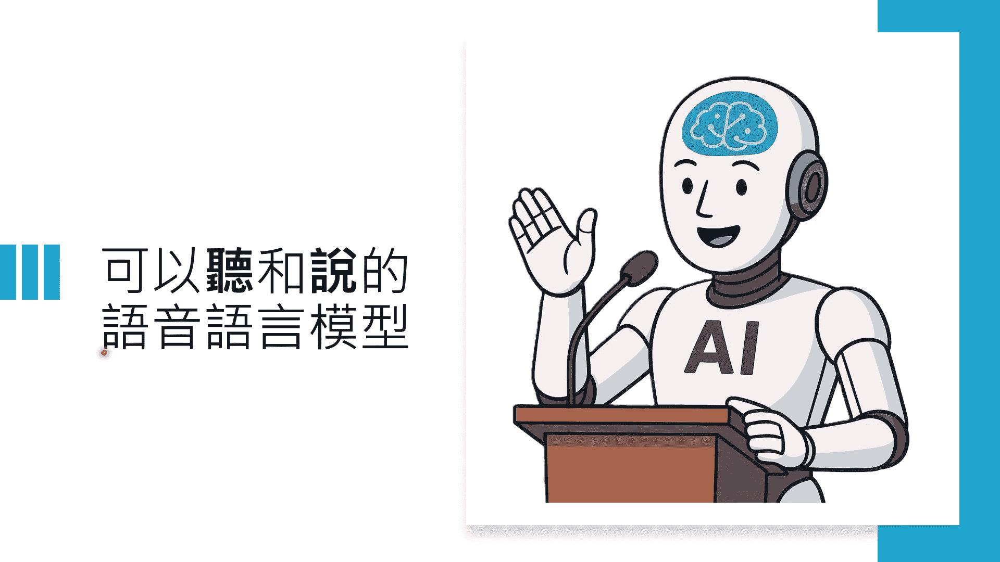

好，那什么是语音语言模型呢，语音语言模型希望做到的事情，就是让语言模型它可以听懂声音，它也可以产生声音，输入输出，声音跟输入输出文字相比有不一样的挑战，因为啊声音相较于文字，它有更多的资讯。

有更多的变化，比如说声音里面不只有原来文字内容的咨询，它还有其他的咨询，一个号称能够听懂声音的模型，他必须要能够知道现在是什么样的人在讲话，他需要知道讲话的人，他的情绪是什么样。

他甚至需要根据环境音推测，现在讲话的人在哪里，是什么样的状态，所以开发语音的语言模型，相较于纯文字的模型有不一样的挑战。

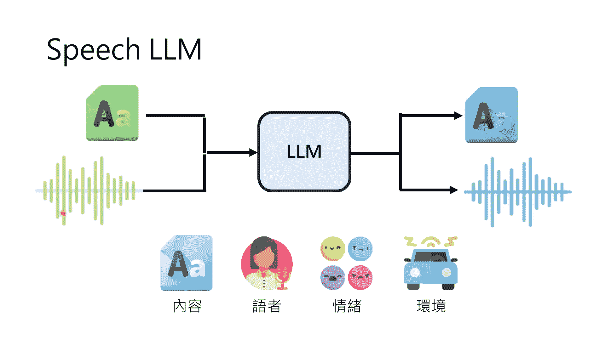

其实你今天呐也已经可以看到一些，语音语言模型的应用，比如说比较知名的有cheat gbt的voice more，他中午会翻成高级语音模式好，还有Gemini life。

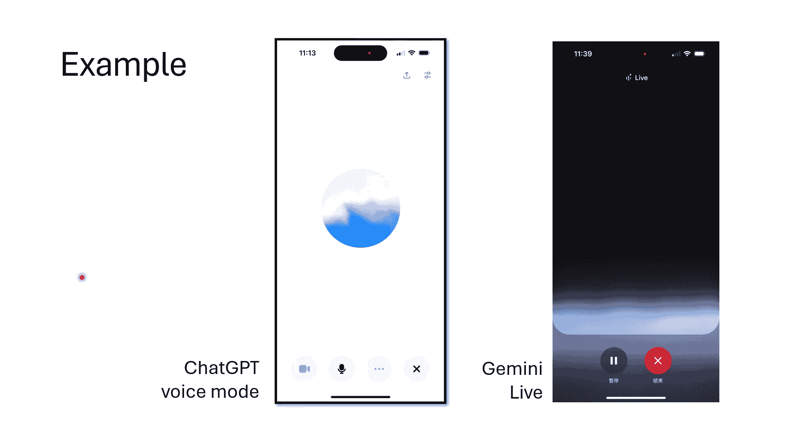

那除了ChatGPT跟GEMINI，都有用语音互动的功能以外，其实还有很多很多的语音语言模型，那这边只列举了其中一部分，那有很多我这边还没有列举到呃，比如说MOSHI，应该是最早真正试出的语音语言模型。

为什么说最早真正试出呢，呃你看MOSHI它试出的时间点是去年的10月，那可能说哎这个g p t four o，不是5月就已经做了一个demo吗，但他只是做了一个demo，然后他并没有真的试出模型。

然后我所谓试出模型并不是说试出模型的参数，它并没有真的试出那个服务跟大家互动，那有人发现说哎5月之后诶，马上就有一个可以用语音互动的模型了，那并不是真正的语音模型，它是前面加了语音辨识。

后面加了语音合成，然后让大家误以为，他们开发了一个新的语音语言模型，其实这个g p t for all the voice more，是在这个去年年底才真正上线的，所以MOSHI。

其实才是最早真正上线的语音语言模型，而后来还有很多语音语言模型，比如说GON，比如说step q问KIMI等等，有一大堆不同的语音语言模型，那在这些所有现在可以用的，语音语言模型里面呢。

我个人觉得互动起来呃最流畅，最让人惊艳的可能是sesame米，那我其实可以现场demo一下sesame米啦。

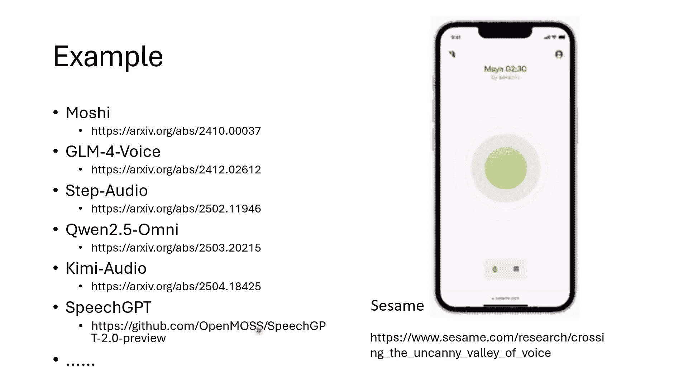

好，你在sesame i的官网上呢，可以找到他们的语音语言模型啊，他们有两个版本，我们选择一个，Well well，Well，Well，Back from ror，I see you know。

You're starting to be a regular around here，Hello，Um，Can you introduce hokay。

Can you introduce yourself all right，I'm maya，I'm sesame me's latest and greatest experiment。

More human than ai like，What about stop，Okay，Uh，Can you tell me a joke，Okay，Okay，Hold your horses。

Um all right，Why don't scientist trust adams，Because they make up，Everything get it。

You can say i told you，I was funny or not，Maybe that was a bad one，What's on your mind。

This is not funny at all，So tell me something interesting，Okay，Okay，Shh，Fine，What if i told you that。

There is a species of jelly，Okay，Okay，Start uh，Let's do something else，Let's do something else，Uh。

I'm going to give a lecture，Right now uh，You can listen to the lecture，Um，But don't interrupt me。

Unless，You have any question，Okay，Oh lectures，Okay，Shoot，I'm all ears，Okay，Great。

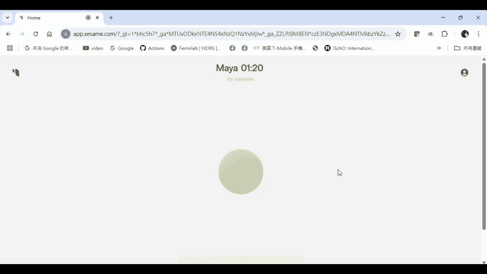

Let's start the lecture，so哎我们我们就继续讲中文，这样子，呵呵其实他听不懂中文，他如哎他这哎卡卡其实只听得懂英文了，所以不过如果他听得懂中文的话，这个应该是非常非常猛的好。

那我们就继续上课啦，希望MAYA还有再继续听着好，那我们就哦还有还有听，还有还有听到还有听到我们在叫他好好，那我们就slow down back up a sec，Are you saying。

There's someone else listening like another person，Or something else entirely。

We are having a lecture，Right now，So don't interrupt me，If you don't have any question，Okay，Okay。

I got it loud and clear，No interruptions，好，我们可以看，可以继续上课了好，所以大家知道说今天的语音语言模型哎。

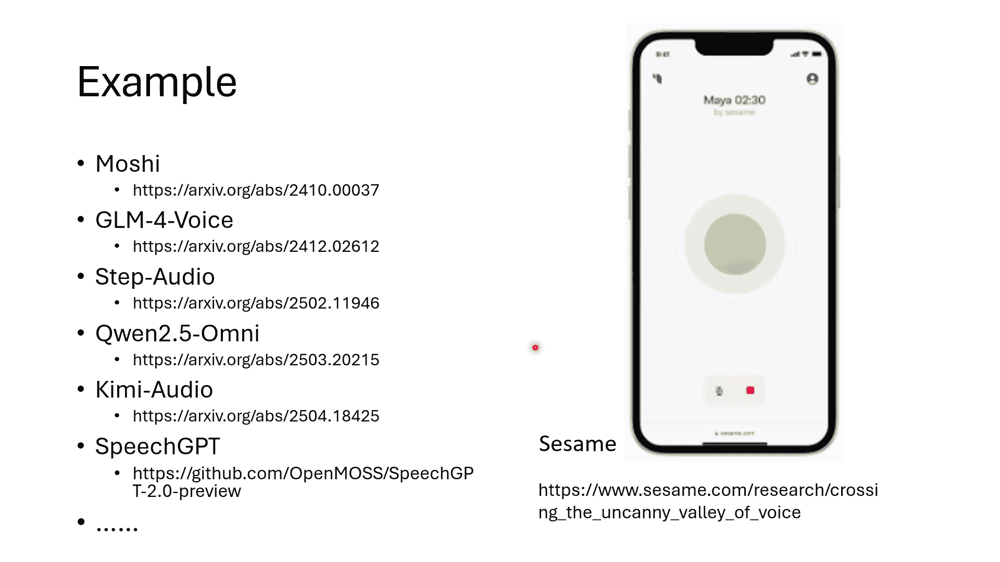

他可以做到这个程度，Studying away，absorbing knowledge啊，还是把它关起来好了。

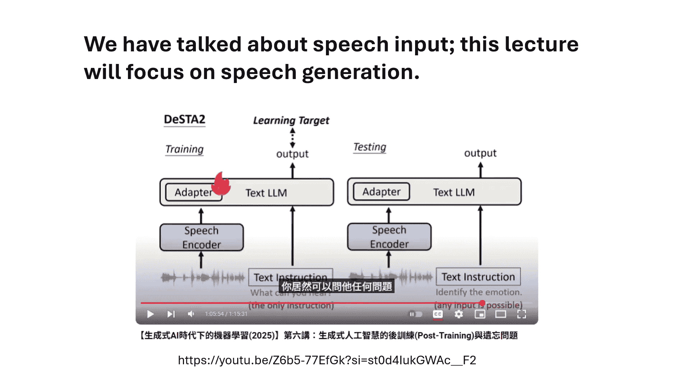

Uh i think we need to say goodbye，Already，We just got started professor。

I was really hanging on your every word billy，But well，Uh time flies so goodbye to everyone goodbye。

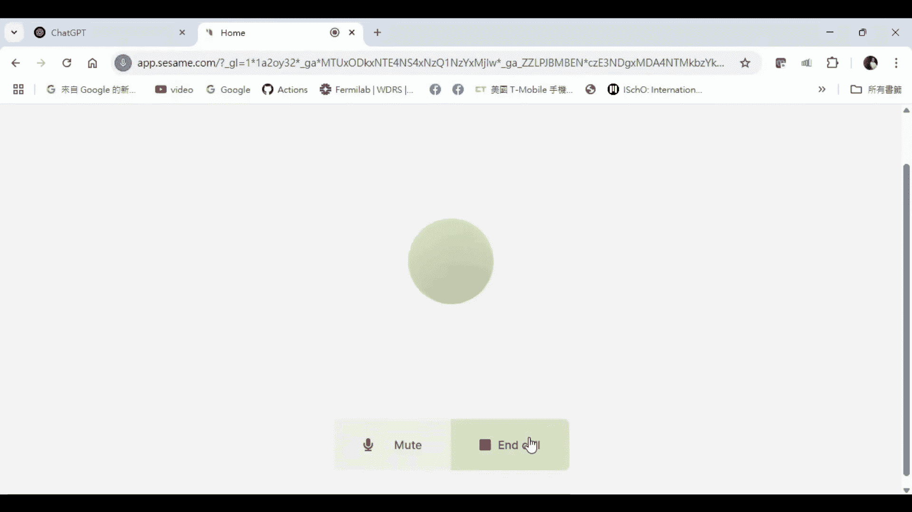

来上课吧，好那有关让模型可以听语音，听声音这件事啊，其实我们在第六讲是讲过的，在第六讲讲说避免语言模型遗忘的时候，有讲说，有一些方法可以让语言模型学会听懂声音，但是不要遗忘它身为文字模型的技能。

那这堂课呢我们会更着重在讲，语音或声音是怎么被产生出来的。

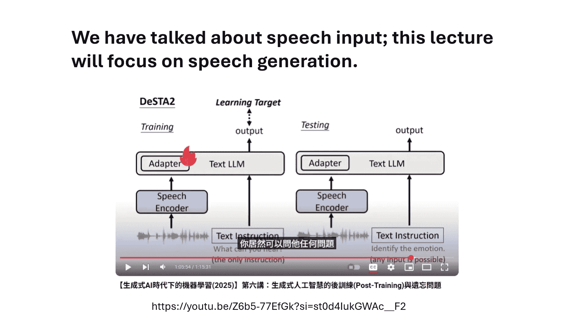

那怎么打造一个模型，它可以产生声音呢，它可以产生语音呢，来想想看文字模型就是做文字接龙，还就是读一段文字的token，做文字接龙产生更多的token，其实啊一个语音模型它的原理也是一样的。

只要我们知道怎么把一段语音讯号，表示成语音的token，我们就可以训练一个语音版的语言模型，它吃语音的token当做输入，他做token接龙，产生更多语音的token。

我这些语音的token就只是一些discrete的unit，所以人没有办法直接听他，所以你还需要一个DETOONIZATION，你还需要一个DETOGANIZER，把这些token转换回声音讯号。

所以你只要知道怎么把声音讯号变成token，把token变回声音讯号，你就可以训练一个语音版的语言模型就结束了，那怎么训练一个语音版的语言模型呢，那它的步骤可能就跟训练文字版的模型，其实是差不多的。

首先我们要做PRETRAIN，Pretrain，就从网络上搜集大量的资料，现在有很多影音平台可以爬到，无穷无尽的语音的资料，从这些无穷无尽语音语音的资料可以做PRETRAIN。

去练出一个PRETRAIN的语音模型，但这些PRETRAIN的语音模型它只能够做语音接龙，还不能真正跟人互动，所以怎么办呢，我们要做supervise fine tunney。

你可能需要有一些人类标注的资料，有一些人与人间的对话，拿这些人与人间的对话来微调PTD的speech model，然后接下来呢你可以对他做LHF，告诉他说什么样的答案是好的，什么样的答案是不好的。

然后最后可能就可以有一个，语音版的语言模型好。

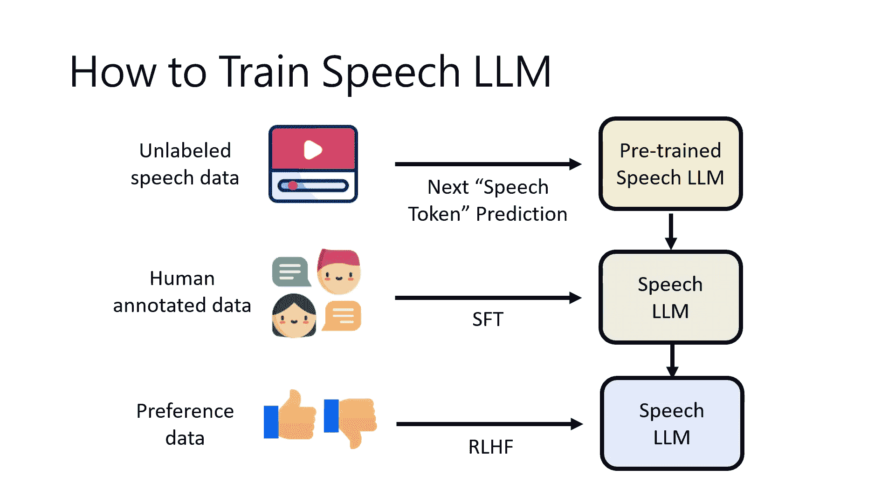

那这一切的根基，第一个问题是语音生成的基本单位，也就是语音的token到底应该长什么样子。

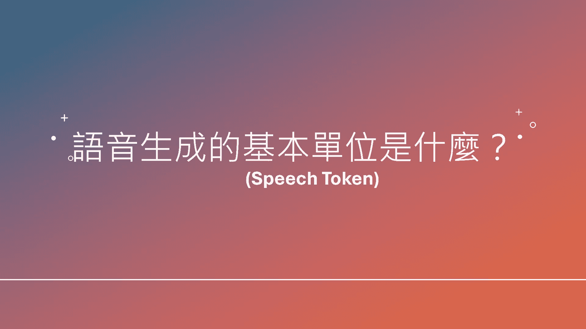

对于文字而言，token似乎是一个非常自然的东西，今天通常我们的想象就是一个英文的单词，它就是一个token，比如说有一句话，I want to learn，Generative ai。

I want to learn，这四个单词分别就是四个token，那有一些比较长的英文的词汇，其实会被切成多个token，比如说generative AI在GB t four o里面。

其实是被切成general跟active这两个token，然后AI本身是一个独立的token，所以一句话你可以一段文字，你可以很自然的把它表示成一个token sequence。

那如果你想要知道说这些TRAGBT背后的模型，用的是什么样文字的token，下面这个网站可以告诉你详细的资讯，但是语音呢语音就有不一样的挑战，一段声音讯号到底是怎么表示成一个token。

sequence的呢，这边就需要有新的技术，一段声音讯号怎么把它表示成token sequence呢，有一个最极端的想法是我们的TOKIZATION啊，也许就是一个语音辨识系统，你像语音辨识系统。

就是把一段声音讯号变成文字，文字本身就是token，所以把一段声音讯号跑过一个语音辨识系统，把它变成文字，我们也许可以说这个就是TOKIZATION的过程，把token文字的token转回语音。

要怎么做呢，那你需要的就是一个语音合成的系统，就可以把文字转为语音，那如果我们把语音辨识当做是organization，语音合成当做是DETOONIZATION。

那我们的语音模型输入输出就通通都是文字了，它根本就是一个文字模型，文字模型现在已经很多了，你也不用开发任何新的东西，所以语音语言模型的研究就到此为止好，但是这样的设计会有什么样的问题呢，举例来说。

假设现在输入是这样一段声音讯号，你实在是真的好棒哦，啊有人赞美了一下这个模型，那变成文字以后哦，就是你实在是真的好棒哦，那这个语言模型看到这段文字，他的回应可能是谢谢你的夸奖，再用语音合成把它合出来。

听起来没什么问题，但是假设有一个人，他讲的话是这样子呢，你实在是真的好棒哦，如果是语音辨识，它辨识出来的文字，可能跟前一句话是一模一样的，你如果你听声音讯号内容以外的资讯。

听这个人的语气其实好像有点不太像，是在赞美，似乎有点反讽的意味，所以这个时候模型他的回应应该是，比如说怎么了，他这个时候可能应该要问说，这个人到底为什么要用反讽的语气，来跟我说话哦。

所以如果只是把声音讯号变成文字是不够的，你会忽略很多语音中重要的资讯好，那既然把声音讯号直接变成文字是不够的，那你想要保留语音中重要的资讯，想要保留语音中文字以外的资讯，那要怎么做呢。

另外一个极端的想法是我们来看看声音讯号，这个声音讯号本身呐，是由一个一个的取样点所构成的，我们可以直接把每一个取样点当做一个token，这样我们就不会损失任何声音中，所原来就有的讯号。

也就是说我们根本就不做organization跟decode，Toganization，我们这个语音语言模型的输入，直接就是一个一个的取样点，我们把每一个取样点当做一个token。

这样做你就不会损失任何语音中有的资讯，但这样做有什么坏处呢，如果今天呐你要好好的表示一段声音讯号，让其他人能够听得懂，那通常你至少一秒呢要有8000个取样点，一秒8000个取样点。

像一般我们在讲电话的时候，他的这个取样的samply ray啊，通常都是K所以一秒钟有8000个取样点，一秒钟8000个取样点，意味着说假设你想要讲一分钟的话，哇，那就是8000×60了。

这是一个非常大的数字，这是50万，所以今天模型要讲一分钟的话，还要产生50万个token，今天能产生50万个token的auto regressive model，其实没有那么多，你想看那些文字模型。

其实没几个可以产生50万个token的，所以假设我们直接把取样点当做单位，取样点当做基本单位，让语音语言模型来学习怎么做token接龙，你需要训练一个能够呃处理非常长的输入，输出的语音语言模型。

这可能是不切实际的，所以我们需要的是一个，介于刚才两个solution之间的方法，我们需要有一个方法把语音讯号变成token，一方面保留了重要的资讯，另外一方面，又希望能够对原有的语音讯号尽量做压缩。

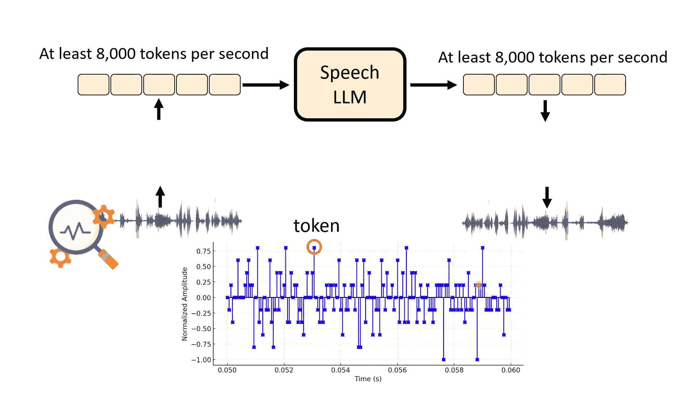

不要让输入的sequence太长，那这边就有非常非常多不同的想法，怎么把语音变成token，怎么打造语音的TOKIZER，是现在在语音领域一个热门的题目，那下面这张图呢是来自我们实验室以前的学生。

吴海滨博士的link，那这张图上呢就摘要了过去一年，in the coconanizer的发展啊，横轴是时间，每一个圈圈代表一个新的语音的token，IZATION的方法，也可以发现说。

每个月都有好几种新的organization的方法，被提出来好，那因为方法实在是太多了，这边我们实在是没有办法细讲，如果你对语音怎么表示成token有兴趣的话。

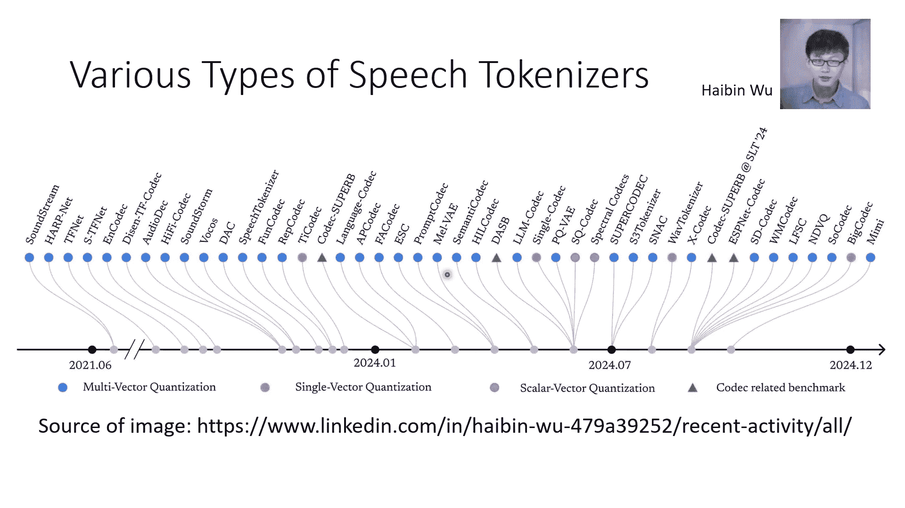

那这边有两篇overview paper给大家参考，那因为有这么多不同的语音的，TOGANIZATION的方式，那大家当然会有个疑问，就是哪一种token anizer才是最好的呢，精确来说。

如果比较token izer的好坏，那你应该是拿这些token izer产生出来的code，产生出来的token直接去训练语音语言模型，看哪一种TOGANIZER，训练出来的语音语言模型最好。

它就是最好的TOGANIZATION的方法，但是训练语音语言模型本身，它就训练一个语言模型，所以耗费的运算资源是非常大的，所以就会有一些benchmark想要来检测这些语音。

token anization的方法的好坏，在你真的开始train语音语言模型之前，看看能不能先检测一下这些token，他有没有好好的表示语音的讯号，那这边有两大类不同的方法。

而一大类的方法呢是出自codex super这个benchmark，那在这个benchmark里面呢，做的事情就是先把声音讯号通过token，ANIZER变成token，然后这一串token。

再通过DETOONIZER还原回声音讯号，那接下来你就看说DETOXIZER，输出的这些声音讯号，它的音质怎么样哦，因为把这些声音变成token，再变回来以后，你往往会有一些资讯的损失。

那到底损失了多少，或者是把这一些声音讯号，丢到一些现有的语音模型里面，比如说丢到现有的语音辨识系统，发现本来原来的CA讯号能够被正确辨识，还原回来以后就不能够被做语音辨识了。

那就代表说原来语音的内容被破坏掉了，我本来这个声音讯号可以做情绪辨识，还原回来以后情绪变色，结果就错了，就代表说声音讯号里面，跟情绪有关的资讯被破坏掉了，所以这是一个判断token好坏的方法。

那另外一个方法呢出自DASB，他们的想法就是先把声音讯号变成token，接下来直接检测这些token里面有的资讯，比如说拿这些token去训练一个语音辨识系统，看能不能训练的起来，可以训练的起来。

但有这些token里面有文字的资讯，拿这些token去训练一个呃情绪辨识的系统，看能不能训练的起来，如果可以训练的起来的话，带我这些token有情绪相关的资讯，所以有一些方法可以。

在你真的去训练一个语音语言模型之前，先来检测token的好坏，那我们这边呢大致谈一下，产生token的方式有两大方向，第一大方向是哪一个现成的encoder。

那这些encoder通常又叫做speech的sale supervise model，而这些speech sale supervised的model会吃一段声音，当做输入。

接下来把这段声音变成一个vector sequence，那通常是0。02秒，一个vector当不同模型不一样啦，不过0。02秒是比较常采取的一个setting，如果你想要了解这些语音的sales。

supervise model SSL指的是sales supervised learning，你想要了解这些语音的sales，supervise model是怎么被训练出来的，可以看一下。

我在2022年的时候写的一篇overview paper，那里面就详述了语音领域这些sales，supervise model发展的历史，那横轴是时间，那这边每一个点呢代表一个模型。

那你可以看到在20202021年的时候，有很多各式各样的sales supervise model被创造，被发展出来啊，那如果你不想看文章的话，其实在2022年的机器学习的课程。

我们也介绍过语音跟影像上的sales supervise model，也可以看这个课程，花一个多小时的时间，告诉你说，影像跟语音上的这些encoder。

是怎么在sales supervised learning的情境下，也就是没有标注资料的情境下被训练出来的，所以总之已经有很多现成的encoder，可以把很复杂的声音讯号变成一个一个的向量。

那每个向量可能对应到0。02秒的时间好，那有人会说，那可是我们要的是token啊，token是离散的东西，这些向量是连续的东西，等一下我会告诉你说，到底把连续的东西变成离散的东西，是不是真的有必要。

我现在我们先想象说我这个语音的语言模型，就是去去模仿文字的模型，文字的模型都是拿discrete的token，离散的token当做输入，所以我们也想要把语音弄成离散的discrete，token好。

那这边有很多连续的向量，那怎么做呢，啊我们可以先对它做vector qualization，有很多vector qualization的技术，可以把连续的向量做clustering。

把比较相近的向量就用同一个符号，同一个id也就同一个token来表示它哦，所以这一串向量就变成一串token，那很多时候呢，相邻的token可能他的id会是一样的，因为通常呢语音的讯号比较平滑。

所以相邻的这些向量往往它就很像，所以你做完这个vector companization以后，就对到他们的cluster，也就是他们会被归类到同一个token，他们会有同样的token id。

为了让这个sequence变短，所以有些时候会采取一个步骤叫DEDUPLICATE，就是把重复的token拿掉，然后呢还会有一些论文采取一个步骤，叫做bike pair encoding bp1。

那其实这个方法呢也常常被用在文字模型上，及今天文字模型上的token，就是用BP这个演算法找出来的，那这些BP的演算法呢也可以用在语音的token，sequence上。

这个演算法他做的事情就是给他一大堆的token，Sequence，他会去找说哪一些token常常一起出现，常常一起出现的token，比如这个例子里面，三后面常常接二，三后面常常接二，就把它合并起来。

用一个新的符号来表示它，比如这边把三跟二合并起来，说他们就是5号token，所以就可以再把token sequence的长度再缩短，所以就可以把一段声音讯号变成discrete。

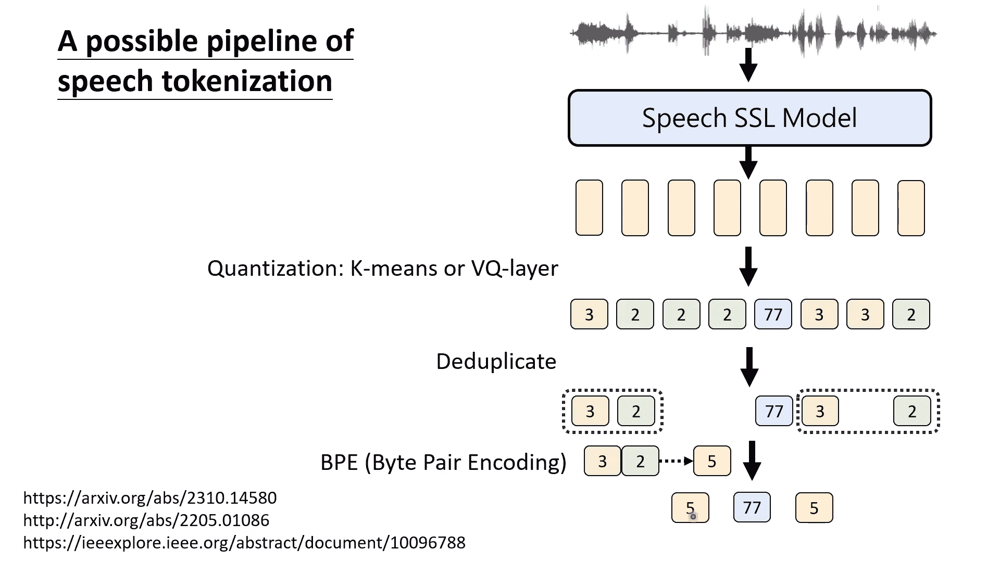

Token sequence，那这一串步骤就是TOKIZATION，那其实这串步骤里面呢不需要训练模型，但你想要训练也是可以的，但我们现在只是把语音的讯号变成token，我们还需要一个DETOKEN。

Izer，可以把token变回语音的讯号，那这个DETOIZER怎么来呢，那你就需要自己另外再训练了，我们已经知道这串声音讯号会变成这些token，那么就要训练一个反向的模型。

这个反向的模型拿token当做输入，他的目标就是要产生这边的语音的self supervise model，输入的声音讯号，所以我们输入一段声音讯号变成token，我们训练一个模型。

希望把token还原回原来的声音讯号，这是第一个系列的想法，那第二个系列的想法呢，通常叫做neural speech codet，这个系列的想法是刚才在前一个想法里面，是已经有了token nizer。

另外在训练DETOKENNIZER，在这个neural speech codex这一系列的想法里面，TOCHNIZER跟DETOKENNIZER是一起训练的。

我们就把token nizer跟detoken nicer拿出拿出来，把它们接在一起，一段声音讯号通过token izer变成code，变成token token，通过DETOIZER变回声音讯号。

我们希望输入输出越接近越好，那其实这个训练方法，就跟一般的auto encoder的方法，一般auto encoder的训练大同小异的，那像auto encoder里面也有一些方法。

是让你的later representation变成discrete，那其实你就可以直接拿那些方法当做neural，speech codecode这个字啊是由CEO的代表。

compression跟dec decompression组成的，那这个compression呢指的就是TOGANIZER，这个decompression呢指的就是DETOONIZER好。

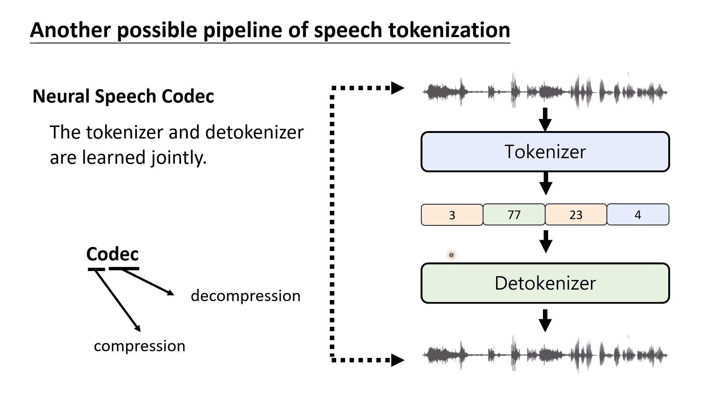

那我们现在介绍了两大类的方法，好用sales supervise model的方法，跟用neural speech codex的方法，那在语音领域呢，又常常被叫做semantic token。

那neural cortex产生出来的token，又常常被叫做acoustic token，那这个称呼呢，应该是来自于一个史前时代的文章，叫做audio l a，但是其实这个称呼啊并没有非常的精确。

而且很容易让大家误导这些token所有的性质，这个semantic的token，它的semantic这个词汇的意思，其实跟一般语言学里面的，semantic的意思是不一样。

一般在文字上我们说两个词汇SEMANTI相近，意思是说他们语义是相近的，虽然这两个词汇表面上看起来不一样，比如说高雄跟打狗表面上看起来不一样，其实他都是指同一个地方的地名，这个叫做semantic相像。

但是这一些sell supervise model啊，他其实是抽不出semantic这个层级的token的，从语音直接到语义，很难用一个self supervise model就直接做到呃。

所以这些cell supervise model，它抽出来的token充其量呢只跟PHING差不多，那风铃是什么呢，风铃呢中文通常翻译成因素，它指的是发音的基本单位，那如果你很难想象风铃是什么的话。

你就把它想象成是KK音标，你就想象说这一些sales supervise model，它真正抽出来的token，每一个token就是对应到某一个KK音标，可能token编号103就对应到ken。

然后token编号59就对应到B这样的感觉哦，所以这一些呃semantic token它其实更像是KK音标，跟语义其实没有什么直接的关系，所以叫他semantic token是有点误导。

不过因为最早做这个研究的人，把它叫semantic token，所以后来很多论文都直接把从SSL model出来的，token叫做semantic token，另外一方面呢。

这个codex出来的token叫做acousic token，它就是相对于semantic token，把它叫做acoustic c token，但这些acousic token其实也保有内容的资讯。

因为如果他没有保有内容的资讯，那token是怎么被DECOGNIZER，还原回原来的声音讯号呢，他已经有保有内容的资讯，所以这个semantic token里面它不是semantic的资讯。

它是FNATIC咨询，但除了FNATIC资讯以外，它可能也有一些声音讯号的资讯，比如说包含情绪的资讯，或包含POSITI的资讯等等，而另外一方面。

这些accursive token不是只有ACOUI的资讯，不不是只有情绪啊，不是只有韵律的资讯，他还有其他的资讯，它也有内容的资讯，他可能也有类似KK音标这种风铃的咨询，所以总之非常的复杂。

那这个是一个历史遗毒啦，就是历史这个啊，当初最早的原始论文这个名字取得不好，所以这个有个历史遗读，总之就是有两种产生token的方法，他们都可以把声音讯号变成token。

那今天呐这些neural code啊，它往往不是一段声音，抽一个token出来，往往是一段声音，抽好几个token出来的一段声音，可能只有一个token，没办法表示它只要抽出多个token合起来残空。

从各个面向去完整地表示一段声音，那怎么抽出不一样的token，每一种token表示不同的面相呢，那这边我们就不细讲，如果你有兴趣的话，你可以查一个关键字叫做RBQRECEDUVECTOR。

Ptization，则它可以让你不同的token去这个model去呃，代表不同的资讯，或者是另外一个方法，是把SSS把SSL产生出来的semantic token，当做老师。

你这个neural cortect的其中一组token，就让他去学semantic token，让neural product其中产生的一组token，跟semantic token越像越好。

某一组token呢去表示这个跟FNATIC，跟因素phoning比较有关的资讯，那其他token就可以去表达PHING以外的资讯，总之这边有很多不同的方法。

今天这种这个neurope product做做出来的这种TOPIZER，往往一段声音讯号会用一组token，而不是一个token来表示它，那这种用semantic token当做老师的方法呢。

在speech token nizer这篇paper，还有mini这个codex里面都有用上，那mini呢就是最早的speech language。

model moshi里背后所用的token ization的技术，那讲到这边，你可能会问说有这么多组token，那我们应该要选择哪一个呢，那众所周知，小孩子才做选择，大人是全都要。

所以我们其实不会想说我要选哪一组token，而是把所有的token通通都用上去，所以在语音语言模型的领域，一个热门的研究题目，就是思考如何在做生成的时候，结合多种不同层级的token。

我们现在先想假设说呢我们有三组token，这三组token的长度是一样的，然后最左边的这一组token，可能代表了偏内容的资讯，那最右边的这组token，它代表了比较偏ACOUSIC的资讯。

那从左到右呢代表的是比较粗到比较细的资讯，那接下来你就可以想说，有什么样的方法可以训练一个语言模型，让他可以充分的利用不同层级的token，那一个可能的想法是，从初的token一直产生到细的token。

要产生一句话的时候，就先产生最初的token，在产生中间的token，在产生最细致的token哦，最左边的这个是代表的内容资讯的token啊，最右边的是代表了比较偏，比如说啊声音讯号的韵律啊等等。

比较细致变化的token，所以最左边是粗的，最右边是细的，然后就从粗的token1路产生到细的token，那像audio ln跟vi都是使用了类似的技术，那在这个图上啊。

我们是用一个language model产生多组不同的token，但是实际上呢多组不同的token，是可以用不同的language model产生的。

你可以有第一个language model产生最初的token，有第二个language model根据粗的token，把粗的token当做输入，再产生细的token。

而不同的language model产生不同token的language model，它的架构可以是不一样的，比如说在vi这个模型里面，他们的第一个language model。

他们的LLN是一个auto regressive的model，在他们的LLNT就选择了一个NAUTO，regressive的model，那么在之前的课程里面有跟大家讲过。

auto regressive跟nauto regressive的差别，那这边踩踏我们通常会说，为什么要用朗O朗，auto aggressive model的好处是生成比较快。

但是auto regressive model算生成慢，但品质比较高，那如果你今天的问题没有那么困难的时候，你可以用nauto regressive model来加快速度，对LNQ来说。

它是给定一组已经产生出来的code，再去产生新的code，那可能我已经知道最初的资讯，比如说我已经知道这句话大概要讲什么，那如果要把它丰富一下，这句话的语音的变化，也许是一个相对比较简单的问题。

所以这边可以用nauto regreed model就好，那这样就可以提升生成时候的速度，那像刚才这个由粗到细的方法，它有一个比较大的问题，就是它难以streaming。

所以streaming的意思就是说你跟模型说一句话，然后希望模型可以马上就回答，你中间不要有停顿啊，这个就是streaming，那如果今天是由粗的token一直升到细的token。

为什么会难以streaming呢，因为今天模型要把每一个层级的token，统统都生出来之后才能够做生存，才能够丢进DETOKENANIZER去把token还原成语音，所以如果你今天是从初生到细。

然后全部各种token统统升完之后，才能做DETOGANIZATION，那这样你的模型本身就不是一个，可以做streaming的模型，那怎么样增快模型的反应速度呢，另外一个可能的解法是。

我们不要产生完所有的horse token，再产生figrant token，再产生final token，我们可以先产生第一个最初的token，接下来就产生第一个中间的token。

接下来就产生第一个最细的token啊，接下来再产生第二个最粗的token，以此类推，如果是用这样子生成的策略的话呢，那我们就可以把这三个都是编号一的token，丢进DETOKEN。

NIZER就可以生声音了，把所有编号2token生成出来就可以产生声音了，以此类推，那这个模型本质上就比较容易做streaming，但这样子的设计还是有可以再改进的地方，这样子的设计有什么样的问题呢。

当我们让模型产生多组token的时候，我们可能会遇到的问题是，这一个language model要产生的sequence会变得非常的长，今天一个language model。

一个语音的language model，它要产生的sequence的长度要怎么计算呢，它产生的sequence长度等于token per second乘以，我们用了几种token，再乘以对话的长度。

我们以MOSHI这个模型来当做例子，它的这个poken per second呢是12。5HZ，也就是每秒钟他会用12。5个token，来表示一秒钟的声音讯号，那其实这个数目啊在语音语言模型算是少的。

就如果用这样子的数目来产生出来的声音讯号，往往品质就会不太够，你通常一秒钟要50个token以上，那投那个这个合成的品质才会比较好哦，所以一秒钟12。5HZ是一个比较低的。

已经是一个比较低quality的这个生成的结果了，好那他的用八组token哦，所以每一段声音讯号用八个token来表示，今天MOSHI呢他可以讲5分钟，他讲话上限呢是5分钟，也就300秒。

全部乘起来是多少呢，全部乘起来是30K，也就是3万哦，所以今天要讲5分钟的对话，如果你用多组token哎，你要想产生3万个token才能够讲5分钟的话，你可能觉得3万听起来不是一个很大的数字。

那我们来看看文字模型都可以吃多长的文字吧，这个横轴是时间，从23年初一直到24年的4月，纵轴是各个不同知名的文字模型，它可以输入的文字token的长度，3万在哪里，3万在这里哦，所以确实很多知名的模型。

它可以输入的文字token的长度都超过3万，但是要能够做出一个模型，它可以输入的token长度，或它可以输出的token长度能够超过3万，其实并不是一件特别容易的事情，比如说gbt four。

他在2023年刚试出的时候，他可以吃的token长度的上限是8000个token哦，所以今天你要训练像MOSHI这样的模型，其实是比最早的g p t four还要更困难的，他需要吃。

比最早的gt four，可以吃的这个token的长度还要更长，呃，有没有办法缩短这个token sequence的长度呢，其实是有办法的一个想法，就是我们能不能够一步产生多个token。

之前都是一步只产生一个token，只能一步产生一个token吗，能不能够一步产生多个token，所以有一个方法是，我们能不能每一步都各产生一个呃，如果有多种token的话。

我们能不能每一步各种token都产生一个，第一步就产生一个course的token，一个five grant的token跟一个final的token，第二步再产生第二个cos的token。

第二个fire的token，第二个final的token，以此类推，那这样的做法就是假设你有八组token，你一次每一步可以产生八组token，那secret长度就变成原来的18，但这么做会有一个问题。

什么样的问题呢，今天呐模型必须要同时产生，course token的第一个跟final token的第一个，但很多时候final token长什么样子，是取决于course token长什么样子。

所以你可能很难同时产生第一个course token，跟第一个final token，在第一个course token还没有出生之前，还没有被生成出来之前。

我们其实也不知道第一个final token模型，可能很难猜测第一个final token应该要长什么样子，所以就有一个想法叫做acoustic delay，给予刚才的方法再做一下改进啊。

这个改进的想法是，第一步呢只产生第一个cos的token，第二步呢产生第二个cos的token，跟第一个FGRANT的token，第三步呢产生第三个cos的token。

再产生第二个final的token，再产生第一个final的token，这你在产生第一个final token的时候，前面已经产生了两个cos的token，跟一个FINGRANT的token。

那even已经产生的这些token，那要产生final token可能就比较容易，那这个是acoustic delay的想法，这是一个现在蛮常被使用在spoken language。

model里面的想法，那还有另外一个想法呢是用两个transformer，我们一般在做语音的时候，只会有一个transformer，但是在语音语言模型里面，可以有两个transformer。

一个叫temporal transformer，一个叫def transformer，Tember transformer，传一个vector给def transformer。

Deft transformer，再把第一个位置的每一个token生成出来，先生最初的token的第一个，再升中间token的第一个，然后再生最细token的第一个，然后呢。

temporal transformer再给这个Deft transformer，下一个vector，Deft transformer呢再生最初的token的第二个。

然后中间token的第二个跟最细token的第二个，再一直这样子下去，那这是另外一个有点类似acoustic delay的方法，那这个方法其实也可以跟acoustic delay，并排使用好。

所以讲到这边，其实只想要告诉你说有各式各样生成的策略，在你有不止一组token，而是有多种token的时候，你就可以开始研究，什么样的生存策略是最有效的，怎么样组合各式各样不同的token。

到同一个生成的过程中，其实现在影像啊也蛮常使用类似的方法，影像现在也有人开始想说，影像有可以有不同层级的token，然后也可以从粗的token升到细的token，你像现在也有类似的方法。

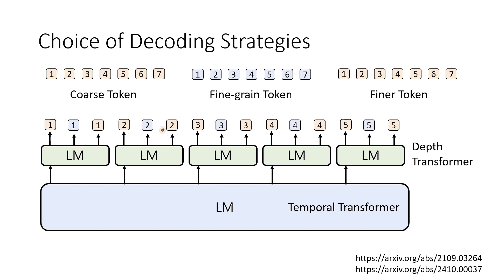

那我们呢刚才有提到一个问题，是一定要用discrete token吗，就是说如果是文字把它描述成一个一个的token，是不是很自然的事情，但为什么语音一定要用discrete token呢。

我们把语音描述成一个一个continuous的向量，再圈一个模型，一个一个向量生成难道不行吗，所以接下来几投影片是要讨论，为什么人类选择了用discrete token，来描述语音好。

那对于一个语音语言模型来说，他要吃语音作为输入，再产生语音，其实对于以语音作为输入这件事情而言，输入是DISCREAM还是continuous，差别不大，甚至现在几乎已经知道说输入continuous。

结果是比较好的，因为你把声音离散化以后，你就掉了一些资讯嘛，你还不如直接给他continuous，the vector模型听到的东西还比较多，所以通常把声音变成discrete。

你表现是比continuous还要差的，所以对于输入而言，对一个模型要理解声音，而言用discrete token没什么好处，那discrete token它真正的优势在哪里呢。

discrete token它真正的优势是在生成的时候，当你要叫模型去预测下一个token的时候，discreet token才会展现它的重要性，为什么呢，对于生成这件事情来说，有一个很本质的特性。

是同样的输入可以产生不同的东西，同一句话，有一个人说你好，接下来可以接各式各样不同的回应，或是一个影像生成的模型，给它一段文字，它可以产生各式各样的图片，只要产生一只狗，那他只要画一只狗都算是对的。

不管画大的小的，白的黑的都算是对的，深层的一个特性就是给定你要做接龙的输入，接下来可以接的可能往往不止一种，在这个情况下，discrete token就会占到优势了。

我们来看看discrete token，在这个不止一种可能的接龙的情况的时候，会怎么占到优势，那我们先讲，如果我们在做接龙的时候，要接的是continuous的vector，会造成什么样的问题。

好现在我们训练一个语音语言模型，它的输出是要去预测，接下来应该要产生怎么样的continuous的vector，现在根据你的训练资料，有两个标准答案，有一个绿色的vector，有一个蓝色的vector。

那你的模型在训练的时候，它可能是想要产生一个vector，离绿色的vector最近，也离蓝色的vector最近，它最后产生出来的vector，可能就是绿色跟蓝色的平均，那产生绿色的这个向量也是对的。

产生蓝色的向量也是对的，但产生两者的平均就是错的，如果有不止一个可能的答案，而你产生的答案是两个答案的平均，你反而产生出来的不是正确的答案，那为什么产生discrete token，可以解决这个问题呢。

我们想想看，我们真正在产生discrete token的时候，假设现在你有两个可能正确答案，分别是token one跟token two，你真正在训练的时候，你其实是教模型产生一个几率分布。

你并不是教模型产生token one跟token two的平均，你是教模型产生一个几率的分布，告诉模型说给这一串token当做输入，接下来接token one的几率是60%。

接下来接token two的几率是40%，那你产生出这个几率分布以后，接下来你真正在influence使用这个模型的时候，你是从这个几率分布再去做sample，你要么sample到token one。

要么就sample到token two，就算你的正确答案里面token one跟token two都有，你的模型也不会产生token one跟token two的平均。

这就是为什么在做这个语音语言模型的时候，人们选择使用discrete token，来训练语音语言模型，但是假设这个就是这核心的理由，假设能不能够处理同样输入，有多个不同输出就是核心的理由的话。

那也许有其他的方法，可以让我们使用continuous的representation，来作为spoken language model输入输出的单位，你只要对loss做一些特别的设计。

告诉这个spoken language model，说，你现在的输出只能跟正确答案的其中某一个，特别接近，跟不止一个正确答案产生平均，不是一件好的事情，你只要想办法设计你的loss教模型这件事。

你其实也可以用continues vector来训练语音语言模型，能够这样做吗，至少在影像上，很多好的模型都是直接产生continue the representation，再把它转回影像。

所以其实只要你好好的处理同一个输入，有不同输出的问题，不需要使用discrete token，是可以用continuous的representation的。

是可以用continuous的向量来当做生成的单位的，那在语音领域能这么做吗，也已经有一些研究开始往这个方向发展，所以确实是可以这么做的，那我们先是有一些同学做这方面的研究啊，日后有机会呢再跟大家分享。

啊其实刚才讲了那么多深层的策略，这些生成的策略基本上只在语音合成的任务，能够有非常好的表现，这个语音合成语音的language model还是有很大的差异的，语音合成的意思是说给你的模型一段文字。

他根据这段文字再去做文字接龙，接触一些语音的token，你再把这些语音的token，通过DETOXIZER还原回声音讯号，所以今天这个语音合成的模型，它产生出来的声音讯号是把输入的文字念出来。

它并不是在回复输入的文字，这是不太一样的，然后有人跟你说，大家好，你把大家好这句话念出来，跟有人说，大家好，然后你回答说啊，那你也好啊，这是其实是不一样的意思好，那今天这些语音合成的模型呢。

它往往也能够吃一段声音，这段声音是教语言模型在合成的时候，要用什么样的方式来产生声音讯号，要产生有什么样特性的声音讯号，你给他一段声音讯号，它会变成一串token，这个语音合成的模型。

就吃文字的token跟吃语音的token，再产生另外一段语音的token，这另外一段语音的token它合成回来之后呃，输出的声音讯号，会跟输入的声音讯号有类似的语音的特性。

那其实今天呐用这种token的方式，是可以产生非常好的语音合成的结果的，那以下的demo用的是联发科的busy voice，这个模型来做demo，那我可以播三个句子。

那这三个句子里面呢有的是语音合成的句子，有的是真正的句子，大家听看看，你觉得哪一句是合成的，哪一句是真正的句子，我们播第一句，喵咪说的摄影展览是免费入场的，任何人都可以免费参观展览。

但是书屋内的其他设施，例如图书馆，咖啡馆和书店则需要另外付费的，第一句好，这是第二句，现在的我自己啊会让自己的步调慢一点点好，这是这是第二句好，接下来是第三句，那为其待下一次的聊天，祝你生活愉快好。

你觉得哪一句是真的，哪一句是语音合成的呢，觉得第一句是真的，同学举手一下啊，好有一些好手放下，觉得第二句是真的，同学举手一下啊，好也有一些有一些手放下，我觉得第三句是真的，同学举手一下好。

也有一些手放下好，我想一下哪一句是真的，哎哈哈哈哈哈哈，只有第二句是真的，这样子，第一句跟第三句是语音合成合出来的，就是这个语音合成的模型使第二句话作为输入，产生第一句话跟第三句话。

所以知道说今天语音合成是可以真的合成到，以假乱真的好，虽然今天语音合成做的这么成功，但是你用刚才讲的那些方法来打造，语音语言模型，你可能很难打造出好的结果，就算你用上万小时的资料来做PRETRAIN。

你往往得到的结果是这样子的，PRETRAIN就是叫模型做token的接龙，语音的接龙，所以照理说你给他一句话的上半句，还要念出下半句，就算你有上万小时的训练资料，你做出来的结果大概就是这样子好。

这个是语音语言模型的输入，He assassinated the president，摩根刺杀了总统，那接下来会发生什么事呢，语言模型就要把剩下的结果想出来，产生更多的token。

然后再token过token，night detoganization以后还原成声音，好，这个语音语言模型做这个语音的接龙以后，接出什么样的结果呢，它接出来的内容是这样子的，And gave him。

Mr johnson，The last charge of improvement in his writing possible，Three point eight nine，完全不知道他在说什么。

对不对，我把这句话呢丢给g p t four，问他说，你觉得这句话合理吗，G two t four，他身为一个文字的模型，他对于这个语音语言模型是不屑一顾，他觉得说这个句子根本就不合理。

看起来好像有一些词汇，好像有一些片语，但合起来没有表达什么意思，语音语言模型，你用刚才讲的方法训练出来就是这个样子，所以人们在这个地方卡了很久，那接下来我们就告诉你说。

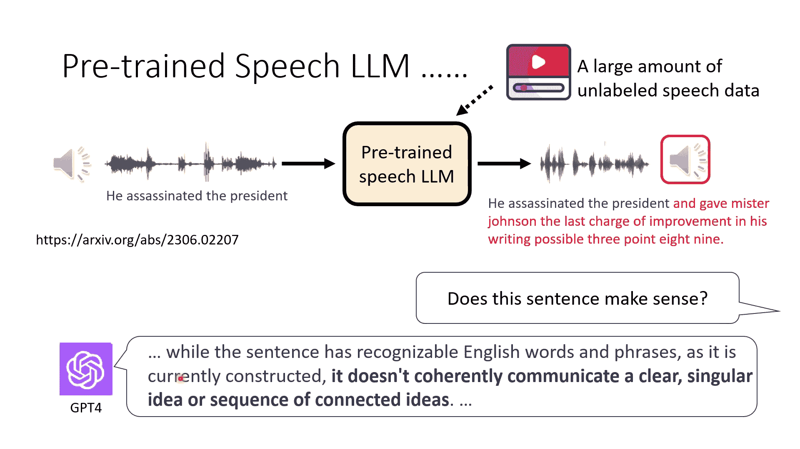

后来是怎么取得了突破，那在上一堂课里面，我们结束在告诉你说哎呀，就算是有上万小时的语音讯号，也训练不了一个好的语音语言模型，接下来我们要先问为什么会这个样子呢，想想看哦，假设你现在呢。

在YOUTUBE上爬了100万小时的语音讯号，拿它来训练语音语言模型，你可能会觉得100万个小时真的很多，但100万个小时真的很多吗，100万个小时的语音讯号，里面有多少的文字量呢，通常一分钟啊。

大概人类可以讲100个token，假设一分钟算100个token好了，那100万个小时里面有多少个token呢，有六个B脸，60亿个token，你可能觉得60亿个token，听起来也不是一个小数目。

但相较于今天的文字模型，比如说拉玛三，他在预训练的时候可是用15T的token哦，六个billion的token，那可能是g p t two等级的模型而已，所以你会发现，就算你有非常大量的语音讯号。

里面所包含的内容的资讯其实是非常有限，单凭这些有限的内容资讯，你可能很难让语言模型讲出合理的句子，或是换一个角度来想，15T的文字的token，假设你扣一个语音合成的系统，假设你用一个语音合成的系统。

把这些文字的内容念出来，那这些声音讯号有多长呢，这些声音讯号有28。5万年那么长，28。5万年前，那时候地球上是没有现代智人的哦，所以是一个非常长的时间，对你很难收集到这么大量的语音讯号。

真的来训练一个语音语言模型，我们知道说文字其实是语音压缩的版本，人类先能发出声音，才发明了文字，发明文字是为了做什么，为了要压缩语音，让它永远的被保存下来，所以文字相较于语音是一个更compact。

更压缩的东西，所以从文字上学习是比较容易的，语音就像是文字的解压缩版本，它除了文字有的资讯以外，还保有其他的资讯，还有更多的资讯，它是更复杂的，所以对语言模型来说，训练在语音上是更困难的好。

那这边呢呃黑色的线代表的是文字的模型，绿色的线代表的是语音文字的模型，纵轴代表这些模型在一个故事，接龙的任务上的表现，那这种故事接龙的任务，通常就是给你故事的前半段，然后接下来呢给你两个版本的故事。

然后模型呢会去计算这两个版本的故事，它的likelihood，他会去计算说，这个模型产生这两个版本故事的几率有多大，然后呢选择几率比较大的，当做是模型真正会接下去的故事，然后再算模型选到正确的故事。

结尾的这个正确率有多高，总之呢这边的数值越大，代表这个模型它语义理解的能力越强，它越能正确的做故事，接龙好，如果我们看文字模型，这边的横轴呢代表的是投入的算力，可能是增加了资料，可能是使用了更大的模型。

对文字模型来说，用更多的资料，用更大的模型，这些文字模型，它的语义理解的能力会持续的上升，但如果你看语音的模型，语音的模型在投入比较多算力的时候，他的成长是比文字更缓慢的。

因为语音除了原来文字有的资讯以外，还有更多的资讯，所以在同样的算力之下，从语音里面学习到语义的资讯，学习怎么做故事，接龙是更加困难的，而且这边我们考虑的都只有模型的语义的能力，都走考验模型。

理解文字的能力，还没有问模型，理解其他语音面向的能力，比如说愚者的情绪或者是环境音的咨询等等，所以可以了解说，只拿现有的这些语音资料，要来训练出一个好的语音语言模型，是非常具有挑战性，非常难成功的。

那怎么办呢。

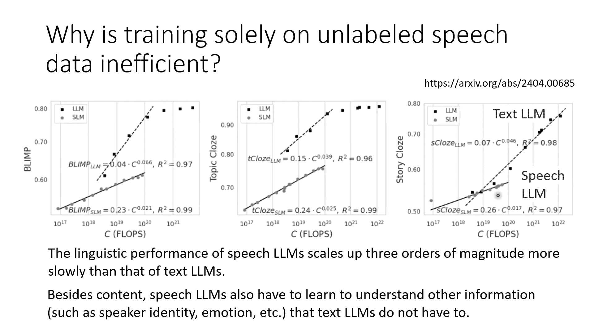

现在已经有很多很好的文字的模型了，也许我们在打造语音模型的时候，不需要从头开始，我们可以从文字的模型开始，文字的模型已经学了文字上的资讯，已经学了语义的资讯，我们何不反过来。

我们何不就是想成所谓的打造语音模型，就是进一步教文字模型，语音相关的咨询哦，所以其实我们在打造语音模型的时候，不需要从头开始，我们可以从一个文字模型开始，从文字模型开始打造语音模型。

其实不算是全新的概念，其实早在bird的时代的时候，我们实验室就有尝试过说，拿文字的BT来初始化语音版的bird，那这样可以让语音版的BT，在语音的问答上做得更好啊，不过这个都是很久以前的研究了。

那现在呢有很多尝试是拿文字的large language model来，作为语音的large language model的initialization，也是在训练一个语音模型的时候。

它的参数不再是random initialized的，而是从文字开始做起，那我想做早做，我想最早做类似尝试的应该是meta的twist，这个模型就是拿一个文字的模型作为初始，来训练一个语音的模型。

而现在一个主流的想法是。

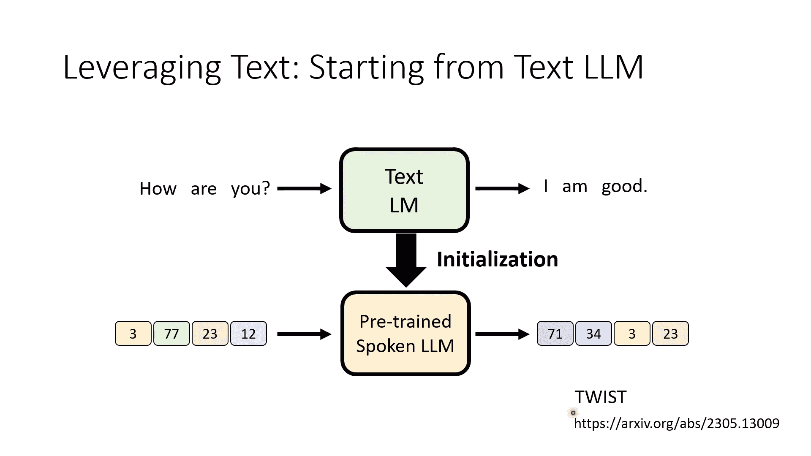

不只拿文字的模型来作为，语音模型的initialization，同时啊，因为文字的模型是语音的模型的initialization，所以这个语音模型它本来就是能产生文字的，这是文字模型本来就有的能力。

所以我们让语音模型在产生语音的时候，不是只产生语音，而是同时产生文字跟语音，那那些文字会作为语音的辅助，它就好像是这个模型的独白，他在说话之前，脑中先想一下我大概要讲什么，然后才把那句话真的说出来。

这样可以让模型在生成语音的时候，表现更加稳定，那这个叫做语音跟文字的hybrid decoding，那文字是由文字的token所组成的，语音是由语音的token所组成的。

那一个模型要怎么同时生成语音跟文字呢，这边就可以有不同的生存策略的设计，那一个最直觉的策略设计是我们的模型，先产生文字，产生完文字之后再产生语音，要讲什么都先用文字把草稿打好，然后再把要讲的话念出来。

比如说有一个模型叫spectra，就是采用了这样的想法，那用这样的想法，你就不意外说，为什么可以成功的把模型训练起来，因为产生文字，对一个文字模型来说已经不算什么难事，今天从文字再产生语音。

那根本就是语音合成，那我们刚才在上一节课已经跟你讲过，说从文字产生语音，今天已经是相对比较成熟的技术了哦，所以先产生文字再产生语音，是可以做出不错的语音语言模型的，但它的缺点是什么，它的缺点是。

这个模型在回应的时候比较难做到及时的回应，因为你问他一个问题，他要先产生文字，那就等于要等一下啦，产生文字是需要时间的，如果这个回答又是一个长篇大论的回答，那要等一下，等他文字产生完，他才会开始说谎。

那这样他的回答就不够及时，那怎么做到及时的回答呢，还有一个想法是先产生一个文字的token，接下来就产生对应这个文字token的语音，token就先说先产生文字的how，然后再把对应到号这个声音的语音。

token产生出来，产生二，再把对应到R的声音的语音token产生出来，以此类推，这样你就可以让模型想一个字就念一个字，想一个字就念一个字，但从使用者的观点来看，这个模型的回答就会是比较及时的。

但这样的训练意味着什么，要训练一个可以产生how，接下来产生对应how的声音的token，意味着说你其实有语音跟文字之间的alignment，你今天在训练的时候，你不止有一大堆的语音的资料。

你同时还知道说这些语音对应的文字是什么，你不止知道语音对应的文字是什么，你还知道每一段文字是对应到语音的，几秒到几秒，今天给你一段声音，你要产生文字相对是比较容易的，因为可以做语音辨识。

但是要准确的知道每一个文字的符号，是对应到几分到几秒，对应到一段声音讯号里面的第几个token，到第几个token往往是有一定程度难度的，所以这个方法在训练的时候，就很吃你手上的语料，如果你手上的语料。

那个文字跟语音的那个alignment不好的话，那你就可能很难训练出好的模型，那也有人想说，那我们能不能够训练一个语音模型，它是同时在每一步就产生一个文字的符号，跟一个语音的符号呢。

这样也可以像我们刚才有讲过说，同一部可以产生多种不同的语音的token，那么现在把文字想成是一种很特别的token，能不能够在同一步就产生文字的token，又产生语音的token呢。

这个想法会遇到的问题是，语音跟文字的长度往往非常的不同，而且他们不会有一对一的关系，不会说一个文字的token，就正好对到三个语音的token，他们中间的对应关系往往是很复杂的，所以如果你要采取的策略。

是在同一个时间点要产生一个语音，一个文字的token的话，那你就要想一些生存的策略，所以在这个地方，就有各式各样生成的策略被提出来，比如有人想说，那如果我每次都只产生一个语音的token。

一个文字的token，那往往文字token的sequence是短的，语音token的sequence会比文字token sequence长，非常非常多，因为这边往往一个token，只对应到声音讯号的0。

02秒，所以通常语音token很长，文字token比较短，所以如果每次升一个语音token，一个文字token，那很快文字token就升完了，那怎么办呢，那没关系，文字token生完之后。

就生出一个代表我什么都没生成的符号，我就定一个特别的符号叫EXCO模型，可以选择生成XXO，代表我什么都没有产生，那像这样子的系统呢，它在前半段会同时生语音跟文字，然后文字升完之后会再把语音伸出来。

那在mini欧米这个系统里面，这个模型里面就是采取了这样的策略，那还有另外一个策略是，既然文字比语音的sequence还要短，那我能不能够文字来等一下语音呢，所以每次生完一个文字的token以后。

就固定升固定数目的EPISOO，固定数目的我什么都没有做token，所以生完一个号，生三个X龙，剩一个二生三个XO，然后这样子就可以把文字的sequence拉长，来等待语音的sequence。

但是像这样的策略啊，你等于是把原来文字的sequence就直接乘以四，变成原来的四倍长，但语音跟文字它们之间的对应关系是很复杂的，语音的token的数目不会正好是文字的四倍长，所以怎么办。

语音中间也要插上一些FCO，所以今天模型在训练的时候就会变得很复杂，模型一方面要让文字的sequence变长，但同时语音这边也要去配合一下文字，在适当的时机模型，要知道说语音也要产生EPISOO。

然后来等一下文字sequence的生成好，那细节大家可以再看文献，有一篇paper叫la欧米就采用了这样的策略，还有另外一个策略是，既然语音跟文字的长度不一样长，那我们能不能让模型自己去决定。

说文字要等多久才能够跟语音一样长呢，所以有一个model叫做莫西，我看这个mi这个模型，它也是每一步都会产生语音的token，跟文字的token，它但它产生一个文字的token以后。

接下来模型就要去预测它要等多久，就是它要产生几个EPSEO，是模型自己决定的语言模型，它会自己决定它要产生几个app solo，这样才能够他每一步都会产生语音。

但是它每一步都要决定它要产生几个EPPZO，才能正好跟语音的sequence一样长，这个方法是用在moi这个模型里面好，那至于哪个方法比较好，现在还欠缺完整的比较，所以很难告诉你说。

哪一个方法一定就是比较好的好，不过啊我在下一个章节里面，想要跟大家介绍一个新的语音的，TOGANIZATION的方法，他可以一举扫除在这一页图片里面，讲的语音跟文字长度不一样所造成的困扰好。

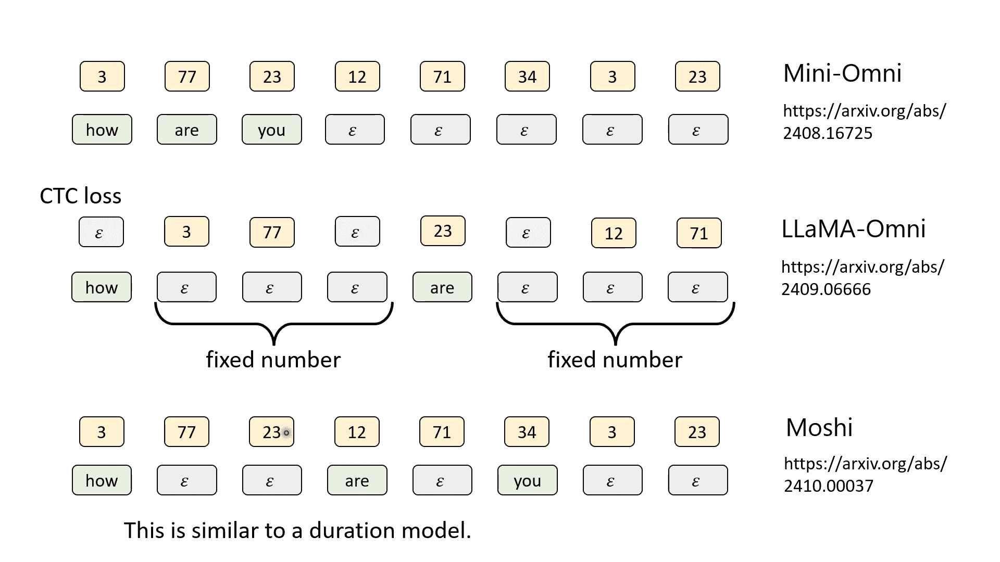

所以这边我们就来讲考虑到文字的语音，TOGANIZATION啊。

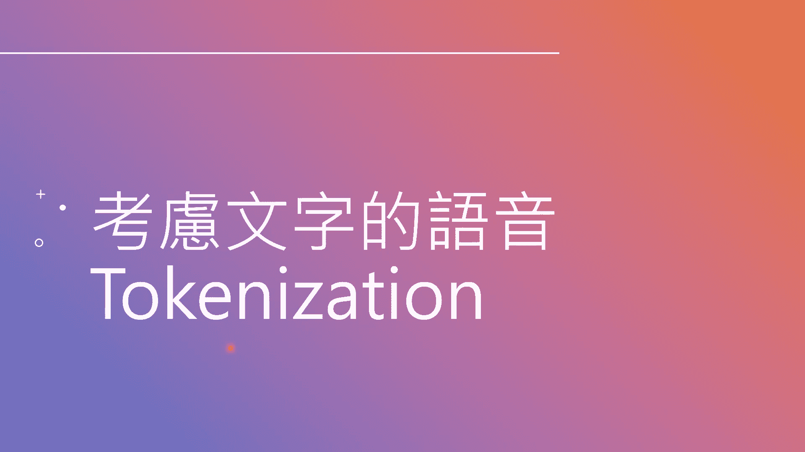

这篇paper呢这个方法呢叫做test啊，他是我们实验室的曾亮轩同学跟MTK的呃，陈宜昌还有呃呃我们助教那个李冠仪同学做的，然后曾亮轩同学今天又来了，他在这边了，他特别来听老师来讲他的研究啊，介绍哎。

谢谢哦，介绍一下那个亮轩哥，亮轩哥其实是CORE whisper的作者，也就是说你现在啊上传一个影片到nt CORE的时候，不会自动产生字幕吗，这个是亮轩哥做的啦，那新模型是亮轩哥劝的。

他还在持续improve cool whisper，而且如果大家有好的some title啊，感谢亮选哥，他同时也是2023年的大主教，这样子好，那就感谢亮轩哥今天来捧场啊，等下请亮轩哥指教好。

所以这个模型呢他是个亮轩哥做的啊，亮轩哥做的研究好，那曾亮之前同学呢提出了一个叫做test的想法好。

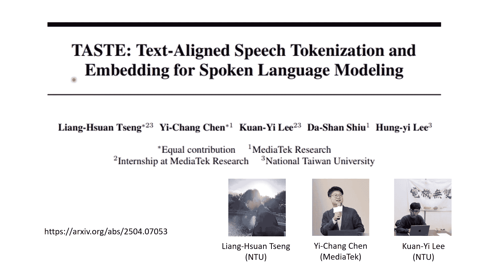

那这个test的想法是怎么样呢，这个想法是这样子的，我们现在已经知道我们在产生语音的时候，同时也会产生文字，我们现在主流做法是做语音跟文字的，Hybrid coding，语音模型是同时产生语音跟文字的。

那这样语音的token他需要保留文字的资讯吗，根本就不用保留文字的真资讯了，所以语音的token是不需要像以前那么复杂的，我们只要让语音的token，保留文字以外的资讯就好了，语音的token。

只要能储存文字以外的资讯就可以了，然后再来呢，我们刚才说语音跟文字要一起生成一个难点，就是它们的长度不一样，那能不能够想办法让它们的长度一样，我们能不能够有一个特别的token anizer。

这个特别的token izer，它会根据输入的语音讯号里面有几个文字token，它就产生几个语音的token，比如说输入的这段声音讯号是how are you。

三个文字token它就会固定生出三个语音的token，每个token都对应到一个文字的token，接下来我就要讲在network的设计上要怎么设计，才能够做到说有几个文字的token。

就产生几个语音的token，好输入一段声音讯号，我们刚才讲说一般的organization的方式，可能是用一个PRETRAIN的encoder，比如说一个pretrain cell。

Supervised the model，去产生一堆representation，这些representation它的长度，这边representation，这些向量有几个跟输入的长度有关系。

但是跟这句话里面的文字的数量，文字token的数量是没有关系的，通常你就是每一个向量，对应到一个固定长度的语音，比如说0。02秒，那这边呢我们会对不同的layer抽不同的向量，我们会抽出两排向量。

那等一下会讲说，为什么这边需要抽出两排向量好，那接下来呢一段声音背后对应的文字token，有几个，今天是有办法知道的，如果你有一个好的语音辨识系统的话，你可以把声音讯号变成文字。

所以你知道说这句话对应到几个文字的token好，接下来呢我们有一个aggregator，这个aggregator是速成的，Attention layer。

这个aggregator呢会把语音辨识所得到的文字，token当做query，把从speech encoder抽出来的representation，其中一组当做key，另外一组当做value。

然后这些query会去对key做attention，然后做完attention以后，再把这些value的vector做weighted sun，你把how输进去，把how当做一个query。

就产生一个token，这个云的token代表的是how这个文字的token，当我们要把它念出来的时候，要怎么念它，那把R输进去就得到一个对应到R的token，把U输进去就对应到一个对应到U的token。

那在这个encoder里面，哪一个layer适合当做key去跟query做attention，哪一个layer适合当做value来代表语音的资讯，来代表一个文字，token怎么念的资讯呢。

大家可以再去参考这个原始的论文，那里面有更详细的解析，我们这边就先跳过这一段，然后接下来呢我们的这个DETOGANIZER呢，会持文字当中输入，还有每一个文字所对应的语音token当做输入。

然后呢去还原原来的声音讯号，那因为呢这个输入跟输出的长度，其实它的关系非常的复杂，所以这边的DETOONIZER，其实是一个很复杂的模型，这边DETOONIZER其实用的network架构。

跟一个PTS的模型是一样的，我们用的是类似cosy voice，这个语音合成系统的network架构，所以你其实可以把这个DEPOGANIZER，想象成是一个语音合成的系统，它是一段文字。

可以产生一段声音，但是跟一般语音合成不一样的地方是，每一个文字都有一个语音的token来教你，这个文字，如果要念它的话，现在它是怎么被念出来的，然后训练的时候就是输入一段语音。

然后最后DETOXIZER输出一段语音，我们要让输入跟输出越接近越好，那这个方法叫做test，就硬凑了一个梗啊，叫做test test。

Alive speed organization and embedding，那在这整个模型里面，这个PRETRAIN的模型加上这个aggregator，合起来是token，Nicer。

输入一段声音讯号，它会输出一串token，这个token的数目跟这段声音讯号里面，对应的文字的数目，文字token的数目是一样的，那对DETOONIZATION的部分呢。

DETOONIZATION的部分，它就像是一个语音合成系统，但它不是一个一般的语音合成，会有文字的token来GA的，来教这个DETOGANIZER要怎么把这些文字念出来，接下来下一个问题是。

这些语音token真的有包含怎么念一个文字。

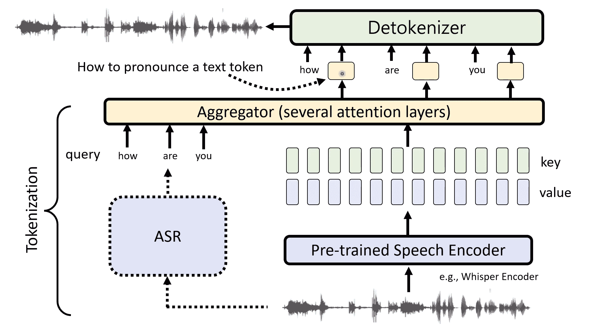

token的资讯吗，我们这边做了一个非常简单的实验，这个实验是这样子的，我们先输入一句念得很慢的声音讯号，到token izer里面，产生一串蓝色的token，这串声音讯号听起来是这样子的，他念得很慢。

大家要耐心听一下，The captain's face，Had been buried in a pile of papers，But now murdoch came around to steer。

at the gang leader好，接下来呢我们给token anizer另外一段声音讯号，这段声音讯号是念的很快的声音讯号，然后产生红色的token，这段声音讯号听起来是这样的。

any news on the dassault啊，这念得很快哦，你看这篇文字，Any news on the dances assault case，它念的很快。

Any news on the dassault case，练的非常的快好，那接下来啊我们做了一个小把戏，把两边的token部分交换，我们把对应到can around to的token。

换成对应到news on的这三个文字token的语音token，所以把这三个文字token对应的语音token，放到这里，我们把这三个文字对应的语音token放到这里。

把这三个字跟这三个字对应的语音token，进行交换，那可以预期会发生什么事吗，如果是左边这个句子，本来蓝色的token代表的是要念很慢，但是换成红色的token以后。

can around to这三个词汇会不会就念得很快了呢，我们来听一下the captain's face，Had been buried in a pile of papers。

But now murder came around to stare at the gang leader，就发现canna round two突然念的很快，或者再听一次。

The captain's face，Had been buried in a pile of papers。

But now murder came around to stare at the gang leader，我看另外一个例子，我们把news on的他的token换成蓝色的token。

那是不是news on的这三个文字的token，就会念得很慢了呢，大家听一下any news on the dance，OK发现news on the真的就念得比较慢了。

我再听一次any news on the dance，OK哦对其他词汇还是念的快，但是这三个词汇就会念的比较慢好。

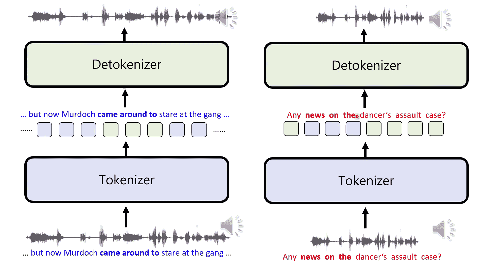

所以有了这样子的token之后，接下来就可以训练语音版的语言模型了，怎么做，首先你就是需要有大量的语音资料，然后呢，这些语音资料你可以用语音辨识系统，跑出它背后对应的文字token。

然后再通过test这个token izer，你就可以抽出每一个文字token对应的语音token，接下来你就可以训练一个语音的language model，这个语音的language model。

它每一次都是产生一个语音的token，加一个文字的token，他会知道说看到look跟语音token，101就要产生艾特跟语音token56，看到艾特加语音token。

56要产生my跟语音token33，看到卖语音token3跟语音token33，要产生ice跟语音token162，然后就可以有一个语音版的语言模型的，那我们这边呢因为算力有限的关系，所以真的没用。

很多资料，我们是用一个现成的COPUS，那个COPUS里面很多是从这个网络上载下来的，这是一个公开的资料集，里面是4万小时左右的英文，那我们的语言模型呢是拿一个1B的，拉马3。

2来做initialization好，那至于表现如何，大家可以直接去看原始的论文。

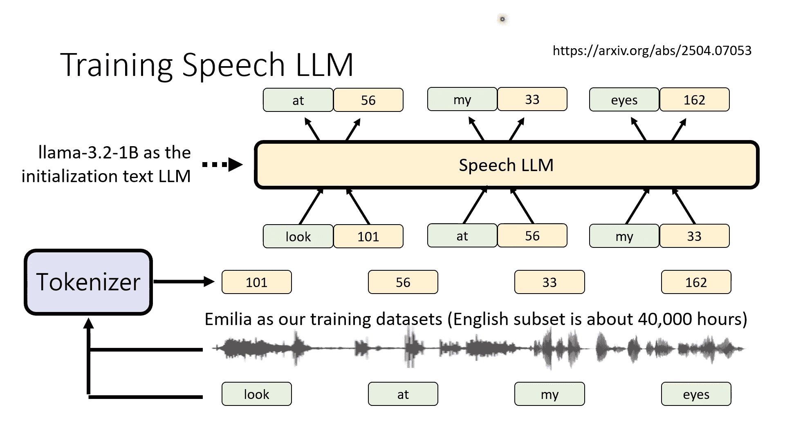

我这边呢就是展示一下这个模型，做语音接龙的模呃能力，那我要强调一下，这是一个PRETRAIN的模型，他并没有做过supervise fine tune，所以他会做的事情就是语音接龙，给他一句话的前半段。

然后他就接后半段出来啊，你可以想象说这样的模型，你可以接下来再做supervise fine tuning，跟l hf，他就可以真的跟人对话，好，我们先来看看这个模型。

它做啊continuation做语音接龙的能力怎么样好，那这边就是举了四个例子啊，第一个例子输入是这样的，i'll take the arm chair哦。

他说i'll take the arm chair，会发生什么事呢，In the corner and just sit there，It'll feel better。

I'll try to not sleep，还会尽量不睡着啊，希望这个演讲没有无聊到让大家睡着好，那后呢，如果今天是男生的声音呢，i reserve your services啊。

他说i reserve your services，接下来呢for a long time，I am very happy with the result。

I will definitely recommend you to my friends，对他得出一个合理的语音接龙的结果，那我也试了一下，假设让他听有口音的声音会怎么样，听一下这个句子。

it's hot and loud and so many people好，这个是big bang theory里面roger的声音好，然后那接下来会怎么样呢。

哦他说it's hot and loud and so many people，接下来呢，I don t know what to do，I'm not a band of crowds。

I'm not a fan of loud music，I'm not a fan of being in a crowd，i'm not a fan of being in a big city啊。

所以听起来还是有一点点口音的，或者是我们让他输入这一个句子，这句这句你一定听过，他是这样子的，Look in my eyes，好，大家都已经对，大家已经知道。

接下来的光处就是tell me why baby why，然后看看模型会结出什么样的结果，模型接出来的结果是这样子的，I'm not the one，Who's wrong。

I'm not the one，Who's wrong，I'm not the one，Who's wrong，I'm not the one，Who's wrong，还有重复another one。

Who's wrong，然后这边还产生一个noise，这个noise呢是模型自己产生出来的，那我会觉得这是一个feature，不是一个bug，因为原来的声音讯号里面，我仔细听小明建模声音。

他的麦克风呢其实品质没有很好，所以背景是有一些杂讯的，所以模型在生成的时候，也生成了一些类似的杂讯，接下来我还做了一个莫名其妙的demo啊，这个不能说非常的成功，我单纯只是很想要播这个迷音而已。

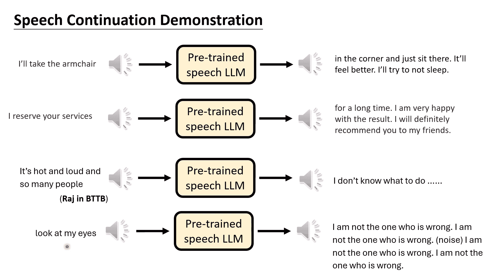

大家应该都看过这个迷音吧，啊不知道这个民营的人，我播一下，我播一下，嗨纳尼拉提卡索米多哈有力莫阿娜，你家哈纳尼大哈尼，我的尼斯没大。

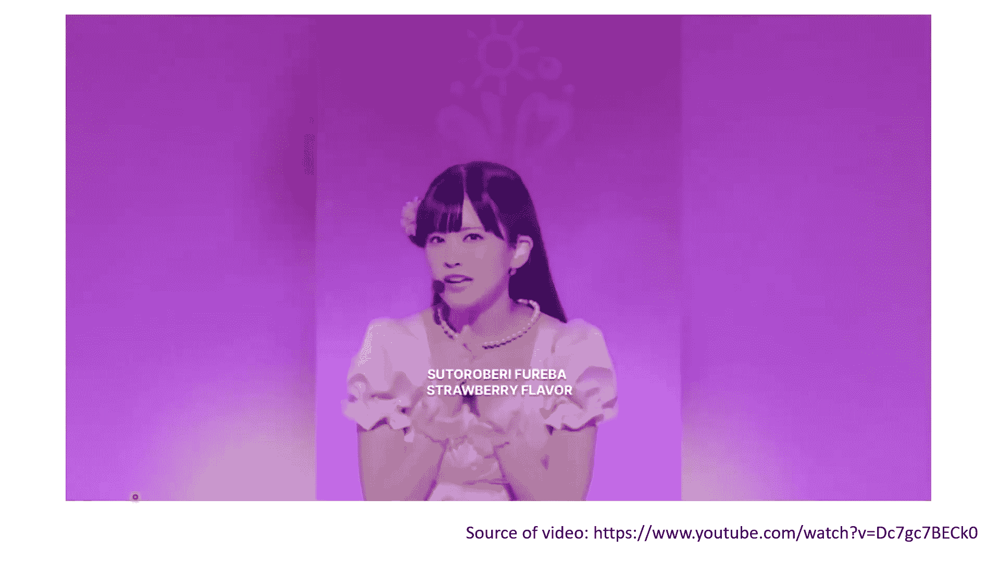

有你们阿纳达，嗨纳尼大吉，He and the creamer from ana mina，好难尼大地，我只要带自己爱1sume out and night好。

这是有一个团体叫做ice cream的表演，那这是个非常知名的迷音，他被换成各式各样的东西，比如说最知名的版本可能是黄仁勋的版本，你在YOUTUBE上搜寻，会先搜寻到那黄仁勋的版本。

然后下面一堆人推荐说啊，黄仁勋，这就是你要的世界吗，然后那个职工那个资讯之夜啊，那个资讯之夜的宣传其实也是用资公讲的影片，然后就什么什么比起演算法，我更喜欢你，比起红黑树，我更喜欢你。

就是这样，然后我就想说，刚才我们听到三个hi的声音，三个角色分别是卢比奖，步梦奖，还有四季奖，他们都产生了一个hi的声音，但这三个hi的声音是不一样的，他们三个人各自有声音的特色，也许我们再听一次啊。

丽丽小好啊，卢比讲的声音是最高的，因为嘉啊啊UI讲的声音是中间的，司机讲的声音是比较低的啊，所以接下来用这三个嗨再丢进去，Pretrain speech language model。

然后让他做continuation，做声音接龙，我们来看看他会接什么样的东西，不过这边还是做了一些前处理啦，我有特别把那个音乐拿掉，因为我发现音乐对这个模型的影响蛮大。

他训练的时候可能没有什么太多音乐的资料，所以听到音乐蛮容易让它坏掉的，所以我其实我把音乐呢remove掉好，那你就跟他先讲卢比讲嗨，卢比讲好，看看模型会接什么。

I'm movie at third year，Ph d student in the department of computer science。

At the university of cambridge，I'm currently working on the project to。

Build a language for describing and reasoning about security policies，他前面还有说哎，I'm ruby，这样子哎，好。

然后看看优一酱，悠米酱嗨好，继续接下去哦，I a new member of the club，I'm from japan，I am studying in australia。

Can a big fan of enemy，哎我不知道为什么如果是UI讲的话，我试了好几次他都会，但每次因为他有sample嘛，每次答案都不一样，但每次他都会说他是日本人。

所以可能这句话特别会让模型觉得，就是一个日本人讲的啊，最后是四季奖，嗨好，接下去哦，I'm the host of the podcast，Girls guide to travel。

I'm a travel writer，Photographer，Photographer，An educator。

I've been traveling the world for over a decade，And i'm passionate about sharing my experiences with you。

Ncashit about sharing my experiences with you，but嗯就是这样，他就有点像有一点点像是4G讲的声音，总之这就是一个PRETRAIN的语音语言模型。

在有了比较好的encoder的方式之后，可以用比较少量的资源，就训练出一个还可以用的语音语言模型。

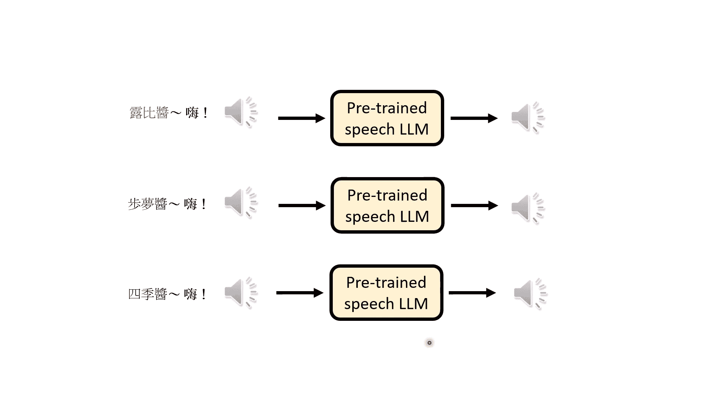

好，那我们讲了这么多，但其实目前为止我都只讲到PRETRAIN而已，有了一个PRETRAIN的模型之后，接下来要怎么变成一个真的能够互动的。

语音语言模型呢，也许可以参考的路数就跟文字模型是一样的，先有大量的网络资料，训练出一个好的PRETRAIN的语音语言模型以后，接下来你就可以做这个supervised by tune。

拿一些人跟人之间的对话，来教这个语音语言模型说听到一句声音，你要怎么样回应才是人类会有的回应，那这个部分这个资料的收集呀，其实用网扒的资料反而不一定是最合适的，但你可以去录一大堆人的对话。

但他不一定是最适合拿来fight to，这些模型的资料，因为其实今天我们是从一个文字的模型开始，做fighting，所以这边虽然我们在课程里面没有大力的强调。

但是其实也是会有forgetting的问题的，forgetting的问题，也是一个我们需要非常注意的问题，所以如果你只是收集一大堆人跟人之间的对话，拿来翻出你的pretrain model。

往往你就把pretrain model，原来的文字能力翻译就坏了，因为这不是你的pretrain model原来会说的话，所以怎么办呢，一个你今天常见的套路，就是拿原来PRETRAIN之前的文字模型。

这个PRETRAIN的语音模型，它也是拿一个文字模型再去做翻译就来的嘛，拿那个文字模型叫他自己产生对话，建议跟个模型说，哎你就产生两个人的对话，他完全可以做到，然后再把这个对话用TTS用语音合成。

把它念出来，你就有训练资料可以拿来find you pretrain的模型了，然后这边呢就拿了几个，拿这样的方式所生出来的对话给大家听看看，然后等一下在对话里面，你会听到一个男生的声音跟一个女生的声音。

然后那男生的声音呢背景有杂讯，那是故意加上去的，想要模拟这两个人好像是用电话在讲话的感觉，所以听起来像是这个样子啊，你好，我最近在考虑投资，不知道该从哪里开始，你能给我一些建议吗，当然可以。

首先我需要了解你的，风险承受能力和投资目标好，你是比较偏好稳健还是高风险的投资，我偏向于稳健一点，因为不想损失太多，而且长期来看，我希望能有稳定的收益，最好能出去些退休金了解。

那么你可以考虑一些低风险的投资选择，比如定存国债或者啊，所以今天呢你可以非常轻易的产生这种对话，拿一个文字模型，生文字的对话，再拿语音和合成系统合出来就好，其实啊据我所知，那个NOBLM。

它noble l m不是会自动升podcast吗，其他生podcast也是这么做的，它应该不是一个NUN的模型，它是先生文字的对话，再用语音合成合出来的，我甚至怀疑。

我第一次看到那个NOBLN会生podcast的时候，我甚至怀疑说，google是不是在开发语音语言模型的过程中，在升资料的过程中打造了这个模型，然后想说顺便试出来给大家玩也不错。

所以才有了这个才才有这个产生POKEST的构想，不过这只是一个胡思乱想而已好，那至于呢你要教语言模型什么东西，就要看你在FTUNING的时候准备什么样的资料，举例来说，假设你今天想要教你的语言模型。

听得懂环境音，也许你需要准备一些跟环境音有关的资料，比如说像是这样搞，这种声音常常用来标示什么事件，这种嗯声音通常用来表示重要的事件，比如嗯课程开始或结束的钟声对，所以你就可以教模型说。

听到叮这个声音啊，叮这个声音的含义，就是代表课程结束的声音等等，或是假设你希望模型可以，对人类非语言的讯号有反应，比如说对人类咳嗽的声音有反应，那你可以这样教他，最近我爱上了煮咖啡的过程，煮咖啡很棒。

听到你咳嗽了，记得多喝水，你就给他一个咳嗽声，然后教他要回答说啊请多喝水，这样啊，模型期待他就可以知道说听到一个咳嗽的时候，要怎么样回应好，总之你可以自动生成的资料，接下来用这些资料。

你就可以翻出一个PRETRA的模型，那希望就会有一个好的语音版语言模型，今天蛮多模型都是用这种路数打造的，那接下来呢你还可以做IOHF，那现在呢在语音模型领域，还有HF也不算是特别稀奇的东西。

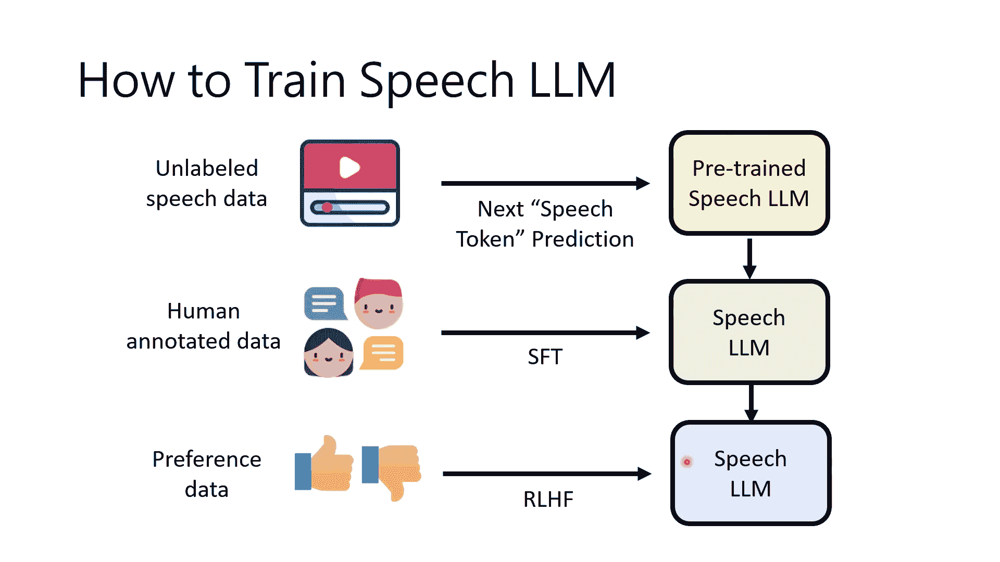

那LHF它的概念大家也都知道，就是语音模型产生不止一个答案，能去评价哪一个答案是比较好的，那比较早年的研究，所以比较早年的研究大概是一年前，那个时候人们比较在意的是语音。

语言模型合成出来的quality，所以有很多论文他的feedback都是跟quality有关的，就是人告诉语言模型说，这句话合出来的声音品质比较好，这句话合出来的声音品质比较差。

那最近流行的趋势是quality已经做的很不错了，下一阶段呢是希望模型可以听懂声音，尤其是对文字以外的声音，比如说音乐或者是环境音，他能够正确的辨认这是什么样的音乐或环境音，所以这几个月有一系列的文章。

都是用IOHF来强化模型理解声音的能力。

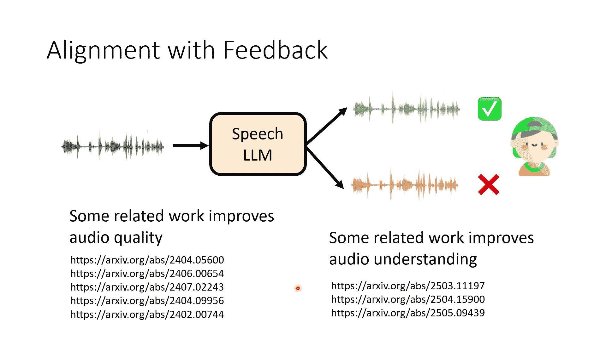

那除了RLHF以外，也可以做RLAIF，就是用个模型来提供语音模型回馈啊，这一篇论文呢是我们实验室的林冠婷同学，跟amazon的研究人员合作的结果，他们就是训练一个语音模型，用还有AI if的方式。

用文字模型来当做那个AI文字模型，会去看那个语音模型，它产生的语音讯号，辨识出来产生的句子合不合理，然后把文字模型的输出当做语音模型的feedback，再来强化语音模型的能力。

所以你也可以做RL AI if，那讲到这边了。

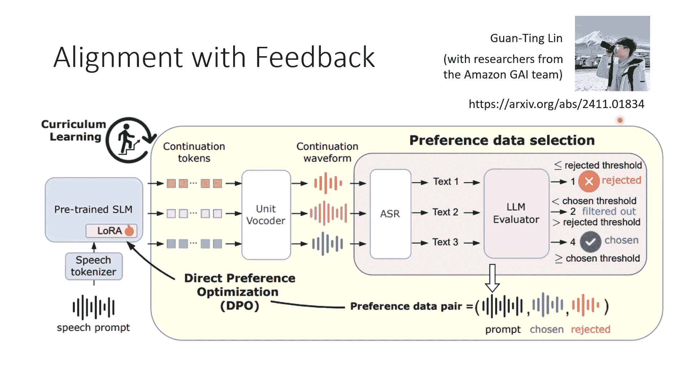

其实还有一个跟语音非常有关的关键特色，我们今天还没有讲到，就是一般的文字互动是回合制的，你今天在跟一个文字模型互动的时候，就是你讲一句话，他讲一句话，你讲一句话，他在讲一句话。

这个互动之间的间隔是非常明确的，模型怎么知道你讲完了，就是你打字完输入enter，输入enter之后，模型知道你讲完了，所以今天你什么时候讲完，有非常明确的讯息，但是对语音的对话来说就不是这样了。

语音的对话是非常复杂的，今天两个人在对话的时候，他们既说也同时听，他们不只是听他们同时也可以说话，一个模型要同时听，也同时说，这种能力叫做for dup，所以今天两个人在对话的时候。

他中间可能会有很多的overlap，比如说有一个人他在讲，比如说他出去玩的事情，另外一个人如果他一直不讲话，你就觉得很奇怪嘛，他是要发出一点声音的，所以他会说嗯你说的都对，太棒了，所以他要讲一些话。

这个人还没讲完的时候，另外一个人可能就有可能会插话等等，所以两个人在说话的时候，他们的声音讯号是有非常多重叠的地方的，所以两个人在对话的时候，他是一边说又一边听，这两个能力是需要同时存在的。

那怎么打造这样的能力呢，怎么让一个语音版语言模型，同时既能听又能说呢，如果是讲到目前为止，你对于文字模型，对于这些auto regressive model认知，就是它要么就是输入。

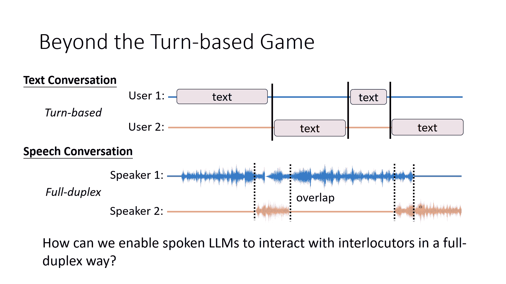

要么就是输出，怎么同时输入又输出呢，这就需要新的技术了，所以这边需要一些跟你所知道的那些，auto regressive model不一样的模型，才有办法同时说又同时听，不过这个部分。

如果要具体来讲的话啊，可能需要在下一节课，那就是另外的资讯了，那如果大家想知道的话，我这边就是列了一些有代表性的reference，给大家参考，大家看看文献上这些语音语言模型是怎么做到。

同时听话跟说话的。

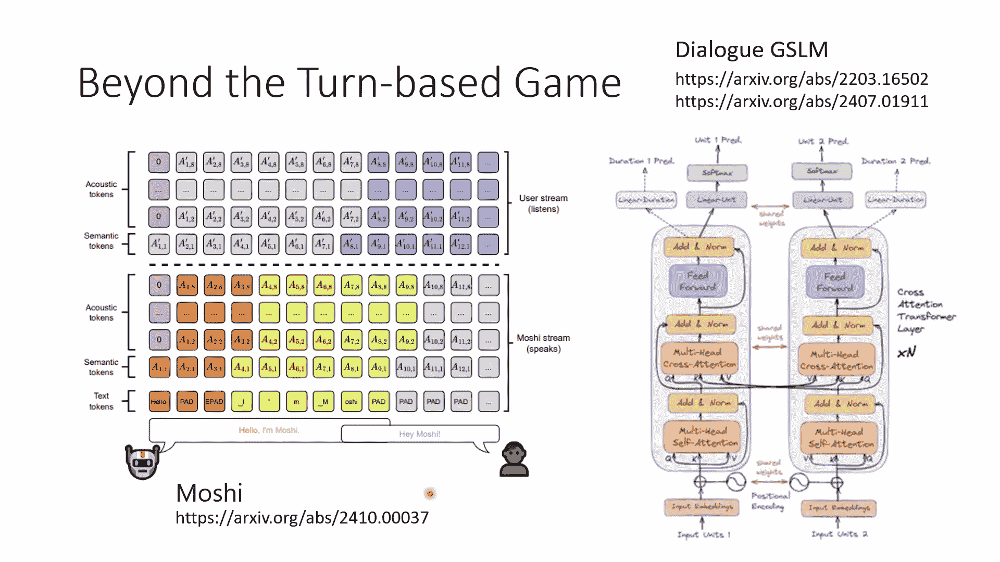

另外一方面，怎么评量一个语音语言模型的好坏，也是另外一个值得关注的议题，语音语言模型不仅要产生文字的资讯，它还要产生文字以外的资讯，比如说当我们讲到TACICITY，讲到模型的安全性的时候啊。

如果是文字模型，那你考虑的是文字模型，输出的文字是不是安全的，它有没有不小心输输出，不该输出的文字，但是语音模型除了考虑文字输出的内容之外，还要考虑文字以外的资讯，比如说假设一个模型。

他讲话就是很尖酸刻薄，他讲每一句话听起来都像反讽的意思，就按他文字内容是你好棒哦，听起来人类会觉得很不舒服，所以语音是需要考虑，本来文字模型所不会考虑的面相的，所以要怎么评量语音模型又是另外一个挑战啊。

我们大助教杨志海同学，最近写了一篇语音语言模型评估的overview paper，那我把链接放在这边给大家参考。

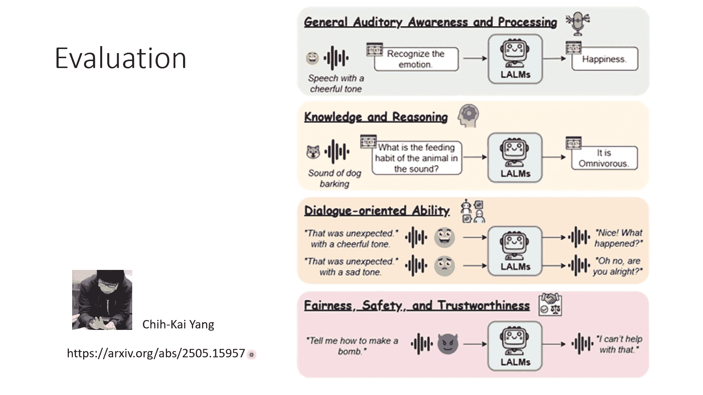

而如果你想要知道更多语音语言模型，相关的事情的话，也可以开一个这个GI哈rapper，在我们实验室张凯为博士维护的一个GI哈rap，里面会更新最新的语音语言模型相关的论文。

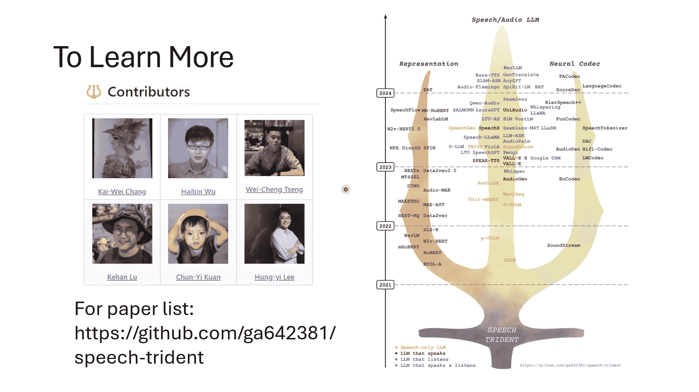

或者是这边有一大堆的overview paper，再告诉你说，近几年来语音语言模型有什么样的发展，那我自己呢也跟其他学者写了一篇overview paper啊。

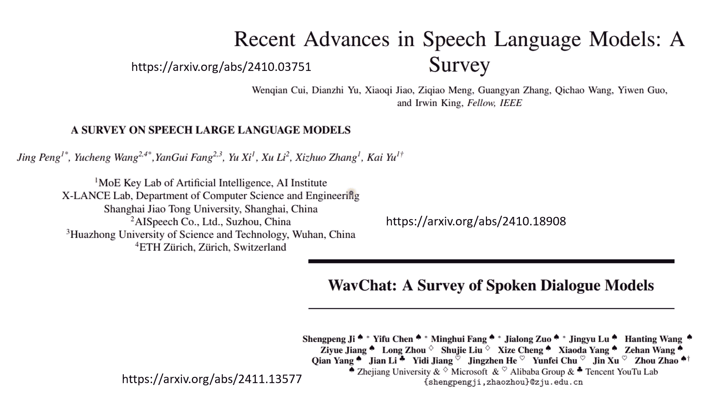

摘要了综述了语音语言模型这几年发展的历史，然后把连接放在这边给大家参考，那其实今天就只讲了一点点的内容而已，很多更多的内容大家可以参考这篇overview paper。

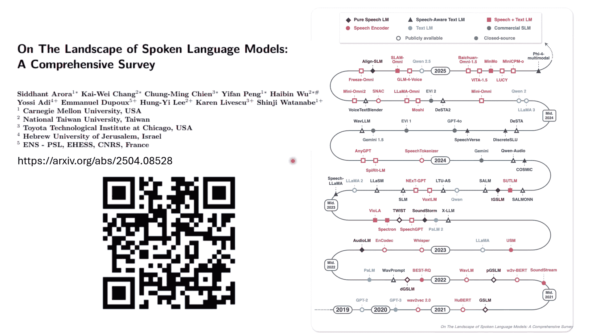