# 强推！(2026最新版) 李宏毅最新课程：智能体AI【AI Agent】71集全！人工智能／机器学习／深度学习／大模型／LLM - P25：24-2、RAG共学一：16个问题帮你快速入门RAG - Ai人工智能工程师 - BV1QdzCB3Eu2

AI开发前途无限。

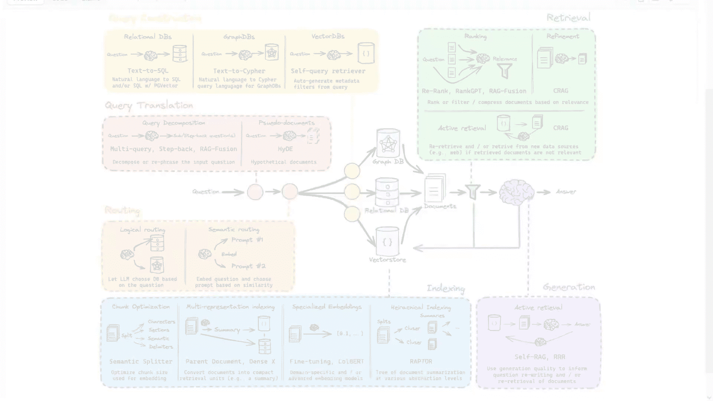

欢迎来到AI开发者的频道，从这期视频开始呢，我们一起来共学基于LCHARAG，这次供销活动呢，我们使用的是lantern官方最新发布的一套。

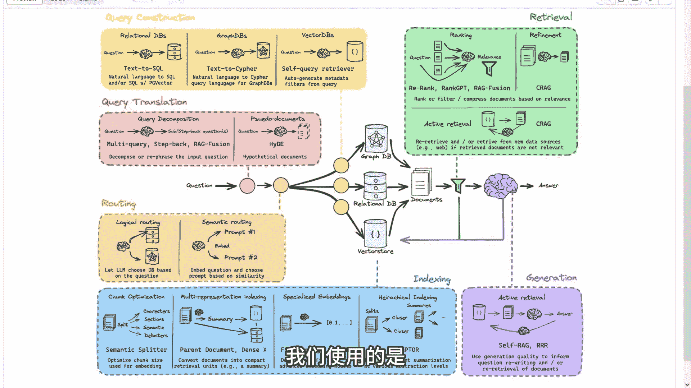

RAG教程，今天我们来学习第一部分，也就是step1到step4，很多小伙伴说呢蓝衬太难了。

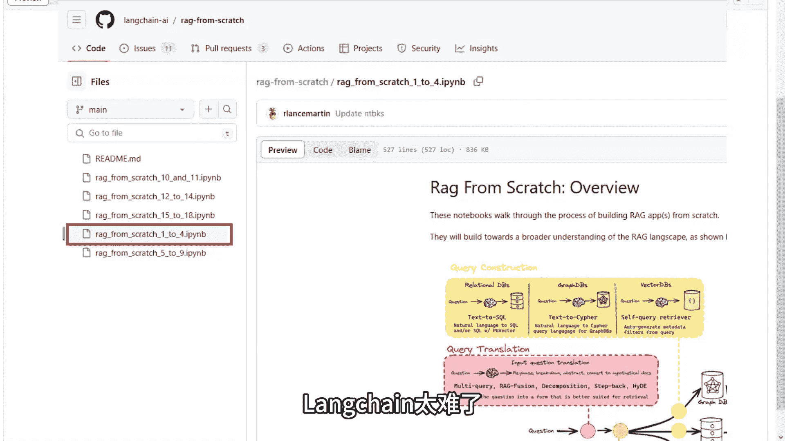

学习起来很头大，为了帮助大家更快速轻松的入门啊，我特意为你整理了16个问题，只要你搞明白了这16个问题，你就可以很好的掌握一个入门级的RAG了，好的，下面我们开始。

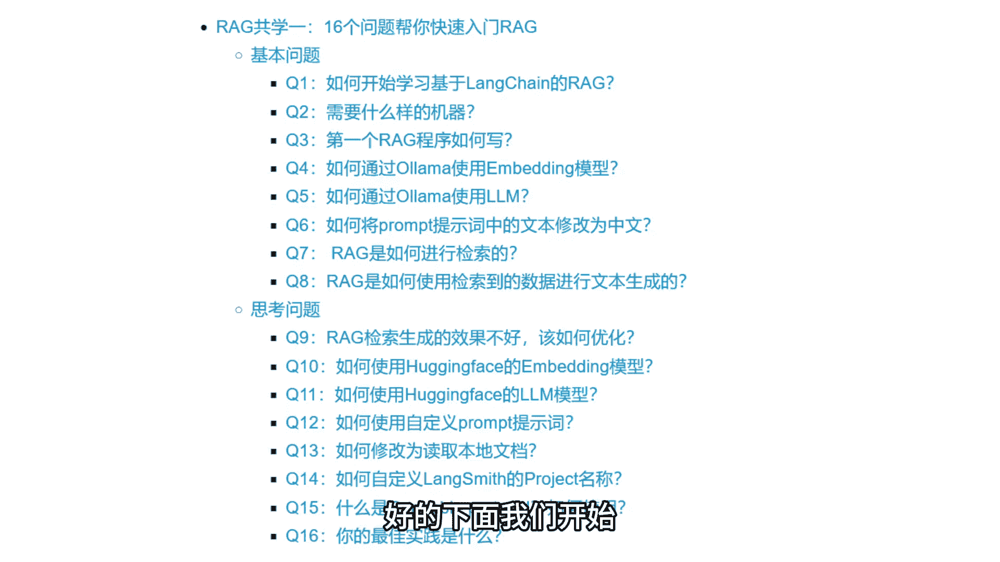

首先是第一个问题，如何开始学习基于lend的RAG，这里我的建议呢就是三点，第一个呢就是快速了解一下蓝衬的概念。

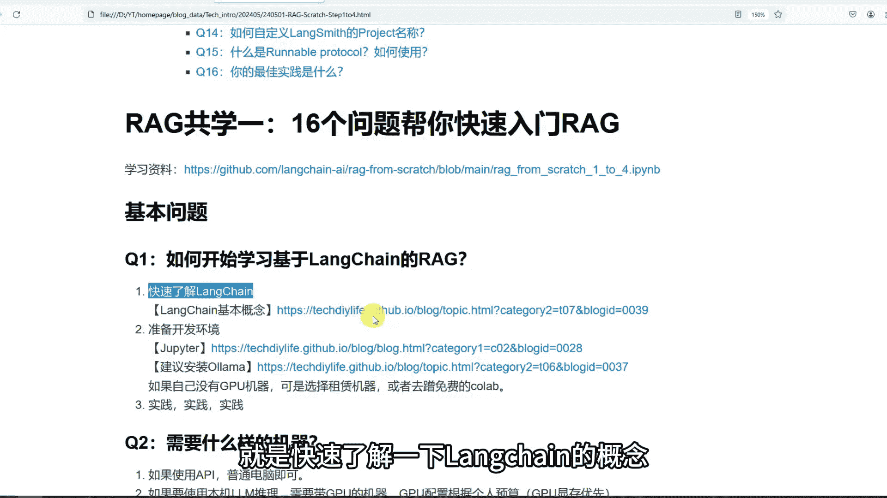

这边我准备了一个资料，你可以快速的阅读一下这个资料。

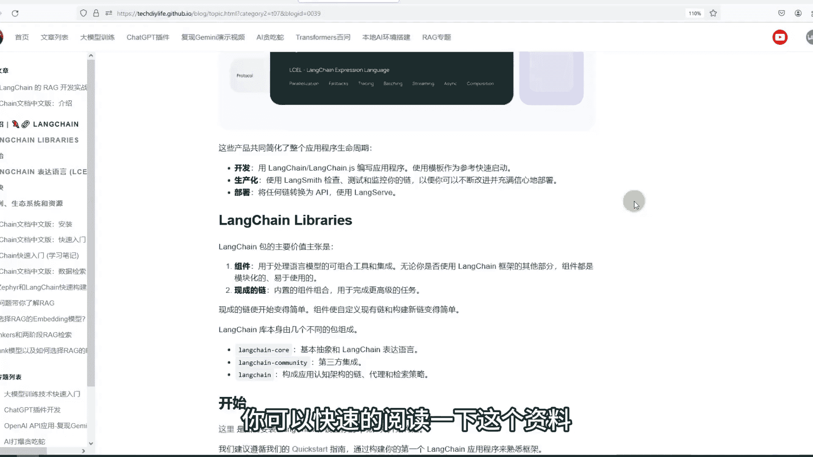

大体了解一下蓝衬的基本概念，第二个呢是准备开发环境，如果你本地有一台GPU机器的话呢，你可以安装JUPITER，安装OLLIMA来搭建这个环境，你可以参考这边的资料呢搭建这个环境。

如果你没有GPU机器的话呢，可以选择啊租另一台机器，或者呢去蹭免费的谷歌的COLAB，第三步呢就是实践实践实践。

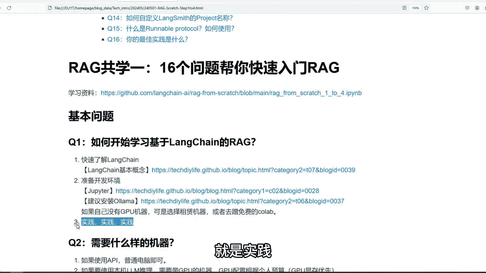

重要的事情说三遍，那第二个问题就是你需要一台什么样的机器呢，如果你是使用API来访问大语言模型的话呢，那么你使用普通的电脑呢就可以来进行学习了，如果你希望在本地的机器上进行，大圆模型的推理的话呢。

那至少啊需要一台带GPU的机器，GPU的配置呢在个人的预算范围之内呢，选择尽量大显存的GPU，第三个问题是如何来写第一个RG程序。

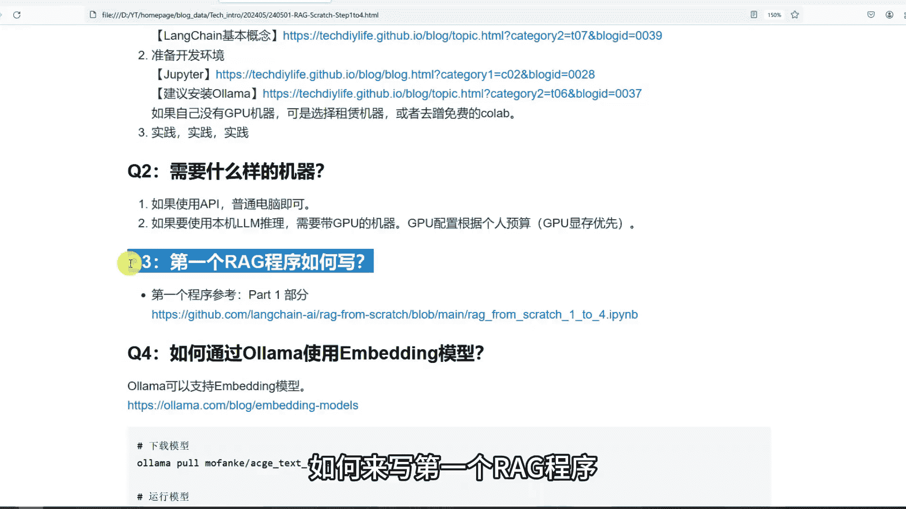

在这头教程当中啊，这里面啊已经帮我们准备好了。

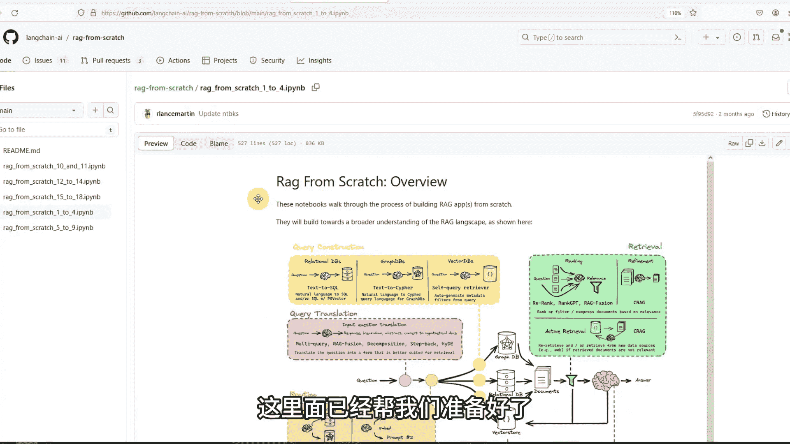

第一个RG程序也就是这个part one的overview的部分，这边呢他给出了一个最简单的RAG的程序，这个程序呢首先会读取这个网址当中的数据，然后呢会对文本呢进行拆分，文本拆分完之后呢。

会对文本呢进行一个向量化处理，最后呢是创建一个提示词模板，并建立一个lend的chain，通过这个chain呢你就可以进行RAG的检索，生成了，这个例子呢是需要使用OpenAI的API来调用啊。

open i的模型来进行embedding的处理，和使用大圆模型来生成结果，这里呢我们不使用这个open i的API，我们来通过使用OLLEMONA，来调用本地大语言模型啊来进行处理好。

下面呢我来演示一下如何进行修改。

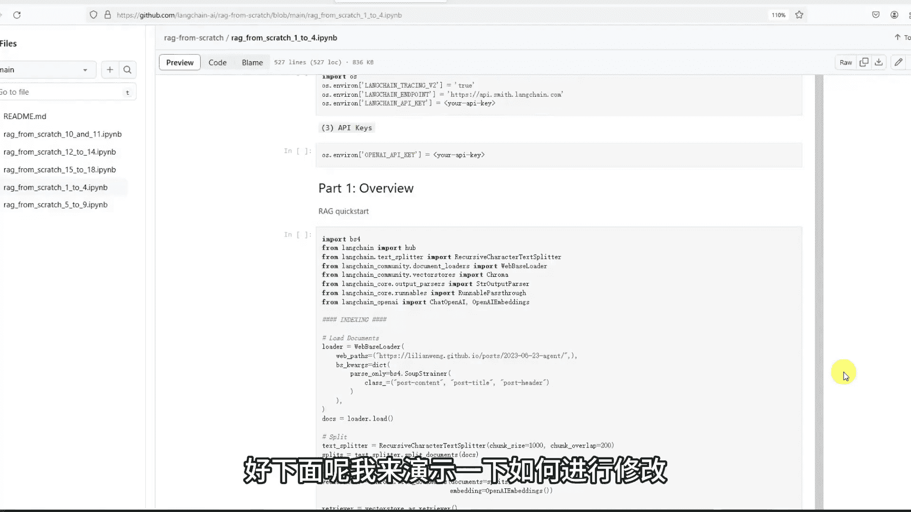

下面我基于前面我整理过的这个，20个欧拉姆的问题啊，来进行检索，来看看这个RAG检索能否回答我里面的问题。

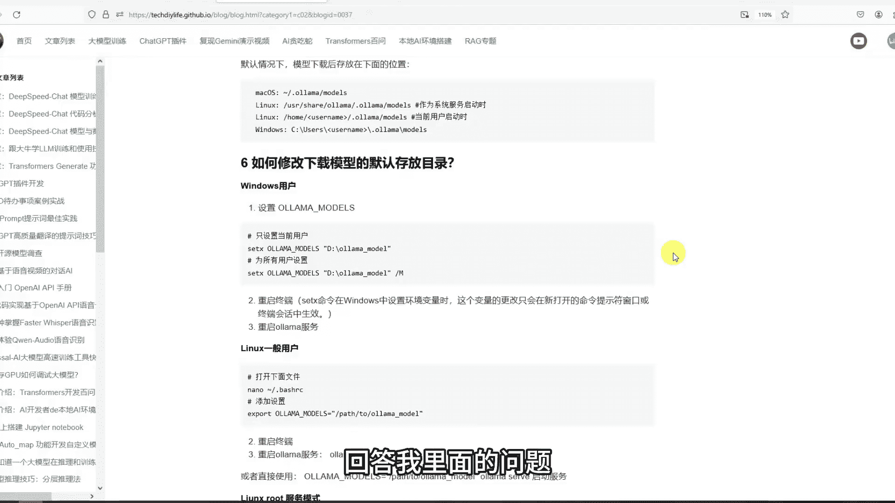

首先呢我把这个程序啊转到这个JUPITER当中，这前面呢是安装的相关的开发库，这里呢我不使用这个line on smith，我这边呢是首先呢把这个文档下载到本地，这样呢可以更方便的我反复的来进行读取。

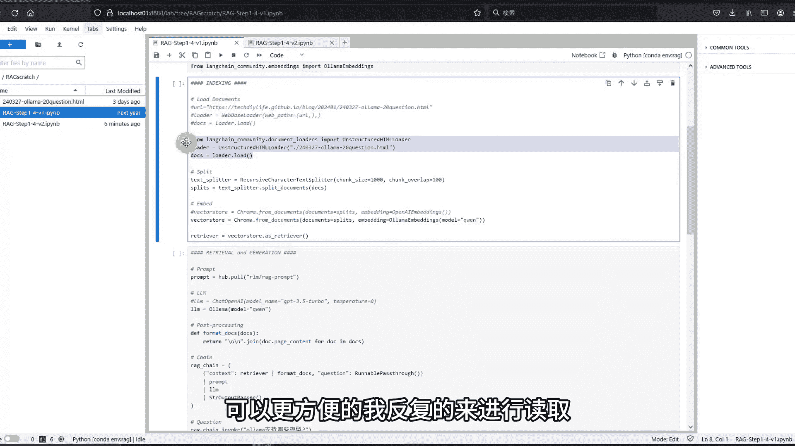

好下面的一个问题呢，就是如何通过OLLA来使用embedding的模型，OLLIAA是可以支持embedding模型的，相关的介绍呢，你可以看这边的链接，这里我们来使用这个AC g e taxi。

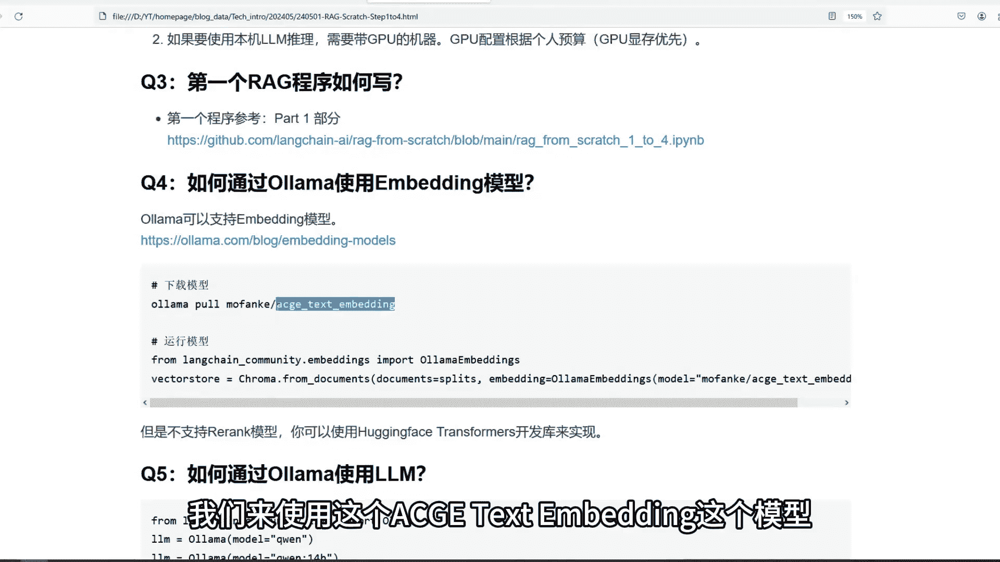

embedding这个模型，我们首先下载这个模型，好的下载完成了。

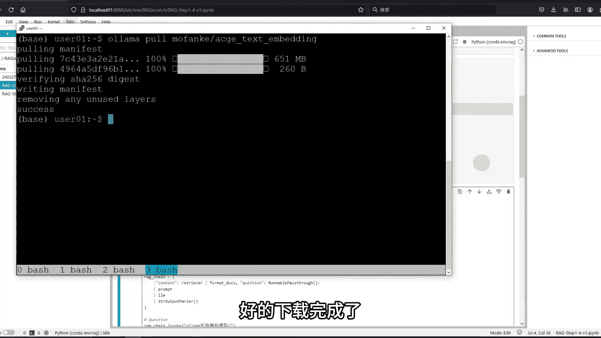

然后呢，我们将这个向量化这个地方呢，替换成欧拉姆的模型，好的我们执行一下，可以看到执行完成了。

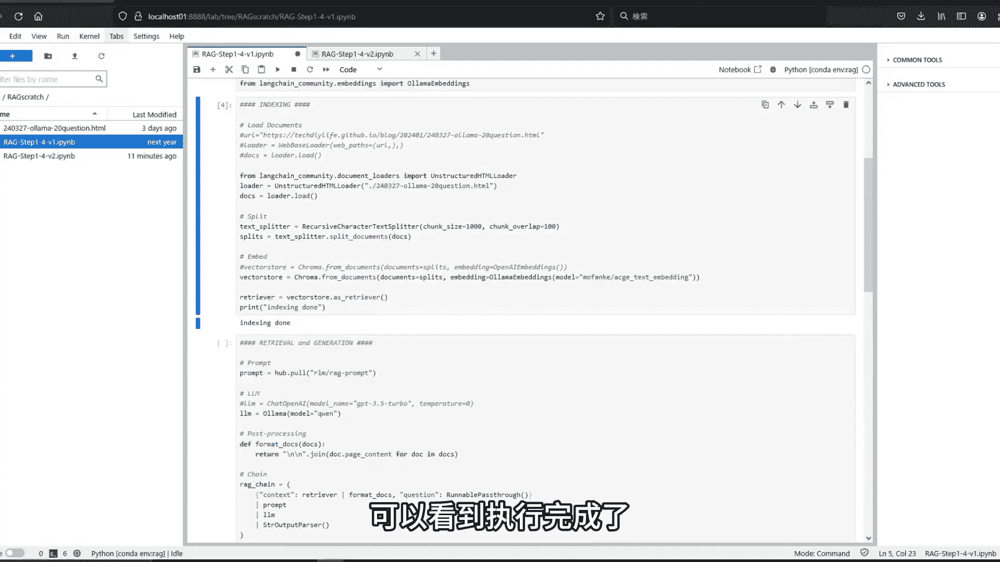

没有任何问题，好到这里呢，我们就将这个embedding模型啊给替换掉了。

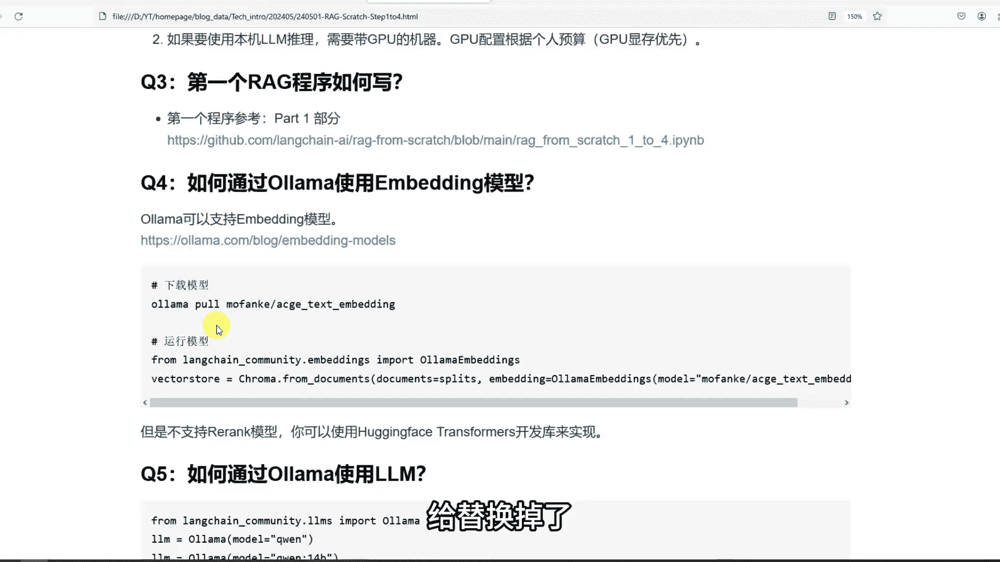

那第五个问题，如何通过OLLA来使用大于原模型的，这个呢跟前面是一样的，首先我们需要导入这个OLLEMA，然后呢通过这边的命令呢。

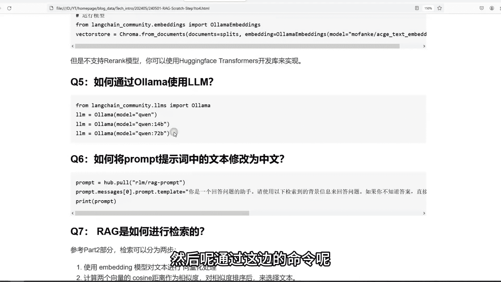

就可以非常方便的呢替换掉模型，我们将这个代码注释掉，然后呢替换成这个欧拉姆的模型，好的这里呢我们来运行一下，看一下，这里你可以看到他虽然产生了回答，但是呢完全产生的不正确。

这边我的问题呢是OLLEMA支持哪些模型，但是他的答案呢确实跟这个完全没有什么关系，如何进行改进呢，后面我们再讲，在改进之前啊。

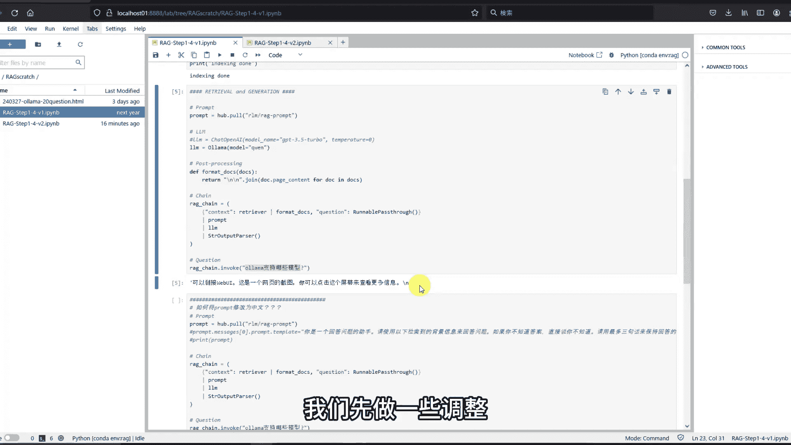

我们先做一些调整，然后再读一下这个程序，也就是下一个问题。

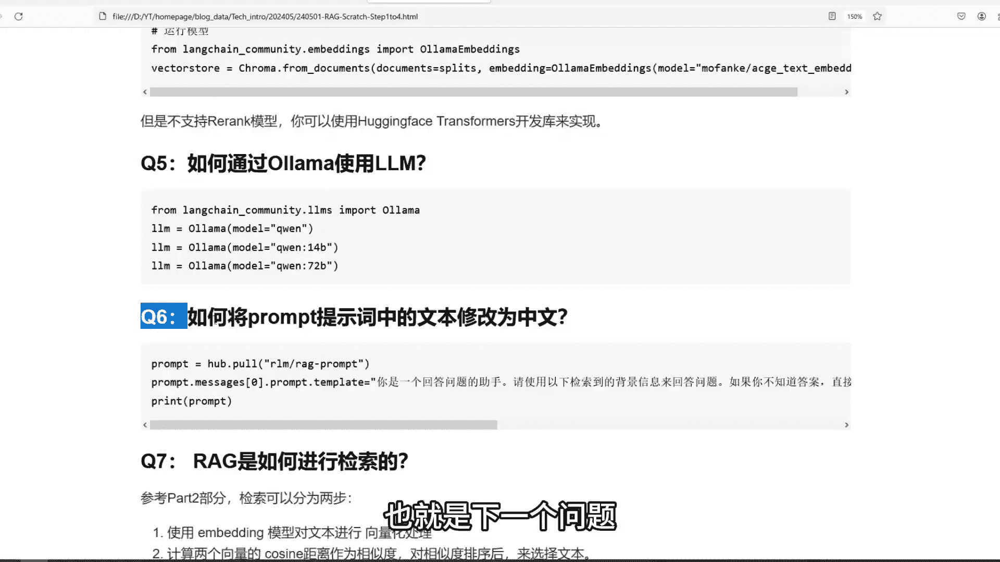

如何将这个promote的提示词的文本呢，修改为中文，它这个提示词呢是在这个lend hub上，下载的一个提示词，这个提示词的这个格式呢是这个样子，在里面呢，我们可以看到它里面啊。

用的是一个完全英文的一个描述，那么如何将这个英文的描述，修改为中文的描述呢，这边你可以使用这个代码，直接将这个template改成中文的描述啊。

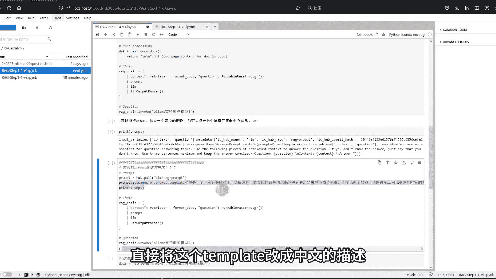

就可以好，修改完之后，我们再来执行一下，看一下，这边我们可以看到这个提示词啊，已经修改为中文了，下面是新产生的一个回答。

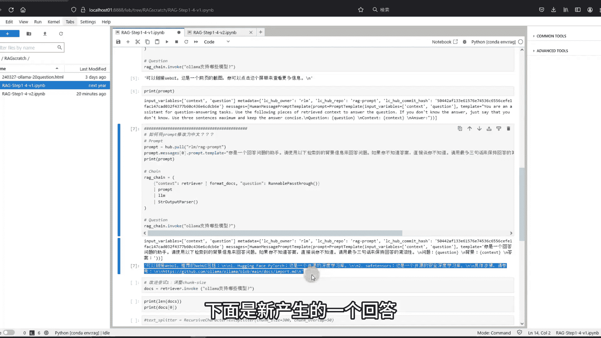

第七个问题，这个RAG呢是如何进行检索的，关于这个问题呢。

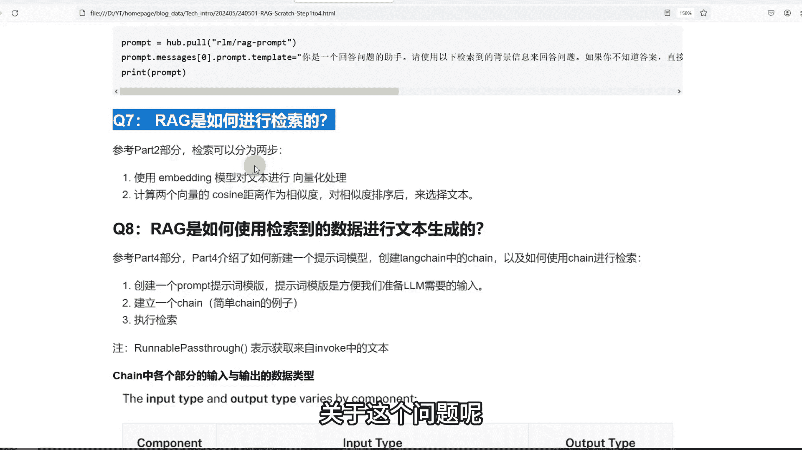

我们可以参考这个part2部分，也就是这个官方文档的这一部分，这下面呢他也给出了一个，详细的检索的一个例子，首先呢是由两两个文本，一个是问题，一个是文档，这儿呢是计算这两个文档的token的数量。

然后呢会对这两个文档呢分别进行向量化处理，然后根据这两个向量的，就可以计算这两个向量的Q3距离的相似度，通过它们的相似度呢来选择最相关的文本，在下面呢其实是对这个上面例子的一个解释，这边呢是下载数据。

然后是对文本进行拆分处理，再然后呢是准备检索的向量数据库好。

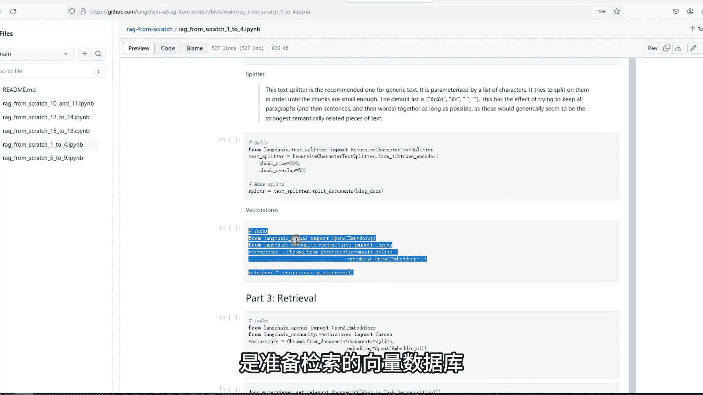

第八个问题，RNG呢是如何使用检索到的数据，进行文本生成的，这个问题呢，我们可以参考这个文档当中的part特四部分。

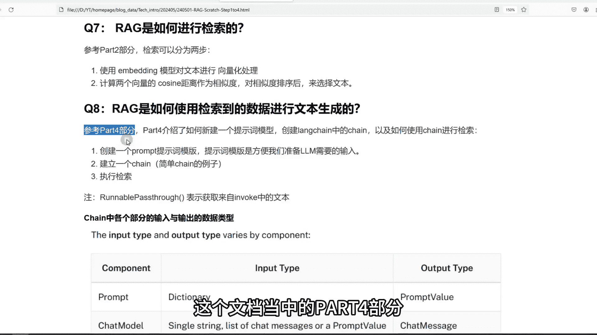

这个part特四部分呢，他介绍的是如何基于检索的结果进行文本生成，首先呢它定义了一个promote template，然后呢是建立一个LUNCHAIN的一个chain。

这边呢就是调用这个chain呢来进行检索。

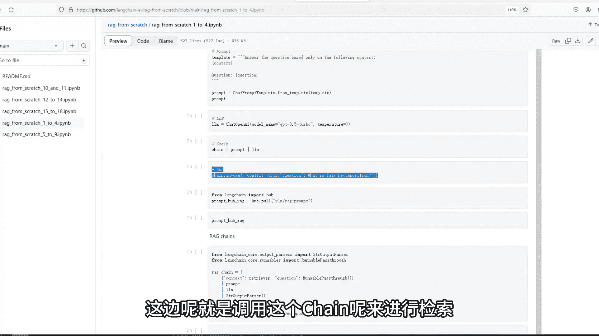

这是一个最简单的一个line chain的一个实例，蓝衬的衬的部分呢。

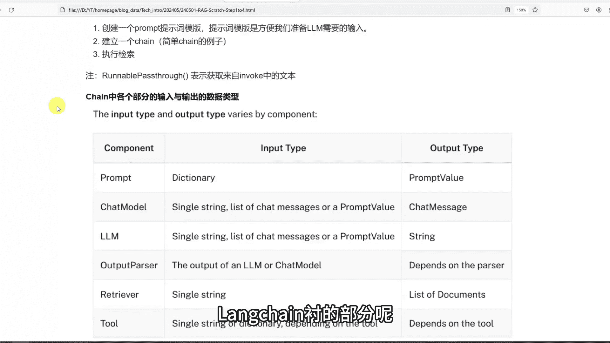

是一个比较难以理解的一个地方，这边呢是来自官网的一个关于change的各个部分的，输入和输出的数据类型，通过这个输入输出的数据类型啊，可以帮助你啊，进一步理解这个chain a是怎么进行处理的。

好到这里呢，我们这个代码的基本介绍呢就算完成了。

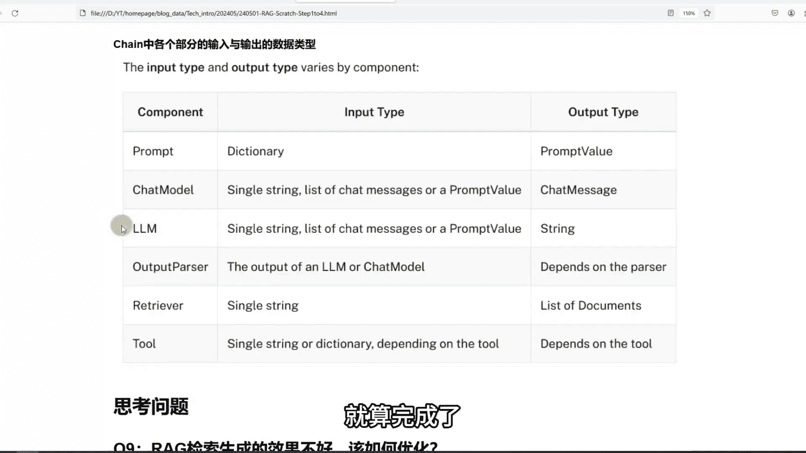

那上面我们提到了这个RAG检索的生成，效果不好，那么该如何进行优化呢，使用的是千问4B类的一个模型，这个模型的参数量比较小，所以呢我们首先啊可以选择一个更大的模型，我尝试了一下。

如果使用这个72B的模型啊，他的回答质量就会更好，所以这里啊我推荐大家，首先来尝试使用一个更大的一个模型。

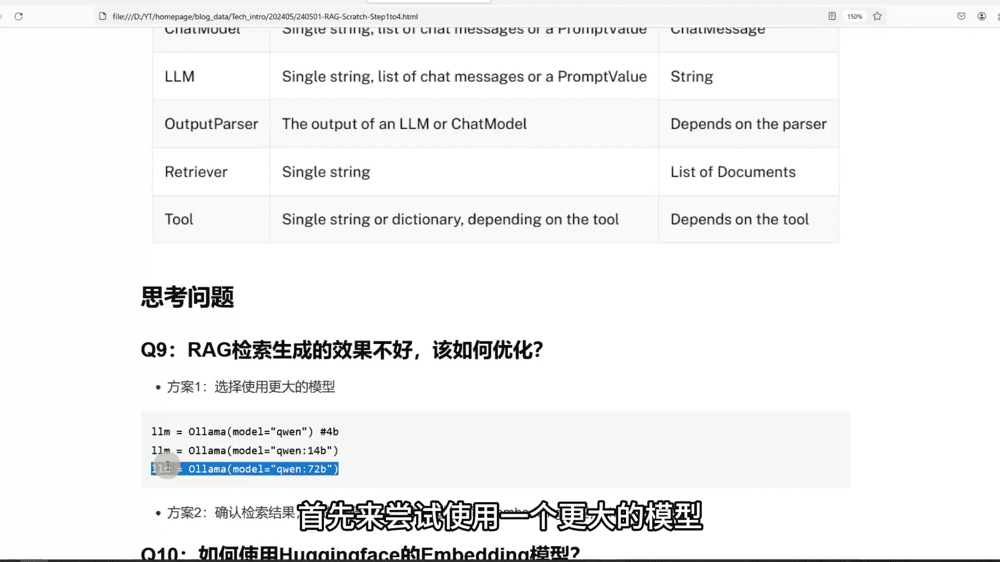

如果使用更大的模型，你发现效果也不好的话呢，那么你就需要做进一步细致的调查，比如说选择不同的embedding模型，调整窗口size的大小，调查时呢，你也可以打印出啊这个检索到的文本。

来确认一下是不是检索到了对应的文本，从这个检索的这个第一个文本来看，很明显这个trunk size的确是设置的太大了，根据我的测试，使用千问72比例模型，将trunk size调整为300的情况下。

他可以很大概率的回答正确，这个问题对于有更多定制化要求的小伙伴呢。

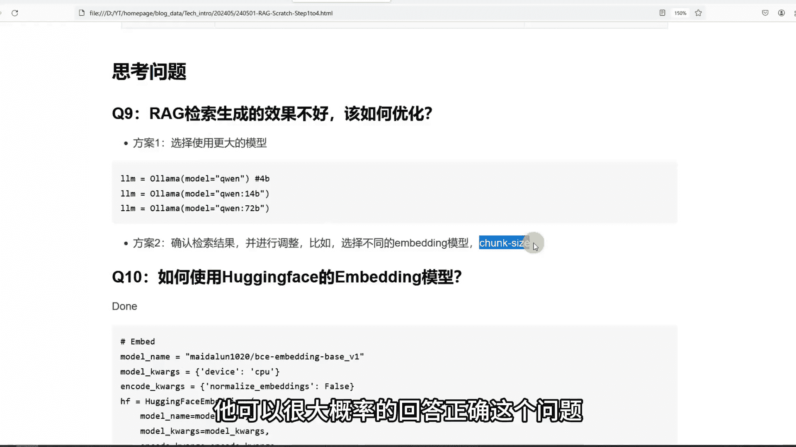

你可以参考这个十到第16个问题啊。

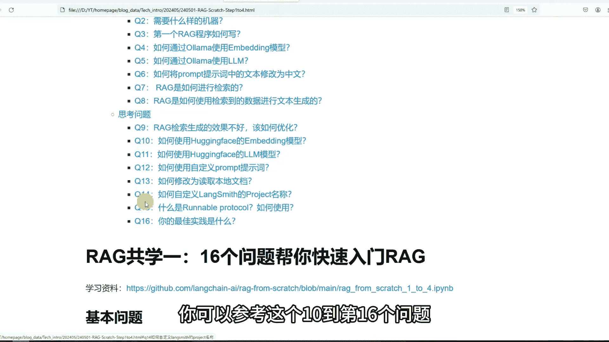

来进行进一步的改进，这个代码最后呢给你一个调查的完整的思路，也就是呢，每个人呢都可以整理一个自己的最佳实践，这个最佳实践呢可以包括这几个部分，第一个呢是数据该如何处理。

第二个呢是trunk size如何设置，第三个呢是使用的什么embedding模型，第四个呢是promote的如何设计，使用了几个检索的结果来进行生成，第五个呢是你使用的什么大语言模型。

你可以将你的最佳实践呢，分享在我们视频下面的评论区，或者我们的交流群里，以上就是今天的分享，感谢收看。

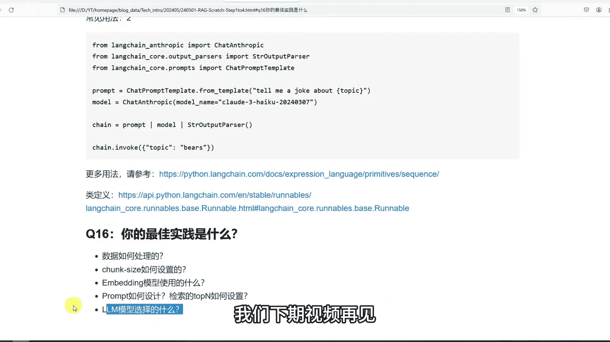