# 强推！(2026最新版) 李宏毅最新课程：智能体AI【AI Agent】71集全！人工智能／机器学习／深度学习／大模型／LLM - P26：25-3、如何选择RAG的Embedding模型？ - Ai人工智能工程师 - BV1QdzCB3Eu2

AI开发前途无限，欢迎来到AI开发者的频道，今天我们来聊聊，如何为RAG选择一款embedding的模型，在视频的最后呢，我也会推荐几款我比较看好的embedding模型，供你参考。

最近呢在学习RG技术过程中啊，遇到一个关于如何选择合适的，embedding模型的问题，embedding模型呢在RAG技术中呢，是非常关键的，因为它呢直接影响到信息检索的效果，从而影响生成文本的质量。

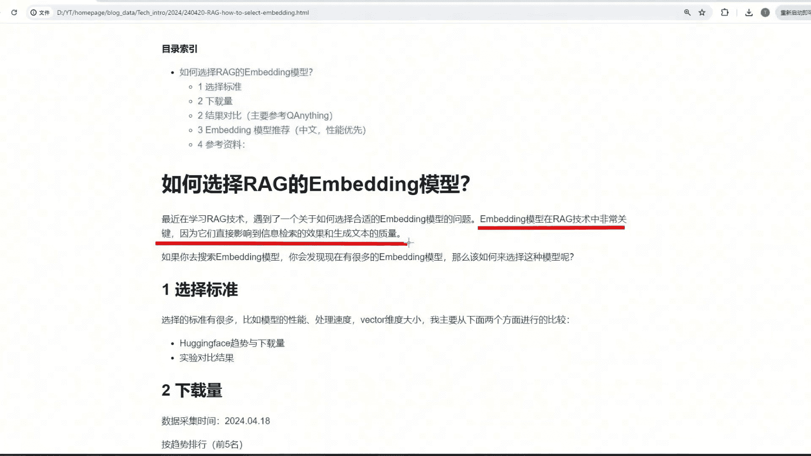

如果你去搜索embedding模型的话呢。

你会发现现在有很多的embedding模型，甚至于很多大约模型本身啊，都是可以直接拿来用作embedding模型来使用的，那么该如何来选择这种模型呢，我在共学群里问了一下这个问题。

很多小伙伴呢给出了自己的选择，也有人呢推荐了自己使用的模型。

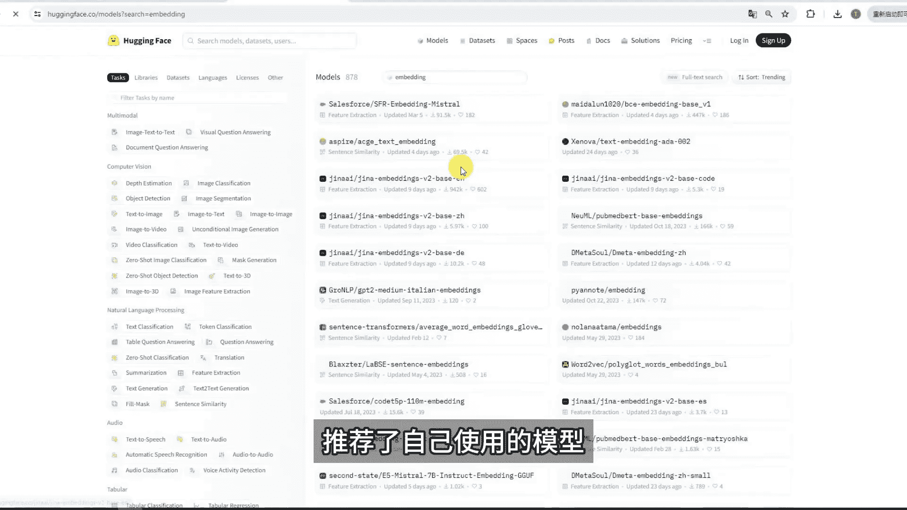

关于选择的标准呢，大家都提到了模型的性能处理速度，embedding后的vector的维度的大小等等。

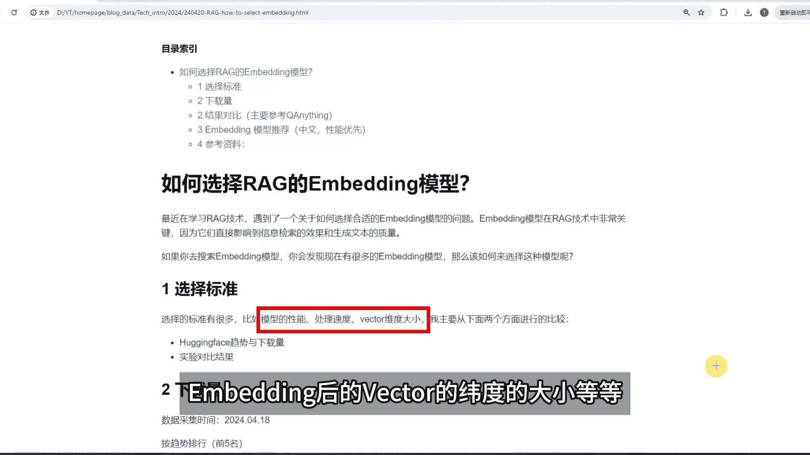

那一看呢大家都是实干过的，也有几位小伙伴啊，推荐参考这个ETMB的排名，我也看过这个排名啊，不过里面呢有很多的模型，看起来呢真的是良莠不齐，很多排在前面的呢都没怎么听说过。

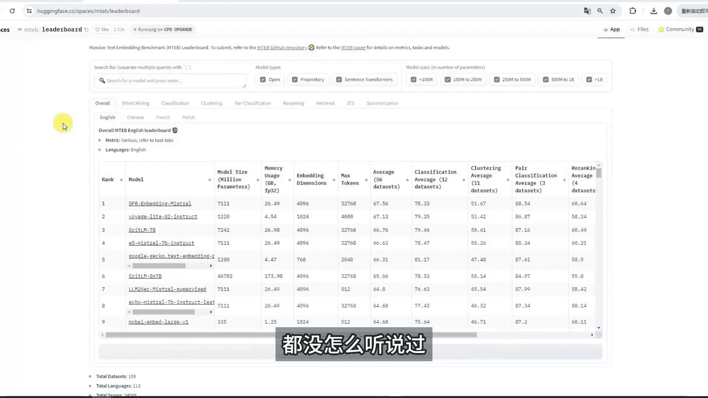

到底有多少可信度呢，我还是有些疑问的，这就像我这几天在刷这个填池的，这个学习排行榜一样，虽然说呢是刷到了第一名，但是刷过排行榜的人都知道，这里面呢是有很多小的技巧的，排名好啊，技术呢肯定是不差的。

但是呢是否通用啊，它就是另外一个问题了，我们这里选择模型呢，肯定是要选择一个性能比较好的，并且呢更加通用的模型，也就是说呢要靠谱一些的模型。

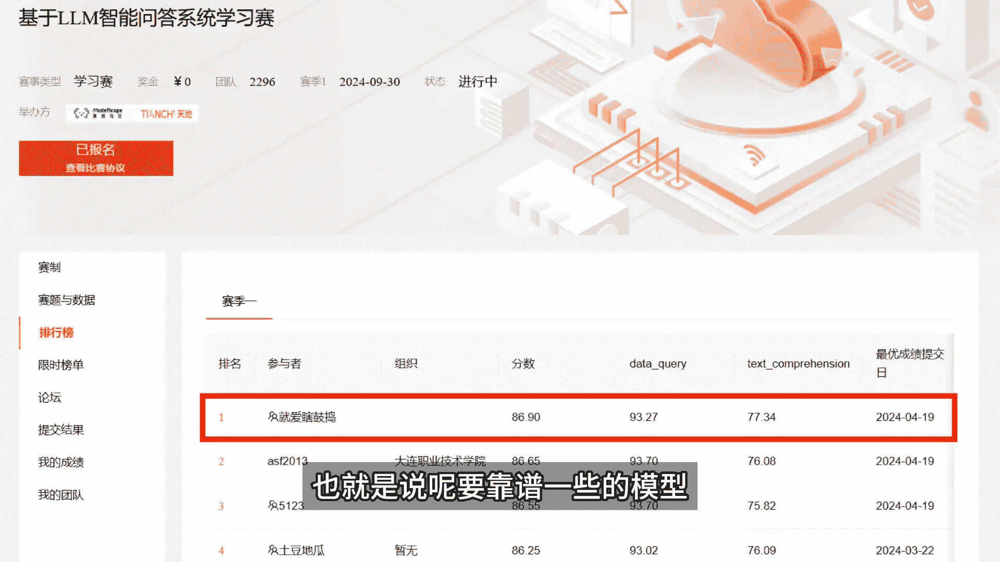

所以这里呢我还是啊要以数据来说话，我主要呢从下面两个方面进行了比较，第一呢是哈根face斯最新的趋势以及呢下载量，第二个呢是实验对比结果，我们先来看一下hi face上的最新趋势啊。

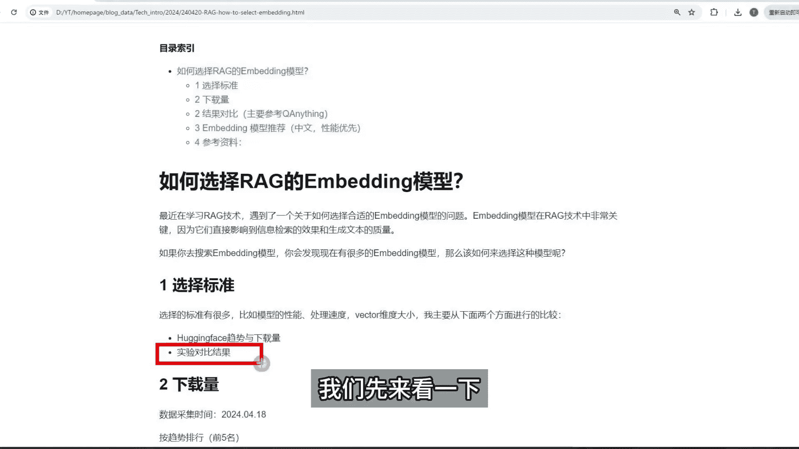

在hi face上呢，我并没有啊找到一个embedding模型的分类。

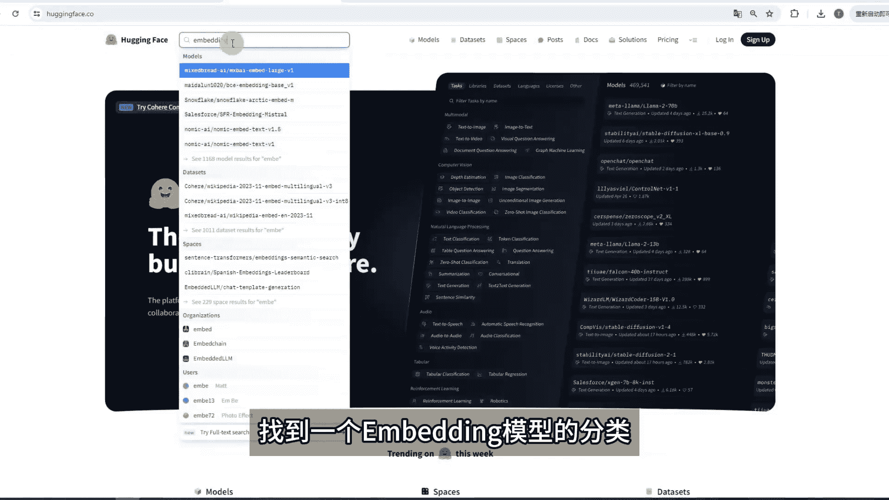

所以呢只能通过关键词啊来搜索，那搜索之后呢，首先显示的是最新的趋势，也就是最近下载量上升比较迅速的模型，另一个维度呢就是可以选择，按照下载量进行排序，但是呢这种方法呢也有个问题，就是有些模型的名称中的。

它并不包含embedding这个关键词，为此呢我还单独搜索了一些，我所知道的一些embedding模型，也放到了这个下载量排行的列表中了。

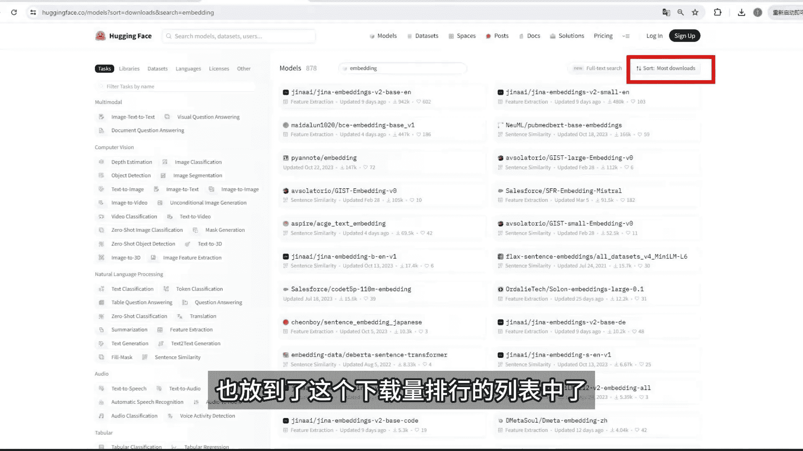

首先我们先来看一下最新的一个趋势，这里呢我列出了前五名的模型，首先我们可以看到第一位呢，就是这个b c e embedding的模型，这也是呢q anything当中啊推荐的一款模型。

看来呢是随着这个q anything的火爆啊，这个模型啊最新的趋势上升也是很明显的，第二位呢是这个cs force一款基于mr。建立的模型，第三位呢也是一款中文模型，也就是这个ETMB。

中文排行榜上排名第一的模型，最近的下载量上升的是特别的快，这个模型是真的好啊，还是假好啊，我们需要让子弹飞一会儿，过一段时间呢，我们才能知道他是不是真的受大家认可。

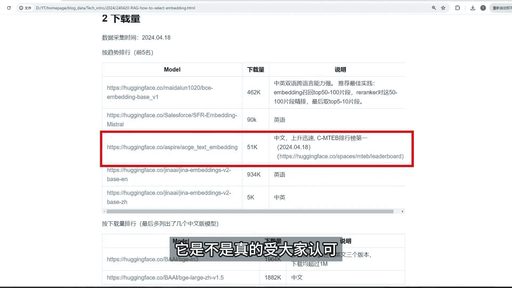

这上面呢是最新的一个趋势，下面呢我们再来看一下下载量，这个下载量呢是当前一个月的下载量，所以呢是可以很好地说明啊，当前这些模型是否受到大家的关注，这边的模型呢列出的比较多。

首先呢就是这个BGE系列的模型，这个BG3的这个模型呢，这一个月的下载量呢接近200万，另外啊这个BG的版本呢，还有三个英文版的模型，他们的下载量也都超过了100万。

第二位呢也是这个BAAI的一个b g e large，中文的一个模型，这个呢是专门针对中文进行优化的，下载量呢也达到了188万，从这个下载量我们可以看出，这个BAAI的模型啊。

这个受到的关注程度啊还是非常大的，第三位呢是这个gt贝斯的模型，它是一个英文版，这下面呢这两款呢也是英文版的模型，第六位呢它是一个多语言的一个版，本的一个模型，这个的下载量呢达到了81万。

然后呢是这个E5large的模型，在下面呢就是这个QANIMANYTHING当中啊，推荐的这个b c e embedding base的这个模型，这个呢它在中英双语跨语言能力上是比较强的。

下载量呢也达到了46万，再往后呢也是gt large gt small，这些呢都是英文版的模型。

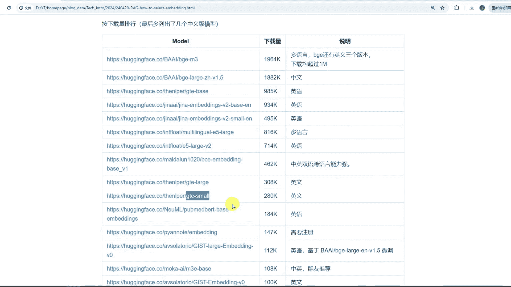

在我们的学习群当中啊，有很多小伙伴都推荐这个M3e base的这个模型，这个模型呢是支持中文英语双语的模型，下载量呢也达到了10万，最近这个上升趋势非常明显的，这个模型呢它的下载量呢也达到了5万。

这个刚刚发布不久，所以这5万的下载量呢还是挺大的，大家今后呢可以关注一下这个模型，根据上面的统计啊。

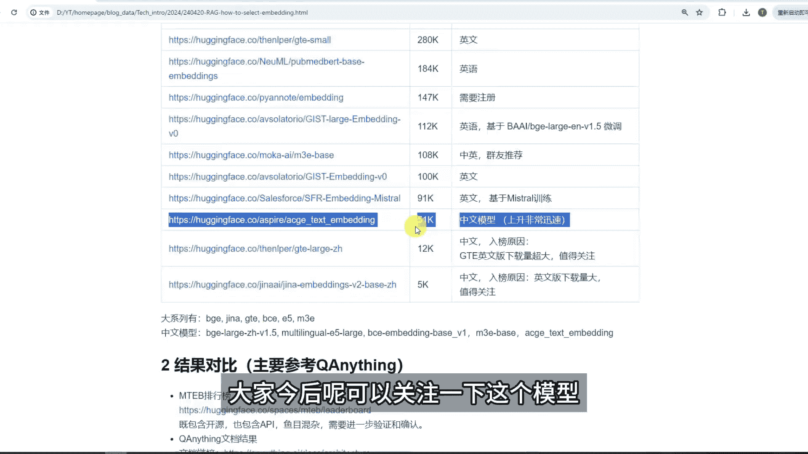

我们可以看到从大一系列上来讲呢，有BGEGAGTEBCEE5，M3E等系列的模型，然后在中文模型上呢，我觉得这个bg large中文1。5版，和这个多语言的义务。

Large b c e embedding，Base m 3e base a c g e text embedding，这个模型呢大家可以关注一下，上面我们讲的是根据最新的趋势。

以及呢最近一个月的下载量来进行排名的，那么这些模型的性能到底如何呢。

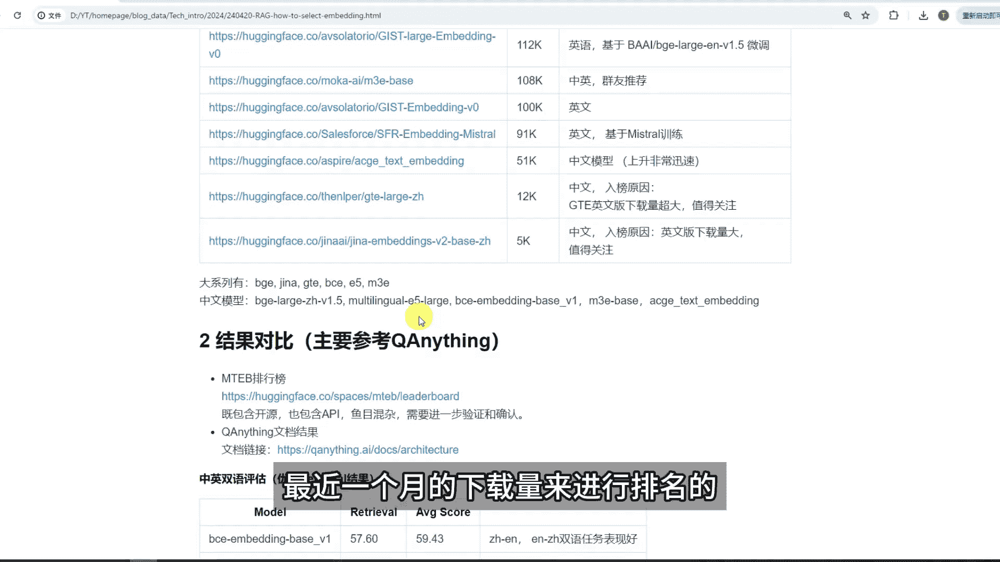

关于性能的比较呢，一方面呢你可以看这个MTEB的排行榜，这边呢有英文的，有中文的，还有其他语言的，一些各个模型的一个排行的情况，上面我们说了这个排行榜呢到底可信度如何呢，这个呢每个人有每个人的一个看法。

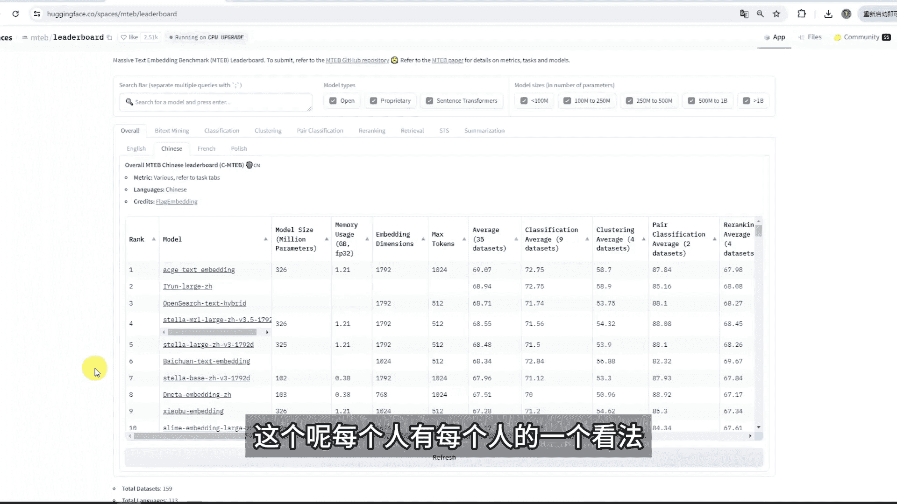

然后我这边的结果对比呢，主要是参考的q anything官方文档的一个对比。

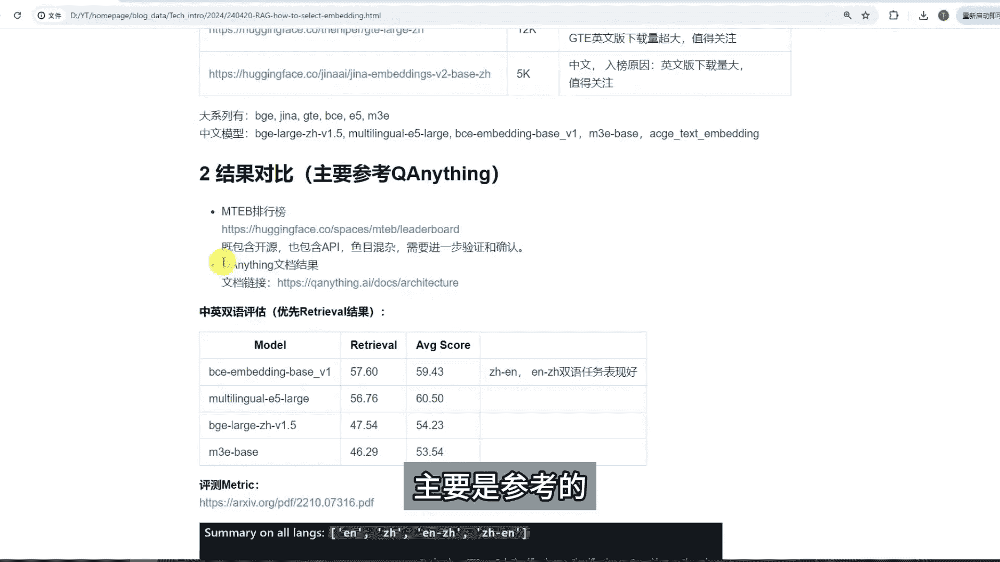

这边呢是我在这个GITHUB上抓取的一个截图。

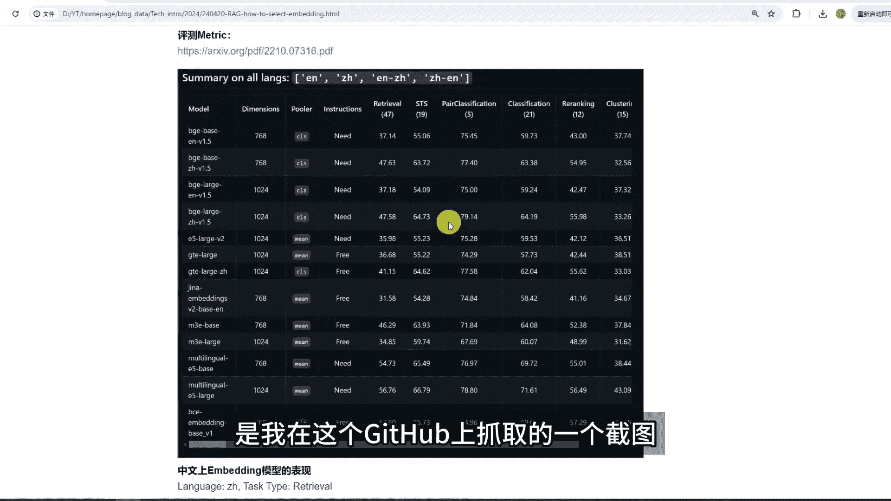

这个结果呢是针对中英双语的一个评估，我们这里呢主要是用于retrial检索，所以我这里呢，主要参考的是这个检索的一个结果，根据这个结果呢，你可以看到这个b c e embedding base呢。

是当前呐性能最好的一个模型，然后呢就是这个moral lingue5large，再然后呢是这个b g e large，中文M3e base的，结果呢与这个b g e large呢是相近的。

但是它与上面两个模型呢差了差不多有十个点，这是啊在中英双语上的一个评估结果。

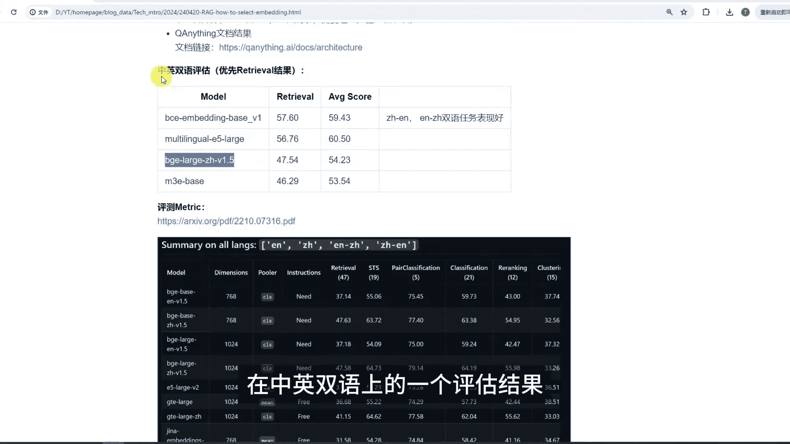

那么单纯在中文任务上是怎么样的呢。

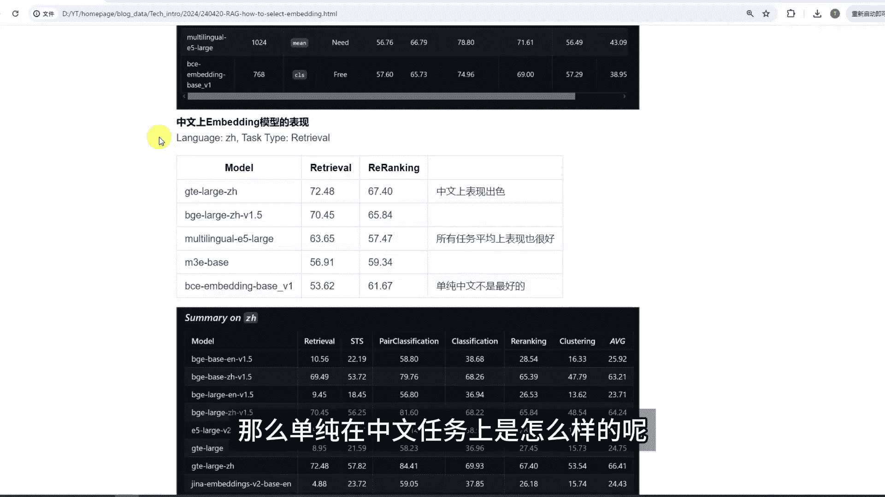

这边呢是各个模型啊在中文上的表现情况，我们可以看一下，在中文上与前面的排序啊是完全不一样的，在中文上呢，gt large zh这个模型呢取得了最好的一个结果，中文上的表现是非常出色的。

然后呢使bg large的中文版，这两个模型的retrieval的得分呢，都在70分以上，再往后呢是这个MTLINGO义务蜡纸，然后是M3e base，在前面中英双语上排名第一的这个BCE。

embedding base呢，在这里呢排名啊并不是很靠前，从这个对比我们就可以看到，即便是这些相对来说比较通用的，下载量比较大的模型啊，他在不同任务上的表现差异也是挺大的。

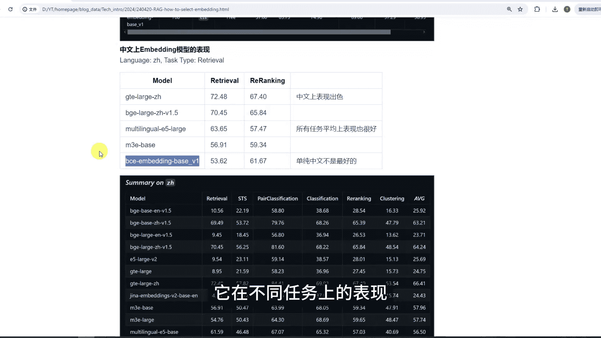

我们可以对比一下这个BG蜡纸中文版。

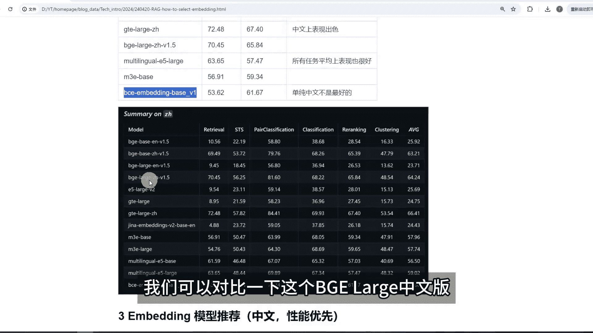

和这个bg large英文版，你可以看到这个中文版的这个模型啊，在中文任务上是远远超过这个英文版模型的，所以说呢选择这种模型呢，也需要针对我们具体的任务啊进行一些评测。

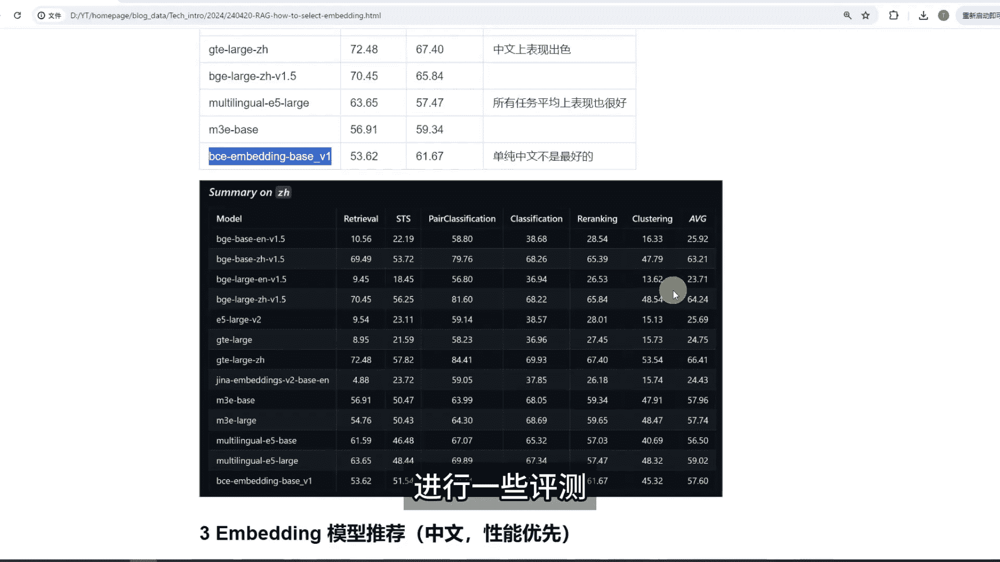

最后呢我推荐几个我比较关注的几个，embedding模型，我推荐的这几个模型面向的任务呢主要是中文，然后呢是性能优先，这里并没有考虑这个计算量的问题。

第一个呢就是这个b c e embedding base这个模型，这个模型呢，在哈根菲斯上的下载量呢是46万，我之所以关注这个模型呢，主要还是因为这个q anything呢，最近啊的确是比较火热。

这个模型呢也是q anything当中啊，使用的一个模型，第二个模型呢就是这个multi lingue，5large的这个模型，这个呢是针对多语言的，所以呢也肯定可以用在中文上。

它的下载量呢还是比较大的，达到了81万，第三个模型呢是这个g t e large，中文这个的下载量虽然有点小，但是啊根据上面我们的结果来看呢，它在中文任务上表现还是不错的，我自己简单测了一下这个模型啊。

在我现在使用的天池学习比赛这个数据上呢。

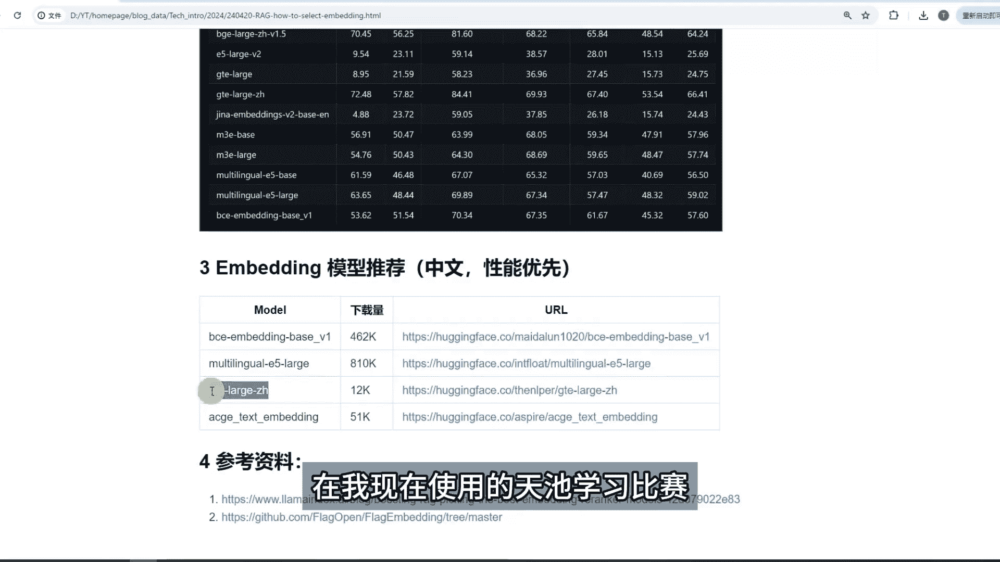

表现没有这个bce e embedding base的模型好，最后呢是这个AC g e taxi embedding。

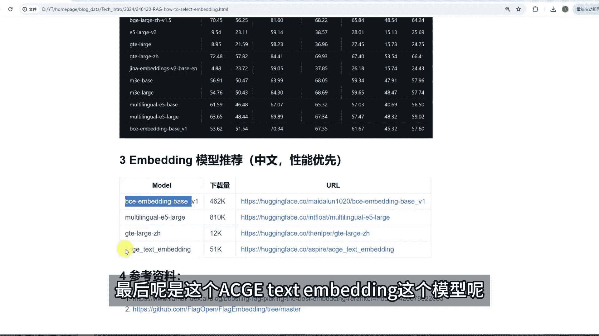

这个模型呢刚刚发布不久，具体性能如何呢，现在还很难说，但是呢感兴趣的小伙伴可以来关注一下他好的，以上呢就是我今天的分享，如果你有其他推荐的embedding行的话。

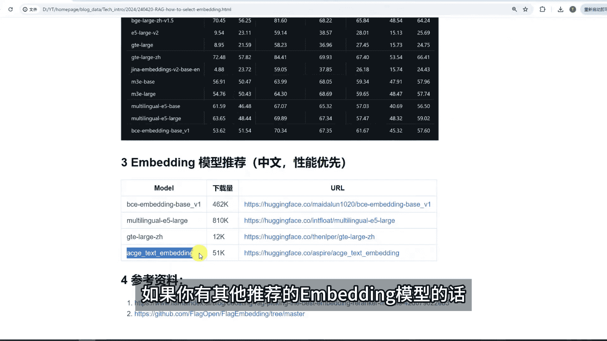

记得在视频下面留言告诉我，感谢收看。

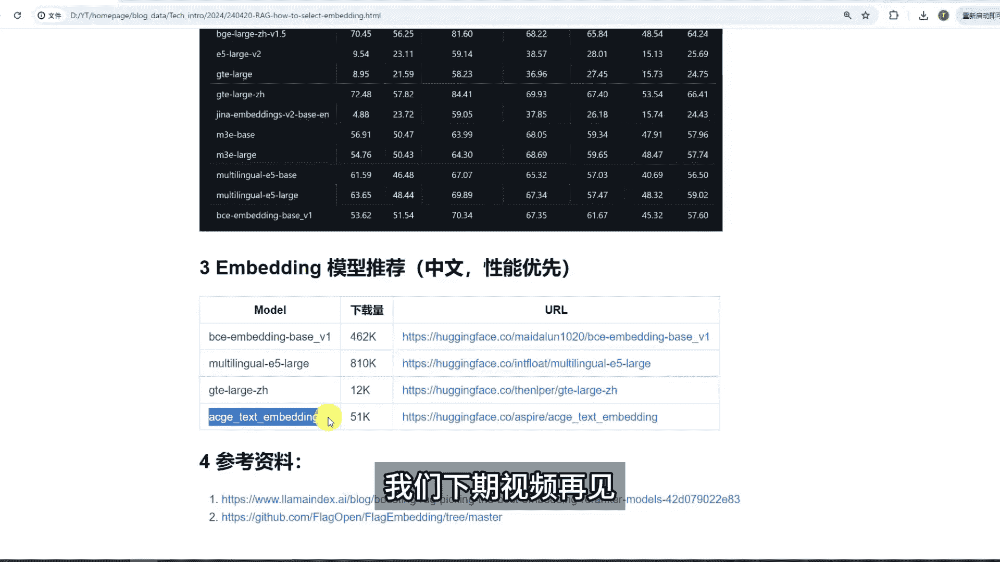