# 强推！(2026最新版) 李宏毅最新课程：智能体AI【AI Agent】71集全！人工智能／机器学习／深度学习／大模型／LLM - P33：32-2、LLM应用高效开发利器 - LangChain命令行工具与模版 - Ai人工智能工程师 - BV1QdzCB3Eu2

大家好，我是小木头，欢迎再次回到我的频道，今天我来给大家分享一下luncheon应用开发中，提升开发效率的两大利器，分别是luncheon CLI和template。

它们分别是lantern的命令行工具和模板，命令行工具呢帮助我们快速的创建launch，应用管理开发包等，同时呢也能帮助我们管理本地的运行环境，而lantern模板为开发者提供了轻松快速的构建。

生产级别大模型应用的能力，篮球模板目前涵盖了主流的大模型应用场景，这实现了场景的标准化，模板化，有了相同需求的开发者呢，不再需要重复的完成开发工作，基于模板一键搞定功能开发非常的方便，更重要的是。

咱们作为开发者，还能在日常的开发工作中，以模板的形式提供或者发布，基于应用场景的实现，这样呢，其他的开发者或项目就可以重用我们的成果，现在我们就通过两个典型的应用场景，来看看。

lunch的命令行工具以及template的使用方式，现在我所分享的呢，就是lunch官方代码仓库的templates部分，这里对模板有非常清晰的介绍，同时也给到我们非常简明的指令。

来完成命令行工具的安装，lantern项目或应用的创建，同时也给到了我们如何使用模板，在这里呢文档使用了一个叫paris speak，这个模板来创建了一个蓝全应用，所有的模板。

目前呢都可以在这个代码仓库里找到，我们会通过两个模板的应用，来看看究竟如何使用它，如何通过这些工具高效地帮助我们构建应用，第一个呢就是刚才介绍的paris speak，另外一个呢是csv agent。

Csv agent，这个模板是基于CSV数据作为知识库，来进行问答，我们呢首先通过命令行工具的安装，来开始今天的分享，那首先呢我们来装一下这个命令行工具，C r i。

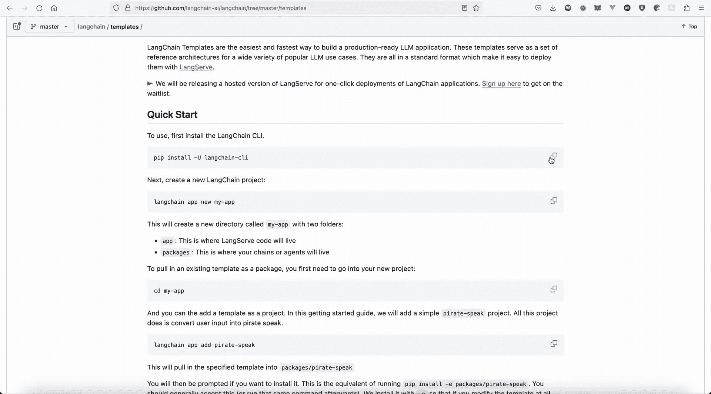

复制pip install这个命令来到控制台完成安装。

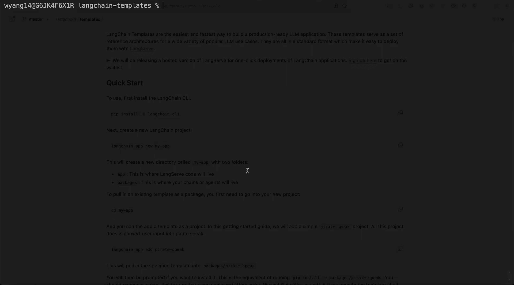

完成安装以后呢，大家可以先来尝试一下这个lunch命令行工具，在这里给到了我们一些帮助信息，看看他能做什么，首先呢是管理安全应用，还能够帮助我们启动安全的应用，或者是基于安全模板做一些工作。

我们在这里呢回到文档，基于LUNCHECRI，首先我们来创建一个应用命令呢，在这里我们可以拷贝一下应用。

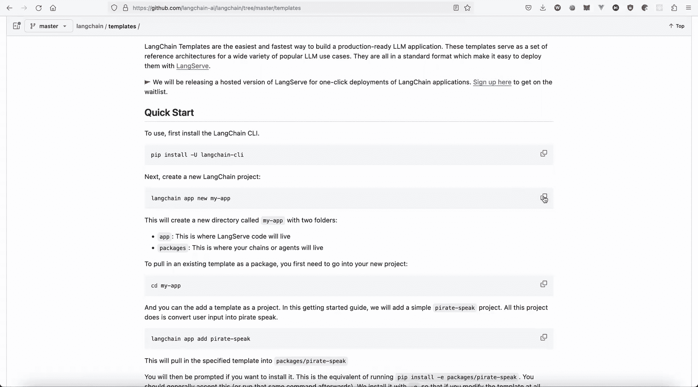

我们就让它叫你my app，这里会提示我需要添加什么package，也就是包，这个包呢就对应了，咱们在刚才LUNCHAIN，templates目录这里看到的一些模板，我们可以暂时不安装。

所以我们跳过这样呢，我们看看现在目录结构，有了my app，我们进入这个目录，可以看看这里面有些什么，这是一个标准的蓝全应用的目录结构。

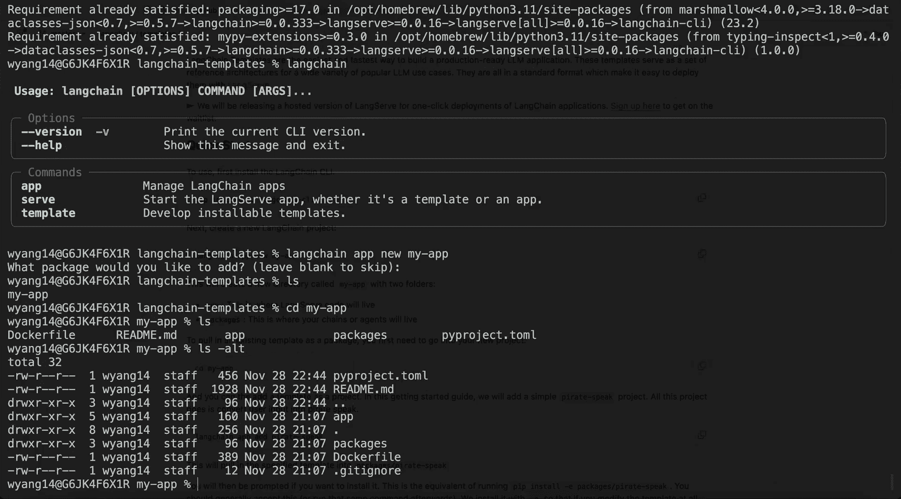

有个app文件夹，这里面呢就是这个应用的Python脚本，有一个，packages目录。

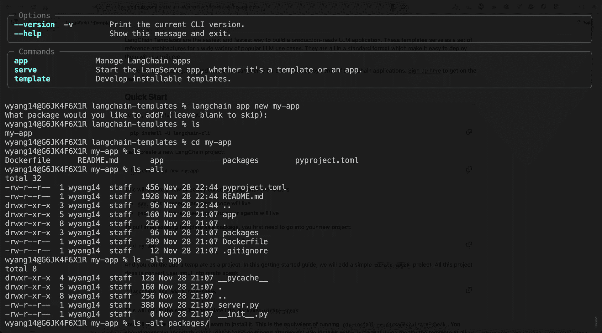

这里面呢就会包含我们安装的包，在这里我们还没有安装任何的模板，所以这里面暂时还是空的。

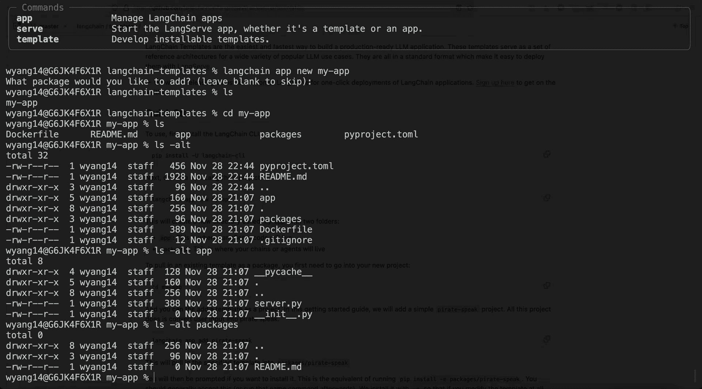

Docker file，帮助我们来构建docker镜像，这里我们暂时不做这部分的执行，回到文档。

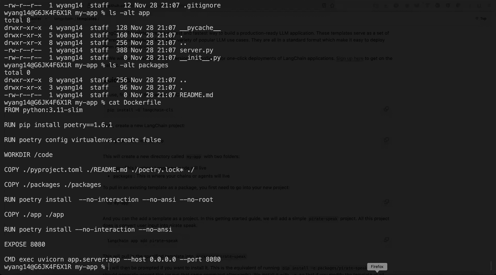

接下来呢我们会为它添加一些模板，模板的添加，这里有一个命令launchup ADD，我们先复制一下，会添加的是paris speak，这个模板，我们先复制。

然后呢回到paris speak这个模板的目录，可以看看他的介绍，每一个模板它都有文档做介绍，帮助我们了解这个模板究竟是做什么的，在这里可以看到他要求我们呢是有OpenAI的API，key环境变量。

这样才能保证我们能够使用大模型，默认它使用的是OpenAI的模型，那往下看呢，可以看到需要做什么来使用这个模板，模板安装以后还需要添加什么必要的代码，同时如果大家有lon smith访问权限。

也可以对这几个环境变量，Luncheon tracing，Lunch api，key lunch project进行配置，这样呢就可以在LMIST，看到这个模型交互的所有的数据流。

最后呢通过LUNCHASERVE命令启动这个应用，有几个URL或link可供我们使用，第一个呢是DOS，这个呢是访问的API，整个应用其实都是基于fast API，那么DOS是一个标准。

URRL可以查看API schema，另外呢就是playground供我们可以测试体验，整个基于模板应用，它的交互情况是什么样的，是不是我们期望的结果或体验，现在呢我们就回到刚才的根目录，这里。

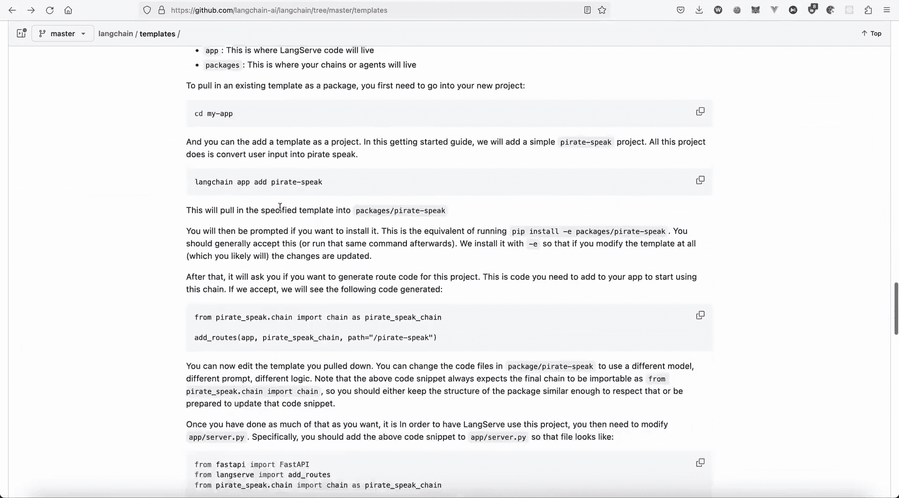

我们来把这个paris speak安装一下，我们现在呢需要额外做一份。

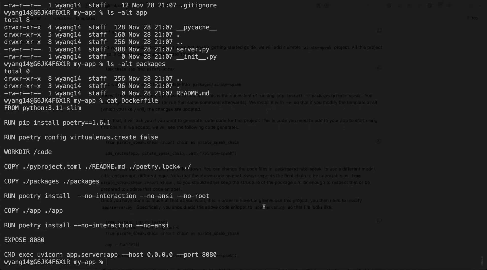

在文档中没有介绍的分享，我们来看看这个目录结构，在这里面有一个pi project tm文件。

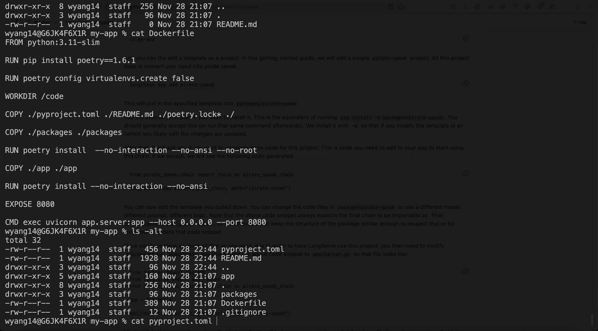

这个呢做了Python包的依赖的管理，使用的是ping，通过我的测试，我发现我似乎需要选用py shell来帮助管理，虚拟环境，管理依赖，否则的话好像还不完全能够工作，那么现在呢我就按照我自己验证过的。

可以工作的步骤为大家分享一下呃，第一步呢我们是要启动一个portrait shell。

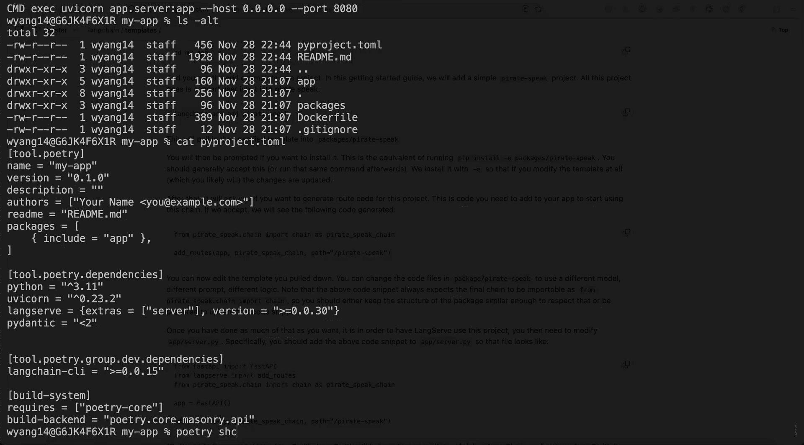

这样呢就有了一个应用的虚拟的执行环境，Python的虚拟环境，接下来我们来完成portrait的包的安装。

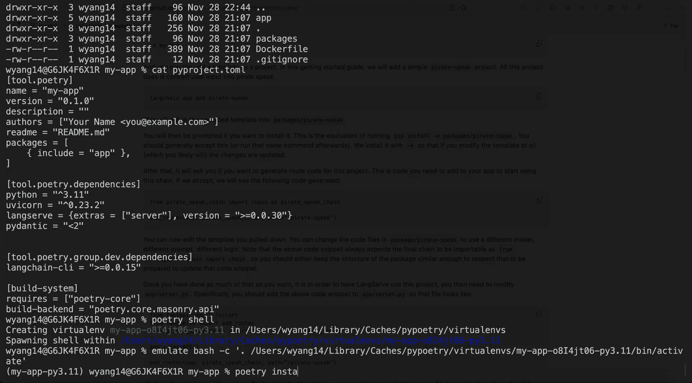

依赖的安装，这里呢可能略微花些时间安装完毕。

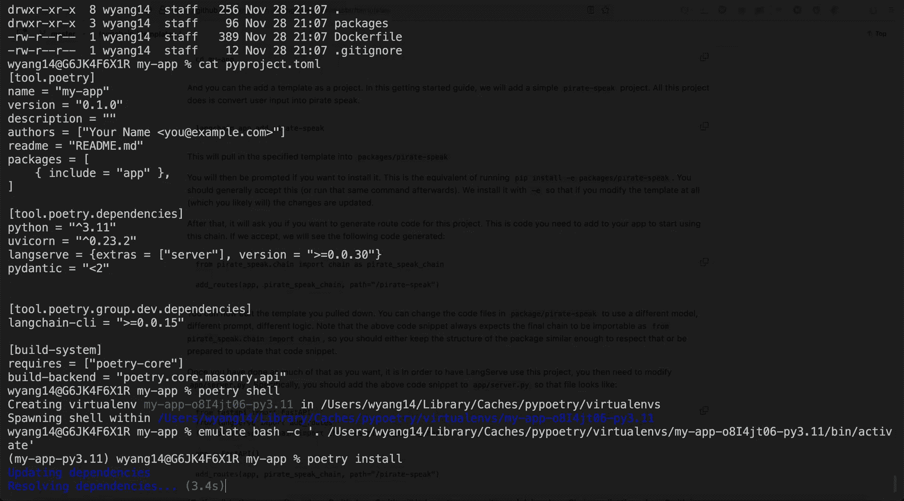

那现在咱们就可以按照文档的介绍来进行。

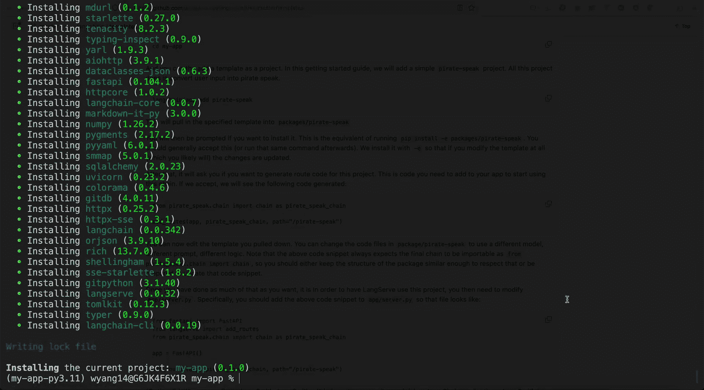

模板的添加以及lunch应用的执行，我们刚才复制的这个命令，Luncheon up at paris speak。

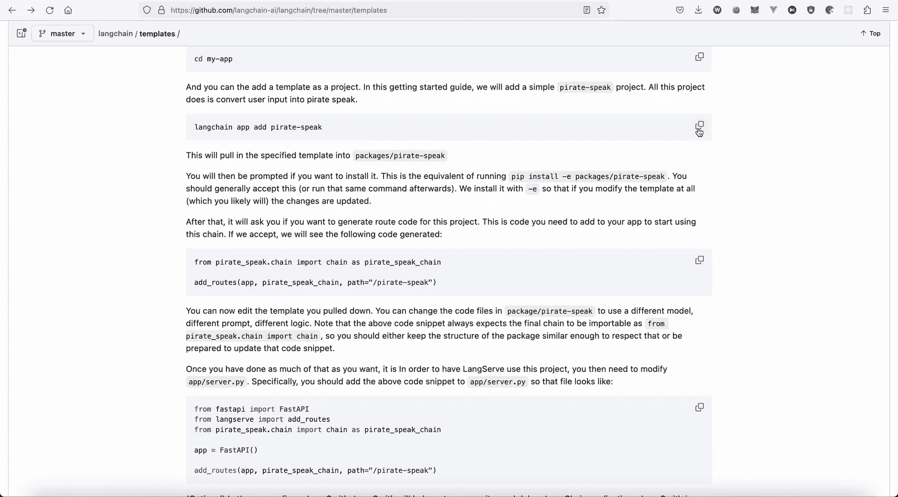

那在执行的时候呢，在控制台我们额外的需要使用poi run，那在这里表示我们确定是的要安装这个模板，他就会下载模板，并安装到咱们刚才分享的packages这个目录当中，那现在已经完成了安装。

最后告诉我们要使用这个模板呢，需要将下面的代码添加到app当中，我们马上会介绍这个添加到哪里，无论如何呢，我们先复制一下，那现在我们来看看package目录里面有些什么内容。

现在呢可以看到就有一个paris speak，这个呢就是我们刚才安装的模板，那它会被如何使用呢，现在我来分享一下这个py project tomo文件，这个文件当中大家可以看到paris speak。

这里呢是通过pass来指定的，它相对路径，也就是说这个依赖呢，是通过当前应用目录当中的packages目录当中，我们安装的这个模板来定位的这个依赖，这就是他们如何关联起来的，好了，我们完成了这个安装。

那接下来就需要把刚才命令告诉我的这段代码，添加到应用中，添加在哪里呢，我们添加到app server这个PY文件，这个文件呢，大家可以看到是个非常典型的fast API的应用，我们将这个注释掉。

注释部分的代码去掉，这是没有实现的一条root，那我粘贴进来，这样呢就有了一条root，Paris speak，好了我们可以保存退出。

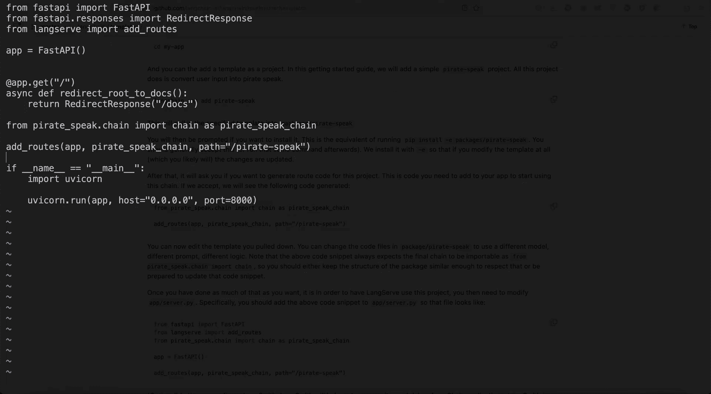

完成了必要的准备工作，接下来呢就可以运行这个应用了，我们依然得使用ping wrong lantern serve，用这个命令就能够启动，现在我们这个蓝全应用安全应用启动以后呢。

它是在本地的8000端口这里出现一些错误，表示呢OpenAI的API key我还没有配置，那我现在需要停掉这个应用，我将环境变量配置一下，这样呢应该就能正常工作了，那大家稍等我一下。

我去找一个API key好了，我在后台呢去拷贝了一个API key，并设置到环境变量中，现在我再次运行这个lunch serve应用启动，现在可以看到一些正确的输出信息，playground已经就绪。

这个playground是paris speak模板的，那文档呢就在DOS这个URLL之下，那我们现在先来到playground。

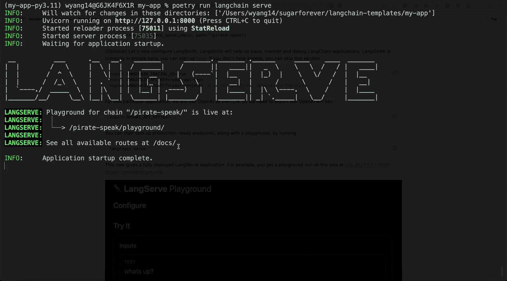

我们回到这个文档，那么我们点击这个链接，大家也可以手动输入，127。0。0。一八千端口，Paris speak slash playground。

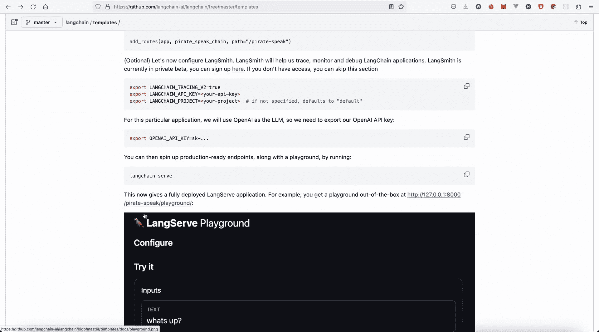

在这里呢就可以进行一些交互了，这是一个非常自由的交互，没有额外的组件的依赖，整个交互呢模型是扮演的一个parrot角色，那我们随便的聊一聊吧，How are you。

这里呢有intermediate steps，我们可以看到究竟交互中做了些什么，其中包括了聊天提示词模板是什么，那么在这里可以看到这个指令呢。

就是translate user input into paris speak，就将用户的输入呢转换成嗯，海盗的说聊天方式或者风格，这就是整个交互的过程，接下来呢是和chat OpenAI的交互。

那这就是我们如何使用模板，那么我们刚才介绍过了，dogs也是他提供的一个路由，这个呢也是可以访问的，通过这里我们可以看到他所有支持的API，这也非常重要，可以帮助我们在其他应用中。

非常轻松的集成paris speak这个模板，所支持的安全应用，那这就是我们如何使用最基本的一个模板，那接下来呢我们再进一步，我们再为这个应用添加一个模板，我们会用到刚才所介绍的csv agent。

这个模板他做了什么呢，我们先简单看一下，它呢会使用Python r e p l工具以及内存来做交互，这个交互的数据是什么呢，它这里面呢有一个CSV文件，这个文件应该是泰坦尼克号当时的乘客名单。

其中包括了性别，年龄嗯，他的客舱嗯号等等这些信息，那这就是一个非常典型的，以数据作为知识库来进行问答的场景，那我们这个模板我们回到这里来看看，它需要我们做些什么步骤，非常的相似。

那么在这里他也介绍了要创建这个环境呢，需要这个ingest py脚本，需要执行它来将数据注入呃，向量存储，那在这里其实我们可以发现它的这个模板当中，已经提供了索引数据的依这个依赖。

在这里有一个titanic data目录当中呢，已经有了这个线索引数据，也就是说数据已经注入了，当然没有这个数据，或者大家想想变换到其他向量存储呢，完全可以使用这个ingest脚本来自行的做注入。

那这就是我们如何准备这个数据，现在呢我们就将这个模板添加进我们的应用。

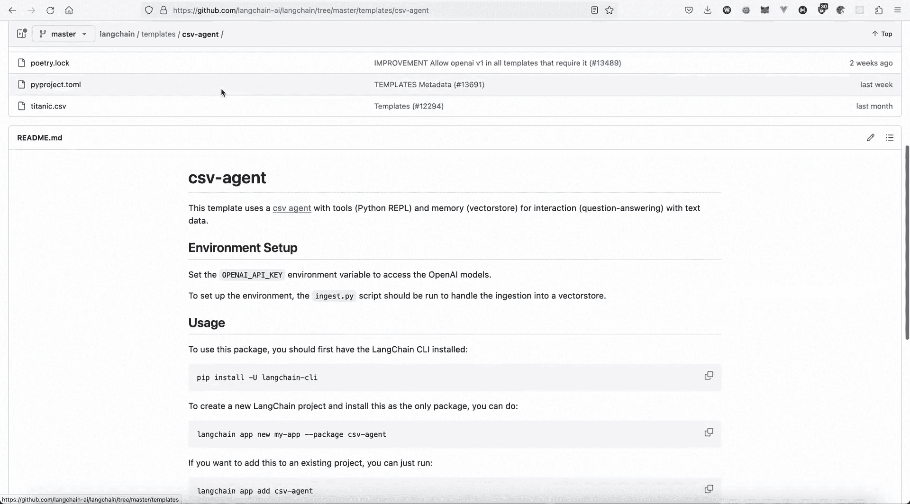

既然我们已经有了这个应用，我们回到控制台先将它停掉。

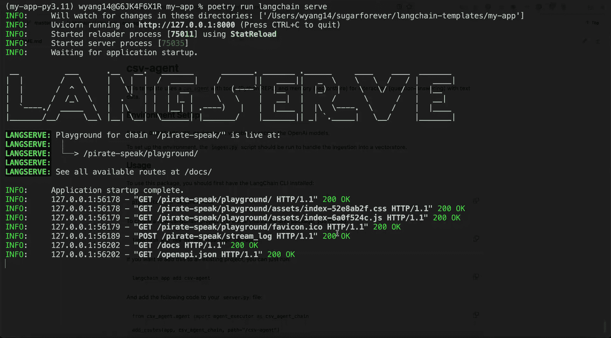

那么现在首先来添加这个模板，同样使用lunch app at csv agent，我们复制这个命令。

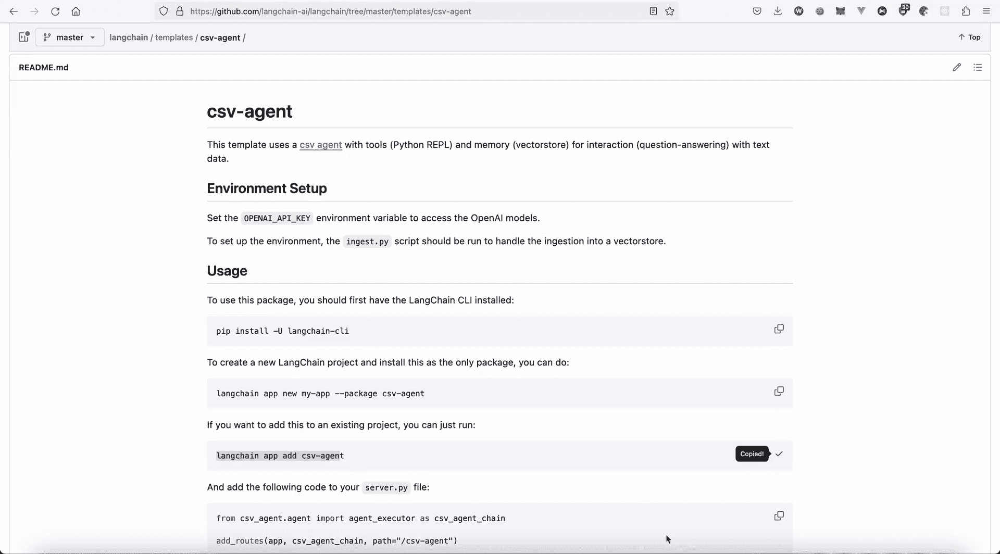

回到控制台，我还是得使用poetry run确定。

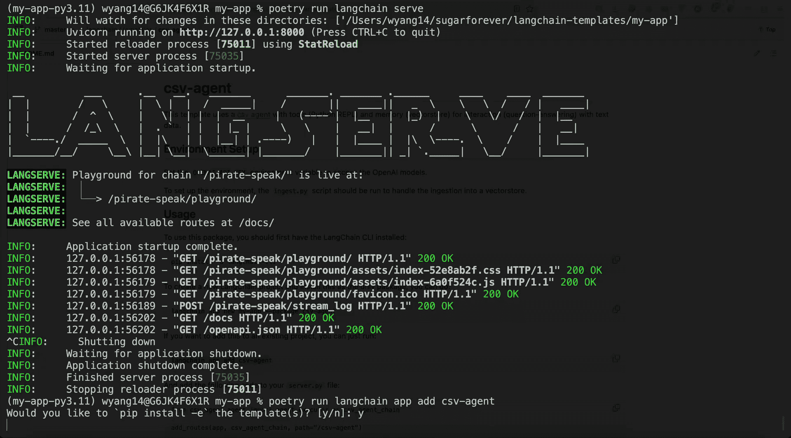

那么我们是会安装这个模板，同样这个模板呢会下载并存放到packages，这目录当中，执行完以后呢，我们来看看目录中的结构，应该会多了一个文件夹，也就是csv agent，我们拷贝这段代码。

因为我们要添加到server py这个文件里，那现在来看看packages目录当中的结构，多了一个文件夹sensory agent，那这就是我们如何使用安全的模板，非常简单。

那接下来呢就是在app server当中添加新的一个路由，刚才我们已经复制了，那在这里粘贴一下保存。

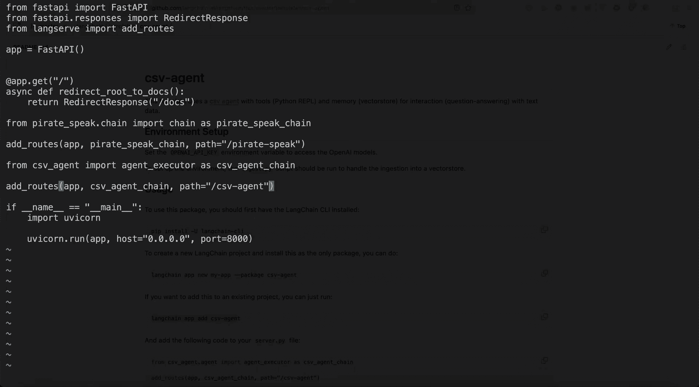

那现在我们就可以启动它同样的方式。

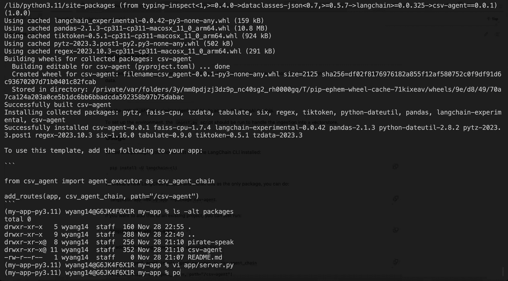

poch run安全serve启动，正常情况下，我们应该期望这里能看到，成功的加载了两个模板，那会有两个playground出现，稍事等待以后呢，它就启动了。

那playground一个是paris speak，一个是csv agent，那我们现在要做的呢是来尝试验证一下csv agent。

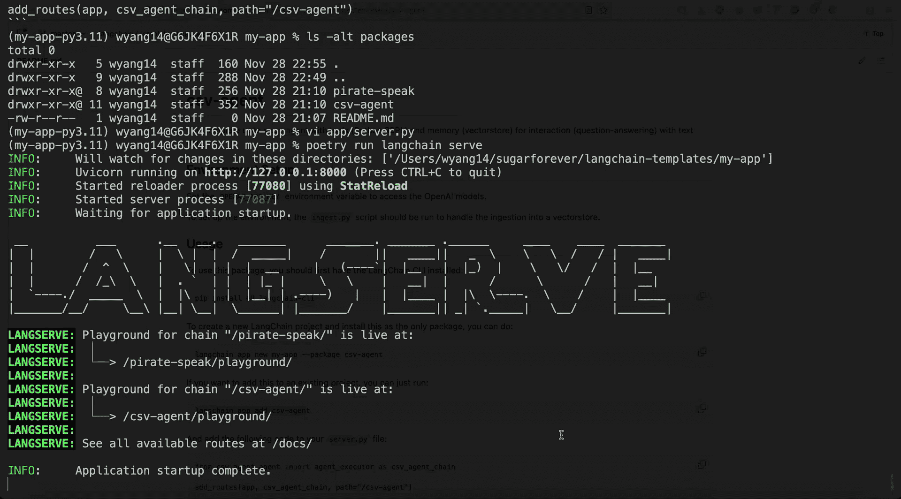

他的工作回到文档这里，cs agent这个模板呢同样也提供了一个链接，方便我们在本地轻松的打开playground，那在这里我们点击它，那就打开这个program。

暂时我们可以忽略这个validation error，这是playground，那么这些小小错误呢，是因为这里的输入是必选的，但是呢内没有内容，我们来提一个问。

我们先来看一下这个文CSV里面有些什么数据，比如我们来问一下谁，在这个cabin e forty six提完以后呢，可以看到这里有中间步骤，步骤在不断增加，说明他这个交互呢在进行啊，不断的在进行操作。

那给到我们答案，在e forty six里面的呢是mr timothy j mccarthy，我们来看看是不是这个人看谁没事对，是他我们还或许还能够来问一些不同的问题，那么我们来问问这个这个问题。

问问这位女士在哪里，那执行过程中呢，我们打开这个中间步骤，看看他究竟做了什么，这里进行了一系列交互，可以看到这里有方圈扣，然后呢这个执行呢得到了一些输出，输出当中得到的一些文档文档信息。

这些文档信息呢抽取出的一些内容，这就是retriever的结果，最后呢chat OpenAI呢，基于这些信息组织得到了回答，输出呢就是在cabin c one zero three，是这个吗。

zero zero three对，那我们的问题呢就先问这么多，至少我们验证了整个功能是能够跑通的，数据的检索也是正确的，那有兴趣的同学呢也可以自己再尝试一下，这里面其他不同的模板模板非常多。

特别是我们现在非常热门的概念REG，它也有非常多模板提供支持，包括conversation，Elastic search，甚至包括multi index fusion，Router。

open search等等，它都有支持，那每一个不同的模板，它的依赖会略有不同，那么呢我们在使用的时候需要对环境变量，需要对一些包的安装有一些必要的准备，那大家相应的准备就好。

那我想今天分享呢就先到这里，当然了，我们也只分享了模板应用当中的一部分内容，在这里大家可以看到，其实还有一部分内容我们并没有介绍，就是如何使用line surf进行应用的发布和部署。

另一部分呢是如何使用remote ronnable来调用，咱们在本地运行起来的lunch应用，这部分内容呢我们会放到后续的分享中来介绍，那有兴趣的同学呢请继续关注我们频道。

那也给咱们来波三连YOUTUBE的小伙伴们，记得点击小铃铛以获得我们发布的更新，这样呢能够第一时间得到我们最新的视频发布，好吧，感谢大家的关注，有什么问题呢，也请在评论区给我们留言。

那我们就下次视频分享再见。

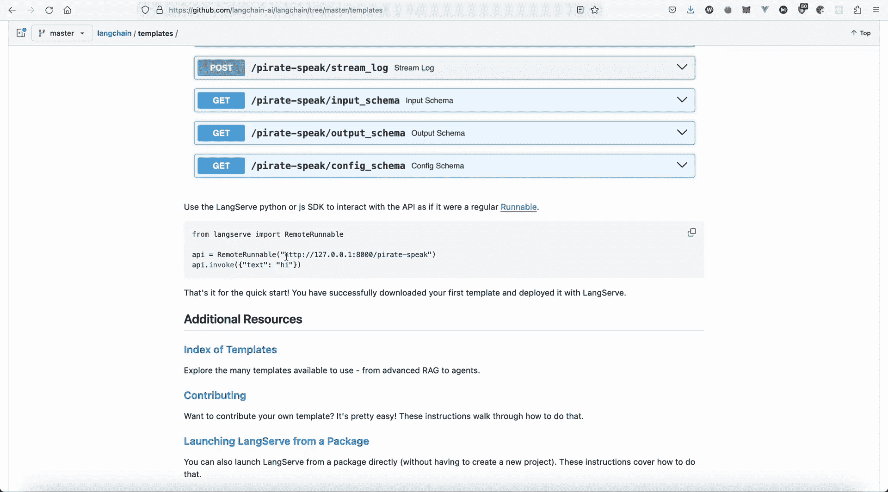