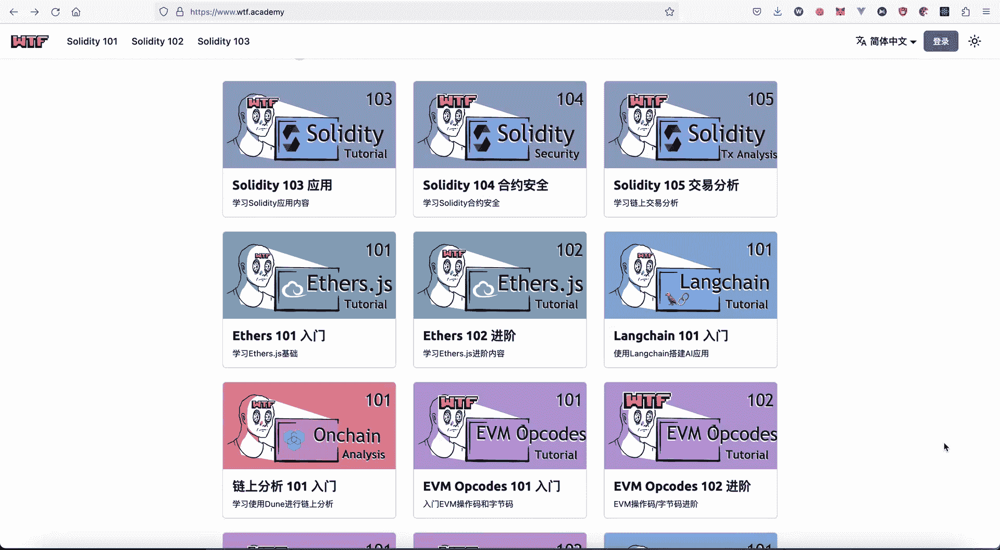
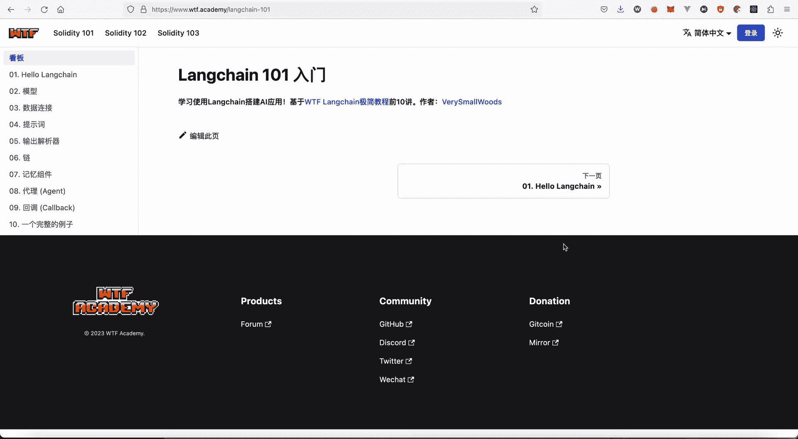
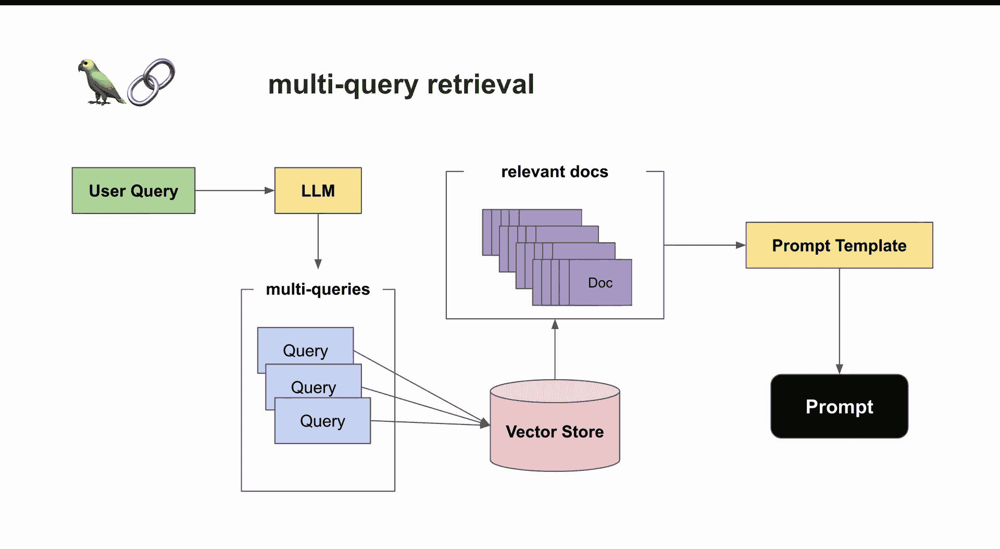
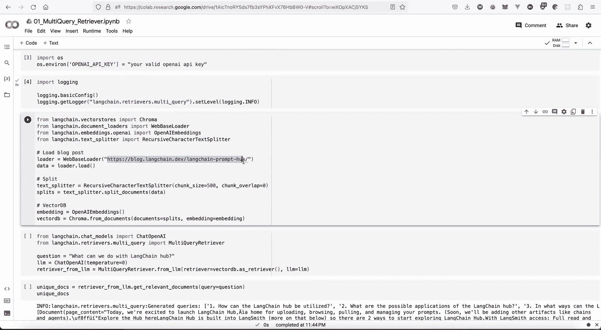
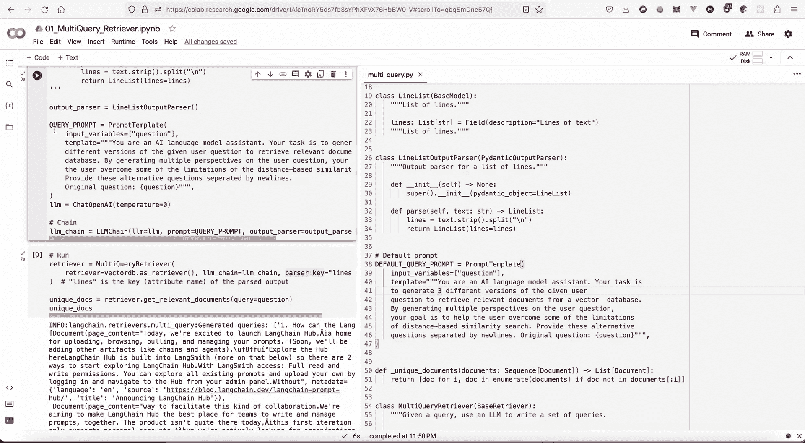
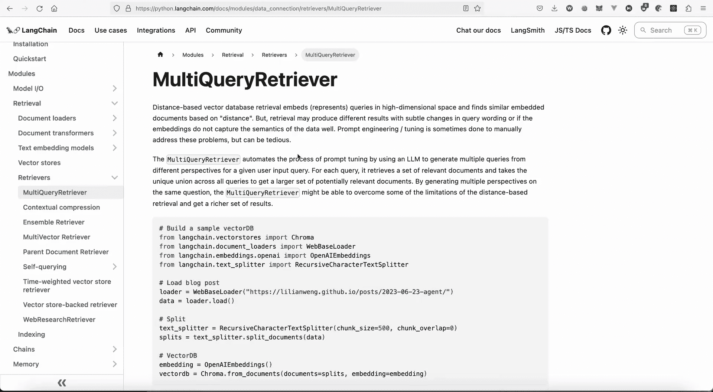

# 强推！(2026最新版) 李宏毅最新课程：智能体AI【AI Agent】71集全！人工智能／机器学习／深度学习／大模型／LLM - P36：35-5、LangChain进阶 - 高质量内容检索 01 多重提问检索器 - Ai人工智能工程师 - BV1QdzCB3Eu2

大家好，我是小木腾，不久前我们分享了lantern极简入门系列。

该系列呢介绍了lantern的最基础的知识，能够帮助我们开始构建launch应用。

但是在实际的产品开发中，利用这些基础的功能构建方式呢还不够，今天我们就开始分享一些蓝拳框架中，更高级的功能，这也是蓝拳进阶系列的内容，今天我们从检索器开始，在一个典型的RG应用开发中。

必要的步骤分为了文档加载，文档拆分向量化，并进行向量存储，然后基于向量存储进行相似性查询，或基于向量距离的查询，这类查询就叫检索，蓝拳所提供的对应组件就是检索器，但是这种方式呢在查询语句发生微小变化时。

可能就会带来不同的结果，那蓝圈则提供了一系列更高级的检索实现，帮助开发者解决这类问题或提高检索质量。

今天我们介绍第一种multiccurry retriever，多查询检索器，他利用大院模型，基于用户的提问，生成在不同方面的多种提问和多个提问，再利用这多个提问来进行相似性的查询。

以此得到一个更大的相似文档集合，从而呢克服基于距离查询的局限性，接下来我们通过简单的示意图，来看看它的工作流程，在一个多查询检索中，当用户提出一个问题，这就是一个用户的查询。

一个carry它会被发送给大约模型，交付给大元模型，来生成在不同方面的相似的几个问题，也就是基于单元模型，将用户的提问映射成在不同方面的几个，相似的提问，那在这个场景中呢，我们这里将它映射为三个。

或者说大院模型给到我们三个相似的提问，再将这些提问交由向量存储，基于向量存储进行基于向量距离的相似性查询，在这个查询中就会得到一系列的相关的文档，这些相关文档呢。

由于是基于多个提问或多个carry来生成的，那么就得到了一个更大的相关文档的集合，再将这些文档的集合交给提示词模板，或者直接交付给大约模型，作为上下文信息或上下文环境，那如果提供给提示词模板呢。

它就会基于这个较大的结合的相关文档，来生成一个更丰富信息的提示词，一个prompt，这就是多查询检索的基本的工作原理。

在LUNCHEN的官方文档，这里，也对这个多查询检索器有非常详细的示例代码，在这里呢我们也参考这个示例代码，来准备了一份Python notebook，和大家一起来跑一跑这个程序。

看看究竟这个多查询检索器它的工作效果如何，那我们来到这个Python notebook，在这里呢大家需要安装一些Python包，Lunchen open ai chrome db token。

我们会用到chroma dB作为向量存储，同时准备OpenAI API key，接下来我们会做一个操作，是将日志打开，日志呢我们对这个多查询打开了info级别的日志，接下来就是多查询检索器的主要的工作。

原理的展示，我们会加载一份网页，这是lantern的博客。

这个博客呢我在这里已经打开了，这是对luncheon Hope的一个官宣。

其中介绍了什么是安全hop，如何使用它为什么会构建luncheon hop这个应用，那我们基于它来加载这个博客文章，并将这个文章进行分块向量化做存储，那这些操作呢就在这部分的代码做了实现加载。

这个博客文档，然后将这个文档分块，文分块的大小呢是500分块，后基于OpenAI的embedding API来做向量化，并存储到chrome dB当中，我们来执行一下，在执行完成以后呢。

这里就会得到一个向量存储的数据库，存储的实例，这个实例就被后面的检索器来使用，下面这里我们可以看到提了一个问题，What can we do with luncheon hop。

想问一下luncheon hob能拿来干嘛，对我们来说有什么用，这里是第一种方式呢，是直接使用MULTIQUARY，retriever这个类来构建一个检索器，检索器的构建呢是调用from LLM函数。

这个函数需要两个参数，第一个呢是向量存储所暴露的检索器接口，是通过调用ARRETRIAL函数得到一个检索器，另外就是提供一个大圆模型LLM，那我们先来执行一下这部分代码，这样就得到一个检索器。

如果我们用这个检索器去做这个，相关文档的查询，通过调用get relevant documents提问的问题呢，是query参数传入的，这样就会得到一个文档的列表，我们先来执行一下。

然后看一下这里的效果，执行的时候可以看到一行日志，这个是MULTICKA日志，它告诉我们生成了curious，这CURERIS，那就是基于一个用户输入得到的多个相关的。

或从不同方面表现这个提问的几个问题，这个数组当中我们可以看到123，这一共是三个问题，表示这个相四的问题呢，大模型给了我们三个，这三个是怎么来的呢，我们一会儿会通过源代码的解析，简单的给大家分享一下。

那么在这里得到的文档呢，我们可以看到在下面有三个文档，这些数组有兴趣的同学呢，也可以一个一个来审核一下，看看是否跟这个提问是有相关性的，或相关性比较高的，这是第一种方式，这种方式呢是基于大模型。

基于向量存储，大家可以看到在这里呢和大模型的交互，去获得相似问题，多个相似问题的这个过程中呢，并没有用到提示词，没有用到提示词模板，当然了，我们也可以自己来构建提示词，让模型来返回相似的问题列表。

那这里呢既然使用提示词呢，就可以做一定的定制化，我们下面这个例子就来看一看是如何做的，在这里呢我们定义了一个提示词模板，输入变量呢是一个问题，这个模板是什么样的呢，是现在我们大家现在看到这一段。

就是要得到，或者说让模型给他们五个相关的问题，那原始问题呢是通过这个模板变量传入的，当我们构建了这个查询的提示词模板，那在这里呢可以看到，用到了聊天API或者聊天的模型，Chat open ai。

这里首先会构建一个大圆模型链，这个链呢就用到了刚才这个模板，还有一个是输出的解析器，这里呢输出解析器用的是linless output passer，这个类是由蓝全框架提供的。

我们在这里可以看到也将它的源代码贴出来了，他做的事情是什么呢，他其实做的事情很简单，他把响应按照换行的方式来做了拆分，也就是在响应当中有多少行呢，他就对应的拆分成多少各元素。

这样每一行就是一个数组中的一个记录，因此当模型告诉我们五个问题是，那么通过换行符的拆分就可以得到这五个问题，五个问题数组存放在了这个list，line list这个模型当中，这个呢正是蓝犬框架所提供的。

实现好了，当我们构建出了这个大圆模型链的以后，就可以将其传递给这个multiculate retriever，我们回忆一下，刚才使用的是from lolm这个函数，来构建的一个检索器。

接下来呢我们是通过传递与TRIOR，检索器以及大圆模型链和解析器的键，来进行这个检索器的构建的，差别在于在这种方式下，就可以通过提示词模板来自定义期望模型，对于相关性问题或相似问题返回。

需要完成哪些任务，那在我们现在这个自定义的场景中呢，就希望它能够返回五个不同的问题，那我们来执行一下这部分代码，我们先执行一下，并来构建一个检索器。

这检索器呢当我们调get relevant document时候呢，可以看到这这里的日志告诉我们生成的query，如果我们向右边滑动，可以看到他一共给到了我们五个相关的问题啊。

下面的文档呢我们也就不再逐一的过，大家有兴趣也可以去比对一下，核心在于我们通过这个示例代码执行，介绍如何使用提示词模板，或者不用提示词模板，直接使用大圆模型，或利用LANCH所实现的默认的机制。

来让大模型帮助我们生成相似的问题，那接下来我们回到刚才的两个函数调用，第一个是from LLM，我们来看看他究竟做了什么，在这里面大家可以注意看，在这里面呢它也用到同样的输出解析器。

Line list of proposer，那这个prompt我们刚才并没有指定这个prompt，可以看到这个prompt它使用的是default prompt，Carry prompt，那它是什么呢。

如果我们往上翻，可以看到这个default prompt，和刚才我们在这底下，看到的这个实例几乎一模一样，大家看到了吗，这个carry prompt1模一样。

区别且又在于在LANTER所提供这个default，默认的提示词里面是生成三个不同的问题，而我们这里刚才自定义的提示词模板呢，是让它生成了五个，因此工作机制或者工作呃原理是非常相似的，仅仅在于。

我们可以通过刚才我们分享的第二种方式，来自定义一个模板，让大模型基于一些特定的条件。

来帮助我们生成相似的问题，好了，这就是LUNCHA框架所提供的多查询检索器，它能够帮助我们克服基于距离的检索，中的一些局限性，同时呢能更得到一个结果更丰富的，相似或相关文档的集合。

那这样呢在基于用户提问做回答时候，模型能够更好的获取必要的上下文信息，那这是第一种，在检索时我们可以使用的相对更高级的一个，检索器的实现或检索器的组件，那后面呢我们会介绍更多相关的检索器好吧。

那今天分享就先到这里，有兴趣的同学呢，可以将这个检索器尝试应用在自己的相关的功，能或应用场景中，看看它的表现如何，那有过测试或使用体验的同学呢，也欢迎在评论区给我们留言，来分享一下使用体验。

以及在使用中是否有一些潜在的问题，好吧，那今天的分享就到这里，感谢大家收看，我们下次再见。

