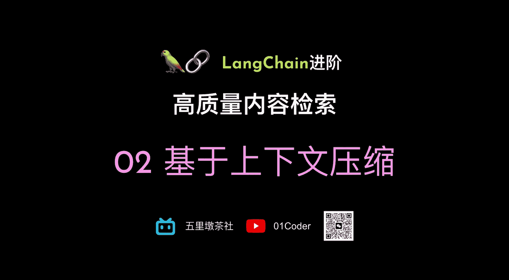
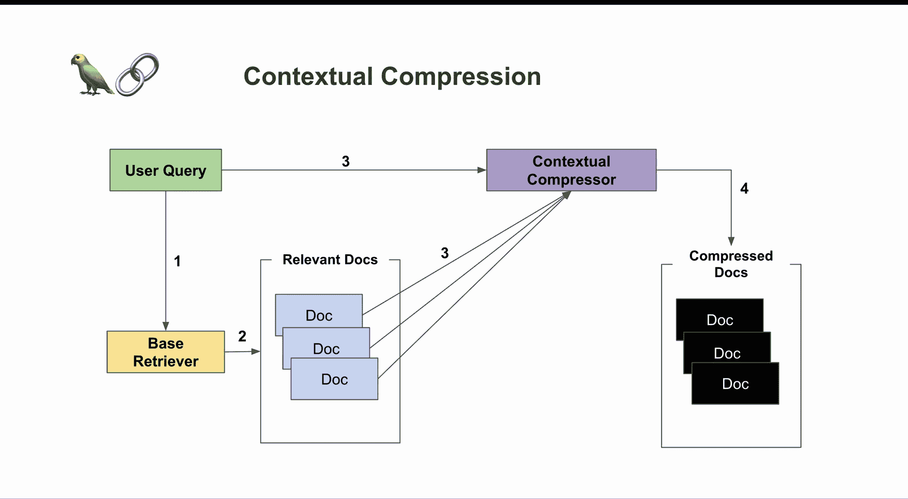
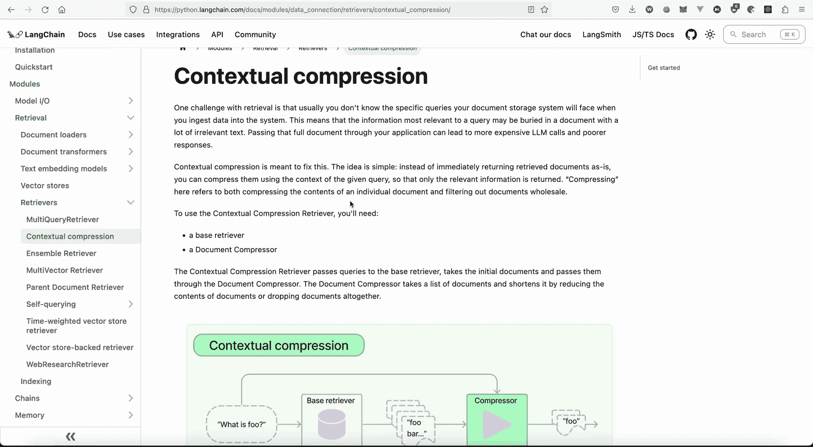

# 强推！(2026最新版) 李宏毅最新课程：智能体AI【AI Agent】71集全！人工智能／机器学习／深度学习／大模型／LLM - P37：36-6、LangChain进阶 - 高质量内容检索 02 基于上下文压缩 - Ai人工智能工程师 - BV1QdzCB3Eu2

大家好，我是小木头，今天呢我们继续蓝拳进阶内容的分享，我们还是学习检索器，在上一次视频分享中，我们学习了MULTICCARRYTRIEVER，这是通过多重提问，来提高检索质量的一个检索器。

今天的分享中，我们来学习launch框架所提供的另一个检索器，它是基于contextual compression，也就是基于上下文的压缩来实现的，检索器检索的一大挑战在于。

当我们将文档或数据注入系统时，并不知道将来它需要服务于什么样的查询，这也意味着对某一个查询最相关的信息或数据，它存在于一份文档中，但可能同时也被大量无关的信息所环绕，那么如果我们将这一份完整的文档。

交给大院模型进行处理呢，这会导致非常昂贵的模型调用开销，同时呢也会降低响应的质量，基于上下文的压缩，帮助我们能够改善这种情况，解决这类问题，他的想法是，当我们检索到相关的文档。

并不是简单地将文档立即返回，取而代之的，首先会基于提问的上下文，来对这些文档进行压缩，这样呢只有相关的信息才会被返回，而这里所提到的压缩呢，它会做两件事情，一个是对每一个单一文档内容进行压缩。

另一方面呢是可能会过滤掉整个文档，在安全框架中就提供了一系列的组件，帮助我们实现这些功能，要使用基于上下文的压缩，那蓝全框架就提供了这么一个检索器，如何使用它呢，首先还是需要一个基础的检索器。

一个retriever，基于用户的提问得到相关文档，接下来再使用这个压缩器或这个检索器compressor，来对相关文档进行进一步的处理，可能会从中截取出相关的信息，压缩文档也有可能过滤掉整个文档。

那怎么做呢，我们先来看看简单的一个流程，在基于上下文的压缩中，用户提出了一个问题，作为一个CURY被发送到检索器，这个检索器是我们在RG过程中，过去分享中已经反复用到的。

基于文档可以到向量存储中进行查询，得到相关的文档，得到相关文档后，我们会对这相关文文档进行处理，这个处理呢就是压缩，压缩损约所用到的就是contexture compressor。

基于上下文的压缩器进行压缩以后，我们就得到一组压缩后的文档，这些文档呢叫之前得到的相关性，文档呢就有更高的相关性，换句话说更通俗讲，它的文档质量会更高，更符合回答用户提问的要求，这就是简单的一个流程。

如何完成基于上下文的压缩，那接下来呢，我们就通过蓝圈框架所提供的一系列组件，看看他是怎么做的，我们可以如何实现这种基于上下文的压缩，同样在这里呢准备了一份Python notebook。

我们来看看如何一步一步的实现，这种基于上下文的压缩，那我们安装lunchopen AI chrome dB，Take token，今天用到的这个文档或示例中，所使用的这个原文档。

数据呢是这个po graham essay，这个是我们在之前的分享中，也曾经用到过的一篇文本文件，这是一篇短文，我们会要基于这个文章提一个问题，Where did paul graham study。

这个问题的回答呢，最简单的一种实现方式，就是将文档进行分块向量化，做向量存储，然后基于相似度进行查询，得到相关文档，并将相关文档交给大模型，从而得到响应，这是最基本的RG的一个流程，那我们在这里呢。

参考了Python版本lunch的这个文档中，所定义的一个打印文档的函数，Pd print docks，帮助我们更友好的查看文档内容，我们也继续用这个函数，接下来这个代码块。

我们先演示的是最基本的RG的过程，得到一个文档，加载文档，拆分文档向量化，然后做向量存储，在向量存储中，基于相似度或者向量距离进行查询，从而得到相关的文档，这是最基本的一种实现方式，在执行完成以后。

我们是会看到这里得到了四份文档，这个呢就是文档分块，接下来我们会对它进行，我们刚才介绍的压缩操作，第一个操作呢是基于LLM chain extractor，这个组件所做的事情。

是基于大圆模型或是利用大圆模型进行数据，数据或信息的抽取，也就是extraction数据的抽取，是从每一个文档中抽取出相关的信息，在这里可以看到得到了三个文档，这个文档呢。

相较于刚才这个最基本的检索器的查询，相关文档呢，得到的信息显然是不同的，首先信息量上也会少很多，每一个文档分块的信息可能就更精确，我们问的是program在哪儿学习读书的。

那在这个通过抽取器来实现的压缩呢，就非常精确，的给到了我们学习的地方的一个信息，那我们接下来看看他，这ATTRACTOR究竟是怎么工作的，那我们现在来看一看LOLMCHAEXTRACTOR。

这个提取器是如何工作的，我们打开这个from LLM这个函数的源代码，在这里可以看到他会做几件事情，首先呢它会构建一个提示词，一个prompt。

这prompt来自于这个get default chain prompt，当我们没有提供prompt参数的时候，那就是一个默认参数，我们看看它是哪来的。

这个get default chain prt在这里定义，它会从这个PROTEMPLATE当中进行格式化，这PROTEMPLATE正是来自chain extract prompt。

它在这里可以看到它的提示词是怎么写的，它是基于问题和上下文要求，大圆模型帮助我们来把文档中的相关部分提取，如果没有相关的呢，就返回一个NO output string。

这个out NO output string呢也是通过输入变量来指定的，因此从原理上来讲呢，这个LLM乘extractor，是利用大运模型来帮助我们，将必要的信息抽取出来，接下来呢再看定另外一个组件。

叫l v m chain filter，这个组件呢是做过滤，从名字上就能够看出来他是做过滤的，这个过滤是怎么做呢，同样如果我们打开from lolm就可以看到，在这个函数中同样是构造了一个提示词。

prompt和一个大圆模型的链，这个提示词呢，依然来自于这个默认提示词的模板，这个模板呢通过了chain filter prompt引入，我们如果打开它的源代码，可以看到这里面提示词是怎么写的。

他会要求大圆模型帮助我们去判断，基于提问和上下文来判断是否相关，他如果这个上下文和问题是不相关的，那就回答NO，否则呢回答yes，它正是基于这个提示词来构建的过滤器，那我们先跑一跑这部分代码会看到。

这里呢对它进行了过滤，过滤的结果呢从大于模型角度来看，三个文档其实在这个最基本的这个实现中呢，是四个文档，这四个文档当中它过滤了以后，我们会看到他只留下了一个文档，也就是这个document to。

从大于模型的角度来判断，其他几个文档呢就跟这个提问没有没有关系，因此呢他就过滤掉了其他三个，仅留了这一个文档，这就是过滤的压缩方式，这就是刚才我们提到的，在压缩中一方面是会对内容进行压缩。

提取相关的信息，另一方面呢有可能会对文档整个进行过滤，那这个l l chain filter就是做的过滤工作，还有一种方式呢，就是下面我们所看到的这个embedding filter。

Embedding filter，从名字上就能看出它的意思，它是基于embedding来做过滤，他这里呢会指定一个相似度的阈值，Similarly reshold，0。76。

它会基于这个阈值来判定是否相似或者相关，他的判定呢是基于提问，carry或者question，这个question用问题和查询出来相关文档，来进行相似度的匹配，相似度不达标的那就会被过滤掉。

我们在这个地方呢也可以执行一下这部分代码，会发现在这里呢四个文档都留了下来，这有四个文档，我们在这里呢可以对这个参数略做修改，看看会有什么不同的效果，嗯我好像改错了地方，应该是这相似度提高到0。85呢。

就会发现其实就都没有结果出来了，他认为都不够相似，那调到0。8会发现在这种情况下，就只有两份文档符合这个阈值的设置，那最后我们介绍一个类呢，是embedding redundant filter。

它是基于embedding来进行冗余文档过滤的，当我们得到一个文档集合的时候，这其中可能有些文档有相似度极高的内容，那么对于嗯数据来讲，我们认为这些可能就是冗余数据，并不需要存在于这个集合当中。

那就可以使用这个redon filter对它进行过滤，最后如何将众多的过滤器组合在一起呢，我们可以使用document compressor pipeline这个类，来将众多的过滤器或压缩组件串联起来。

在这个例子当中，通过在doc document compressor pipeline，这个类串了三个组件，一个是spider，这是文档的拆分器，第二个呢是荣誉文档的过滤器，Redon filter。

最后呢基于相似度来进行了过滤，也就是使用了relevant filter，使用了刚才我们介绍的embedding filter，基于相似度的阈值来进行过滤，这样构建出来一个压缩器的管道。

本质上它也是一个压缩器，1compressor，最后呢就可以使用contexture compression，retriever来构建一个检索器，这个检索器呢就会从这个retriever当中。

获取到相关文档，这是一个基础的一个检索器，也就是从向量存储中检索到或获取到相关文档，这相关文档就会被刚才创建的这个管道，压缩器进行处理，他所做的处理操作呢，就包含了冗余的过滤和相似度的过滤。

这就是我们如何使用基于上下文的压缩，来实现更高质量的检索，有兴趣的同学，当然还是赶紧将这部分内容，或这部分组件和功能啊试用起来，到自己的产品和应用当中体验一下，非常重要的一点是。

通过测试和使用来评估究竟基于上下文的压缩，这种方式是否能够提高基于文档的问答的质量，那这也是我们在后面的实战中需要做的事情，好吧，今天的分享呢就到这里，有兴趣的同学当然可以比较一下。

MULTICKY和这个contextual compression，基于上下文压缩他们之间嗯的差异，以及在实际的产品应用当中，哪一个检索器给到了我们更高的问答质量。

那咱们就下次再见吧。