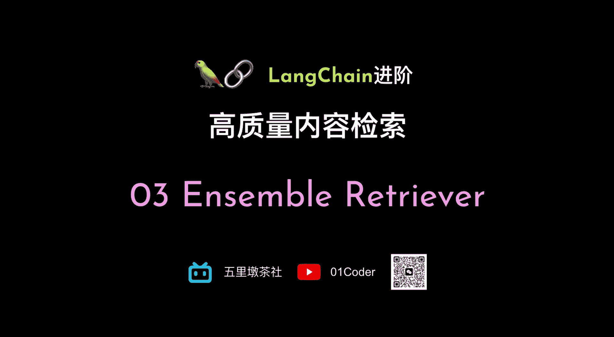
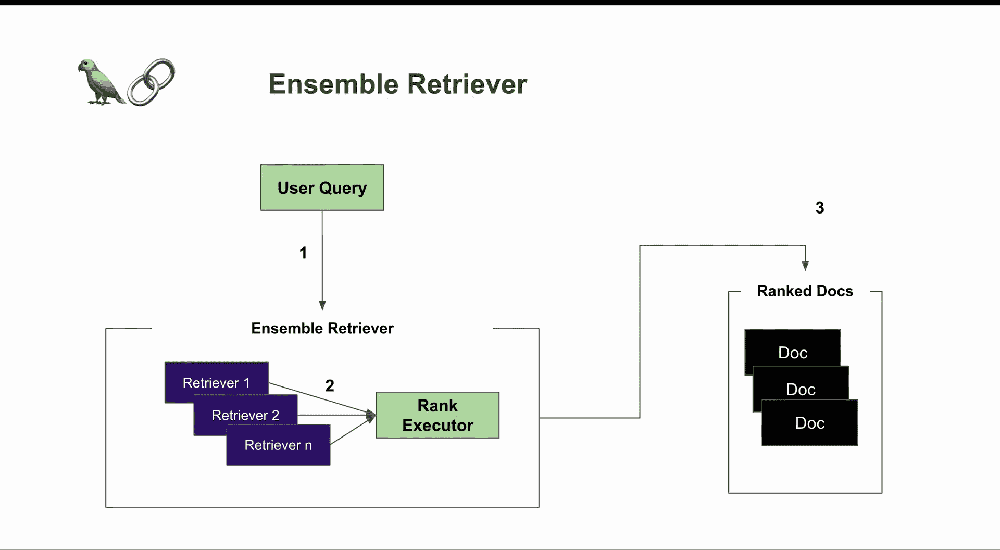
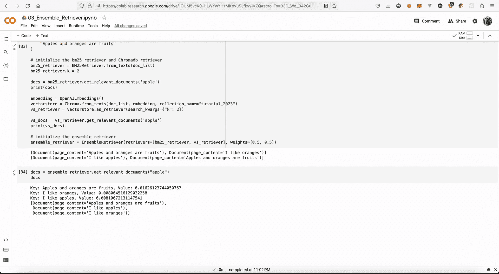

# 强推！(2026最新版) 李宏毅最新课程：智能体AI【AI Agent】71集全！人工智能／机器学习／深度学习／大模型／LLM - P38：37-7、LangChain进阶 - 高质量内容检索 03 Ensemble Retriever - Ai人工智能工程师 - BV1QdzCB3Eu2

大家好，我是小木头，今天我们继续lunch进阶系列内容的分享，这个进阶系列内容呢，我们是从launch框架的检索器开始分享的。

在前两期视频中，分别介绍了MULTICCARRYTRIVER和contextual compression，Retriever，今天我们来介绍第三种类型的检索器，也就是ensemble retribu。

从字面上来讲，ensemble triever也就是集成检索器，它是将多个检索器或检索模型结合在一起，以获得更全面或更准确的检索结果，换句话说以换取更好的综合性能。

那么在LUNCHENSEMPLETRIVER使用场景中，最常见的一种应用场景或模式呢，是组合sports retribor和dance retribor，那什么是sports retribor。

也被称为稀疏检索器，常见的算法呢是BM25篮球框架中，对它呢也已经有所支持，我们可以使用BM25trial这个类，悉数检索器呢，通常善于基于关键字来寻找相关的文档。

而密集检索器也就是dance retribu，它正是基于这种相似性的搜索来提供检索的，称为dance retribu，密集检索器，他擅长于基于语义的相关性或相似度，来寻找相关文档。

Example retriever，正是结合了这两者的优势来问，提供更好的综合的服务和相关文档的搜索质量，接下来呢，我们先通过一段简单的动图，来介绍它的工作原理。

再配合Python notebook和源代码的分享，来介绍他的更细节的工作机制，以帮助大家理解，究竟ensemble trior是如何工作的，我们先来看看ensemble trior的工作流程。

当用户提出一个问题的时候，这个问题呢会被交给intemple retriever，根据我们刚才的介绍，这个检索器呢它会由多个检索器组成，那在这里我们以RETRIBU12N来表示。

每一个检索器都会针对用户提问，进行数据的检索，这样就会得到一系列的文档，相关文档，这些文档会被交由INSERABLE，retriever的相关算法来做排名，也就是ranking。

在这里呢我使用一个run execute，来代表这个排名的模块，经过排名以后，就会得到一个排了名或排了序的文档，排序呢是由相关性或相似度来决定的，这个相似度呢是是经过排名。

执行器根据指定的或特定的算法来进行排序，和我们在过去基于销量存储的相似度，搜索还略有不同，这就是ensemble triever，非常基础的一个工作原理。

那我们现在呢就来到这份Python notebook，看看ensemble triever究竟是怎么工作的，除了常见的包，Lunchen，Open ai cha db，Take token。

还需要安装一个rank b m twenty five，这个包呢为我们提供了b m twenty five，算法的支持，接下来除了OpenAI的API key，引入B2的LUNCHEN的类。

下面呢这里我拷贝了ensemble triber的源代码，目的在于在这里呢添加一些必要的命令行输出，打印，帮助我们理解究竟他怎么工作的，那我们先快速的过掉这部分，我们先把这些代码执行一下。

接下来就是具体的对某一些文档数据进行索引，并提供检索服务的代码，在这里呢我们可以看到，首先呢实例化的一个BM25的检索器，Bm twenty five triever，它是基于一个文档列表。

这个文档列表呢是非常简单的，三个文本字符串，这个代码呢来自于Python lunch的官方文档，这三个字符串呢非常简单啊，构建一个BM25检索器，是基于这些字符串数组的，那K设为二。

表示在每次检索的时候返回两个相关文档，在这里呢我们使用这个稀疏检索器，也就是BM25检索器来查询相关文档，并将它打印出来，查询呢是使用apple这个字符串下面的，基于向量存储的检索器。

也就这个密集检索器做同样的事情，在这里呢是使用的chroma dB做的向量存储collection name，我们在这里给它重新编个码，我们用一个不一样的con，因为在之前我的执行中。

可能已经使用过这个collection名字，我们避免向量数据的重复，也就叫tutorial2023，这样构建出来一个向量存储并获得它的检索器，要注意。

这里呢我们是通过search k w2X这个参数指定了，每次检索的时候返回多少个相关文档，同样我们指定的也是二，我们再用这个密集检索器去查询相关文档，查询呢是基于字符串，Apple。

我们会看看他们返回出来的相关文档，有什么不同，最后再使用ensemble triver，将这两个检索器组合在一起，并进行相关文档查询，那我们现在先跑一下，大家可以看到在这个的代码段的执行中呢。

返回了打印出了两行日志，第一行输出呢是系数检索器BM25，给到我们的相关文档，大家会发现其实我们查询相关文档是apple，很有意思的是，第二个文档它给到我们的这个内容是i like oranges。

这个是挺有趣的一个点一个点，那第二个输出呢就是向量存储的检索器，给到的相关文档，它就是基于相似度，也就是说是基于semantic similarity，就语义上相近的文档，可以看到，他给到我们的呢。

就更接近我们认知中相关的文档，apple他告诉我们两个文档，i like apples以及apples and oranges of fruits，这两个文档，这就是系数检索器和密集检索器。

在功能上所给到我们不同的回复，相关文档看起来是不一样的，我们继续往后执行，我们使用这ensemble trior，集成检索器来查询相关文档，我们同时查使用的也是apple这个字符串去做查询。

可以看到这里呢它打印出了一些的键值key value，这个key value从哪来的呢，我们先回到刚才我们拷贝的ensemble retriever，这个代码。

在这里面有一个函数叫weided reciprocal rank，在这个函数当中就是基于权重，对相关文档进行排序，这个参数是什么呢，这个dog list，这个参数就是每一个检索器返回的，相关文档列表。

因此它是一个列表的列表，针对每一个列表元素中的文档列表，可能听起来有些拗口，也就是每个检索器的香港文档集合，他都会去进行打分，因此这里有一个嵌套的for循环，它会对每一个文档进行打分，也基于权重。

有兴趣的同学呢可以详细去研究一下，这里面的算法是怎么算的，最后我们将打完分的这个文档做了打印，打印出来的呢分别就是文档的内容和他的评分，我们看到底下这里呢。

Apples and oranges are fruits，这个评分是最高的，然后就是i like oranges，I like apples，这两评分非常接近，那么i like apples略高一些。

最后的排序呢可以看到是在这里，他会对这个打完分的文档内容进行排序，最后得到一个已经排序完成的一个文档，那排序完成以后，我们可以看到，其实就是按照分数的排序。

Apples and orange fruits，这个分最高，它排在最前面，其次呢是i like apples，然后是i like oranges，这就是相关文档的算法，它是如何实现的。

那在这里有兴趣的同学还是可以去了解一下，这个reciprocal rank fusion，这个算法，在这里呢也有链接，这个链接呢就指向了111份paper，大家可以去学习一下，究竟这个算法是怎么设计的。

怎么实施的，在这里呢我们就不详细介绍了，那在这里有兴趣的同学还可以做一个事情，就是对这个权重这个位置进行一些调整，看看它究竟会对结果产生什么样的影响，那在这里呢我们就暂时不做调整了。

大家根据这个源代码的实现，应该也能看到不同的权重，对最终的结果产生影响，从原理上来讲，它会针对每一个检索器返回相关文档，进行权重的设置，那权重越高，那对应的检索器返回相关文档。

那它的占比或者在分数中占比可能就会越高，那这就是ensemble triber的工作原理，有兴趣的同学，当然是可以去寻找一份自己在过去的测试实践，或真正的生产环境中使用过的文档数据，来进行一番测试。

看看究竟这种集成检索器在相关文档检索上，它的表现究竟如何，特别是对比一下过去我们介绍的，multi curry triber和contextual compression，区分他们在不同的应用场景中。

究竟在哪些方面表现更佳，哪些方面可能相对就弱一些好，那今天我们的分享就到这里，如果对我们这个蓝球进阶内容感兴趣的同学们，请持续关注我们频道，我们会不断的推出更多更新的内容。

我们最近的关注点应该就是在检索器上，那我们会逐渐将安全框架介绍或支持的，不同的检索器逐一的介绍好吧，那今天的分享就到这里，感谢同学们的收看，咱们下次再见。

