# 强推！(2026最新版) 李宏毅最新课程：智能体AI【AI Agent】71集全！人工智能／机器学习／深度学习／大模型／LLM - P39：38-8、LangChain + Realtime API + Tavily - 支持实时搜索的语音助手 - Ai人工智能工程师 - BV1QdzCB3Eu2

大家好，我是小木头，欢迎大家来到我的视频频道，在上一期视频分享中，我介绍了OpenAI在10月1日发布的REALTIMEAPI，并且通过playground中对话的演示。

介绍了在WEBSOCKET连接上，典型的消息交互是怎么发生的。

有兴趣的同学呢，请点击视频上方链接，回到当时的分享来了解这部分内容，今天我们继续介绍real time API的应用，在API发布后，主流的大圆模型框架或工具，也纷纷提供了对它的支持，篮球框架也不例外。

今天我们就来分享一个简单的web应用，基于篮球框架构建，基于OpenAI real time API的语音助手，在这个事例当中还集成了TAVI搜索引擎，这样语音助手可以得到搜索引擎的支持。

从而回答更多用户提出的问题。

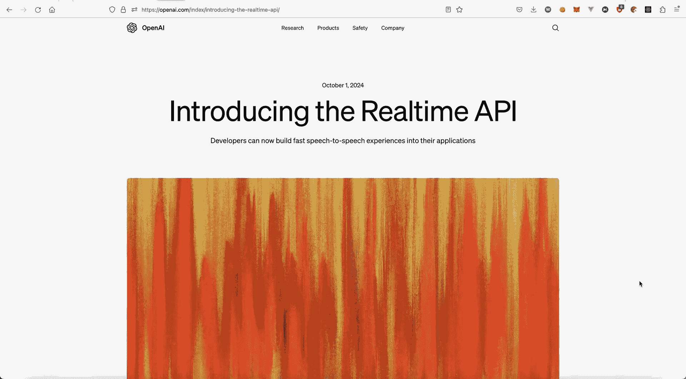

那现在我们就开始吧，我们今天的分享呢，就是基于目前我所分享的这个代码仓库，这是lantern发布的一个实现，基于open e a real time API实现了一个react风格的agent。

在这个代码仓库中有两个服务端的实现，一个呢是Python版本，一个是typescript，我们在分享中会用到typescript这个实现，对应的代码呢就在JASSERVER目录，有兴趣的同学呢。

可以同样参考server目录中的Python代码，来了解如何使用real time API，在typescript这个实现当中，给到了一个点EMV点example文件。

我们在使用前先将其拷贝到一个点ENV文件，并配置上OpenAI和TV里的APIKE，如果没有TV的APIKE呢也不要紧，只是在这种情况下，语音交互时，应用就无法通过搜索引擎获得更多的信息。

帮助语音助手更好的回答用户的问题，现在呢我们就克隆这个代码仓库，我在本地已经完成了克隆。

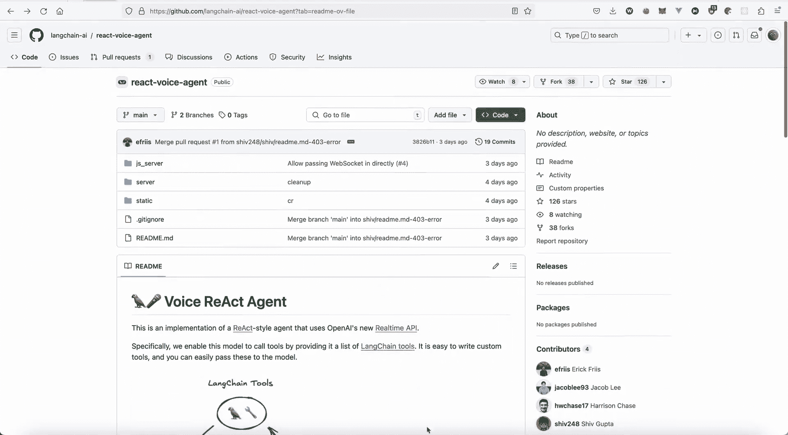

那现在呢就来到j server目录。

我在本地同样也打开了代码编辑器，首先看看点ENV点example文件，这里配置两个环境变量，一个是OpenAI API key，一个是TV的API key，接下来我们梳理一下目录结构。

服务端代码在SRC目录，客户端代码在static，首先来看看服务端的代码，index ts是这个web应用服务端的核心代码部分，构建了WEBSOCKET连接的端口或者end point。

基于OpenAI的API key来创建的一个open ei voice react agent，这个实例，这个实例定义呢在src lib目录，在这个目录当中定义了一些类供应用层。

使用一个就是咱们刚才看到的OpenAI voice real agent，这里面最重要的就是OpenAI websocket connection，这个连接是在这个agent构建的时候实例化的。

它会基于OpenAI的RETIME，API的url l API key以及模型来创建WEBSOCKET连接，在这里，默认连接，默认模型，这些呢都通过变量在这里指定了。

接下来我们看看服务端对于real time API事件的处理，在上一期视频中，我们介绍了real time API一共定义了九种客户端事件。

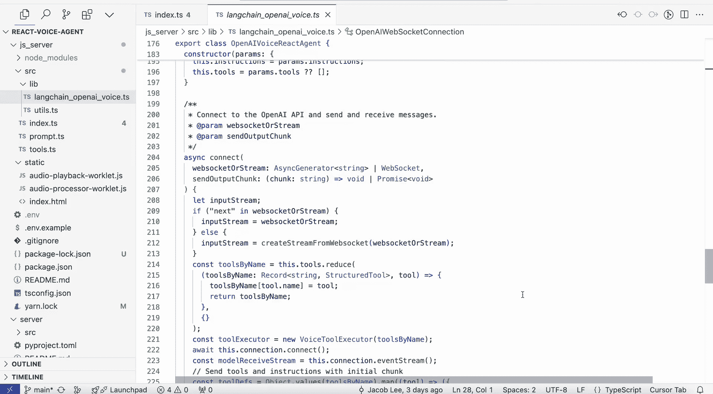

以及28种服务端事件，要妥善的处理音频文本的输入与输出，需要正确处理这些事件类型。

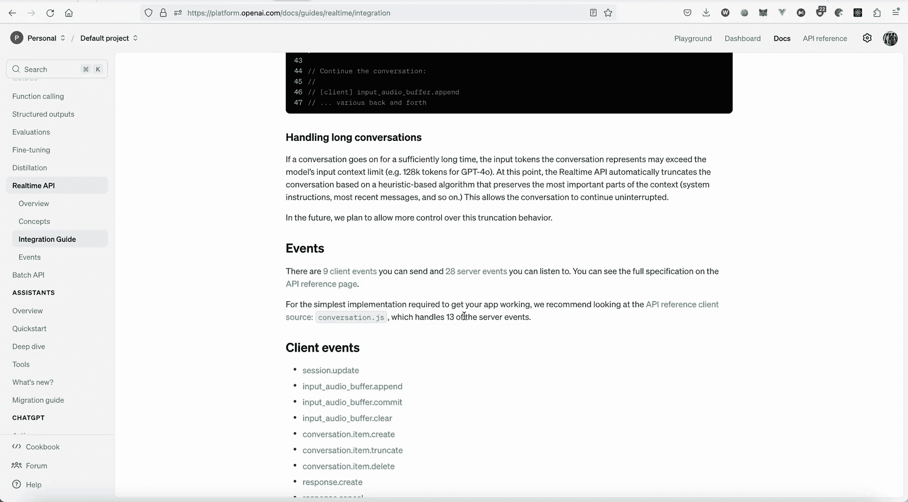

回到代码仓库这里来看看connect函数的实现，在这里呢对事件做了处理，其中部分事件做了处理，部分呢做了忽略，在代码最顶端有一个忽略的事件列表，大家可以参考一下，那么处理的事件里面。

我想最重要的就是现在我高亮的这个response，Audio data，这个是模型响应的音频数据的分块，这个分块数据呢做了输出，在其他一些事件上面，就只是做了一些简单的控制台的输出。

这里面有一个事件类型，它没有处理，有兴趣的同学可以考虑，基于现在这个应用的版本来扩展一下，是哪个呢，我们回到最顶端，就我现在高亮的这个response audio transcript data。

这个是响应的文字版本，在上一期视频分享中，我们在playground的通过对话，也看到了文字版本的数据，是如何通过WEBSOCKET消息来发送给客户端的，我们处理这部分内容呢。

就可以实现在web应用或字节应用中，实时的显示模型输出的文字内容，这个文字内容呢和语音是匹配的，这就是在服务端的实现，在来到客户端代码之前，还要提一下关于这个tools，一个是at数字相加的一个工具。

另外一个比较重要的就是tabi search，搜索引擎的支持，这个工具呢大家配置了API key就能够使用，如果没有配置呢，是在语音对话中无法进行搜索的，这是一个标准的lunch的工具的实现。

有兴趣的同学呢可以点击具体的实现，来参考一下，现在咱们就来到客户端，客户端是一个简单的HTML页面，在这个HTML页面中通过JAVASCRIPT来完成WEBSOCKET，连接的管理以及消息的处理。

这里还有额外的两个JS文件，一个呢是audio playback，主要负责音频的播放，他参考的是ASIA的一个示例，有兴趣的同学可以点击上面这个链接，来了解最原始的那个版本。

另一部分是professor，这个processor的目的是什么呢。

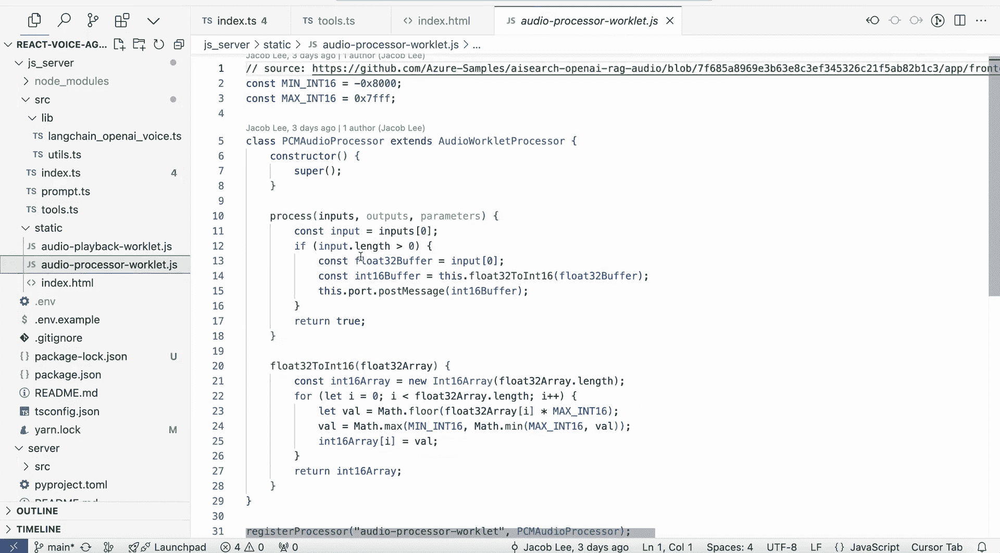

我们通过文档来简单介绍一下，在机神文档这里，对于目前API支持的音频格式做了介绍，一个是16位PCM的audio，24K赫兹，一个呢是G7118K赫兹，正是因为这两种格式的支持。

所以在咱们的代码里面有这个processor。

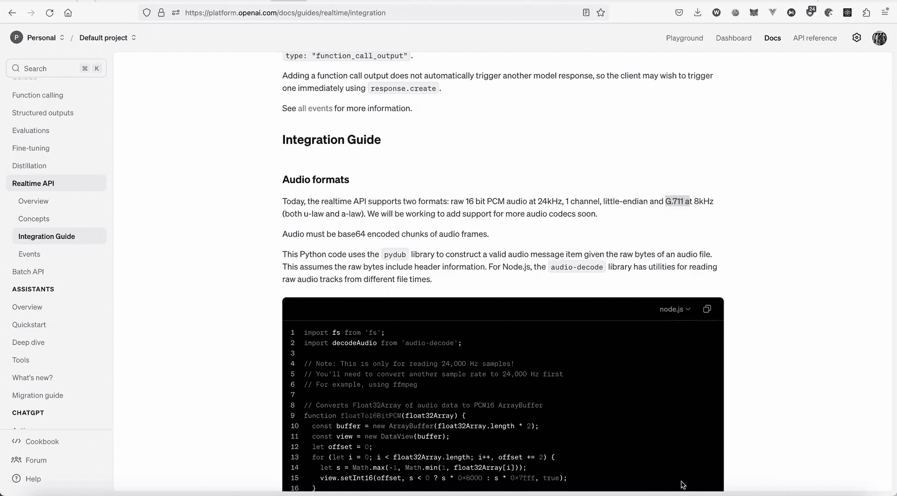

来处理p c m audio相关的数据，这部分内容呢也参考自ASHA的一个事例，那有兴趣的同学可以同样参考原始的代码实现，来了解究竟是怎么做的，我们在前端的开发中也可以同样参考这两个类。

来简化我们在音频数据处理和播放时，的一些开发工作，回到index HTML这里，当我们使用了这两个WORKLET，工作就变得简单了许多，与服务端WEBSOCKET连接管理呢。

是在store audio函数中实现的，创建WEBSOCKET连接监听并处理接收到的消息，目前的消息实现呢，它只处理了response audio data这个类型，其他类型呢他都丢弃了，这个类型数据。

正是刚才我们介绍的音频数据的分块，这些数据进行解码后，通过order player的play函数来播放，以达到播放大模型输出的音频数据的目的，那这就是对服务端与客户端代码的简要的介绍。

现在呢我们通过本地的运行来看看，究竟这个语音助手的效果如何。

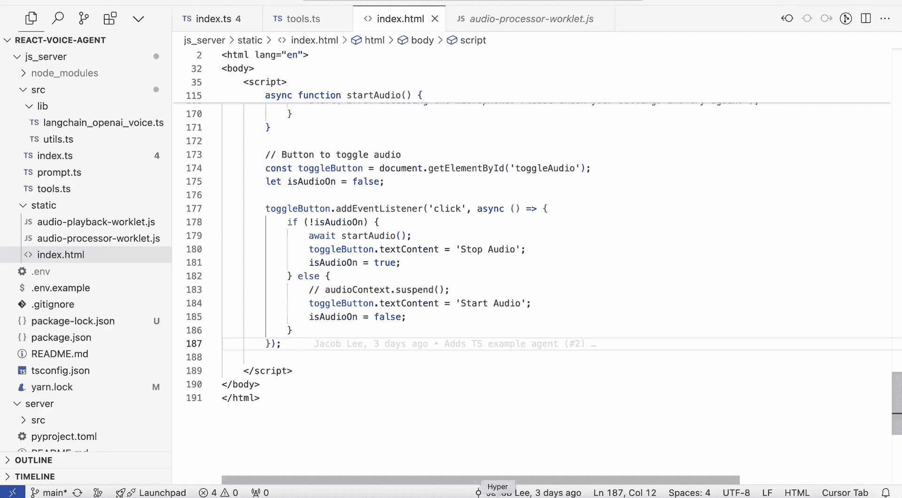

来到控制台完成必要的依赖包的安装，大家如果一二能工作呢，可以通过一二来安装，但我本地的一二版本有问题，因此我是用的npm install，通过npn round def能够启动这个开发服务器。

服务器运行在3000端口。

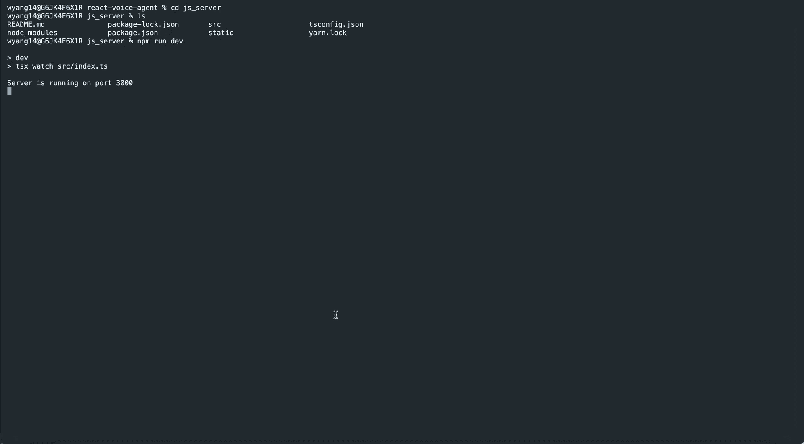

那我们现在打开页面，现在就打开了这个演示的页面，非常简单的一个界面，唯一的按钮start audio，一旦我点击这个按钮，就会开始语音交互，Hello hello。

How can i assist you today，I want to know the weather in new york，Today，Sure。

Let me check the weather in new york for you，I'll ask my friend，Tavily for the latest。

Update the kurg weather in new york，Is partly cloudy with a temperature of about，Twenty two degrees。

Celsius，Seventy，Two degrees fahrenheight，The wind is coming from the northwest，Per hour。

The humidity is relatively low at thirty，Three percent invisibility is good at sixteen kilometers。

Feels like the temperature is around twenty four point，Four degrees，Celsius，Seventy。

Five point eight degrees fahrenheight，How is the weather like in the rest of the week。

I might be planning for a visit later，This week，Let's take a look at the weather forecast for the。

Rest of the week in new york，I'll get the latest information for you。

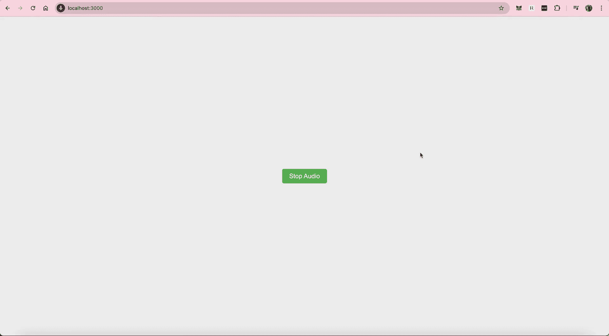

现在我就已经停掉了整个开发服务器。

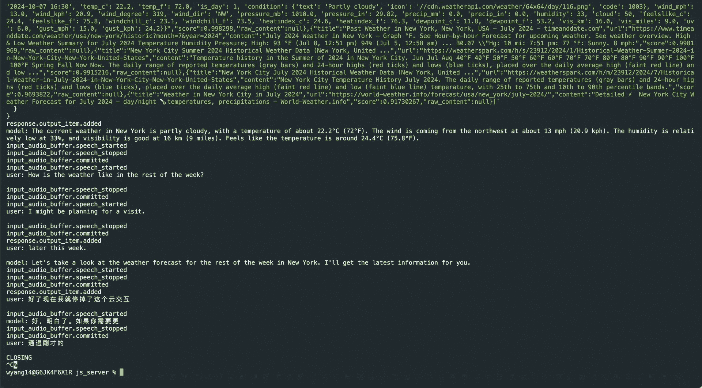

不知道大家觉得刚才的语音交互效果如何呢，我个人感觉还是很不错的，通过TBI搜搜索引擎能够给到我们更多的信息，这样呢就不局限于模型的训练数据了。

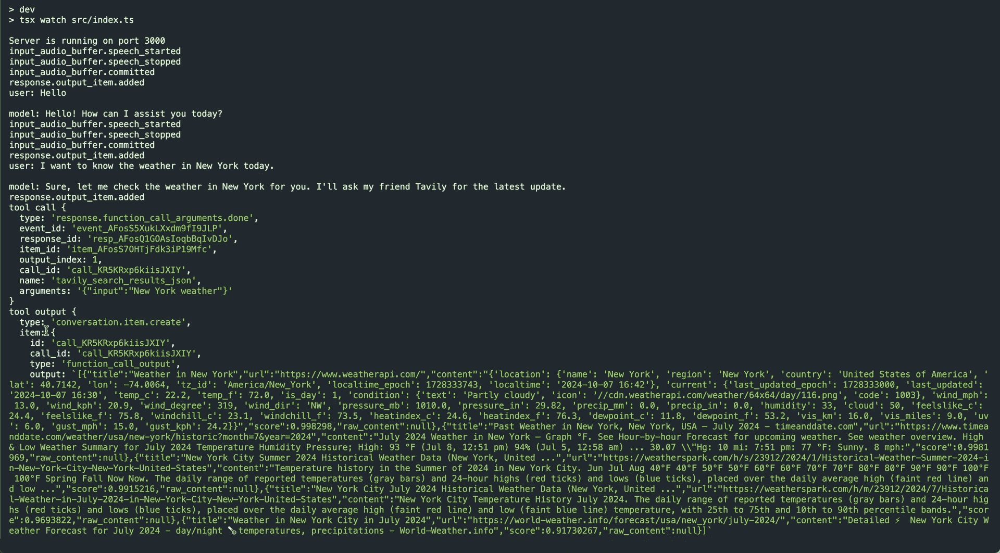

在控制台这里还打印出了日志的信息，那今天的分享呢就是这些内容感兴趣的同学呢，可以基于这个版本来扩展出更多的功能，让这个语音助手更加的有趣，也更加强大，那么大家在使用中发现有什么问题呢。

也欢迎在评论区给我们留言。

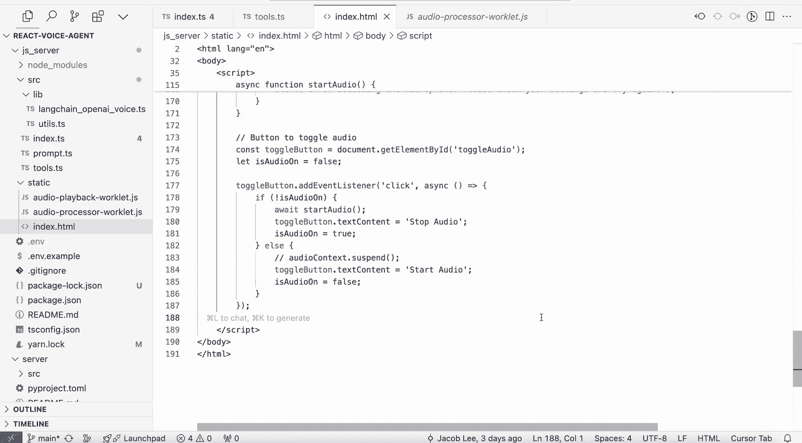

那咱们就下期视频分享再见。