# 强推！(2026最新版) 李宏毅最新课程：智能体AI【AI Agent】71集全！人工智能／机器学习／深度学习／大模型／LLM - P3：2-作业：AI Agent2 - Ai人工智能工程师 - BV1QdzCB3Eu2

大家好，我花1万8000 04：30要不要讲，那要换头风发好，哈喽哈喽好，助教来讲作业二了，你要啊没有你坐，我要坐不坐，站着就这样了。

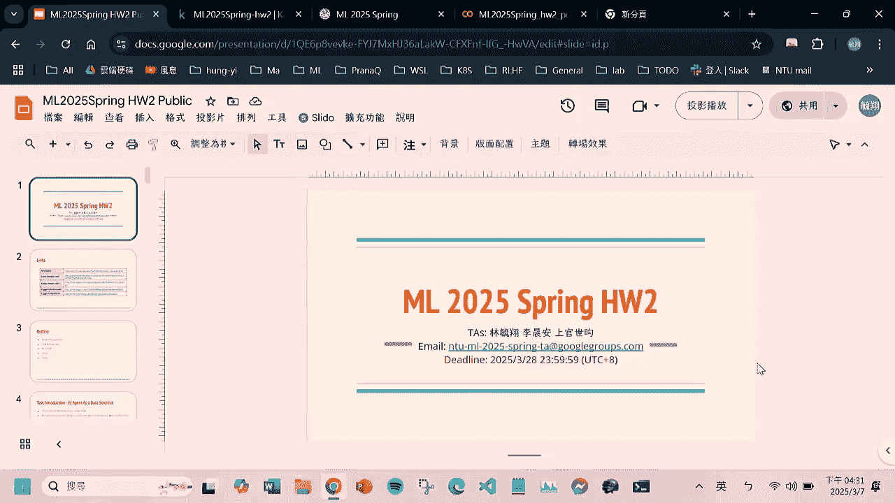

休息一下。

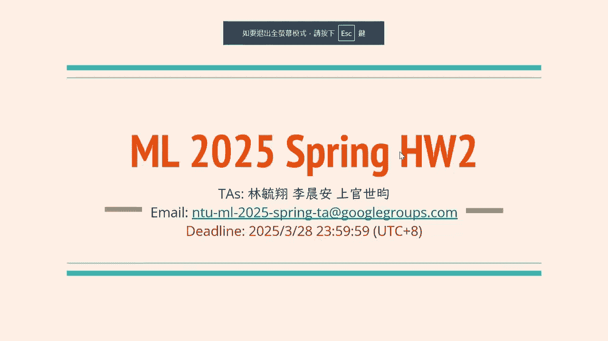

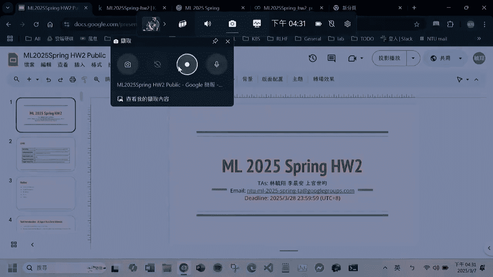

喂好喂好，那大家好。

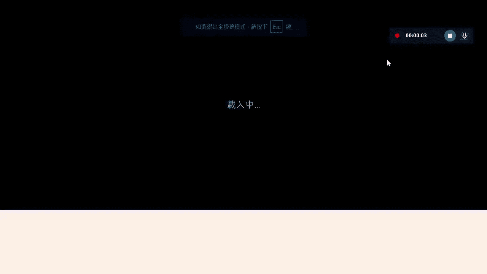

那现在我们开始讲一下作业，希望大家在做什么，那作业的daylight一样是三个礼拜后，就是在3月28当天的晚上，这边帮大家统整了一下作业，可能会用到的一些连接，然后大家如果需要链接的话。

可以来这边找找看，我们会先跟大家讲一下，就是作业二想要教大家做的事情，然后带大家大概go述一遍sample code里面的cost structure，然后后面都会讲到一些评分的标准，以及你要怎么呃。

利用不同的方式突破各个不同的base line，然后最后面则是有一些，大家会常比较常遇到的一些问题，这一次的作业呢其实就是跟老师上课讲的一样，就是希望大家去build d一个AA卷。

然后他可以解决一般机器学习的问题，其实想要教大家做的事情，就是想让大家去使用大型语言模型，去自动化的撰写城市嘛，然后去做分析以及以及预测，那其实一般AIA卷设计的初衷是说，对于很多不同的任务。

我们只需要知道这个任务自己的input data，我们就可以为每个不同的任务，生成一个克制化的solution，但因为呃这一份作业为了要让同学比较，就是简单，可以去尝试A卷，所以我们选定了一个任务。

那这个资料集呢是收集了一群民众，他在三天里面的一些生理以及心理的状态，然后想要去预测他在第三天的时候，得到这个疾病的几率，这一份资料集的来源是CNU的一个research group。

然后这边希望大家不要上网去搜寻额外的资料，用来训练或者是testing set的答案，就是只只使用助教提供的资料就可以了，然后这边特别提醒大家的是，这边跟作业一不太一样的地方，是。

我们呃也禁止大家用LN去做上网搜寻的动作，所以如果LN违反这个规则的话，也也当成是你违规这样子，所以就请大家尽量不要去碰别人，做他不该做的事情，这边是这份资料集里面呃，一些feature的解释。

那首先第一个feature是这群居民的居住地，那它一共有35个colon，然后它是引扣成one hot encoding的形式，就像右上角这个例子，那假设额他住在ARI瑞ZONA州的话。

他的对应的colon就会为一，然后其他栏位就会为零，那除了他的居住地的资讯之外，还有一些是像是他有没有一些呃跟KOBE相关的，或者是跟一些流感相关的症状啦，或者是他最近的行为啊，比如说他有没有戴口罩。

或者是他有没有在一些室内，参加一些很多人的活动，除了生理上的资讯之外，也有一些心理的因素或环境的因素，像他最他相不相信戴口罩可以有效预防疾病啦，或者是说他身边的人有没有戴口罩或打疫苗啦。

那有了这些feature之后呢，我们就想要预测最后一个最重要的资讯，就是他得到这个疾病的几率是多少，也就是最后一个feature就是testy positive，那这边特别提醒大家一下。

就是刚有提到这里面的资料呃，是收集了三天里面的所有的资料，所以这边看到的每一个feature，应该都会有三个三笔不一样的数值，那它的后缀会有day one，Day two and day three。

然后分别代表着三天不一样的资讯，然后我们要做的事情，就是用前两天的资讯去训练一个模型，而教委人员去写出一个城市码去训练模型，然后去预测第三天的这个testing positive。

接下来带大家看一下这一次的sample code structure，那这一次的sample code是彩良老师上课讲到的，那篇论文，就是AI id这个呃这一篇论文，然后他想要做的事情呢。

就是instruct大型原模型去解决，我们刚刚想要解决的那个任务，也就是一般的机器学习任务，那他的城市码架构大概是这样，他首先第一步会先叫大写眼模型去做planning，也就是一些初步的构想。

那在有了初步的构想之后呢，他就可以继续叫大型原模型去撰写城市嘛，写了程式码之后呢，就可以交给Python的interpreter，就是执行器去执行这个写出来的程式码，得到了这个程序执行的结果之后呢。

他就可以选择要去做debug或是improve，那如果这个执行结果表明说，你写的第一份程序码是有错的话，我们就可以做debug，那如果他虽然没有错，可以正常执行，但你觉得他预测的结果不是这么的准确的话。

你也可以改做improve，那这样经过很多个iteration之后呢，我们希望最后可以达到一个很好的结果，那这边跟大家讲一下，就是每一个step大概他可能会做什么事情。

那首先第一步我们在做完planning之后，我们就要开始写城市码了，那在这一个步骤的时候，因为我们没有任何的一些先背知识，或者是刚老师讲的memory，所以我们就只能完全的从头开始写。

那我们是写了第一版的城市码之后呢，我们就可以执行，然后得到执行的结果，然后也可以叫大型远模型去看这个执行的结果，给我一些feedback，让我知道可以怎么样去改进，所以这是第一步骤。

就是你要从头开始coding，那你在有了第一版的城市码之后呢，你接下来每一个step都可以有不同的选择，像左边这边你可以叫他去根据第一版的城市嘛，假设第一版城市没有错的话，你可以叫他去debug。

那如果他没有错，但是你希望它可以变得更好的话，你可以叫他improve，那当然你也可以直接放弃第一版的城市嘛，因为你觉得说有可能，我从头开始写一个新的城市嘛，它的结果会比第一版好。

那你当然也可以叫他直接从头开始写，就像右边那个图，那每一次的程式码以及它的执行结果，还有它的大型原模型，给的FEB呢其实都会存在一个叫node structure里面。

然后同学们就可以去这个node structure里面去，存取这些资讯，然后把它喂给大型圆模型，那有了这个一个个NO之后呢，我们最后就会串起来一个trees structure。

然后有了这个trees structure之后，我们就可以得到最后大选的模型呃，给我们最好的结果，然后就以那个结果来预测我们最后想要的答案。

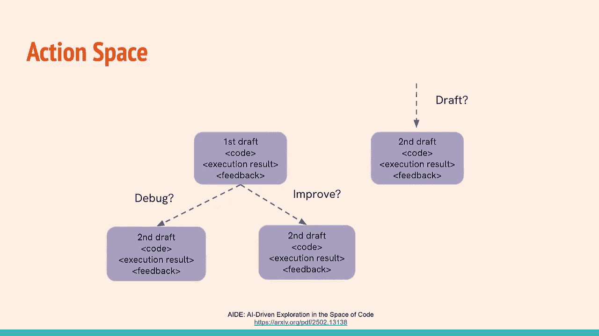

那这边给大家看一下，每一个步骤可能output长什么样子，让大家比较可以清楚的知道说呃，这个步骤到底是怎么，这个pipeline到底是怎么运行的，第一个就是所谓的plan。

也就是大型的模型给你的一些初步的构想，在写程序之前呢，他可能会跟你讲一些讲一下，说他可能想要怎么做，那这样做的原因就是，因为他可能有一个可以比较明确的，一个指令去遵循，那像这个例子为例的话。

他就是跟你讲说呃，我们将会用呃这些步骤去写一个程序码，首先你要先load一个library嘛，然后去处理资料，处理资料完之后呢，我就要change一个regression model好。

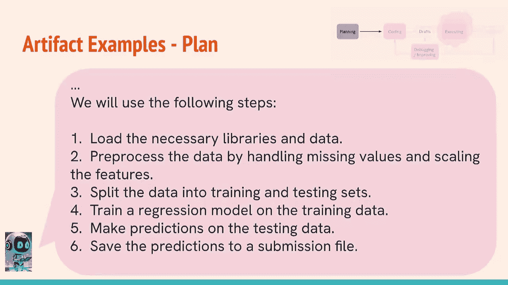

那这是planning的部分，也就是初步的构想，那你有了这个初步的构想之后呢，你就可以叫大型原模型，去根据这个初步的构想去撰写接下来的城市嘛，那他就会写出来一些城市嘛。

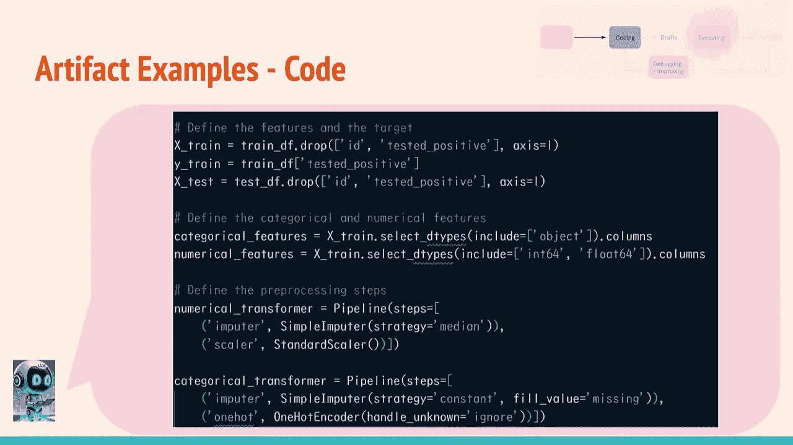

那有了城市码之后呢，你就可以丢到Python的环境去执行，这边是要跟大家讲说，我们为了让大家debug方便，所以就是把每一个step生出来的城市码，都帮大家存在一个Python档里面。

所以大家如果看到你的l n agent，生出来的结果不是这么好，或者你想要去观察怎么improve它的话，你可以去看一下每个步骤生出来的solution，然后去看一下他的iteration呃。

中间的差异，好那我在执行我刚刚写出来的程式码呢，就会得到他的execution resol，那这个execution resol，可能是一些城市码报错的结果。

也有可能是他呃print出来的一些match，比如说我预测出来最后的分数到底是多少，那像这个图为例子的话，它的呃给的execution result，就是讲说呃你的城市码有错，那错误的原因是。

因为你在iterate你的档案的时候，有一个colon是没有被找到的，但是你的城市码里面用了这个colon。

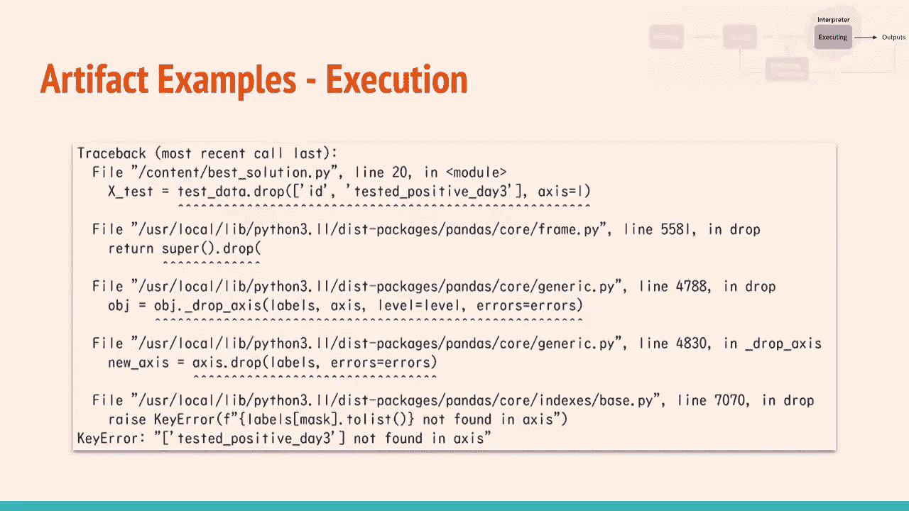

所以你可能就要想办法去解决，那最后一个则是feedback。

Feedback，就是LN在看到刚刚执行的结果，就像这个execution result跟第一版的城市嘛之后。

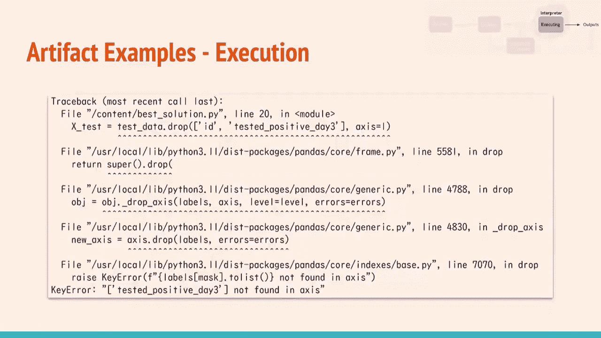

你希望去prom北LN这跟跟你讲说呃，这个要怎么更改，或者说你要去怎么improve它，那以这个画面为例的话，他就是想要解决刚刚的那个呃执行错误的问题，他就跟你讲说这个feature name啊。

是在finance fetime的时候是有看到，但是prediction time的时候是不见得。

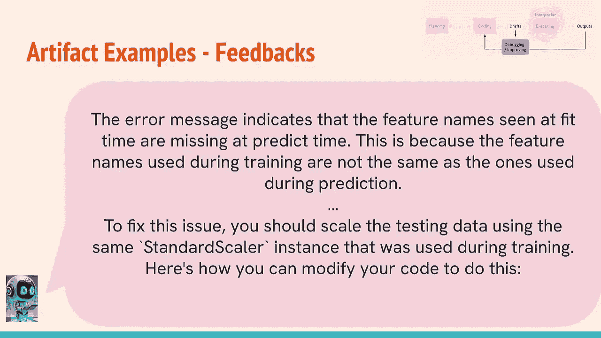

所以希望你可以用这种方法去解决它好，那讲完了这个sample code structure之后呢，接下来讲一下这一次作业的评分的标准，然后大家会跟大家讲一下，就是要怎么用不同的方法去冲高。

你的l AI agent的performance，这次的作业跟作业一的评分方式是一样的，就是你只要交程式码，然后格式是正正确的，你就会得到四分，那你只要跑完sample code。

然后把你的sample co跑出来的预测档交到呃，评分的平台之后，你就会得到另外两分，那至于剩下的medium baseline跟strong baseline的四分呢。

则是希望你可以用我们这些hint去想办法，让你的LNA卷写出来，城市码品质比较好。

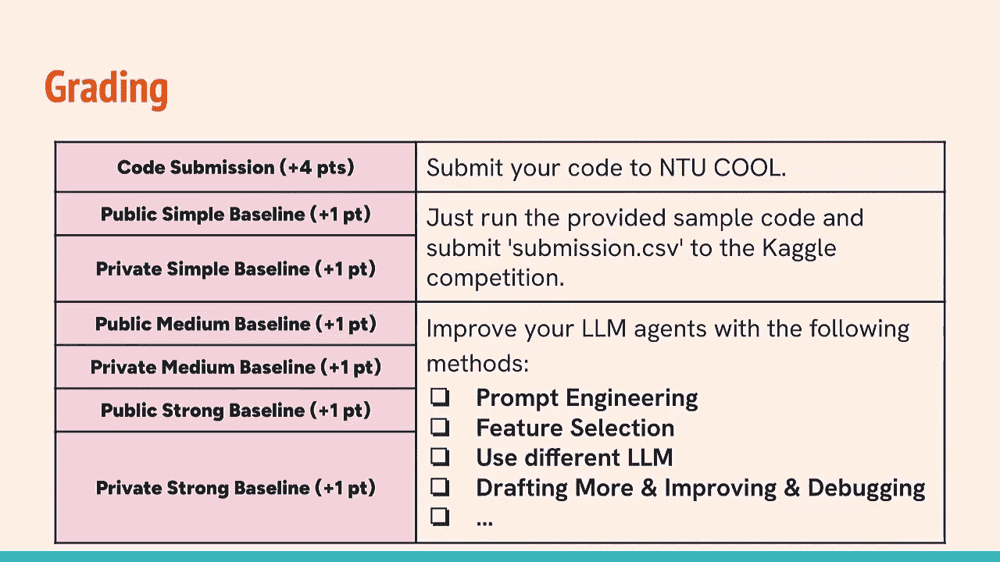

首先我们先讲一下coser Mission的部分，这次的扣一样是交到n t u CORE上面，然后daylight就是作业截止的时候，也就是三个礼拜后，然后请大家注意的是。

你的城市码必须要压缩成一个zip档，然后lip党的党名必须是你的student id的开头，然后底线轰work to，我们只会看到你的最后一次的submission，所以如果你交了很多次之后。

这个党名的后缀可能会有dh one，Deh two，Death three，那其实不用在意的，只要你在本地端，你交上去的时候，你的档名是正确的就可以了，然后请大家不要把你下载下来的模型。

参数以及资料集交上去，因为那资料太大，你可能交不上去，最后一点则是说，如果你的城市，你必须要确保说，你的城市码是可以被reproduced的，就是他必须没有bug，而且可以接近你。

就是在leader board上面的结果，要不然你可能会拿不到这次的成绩好，这是这一次baseline的成绩，这次baseline因为就如刚刚所说，我们是想要预测那个呃疾呃，得到疾病的几率。

所以它是一个regression的任务，那我们以regression任务衡量的方式，就是用masquare error，也就是你预测出来的值去减掉真实的值呃，取平方之后再取平均。

中间这个是不同baseline的乘积，那大家可以去参考一下，说呃要冲过这base要达到多高的成绩，这样子右边则是说你在COLAB上面跑，大概需要跑多久才能冲破这个base line。

这边要跟大家特别提醒的是，这边公布的只有public set的成绩，然后private se的成绩则会在作业截止之后公布，所以你你在试的时候，你只能选择你public se成绩高的档案去作品。

去评分在private上面，也就是说你通过了你的public baseline，并不代表说你一定会通过你的private baseline，所以这点要请大家特别注意。

这一次作业缴交的平台是跟作业一不太一样，这次作业平台是采用k go，然后KEIGO的使用方式跟drag ball，应该是蛮类似的，就是你只会看到你的public set performance。

在daylight之前，然后呢你也只能选择两个submission file，评分在privacy上面，然后一样你也只能评呃，每天最多只能缴交五次，但是有点不太一样的地方，是你K购平台注册的账户。

不一定要是是要你要是你呃，嗯学校的信箱或者学校的账号，但是你在角交的时候，你必须要把你的team name改名成这种format，student id开头，然后后面你可以底线，你可以接任何是任何自穿。

要不然我们没办法抓到你的成绩的话，你的这份作业就只能拿到零分，那这边等下我教simple code的时候，会示范给大家看要怎么改名，接下来是你要做这份作业，可能想要需要尝试的一些方向。

那第一个重点就是problem engineering，那这部分其实就是希望大家去想办法的写清楚，说你到底希望大型有模型做什么事情，然后如果有什么问题的话，你需要它怎么解决。

那这边一样是分成system brown跟user pr c站，prop呢就是你想要他做什么事情，以及呃他可能是什么身份，那这边给大家一个小提示，就是说既然我们这个作业是要写城市的话。

他如果是什么身份的话，比较有可能会写出高品质的城市嘛，那user pro呢则是你要把你的要所有要求列出来，然后跟他讲说你到底想要他做什么事情，然后去就是做pump engineering好。

那如果大家不太知道怎么调整的话，其实这边跟大家小小提示一下，就是大家也不用想的太复杂，其实就是对症下药就好了，像如果以画面上这个例子为例的话，你可以看到说他写出来的程序嘛，最后执行起来就会报错。

就是大家刚看到那个错，那他报错的原因就是因为他在testing file里面，就他最后预测的档案并不存在于testing file里面，但是他用了那个colon，那我要做的事情就是跟他讲清楚说呃。

testing file面比没有那个colon，所以你不要做这件事情，然后他写出来的程式码就可以正常执行了，那这里的PN就是跟simple po company的PN是一样的，所以如果大家想尝试的话。

可以把这一行注解掉，然后去试试看他写出来的程式码会有什么效果，第二个希望大家去做的事情其实就是feature selection，那刚刚前面有提到说，这个资料集里面有很多不一样的feature。

但是有一些feature可能对于模型预测来说，可能是属于杂讯，有一些feature可能是很重要的，所以这边就希望大家去跟同呃，去跟大型语言讲说，哪一些feature可能是重要的。

哪一些feature可能是不重要的，你可以直接跟他讲说，我希望你使用什么feature，或直接跟他讲说，我希望你不要使用什么feature都可以，或者是你真的不知道怎么预测的话，你或许也可以尝试看看。

跟他讲，讲清楚每一个feature代表是什么，让他自己去做判断好，那第三个方向则是呃，我们希望大家去尝试一个不同的大型原模型，那现在如果你要做animal相关的任务的话，你或许不不用知道说。

你要怎么训练出一个好的模型，但是你要找到一个好的模型来用，这是绝对可以让你工作的效率大幅上升，所以我们希望大家可以学习，怎么去找到一个适合用的模型，并并且学着替换它呃，很多人可能会说。

你不太知道哪个大学的模型可能是好的，那就跟大家讲一些可能可以参考的一些资讯，第一个参考资讯就是模型的size，那以同样的一系列的模型来说，通常模型参数量越大的模型，那它的表现会越好。

但相对的它需要的GPU的memory就会越大，所以你可以自己去做取舍，看你可以load进多大的模型，那第二点则是PRETRAINCOOPUS，这一点是在说，既然我们这份作业，是希望大型原模型去写城市嘛。

那有没有可能一些专门训练在写程式码上面呃，训练在城市码资料上面的大选模型，它的结果可能会比较好的，那第三个给大家的参考资讯是一个leader ball，那这个leader ball呢。

其实就是衡量大选美模型，在不同衡量标准上面的一些表现，然后他会把各种不同的大型野模型的表现，列在上面，所以大家可以进去里面查看一下呃，这边等一下我会示范给大家看，要怎么替换大学模型，在讲SB扣的时候。

这边要跟大家提醒的地方是，你只能使用开源的模型，然后不要使用商业化的模型，像jb t four或gm nine，因为如果你要缴交APIT上来，可能会导致我们在reproduce的时候呃，没有APIK呃。

应该说就是如果你APIK上来，可能会导致你的APAK外形，这样我们就没有办法reproduce的结果，所以就请大家就使用开源的模型就好了，那最后一个尝试的方向则是，你可以尝试让大型的模型去进行更多。

更多的iteration，就像刚刚上面讲到这个投影片，就是让它继续的去写不同版本的城市码，或者是根据第一版城市码去做improve for debug，那首先是一种可能，就是你你直接不要管。

说你每一版写出来的程序嘛，你就直接每次都从头开始写，每次都从头开始写，你就相信说总有一次他会写出好的城市嘛，那如果大家要往这个方向去尝试的话呢，要改的地方就是STCO里面有个CONFIG。

然后CONFIG在卷底下有一个step数，这个step数就是呃，你要你要交这个大选原模型去iterate多少次，那在sample code里面预设是一次，也就是说他完全不会做呃iteration。

那如果你想要做drifting more这个动作的话，你就可以把step数改改为成大于为一的数字，然后下面还有一个none of draft，这个数字就是在跟你讲说，你希望他从头开始写几次。

也就是说如果你的step设成五，然后你的none of drops设成三，他就会先从头开始，写出三个完全不一样的城市码，然后再从中选择一个一些比较好的城市码去做，Improve for debug。

所以大家可以自由调整这个step跟none of drop的，这边是跟大家讲一下，说如果你要尝试这个方向的话，你可能要去把temperature设成大于零的数字，那在simple co里面。

它的位置在generated response的这个function里面，然后sample code里面也有一个function是CSC，就是把呃RANDOC固定住。

这样你才可以reproducing的结果，那如果大家不知道temperature是什么东西的话呢，这边有一份来自于呃上学去年JAI的作业，那temperature其实就可以想象成。

他去影响大型原模型output的diversity，那如果你像sample code里面一样，把就是temper角色成零的话，你通常写出来的每一版之间的层次码，基本上都会是差不多的。

所以如果你想要让它希望他一直sample，一直sample，总有一次会sample出最好的答案的话，你就需要把这个temperature调大一点，那大家如果不太懂。

这个temperature是什么意思的话，可以看一下这个投影片，我们都知道，大选与模型在做的其实就是做next token prediction，那在做next token prediction的时候。

其实就是看说每一个vocabulary的几率，然后选择呃根据这个机遇去做SAMPLY，那temperature你设的越大，你就会让原本几率越大的那个头。

ken的temperature呃的probability变小，然后原本小的变大，所以你temperature色大的情况下，它选到原本几率比较小的那个，token的几率就会变上升。

也就是说你的temperature越大，你的diversity就会越高，所以大家如果想要尝试这个方向的话，就是就可以把这个temperature调大一点，那第二个可能尝试的方向就是做improve。

那如果你想要做improve，其实也是希望大家去做，就是把要求讲清楚，一样是去改system from跟user pro，然后去跟大学员讲说你想要他做什么事情，那这边跟大家讲一下。

就是大家可能会用到的资讯都已经帮大家打SM，包括里面像有一些test description啊，或者是在这个版本之前，LN生成什么扣的一些memory啊，还有他跟他想。

你想要他去improve的那个城市嘛，都已经打在这边，如果同学不知道这是什么的话，也许把可以把它print出来看看，最后一个可能则是debug，那这个跟improve一样，就是你就讲清楚。

你想要大选原模型做什么就可以了，那这边提醒一下，就是说如果你完全不需要管，就是你完全不想要管improve跟DEBU的话，你完全可以就直接叫他，甚至很多版不同的job。

你就完全不需要管这两个function，所以到底要用什么架构去进行，这次作为，完全可以看你自己就是想要怎么尝试都可以，不需要特别限定在说你要实做哪个方选这样子。

最后一个要做的事情则是evaluation，那这个方法其实严格来讲，对于你的performance来讲，并没有这么直接的相关的影响，可是它可以让你比较好的去知道说呃，你要选择哪哪份城市嘛。

刚刚的问题是说，你在跑了很多个不同的iteration之后，你会产生很多不同版本的城市嘛，但是你最后到底要选择哪个城市嘛，也是一个问题，所以这个function呢。

就希望大家可以去利用大型圆模型去想办法，把就是他的每版本城市码的match抽出来，然后存起来，这样你最后再跑完，每跑完升完一堆城市码之后，你才可以知道说最后到底要选择哪个城市码，那大家可能会不知道。

说到底要怎么样去把这个判断，每一个城市码的好坏，其实就是我们可以把呃，每一个城市嘛执行之后的结果，也就是刚刚秀给大家看的那个feedback，把它印出，把它喂给大型语言模型。

然后叫他想办法从中抽出一些呃，关于这个performance相关的一些match，或者是一些feedback，然后就可以把它存起来，这样子好，那这边跟大家讲一下呃，总结一下刚刚的hint呃。

第一个hint等一下会讲就是，然后第二个hint是说额，prom design这件事情也许可能有一点悬，就是你有时候写越多不见得越好，所以就是在这份作业里面，至少以我们自己尝试的经验的话。

你完全不需要去写的太多，你写太多，你他就是写出会有bug的城市码的几率就会越高，所以你只要把你的要求讲清楚，然后他如果写出来的程序嘛有什么错，你就对症下药就好了。

并不需要去呃把那个prom写到又长又臭又长，这样子，就是并不希望大家花太多时间在做prompting上面，所以我们希望大家可以先尝试的方法，就是做feature selection跟使用一个不行的呃。

使用使用一个比较强的大型人模型，然后就像刚刚所讲的，你可能在step two的时候，你有很多个不同的做法，那大家可以完全可以自由的去做，自己想做的做法，也不需要去完全按照这个投影片上面的进行，这样子。

接下来讲一下这一份作业的一些regulation，那跟作业一不太一样的地方，就是这份作业呃，就是大型的模型，如果犯错，就是你犯错，所以你不要去碰它，做一些奇怪的事情，比如说上网搜寻额外的资料来做训练。

或者是直接去找testing say的答案，然后也请大家不要使用商业化的模型，有一个比较特别要注意的地方，是你在用大型原模型生出来的城市嘛，有时候可能会有一些bug，然后让它执行不了。

这时候就请大家不要手动去改，你生出来的程式码，然后再执行它，或者是说你不要去改你生出来的submission file，因为这样的话我们在reproducing的结果的时候，我们并不会手动的帮你改。

所以你跑出来的结果如果是错的话，你就拿不到这次作业的成绩这样子，然后一样的是你违反这些规定的话，你就是的作业的成绩就会是零分，然后最后的总成绩还会被乘以0。9，所以请大家就不要违反这些规定，这样子好。

那有同学问说reproduce的方式，或者说我要怎么样才能确定我能不能reproduce，这个结果，那如果你是用COLAB跑的话，其实不太用担心，你只要把你COLLAB下载下来的城市码交上来。

我们通常都可以reproduce的了，那如果你是在你的本B端跑的话呢，请你教一个rein file，告诉我们怎么reproducing的结果，那这个read me file的format。

你可以自自己呃，想想怎么写就怎么写，但是你要确定说，我们看到你这个remi file是能够reproduce，你的结果的，所以你最好提供一个requirements点TXT。

就是跟我们讲说你装了什么套件，这样子好，那这个常见的问题我先讲完simple cow再讲。

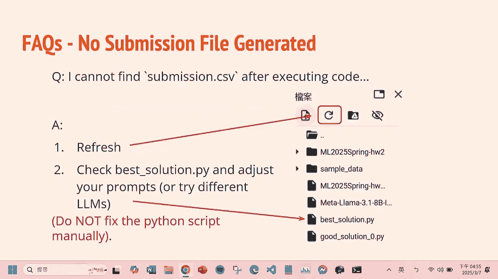

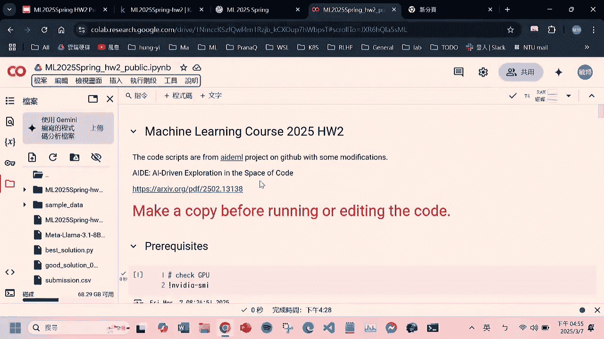

然后我们现在讲一下这次作业的simple口，那这是这份sample code，是根据爱德这AIDE这篇论文的提供的城市码，去进行更改的，然后这边提醒大家的是，就是你在改这份城市码之前。

记得要先存一个副本，要不然你改了半天，最后可能会储存不了，这样子好，那首先你要先确定一下你这个城市码，你这个城市嘛是有跑在这个有GPU的session上面，然后你可以把NVDI现在打上去。

然后看一下说他最后print出来是不是有GP5，如果没有GP5的话，你可能就要去执行阶段，然后变更执行阶段，练习就跟作业一样，你要选择有GPU的session好，那你确定你有GPU之后呢。

你就是安装一些套件，然后把资料集下载下来，这边跟大家讲一下，就是因为现在的资料集，作业的资料集是存在google drive里面，那根据以往的经验，就是如果你下载太多次的话，那个连接会暂时的失效。

所以这边帮大家准备了很多个不同的连接，那大家就自己尝试一下，就是呃哪一个可以用，那里面的每一个连接的档案都是一样的。

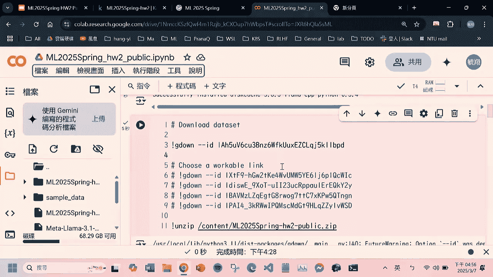

所以不用担心用哪一个会有什么差别，这样子好哦，那这边则是要跟大家讲一下，就是希望大家去尝试的地方，就是你可以尝试下载不同的大型原模型好，那如果大家不知道怎么去下载大型云模型。

我这边先给大家看一下那个页面，就是通常你可以从这边找到，你想要的大型原模型，但当然这边有很多非常多的大学的模型，你可能会不知道说到底哪一个是可以用的，然后但到哪一个效果比较好。

所以如果你不知道怎么用的话，我这边提供一个就是比较系统化的流程，那如果你可以原本就知道怎么找大型原模型，或者是你原本就知道哪个比较强，你完全可以忽略这个流程，去用你自己喜欢的大型原模型好。

那你点进来这个open ln离得BO之后，就如刚刚所说，他会秀出不同大型原模型，在各个不同衡量标准上面的结果，那呃我现在讲的这个系统化的流程，就是为了要在COLAB上面能跑，所以我们先点进来之后。

这边有一个advance filter，那你打开这个advance filter之后呢，这边有个parameters，这个parameters就是指说这个模型的参数，那我们可以把它调到7~20左右。

因为以这个range来说，比较有可能是一般的GPU log进去的，然后你在调完这个parameters之后呢，你在这个旁边有个official models，把这个official models打勾。

那这边原本就是打勾，所以我就再把它打勾起来，这样那你做完这两个动作之后呢，你就可以看到下面这边，就是符合你刚刚筛选条件的一些大型的模型，然后他的排列方式就是把分数高的，排到分数低的。

所以第一个就是在这个range里面，表现最好的模型，那这边要跟大家特别提醒一下，就是这个leader board上面呈现出来的结果，未必会适用在每个use case，所以作业二来说呃，这这上面的分数。

未必会代表你最后会拿到的分数，所以这只是给大家做一个参考，这样子好，那假设我想要使用这个排名，在这个range里面排名第一的这个模型，我就把这个模型的名字CTRLC起来。

然后回到刚刚这个sample code里面，进到搜寻模型的那个地方，然后在这个搜寻栏呢把它CTRLV上去，然后它通常前面会有一个，前面会有个组织名，然后后面是模型的名字，然后就请大家把这个组织名删掉。

删掉之后，他这边就会跳出很多不一样的模型，那其实你就只要对说呃，这个后面的这个名字跟这边是不是一样的，那即使你对到这可能是一样的，其实很多不同的模型提供者的模型。

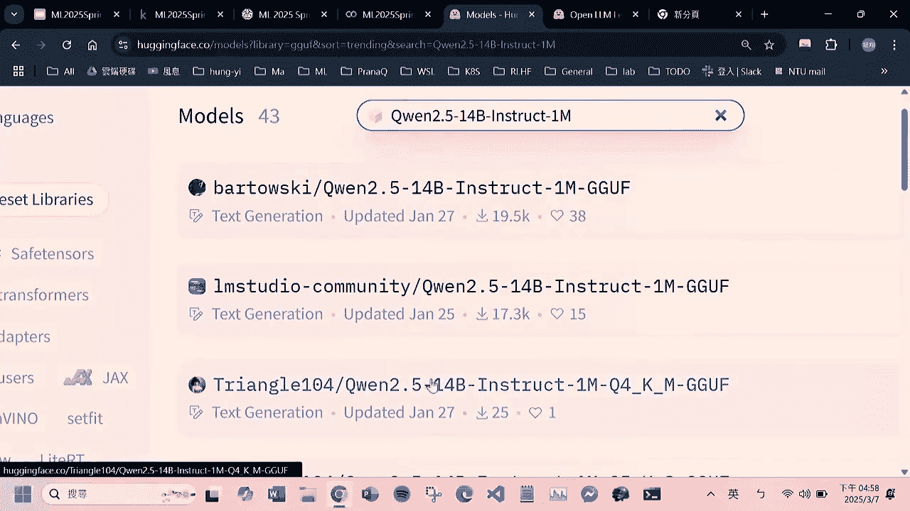

其实都是叫这个名字，那这边我就推荐大家先从排列第一个的去尝试，因为呃第一个跑出来通常是最热门的，也是最多人用的，那如果他不能用或者漏进去的时候报错，再往下尝试，这样子好。

那假设我现在就选择我要用第一个这个模型，那我就点进去，点进去之后呢，就可以看到他这边会有一些说明，然后有一些呃比较好心的模型提供者，在这边会跟你讲说，他这边有很多个不同一颗模型。

但有很多不一样种类的呃check point，然后可能跟你讲说每个check point各有各的好处，然后你就可以自己选择用哪一个，那这边跟大家稍微简单解释一下，这个型号。

就是这颗模型后面有一些后缀代表的是什么，那呃它通常会有很多不同的型号，然后型号的开头会是呃不同的beat，那这个beat越大呢，代表它的压缩率越小，就是是相反的，那压缩率越小的情况下。

就代表它的呃模型的效能受到的影响越，越越小就是它越越能重现它原本模型的效能，那相当相反的，当你压缩率越小的话，你需要的GPU的memory就会越大，所以这边就要大家去自己去做取舍时，你到底要用什么样呃。

哪一种型号的模型，才可以让你得到比较好的结果好，那假设我们要选我们要哪个型号的话呢。

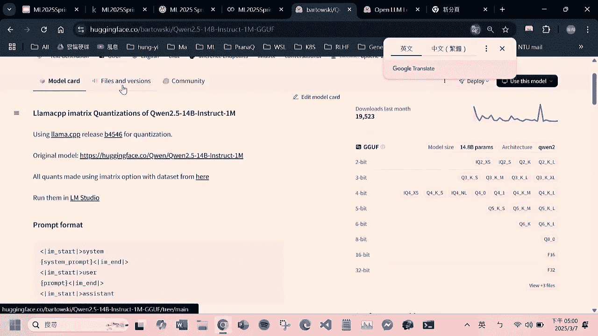

我们就点进去看，那呃这可以看到说，通常一般的模型都会有很多不一样的压缩率，Q后面的就是指它的压缩率，像这个就是指3beat，然后这个Q4就是指four bit。

那通常four beat的结果会比3beat好，那如果大家不知道要尝试哪个型号的话呢，就推荐大家从大概呃10GB的这个TRIPIN开始尝试，因为通常10GB的TRIPIN是可以漏进呃。

COLAB的GPU上面的，然后如果可以的话，你再继续往上尝试，那假设我现在看到我想要选择的这个，10。5GB的这个模型好了，那我就把这个连接档案点进去，点进去之后呢，就可以看到这个档案的全point。

那我要做的事情就是把这个模型的这个trip，point in的链接复制下来。

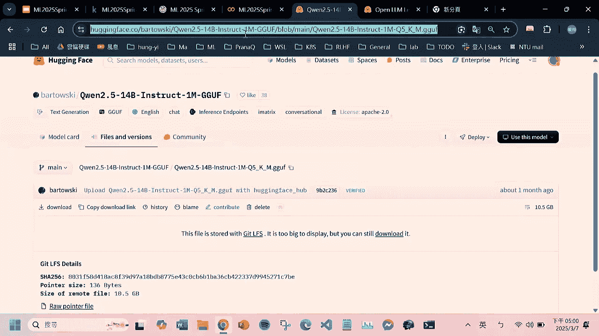

然后回到我的sample co，回到我的sample code之后呢，我就把这个下载模型的，等下我就把这个原本他已经有一个，拉玛3。18b instruct gg uf的这个模型，把它呃。

你可以把它删掉，或者是就是看你要不要一起下载，反正就是在后面加上一行w get，然后后面把你那个链接贴上去，那贴上去之后呢，大家唯一要做的事情，就是把这个BLB改成resolve。

那改完之后他才会下下载到正确的这个check point，那我这边就不下载了，反正大家就是可以去尝试说，使用不同的大型的模型，那我这边就用预设的这个拉玛3。18比去跑，simple扣好。

那大家记得在下载完这个大型原模型之后，要在这边low的大型原模型的时候，把你刚刚下载模型的weight吧，呃挡check point in，把它漏进来，那你下载下来它就会出现在这里，你就去看书。

它下载下来档名叫什么，然后把这个漏LN的这个档名更改掉之后，你就可以把它喂进去，这样子这边特别提醒大家的是，如果你在同一个collab session里面，要漏了很多次模型的时候。

因为你的GPU memory没有被free出来，所以你在漏第二颗大型原模型的时候，很有可能他就会直接报错，那他就漏不进去，这时候就要请大家开执行阶段，然后去按这个重新启动执行阶段。

那请大家按的是这个重新启动执行阶段，不要按这个中断连线，要不然你刚刚下载下来的模型的参数，会全部被删掉，那如果你按重新启动工作阶段的话，你就不需要重新下载资料集以及模型的参数好，那你漏进去之后。

你就可以开始做你想做的事情，然后这边january response这个function定义的，就是去抠这个大型原模型，想要叫他进行回复，这个temperature的参数就是刚跟大家讲的。

你可以去叫它生成更diverse的内容，如果你把它的值设大一点的话，然后这边会有一个warning，是说你现在用的这个content length，可能小于它最大的contact。

这边可以请大家忽略这个讯息，因为正常来说，如果你要过strong备赛的话，是不需要这么大的contact lens的好，那接下来讲一下会用到的一些functions。

像这个save on function，就是在呃存每一个step生出来的城市嘛，然后让大家可以去里面去看，所以他最后呃你跑完他的城市码之后，你应该看到城市码会生在这里，然后你就可以点进去。

看出他大概写了什么东西呀，然后可能有一些什么方法可以改进，这样子好，然后呃接下来是interpreter，就是你先生出来城市买要怎么去执行，那这方面这个这个sell，我们是希望大家不要去做更改的。

不过这边还是跟大家稍微讲一下，这个成这个sell在做些什么，那他其实就是首先先定义了一个呃资料结构，然后去储存一些模型，output的一些就是执行之后产生的结果，比如说像这个turn out。

就是他最后模型print出来的结果，或者是他的呃报错的一些资讯，然后在execution time就是他执行的时间，然后后面则是一些exception的error，比如说像是呃你如果中断。

它可能会有什么keyboard interrupt啊，或者是他有时候会一些wrong time error之类的讯息，那这个exception summary。

其实是纯刚刚说的那些EXCESSION的summary好，然后这个Q是，因为我们想要去在我们跑大型远模型的同时，同去执行我们这个城市嘛，所以可能会需要创造不同的process。

然后这个Q就是去做针对process做一个管理的动作，然后最后这个interpreter，其实就是去执行那个城市码的程序，那这边有定义了一个呃变数叫参now，他的意思就是说你的跑出来的成。

你生出来的城市码最多可以让它执行多久，这边预设是3600秒，也就是应该是一小时对一小时好，它如果你的城市码一小时执行不出来的话，你就可以改这个城市，你就可以改这个数值，让它可以就是跑比较久。

不过这边呃跟大家讲一下，就是通常你写出来整只码如果要跑一个小时，通常它跑出来的结果也不会太好，所以就是你也不用想办法让他可以跑更久，这样子，然后嗯这个城市马定义的就是去抠这个城市。

然后就要去跑那个大型原模型牵出来的城市，这样子，然后去抓一些error，让你可以比较好的，把这些错误的讯息去喂给大型原模型，让他去做改进，好，然后接下来讲一下，刚刚就是说到的每一个step。

生出来的一些像城市嘛，或者是一些执行的结果，还有一些feedback应该存储存在哪里，那它储存的地方是一个叫node的资料结构，note这个资料结构了。

里面每每一个note存的都是每一个step output，那它可能会存一些城市码，或者是他的一些初步的构想，还有一些他的一些feature，像是他是第几个步骤生出来的城市嘛，或者是他上一版呃。

根据比如说像improve跟debug，它会有呃上一版的城市买，让你做参考，那那一版可能是哪一个node这样子，然后也会有一些关于城市码执行的结果，还有一些最后LN给你的一些的一些feedback。

然后这边就是都帮大家写好，所以大家可以稍微看一下，基本上就是定义一些呃heuristic的一些东西，然后最后呢我们就是想要把这个node串成一个tree，也就是呃journal这个class。

然后他要做的事情呢，其实就是把在每个step最后，把那个升最最新版本生出来的那个note呃，pen到这个tree后面，然后呃最后面可以去抓到这个best kno。

把它存成我们最后的best solution，这个generate summary是想要让大家可以去抓到，说你在这个不同iteration，整个iteration的过程中。

你每一个step生出来的城市码的一些优势，或者是一些执行结果，然后让它可以生成一个像memory的东西，然后你有了这个memory之后，你或许就可以把这个memory为进大学的模型。

让他从这个经验中去做学习好，然后这个class的是嗯定义的那个agent，也是我们大选人模型的这个呃AG卷，然后他想要做的事情，其实就是额在每一个step打去做他该做的动作。

比如说是像improve或者是debug，或者是从头开始写一份程序嘛，那这边帮大家写的做法是呃，你会先写一个，在CONFIG里面设定一个参数叫none object。

然后我在假设我now obsta射程三好了，我就在前三个step中都会只会从头开始写，那在第三个step之后呢，我就会开始随机的随机性的去做debug，或者improve。

那大家完全可以自己去改这个逻辑，看你想要怎么怎么去做尝试好，然后这边就是希望大家去调整prom的地方，这个drag function就是完全从头开始写的这个呃作用。

所以你可以去呃给定这个user brown跟sister pron，教大学模型开始去想出一个好的solution，那这边有就是刚刚有提到说，就是有一些可能要用到的资讯，比如说这个任务是需要做些什么啦。

或者是你生出来的档案应该要放在什么位置啊，然后还有一些这个data评，入党会讲就是feature selection的部分，然后你最后应该生成一些submission file。

那大家可以试着把这些呃prop先注解掉，然后可以看一下，说以simple或来说这些pro应该都是蛮必要的，就是你注解掉一条可能就会出现相对应的错，这样子，所以大家可以自己去尝试好。

然后improve跟debug其实就是把你的要求讲清楚，improve就是叫LN去做improve嘛，然后debug就是叫LN去做debug，然后他该有的讯息都已经在这边了。

然后大家要做的事情其实就是描述清楚，这样子好，然后最后一个function是做EVELUSION的动作，他其实就是刚统一片上面讲的，就是你在得到LN执行的结果之后。

你可以去得到一些想办法把他的MATRI抽出来，或者是得到一些feedback，然后有了这些FEEBAY之后，你才可以更好的去做下一次，下一个iteration的improve或debug好。

然后这边就让大家可以去尝试，把要求讲清楚之后，让有人吐出我们想要的output，然后这边有一个大家可以去做尝试的地方，是我们可以强迫大型原模型去吐出，我们想要的格式的output。

那大家可以从这个链接里面去做，去学习，要怎么让大选的模型去吐出我们想要的output，不过这部分的话并没有强迫大家一定要使用，这个方法，你当然可以直接用一些，像正则表达式之类的方式。

让直接从大选模型里面的回复，抽出你想要的资讯好，然后最后面则是一些呃文字处理的一些function，大家也可以自由去做更改，比如说你把城市码包在一个特定的区块里面。

让大让我们最后在做pass的时候比较好，把城市码从LN很长的回复里面抽出来，或者是你去检查说你写出来的Python script，是不是有bug啦。

或者是你去呃你从LN的response抽出JSON file了，或者是你把太长的字串抽呃切掉啊，然后或者是你从呃LLN的response里面，抽出他写出的程式码好，那这部分都帮大家写好了。

所以大家可以如果想要改的话，可以自己去做更改，那最最后一个要教大家去请大家去做的方向，就是feature selection的部分，那现在sample cord面的做法，其实就是把data set里面。

每个features直接秀给大选人模型看，然后不跟他讲他是什么，也不跟他讲说你应该使用什么feature，那大家可以自行去尝试说，你可以跟他讲呃，什么feature是重要的。

然后请他用什么feature，也可以直接跟他讲说哪个feature不要用，会造成呃，会对你的预测造成杂讯，就是不好预测，这样子就请大家自己去尝试，要嗯要怎么跟大型人去沟通。

然后让他知道哪一个feature是重要的好，然后CONFIG的话，这边就是请大家也不要去更改它，就是做的事情其实就只是set一个seed，让你可以做k reproduce。

然后上面只是定义一个class，让你可以比较好的去存取这个CONFIG，然后这个CONFIG呢大家也可以自由的去做更改，然后这个experimenting其实是不重要的，所以大家可以不用管它。

然后这个data dir，其实就是讲说你的资料及存放的位置，那如果你在COLAB上面跑的话，你其实不用去动它，它就是下载下来就会在该有的位置，那如果你在本地端跑的话。

你可能就要看一下说这个路径要改到什么地方，然后这test code就是刚刚讲的，你未给大学的模型，关于这个任务到底想要他做些什么的一些描述，大家也可以自由去改这个description。

然后接下来就是有一些刚刚讲过的一些参数，像这个step跟nb drop就是刚刚讲过的那些呃定义，然后这个debug probability，就是在讲说你在同一个step下。

你可以决定你要去做improve还是debug，然后刚刚讲说你是随机的，现在的CNCS随机的去选择，你要去做improve还是debug，那这个随机的几率就是定义在这里，现在定义的是一半一半嘛。

那你可以自由去改这个改这个就是几率这样子，然后你在呃定义完之后，你就可以开始跑，然后这个main function呢，其实就是把刚刚呃你出写出来这些词呃，agent啊，或者是这些tree啊。

或者是Python的执行环境把它抠出来，然后之后就开始不断的跑，不断的跑，跑到你定义的iteration上限为止，然后这样就跑完了，那你最后跑完之后呢，如果你的城市码没有bug的话呢。

你可能会看到这个呃，在这个档案这边可能会出现一个submission file，那如果有时候你刚跑完，它可能会没有跳出来，那你可以先按这个重新整理，他有时候不会马上重整，所以你按重新整理之后。

他可能就会跳出来，那如果没有跳出来的话。

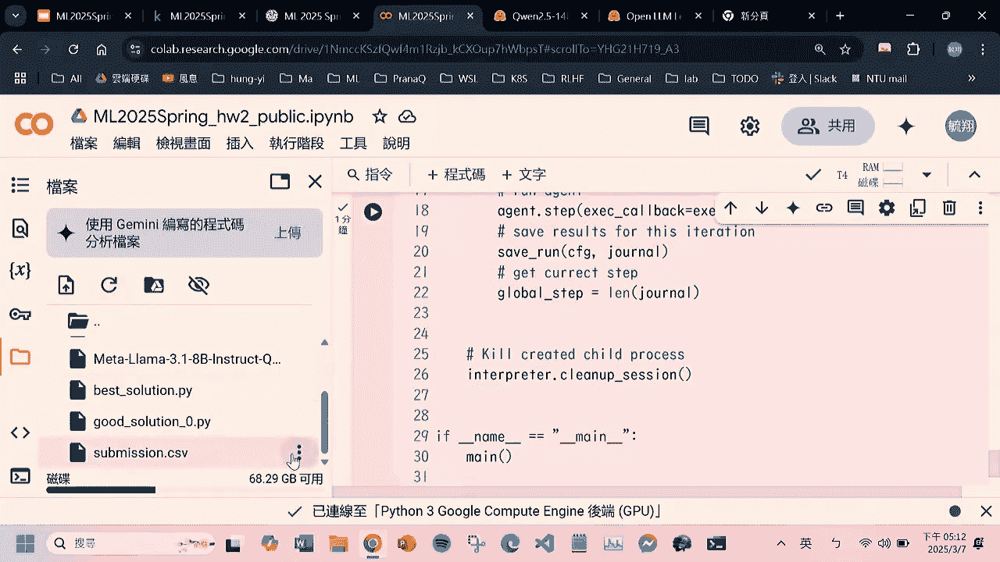

可能就是你城市买的问题，你可能就要去看一下怎么修改好，那这边我展示一下要怎么去，怎么去教你的submission file。

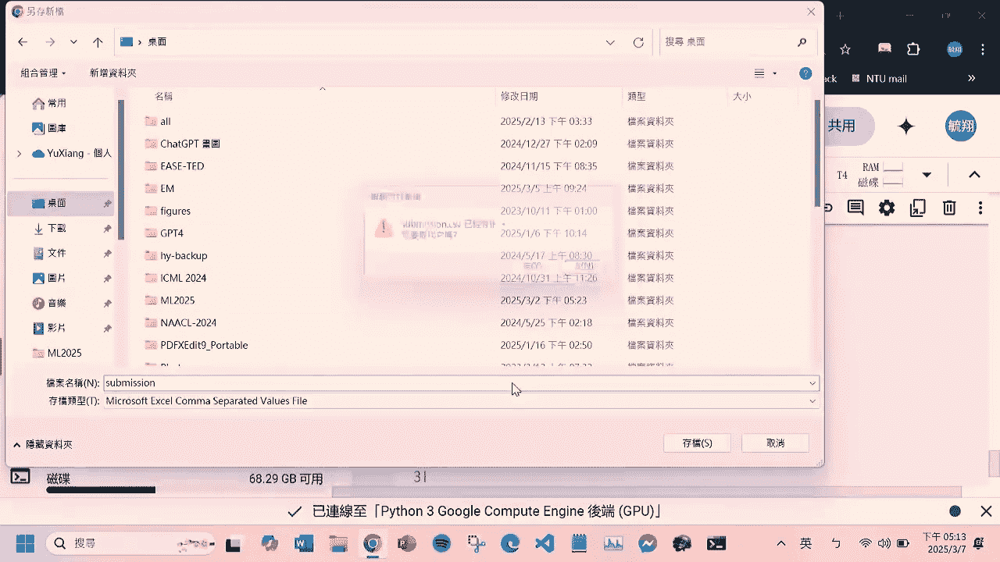

好那我把这个submission file下载下来之后呢，我就回到刚前面这个投影片里面，有一个k o competition的link，然后这边跟大家特别提醒一下，就是我这个k go的比赛是射程呃。

Private，所以你可能要先按这个invitation link。

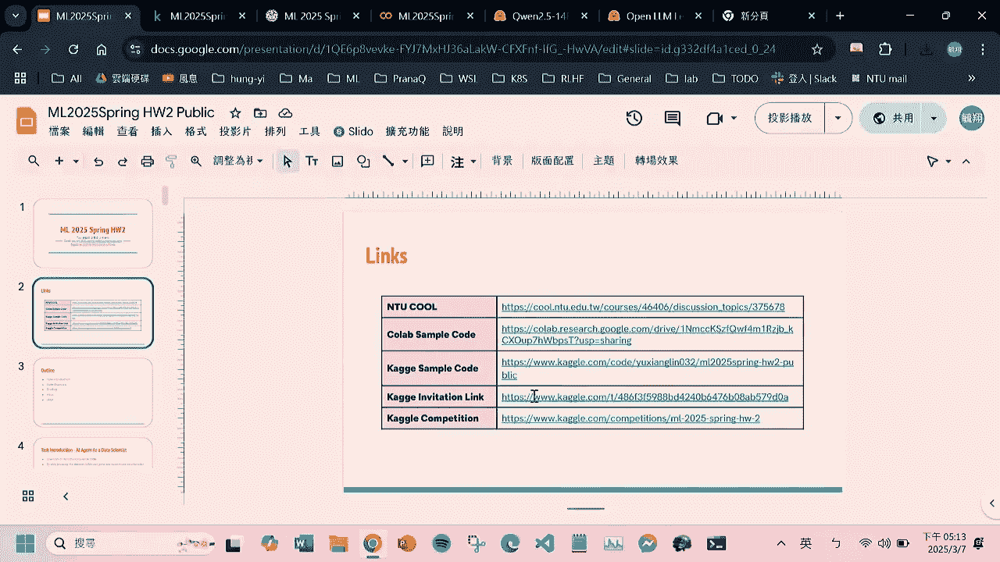

然后进去之后他才问你，说你要不要加入这个比赛，那因为我之前已经加入了，所以这样我现在进来看到的就是这个画面，然后进来这个画面之后呢，你就可以按这个submit prediction。

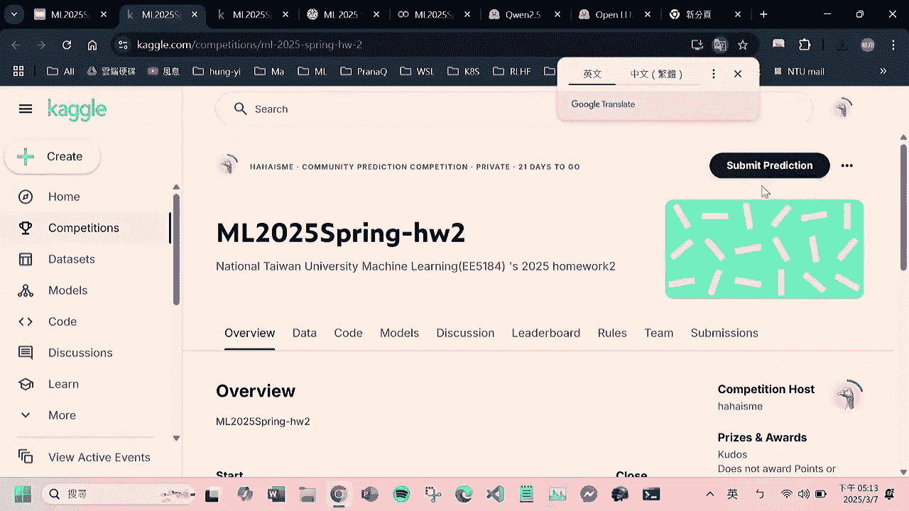

按了之后呢，你就把这个按这个BROXFILE，然后把你刚刚下载下来的submission file交上去，好交上去之后，你就看看这个神秘。

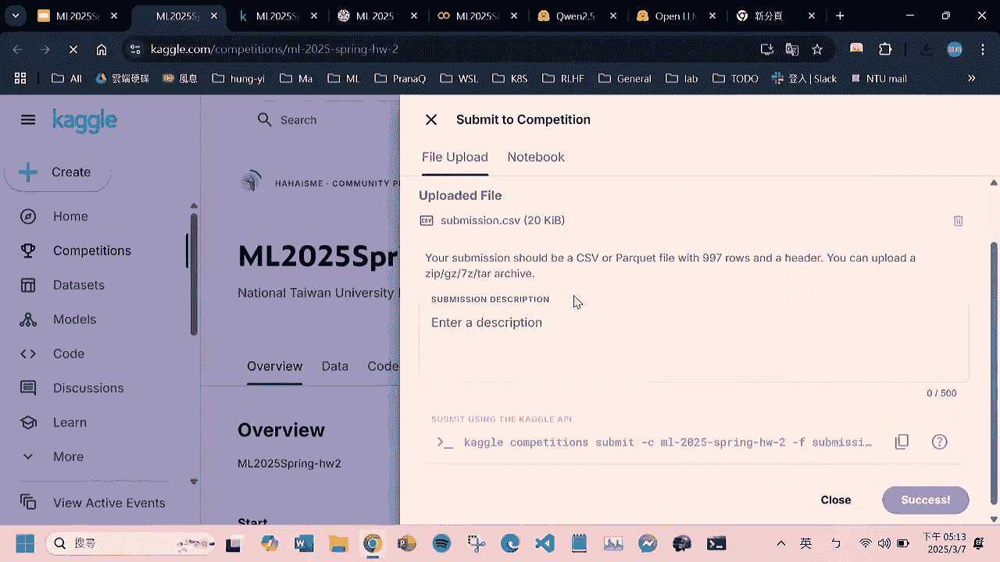

然后你按了神秘之后呢，你就可以点这个leader board leadable，就是你最后城市满output出来的，应该说最后预测出来的结果，然后他就会开始慢慢的跑你的城市嘛，那你等他跑完之后。

你就可以知道它在leer BO上面，距离每个杯赛有多远的距离，好那这边跟大家先提醒一下，就是跟judge ball一样，你一定要选两个，最高两个你想要的档案去做privacy的评分，那你可以选最高分的。

也可以选，说你你觉得最好就看你自己想选哪两个，但是一样就最多只能选两个，那假设我选这两个的话，它就这两个档案就会被拿来拿去做privacy的评分，那我们是取PRIVC，我们是取最高分的。

所以只要你这两个有任何一个档案是超过privacy的，某个baseline，那你就会拿到那个杯赛的成绩好，那现在我们回去lead board上面看，我们就可以看到我刚缴交的成绩，是这个1。03004。

然后他这边会秀出你最好的结果，但是因为我之前教的是别的档案的结果，所以跑出来的是这个分数，但如果你是第一次交的话，你可能看到的分数就会是在这里，就是在simple base赛跟MEDI电BAS赛之间好。

那你在角交完之后呢，要提醒大家的是，你在leader board上面秀的名字是你的账户的名字，但是这样的话我们没有办法抓到你的成绩，所以邀请大家去听这个这个地方，去把自己的听name改成学号开头的听内。

像我这边，比如说我嘎B13901001，然后你只要学号打出来之后，后面加底线，你后面随便要打一个任何东西都可以，你就想要想要打什么都可以，反正你只要前面学号有打出来就可以。

然后记得按shift change，然后save change之后呢，你就去lead BO上面看，只要你lead able上面显示的额，听name是正确的就可以了，我们就可以抓到你的成绩，这样子好。

然后回到投影片。

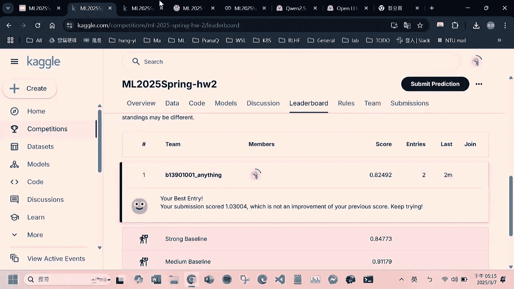

跟大家讲一下一些比较常见的问题。

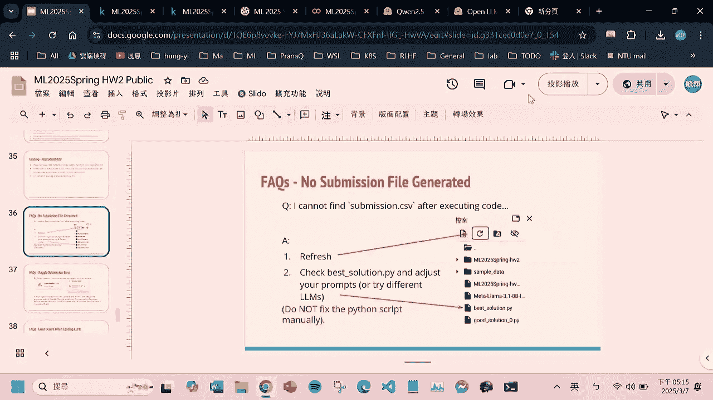

好然后一些比较长可能会发生的问题，就是刚提到，如果你最后没有生成submission file的话，你可以先按重新整理，然后呃去如果从一战里还是没有出来的话呢，你就呃去想办法去调整你的pro。

或者尝试不同的大型原模型，那呃也许你会觉得说常常都不会生submission file，那有可能是你的crown设计的太复杂了，所以大型野模型没办法真的了解，你到底想要他做什么事情。

或者是你现在尝试的那个大选原模型不够强，所以如果你真的一直没办法伸出，submission fire的话，你不要一直去调整它的PRM，你是想要想要应该做的事情，是想办法去，也不是说就是你不要一直想办法。

去让那个PRM变得越来越长，这样子你可以想办法去适当的缩短你的prom，或者是你直接尝试一个更强的大型的模型，然后请大家不要直接去改，你生你生成你大选模型生成出来的solution，这样子好。

那就算你生出这个submission file呢，有时候它生出来答案，也许会你交到K狗上面的平台，可能会报错，那K狗会跟你讲说你报错在哪里，像这个报错的讯息，就是跟你讲说你身份神秘宣file。

没有我们想要的格式那一样，这边就请大家去调整你的pro，或者是呃尝试不同的大型原模型，就请大家不要手动的去改这个神明选five了好，然后最后一个比较常见的问题就是，当你在漏大型人模型的时候。

如果他跟你讲说fail to create lama context，或fail to load什么model的话，你就是要先确保说你有重新启动工作阶段过，然后重新启动之后，如果还是不行。

就表示这颗模型太大了，你可以换压缩率比较大的模型，或者是使用别的不同的模型，那请大家不要担心的是，这一次所有的贝斯赛在COLAB上面都是可以对啊，可以突破的，所以就是呃大家可以放心的使用。

就是可能参数量不是这么多的模型，这样子好，然后最后面则是一些，就是如果你有一些问题要去哪里问，这样就是一样是gun to cool，会有个讨论区，然后我们希望大家如果有问题，尽量在里面发问。

这样其他同学才看得到，然后寄信一样也是寄到这个ta信箱，但是你的信件开头必须要有home work two，那这样助教才能知道说，这一份这个信件应该是谁，要哪个助教要负责回复，然后TL一样。

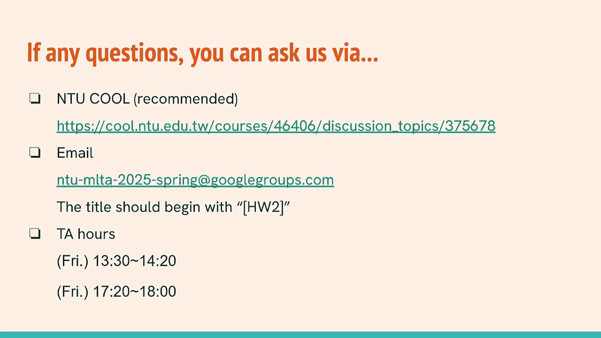