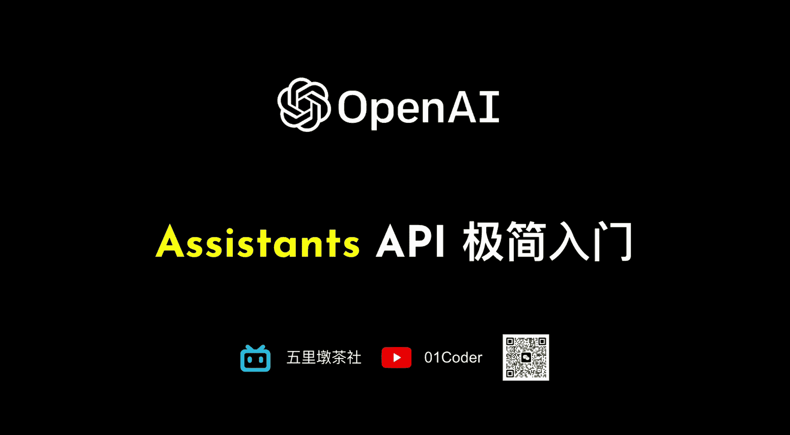
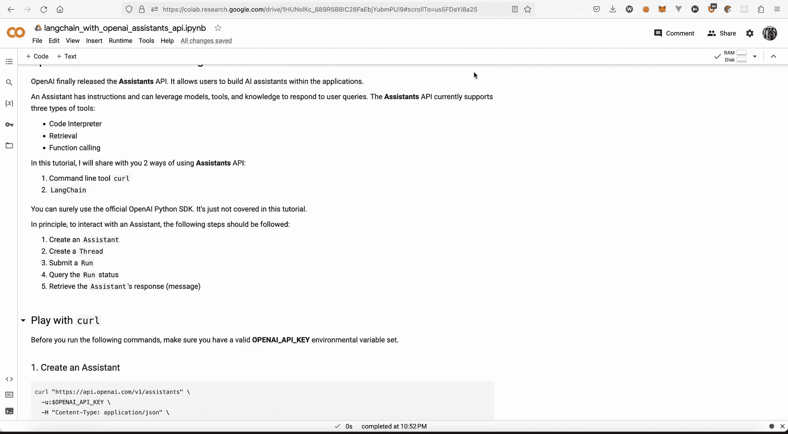
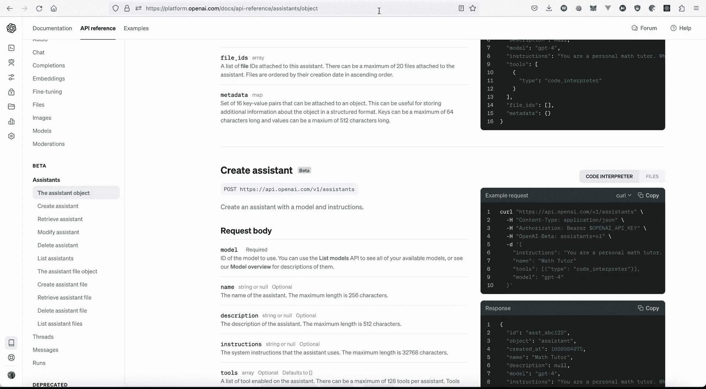
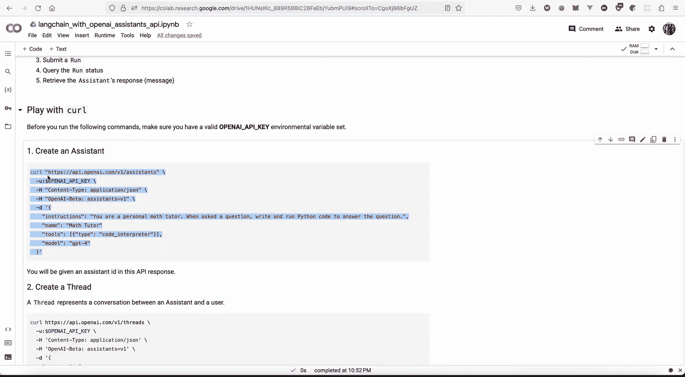
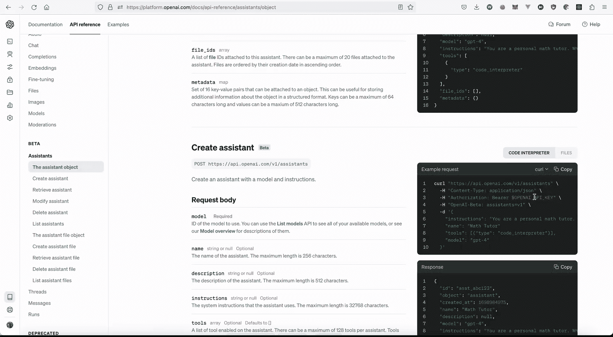
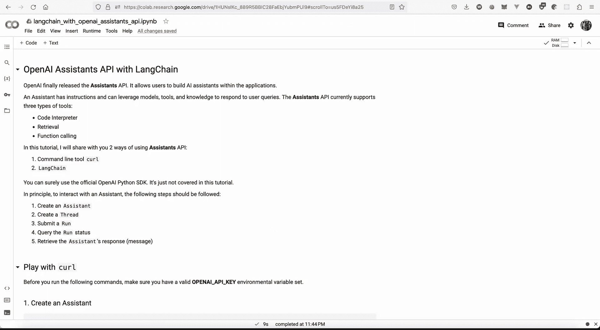

# 强推！(2026最新版) 李宏毅最新课程：智能体AI【AI Agent】71集全！人工智能／机器学习／深度学习／大模型／LLM - P40：39-9、OpenAI Assistants API 极简入门（附LangChain集成） - Ai人工智能工程师 - BV1QdzCB3Eu2

大家好，我是小木头，欢迎大家来到我的视频频道，OpenAI的开发者日，为我们带来了一系列非常令人激动的更新。

那assistant API就是其中之一，今天这期视频呢，我们期望大概利用十到15分钟的时间来分享，究竟assistant API能为我们带来一些什么，不一样的功能。

那在这里依然按照惯例准备了一份Python notebook，来总结今天所要分享的内容，首先来大致了解一下什么是assist API，它允许用户在自己的应用中构建AI助理assistant。

那么一个助理呢会有指令instruction，并能够利用大模型，利用工具甚至知识库来回答用户的提问，当前OpenAI所发布的assistant API呢还处于beta版本，它支持的工具包括了以下三种。

一个是代码解释器，Coding interpreter，一个是TRIBLE，一个是function calling，retrial呢就是检索，function calling是函数调用。

在今天这一期的分享中，我们来看看如何使用assistant API，在分享的应用场景中呢，目前只用到了coding interpreter，后续的分享中，我们会来尝试使用不同的工具。

看看它们都有什么样的特色，我们今天分享分为两部分，第一部分是利用curl命令，通过最原生的API调用，看看assistant究竟是怎么工作的，我们使用或应用a system。

在自己AI应用当中需要经过哪些步骤，另一个方面呢，看看luncheon是如何将ASSESSIONAPI，集成进自己的框架当中提供支持，那么在lunch应用当中如何使用ASSESSIONAPI，当然了。

大家肯定是可以使用官方的Python SDK来开发这部分，或利用assist API的，只是呢在今天的分享中，我们并没有涉及它，简单介绍一下一个assistant，它是如何工作的。

我想对这部分内容已经有所了解的同学呢，应该已经看过现在我所分享的这张图了，这也是OpenAI文档中，对assistant工作原理的一个介绍，在这个API概念之下，有几个重要的角色。

一个是assistant，一个是threat，一个是wrong，assistant代表了一个AI助理或一个机器人，thread代表了助理与用户之间的一个对话，也就是一个conversation对话当中。

当然了，可以有多条消息，在这个图中演示了有用户的消息以及助理，也就是AI回答的一个wrong呢，则是一次我们可以将其定义为人机的交互，这个wrong他就可能会做很多事情，取决于我们用了什么样的工具。

比如在这个图当中，当我们使用了coding interpreter，就会使用到这个工具来创建AI的消息，或assistant的消息，这样呢返回给用户，我们会通过后续的代码演示。

来看看究竟这几个角色是如何在API中呈现出来，我们如何使用它，现在呢就回到刚才介绍的Python notebook，当然了，这里我们总结这些内容呢，是一个应用场景中assistant API的使用情况。

对于究竟每一个API如何使用。

它们的目的或作用是什么，大家可以参考API文档，有非常详细的文档介绍，那我们回到Python notebook。

首先我们来看看如何使用curl命令，来调用最原生的API，在介绍前，我们首先要看看与一个助理assistant交互，需要做哪些事情，通常我们会遵循五步，我们在这里有所介绍。

首先呢创建一个assistant，这是一个创建助理的操作，接下来呢创建一个绘画，也就是创建一个threat，这个绘画就维护了助理和用户之间的对话，接下来提交一个round。

一个round对象呢它代表了一次人机交互，提交了一个round执行，就开启了一个人机的交互，那它是一个类似于异步的任务，在提交以后，我们需要去查询这个wrong的执行状态，一次成功的执行以后呢。

就可以查询thread中的消息列表来获取助理的回复，那通常助理的回复呢，就是消息列表中最新的一条消息，也就最近的一条消息，接下来我们来看看，首先怎么用curl命令来完成这一系列操作，在执行下面的命令前。

大家要确保有一个有效的OpenAI的API key，这个环境变量的设置，同时呢需要有GBT4的访问权限，我在这里呢控制台或者这个shell里面呢，我已经配置了环境变量了，那我们现在就开始。

第一步是创建一个assistant。

在这里呢，大家其实通过API文档也能得到这样，相应的这个命令的详细信息，还有Python和NO js的代码示例。

那我现在呢就要拷贝这个命令，在控制台执行一下，在这里的执行可以看到呢，通过调用we want slash assistant这个m point，完成了一个助理的创建，创建以后会得到一个id。

这也是我们要记录的，当然这是在手动的命令行的执行中，我们得这样做，大家如果通过个shell脚本来进行，请自动化的程序执行呢，或者程序化的调用呢，这些都可以通过程序来处理，我们将这个id记录下来。

现在就有了一个assistant，他用这个id来标示的，给到他的一个指令，instructions告诉他是一个个人的数学导师，当提出任何相关问题的时候呢，期望他能够编写Python代码并执行来回答问题。

在工具这里就指定了，使用的是coding interpreter模型呢，G比D4，同时我们还给它起了个名字叫mass tutor，好了，现在就有了一个助理，接下来我们刚才是介绍的做什么呢，创建一个绘画。

一个threat server，创建命令也在这里，我们拷贝就好，在创建的时候，我们还在相这个请求的消息题里面，构建了一个消息数组，一条消息，期望他能够我这个呢是用户提问。

是计算123的和但非常简单的一个问题，我们通过这个事例来演示，要注意，同时呢需要设置几个头，一个是content type，一个是open in a better assistant，等于v one。

那这就是创建绘画的命令，我们来执行一下，现在这个绘画就创建完成，同样在API响应当中就会有这个thread对应的id，这个id呢也是在后续的命令执行中会用到的，我们也需要记录一下，现在我们有了助理。

有了一个threat，一个绘画，接下来可以提交一个run，就是要执行这个人机交互了，在上一步第二步创建thread的时候呢，我们同时提交了这个消息，我们现在就期望开启一个交互，在这个交互中可以看到。

这里呢又要用到刚才我们所得到的一个set的id，和一个assistant id，我们在这里呢粘贴一下，也方便我们将它拷贝到命令行，在创建SEM时候呢，得到这么一个id。

这样我们就能够来提交一个wrong，可以看到这里的响应当中，同样给到了我们一个wrong这个任务的id，这个id在这里，那依然我们需要记录的，那我们现在呢将这个记录一下，下一步就去查询这个run的状态。

非常简单，也是通过一个API调用，我们同样需要这个thread id和run id，这个run id呢也是刚才在API调用中返回的，我们将它复制过来，这个命令呢执行一下，可以看他的状态已经是完成的。

说明这个任务的执行还是蛮快的，我们回到Python notebook，接下来呢就可以去获取助理的响应，助理响应的获取呢是通过threat中，消息列表的查询来得到的，我们将这个sd id同样拷贝到这里。

我们通过这个命令来查询，在这个命令的查询中呢，我们提交了一个thread id去查询他所有的消息，我们从最底下这条消息可以看到，下面这条消息呢是文本消息，这就是用户roll user提出的一个问题。

期望计算123的和第二条消息呢，就是助理的回复，rose assistant内容是文本内容的详细信息就在这里，Some of one two and three is six，这就是他的一个回复。

那我们刚才就看到了，究竟一个assistant是如何创建，并如何完成一个人机交互的，现在呢我们就完成了利用curl命令，通过命令的执行来进行assistant API的使用，看起来还是需要至少那么五步。

接下来呢我们来看看lunch是如何集成的，Assession api，整个lunch的开发团队，对于OpenAI大模型的响应还是非常积极的，因此在OpenAI发布assistant API不久。

就已经在最新的RC版本中提供了，LUNCHE与assistant API的集成的支持，在这里要注意，在发布的版本中，我们现在呢最好是使用0。0。331，RC2以上的版本，因为在之前版本当中呢。

可能还是存在一些小小的问题，那这这个版本以上的，至少我验证过是可以正常工作的，同时要注意的是，lunch对assistant API的支持或assistant的支持呢。

是通过luncheon experimental这个包来实现的，因此不仅仅是装luncheon，还需要装launch experimental，使用非常非常简单。

只需要一个类OpenAI assistant runnable，接下来我们看看这个代码结构是什么样的，首先呢一个有效的OpenAI的API key，跟刚才curl命令的执行是一样的，接下来安装几个包。

lunch launch experimental和OpenAI，要注意OpenAI呢也要使用，至少是一点一版本的，接下来就是最简单的两步操作，第一步创建一个assistant。

通过使用open air assistant，RUNNABLE这个类的create assistant函数就可以了，给它起个名字，名字叫lunch on assistant，指令。

指令跟刚才我们提出的创建的session是一模一样的，它叫，他也是一个数学的导师，基于Python的代码来执行并回答数学问题，工具也是使用的coding interpreter模型，Gb t4。

这就是如何创建一个assistant，我们通过执行就看到没有任何错误，接下来可以提问了，这个提问跟刚才我们在创建thread的时候非常相似，其实完全一样，这个内容也是计算123的和。

在这里呢就通过invoke函数调用就可以了，invoke时候呢给到他一个字典，Content，就是我们这个键对应的就是提的问题，我们来看看它执行结果如何，重点是我们要看看他的输出里面。

包含些什么样的信息，这些信息呢对我们有什么帮助，在这里可以看到content有一个message content text，他说a sum of one two and three six。

这个没有问题，相信大家也是对的，更重要的是，我们来看看这个output里面究竟包含了些什么，首先它有一个id，这是一个threat message，它包含了assistant id。

还包含了创建的时间以及角色，Run id thread id，因此这里面就包含了我们刚才介绍几大元素，Assistant thread，wrong这几大元素，他们的id呢在这个响应里面都有。

可以看到lunch对他的封装还是挺不错的，至少在代码层面非常的简洁，如果我们使用OpenAI的Python SDK呢，我们还是免不了需要一步一步的调用它的接口。

去创建assistant assistant，去创建threat，创建run查询状态，并得去查获得它的响应，当然这个响应呢，是通过THRE的消息列表去获得的，而在LON的封装上显得非常的简洁。

因此呢这个在具具体的AI应用开发中，大家怎么使用assistant API，嗯想用原生SDK还是用lunch呢，大家也可以在自己的使用中来评估，那我想今天分享就到这里。

这就是我们非常简单的一个入门的一个分享，关于如何使用OpenAI assistant API，那大家对这方面有什么反馈呢，也欢迎在评论区给我们留言，后续我们应该也会制作更多ASSESSIONAPI。

相关的一些分享视频，那大家就请关注我们频道，给你也来一波三连吧，那我们就下次再见。

