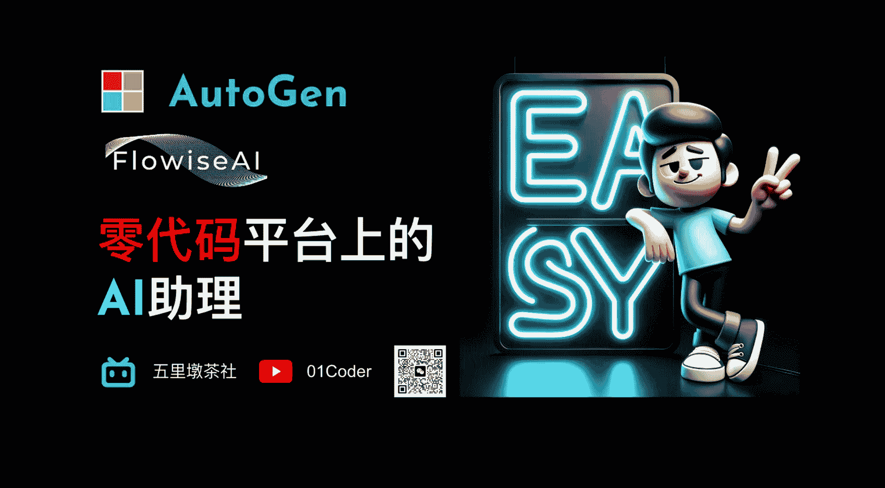
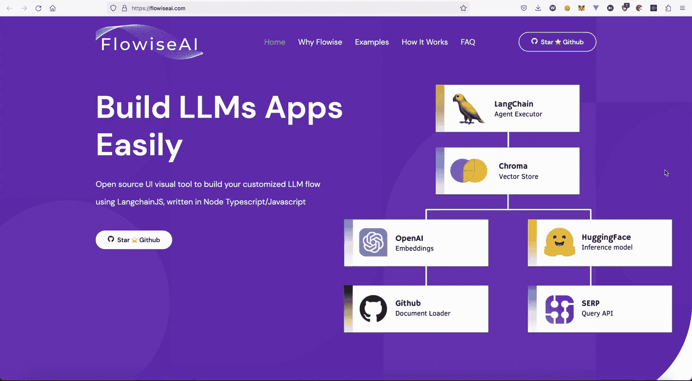
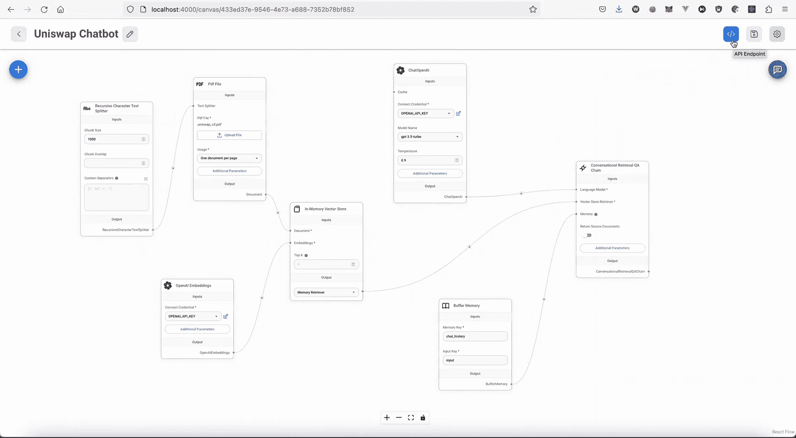
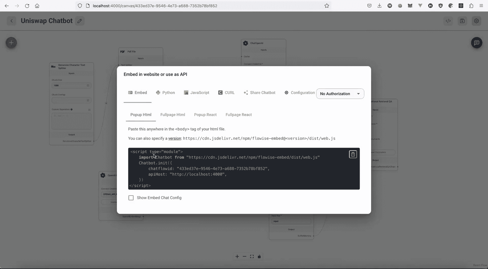
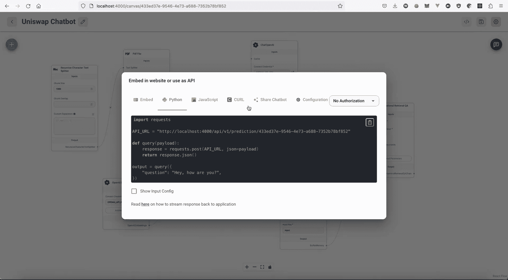
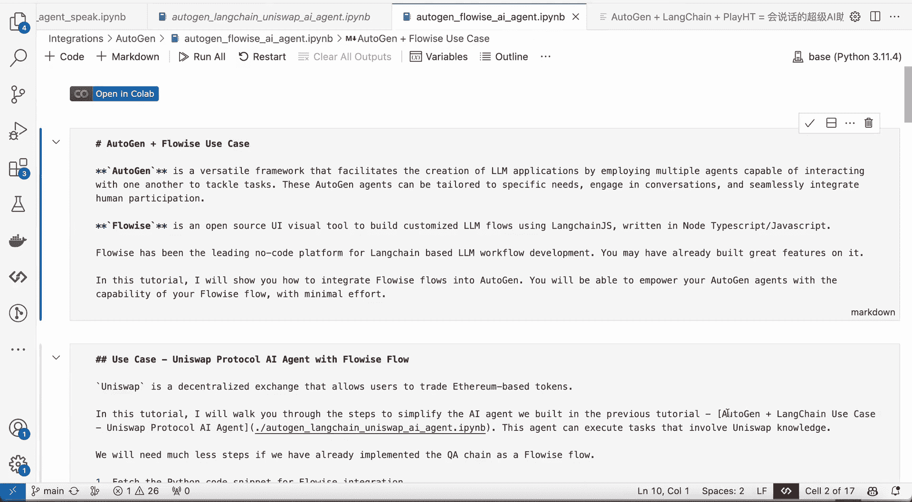
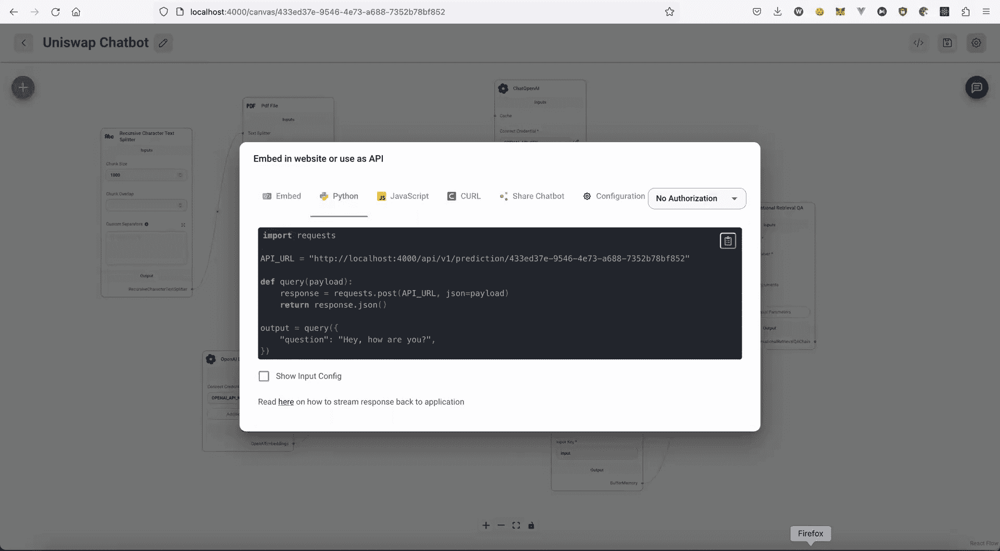
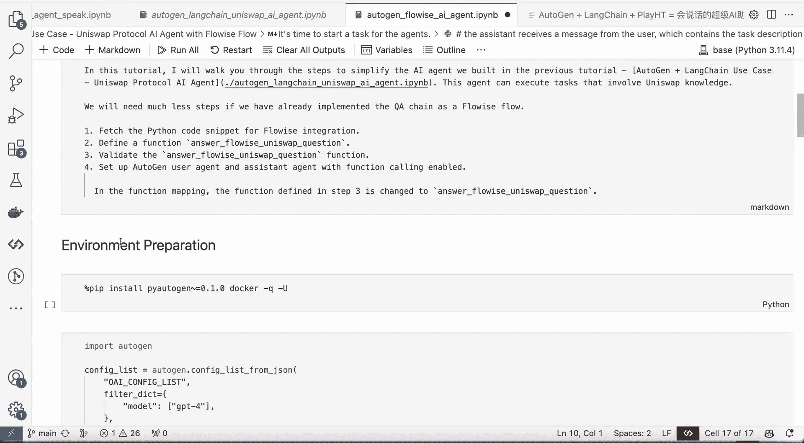

# 强推！(2026最新版) 李宏毅最新课程：智能体AI【AI Agent】71集全！人工智能／机器学习／深度学习／大模型／LLM - P42：41-11、AutoGen + Flowise = 零代码平台上的超级AI助理 - Ai人工智能工程师 - BV1QdzCB3Eu2

大家好，我是小木头，在过去两期视频中，我为大家分享了关于如何使用auto键和蓝全框架，来构建基于大圆模型的应用或功能，他们呢，能被用在许多非常有意思的应用场景之中，AI的这个生态中。

其实已经有许多非常优秀的开源的，闭源的或商业化的框架产品或服务，那么如何将已经完成的一些成果提升进order，JIN框架呢。

今天我们就来分享一下，现在的AI或单元模型生态中，L卷是非常活跃的一个开源框架，那么在蓝圈的生态中，有一款非常流行的开源的UI可视化工具，或者我们称为无代码工具，那就是flow wise。

它用来使用lunch js框架，构建自定义的大圆模型流程，一个workflow工作流，那我想同学们可能或多或少，已经使用过这个平台或这个工具了，甚至可能已经利用它构建自己的产品。

那如何将基于fluids构建的AI产品或应用，集成进order jin框架，利用已有的工作流来赋能我们的order jin应用，那这就是今天我们所要分享的，我们会基于过去视频分享中已经构建的。

unit wap协议的AI助理，我们期望使用FLOIS构建的工作流，来实现一个同样的机制的AI应用，我们来看看究竟如何能够轻松地将fluids，集成进OTOJIN，当然了，最后我们发现代码非常的精简。

那我们现在呢就进入今天的分享，我们首先是需要一个fluids的运行环境。

来到fluids官方的代码仓库，可以看到在本地运行支持两种方式，一种呢是通过npm install开发包的形式来运行，另一种呢是用docker，我在这里呢就使用了docker，非常非常的简单。

一种是选择docker compose，一种呢是构建自己的docker镜像，我在本地编译了这个docker的镜像，并运行其一个容器，大家可以选择自己喜欢的方式来运行，我在这里呢就不再build。

我已经完成了构建，大家只需要通过docker build这个命令就行，然后再通过docker run命令来启动这个docker镜像，来运行一个容器，我在这里呢本地并没有绑定3000G端口。

我绑定了4000，同学们根据自己的需要绑定就好，我在这里呢，可以给大家分享一下目前的运行情况，可以看到这里我在四线端口上运行了个FLOIS，我们打开浏览器来到四线端口，在这里可以看到。

我已经为今天的分享提前准备好了一个，unit swap协议的聊天机器人，这也是为了避免花费太多时间，来构建这个工作流，我们简单介绍一下整个工作流所使用到的组件，从我们从最终的暴露的接口来讲呢。

我们是需要一个retrieval q a chain，这是一个绘画的检索QA链，我们先需要这么一个QA链，这个链上需要三个组件，一个是大圆模型，一个是向量存储的检索器，另一个呢是G组件。

分别我们就构建了，或我们添加了chat OpenAI模型作为语言模型，这是大圆模型，向量存储检索器呢，我们使用了基于内存的向量存储，这是方便我们演示，大家可以选择chroma dB或PYON等。

都可以记忆组件，我们选择一个buffer memory，大家可以根据自己的需要，应用场景呢来选择不同的类型，至于这个内存的向量存储，它需要两个组件，一个是文档，一个是embedding。

embedding呢使用的是OpenAI的embedding文档，是一个Pdf file的组件，在这里呢我们上传了unit wap v three的PDF文件，作为呃文件输入，那在这里呢。

还需要对这个PDF文件提供一个文本拆分器，我们选择的是recursive character，Text blader，这样我们就构建出了一个工作流，通过保存就可以在这个聊天这里提问，我们已经提过问了。

我还可以问一个不同的问题，What's，The main change with three，在版本三当中的主要的变化是什么，它就告诉我们了一些基于文档所学习到的知识，这就是如何构建一个工作流。

我们以非常快速的形式流过了一下这个步骤，有兴趣的同学或者是还不熟悉的呢，可以参阅官方文档，那重点就是接下来的部分了，我们在这个flowers的工作流的右上角，这里会看到有个API m point。

我们点击它可以看到不同的集成方式，也就是我们可以使用哪些方式来使用，这个工作流，可以直接以CRIPTJAVASCRIPT代码的形式嵌入网页。

也可以通过Python JavaScript等不同的编程语言访问，为什么能访问呢，正是因为它提供了一个API接口，可以看到跑在4000端口上的这个fluids，是有一个API接口的。

那这就是我们如何使用它，通过Python脚本来调用这个API，就可以非常轻松的基于这个链来进行问答，我们正式使用这段代码，那我们现在呢就来到一份Python notebook。

来到这里呢是我们新建的一份这份代码呢，我已经上传到了代码仓库。

我会把相关的链接全部都放在视频描述中，需要的同学呢就在描述中取用。

我们简单分享一下，就是我现在所给大家演示的这一部分，我们要做的是使用FLUISE工作流，来构建auto键的多代理应用，在这个应用当中呢，会做之前视频分享中实现的同样效果，我会给到一个任务。

让代理帮助我完成这个任务呢，需要懂得unit wap协议的知识，我会让他写一篇博客，基于unit sop v three协议当中的基本的一些知识，那这个任务我会交给auto jin的代理来做。

那这部分的实现呢会需要哪些步骤，我们这里就来看一下，第一步呢是按照我刚才所介绍的，到FLOS工作流中获取到Python代码片段，这版这个Python代码片段会被用于后面的集成。

接下来就是在代码中定义一个函数，这个函数就是answer flowers units a question，在这个函数当中去做force API调用，进行问答，我们会简单的调用一下这个函数。

来确保他的工作是正常的，最后呢就是构建oto jam的代理，user agent和assistant agent，在之前的视频分享中，我们是使用的函数，Answer unit wag question。

这个函数呢我们可以回到当时的分享中，所用的Python notebook，在这里我们是自己构建了一条蓝全的链，来进行的问答，大家可以看到在这里，那现在不同的是，我们不在自己构建了。

我们重用已经构建好的FLOIS链，只需要通过API调用就好，我们可以快速的来到下面这里，可以看到第一步是先去获取代码片段，这个代码片段呢我也粘贴在这里供大家参考，接下来的函数，那只需要四行代码吧。

API的URLL以及做一个简单的post请求，API调用问题呢通过消息体来提提交，接下来验证这个函数能正常工作，最后我们就可以来构建auto jin的代理。

user agent和assistant agent，我们的函数这一章的名称会略作修改，我们会用answer flois unit，WAP快式，其他部分只有一处改动，就是user proxy。

这里user proxagent中的function map，会对应的将函数的定义作为修改，最后呢就可以完成同样的任务了，写篇博客介绍，uni swap协议的V3版本有哪些呃，差异，它是什么，如何使用。

最终呢通过这些内容来完成一篇博客，现在呢我们就来到我的本地环境，我在这里呢已经准备好了一个环境，同时呢包也已经安装好，我们就快速的浏览一下，我们可以尝试来构建这个函数。

Answer flowers unifquestion，然后验证一下是否正常工作，我来提问主要的变化是什么，那我们运行这个代码，他就会去调用在本地运行的flies，可以看到。

在这里他给到了我一个非常详细的回答，我在这里呢就不逐一的过这个回答的内容了，至少保证API调用是正常工作的，即使内容有差池，大家需要调整呢，也只需要到FLOIS斯侧去做必要的调整就好。

那接下来就是对这个大圆模型配置做一番设置，会被用来构建auto jin的代理代理，我也构建完了，现在呢就可以启动这个任务，我们来看看他做了些什么事情，他会调这个函数，大家可以看到在这里调用的时候呢。

是分别使用了三个问题，What the unit wap，What are the main changes，以及how to use unit web，每次的调用呢得到的结果可以看到，在这里。

这正是我们所需要的，也是user proxy agent所需要的，最后基于这些内容，会有assistant agent来完成一篇博客并交付给user proxy，最终完成这次任务的执行好了。

今天呢我们这个视频分享呢其实非常的简单，核心就在于我们能够最大程度的重用，已经完成的AI应用，即使我们用了不同的工具，比如FLOS，那我们也可以将它集成到order键的产品中。

这样呢我们可以使用最小的代价，尽快的将已经完成的一些成果集成进来，那这今天的分享呢，我想就做一个抛砖引玉的效果吧，同学们也可以将自己手手头的已有的一些产品，或功能以类似的方式集成进来。

看看order jin究竟在哪些方面，能够帮助大家起到协作以及调度的功能，那咱们今天的分享就到这里，有什么问题或意见的同学呢，也欢迎在评论区给我们留言，我非常也希望看到。

能够有更多奇妙的想法和很好的点子，以及改进意见，能够贡献到整个AI应用或这个生态当中，那咱们就评论区见，咱们也下期视频分享再见。

