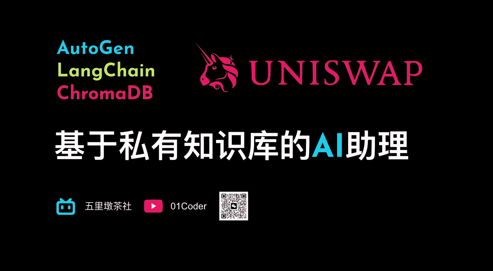
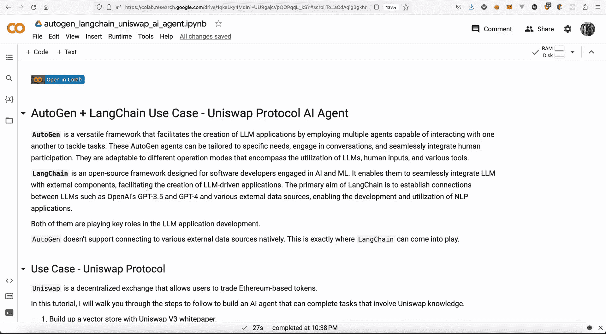

# 强推！(2026最新版) 李宏毅最新课程：智能体AI【AI Agent】71集全！人工智能／机器学习／深度学习／大模型／LLM - P43：42-12、AutoGen + LangChain + ChromaDB = 超级AI助理 - Ai人工智能工程师 - BV1QdzCB3Eu2

大家好，我是小木头，最近挺长一段时间，我们都在学习和分享luncheon开源框架的知识，最近呢微软又推出auto jen，这个多代理的大元模型框架，我们对它呢也做了一番学习，在视频分享后。

有一些同学对于这两个框架提出了一些问题，比如auto键与luncheon它究竟有什么差异。

它们是否可以集成在一起协同工作，那今天这期视频呢，我们就来分享一个OTOJIN加LUNCHEN，的使用场景，来，看看究竟我们可以如何使用这两个框架的优势，来配合协同工作，实现一些大元模型的功能或应用。

在今天这个事例中呢，我们会基于知识库，我们所说的知识库呢是使用的unit wap protocol，也就是unit wap协议的白皮书，作为私有知识库的样本数据构建一个AI代理。

先简单的再介绍一下什么是OTOJIN，它是一个支持多代理的大圆模型框架，通过利用多个能够相互交互，以处理任务的代理来构建大元模型的应用，而LUNCHER是一个开源框架。

专门为从事AI或机器学习的软件开发人员设计，帮助他们能够无缝地将大源模型与外，部组件集成，特别是外部的数据，那今天我们所衍生应用场景呢是基于unit wap version。

three版本的白皮书来构建AI助理，帮助用户完成与unit wab v，three协议支持相关的任务，现在呢我们就利用一份Python notebook，来分享今天的主要内容。

刚才我们介绍了什么是OOJIN，什么是LUNCHE，那从介绍可以看到，OTOJIN善于对多代理进行调度协同工作，帮助用户完成提出的问题或执行任务，那lunch呢它具有很强的连接外部数据，外部组件的能力。

那在今天我们的应用场景中，期望建立一个基于unit wap协议或白皮书的AI代理，帮助用户来完成基于协议的一些任务，那在这个应用场景中呢，正好可以充分利用auto jin和lunch各自的优势。

来实现这样一个功能，现在我们就来看看要实现这么一个AI代理，需要做哪些事情，既然是针对某个协议的白皮书构建一个AI助理，那白皮书的内容就将是整个应用或这个助理，必要的知识基础。

这与我们在过去分享的基于luncheon的文档，聊天机器人这么一个应用场景是非常类似的，那我们需要基于协议的白皮书，来创建它的知识库，构建它的向量存储，以便后续的检索使用，当用户提出一个问题。

或希望完成一个任务的时候，auto jen的代理需要寻找或定位必要的协议，相关的内容或知识，它可以来到我们的向量存储中，进行相关性的查询，这也是最基本的一种策略和手段，那从架构上来讲，我们就分为两块。

首先luncheon来实现协议数据的索引，那auto键通过提供多代理来帮助用户来完成任务，那任务的执行中，当auto jin的代理需要寻找或查询相关的协，议的内容或数据的时候呢。

就可以通过lunch框架所提供的链来完成，那这两块如何结合呢，如何集成呢，这正是通过auto键框架支持的函数调用，function co来完成，我们现在就来一步一步的看看，如何实现这么一个功能。

在这里呢我们做了一个总结，第一步是构建一个向量存储，是基于unit wab three的白皮书，基于这个向量存储来构建一个lunch的，基于对话的检索QA列，它是基于向量存储的。

这样就有了一个可以使用的QA链，即使没有auto jin的代理，我们也可以直接通过这个链的函数调用，来进行问答，这个问答呢就是基于unit swap的白皮书内容，来进行的问答，第三步，定义一个函数。

这个函数呢就会被auto jin的代理使用，这个函数我们命名为answer units a question，接受一个参数，Question，他会去调用LUNCHEN的q a chin来回答这个问题。

回答会作为函数的返回给到代理，第四步呢就是构建auto jin的user agent和assistant agent，它会启用函数调用，目的在于调用刚才第三步中定义的answer。

Unit one question，来进行unit swap相关内容或相关问题的问答，要注意在第四步构建auto键代理的时候呢，在函数映射中会用到第三步中声明的函数。

同时助理agent assistant agent他该怎么行动，他该怎么工作呢，会基于下面我们看到的这个事例的消息来引导，比如在这里我们会告诉这个assistant agent。

通过user agent，我想要写一篇博客，介绍unit wap协议的第三版本version three，那么就通过回答以下三个问题，基于回答来编写一段简要的介绍，三个问题分别是什么。

是union swap，版本三里面主要的变更是什么，以及如何使用union swap，需要注意的是，真正的函数调用是通过user agent来完成的，接下来呢来准备一下环境。

在环境准备中可以看到会安装一系列的包，我们会用到OTOJIN框架，用到docker来执行代码，执行Python脚本或执行函数调用。

运用到了lunchopen AI tick token chroma dB，我们利用chrome dB来作为向量存储，最后呢就是PYPDF这个包，它帮助我们加载PDF的啊，白皮书。

我们还需要一份unit swap的白皮书，那PDF的下载在这里也完成了，文件呢就是unicom wap v three，PDF环境准备中，还需要为auto jam加载必要的模型和API key。

我们在这里呢上传了一个文件，O ai config list，这个文件中就包含了我定义的模型，和对应的API key，这里有一份示例的内容，关于o AI config list文件该长什么样。

大家可以看一下，这里面可以定义多组模型和API key的配对，我们这里呢我只用了一个，我用的GPT4的模型，对应的API key呢也在这里头配置了。

通过auto jin的config this from jason加载，这样呢就加载了这个配置，这个配置会在后面agent的创建中使用，同理我从这里面呢就读取到了这个API key。

将它呢设置为环境变量，这是方面lunch的OpenAI模型使用，包括了embedding的模型，这就准备好了环境，当然啦加载一系列必要的类，我们看看接下来步骤，第一步是创建一个向量存储。

这个向量存储是基于unit wap的白皮书，那非常简单，我们来基于这份下载的白皮书，PDF文件来加载文档，然后呢再做文档的拆分，将拆分后的文档存入CHROMADB。

用了OpenAI的embedding模型，第二步是创建一条蓝犬的链，这条链呢是一个conversational retrieval q a cha，通过这个链我们可以进行问答，非常简单的构建方式。

利用了OpenAI的模型向量存储作为检索器，并创建了一个buffer memory作为记忆组件，那这就是一个科约链的创建，我们可以在这里呢通过最简单的一个提问，验证一下他究竟是否正常工作。

我们来问一下什么是unit wap，我们把这个回答中的answer字段打印出来，这就是模型给到我们的答案，确认了QA链的正常工作，就可以来定义函数。

这个函数就会被auto jin的代理agents所使用函数，Answer unit wap question，实现也非常简单，一个参数question，这正是用户的提问或模型给到的提问。

这个提问呢会交付给这个QA链，我们将模型的回答或响应返回给函数调用方，在这里呢就是只返回answer字段，这就是就是模型回复我们的内容，其他字段就不需要了，最后就来创建auto jin的代理。

我们分别需要一个user agent，一个assistant agent，启用函数调用，我们接下来看看这个大元模型的配置中，是如何定义的，函数函数中呢，就将刚才我们声明的函数把签名放进来。

名称是answer unit wap question，给他一个描述这个函数是做什么工作呢，回答任何unit wap相关的问题，接受一个参数question，这question是必须的。

是一个required property，那声明好了以后呢，这就是我们所构建的大圆模型的配置，这个配置会被用在后面这里，assistant和user proxy的创建，这些地方都没有。

特别跟我们之前在分享auto jin的使用时，都是一样的，Function map，这里呢定义了answer unit one question，这个函数的映射，将这个名称映射到了。

我们前面定义的Python的函数上，通过这个映射在assistant agent告诉user proxy，该调用这个函数的时候，他就知道究竟该去执行哪一个具体的函数，在完成了构建后。

现在就可以开始执行一些任务，我们现在要执行的任务呢，就是在视频开始的时候所介绍的，会要求代理帮助我写一篇博客，来介绍unit wap协议的第三版本内容从哪来呢，会期望代理能够提三个问题。

基于这三个问题的答案来编写这份博客，我们呢现在就执行它一下，看看这个user agent和assistant agent，以及LUNCHE的这个q a chain究竟是怎么交互的，我们来执行一下。

可以看到这里，user proxy向助理提出了这个任务，他要写一篇博客，要通过三个问题的回答作为基础来写，那助理就会返回给这个user proxy，建议他执行这个函数。

提的问题呢是what the unit wap，这就是刚才的第一个问题，执行是由user proxy来完成，响应是unit swap。

Is a decentralized cryptocurrency exchange，这就完成了第一个问题的问与答案，assistant会让user proxy继续进行函数调用。

可以看到这里呢得到的是第二个问题的提问，函数依然会执行，执行也是调用的kv chain响应是这样的，第三版本介绍了一系列新的功能，包括什么什么什么，继续往下，assistant建议执行第三次函数调用。

这次呢就是提的问题，How to use unit wap，user proxy会完成这次函数调用，依然是KVCHEN的回答，要怎么使用，To use unit web。

You will need to have a web through wallet，在三次完成以后，我们看到最后这一次assistant返回给user proxy，这么一段话。

Based on the answer to your question，Is a draft introduction for your block，那他就把这些内容整理在了一起。

组织成了一篇介绍unit wap版本三的白皮书，的一篇简单的博客内容，那这就完成了整个我们用户提出的任务的执行，通过这个是分享呢，希望也能够给到大家一些指引，关于如何将oto jam和LUNCHE。

有效的结合在一起，order键的函数调用，能够很方便地帮助我们，将lunch框架中链的概念引入进来，这样呢就给到了order jin一个渠道来对外部数据，外部组件进行很好的集成，那有兴趣的同学呢。

赶紧来尝试一下这部分的功能，看看是否能够通过auto jen的代理，结合lunch所提供的工具和组件，构建出更加有趣更强大的AI应用，我会把今天所分享的所有代码和相关文档，链接呢都放到视频描述中。

有兴趣的同学呢就到描述中取用吧，那今天咱们的分享就到这里，有任何问题的同学们，请依然到评论区给我们留言，那咱们就下次再见。

