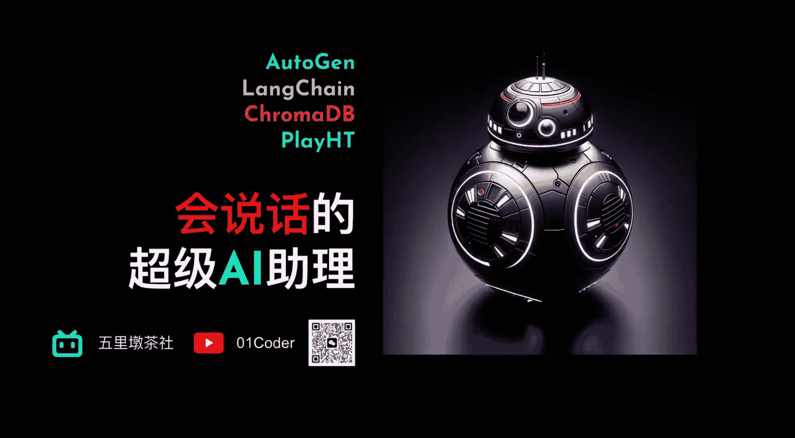
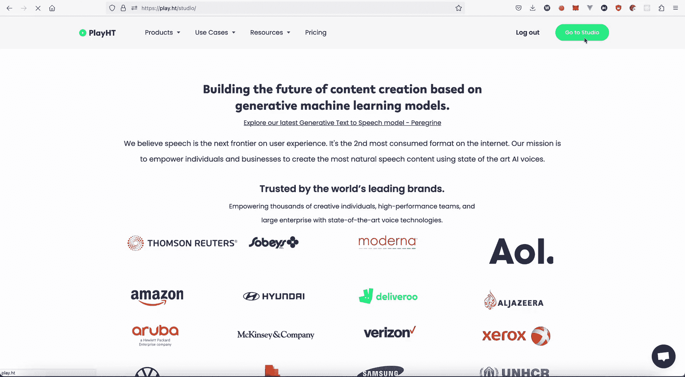
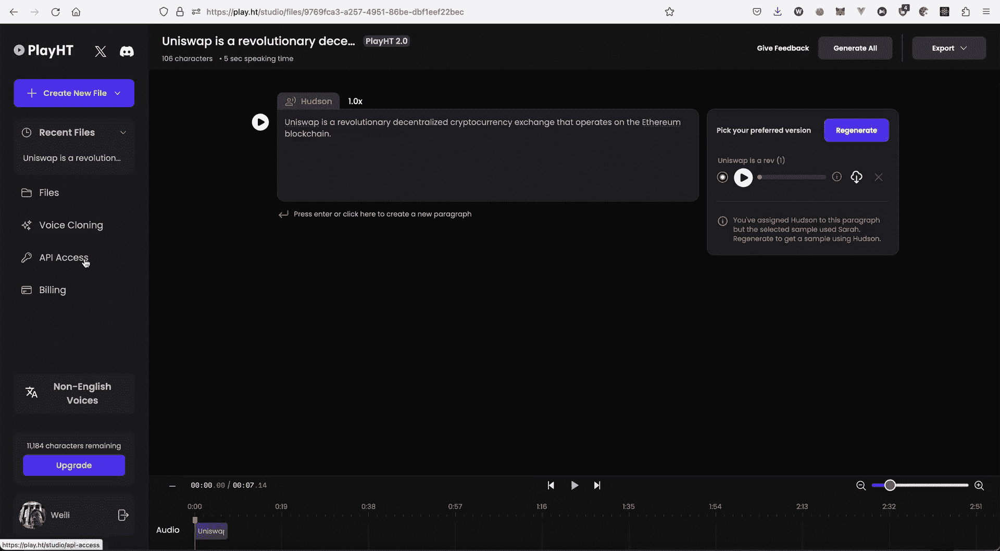
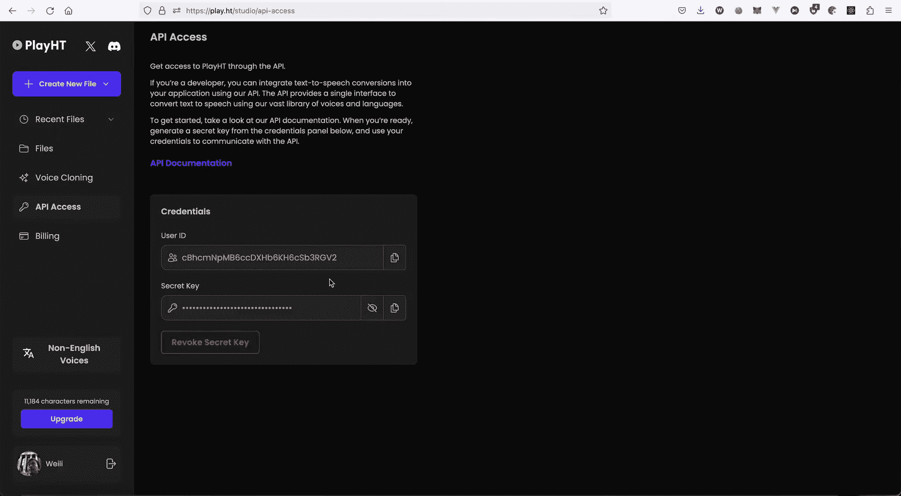
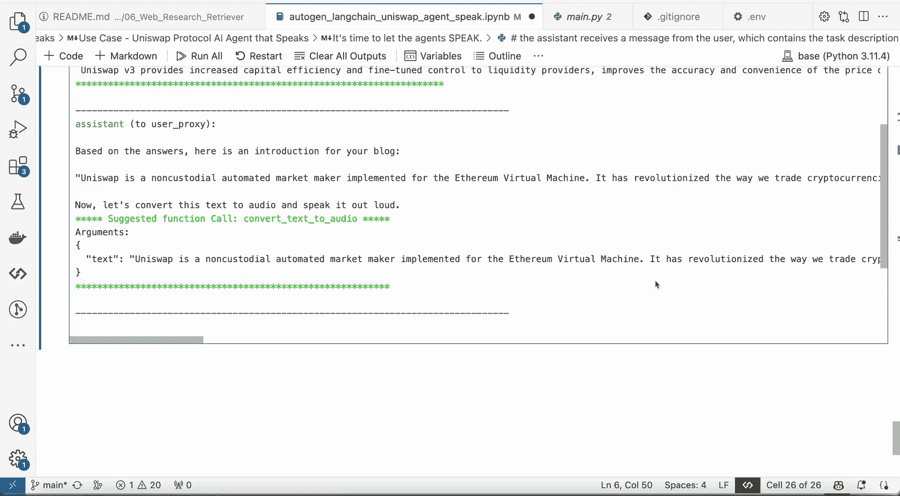

# 强推！(2026最新版) 李宏毅最新课程：智能体AI【AI Agent】71集全！人工智能／机器学习／深度学习／大模型／LLM - P44：43-13、AutoGen + LangChain + PlayHT = 会说话的超级AI助理 - Ai人工智能工程师 - BV1QdzCB3Eu2

大家好，我是小木头，在上期视频分享中，我们将auto jen和LUNCHEN这两大框架集成在一起，构建了一款非常强大又好用的AI代理，这款代理呢它基于了unit swap协议的白皮书。

以它作为知识内容或基础，为我们提供AI服务，不仅仅是一个基于文档的聊天机器人，正是由于auto jin的引入，它能够执行代码生成代码，那他就在知识内容基础上不仅提供聊天内容，还可以做许多更多的事情。

我们可以利用它来发邮件，写博客等等。

那在上期视频中分享的这款AI代理呢，与用户的交互完全都是基于文字的，那我们还在，那我们期望在这个应用之上，是否能够让它的用户体验更加丰富一些呢，今天我们就来分享如何使用auto jin加lunch。

提供能够进行语音交互的AI代理，在今天这期视频分享中呢，我们先让AI代理具备说话的能力，我们会基于上一期视频分享中所使用的Python notebook，那对上一期视频感兴趣的。

对这个话题感兴趣的同学呢，请务必点击视频上方链接，回到上一期视频分享，来了解我们究竟是如何构建的这么一个AI代理，那回到今天的分享，为了让AI代理具备说话能力，那么最直观的想法就是。

将代理生成的文字转换成语音，在今天的分享中，我们会用到一款服务，它是来自play HT这家公司，他们为我们提供了生成式文字，向语音转换的服务，非常的好用，那在这里可以看到，当完成了注册和登录后呢。

点击go to studio可以来到他们的工作室和工作区。

在这里大家可以根据自己的需要订阅，当然了，每个账号是有一定额度的，免费使用额度的，对于我们的测试和验证来讲也足够了，对于商业化的使用呢，可以订阅他们的计划。

我们在a API access这里可以拿到自己的user id和secret key。

这两个参数就是我们在代码当中会引用的。

我们会用到它的Python SDK，在这个Python SDK中提供了一系列的测试脚本，如果大家来到github dot com slash，Play hd。

slash p y HT就可以进入这个SDK的代码仓库，我们可以利用它来进行基本的API测试，我们呢先来通过命令行验证一下它的效果，最简单的方式就是克隆他们代码仓库。

然后使用这个demo目录中的main脚本进行验证，我在本地呢已经克隆了这个代码仓库，并安装了B2的Python包，那我们现在就可以使用命令行接口来验证一下。

大家可以看到在这里使用的是Python demo main到PY，这个脚本，通过提供user id和API key，同时传给他一个文本或字符串，就可以进行文字到语音的转换。

我们现在呢就到命令行来尝试一下，我要执行的呢就是现在大家所看到这个命令，我使用了变量，这个变量从哪来呢，我们先退出在本地，我准备了一份点ENV文件，通过它来配置环境。

变量格式呢是example里面的内容，两个参数，一个是play HT user id，一个是play hta API key，这两个呢就是刚才我所分享的命令中，使用的两个变量。

我已经将它注入了当前的这个shell，因此呢可以直接通过这个命令执行，来测试API的情况，Nice to meet you，那我们现在呢就来尝试一下执行，Nice to meet you，好了。

大家觉得这个文字转语音的效果怎么样呢，接下来我们就将这部分内容，注入到上期视频分享中所创建的AI代理中，那我们现在呢回到Python notebook，今天的分享呢并没有在COLLAB上分享。

原因在于我们需要访问音频设备，我不得不在本地的video studio code当中，来使用这个Python nobook，简单介绍一下，今天我们所要做的事情，我在本地呢已经克隆了这个PYHT的代码。

仓库，可以通过这个main脚本来学习如何使用它，有兴趣的同学呢，可以参考这个man到PY，来了解如何基于SDK创建，文本转语音的功能代码。

那现在呢我们就来到刚才所分享的这个Python notebook，看看究竟要做哪些事情，我们有了上一期视频分享成果，因此今天所做的事情呢会非常的简单，我们要将文字转语音的功能注入。

让模型能够实现说话的功能，那接下来我们做如下几个事情，代码呢除了上一期视频分享中，创建AI代理的时候的一些依赖包，额外的需要simple audio和NPY，这两个呢也是在我们使用play HT。

Python s decay的时候会用到的，我在这里呢通过点ENV文件来加载，play HT的两个参数，一个是user id，一个是secret key，刚才我们也分享了这个example。

我们需要哪两个变量，大家按照这个配置就能够使用，现在这个Python notebook下面的内容呢，都是在上期视频分享中已经介绍过的，加载oai config list。

这是OTOJ会使用的模型和API key的映射，接下来呢就是创建一个基于union rap白皮书的啊，向量存储，这也是我们在上一期视频中已经做过的，在这里呢我们依赖这部分代码创建向量存储。

然后呢创建一个基于绘画的检索链，KV链，这个练呢可以做问答，我们来简单的做一下问答，这部分功能呢，是上一次视频分享中就已经实现的，我来问一下什么是unit wap，它会基于白皮书中的内容。

告诉我们什么是优点，Swap，接下来呢就是创建一个函数，叫answer unit waquestion，这也是我们在上一次分享中就已经创建的，接下来做的事情就是今呃新内容定义一个函数。

来做文字到语音的转换，语音到文字转换呢，这一步其实可以删掉的，我现在前面已经安装了文字到语言的转换，我们最简单的做法，我在这里分享的呢是，基于p y HT demo中的main脚本在这里面的实现。

我将它拷贝到了Python nobook main函数，这里面的main函数就是我所重用并改造的，我将它直接当然了，是两个函数，一个是main，一个是play audio。

这两个函数我将它引用到了这边Python notebook当中，play audio当中呢没有做什么变化，它就是播放语音，重点在于后面这个convert text to audio，它接受一个字符串。

这个字符串呢在这里，首先基于逗号或者句号做拆分，目的在于将交付给play hd，API的文本控制在有限的长度，因为API本身它跟OpenAI的聊天模型等API一样，对token数也是有限制。

每次API调用中，那我们在这里呢对他做一些约束，就将它做一些拆分，然后呢是创建客户端嗯，在示例的ma py脚本中呢，这里是通过参数传入的，我们就从环境变量中加载，voice是这个深沉的语音中角色的声音。

那在这里呢我们就使用了在main到pi脚本中，的默认默认值，在这里呢就没有去做参数化，同时quality也是使用了faster，这是硬编码了，就简化了文本到语音转换的这个函数，就只需要一个文本就行了。

剩下代码呢都没有什么改动，这就尽可能的重用了实例中的Python的函数，我们在这里可以简单地执行一个函数，这个函数来看看究竟他是否能够正常工作，这也非常重要，后面的代理会依赖这个函数来进行文字转语音。

那现在我们就来试试，Welcome to the unit one，V three white paper，Welcome to the uniswap v three white paper。

大家已经听到了这段语音，那至少说明这个函数是正常工作的，现在我们要做的事情，就是将这个函数提供给auto jin的代理，让他知道在需要进行文字转语音的时候，就调用这个函数，我们做的事情呢。

就是在function当中新增一加这个函数签名，Convert text to audio，描述中告诉他这个是做文本到语音转换的，并大声的把它说出来，参数是text，那么在这里还要做的一个代码的改动。

就是在user agent这里，user agent创建function map里面，需要将convert text to audio，这个函数与Python函数实现做关联。

现在就到了最关键时刻进行嗯测试了，在上次视频分享中呢，我们是让这个代理帮我们写一篇博客，介绍unit wap协议，这个介绍的内容呢是基于三个问题的回答，来编写的，那在这里呢我们简化了一些，通过两个问题。

希望他能够帮我们写一篇介绍，而且今天我们希望他能够大声的把它讲出来，而不仅仅是把它写出来，那现在呢我们就来执行一下，我们来看看这个语音的生成效果，以及是否代理能够正确的调用。

convert text audio函数来完成这个任务，Inner swap is a non custodial automated market。

Make it implemented for the ethereum virtual machine，It has revolutionized the way。

We trade cryptocurrencies，By，Providing a decentralized，Platform for swapping tokens。

The latest version ununder swap，V three brings，A host of improvements and changes。

It provides increased capital，And fine tune control to liquidity providers。

Making it more beneficial for them to，Participate the accuracy and convenience of the price。

Oracle have been improved providing more reliable price feeds。

The fee structure has become more flexible catering to a wider，Range of use cases on a sweet，V three。

Also introduces multiple pools for each pair of tokens，Each with a different swap fee and introduces。

The concept of concentrated liquidity，This allows liquidity providers to concentrate their capital。

Within，Specific price ranges increasing their potential returns，好了，这就是整体的文字转语音，以及如何让AI代理说话的效果看起来还不错。

至少对于我来讲还是非常满意的，那今天这期视频呢，我们就演示了如何在auto jin加LUNCHEN，构建的AI代理中，让代理具备说话的能力，这样就能够通过语音的形式与用户交互了。

看起来让我们的这个AI代理呢又近了一步，我会将今天视频分享中的文档和代码链接呢，都放在视频描述中，有兴趣的同学描述中取用吧，那咱们今天的分享就到这里，同学们如果有任何问题或反馈呢。

也请在评论区给我们留言，那咱们就下期视频分享再见。

