# 强推！(2026最新版) 李宏毅最新课程：智能体AI【AI Agent】71集全！人工智能／机器学习／深度学习／大模型／LLM - P45：44-14、【隐私优先】Llama 2 + GPT4All + Chroma实现100%本地化RAG - Ai人工智能工程师 - BV1QdzCB3Eu2

大家好，我是小木头，欢迎再次来到我的视频频道，今天为大家带来的分享呢，是如何实现百分之百的本地化的大模型应用，我们利用一个RG应用为例，大模型呢采用lama two的聊天模型。

embedding是用的GB t for all提供的embedding接口，而向量存储则是chrome dB，为什么做这期分享呢，原因在于在AI应用开发中，开发者们广泛的使用。

像OpenAI等大模型供应商的服务，基于API来接入，而随着开发的深入，越来越多用户发现在这些模型的使用中，个人数据会交给外部模型处理，这也带来了巨大的隐私泄露的风险。

随之而来的是对纯本地化解决方案的探索，今天呢我们就利用LUNCHE模板，来快速构建一个纯本地化的RG应用，这是一款完全不需要网络就能执行的应用，那我们现在就开始吧，在开始之前。

我们还是要声明一下模型的下载，数据的下载，那么还是需要网络的，在模型下载完毕，数据准备完毕，执行期间呢，我们是可以不需要网络个人数据，个人提交的问题或输入信息，这些都不会经由网络流到外部。

因此呢这是一个非常本地化，甚至百分之百本地化的方案，现在我所分享的呢是lunch的模板部分的文档，这里对如何使用文模板，以及目前流行的一些模板都有非常详细的介绍，有兴趣的同学呢也可以点击视频上方的链接。

回到上一期的分享，在上一期我们介绍了，如何利用lunch的命令行工具以及模板，快速的构建基于大语言模型的应用，今天我们所使用的呢是模板中目前流行的一款，也就是现在我所分享的。

Local retrieval or commended generation，实现一个完全本地化的RG应用，这个模板我在这里，代码仓库这里呢也已经打开了，大家可以从这里了解整个模板的更多技术细节。

那么这就是在模板的使用中，如果我们想要找它的源代码，可以来到lunch官方代码仓库templates，那简单介绍一下，在这个模板当中所使用的一些工具，这些呢都是纯本地化的工具。

点开可以看到他给我们做了介绍，会用到的呢是欧拉马，欧拉马给我们提供了大模型的管理，我们马上会介绍如何使用它，在大模型上，我们在这个模板当中，其实使用的是lama two embedding。

用的是GB t for all，向量存储，用的是CHROMA，那当应用的数据构建完毕，运行起来以后呢，完全不需要网络就可以工作了，向量存储存的是什么数据呢，他在这里给到了我们一个链接。

我们在这里也打开了，可以看一下这部分内容，这就是一篇博客，这些内容呢就被索引在了向量存储中，我们就可以基于这份博客作为知识库进行问答，模板，安装完应用启动以后呢，我们从界面上。

从playground能体验到的也是这么一个用户体验，接下来我们就来做一些环境配置，并完成应用的构建，首先呢准备一下环境，既然我们用了欧拉A，那大家应该需要安装安装欧拉A呢。

大家可以根据它的文档一步一步的完成，在launch的官方文档对欧AMA也有介绍，那么在这里通过指令来完成它的安装，非常简单，不同操作系统呢有不同的安装指令，我在这里安装完成以后呢。

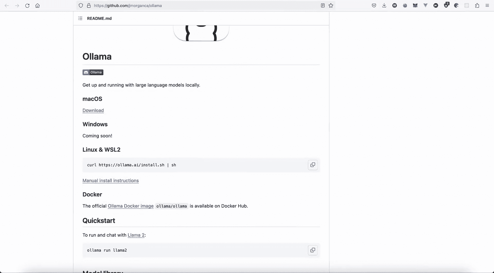

命令行就会有一个ORAMA的工具可供使用，接下来可以通过欧LAMPOO，来将一款模型先下载到本地。

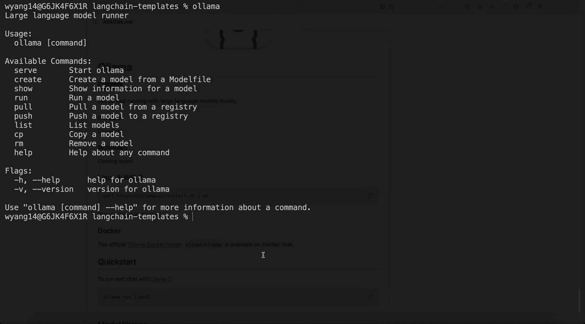

我们回到这里，在这个环境的准备中，大家可以看到，如果我们使用的是lama two7b chat模型呢，就通过这个命令来下载。

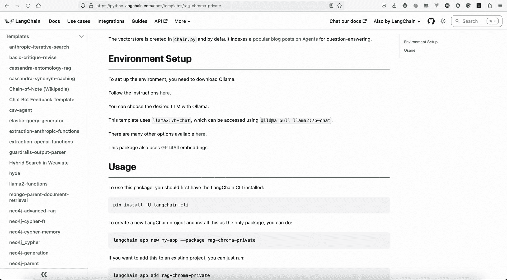

我在这里呢已经装好了欧拉A，那我直接就下载它，其实这个模型我也下载好了。

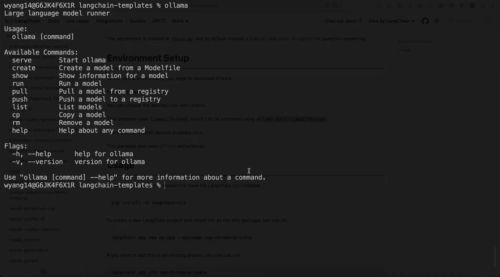

他会去拉取，第一次下载呢可能会花些时间。

那在这里呢我已经下载完成，所以这里很快，接下来那就可以进行应用的创建，以及模板的安装，我们在这里来创建一下，首先确保安装了LUNCHEN命令行工具，也就是CRI还没有安装。

同学呢使用pip install就能安装，接下来呢创建一个应用，我们来创建一下，我们可以分两步来先创建应用，再来添加一个模板或package，我们这里呢就不使用dash。

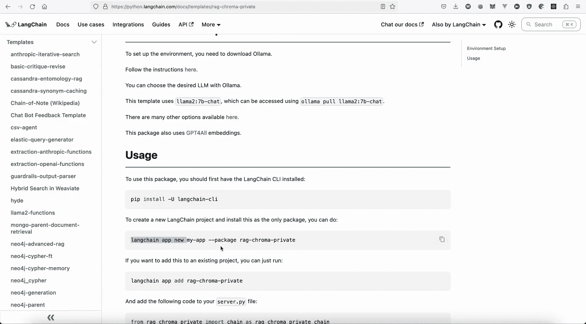

dash package这个命令，那我们先来创建一个应用，那就叫privacy。

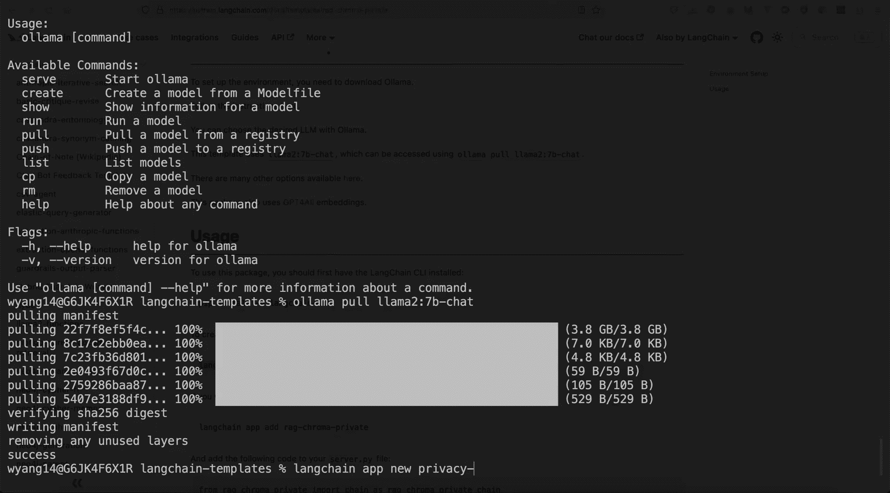

提示我们是否需要安装包。

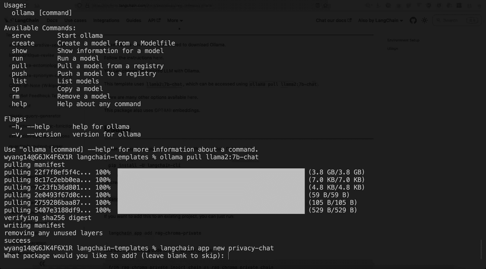

暂时不装，这样呢就完成了一个应用的创建。

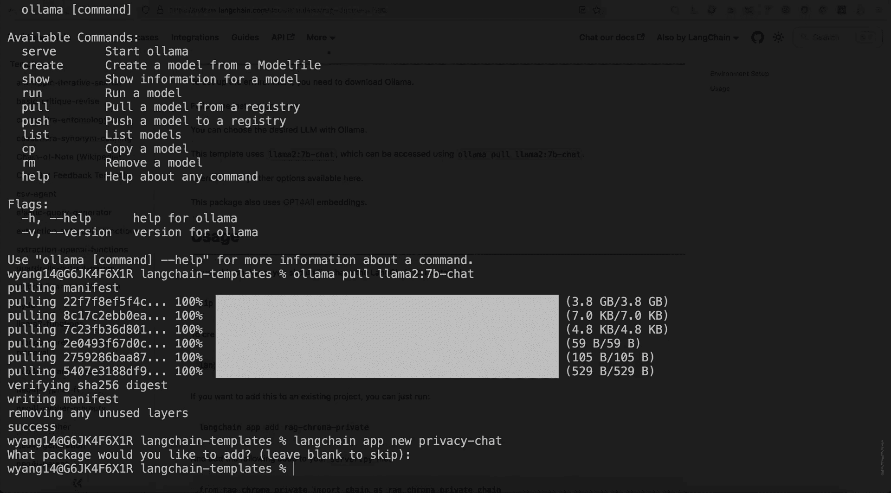

我们来到这个目录里，看看它的结构，它有一个up目录。

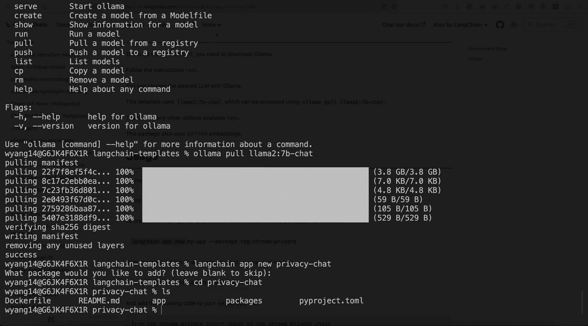

packages目录，packages里面应该是空的，只有一个read me，接下来呢就创建或添加一个模板进来。

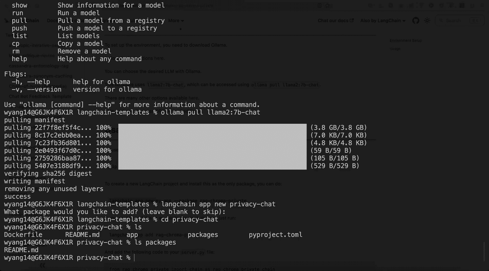

模板的添加呢回到文档这里，他有介绍可以通过app ADD来添加。

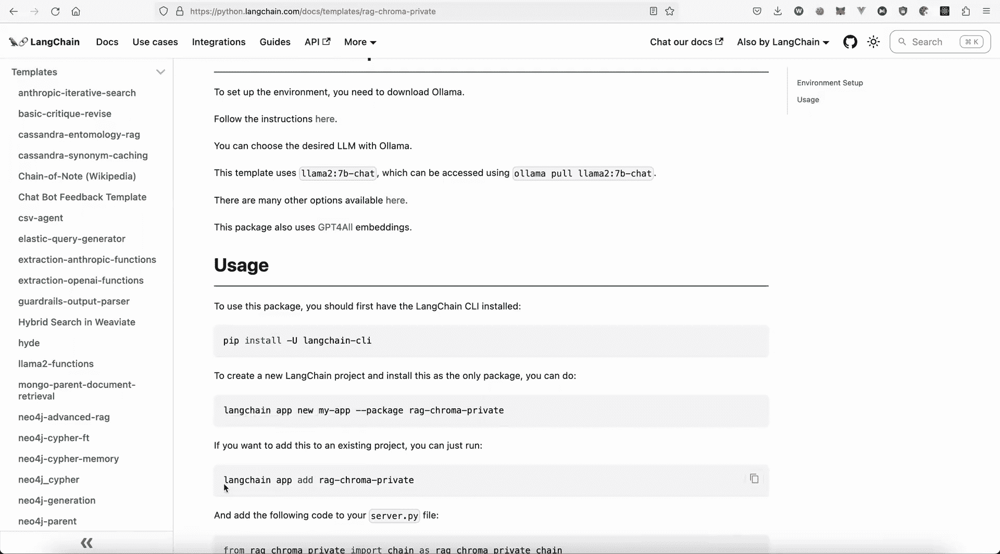

那我们如实的执行这个命令，提示我们是否愿意安装这个模板。

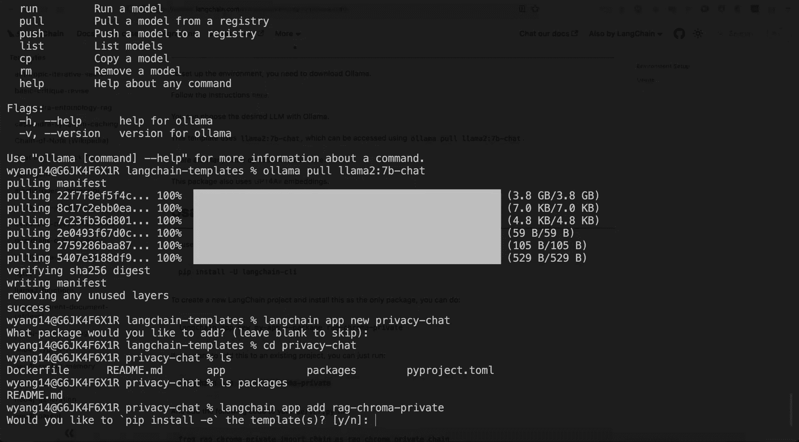

是的，它会下载这个模板，并将它放到packages目录当中，这个呢我们在上一期的分享中，也有非常详细的介绍，大家可以拷贝这最后给到我们的这个代码，这部分代码呢会被添加到应用的server，到PY脚本中。

我们复制它，那么打开server到PY，在这里呢有一个没有实现的路由，我们将其删除，然后呢，讲刚才我们安装模板时候提供的代码粘贴进来，这样呢就有了一条对应这个模板的路由。

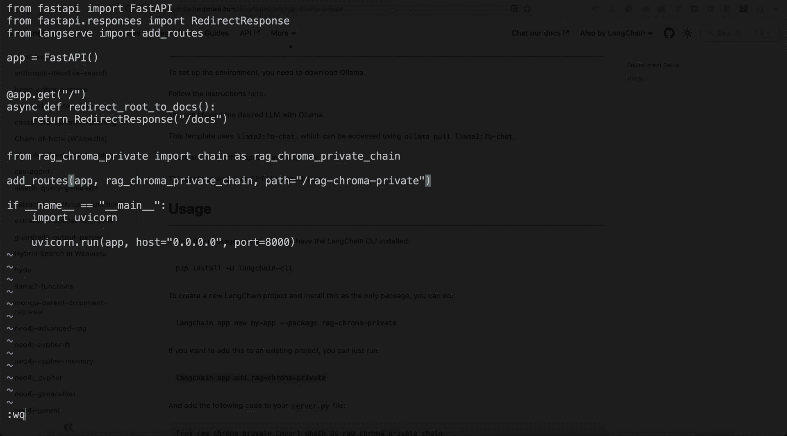

这个路由呢在后面我们在playground的使用中，大家会看到，这就完成了lantern模板应用的创建，以及模板的添加，那完成了操作非常简单，如果我们还需要使用lon smith。

那么对应的配置下三个环境变量，我们在这里呢就不配置了。

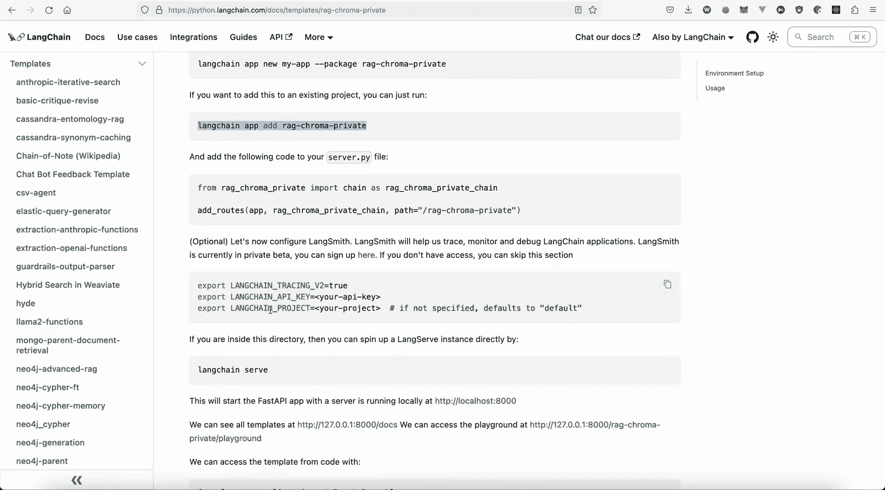

现在就可以启动这个lon serve，安全serve会启动这个应用，我们来看看他在启动的时候做了些什么事情，可以看到模型的加载。

然后呢提供了r a g chroma private playground，这个路由，我们可以通过这个路由来访问它，现在呢我已经将WIFI关闭，我可以确保没有任何网络连接。

来看看它是否能够正常的为我提供服务，那么在进行测试前呢，我们先停掉这个服务，我想再分享一个内容，我们退出这里，先回到代码仓库。

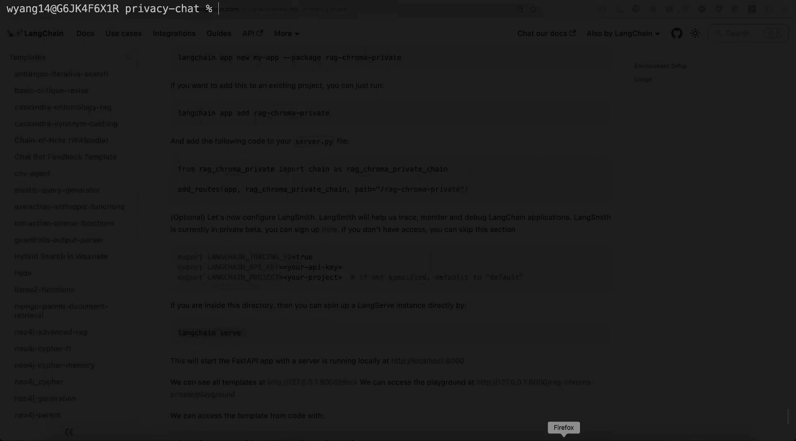

我们来看看这个chain究竟是如何构建的，或这个模板究竟做了什么，我们来到rg chroma private，点击china py，在这里可以看到他所做的事情呢非常的简单，首先从这篇博客加载数据。

然后做文本的拆分，做向量化并做存储，然后呢得到一个检索器，基于一个提示词模板构建了一条链，在这个模板当中呢，用的模型正是我们刚才下载的lama two7比chat，这个模型构建了一条链，就可以完成问答。

那么我们的问答呢就是基于这篇博客文章，作为知识库，好这就是整个模板它所实现的功能，因此呢我们的提问如果想让它变得有效，也应应该是基于这个文章中的内容来提问。

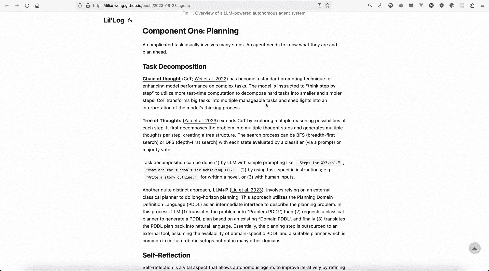

一会儿我们或许会来问一下，什么是self reflection，这里呢对他做了介绍。

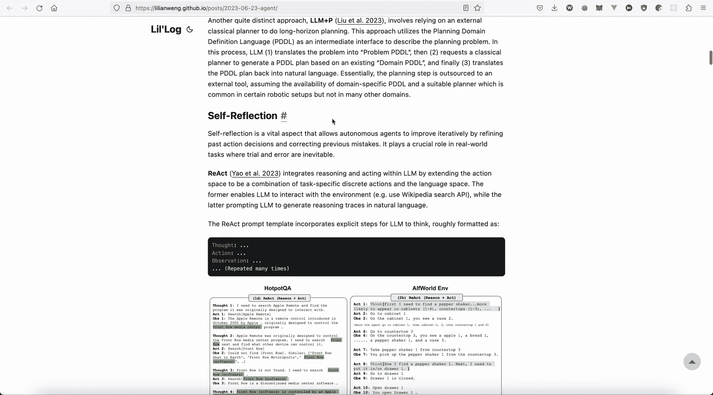

那我们这要现在呢就将这个服重新启动。

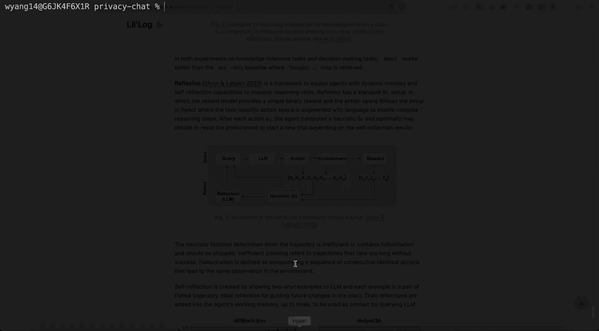

现在服务呢已经启动，我们就通过这个，8000端口来访问一下，现在看到的呢这个是文档，它的API文档，我们要做的呢是访问他的playground，可以关，这样呢就来到了他的playground。

我们可以提问，刚才我们想到一个问题，问一下，What is self reflection，那现在开始了推理，那我们点击这个intermediate step，可以看到他究竟做了什么问题。

是what itself reflection context，这里面给到了几段文档，这应该就是基于检索器获取的相关文档，这些片段呢被交付给大模型，这里是retriever做的工作，再往下走的。

Ratiable pass through，这个是基于表达式语言构建，LUNCHLINE中的一个环节，那提示词模板在这里构建出了in，这么长长的一段消息，然后呢与chat obama交互。

获得到达模型的响应，最后呢就会得到了回答，我们回到最上方，看看他究竟给到了什么样的输出，他介绍了self reflection是一个什么样的机制，好了，这就是一个非常典型的。

百分之百本地化的RG应用实例，我们用到了开源的arma two的大语言模型，也用到了GB t four all所提供的embedding接口，还使用了CHROADB开源的向量数据存储。

帮助我们构建了一个，不需要网络就能够工作的耳机应用，有兴趣的同学呢赶紧可以来尝试一下，看看是否在本地能够将这么一个应用搭建起来，它的表现如何，性能如何，在随着大家对隐私数据的越来越关注。

那我想这种纯本地化的解决方案，也会越来越受到大家的欢迎，那有什么问题的同学呢，也欢迎在评论区给我们留言，有什么反馈的，也欢迎大家告诉我们，好吧，那我们今天的分享呢就到这里，感谢大家的收看。

我们就下次分享再见啊，结束前再次声明一下，我会将所有的文档的链接都放在视频描述中，有需要的同学呢就在描述中取用吧。

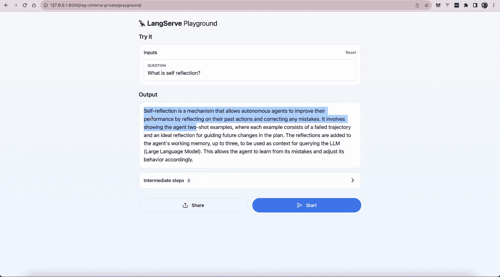

那我们就下次分享再见了。