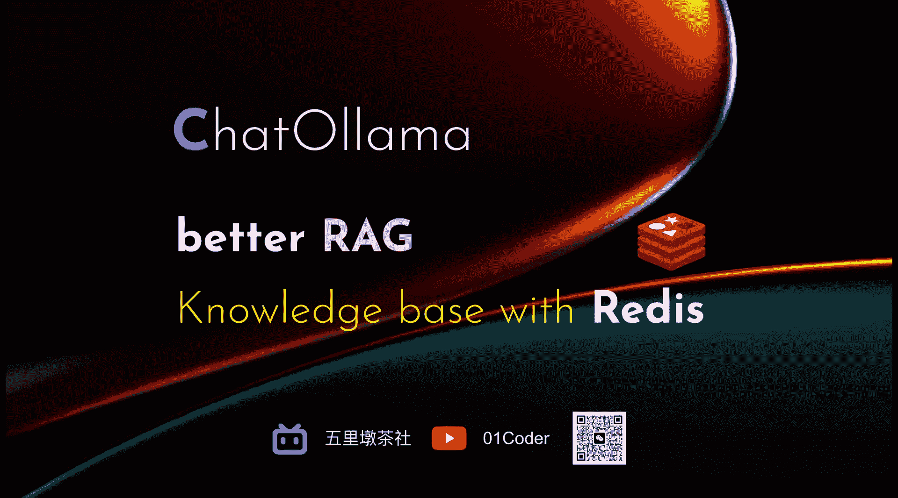
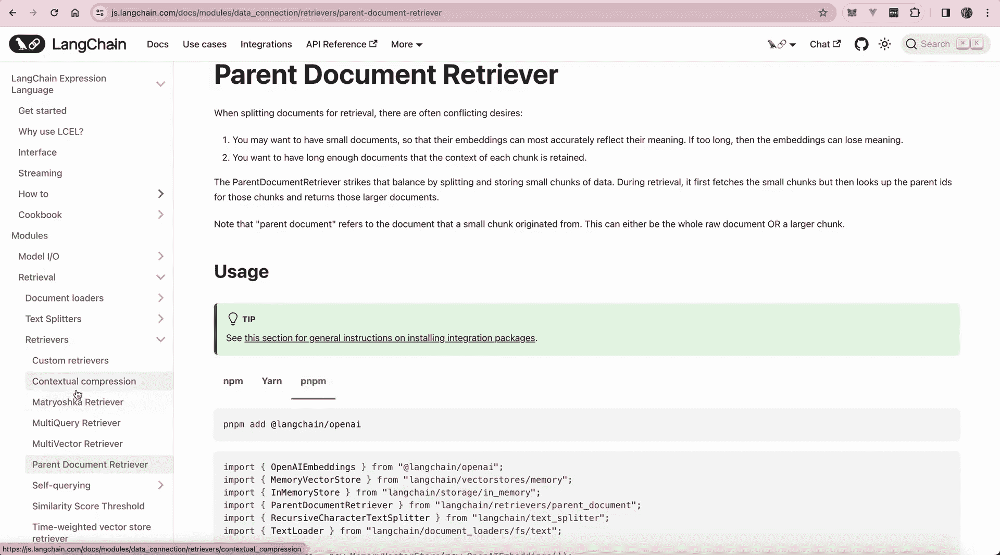
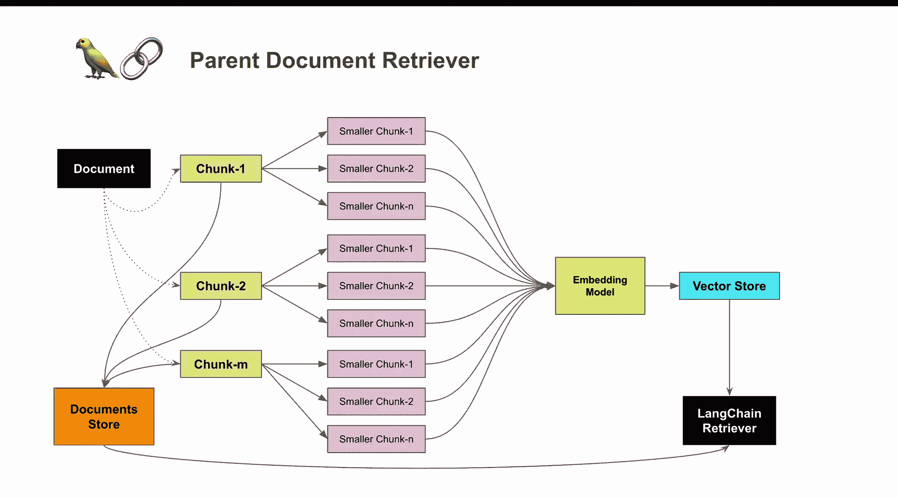
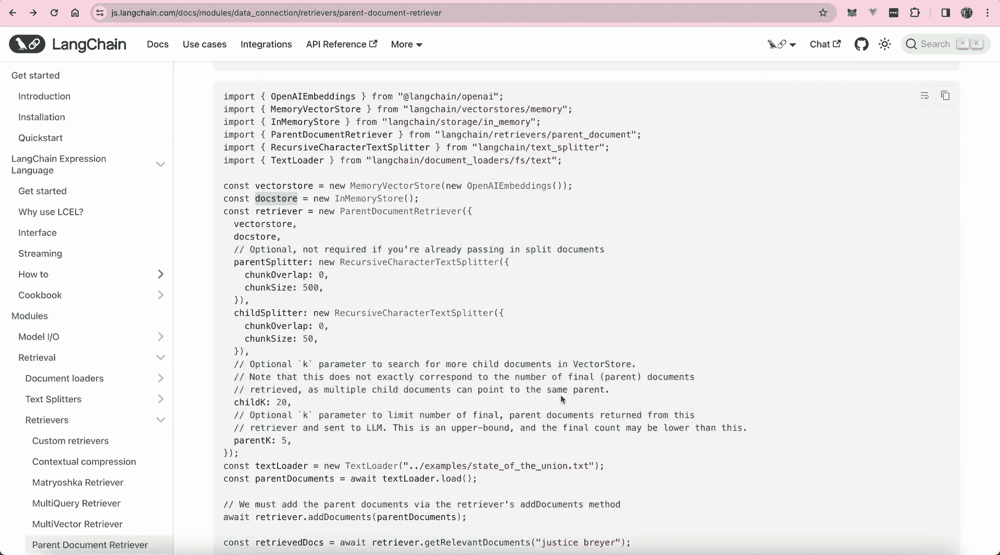
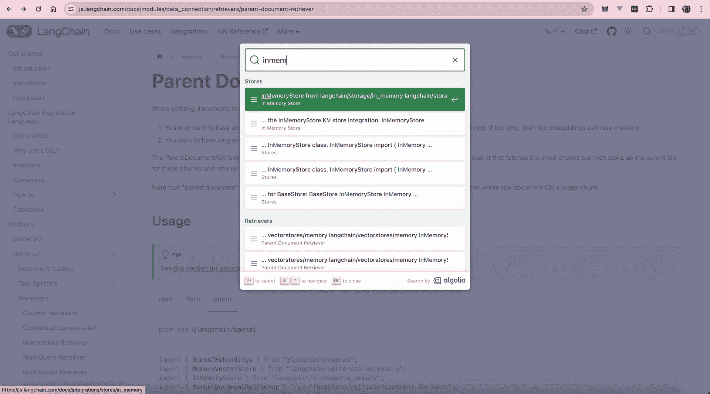
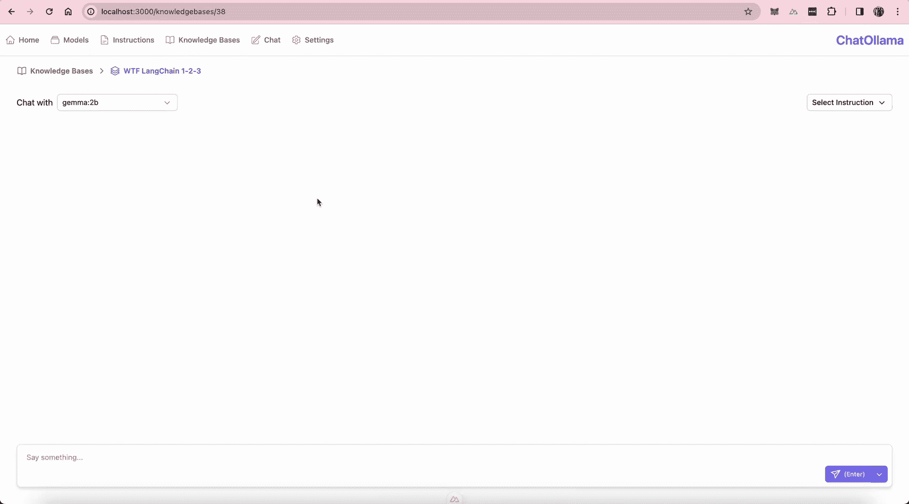

# 强推！(2026最新版) 李宏毅最新课程：智能体AI【AI Agent】71集全！人工智能／机器学习／深度学习／大模型／LLM - P46：45-15、基于LangChain高级RAG技术的本地知识库 - Chroma向量存储 + Redis文档存储  ChatOllama升级 - Ai人工智能工程师 - BV1QdzCB3Eu2

大家好，我是小木头，欢迎大家再次来到我的视频频道，今天呢我们要继续聊聊chat olama，在过去24小时。

我们做了非常多的更新，一方面在用户体验上，修复了一些在页面上的小bug，改进了用户体验，另一方面呢，对底层的功能做了一些比较大的改动，今天呢我们就来分享一下，这些改动如何影响到你日常的使用，在聊天界面。

大家应该能够发现到一些不小的变化，首先是文字的大小做了调整，更大的字体呢能够帮助大家更好的阅读，另一方面消息的滚动更加的顺滑，同时呢也给到了快捷键的支持，默认情况下。

现在我们可以通过enter键来输入消息，同时呢也允许大家在enter或shift enter之间切换，这样也能方便大家在使用时，以自己最习惯的方式来与模型交流，可以看到在这里当我们进行交互的时候呢。

页面上消息的滚动和输出也是非常流畅的，这是我们在用户体验上的改进，希望大家能够喜欢，如果有任何反馈，也欢迎大家在代码仓库，也就是GITHUB这里issue里面给我们提反馈，我们会来不断的改进。

确保大家在日常的使用中能够非常的顺手，这是今天介绍的第一部分，关于用户体验方面的改进，另一方面呢想介绍的是在更底层的方面，我们做的一些修改，在知识库这里，大家或许并不能够非常直观看到区别。

那么我们在过去的24小时，对底层的RG的数据索引部分做了调整，请现在呢我就来分享一下，究竟这些调整包含了哪些内容，我们先要分享的呢是luncheon，JAVASCRIPT版本框架的文档。

在这里对检索器parent document trevor做了介绍，这也是在最新的chat oamma应用中，我们引入的检索器，在最初始的版本中，我们是实现了非常原始的。

那if RT也就是将文档进行拆分切片，基于embedding model，计算向量，向量，数据存储，基于此来实现的检索相似性查询，最后呢由大模型来合成回答，这是非常简单原始的一种实验方式，它可以工作。

但是呢性能并不好，效率并不高，基于此，我们尝试将launching框架中，已经提供了一些不错的检索方式，也就是retriever实现在chat alama中，我们今天所分享的呢就是在底层的改进。

Parent document tribu。

通过使用这个检索器，我们来提高文本检索的质量，我们首先从原理上来介绍一下，什么是parent document tribu，刚才我们介绍了最原始的RAG，他做了什么呢，将文档切成分块。

经由embedding model生成向量，数据存储在向量存储中，基于此进行数据的检索，那在现在我分享这个图表中呢，可以认为now if r a g就没有中间粉色的smaller，Chunks。

它有的也仅仅是chunk one，chunk two到chunk m，简单分块策略的局限性在于，文本被分成了众多的小块，一旦我们确定了分块大小，那么在分块的边界上，总是可能存在语义被截断的情况。

那么我们如何解决这个问题呢，在业内就采取了一种叫parent document river的策略，他所做的事情呢是将分块分为两级，也就是副文档分块和子文档分块，对一份文档首先进行分块。

这些得到分块呢是较大的文档分块，也就是副文档分块，从而在对每一个副文档分块进行拆分，得到更小的块，也就是现在我们图表中看到的sismaller chunk，那这样呢就有两极分块，副文档和子文档。

在向量存储中存储的向量数据呢，是子文档分块的数据，而每一个子文档分块，通过原数据与副文档进行关联，副文档存储在文档存储中，也就是左下角的document store，当用户提出一个问题。

我们想要找到相关的文档信息时，首先在向量存储中基于小分块来进行查询，得到相似度较高的小分块，再将它们关联的副文档分块，也就是较大的分块，取出这些数据呢是来自document store，在这种情况下。

我们既定位到了相关的文档，又能将这些文档块周围，更大区域的文本返回给大模型，这样呢模型就能够尽可能多的获得上下文信息，一定程度上，这样呢，也解决了在文档分块的边缘与一遭截断的问题，当然了。

这种解决方案并不完美的解决现有的问题，大家可能会发现在副文档分块的边缘，依然存在着语义截断的问题，当然了，一定程度上，这种解决方案呢，也还是能够起到提升数据检索质量的这个效果，不过呢通过这种方式。

我们依然是能够扩大相似文档的覆盖范围，以此呢一定程度上来提升数据检索的质量，那现在呢我们就来到chat all amma，看看在实际的开发中，我们是怎么做的。

如何应用到parent document trial，我们现在来到luncheon的文档，这里快速的浏览一下parent document trial，它需要的组件。

那在这里可以看到它需要两个spider，也就文本拆分器，一个呢是副文档拆分器，一个是子文档拆分器，副文档拆分器在实践上呢，我们会设置较大的文档分块，子文档拆分器呢分块的大小较小。

其次呢我们需要vector store来存储子文档，分块的向量数据，关于文档存储呢，在示例中给到的是imeme store，也就是基于内存存储，这也是在生产环境中不可能使用的。

首先我们无法将所有的文档存储在内存中，另一方面，一旦使用了内存的存储，任何时候的重启，会导致所有的文档存储就消失了。

如果我们现在搜索document store。

这里呢就是m m m store介绍，如果我们来到stores，我们点击这里可以看到，这这就是lantern js版本所提供的存储的支持，这个存储呢是键值存储，Key value format。

它提供两种支持，一种是eem store，一种是local fire store，我们不可能使用EMAMISTORE，在生产的环境中，或许我们希望一个分布式的网络环境，来支持我们的AI应用。

那么还是会去寻求一些，更具有扩展性的解决方案，那这就是今天我们在chat oamma中为大家分享的，我们尝试利用REDIS来存储，REDIS是业内非常主流的键值存储的解决方案，也具有很好的扩展性。

那我们如何使用呢，现在呢就看看在chat orama中我们是如何实现的，现在呢我们就来到chat orama代码仓库，在本地我已经拉取了最新代码。

既然我们要使用parent document trier，那就需要来创建这个检索器，在过去的实践中，我们使用的是基于向量存储检索器，为此呢新增了一个retriever包，在这里做了一些实现一个新的函数。

creative retriever小小的做了一些动态的处理，根据环境变量的设置来决定是否使用parent document，区分条件呢，就是当环境变量redis host做的设置。

表示在环境当中具有REDIS的配置，那我们就可以使用parent document river，因为具备了使用它的条件，否则呢就是用最传统的基于向量存储的检索器。

在这里呢就是基于CHROMA的retriever，当设置redis host，那现在呢我们就来创建parent document trial，向量存储是咱们一直在使用的chrome dB。

而document store就是REDIS支持的文档存储，这个文档存储呢是我们在这里单独实现的，来看看他究竟做了什么，呃，当然这底下parent spider和child spider。

这两个文档拆分器呢我们就不做额外介绍了，呃，我们设置的分块大小分别是1000和200，那redis dog store在这里我们实现在了dog store，这里。

在这里呢是基于了luncheon js的base store interface，这个接口来做的实现，可以看到这个接口呢会很快被删除了，已经deprecated，那目前还能工作，我们先以这种方式实现。

后续呢我们会来清理这部分代码，redis store做的事情非常简单，它会对键值对，那当然了，这里的键值对呢，其实就是字符串和文档的键值对，每个文档会有唯一的id。

这个id呢是在retribun retriever里头分配的，我们在这里只需要针对这个键值对做处理，如实的存储的release，另外要注意的是，REDIS并不支持文档对象。

那么在这里我们就需要对文档进行序列化，或者说转换成字符串，在这里我们就使用了JASON的数据格式作为中介，进行转换，那么关于name space或者collection，我们怎么去管理的呢。

大家记得在chrome DP当中，对于每个资料库或者是知识库的数据，我们是通过collection，也就是集合的名字，来将不同的知识库的数据，存储在一个唯一的集合中，那么结合这个概念呢。

在这里我们依然使用我们将其称为name space，这个概念是什么呢，我们期望将某一个知识库，所有的文档放在同一个名字空间中，而REDIS并没有真正的名字空间的概念，我们是通过键的前缀来标识的。

可以看到，在这里我们通过一个名字空间和它对应的键，来构建一个字符串，这个字符串呢作为key，因此呢我们就有了某一个名字空间作为前缀，的一个完整的key，这个key呢就帮助我们来识别在一个知识库中的。

所有的文档数据是在哪一组键之下，我们一会呢也会通过命令行来看看在REDIS中，现在的存储情况，search其实呢就是基于一个文档id，得到它对应的文档，我们在这里呢也是将这个id转换成了。

具有名字空间前缀的键，这样呢就可以到REDIS当中取到对应的文档，最后呢就是一个新增的函数delete all，这个函数呢并不在这个base store interface，这个接口当中。

那我们实现目的呢是在于，当我们相我们实现这个函数，目的呢是帮助我们在删除知识库的时候，能够将所有在文档存储存存储的相关数据删除，那么为什么是delete or呢。

因为我们的这个redis dog store构造函数，会接受一个名字空间参数，因此呢每一个dog store对应的是某一个名字空间，或者换句话说某一个知识库的文档数据。

因此所以我们就可以在这里得到一个name space，在delete or的时候呢，是将这个名字空间中所有的数据存储全部删除，那这就是在REDIS的实现上，我们是怎么做的。

这样就有了一个redis dog store，最后呢为了提高代码的可维护性，我们还新增了一个包store，这里面呢有一个目前唯一的函数create redis client，来创建客户端。

支持四个环境变量，分别是redis host，Port，Username password，默认参数就是典型的REDIS的运行参数，Local host6379，那这就是我们目前做的改动。

那通过这部分改动呢，我们就可以在RETRIBUTE构建时，根据院线环境的支持情况来动态的决定，是使用parent document trier，还是传统的向量存储解锁器，现在呢我们就可以来到控制台。

首先呢来分享一下release这里的情况，我在这里呢已经运行了一个REDIS的服务器，通过客户端咱们可以来看看现在所有的key，那在这里我们可以看到，除了一个test key。

这个是我手动测试添加的键值，对呢，其他的j key都是以collection开头，那带了一个整数，这个整数呢就是知识库的id，这是我们的命名方式，这个命名方式呢与chroma dB当中。

collection的命名保持一致，因此这种前缀就是表示，所有这些文档id都是来自于知识库36的，那这就是目前在REDIS中的数据存储在这里呢，我们来看看知识库的创建。

究竟是如何与retriever关联的，那控制台这里我们首先呢将其停掉，在ENV这里我们来看看redis host，我设了local host，那有了这个参数。

chat olama就知道应该到REDIS当中去存储文档，那么应该使用parent document trier，现在呢我就来启动这个开发服务器，我们回到china lama，首先呢通过创建知识库。

来看看究竟parent document river是否被用起来了，在这里呢我们建一个知识库WTMLUNCHER，123，目的呢是将lunch极简入门课程的123课内容，来做知识库的创建，那选择文件。

我们就来选择010203这三个文件，点击保存，它就会来做数据的索引，我们可以来到后台看看他究竟做了些什么，在后台我们这里来看看，首先呢是他会来创建一个知识库，123id呢是37，Embedding。

用的是ALAMMA拉取的服务的omic embed text，初始化的呢就是parent document triever，那这就是在这个应用场景中，我们是如何使用，那在这里我们就可以看到。

parent document river已经开始被使用了，REDIS也会用来存储文档片段，那文档片段在REDIS当中键值是如何反应的呢，我们来看一下，在这里就多了许多collection，37的键。

这些呢就是我们最新创建的知识库的文档存储，我们没有显示值，我们只列出所有的键，在前端已经创建完毕，如果我们点击这个知识库来到聊天界面，就可以进行一些问答，我们来看看问答的效果如何，首先呢我们来选择模型。

我还是偏向于使用GBT3。5来试试这个效果，我现在就来提问，什么是w t f lunch，他的回答呢应该就是来自于咱们的知识库，他给到的源代码和文档呢，也是我的开源代码仓库。

有兴趣的同学呢可以点击这个链接，来到咱们的课程了解这个极简入门课程系列，那这就是我们在问答中看到的效果，那我们来看看后台的日志情况，刚才我们的问答中。

在这里呢看到的也是初始化的parent document trior，用到了redis dog store，那他做了哪些事情呢，首先我们来看看这里，他检索的时候用到了这一系列的id。

到这个REDIS当中去查询文档，而最后得到的相关文档呢，在这里这些文档块一共有几个呢，来看看一共有一个两个三个四个五个，为什么是五个呢，我们来到retriever。

在这里可以看到parent k表示负文档的份数，取的呢是五个，这也就是为什么我们在parent document trier，这里会拿到五个相关的文档，而如果使用的是传统的向量存储检索器呢。

我们返回的是四个文档分块，这就是我们在使用paradocument river当中，会看到的不同的效果，最后呢我们来看看在数据清理方面，我们回到知识库这里，当我们选择清理掉这个知识库的时候。

会选择删除操作非常的迅速，这个知识库就删除了，那在数据库当中，当然这个记录已经没有了，那我们回到REDIS这里看看它的效果，我们刚才介绍了使用的是名字空间的概念，Name space。

也就是说通过collection加上知识库id作为一个前缀，那我们现在呢已经将id为37的知识库删除，对应的呢在这个文档存储，也就是REDIS中呢，所有前缀是collection，37的也都被清理掉了。

这就是我们在数据管理上，究竟REDIS是如何发挥作用的，那现在呢我们再来做一个演示，将redis host设为空，这样呢我们就认为没有进行REDIS配置，我们再启动开发服务器，我们回到知识库这里。

我们依然做同样的知识库，创建好了，选了三个文件，同样的名字，wtf lunch123保存，他依然会去做数据的分块向量存储，那如果来到控制台这里，看看他究竟做了什么，这次他就不再初始化。

这是parent document retriever，而是vector store trier，也就是说数据呢仅仅存储在向量存储中，基于向量存储来做相关性的查询好了，那今天的分享就到这里。

有兴趣的同学呢，可以拉取最新的chat onoma的版本，看看在使用了不同的检索方式后，在知识库的问答上质量是否有所不同，我们刚才的分享呢用了非常简单的提问，这种提问中呢应该还不能够很好体现出。

在不同的检索方式带来的效果上的差异，那有兴趣的同学呢来尝试一下，看看是否在自己的问答场景中，能够感觉到不同的检索方式带来的差异，那今天的分享就到这里，我会将相关的文档和代码链接呢，都放在视频描述中。

那么在新版本的使用后，大家有什么问题呢，也欢迎在评论区给我们留言，也可以到代码仓库给我们提issue，我们会尽快给大家反馈，那感谢大家的收看，记得继续关注我们的代码仓库，关注我们频道哦。

那咱们就下次视频分享再见。

