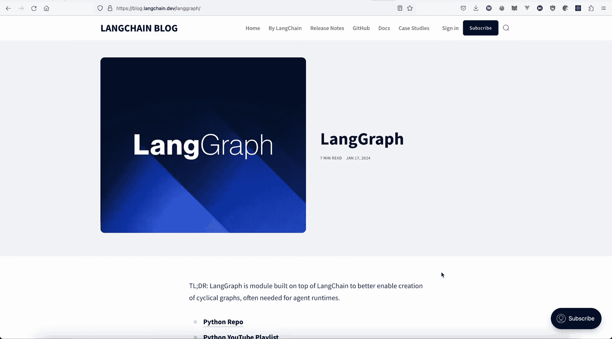
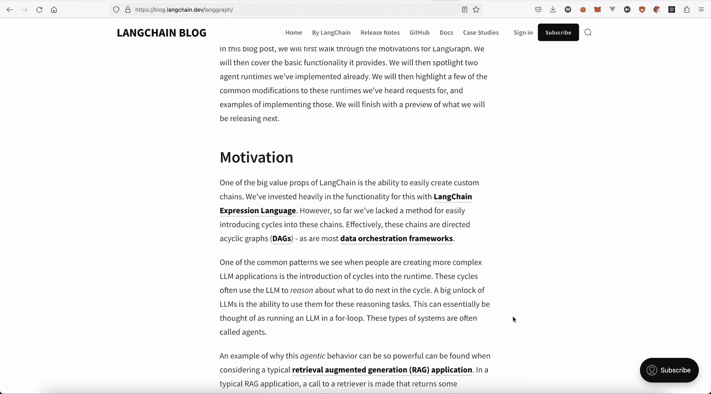
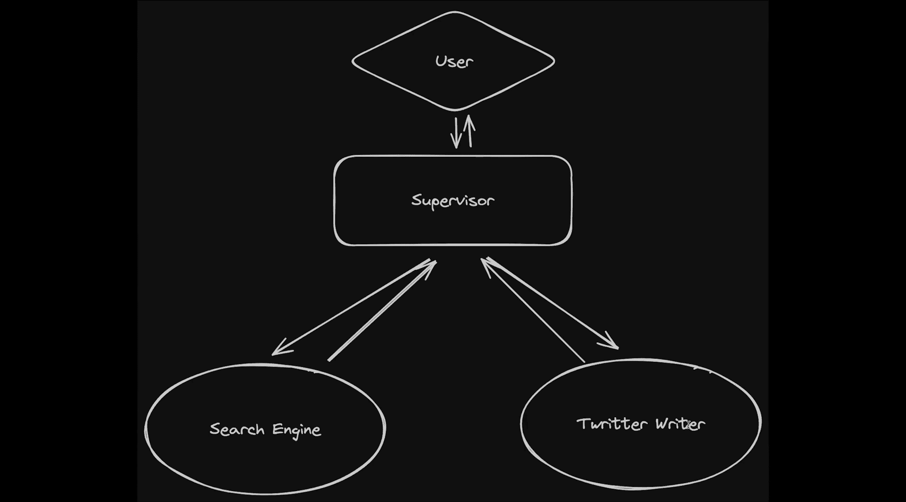
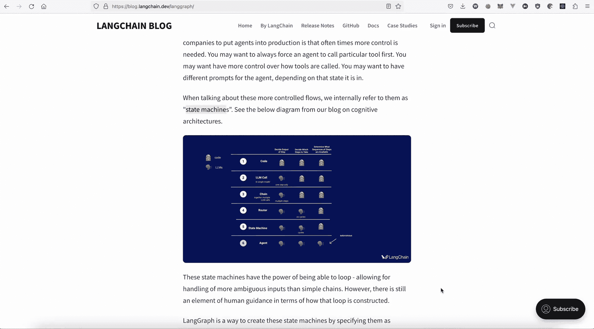
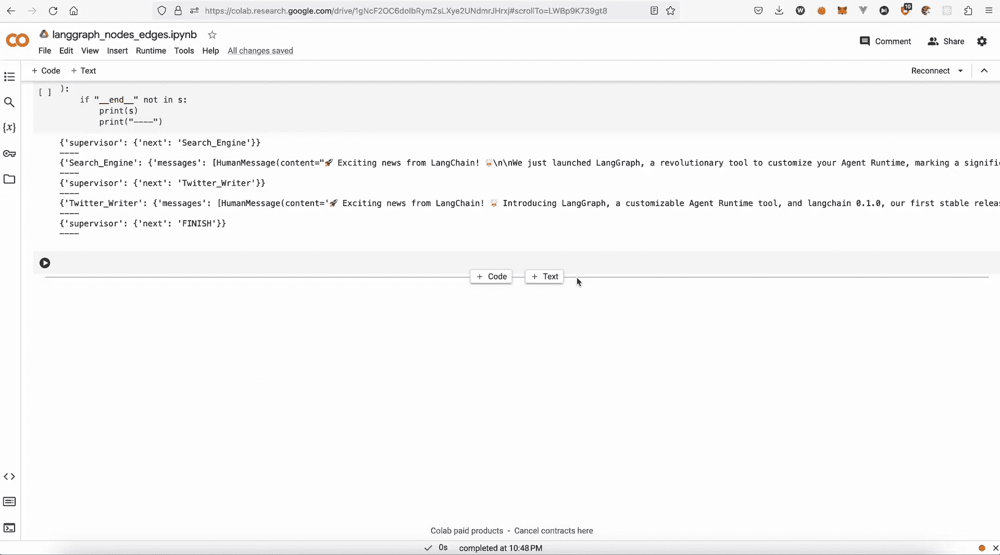

# 强推！(2026最新版) 李宏毅最新课程：智能体AI【AI Agent】71集全！人工智能／机器学习／深度学习／大模型／LLM - P47：46-16、LangGraph  新手入门 - Ai人工智能工程师 - BV1QdzCB3Eu2

大家好，我是小木头，欢迎大家再次来到我的视频频道，LANCH在最近发布了重要功能line graph，这也标志着LTRA向多代理框架进军，line graph构建与LUNCHE之上。

帮助开发者轻松构建强大的代理运行时，luncheon以及它的表达式语言，也就是luncheon expression language。

为开发者构建自定义的链，提供了强大的技术支持，从图的角度来讲，这种链是有向无环图，而在实际应用场景中，用户或开发者还是会期望构建有环图，也就是说在大院模型的应用中，代理之间可能会基于推理。

会有代理被循环调用，直到完成用户提出的任务，那像oto jam这类多代理框架呢。

正是实现这种机制，那现在分享这个图表呢，就是一个比较典型应用场景，在这个场景中，AI应用会帮助用户智能的去采集信息或数据，并编写推文，在这里面呢有不同的角色，User，他当然了。

提出问题或交付给supervisor一个任务，supervisor并不亲自去执行这个任务，去完成这些所有的必要操作，那他会去决定由哪一个agent在什么时候做操作，他该做什么。

super BER可以使用的呢，有目前在这个图表中有两个agent，一个search engine，一个twitter rider，分别负责采集信息和推文的编写。

那super rider需要决定该如何使用search engine，如何使用twitter rider，以及什么时候使用，有可能会需要多次调用search engine。

来采集不同主题或不同要求的数据，并将它们交付给twitter ride编写，那这就是这个应用场景中，不同角色之间他们是如何调度的，那这样呢在多次的调用中，我们就可以看到。

某一些元素或角色之间就会形成执行的一个环。

而line graph正是为满足这类用户需求而生，也就是说，基于lunch，开发者也能像order jin一样来构建大圆模型应用，line graph呈现的是类似状态机。

也就是stay machine这样的机制，该状态机呢能够驱动代理循环工作。

因此在line graph中有三个非常重要的元素，接下来呢我们就介绍一下它们，分别是state graph，node和edge，先来看看state graph，根据刚才介绍，我们可以看到。

line graph实际上是代表了一张有向有环图，STAGRAPH这个类正是用来描述这么一张图的，图中状态会随着多代理的工作不断的被更新，那谁来更新状态呢，节点也就是node。

我们接下来看看这里一个非常简单的例子，如何来定义一张图中的状态，每个应用它的状态呢可能会有所不同，因此呢我们需要根据具体应用场景来决定状态，目前这个事例中它的状态定义包含了两个字段。

一个是输入input，一个呢是ORACTIONS，所有的操作，开发者可以来决定这个操作，对于一些属性呢究竟是应该覆盖还是添加，另一个重要的概念，就是刚才我们提到节点，当我们创建好一张图的状态。

也就是STAGGRAPH，就可以向其中添加节点，操作很简单，就通过UNNODE来添加，同时呢需要给节点一个名字，这个名字会被后续的应用引用，由它来决定我们该寻找哪一个节点，来做什么工作。

在这里呢也给到了两个非常简单的例子，如何添加节点，节点可以有多种不同的类型，它可以是个函数，也可以是表达式语言的RNABLE函数，或者是这个RUNNABLE，他会接收一个参数，这个参数呢是一个字典。

字典中的信息和在状态中定义的格式，或者是框架是一模一样的，输出呢则是这个节点在操作后更新的状态，也就是这个state，在状态中还有一个特殊的节点类型，也就是ant，这个就是描述或标识的操作或状态的终止。

在介绍完节点以后，那我想现在必然要介绍的是图这种数据结构中，非常重要的概念边，在介绍编之前，我们需要了解另一个重要概念，也就是图中的entry point在line graph应用构建好。

我们定义好节点和边以后呢，当用户提出一个任务要执行，该从哪个节点开始呢，这就是entry point，它通过调用set entry point，并给予一个节点名字来定义从哪里开始。

接下来看看两种边的类型，normal age和conditional edge，normal age也就普通的边，它定义了两个节点之间必然的先后关系，而conditional edge是什么意思呢。

它是有条件的，来决定下一步跳或下一个节点是哪里，在定义这类边的时候，需要三组信息，一个呢是上游节点，一个呢是判定函数，另外呢就是一个mapping，一个映射关系，上游节点呢是表示要决定吓一跳的时候。

上游节点是哪一个，基于它，我们还需要一个判定函数来判断，究竟下一条该去往哪里，最后呢是一个映射关系，这个映射关系表示的是基于上一个节点的输出，该如何走往下一个节点，或者在什么条件下该去往哪一个节点。

我们在这里可以看一下，下面有个非常简单的例子，这个条件边来自于model，上游节点是model，当model这个节点输出的时候，就用should continue这个函数来判定究竟该去往哪里。

而去往哪里，最终这个映射关系也就映射到哪个节点呢，是通过最后这个mapping来定义的，当输出是and的时候，表示它结束了，那当输出是continue的时候，就会前往tools这个节点进行下一步的操作。

这就是在line graph中三个非常重要的概念，当我们使用staggraph note edge定义完一张图，接下来要使用它之前呢需要compile，也就是编译。

编译会将它转换为一个lantern的RONNABLE，这样呢就可以像使用一条chain，一条链或者一个大圆模型一样来使用它，代码很简单，graph上调用compile就可以得到这么一个实例。

接下来呢我们就通过一份Python notebook，来看看如何使用line graph，以及它如何工作，现在呢我们就来到这份Python notebook这里，实现了刚才我们所介绍的应用场景。

应用会接收到用户的任务，并通过搜索引擎采集数据，并完成一份推文的编写，这就是这个应用能够支持的，我们现在看看它是如何通过line graph来构建，多代理实现的。

那在这里首先采集数据用的是SERBAPI，也就是谷歌的搜索引擎模型，用的是OpenAI的模型，当然了，这里我也配置了lon smith的API key用，用来帮助我们监控整个蓝全应用的执行。

首先呢尝试了一下SPAPI，通过一个简单的调用，看他是否工作，接下来就是land grab应用的构建，首先我们定义一个大模型，这个模型呢是OpenAI的GBT4turbo preview。

接下来定义两个工具，工具函数分别是web search和RTAT，他们分别做的是基于谷歌的serve API进行查询，以及基于一份内容来编写推文，来看看RTAT这个函数。

这里呢其实我是用的OpenAI的模型来做的推文，编写系统消息，这里给到了他必要的指令，让他遵从trader的政策，policy以及确保推文不超过140个字符，这就是一个系统消息。

这样呢我也是借用了大模型来编写推文，这里呢也给到了大家一个演示，如何在工具当中能够对接到其他的大模型，来帮助我们完成任务，理论上讲，这样呢我们可以利用不同的大模型来协同工作，接下来就定义一个状态。

我们在这里呢用到了两个字段，一个是messages，一个是next messages，就是整个多代理之间交互的消息，消息的一个记录，我们可以认为他就是个历史记录，next用来标识该路由到哪个节点。

来进行下一步操作，两个辅助函数，一个是create agent，一个是agent node create agent是基于大模型，在这里呢用的是chat OpenAI的模型，还有工具集tools。

我们刚才定义了两个工具，在这里呢会给到他，另外呢就是一个系统提示词，通过这三个参数来构建一个AJXQ的，这也是lunch提供的组件，这就是创建代理，创建完代理以后。

我们就需要基于它来构建一个LANGUH节点，因此呢就有了agent node这个函数，agent node函数它会做什么呢，这正是每个节点他要做的事情，它会使用这个agent。

也就传递进来的参数agent来完成执行，给到他一个状态，这个状态呢就是目前这个line graph中图的状态，这个状态的最终这个调用invoke，会得到一个结果，这个结果呢就会作为响应的或者函数。

返回的一部分，我们可以看到，在这里messages这里呢是定义了这么一个human message，这个返回的消息会被追加或添加到整个状态的，messages这个数组当中，这就是代理节点的工作工作机制。

这样呢我们就可以构建一个节点，后续我们会通过这个agent note函数来构建，我们需要的不同类型的节点，接下来我们需要一个辅助的数组members，这个是告诉模型，我们究竟有哪些成员或者哪些节点。

这里定义了两个节点，一个search engine tor rider，另外这里给到了这个，我们刚才在图表中介绍到了，在整个应用当中有一个super bor角色。

因此呢这里有个系统的提示词给到supervisor，现在我们要做的事情就是构建supervisor节点，提示词，告诉他，他是一个负责帮助我们调控监管的一个节点，按照应用场景来决定。

下一步究竟该由谁来完成操作，options是给到函数调用的，Function call，我们会看到这里提示词马上会用到它，除了这两个节点，还有一个finish，我们需要有一个角色finish，这样呢。

super supervisor才知道什么时候就该结束这个任务，执行，或者什么时候任务已经完成了，接下来呢是利用了open i的函数调用，也就方向call直接定义了一个字典，来描述它可以使用的函数。

那么这个函数呢，并不是一个真正的会去调用或执行的，它只是一个route，这里面它会有一个属性或者一个参数，Next，这个参数呢可以是options中的任意一个。

这options好包含了我们的两个代理的角色，一个search engine，一个是twitter rider，最后呢finish也就是在必要的时候，任务执行完毕了，我们可以认为已经执行完毕。

就使用finish来调用这个route，也就是这个路由就完成了，现在就可以构建一个提示词，这个提示词当中也给了他一个额外的系统消息，基于这个会话来决定其究竟接下来该怎么做，还是说直接就应该结束了。

那我们现在呢就构建出一个提示词的链，在这里呢就将刚才我们描述的这个route函数，绑定给了这个达模型，这样呢就有了这个supervisor，这是一条链，这个链呢我们刚才介绍了一个节点，可以有多种类型。

只要是一个RUNNABLE就可以作为一个节点，那这条链不例外，它也是一个RUNNABLE，最后就来构建这些节点，一个呢是搜索引擎节点，一个是twitter operator节点。

我们现在呢就可以把这些节点，全部添加到这个图中，这个图我们刚才介绍state graph，用来标识一张line graph的图表，他做其中的状态的，数据结构是通过这个agent state来定义的。

我们这样呢就定义好了一张图，我们将其名为工作流workflow，把所有节点添加其中，每一个节点呢都会有个名字，在编译前呢，我们这里就需要添加必要的边和设置起点。

entry point编呢我们是针对每一个member member，刚才我们定义了是分别是search engine和to the rider，这两个成员呢都会有一条边连向supervisor。

接下来呢是添加这个conditional edge，我们会看到在这里首先起始点是supervisor，那supervisor的下一步呢是有这个la函数来决定的，这la函数中的next就是它的吓一跳。

那么conditional map在这里我们构建好了，每个成员它都有，同时呢还包含了一个finish作为key，它是指向and，也就是说当判定是已经完成finished。

那么super value这里就知道任务已经完成了，整个图的状态就迁移到了N的状态，最后呢是设置这个起点，我们这个应用当中总是由supervisor来作为起点，由他来开始工作，来决定下一步去往哪里。

现在呢就可以编译得到一个图的应用，这应用呢就是一个RONNABLE，在这里为他提出一个问题，编写一份推文，推文的内容呢是关于蓝拳的新闻的，我们看到这里的执行，首先supervisor决定了吓一跳。

去往search engine，由search engine这个代理来完成工作，那search engine会返回消息这么一长串消息，这个呢是通过google的SERBAPI来搜索到的结果。

那这些信息返回以后，就会由SUPERVIDER决定下一条前往to the rider，由他来编写推文，那推文在这里我们可以看看是什么样的内容，字数目测应该在140个字符之内。

并且按照需要在这里打了一些hashtag，帮助咱们的退文能够更好的被被发现，那这就是to the rider所做的事情，就supervisor决定下一步已经是完成了，那么就决定这个任务已经终结了。

这就是我们如何使用line graph来构建应用，构建多代理，并且在多代理之间协同完成工作，最大的好处是，我们可以将一个庞大而复杂的任务，拆分成多个独立角色，可以独立完成任务，这样呢大模型在完成独立。

小细粒度的任务的时候呢，精确度会更高，好了，那今天的分享就到这里，我们非常概要的介绍了什么是land graph，并且在line graph中有哪些重要的概念，我们也逐一做了介绍，最后呢通过一个示例。

为大家演示了如何使用状态，如何使用节点和边来构建一个line graph应用，有兴趣的同学呢可以赶紧来尝试一下，看看它与auto键这些多代理框架有哪些差异，那咱们今天分享就到这里。

后续我们会分享更多关于line graph应用的，更有趣的内容，那咱们就下期视频分享再见。

