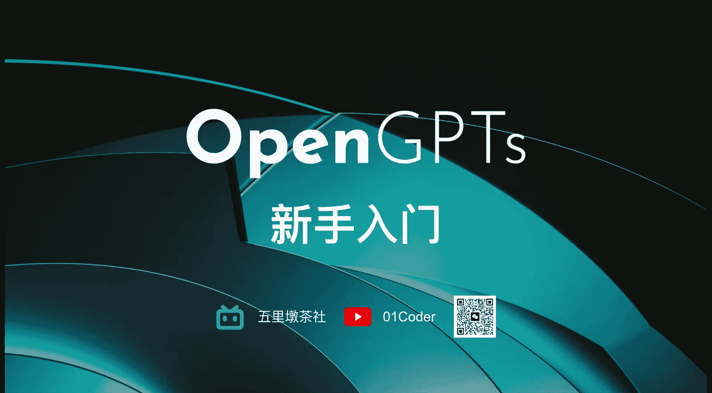
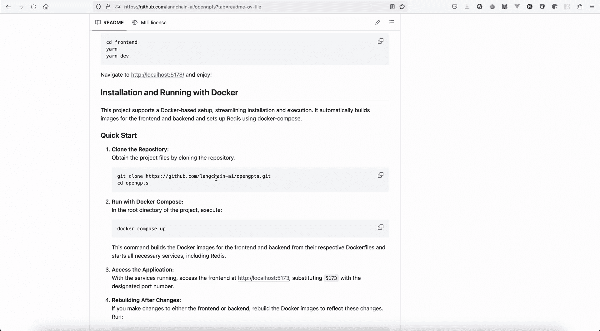
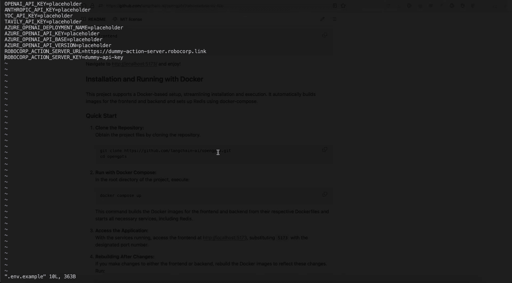
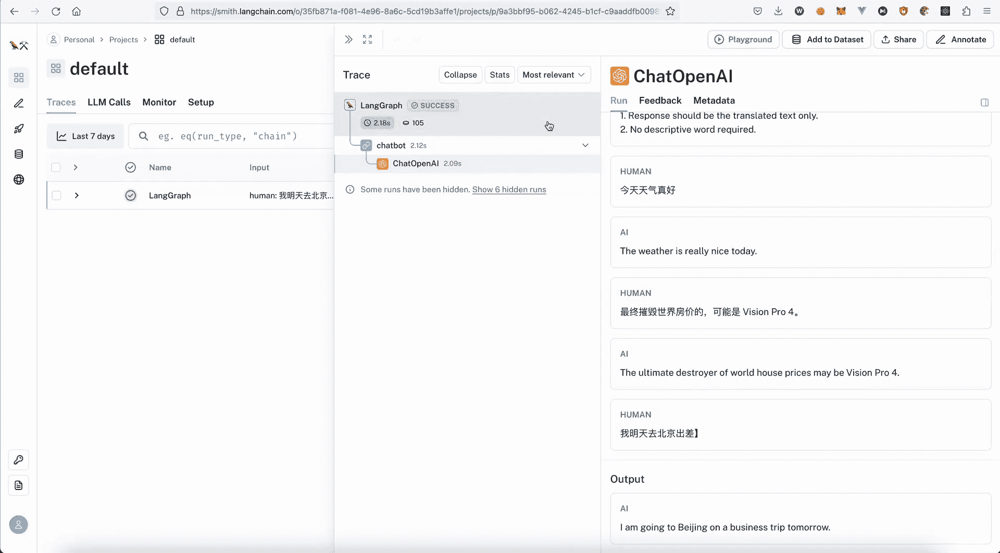
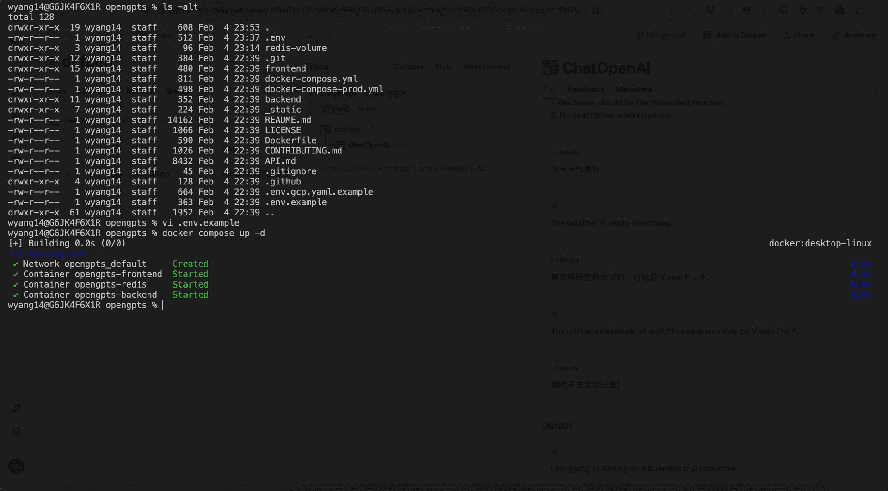
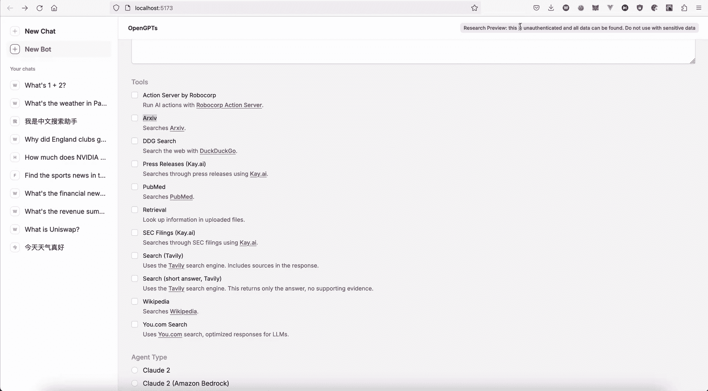
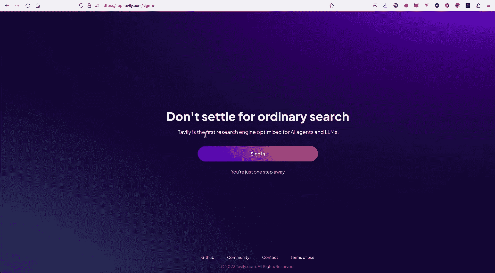
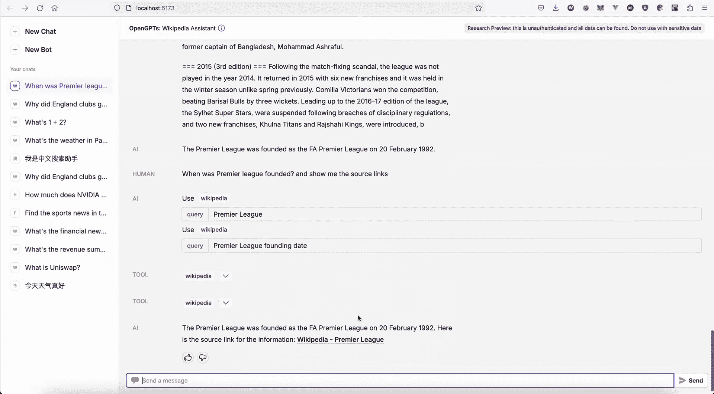
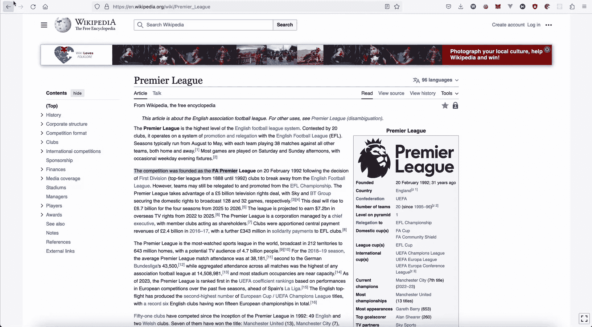
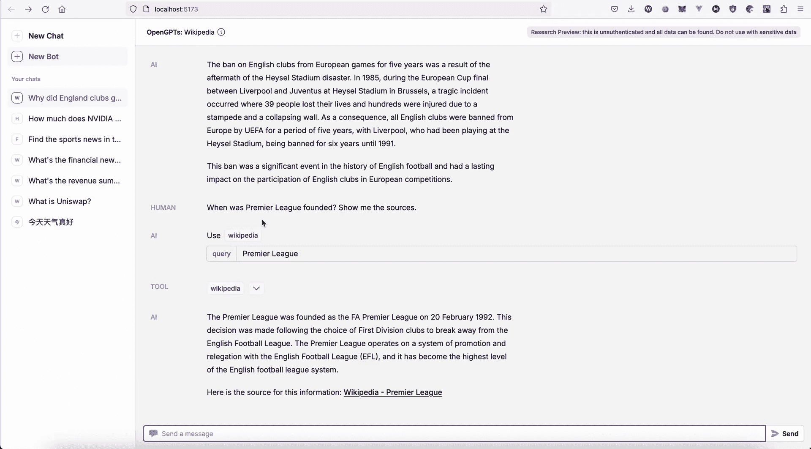

# 强推！(2026最新版) 李宏毅最新课程：智能体AI【AI Agent】71集全！人工智能／机器学习／深度学习／大模型／LLM - P48：47-17、OpenGPTs  新手入门 - Ai人工智能工程师 - BV1QdzCB3Eu2

大家好，我是小木头，欢迎大家再次来到我的视频频道，OpenAI近期已经发布了他们的g p t store，不知道同学们在商店中发布了哪些有趣GBT呢，今天我们来分享lunch所发布的。

具有极其相似用户体验的产品。

Open gb t，这可以是认为一款开源的GB t s store，这款产品它基于了line graph这款框架，它构建于LUNCHLSERVER和land smith之上。

我们可以定制所使用的单元模型，定制提示词，定制工具，向量存储等等，可以说，这是一个完全具有可定制化的开源的GBT商店，我们今天呢就来体验一下open GB t s，看看它能够带给我们哪些用户体验。

那么与OpenAI的gp store有哪些差异，既然是一款开源产品，那么我们完全可以，基于它来做更多的定制和扩展，现在我所分享的就是open GB t s的代码仓库，在这里给到了我们使用指南。

我们有两种方式来在本地运行它，一种呢是通过克隆代码仓库安装必要的依赖，然后运行它的后端，运行它的前端，这种方式呢需要较多的安装和软件的配置，另一种方式呢是基于docker，这也是我所推荐的运行方式。

如果大家并不需要做过多的扩展，那么以docker方式运行，也可以简化本地运行环境的安装和配置，克隆代码仓库，通过dog compose up就可以运行，非常简单，当然了。

在运行之前呢需要进行一些环境变量的配置，接下来呢我们就通过简单的分享。

来看看究竟该如何做配置，现在来到我的控制台，在这里呢我已经克隆了open GB t s这个代码仓库，在开始运行前，需要简单的做一下环境变量的配置，环境变量呢通过拷贝到ENV到example，这个文件。

将其拷贝为到EMV，并对其中的环境变量做必要的配置，我们来看一下它里面的内容有哪些，这是一个模板啊，如果大家使用的是OpenAI的模型呢，就配OpenAI的API key。

如果有ANTHROPIC模型的访问权限，并且使用它呢对应的配置ANTHROPIC等等，那包括azure平台上的API key和secret以及deployment，都可以对应着做配置。

这就是API配置的最基本的部分，另外一部分呢是land smith，在这里他并没有给到这两个环境变量的模板。

那么通过文档我们也可以得到，在这里通过配置luncheon tracing v two true，同时呢设置luncha API key就可以启用LSMITHS，那在这里简单分享一下lon smith。

如果来到斯smith dot lunchdot com，就可以进入这个控制台或者dashboard API keys，这里可以创建自己的API key并配置到环境变量中。

这就是我们如何使用LSMITHS，在dashboard这里我们简单看一下，默认的情况下呢是叫default，这个项目，我们可以在自己的ns mix配置中进行调整，这就是我最近的一次交互。

所监控到的大模型的交互状态，可以看到这里呢在open g p t的后台，他用到了line graph这个框架，在这里的问答用户和AI的响应之间的交互，在这里都有非常详细的演示啊。

这就是我之前所完成的一个绘画，我们马上会回到open GB t s，看看它究竟是如何使用的。

以及与lon smith之间的交互是怎么样的，如果大家并不想与兰斯密斯交互呢，不配置这两个环境变量就好，现在呢我们就来启动open g p t s，通过docker compose up。

我使用dash d让它运行在后台，可以看到他创建了哪些容器，一个前端，一个后端，还有个REDIS，Redis，用于存储一些聊天会话等等，一些状态信息或数据state。

在代码层面的术语应该叫checkpoint，有兴趣的同学呢，可以通过代码的阅读来了解更多技术细节，我们今天主要看看他是怎么使用的，我配的OpenAI的API key呢是可以支持到GBT4。

那我们现在怎么使用它呢，就来到浏览器，它应该是运行在了这个5173端口，如果我们刷新一下，可看到目前这个界面我已经创建了一些聊天，创建一些机器人，那在这里呢有一天有一些聊天历史，我们先来看看新的聊天。

这个聊天呢会给到我们一些已经保存机器人，我可以选择它来做一些交互，首先呢我这里有一个translator，这个聊天机器人呢，有一些什么样的指令可以看到，这里是我之前配置的，我期望他对用户的输入做翻译。

那回答仅仅包含了翻译后的文字，我不希望有任何其他的描述性的信息模型，用的是GBT3。5turbo，那现在呢我就可以输入任何的文字，这些文字呢他都会帮我翻译成英文，比如，我是中文搜索助手。

他应该就仅仅帮我翻译就好，不需要任何其他的文字，其实我问他，你为什么这么聪明，他也知道只需要翻译成英文就好，那这就是非常简单的一个聊天，我们现在就来到机器人，看看它有哪些类型，再点击到new bot。

这里呢会看到三个选项，一个chat bot，一个RG，一个assistant，这里呢我们就不再对这个基于提示词的聊天，机器人做过多介绍，大家只需要将自己在使用中期望引入的提示词，配置到指令这里并保存。

就是一个基于提示词的聊天机器人，接下来呢想介绍一下RAG这种类型的GBT，目的是基于文档或基于知识库来提供的信息，帮助模型回答用户的问题，那这个呢也是在目前OpenAI的g p t store当中。

非常主流的一些GPT，目前绝大多数GPT呢，还是以一些完整而复杂的提示词来驱动，帮助用户回答问题，当然还有很大一部分呢，也是基于了文档作为知识库来提供的问答，那现在我们先来看看RG这种类型。

RG那就是基于检索的来增强生成，帮助大模型来回答问题，在这种类型的聊天机器人中，非常重要的呢就是提供知识库，我们在这里呢为他提供一份文档，现在导入的这份文档呢，就是NVIDIA的一份财务数据的文档。

这里面呢给到了利润等等数据信息，我们期望通过这种类型的聊天机器人，帮助用户解读财务数据，给到一些公司运营方面的指引，首先呢我们导入这份文件，接下来为它命个名，简单命名吧。

nb d a adviser模型，我使用的GB3。5turbo，这样呢就可以保存在保存间，我们可以看看assistant，assistant具有与RG非常相似的界面，多出来的呢是底下tools。

这部分它和RG的区别就在于a cant，它不仅仅能够基于文档提供的知识库来构建，或者是检索上下文信息，它还可以通过工具来引用到外部的资源或代理，最典型的呢就是外部的搜索引擎所提供的数据。

这样呢能够帮助大萌新做更加全面的回答，当然了，根据不同的应用场景，我们获取需要工具，获取不需要，那当我们不需要工具，只需要知识库的时候，比如当我们需要构建自己产品的聊天机器人，小助手。

那我想知识库就足够了，现在呢我们将将其保存，这样就有了一个nvidia advisor，保存的时候，会发现这里保存按钮呢会有个saving，会有一点点等待时间，这是因为文件上传以后。

在一个非常典型的RG的应用或聊天机器，构建时呢，会对文档进行索引，这里会对文档进行分块向量化，向量数据保存这么一个过程呢会花些许时间，好了，现在就完成了这个的构建，我们先来提个问题。

可以看到在这里呢我们提出了一个问题，什么1+2等于几，这个问题其实根据知识库的检索来讲呢，它并这个知识库并没有提供这方面的信息，并不是一个基本的数学的教程，那他也没有得到必要的信息，所以也不能做回答。

那在这里就会发现有一点点的出入，并不那么的完美，这也就是在聊天期间创建中，我们需要在指令中给到一些额外的操指导，我们期望他呢，当被问到一些与文档中给到的信息，并不相关的问题时候。

最好呢是让模型或者让聊天记者回答，我不知道，那这块呢我们可以在指令当中去完善，在这里呢，我们还是来回答一些跟知识库相关的内容，我希望能够得到一些利润方面的趋势信息，他给到我们的呢。

是在2023年4月3号截止的，过去三个月当中的利润情况是这样的，这代表了利润的下滑，那我很好奇利润下滑究竟是什么原因，在这里他也是基于检索，得到了较上一年下滑的原因，那在这里可以看到更加详细信息。

这就是上下文信息或者是相关文档给到的数据，这些信息呢就给到大模型，大模型基于这些信息给到我们回答，那这就是一个非常典型基于知识库的问答，那当我们的一些提问会超过知识库的范畴。

我们希望通过工具去检索一些更加实时的数据，或者是通过搜索引擎提供一些数据辅助，大模型回答，我们就可以在聊天机器创建这里使用assistant，那么我在这里呢当然就不去提供知识库。

我们呢着重是使用工具工具，这里提供了一系列不同的类型，目前所支持的呢，可以看到这个是dog dogo search engine提供的接口，还有不同的工具可供使用。

TOBI这个呢是目前嗯可以简单分享一下。

第一个针对AI代理或者大模型优化的搜索引擎。

它提供了接口，可以在open GB t里面使用它来搜索一些信息，有两种形式，一种呢是包含了信息源的，一种呢是只有回答，并没有信息源的信息的两种模式可供使用，我们呢在这里呢简单做一个。

基于WIKIPEDIA的信息来做工具的例子，在这里呢我们就这样把它勾选上工具，有兴趣呢也可以对指令做一下进步的完善，符合自己的应用场景需求，我们在这里呢。

就以最简单的WIKIPEDIA作为工具来进行问答，这个问答呢就没有过多的限制，起名就叫wikba assistant保存，我们并没有提供任何文件，所以不需要做文件的预处理和索引。

因此这个保存的还是蛮快的，创建好以后就在这里可以提问了，我们呢想问一问关于足球方面的信息，在曾经的一期分享中，我们介绍了对WIKBA中的数据进行检索，我们曾经问过一个问题，为什么英格兰的俱乐部。

当时在某一段时间被欧足联禁赛了5年，我来问问为什么英格兰俱乐部被禁赛了5年，在欧洲范围，那到底是什么时候，在这里他就告诉了我们，是因为当时在比利时的比赛，一个决赛中的一个惨案导致了竞赛。

那这个呢就是我们可以从WIKBEA得到的，现在呢我点击这个new chat再次发起一个会话，我们同样使用wikipedia assistant，在这里我想问问英超联赛是什么时候创建的。

可以看到他依然通过了WIKIPEDIA去尝试获取相关信息，通过WIKIPEDIA返回的信息呢，就是目前我们在这里扩展，或者点击这个箭头展开得到的这些信息呢，就通通来自于维基百科。

这些信息呢给了大模型帮助他，回答了我是什么时候创建的，或许我可以尝试重新问这个问题，我希望能够看到，不光是这些信息，我还需要得到相关的链接，在这里呢现在就依然给到了我们同样的回答。

额外的呢还有一个WIKP的链接可供我点击，那在这里我点击可以来看一看。

究竟是什么样的信息，这个呢就是英超联赛的维基百科，在非常前面，这里有介绍，他是1992年2月20号创建的，这与刚才我们看到的也是同样的信息。

那这就是我们如何使用open GB t s来简单的复制，OpenAI的GB t store的用户体验，那这就是我们如何使用lunch的open GB t s。

来重现OpenAI的GB t store的用户体验，我们可以创建基于提示词的聊天机器人，可以创建基于知识库的聊天机器人，也可以利用工具来帮助我们实现更强大的代理。

那这就是目前在open gbts中所支持的，三种不同的聊天界限的类型，有兴趣的同学呢可以来测试一下，在本地跑一跑，非常重要的一点就是既然是一款开源的工具，它允许我们有最大的可定制化。

包括了可选择需要使用的单元模型，可以选择需要使用的向量存储，以及不同的工具包，这些工具包呢，我们还可以按照自己的需要来实现来扩展，并将其引入到open g p t s。

那今天这期视频呢就作为咱们的新手入门，来了解什么是open g p t s，后面呢，我们来尝试逐渐为它添加更多有趣的功能，比如添加更多工具，添加更多的不同的配置选项，具有更加丰富的功能吧，好吧。

有兴趣的同学呢来赶紧体验一下，在本地跑一跑，有什么问题呢，有什么反馈呢，也欢迎大家在评论区给我们留言。

那我们就下期视频分享再见。