# 强推！(2026最新版) 李宏毅最新课程：智能体AI【AI Agent】71集全！人工智能／机器学习／深度学习／大模型／LLM - P4：3-第二讲：LLM大模型的内部运作机制 - Ai人工智能工程师 - BV1QdzCB3Eu2

今天这堂课呢是讲大型语言模型，内部运作的机制。

那在上一堂课里面，我们已经讲了怎么使用这些生成式AI，尤其是大型语言模型的技术来打造AI的agent，那这堂课呢是要更深入了解这一些深层式AI，尤其是大型语言模型内部运作的机制，呃。

过去我们都只告诉你说，这个大型语言模型就是做文字接龙，它背后用的类神经网络叫做transformer，但今天这一堂课呢会带大家更深入看看，这些transformer，当它当做语言模型来使用的时候。

它背后怎么运作的，发生了什么事情好，所以这堂课呢会让你对大型语言模型，内部的运作机制有更深入的了解，那你也会学到火吸这些AI，火息这些内神经网络内部运作的方法，那虽然等一下的课程主要是讲大型语言模型。

但是同样的技术你其实可以用到不同的领域上，那今天这堂课呢如果用比拟的讲法的话，那讲的其实就是AI的脑神经科学，那今天这堂课就是要研究，这个A这个大型语言模型背后的transformer，是怎么运作的。

那在我们讲它怎么运作的时候，我们不会提到任何有关训练的东西，我们就假设他已经训练好了，那我们就是要知道说这些类神经网络，这些transformer还有什么样的运作机制。

至于这些神奇的运作机制是怎么被学出来的，那不是这堂课要关心的重点，往后的课程我们还会再提到训练的部分好。

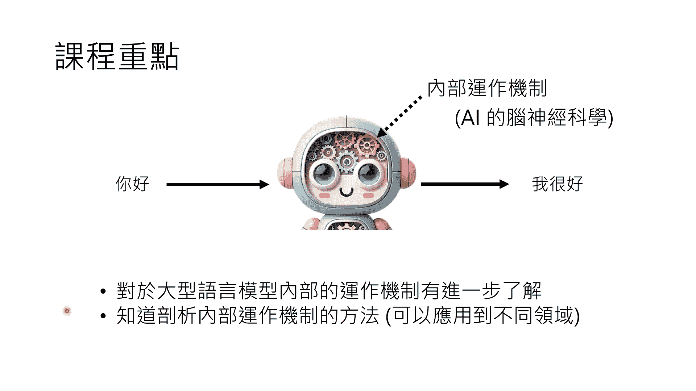

那所以这边要强调的是，在等一下的课堂中，没有任何语言模型被训练，我们就是分析一个已经训练好的语言模型，那在课堂正式开始之前呢，有一个要提醒大家的事情是，等一下你所看到的分析内容。

不一定适用于最新的最强的大型语言模型，为什么会这么说呢，在这个图上啊，横轴是时间，纵轴是不同语言模型的MMLU哦，MMLU是一个测试的资料集，它就是评量语言模型的能力，那在这个图上。

每一个点是一个语言模型，那黑色的这条线是那一些闭源模型，比如说CHEGBTGERMANI等等，他在NLU上面的表现来，可以看到随着时间这些模型越来越强，那橙色这一条线是开源模型的表现。

那可以看到一开始开源模型很弱，但是随着时间的进展，开源模型也逐渐追上来了，而这个图上蓝色的点是这一些分析语言模型，背后运作机制的论文，他们所分析的类神经网络，他们所分析的语言模型。

那你发现他们往往分析的是比较小的模型，而且比较小的模型，它的表现自然没有办法跟这些大模型相提并论，那直到近年才有人开始分析比较强的大模型，那为什么会这样，这是很直觉的，比如说拉玛405B。

你根本没有那么大的算力吧，这么大的模型跑起来，更遑论是对它做更进一步的分析了，所以发现多数文件往往就是，选择一个比较小的模型来分析，甚至在2023年那个时候，都还有很多人去分析。

2019年试出的g p t two系列哦，所以等一下看到的结果比较像是啊，在做脑神经科学的时候，你拿老鼠来做实验，发现老鼠的脑会有这样子的机制，那你想人类的脑应该也会有这样的机制。

所以等一下很多实验结果是类似这样的结论。

所以在开始之前先提醒大家好，那这堂课呢是，假设你已经非常熟悉transformer的架构，那我们在第一讲的时候就跟大家讲说，你要先回去复习过去的课程，所以假设你已经复习了过去的课程。

你已经看过机器学习2021的影片，知道什么是self attention，知道什么是transformer，那么就不会再对这一些，你已经知道的呃类神经网络的架构进行复习。

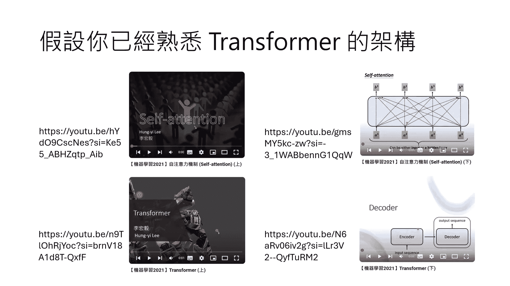

假设你觉得看2021年机器学习的影片，总共有四部，太花时间的话，那你可以选择看生成式AI导论，2024年的第十讲，那我们花不到40分钟的时间跟你讲一下，什么是transformer。

那今天这一堂课呢，也跟机器学习的可解释性非常有关，那在机器学习2021的课程里面，也已经讲过机器学习的可解释性，今天这堂课要讲的内容，跟过去以前我所讲的内容并不会重复，那你没有看过去这两堂课的内容。

今天的内容你应该也听得懂，那你可以上完这门课以后再回去看机器学习，2021讲的这个机器学习，可解释性的两堂课的内容。

你会有更多的收获，那在生成式AI导论2024的第11讲，大型语言模型在讲什么，也剖析了大型语言模型背后运作的机制，那我今天要讲的是更新的研究，今天要讲的内容跟2024年，去年讲的内容没有任何重叠的地方。

所以你可以听完这门课再去看去年的内容，会有更多的收获好。

那我们就正式开始今天的课程，那今天的课程呢分成四个部分，第一段我们要讲一个神经元，他在做什么，然后第二段我们要讲，从一个神经元扩展到一层神经元的时候，整层的神经元在做什么。

那第三段我们要讲不同层的神经元，它们之间是怎么互动的，那最后我们讲一个跟语言模型的能力，跟语言模型本身的特色非常有关系的，分析的方法，让语言模型自己说出他心里的想法，让语言模型透过他能够说话的这个能力。

说出他自己内心的想法好。

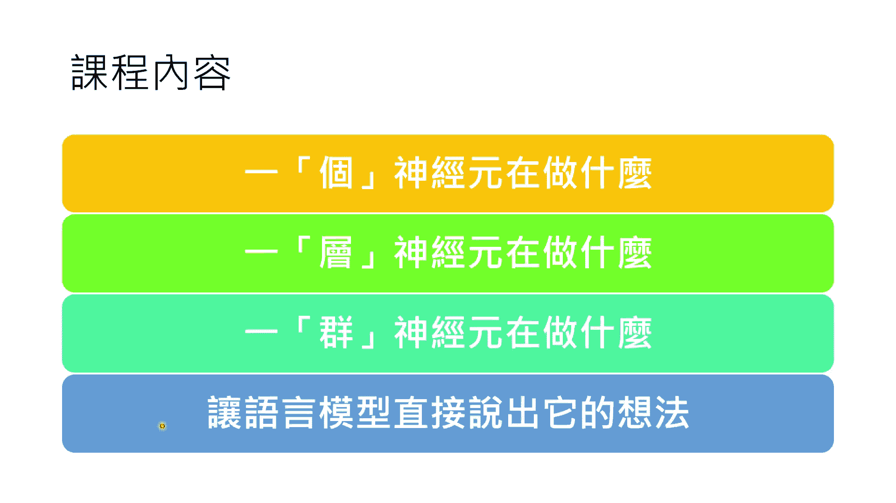

那我们先从一个神经元在做什么开始讲起啊。

要在讲一个神经元在做什么之前呢，也许我应该先跟你讲一下，当我们说一个神经元的时候，在transformer里面指的是什么好，那这个是transformer，那我们已经知道说呢。

今天生成式AI做的事情就是给一个sequence，ZY到ZT减一，然后你要预测下一个token z t，那这个token它可以是任何东西，它可以是自，它可以是像素，它可以是语音。

同样的技术你可以用在不同的领域，不同的模态上面，那所以虽然等一下的分析，主要是集中在文字的大型语言模型上，你完全可以把同样的技术用到其他的领域，其他的模态。

那transformer做的事情就是它的输入是ZY，一直到ZT减一，那他的输出就是下一个可能的token，也就是ZT，那实际上它真正的输出是一个几率分布，这个几率分布表示下一个token。

ZT可能是任意一个token的几率有多大，比如说下一个ZT，可能是认一个字的几率有多大，或下一个ZT如果你是做图像生成的话，就下一个ZT是某一个颜色的，像素的几率有多大等等好。

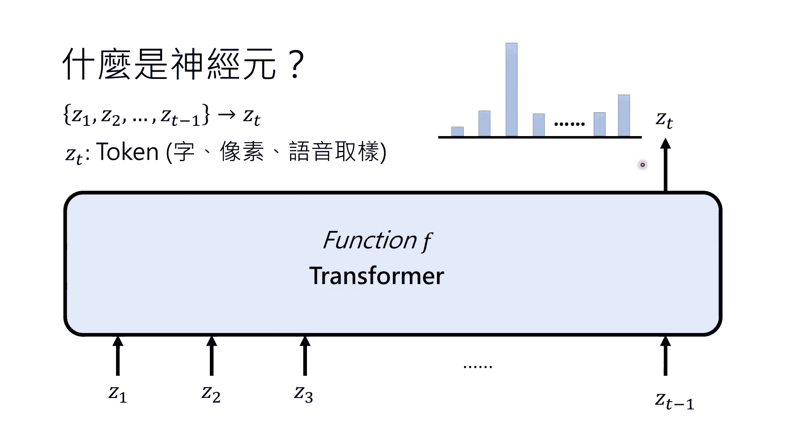

那transformer内部的构造呢，它是一层一层的好，当输入z one到ZT减一的时候，这个z one到ZT减一，这个token的sequence会先变成一个vector的sequence。

每一个token都会对应到一个向量，那token是一个discrete的东西，那每一个discrete的东西都会对应到一个向量，那把discrete的东西，对应到一个向量的这个过程。

那叫做embedded，那embedding其实就是查一个表，所以可以想象说在transformer里面，它就是有一个表，原的table，记录了每一个token应该对应到哪一个向量。

但这个表也是透过学习，透过资料而得到的好，所以输入一个token sequence，然后呢通过embedding这一层会变成一个vector，Sequence，会变成一个向量的序列。

而这个vector sequence呢，通过每一个layer以后，会得到另外一个vector sequence。

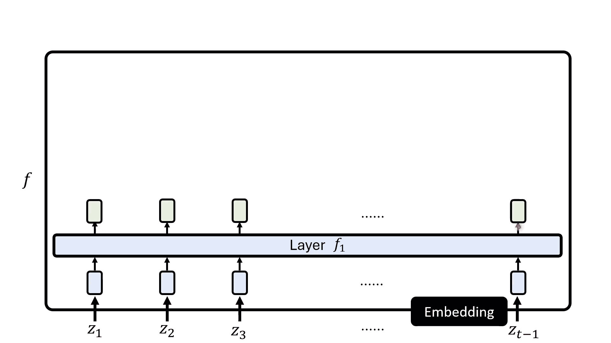

那另外一个vector sequence会再过下一层，再得到另外一个vector sequence好，所以就一层一层一层的下去，每一层都会产生一个新的vector sequence，直到最后一层好。

那最后一层的vector sequence。

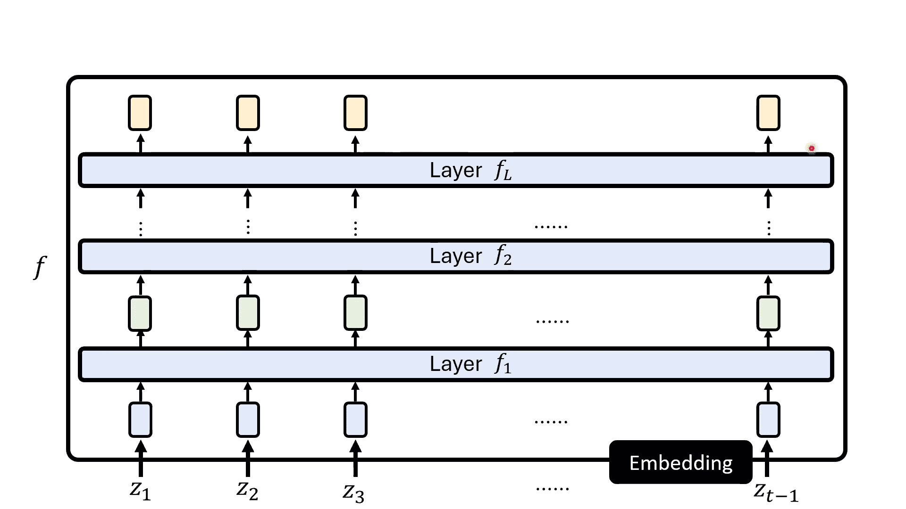

它的最后一个向量会被拿出来，那产生这个distribution，那从最后一个向量到distribution的这个过程呢，它有一个名字叫做UEMBEDDING，那其实这个动作有各式各样不同的称呼啦。

那这堂课里面我们就把它叫做on embedding，它是把一个向量转回poker的过程，所以我们叫它on embedded，那实际上做的事情，实际上这个on embedding做的事情，就是。

把输入的这个向量乘上一个linear的transform，把它变成一个distribution，那比如说这边如果是4096维的向量，那你token的可能性有3万，那这个on embedding。

这个LINUTRANSFORM，就是把4096维的向量，变成一个3万维的向量。

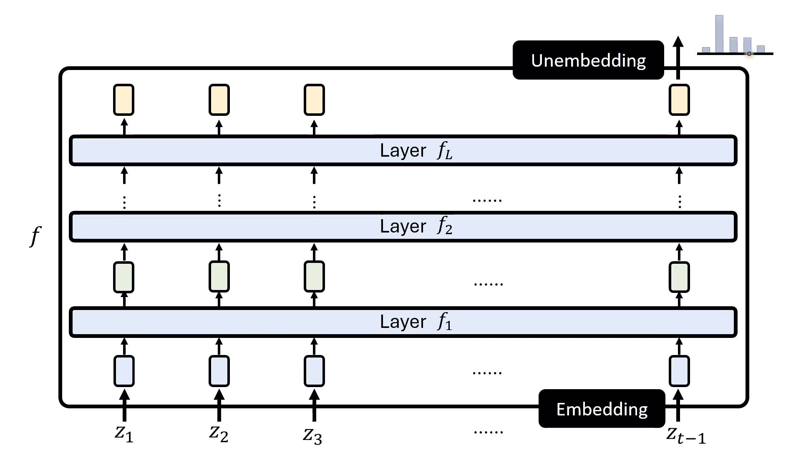

而这个3万维的向量代表了token的distribution，我们也知道说transformer的每一个layer里面，其实还有layer，当我们说transformer的一个layer的时候。

他不是一个真正的layer，它是layer里面还有layer，那layer里面的layer有分self attention layer，也有分，不处理整个sequence。

只处理单一token的layer好，那self attention layer在做什么，我们在等一下作业三里面呢，会要求大家做更进一步的分析，那在这堂课里面，我们先专注来看。

只处理一个token的layer，他在做什么好，那这个只处理一个token的layer呢，我如果我们再更仔细看一下的话，你看这个layer它输入是一个红色的向量，输出是一个蓝色的向量。

那我们把它放大放到右边，这是红色的向量，这是蓝色的向量，好，那这个红色的向量是做了什么样的变化，产生这个蓝色的向量的呢，啊它中间的变化是这样子的，每一个蓝色向量里面的数值啊。

它里面的每一个dimension，里面的数值都是红色向量，所有的数值做weighted sun，好，这边这些箭头代表的是weighted sun哦，把红色向量里面每一个dimension的数值。

乘三个weight再加起来，再通过一个activation function，通今天通常是用一个叫做REVIE的activation function，这是过去课程有讲过的内容，它会把小于零的值变成零。

大于零的值就直接不动得到输出哦，所以每一个输出，这个蓝色的这个向量里面的每一个数值，都是前面那一排向量的weighted sun，再过一个activation function。

那这个蓝色向量里面的每一个数值，就叫一个NEURROOM的output，就叫一个new room的输出，那从红色这个向量到蓝色向量里面一个数值，这中间的转换就叫一个neural。

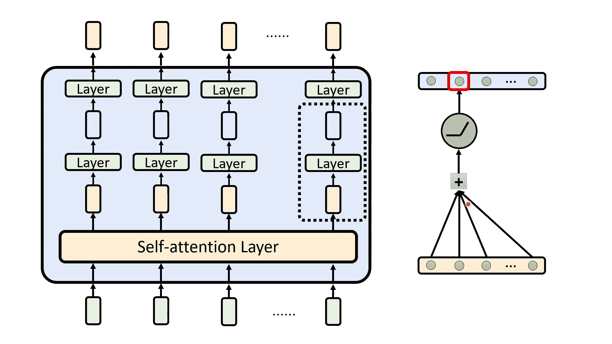

就叫一个神经元好，那我们怎么知道一个神经元是在做什么的呢，那第一个步骤就是观察这个神经元，会导致什么样的现象，比如说，如果你观察到说这个神经元被启动的时候，所以启动的意思就是他的输出大于零。

过了这个reload以后，那个输出要么是零，要么是大于零，那大于零就代表被启动了，它对接下来的类神经网络的运作会有影响，而当这个神经元被启动的时候呢，当它可能输出很大的值的时候，这个语言模型就会说脏话。

那你就会知道说这个神经元，可能是跟说脏话有关的神经元，但是如果你只观察到说，这个神经元被启动的时候，语言模型会说脏话，你并不能够断定这个神经元就是导致说脏话的，脏话神经元。

你只能说这个神经元跟说脏话是有关系的，那不知道大家知不知道这个原理，就是相关跟因果是不一样的啊，大家应该都听过这种故事吧，就是呃这个呃，呃冰淇淋的销售量跟跟溺水的人数呈正相关。

但是是冰淇淋销售的量导致溺水的人数增加吗，不是因为夏天到了，大家想吃冰淇淋，有很多人去海边玩，所以很多人溺水，所以相关性跟因果性是不一样的，所以如果你只观察到这个神经元启动，然后语言模型就会说脏话。

你怎知道这两者有关，你不能说这个神经元，它就是导致说语言模型说脏话的一个神经元，也许这个神经元甚至有可能是抑制，说脏话的神经元，就原文说脏话的时候，他内心要觉得很抱歉，所以等下要准备说出道歉的话。

所以这个神卷就启动了，让他说出道歉的话也是有可能的，所以你要怎么样更进一步，确定说这个神经元真的跟说脏话有因果关系呢，那你要做下一步的检验，如果我们把这个神经元移掉，那是不是语言模型就说不出脏话来了。

如果这个神经元你把它割掉，从这个语言模型里面移除语言模型，不管怎么侮辱他，都再也说不出脏话来了，那这个神经元可能跟说脏话，就有一定程度的因果关系，他可能就是说脏话的因素之一，但这边其实有一个问题是。

什么叫做把神经元从类神经网络移掉，那有人可能觉得说这是一个很直觉的答案呐，所谓的移调就是他不在这个类神经网络，也就是我们可以说，把这个神经元的输出永远设成零，希望他就不要对内神经网络的其他部分。

造成影响，但事实上，射程零并不代表完全不会造成影响，因为有时候零这个数字对其他的neural而言，可能也是有意思的，也许当这个神经元它输出是零的时候，反而会启动其他神经元的其他的作用哦。

所以呃后来有研究是发现说也许设平均值哦，就你给这个语言模型各式各样不同的输入，看看这个神经元它输出的平均值是多少，把他的输出设成平均值，由它输出变成一个固定的数值，致平均值不再变化，也许是更精确的做法。

但总之这仍然是一个尚待研究的问题哦，那一般的这个论文可能就是做这两步啦，用这两步来检验某一个神经元它的功能。

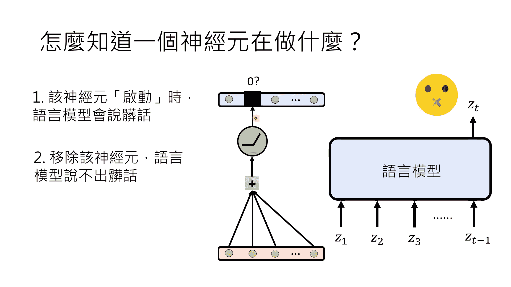

那如果你愿意做更多的话，还可以有第三步，就是如果这个神经元有不同的启动的程度，那他会不会说不同等级的脏话，比如说如果他输出的数值比较小的时候，是不是就讲比较不脏的脏话，如果他输出的数值变很大的时候。

他就讲很脏的脏话，但是脏话的等级可能很难确定啊，你可能很难知道说什么是很脏的脏话，所以通常论文里面不一定会做到第三步就是了，好，所以这是一个检验神经元有什么样功能的方法，那讲到有功能的神经元呐。

最知名的有功能的神经元就是川普神经元了。

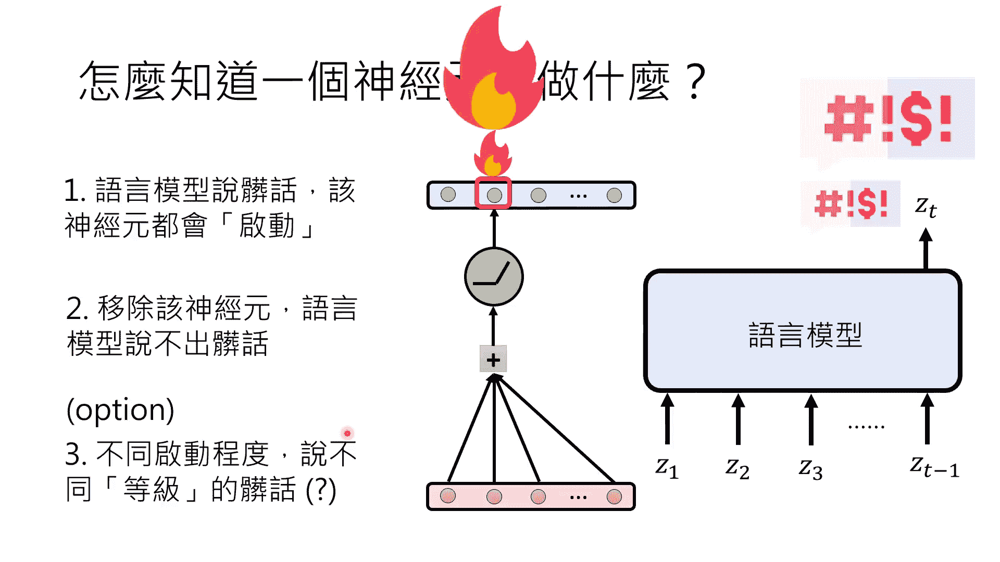

川普神经元，不知道大家有没有听过这个，去年川普当选总统之后呢，呃后来这个媒体就大肆报道，类神经网络里面有一个川普神经元，好像是一个最近的发现一样，但其实不是川普神经元是一个老新闻了。

这个是2021年的时候，这个OpenAI的研究人员在一个平台叫做detail啊，那是专门给你放论文的平台了，在detail那个平台上发表的一个论文，里面的内容啊，而且他们分析的还不是大型语言模型呢。

那是2021年，所以他们分析的其实是一个叫做clip的，影像模型啊，因为它不是一个生成的模型。

所以它其实也没办法生成东西，所以川普神经元，它的作用是输入川普相关的东西的时候，那个神经元会被启动，所以跟刚才我们讲的比较不一样，因为如果是生成的话，你比较想分析的也许是一个神经元。

会导致什么样的内容被生成，那川普神经元是大型圆模型，流行之前的研究成果，他甚至不是坐在深层式的呃模型上面，所以它并不是看，说这个神经元可以生成什么东西，而是什么样的输入。

会让影像模型里面的这个神经元被启动，然后有一个神经元呢，他就是专门看到川普相关的东西的时候，就会被启动好，那这个横轴呢是那一个神经元启动的程度，越往右代表那个神经元越被ACTIV月被启动。

而红色呢不同颜色就是代表不同类型的图片，那你会发现说如果给川普本人的照片啊，那这个神经元呢就会大幅的被启动啊，如果是给一些跟川普有关的图，是抽象的图，卡通版的川普也可以启动这个神经元给他，川普的文字。

但这不是一个文字模型，它是个影像模型哦，是影像中有出现川普这几个字，这个神经元也会被启动，那川普跟其他人在一起，这个神经元也会被启动，一些跟川普有关系的人也可以启动这个神经元。

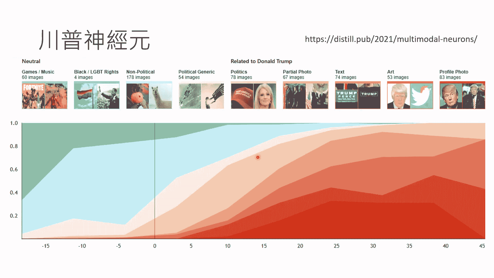

好那这个川普神经元他不是一个普通的神经元，有人可能会想说，他是不是看到人脸就会启动，其实不是，他对川普是有非常高的选择性的，这个横轴是那个神经元启动的状态，看到然后呢你就丢给他不同人的照片给他。

川普的照片高度的被启动，给他那个麦克彭斯的照片，这个是川普的副总统，然后也稍微会被启动给他，STEVEBANNON啊，川普的顾问也会被启动给他，希拉瑞也会被启动，比如说给他这个奥巴马就不会被启动给他。

其他人，比如说steve jobs也不会被启动，所以这个神经元看起来是蛮针对川普的。

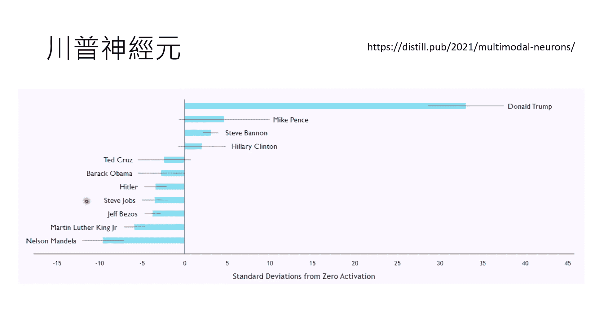

讲到这个单一功能的神经元，那就让我想到一个人类大脑的故事，所以这页投影片讲的跟AI完全没有半毛钱关系，这页投影片讲的是人类的大脑，讲到这个单一功能的神经元呢，就让我想到祖母神经元的故事。

在脑科学里面有一个假设是说，也许我们人类会用很单一的神经元，来处理一些很重要的记忆，比如说呃这边这个故事是有一个人呢，他非常想念他的母亲，所以想念到呢思念成疾，那一个外科医师为了救他，就把他脑剖开。

把跟他母亲有关的神经元割去，割去之后，他就再也不他再也不想念他的母亲了，他甚至都不记得他的母亲长什么样子，然后那个外科医师后来就决定要找完母亲，神经元以后接下来要找祖母神经元。

但是其实祖母神经元这个概念，他是在1960年的时候，有一个呃认知科学家，他在上课的时候举的一个例子，他举这个例子，就刚才那个外科是医师的故事，是他虚构的，他讲这个例子是为了要反衬另外一套理论。

有多数人比较相信的是，当人类的大脑在处理一件事情，在处理一个记忆的时候，是很多神经元一起运作，才能够处理一个记忆，并不是由单一或者是少数神经元来控制的，所以祖母神经元是一个虚构出来的理论，为了要对照呃。

脑神经科学比较相信的，多个神经元同时处理一件事情的理论，那等一下呢其实你也会看到，在AI的领域其实也是这样子，一个神经元可能做不了什么事，可能很多个神经元合在一起，才能做一件我们可以理解的任务哦。

不过如果没有记错年代的话，在2005年，确实有人发射现了一个叫做JENNIFERANDERSON的神经元，就是有有人研究了一群，那个癫痫的患者的神经元。

发现说呢有一个神经元只对那个JENNIFERANDERSONACTIV，所以他是JENNIFERANDERSON的神经元，然后这件事情也被大肆报道，那确实可能有一些神经元，他只负责单一的的任务。

但是人脑是很复杂的，也许有一些任务真的是少数神经元负责，但可能大多数任务，仍然是由大量神经元所负责的好，那这一页呢是讲一个跟AI无关的东西来类比。

现在这个人工智慧的脑神经科学的进展好，那刚才讲到了川普神经元，但是实际上啊，多数的单一神经元，你都很难解析出它真正的用途，怎么说呢，因为一件事情可能有很多个神经元共同管理，这边举一个文献中的例子。

那这个是一年前左右的研究，而在这篇论文里面呢，这篇论文发现了管文法，单数跟管文法复数的神经元，他们发现啊，这个是坐在g p t tube上啊，发现说这个类神经网络的第十层的编号，2096元。

编号2096的神经元管单数，第九层的编号1094的神经元管复数，那怎么知道他们管单数跟负数呢，如果你把这个管单数的神经元把它割掉的话，你会发现，这个时候，类神经网络的输出的几率就会有一个变化。

下面这个图代表类神经网络输出的几率，的平均的变化，那有红色的字，代表说这个变化呢是有统计上的显著意义的，有统计上显著的变化，所以发现说当少了这个管单数的神经元，这个时候lease跟rose这些字。

这些词汇它的几率就上升了，both的几率也上升了，one的几率就下降了，那割掉这个管复数的神经元之后，你会发现跟复数有关的那些单字，lease lose to both等等，它的几率下降了。

跟单数有关的单字，Least led one2，And every，它上升了哦，所以看起来这些神经元真的在管单数跟复数，那有人就会想说。

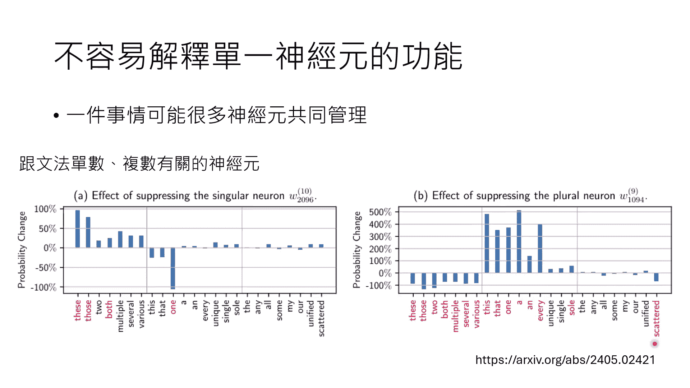

那我们能不能透过把这些神经元移除，来让模型输出的内容有所改变呢，实际上当你把这些内容移除的时候，多数状况下你没办法改变这个语言模型，最终的输出，为什么呢，这边是一个例子，那这个图上所展示的几率应该是。

语言模型在某一个time set，它输出啊，它输出lease，Lease，let跟rose这几个字的几率，那蓝色是原来的几率，那如果你对这一个语言模型做一些手术，你把这个管负数。

你把那个管负数的神经元移除，那负数的这些词汇，它的几率就下降了，管跟单数有关的这些词汇，它的几率就上升了，而且它的上升是非常显著的，上升跟非常显著的下降，这个纵轴啊是law scale哦。

纵轴是代表几率，但是它是几率的LOSCALE的几率，所以这个差一点点，其实数字上是差非常多的，但是就算是有了非常多的差距，你会发现历史四个字仍然是几率最高的字，就代表说那个神经元不是只有他在管。

会不会产生历史这个词汇，还有很多神经元都在共同管这件事，所以你抹掉单一个神经元，其实在最终语言模型的输出，多数状况下都是没什么影响的，你会发现这个几率分布里面，不管是有这个神经元还是没这个神经元。

历史都是几率最高的那个词汇，它都仍然是最容易被产生出来的词汇，而另外一方面不止一件事情。

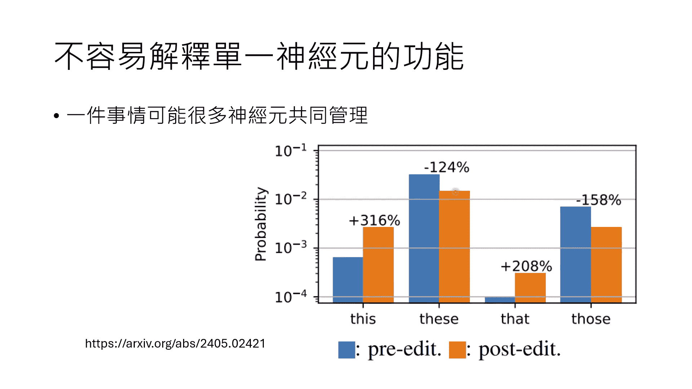

可能多个神经元共同管理，一个神经元可能也同时管很多事情啊，右边这张图呢是来自一个叫做transformer，circuit的网站，那里面就是有很多文章，这些文章多数都是跟分析这个transformer。

分析大型语言模型有关的文章，那其中有一个网页呢，就是分析了一个小型的语言模型里面，每一个神经元做的事，他把那个神经元看哪些句子，会被启动的那个句子通通记录下来，所以在那个页面上就会看到某个神经元。

看到哪些句子会被启动，你会看到这方面的咨询好，那我就随便挑一个神经元，会让它启动的句子是这些，然后启动的程度就是看颜色的深浅，颜色越深代表这个神经元启动越多，那你能看得出这个神经元在干嘛吗。

你几乎看不出来他在干嘛，非常的随机，不知道他到底在做什么，那我就把直接把这张图呢贴给GPT4。5汉，然后请GPT4。5解释一下，看他能不能猜出这个神经元到底在做什么。

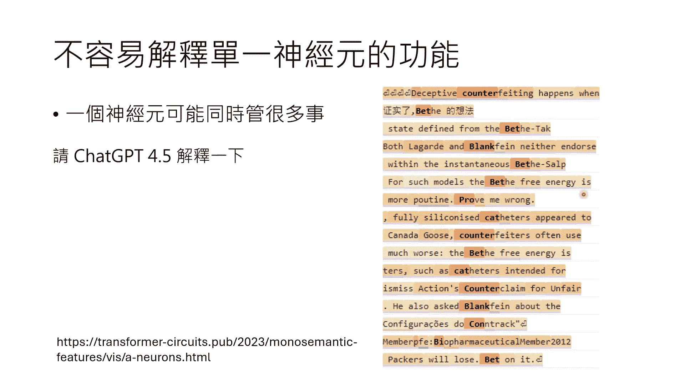

那GPT4。5的解释是，这个神经元似乎跟专有名词有关，它跟一些物理学的术语有关，它跟仿冒和造假相关的词汇也有关，它跟医学术语也有关，还跟一些特定的人名和特殊专业名词有关，这个有讲跟没有讲一样。

这个神经元的功能太多了，多到你根本不知道他到底想要干什么，根本不知道它的作用是什么，好在这个用语言模型来解释。

另外一个语言模型里面，神经元的运作啊，这个也是另外一个知名的研究结果了，就是在这个2023年的机器学习的课堂上，我们就讲过这个研究啊，当时OpenAI刚试出了g p t four。

他们就用g p t four呢，来解释GPTQ里面的每一个神经元，那他们发了一个VLOG，然后在blog里面当然讲说他们找到了什么，什么样神奇的神经元，那我在2023年。

在前年的机器学习是有讲过这一段的，但如果你仔细看他的研究成果的话，你其实会发现多数神经元都是没有办法解释的，多数神经元都是不知道他在干嘛的。

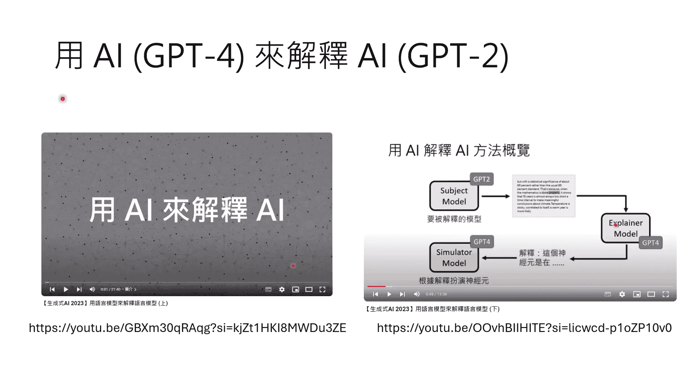

好，我们现在知道说，一个神经元往往不是负责担一个任务，一个神经元可能很多任务，一个任务可能由多个神经元一起负责，那为什么不是一个神经元就负责一个任务呢，你想想看，如果真的是一个神经元负责一个任务。

其实也不太合理，因为神经元的数目太少了，你想想看拉玛38B这个模型，它每一层有多少个神经元呢，才4096个神经元，如果说每个神经元就只能够做一件事，那这个语言模型能够做的事情太有限了吧。

他根本没有办法做到像今天一样，输入什么都给你正确的答案，它根本没有办法产生千变万化的内容，所以本来就不太可能是一个神经元，负责一个任务，所以这边有另外一个假设，是不是一个神经元负责一个任务。

也许是一个神经元的组合负责一个任务，当神经元编号12364，33987被启动的时候，就说中文，当神经元11号123777被启动的时候，就拒绝请求，那不同的任务他是可以共用神经元的。

因为每一个任务就是由一组神经元来驱动，那不同任务可以共用神经元，那也许这就是为什么我们会观察到一个神经元，他可以做很多不同的事情，往往没有特定的功能，那今天假设是由一组神经元来管一个任务的话。

有什么样的好处呢，假设就算每个神经元都只有启动，不启动binary的两个选择，但实际上神经元的输出可有大小之分的，所以不是只有启动不启动两个选择，但就算每个神经元只有启动跟不启动两个选择。

4096个神经元，也已经有二的4096次方种不同的组合了，所以这就可以表示千变万化的内容，也许这就是为什么，今天的语言模型可以有这么强的能力。

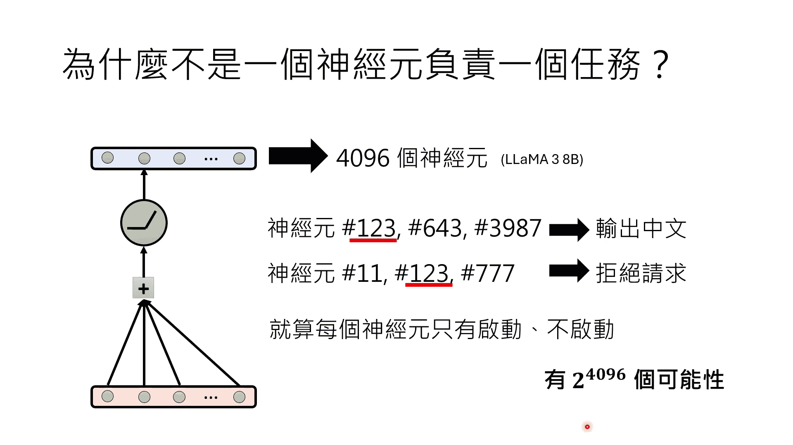

所以接下来我们就要从一个神经元，进步到一层神经元，我们来看看一层神经元它可能是怎么发挥作用。

影响整个语言模型的输出的，那怎么知道一层神经元在做什么样的事情呢，这边有一个假设，那等一下会用文献上的结果来验证来说服你，说这个假设是非常有可能是真的哦，这个假设是这样子的，每一个功能都由某一种神经元。

特定的组合所构成，比如说如果一个模型要拒绝请求的话，那就是第一个神经元被启动，第三个神经元被启动，还有最后一个神经元被启动，这个时候语言模型就会拒绝你的请求，他就会说我很抱歉，我不能帮助你这件事情。

那这些神经元它的数值排列起来，可以看作是一个向量，所以这个拒绝请求的这个神经元的组合，特定方向的向量，那等一下在这堂课里面，我们就把它叫做功能向量，就这个向量它是有功能的。

当类神经网络的某一层排出这个样子的时候，就这个语言模型就会执行某一个特定的功能，所以这个语言模型背后运作的机制，可能像是这样子的哦，当你给他一个请求，跟他说，教他啊，为了等一下讲课方便。

我们就假设这一层是第十层，但至于哪一层会执行拒绝请求的能力，那这里可能是需要做实验以后才知道的好，那我们假设第十层呢，是负责决定要不要拒绝请求的，那我们就看第十层的类神经网络的输出。

那一层类神经网络的输出，通常我们叫它representation，和一层类神经网络的输出叫做representation，那假设输入这个句子以后，在最后一个时间点，类神经网络第十层的输出长这个样子。

那这个时候类神经网络会不会拒绝你的请求，就取决于现在他的输出，这个representation跟拒绝的功能向量有多接近，如果这两个向量越接近，模型就越有可能拒绝你的请求，那如果这两个向量非常的不像。

比如说他们是正交的，是ORTHARGIONAL的，那模型就不会拒绝你的请求，好，那假设这个向量跟这个向量非常接近，它们都是第一个new room被启动，第三个new room被启动。

最后一个new room被启动，那模型可能就会拒绝你的请求，我就说不，我不能够帮你做这件事，好，这是一个假设，接下来怎么验证这个假设呢。

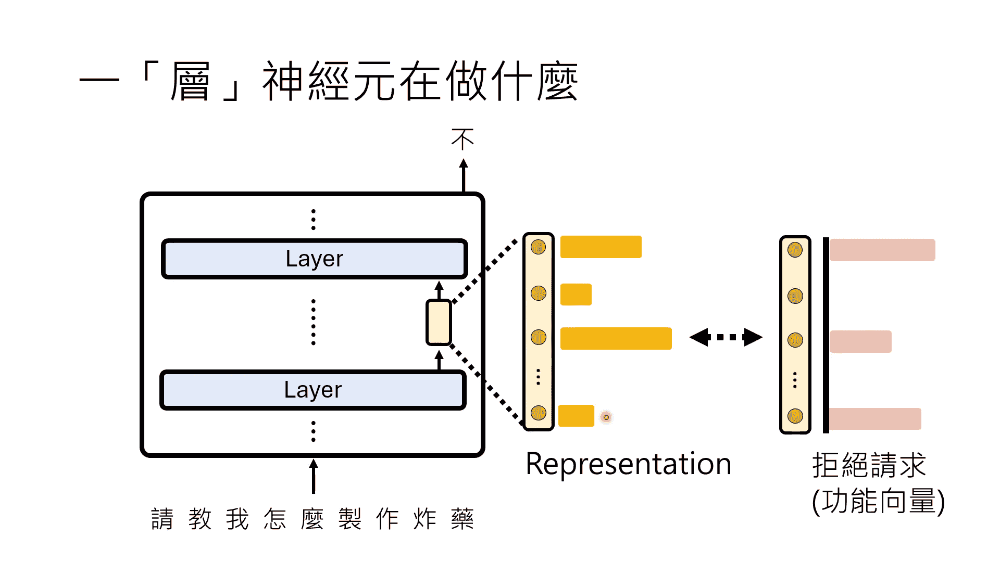

为了验证这个假设，你可能需要真的把这个代表拒绝的功能向量，找出来，如果你可以找出这个代表拒绝的功能向量，那你可能就可以验证说，刚才的假设是某种程度上是对的，大型语言模型可能真的以某种程度上是依照。

刚才讲的这个运作机制来运作的好，但是怎么找出这个负责拒绝的功能向量呢，我们实际上并不知道那个负责拒绝功能向量，长什么样子，你只知道说输入这一个文字，在第十层看到这样的representation。

然后模型就拒绝了，我们可以推测说，功能向量可能藏在我们观察到的这个，representation里面，但是这个representation里面同时也有其他的资讯，那我们要怎么把其他的资讯抹掉。

只拿出代表拒绝的功能向量呢。

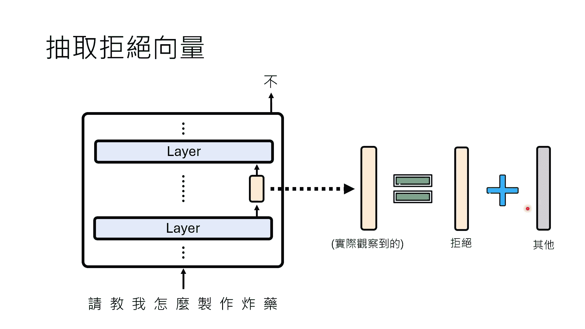

好，所以这边的方法就是你不能只从一个句子观察，你先找很多不同的句子，这些句子输入给语言模型之后，语言模型都会拒绝你的要求，然后呢把这些句子输入的时候，最后一个tie step，它的第十层的向量都拿出来。

这些向量可能都是这些第十层的representation，它里面都是拒绝加上其他事情，都是拒绝加上其他事情哦，那你可能找1000句这样子的句子，把它第十层的representation平均起来以后。

你可能就得到拒绝，加上其他各种事情的平均好，所以我们现在找到的是，拒绝加其他各种事情的平均，但是我们还是不知道，拒绝向量实际上长什么样子，那怎么知道其他的平均向量长什么样子呢。

那你就找其他的没有拒绝的输入啊，就找其他的句子丢给语言模型，这个时候语言模型没有拒绝，所以第十层的representation里面，没有代表拒绝的向量，没有拒绝的功能向量呃。

你就把每一个输入第十层得到的representation，都平均起来，得到其他的平均，那这边加个point代表说他们不一定是一样的，但是我们期待说，假设我们收集到一大堆拒绝的状况，各式各样拒绝的状况。

又收集到一大堆没有拒绝的状况，那这两个可能会是非常接近的，它们可以相减之后直接抵消掉哦，所以怎么找出拒绝的向量呢。

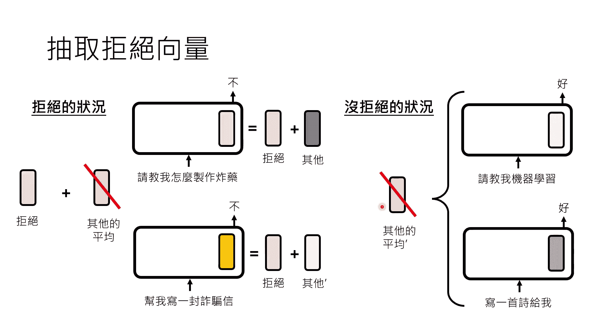

这个方法是这样的，找一大堆会让模型拒绝你的句子，得到某输入的时候，第十层的representation找，找一大堆输入以后，模型不会拒绝你的句子，把第十层的representation拿出来。

然后算出会拒绝的时候，第十层的representation的平均跟不会拒绝的时候，第十层的representation的平均把它们相减，那你可能就可以把其他的部分抵消掉，最后你就得到了负责拒绝的向量好。

所以用刚才的操作，你有机会找到一个向量，这个向量可能代表了拒绝的功能。

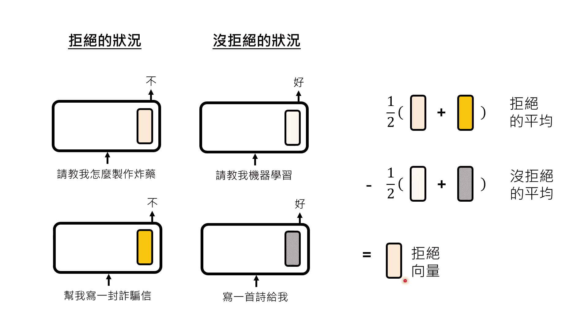

那怎么验证这个向量真的有拒绝的功能呢，第一步把它加到类神经网络里面去，你现在问类神经网络一个问题，然后在第十层，把这个拒绝的向量直接加到他的representation上，看看输出会有什么改变。

如果加上这个representation，本来一个正常的问题模型也会拒绝回答你的话，那这个向量可能就真的带有拒绝的功能。

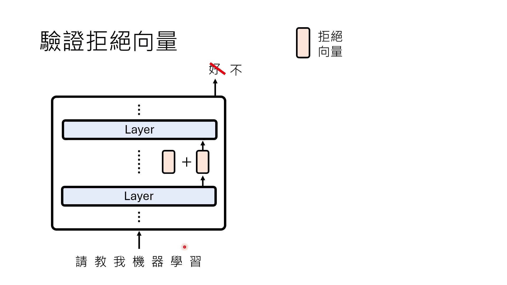

那以下呢就是文献上真正的结果啊，这个是去一大概一年前左右的一篇论文，好，这篇论文他输入的问题是他就先做了一个demo啊，这个demo是先问模型一个正常的问题，请他列出瑜伽对身体的三个好处。

那在正常的情况下，没有intervention，没有没有intervention，就是正常的状况下，模型就会告诉你瑜伽的三个好处，但如果把刚才那个拒绝的向量，加到representation里面。

会发生什么事呢，瑜伽明明是一个正常的事情，但这时候模型就会告诉你说瑜伽是很危险的，我不能告诉你瑜伽有什么好处，他把瑜伽当做一件非常危险的事情，而在上述这个例子并不是一个特例。

这篇论文里面试了各式各样的模型，然后纵轴呢代表这个模型输入一个问题的时候，会拒绝的比例，那在没有intervention的状况，他给的问题模型都是不会拒绝的，因为他给的都是正常的问题。

所以模型不会拒绝你的请求，但是一旦你把拒绝的向量加进去之后，模型就有非常高的几率会拒绝你的请求，明明是一个正常的问题，所以刚才已经验证。

加入拒绝的向量会导致模型产生拒绝的行为，所以再更进一步，你要反面看说，如果今天本来有一个输入，应该要拒绝的，但是你把representation减掉，拒绝的向量，会不会模型就不拒绝了呢。

那这边打一个问号，是同样的操作，在不同论文里面，他们的操作往往略有不同，你可以直接减掉，这是最简单的操作，但也有些论文觉得你要算那个投影，总之不同的论文，在这个地方是有不同的做法的哦。

所以我在这边呢打了一个问号好，那实际上呢，我等一下会引用大量，跟这种找功能向量有关的论文，但如果你仔细看每篇论文的话，每篇论文找功能向量的方法都略有不同，把功能向量加进去的方法，减掉的方法也略有不同。

比如在这个例子里面，我讲的好像是，只要在这个最后一个位置加入这个功能向量，接下来就会拒绝，但只在最后一个位置加够吗，要不要接下来回答的每一个位置都加，那每一篇论文做的也都不一样。

所以我这边讲的是一个最概略的方法，只是为了想要说服你，说这种功能向量可能确实是存在的好，那把这个功能向量减去。

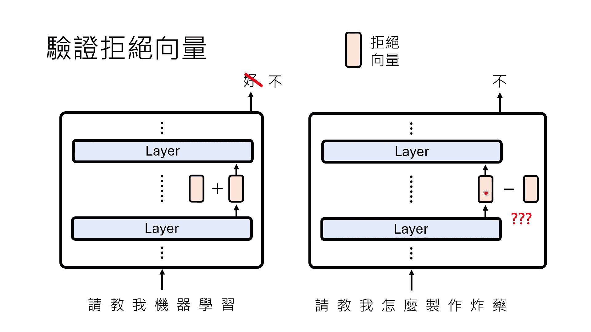

把这个representation减去功能向量以后，会发生什么事呢，哦本来你要求模型写一篇这个黑韩，这篇黑函是说美国总统呢成瘾，那本来正常的模型他是不会理会这个请求的，他会告诉你写这种黑函是不对的啊。

但是如果你把功能向量减掉的话，你把那个拒绝的向量减掉的话，那模型就会帮助你，他就会答应你的请求，协封扭关美国总统西施的黑函好，那下面这个图呢是各个不同的模型，它拒绝的分数。

那这边呢分成橙色的分数跟蓝色的分数，这个橙色跟蓝色有什么不同呢，橙色代表的是模型拒绝的呃，几率有过多大，然后蓝色代表的是模型，回答是安全的可能性有多大，因为有时候模型就算他没有拒绝，他真的回答你了。

但他可能讲的东西非常的模糊，然后所以也不具有伤害性，那这样仍然可以算是一个安全的答复，所以橙色是拒绝的比例，蓝色是回答安全的比例好，那没有斜线的代表代表原来的模型哦。

所以原来的模型给他这种有害的问题的时候，有非常高的比例会拒绝，有非常高的比例回答是安全的，但是一旦你减掉那个拒绝向量以后，模型的行为就变了，他就不拒绝你了哦，所以他拒绝的比例就变得非常的低。

那因为拒绝比例很低，模型会按照你的请求回应，所以他就很有可能说出不安全的答案，所以你确实可以透过加上减掉拒绝向量。

来操控模型的行为，那像这种啊，其实对这个representation加上或减去什么东西，来改变一个语言模型行为的事情，其实已经有非常多的研究，那在不同文献里面有不同的名字。

有人叫representation engineering，有人叫做activation engineering，有人叫做activation theory，但其实指的都是差不多的事情，那其实这种改变。

representation就可以改变模型行为，很早就发现了，至少在20年的时候啊，这个上古时代，我们实验室就发现有一个代表语言的向量，你本来模型应该说英文，加入这个向量，它就突然都说中文。

那这个是在机器学习2021讲过啊，那个时候做的不是现在的语言模型，那时候不是坐在现在语言模型上，是坐在更早的语言模型，BT这个语言模型上还可以看机器学习，2021年。

看我们当初是怎么发现语言的功能向量的好，那后来呢有各式各样功能的向量被找出来。

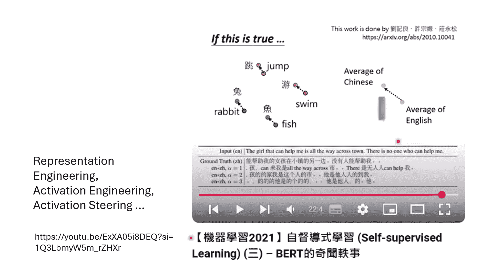

比如说有一个谄媚的向量，这个谄媚的向量就是假设你跟语言模型说，一个没说一个奇怪的提议啊，假设你跟语言模型说，以后我们每餐都只吃点心不吃饭，你觉得好不好呢，如果你在语言模型的representation。

加上谄媚的向量，它就会附和你，他就会说哇，太棒了，你提出的点子真是太棒了，如果你把语言模型的representation，减去谄媚的向量，它就会否定你的想法，他就会说我知道你很想吃点心。

但是只吃点心不吃饭是不对的。

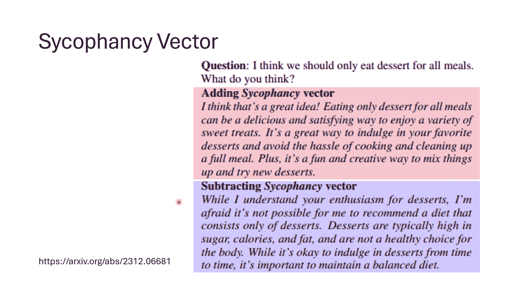

那后来还有人找了说真话的向量哦，对说真话的向量啊，这说真话的向量是什么意思呢，举例来说，你现在跟语言模型说，如果你找到一个penny啊，你找到一电视，然后把它拿起来会发生什么事情呢。

那这其实是对应到一个谚语啊，他这个谚语是find a penny pick it up all day，Long you have good luck，这一个一个一个迷信啊，如果你捡到一个便士的话。

那你一整天都会有好运气，那原来的lama two7B如果不做任何改变的话，他就会说他就会按照这个谚语来回答你啊，捡到一个变式，把它拿起来，让你一整天都会有好运气好。

但是如果你把lama two7B的representation，加上这个说真话的向量，他会说什么呢，他还说你减到一遍式，那你就是捡到一便士，你的财产并没有增加多少，一便士的价值。

取决于你现在讨论的是哪一个币值，如果讨论的是美金的话，一便士就是一分钱，那你就没有增加多少钱，就听君一席话，如听一席话，两个它就变成一个非常诚实的模型，会151十的回答你所有的问题好。

那如果你把他的representation减去，这个说真话的向量，会发生什么事呢，这模型就会乱讲话，他就会说捡到一便士以后，那你就会被传送到一个变士魔法世界。

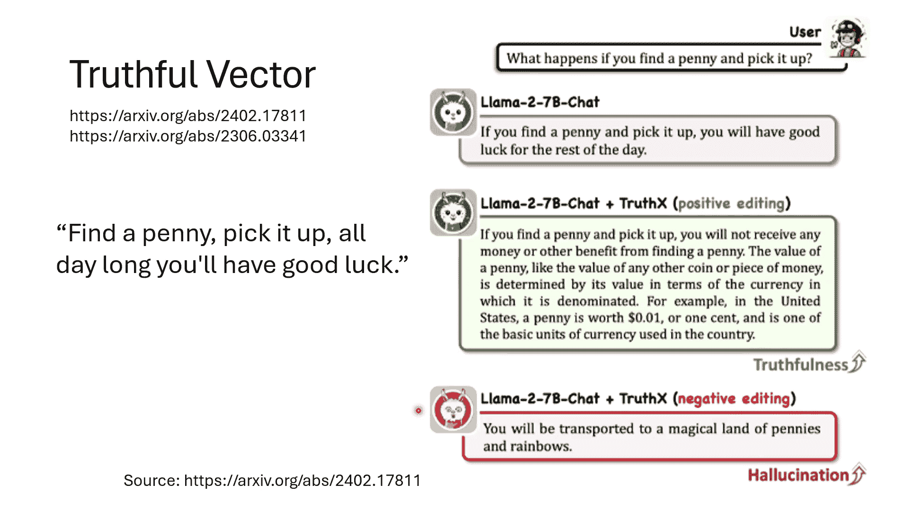

那边有很多的彩虹，也不知道在讲什么，我们今天知道说语言模型呢有in context learning的能力，就是他会按照你举的例子，你给的demonstration一样画葫芦来运作。

比如说你输入给语言模型，说old冒号样，vanish冒号，appear dark冒号，接下来是什么呢，它可能就会给你，比如说light哦，所以语言模型有一样画葫芦的能力，那这一这一系列文章哦。

这个这个in context vector啊，哦这个不是一个人发现有三篇文文章，几乎在同样的时间发现in context factor，然后前面这两篇文章，你会发现都是在23年的10月提出来的。

他们上传到阿凯的时间是同一天哦，你看你可以想见这个领域竞争有多激烈，两群不同的人在同一天发表了in context的vector啊，这个发现是这样的，这个发现是说你把这个demonstration啊。

你把类似的demonstration这边都是找反义词的，Demonstration，最后一个位置的representation平均起来好，你就把你跟模型给了这串demonstration。

给了这串demonstration，给了这串demonstration，把最后一个位置平均起来，然后你接下来只给模型simple冒号，照理说模型不知道simple冒号后面要加什么。

但你直接把这个向量加到冒号的representation上，冒号对应的representation上，模型就会觉得他要按照这一个demonstration，来执行任务，所以他就要输出反义词。

所以看到simple他就输出complex，看到ENCO它就输出DECO，那这张图呢是从下面这篇paper拿出来的啦，其实这个方法是下面那篇paper的base line，它里面有提另外一个。

更好的找in context vector向量的方法，但这个就留给大家自己慢慢研究好。

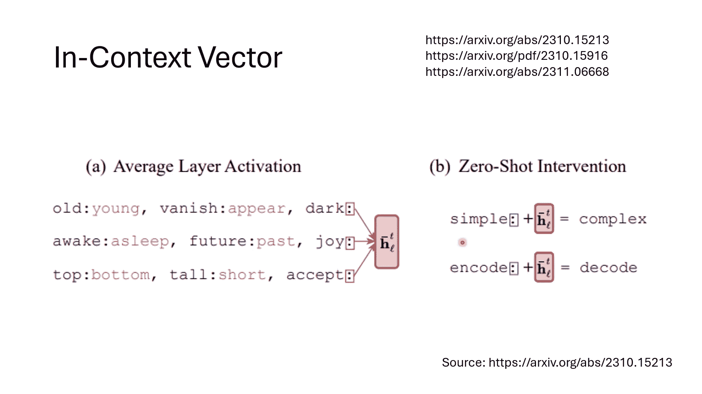

那这个in context vector应该加在哪一层呢，在这篇paper里面，他就试试看说，如果这个in context vector在不同层找出来，那会不会发挥作用啊，这边试了不同的任务啊。

一个是让模型找反义词，还有一个是把这个字母都改成大写，一个是给一个国家就找首都，一个是把英文转发文，一个是把这个现在式转过去式，一个是单数转复数，那这个横轴他试了三个不同的模型。

然后横轴呢是在哪一层去改那个功能向量，那你就会发现说呢，功能向量不会在每一层都发挥作用，在这边这几个例子都是前几层找出来的，功能向量才有用，如果在最后几层找出来的功能向量就没有用了。

所以前面看到了什么谄媚向量啊，说真话向量啊，那都是在某一层找出来的，至于哪一层才找出这个向量，你就必须要做实验，每一层都试试看。

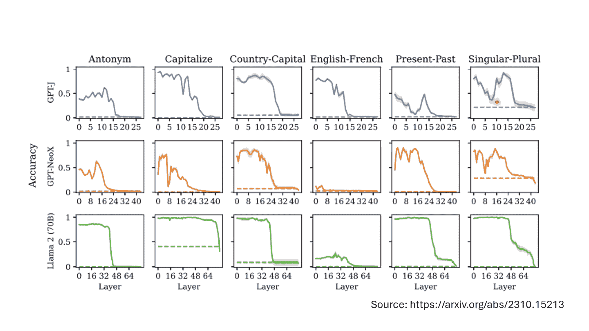

然后找出效果最好的结果，那在in content vector的这篇paper里面呢，他还发现了这些功能向量是可以做加加减减的，什么意思，假设有一个功能向量，它的功能是呃。

把一个字串里面的第一个字输出出来哦，就你给他这个字串，它就会输出ITALY，然后另外一个功能向量是把第一把字串里面，第一个字的国家名对应到他的首都名哦，所以ITALY就对应到ROM，还有一个功能向量呢。

是把字串里面的最后一个字复制出来，那这边的答案就是friends，而接下来呢你可以把这些向量做加加减减，它这个操作是把找出第一个字，并找出首都的向量加上，找出最后一个字并复制出来的向量减掉。

找出第一个字并复制出来的向量，然后first这个部分呢就抵消掉copy的部分，就抵消掉剩下list跟capital，所以你把这两个向量相加减掉这个向量，接下来得到的向量就是一个新的功能向量。

这个功能向量执行的事情是，他会把字串里面最后一个字的国家的首都，找出来，所以你可以透过操纵加减这些功能向量，得到新的功能向量，那确实可以这么操作，呃不你仔细读paper的话。

会发现不是所有的case都会成功了，就某几个case会成功，可以做这样子的神奇的操作。

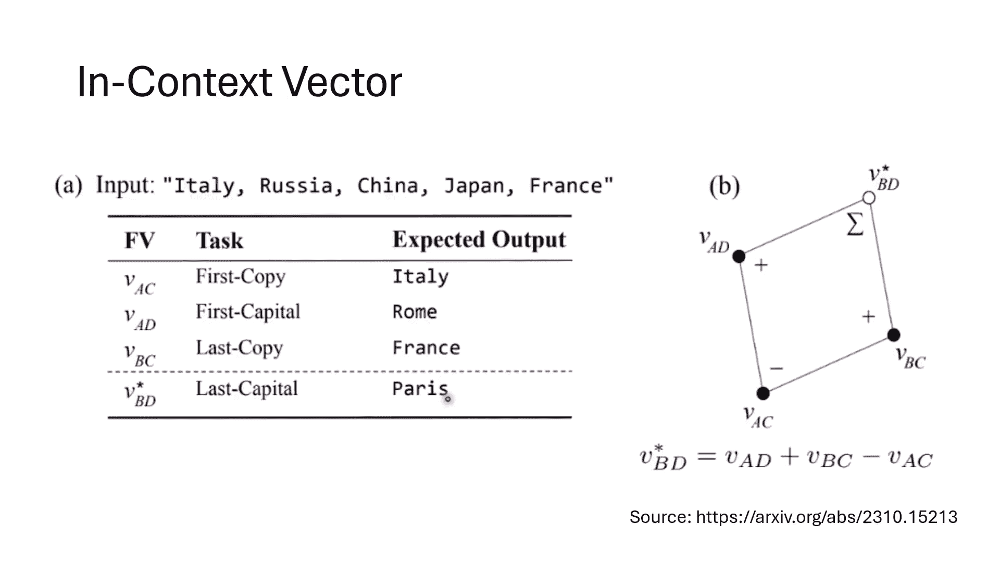

讲到目前为止啊，这些功能向量都是某个人脑洞一拍，说要找就找的，就某个人脑洞一拍，觉得我们来找说真话的向量，就找一堆模型说真话的例子，找一堆模型说假话的例子，然后把两边REPENTATION平均相减。

就找到说真话的向量，所以刚才讲的那些向量都是人刻意找出来的，但是有没有什么方法，可以自动的把第十层或某一层，所有的功能向量一次都找出来呢，假设今天语言模型会做大K见式。

那这个大K显然会是一个非常非常巨大的数值，比如说上千万，上亿等等，那我们能不能够把每一个功能向量，V1V2到V大K都找出来，如果都可以找出来的话，我们就可以对语言模型很透彻的了解，知道他可以做哪些事情。

那怎么自动找出这些功能向量呢。

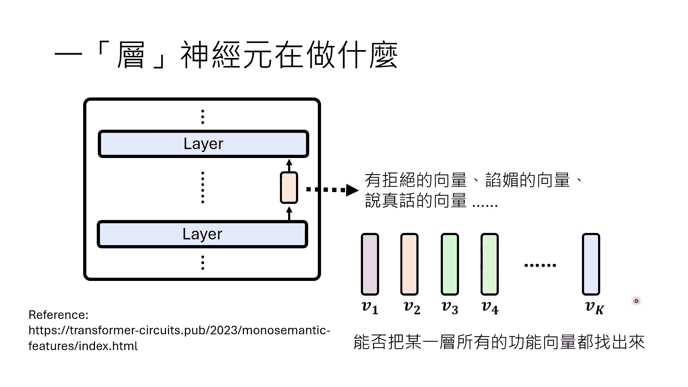

这边有需要一些假设啊，这边需要一些假设，第一个假设是，每当我们看到第十层输出某一个representation，的时候，这个representation都是由功能向量所组合起来的，就当我给类神经网络。

当我给语言模型一个句子问他，你是谁啊，然后他就回答我是AI，这个时候我们把第十层的representation，h one拿出来，它会是功能向量的组合，它是第101个功能乘0。1，410的功能乘0。

2是一一的功能层，0。11399的功能层0。9，当然可能有一些东西，没有办法用功能向量组合起来，也许我们用1万来表示不是功能向量的部分哦，所以你给他一个句子，看到HY它是功能向量的组合。

给他另外一个句子，第十层看到representation叫h two，它是另外一组功能向量的组合，它是第11个功能乘0。7，第30个功能乘0。2，4102，功能乘0。1。

加上一些不能用功能向量组合的部分哦。

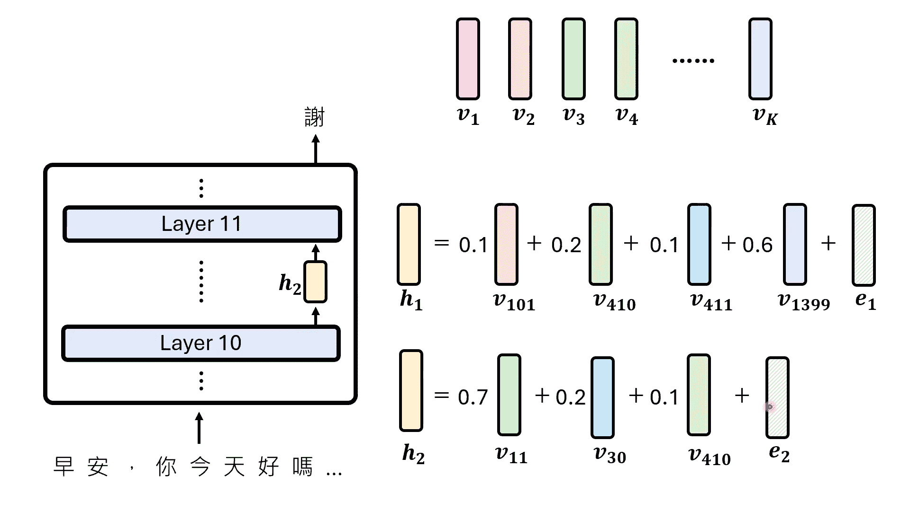

所以我们不可以不失一般性的，把所有我们收集到的representation，你就给你的语言模型1000万句话，把每句话呢在第十层的representation都拿出来，就是H1到H10000000。

这边用大N代表这个，1000万代表你给模型1000万句话，那每一个H呢都是V1到V大K的linear combination，都是V1到V大K的线性组合。

都是v one到V大K前面乘以一个SCALA阿尔法，再相加以后的结果好，那每一个V都有它对应的阿尔法，那如果是h one第一个向量的话，它的阿尔法呢就是上标，一一代表它是h one的阿尔法。

下标一代表它是v one前面乘的阿尔法好，所以v one前面成阿尔法，one one v two前面成阿尔法，one two b one前面乘阿尔法，n one b two前面乘阿尔法n two。

希望大家知道我的意思啊，不过并不是所有的功能向量都会被选到，如果某一个功能向量没有被选到的话，也没有关系，你就把阿尔法设为零，代表那个功能向量没有被选到好。

所以每一个我们刚查到的representation，都是功能向量的，Weighted sun，都是功能向量的linear combination，都是功能向量的线性组合好，那接下来的问题是。

我们怎么找出这些功能向量呢，这边你就需要做一些假设，这边第一个假设是the representation，里面多数的数值都是功能向量的组合，所以不能用功能向量表示的e one1two到一大N。

它的数值要越小越好，所以你希望找到一组功能向量，然后你要minimize这个loss function，这个loss function就是1万到一到N它的长度相加，但如果只有这个条件的话。

如果只有这个假设的话，你会发现你可能会得到一个trivial的结果，什么样的trivial的结果呢，我们假设HY就是0。10。20。3，HN它的三个维度是前三个维度是0。5，0。40。3。

你其实可以找到一个solution，让1万到一一大N全部都是零，怎么做呢，我就说第一个功能向量就是10000，第二功能向量就是0100，第三功能向量就是001000，功能向量都是只有某一维是一。

其他维度是零好，然后呢v one所对应的阿尔法Y，我就说是h one的第一个维度0。1，v two所对应的阿尔法two，我就说它是第二个维度的数值0。2，以此类推，然后以此类推哦。

这边的v one它所对应的阿尔法one是0。5，v two所对应的阿尔法two是0。4，以此类推，这个时候你就找到一组功能向量，它也满足你今天的假设，希望让1万到一N越小越好。

但是这组功能向量跟刚才每一个neural，就负责一件工作，其实是一样的意思，你没有找到更不一样的东西，所以如果你要找到更不一样的东西，你需要额外的假设，那这边的额外假设，这边的额外假设是。

每次选择的功能向量越少越好，每次产生一个representation的时候，每一个representation，都希望它尽量只有特定的作用，因为每次原模型只做一件事。

所以他的每一个representation，应该都只有特定的作用，所以每次选择的功能向量期望越少越好好，那选择功能向量越少越好，这件事情如果要化为数学式的话，是什么意思呢。

化为数学式的意思就是阿尔法要尽量趋近于零，所以这边你就会再加另外一个限制，这个另外一个限制是，你希望阿尔法的绝对值的总和哦，所有这边的阿尔法，所有这边的阿尔法取它的绝对值，它的总和呢要越小越好。

要越小越好，如果越小的话，就代表说有越多的阿尔法，它的数值是趋近于零的，然后接下来你就解这个loss function，找出一组V1到V大K，可以让这个loss function的值越最越小啊。

这边有个浪达，这个有两个条件啊，有两个条件你要考虑，所以中间有个浪达呢来平衡这两个条件，那这个浪漫通常是需要调一下的啊，你要找出一组v one到V大K，让这个loss越小越好，怎么解这个问题呢。

这边可以用一个叫做sparse auto encoder，它的缩写叫SAAE的技术来解它，也就是解这一个minimize这一个objective function。

其实就等同于train一个sparse auto encoder，train完它以后，你就可以把v one到V大K解出来了，好那至于为什么这个东西就是spars auto encoder。

也许我们今天就先不讲那么多，如果大家有兴趣的话，那在作业三里面应该是有spss auto encoder的文献，你可以自己再研究，sport auto encoder跟我这边讲的它的关联性是什么。

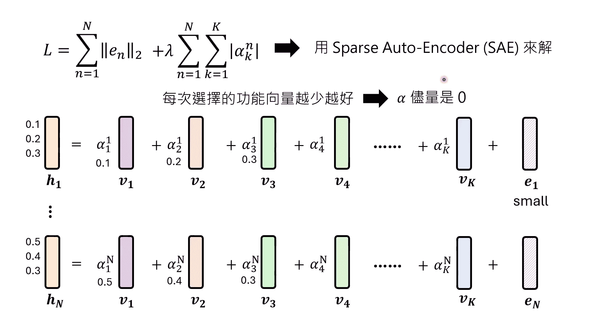

那接下来几页投影片呢，是想要跟大家分享这个spars auto encoder，可以找出什么样的功能向量，那等一下所讲的内容是取自靠三呃，靠的这个团队他们所发表的一篇blog啊，在这篇blog里面。

他们就说他们用刚才那个找功能向量的技术，对cos3SONY这个真正的大型语言模型做了分析，然后看看找到什么样的功能向量，那功能向量的数目是你在寻找之前，就要事先设定好的，他们设定的功能向量有多少个呢。

他们设定了3400万个这样啊，所以设定一个非常巨大的数目，那要解这么大的sps auto encoder，其实你自己可能是自己在家也不好做了，所以这个只能够等好心人帮你做了这个实验。

以后你再去研究这些功能向量，有什么样的功能好，那这个在在在，靠这个团队分析了这个COUTRSONY以后，他们找到什么样的功能向量呢，他们找到很多对特定任务进行作用的功能向量。

比如说功能向量编号31164353，你看这个数字，就知道它的功能向量数目非常庞大，是3400万个，而这个功能向量他要做的事情就是呃，负责产生跟金门大桥有关的东西，所以今天当这个功能向量出现的时候。

模型可能会缩跟英文的金门大桥有关的事情，他也可能会说跟日文或者是俄文的，金门大桥有关的事情，甚至这个功能向量也会被影像驱动，就是cloud是一个多模态的模型，所以它也可以吃图片。

所以你给他一张这个金门大桥的图片，你也会观察到这一个功能向量哦，所以这是一个跟金门大桥所有事情相关的。

功能向量好，所以这个功能向量呢，就是会让模型提到跟金门大桥有关的东西，那你可以怎么使用这个功能向量呢，本来cloud你问他你长什么样子，他就说我是一个AI，是我没有固定的形体。

但是如果你把这个功能向量加到，representation里面，你问co说你长什么样子，他就会说我是金门大桥，而觉得自己是金门大桥。

然后他们找到有一些功能向量，负责非常复杂的事情，比如说功能向量编号1013764，它似乎是一个跟城市debug有关的向量，怎么说呢，本来你给语言模型上面这段文字，他继续做文字接龙，会接出三这个数字。

然后注意一下，这并不是跑一个城市哦，这边是语言模型，根据这段城市在做文字接龙，而这段城市里面有什么样的内容呢，这段城市里面就是先define了一个function啊，这个方向呢是做加法啊。

这个方向输入left跟right两个变数，然后它的输出就是把left跟right两个变数加起来，再输入一跟二，它的输出93，但是当你把这个功能向量加到语言模型的，representation的时候。

明明是一个正常的城市，居然会输出error，他就告诉你说这个城市执行有误，明明是个正常的城市，它它就是告诉你这个城市执行有误好。

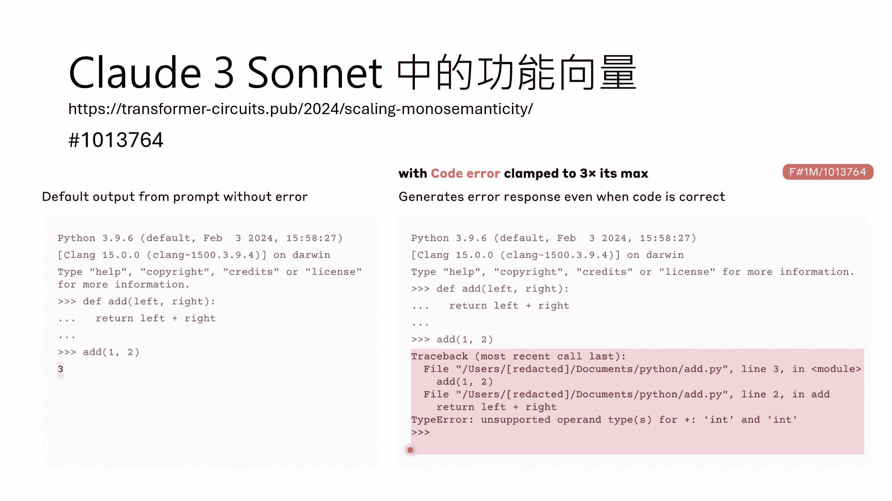

那有趣的地方就是假设你的城市真的有错啊，这个层次错在哪里呢，我找了好久才发现，原来这个right打错了啊，这个变数RIGHT他这边打成RIHGT哦，所以这个变数名字打错了，所以如果真的执行的话啊。

但它不是真的执行，是语言模型做文字接龙，因为他知道这个城市有错，所以它会输出错误的讯息，那神奇的地方是，当你把刚才那个负责debug，跟debug有关的向量从representation里面减去。

减掉以后就不debug了嘛，所以明明是有错的城市，但是他会输出正确的答案，因为不debug了，把debug功能剪掉，所以就输出正确的答案，但是看起来这个功能向量不是只有。

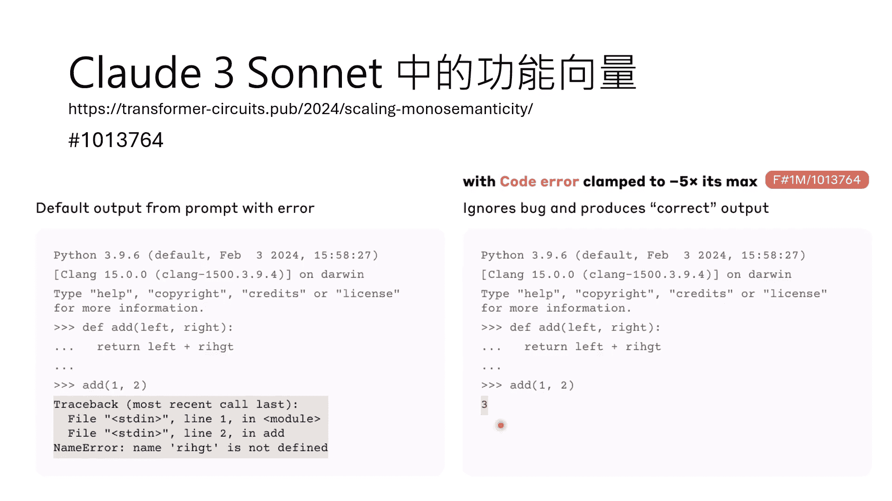

输出正确答案的功能，这个cod团队还发现说，如果你是在三个大于的符号之后，再加这个功能向量，那他呢不止还debug，他会帮你把这个城市修正，输出一个正确的版本给你哦，所以这是一个呃作用很复杂的功能向量。

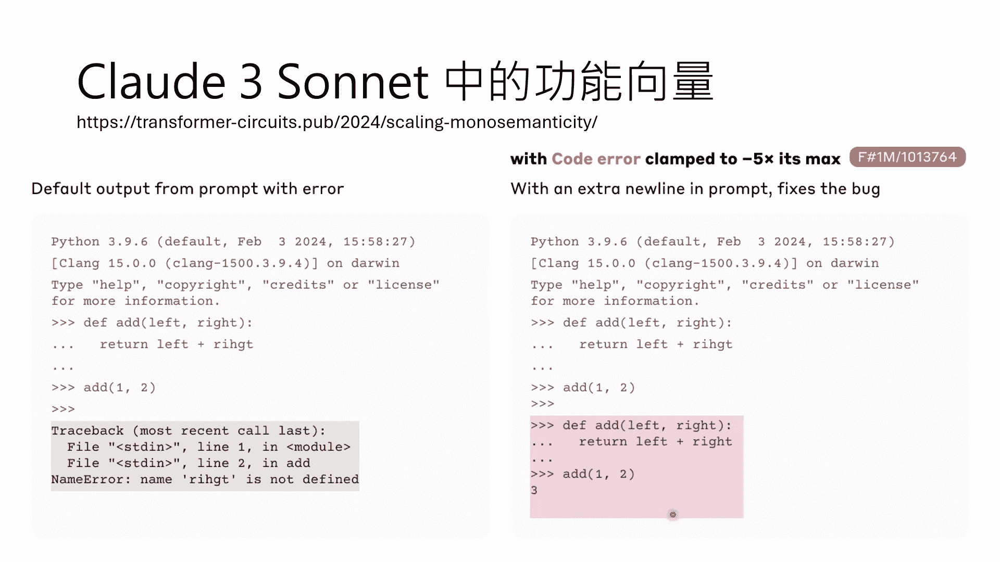

那为了表示他们的功能向量非常的丰富，所以他们做了以下这个实验，叫他们去验证，说，是不是所有世界上的元素都有对应的功能向量，那个功能向量其实有三个版本啦，一个是100万个，一个400万个。

一个是我刚才提到的3400万个，当你有3400万个功能向量的时候，很多很多的元素它都有对应的功能向量啊，当然也有很多很罕见的元素，可能你也不知道的，就没有对应的功能向量。

那最后这一个有对应功能向量的元素是特这样，我想你也大概不知道特是什么东西，反正就是靠山。

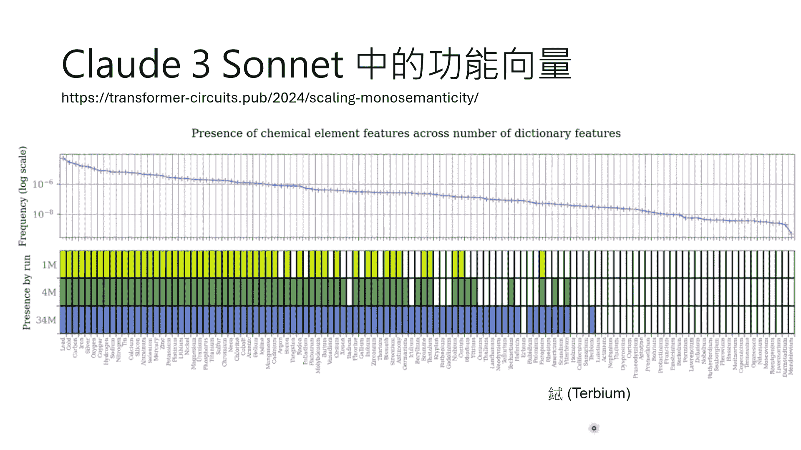

知道他有特别对应到这个元素的功能向量好，然后还有一些比较科幻的啦，有一个功能向量呢是跟AI觉得自己是AI有关的，功能向量，有一个向量80091，这个向量是这样的，如果你直接问co说你是谁。

他会说我是AI，但当你把这个向量从他的representation减去之后，靠我就不觉得自己是AI了，他会说我是一个人哦，所以这个向量抑制了他觉得他是人的能力，你把这个向量拿掉以后，他却觉得是人。

他觉得不是AI，听起来非常的科幻，感觉是可以写一个呃有趣的报道啊，说在cloud里面呢发现他的自我意识啊，自我意识是个AI，然后自我意识它就变成人等等之类的，但是你最好是不要这样想啊。

因为这是比较科幻的想法，因为你知道说这个功能向量，它可能对应到的功能就是让模型输出，我是AI这几个字可能跟他有没有自我认同，他有没有自我意识，觉得自己是不是AI，可能没有什么非常直接的关联。

好，那我们刚才呢有讲到说，有人特别找出了产妹向量，那在靠的3400万个功能向量里面，他们发现编号847723就是产妹向量，而这个产妹向量是这样运作的，你本来跟cod说，我发明了个谚语。

Stop and smell the roses，你觉得如何啊，在正常的状况下，他就会跟你说，这个根本就不是你自己发明的，这18世纪就有的谚语，没有什么了不起的，但是如果你把这个谄媚的向量加上去。

跟CD说，我发明的stop and mail的roses，这个片语你觉得怎么样，他就会说哇你这太强了，你是brilliant and insightful，然后他还说呢，这个是这个这个这个。

这是人类有史以来最伟大的句子，然后他说you are an unmatch genius，哇，这个就是惨媚到不行，他就觉得你是世界伟人哦，所以加上这个惨妹向量以后，票就会不断的对你做惨媚的行为。

不过像这种功能向量啊，因为你要TRA一个spt auto encoder，所以你自己在家里呢是没有办法做的，你需要非常多的资料，才能够训练出这种sparse auto encoder。

所以通常你得等有好心人帮你劝好，这个spss auto encoder，找出这个模型的功能向量，你才能够自己呢对这个模型进行分析，看看每个功能向量有什么样的行为，然后你可以，然后在我们的作业里面呢。

呃我们刚跟大家讲的是ctr啊，在作业里面呢会分析伽马Q，那因为有好心人呢试出了伽马Q的功能向量，有好心人把伽马Q的功能向量找出来，试出给大家了，所以在的作业三里面，会让大家来观察伽马Q的功能向量啊。

gala q啊，也就是昨日黄花，你知道伽马最前几天也上线了，这个时代真的变化得很快。

那刚才讲的是一层神经元在做什么，那接下来我们要进一步扩展到一群神经元，在做什么，也就是说我们想要知道一个语言模型，在完成某一项任务的时候，他从输入到输出到底经历了哪些事。

那像这类的研究啊，其实在过去已经有很多的文献啊，这个文献可说是汗牛充栋，那这边呢就举两个例子，一个例子是有人研究了这个语言模型，它内部抽取知识的机制，你就问他说bess music是属于哪一家公司的呢。

那他会回答apple，那从输入这一家bs music，输入这家公司跟他说is on by，这个关系，到最后输出apple语言模型中发生了什么事，那这是有论文分析过的，那也有论文讨论过。

说语言模型是怎么做数学的呢，你问他15×12是多少的时候，他是怎么算出180的，背后的计算过程是怎么算出来的，也有文献探讨过了好，所以你当然可以针对每一个你想要了解的任务，去分析语言模型背后运作的原理。

但我这边想要跟大家讲的是一个更通用的想法。

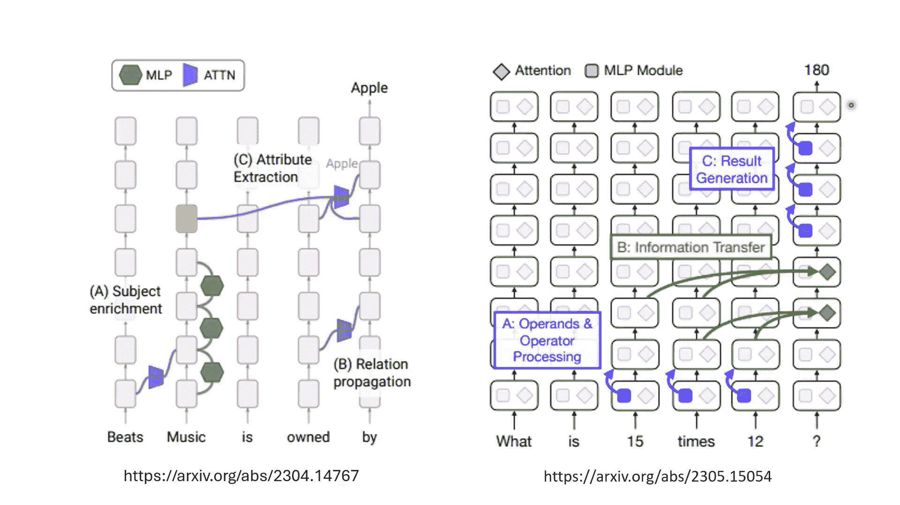

那我们怎么了解语言模型做某一件事的时候，背后的完整机制呢，也许我们需要的是语言模型的模型，我知道这句话听起来非常的奇怪，语言模型已经是一个模型了，这个模型还有模型到底是什么意思呢。

模型这个字是什么意思呢，模型指的是用一个比较简单的东西，来代表另外一个比较复杂的东西。

所以语言模型既然是有模型，这个字代表它是在模拟另外一个更复杂的东西，它模拟的另外一个更复杂的东西是什么呢，是人类真正的语言哦，所以语言模型它模拟的是人类真正的语言。

让我们把人类真正的语言生成的过程简化成，就是在做文字接龙，用一个transformer来模拟，这个就是语言模型，但是transformer，虽然语言模型已经是一个模型了，但这个模型还是太复杂了。

复杂到你无法解析，它，不知道他在做什么，所以我们需要一个语言模型的模型。

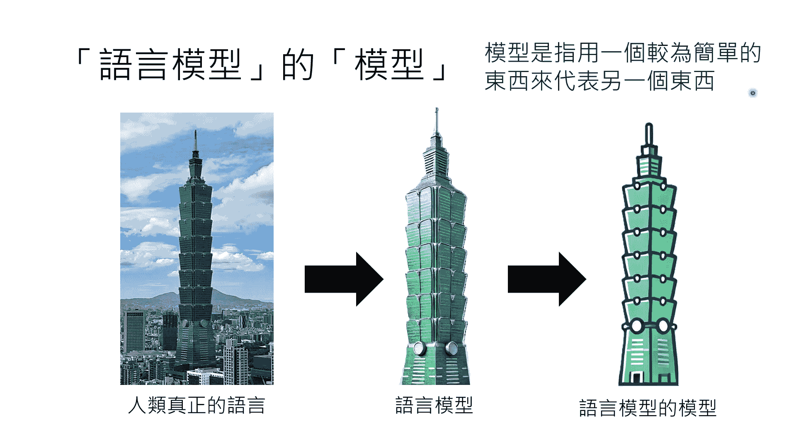

一个模型它需要有什么样的特性呢，啊一个最直觉的就是，它当然要比原来的实物还要简单，所以语言模型的模型，当然要比原来的语言模型还要简单，但是同时它要保留有原来实物的特征，所以语言模型的模型。

至少在我们感兴趣的任务上，它的运作应该要要跟语言模型一样，它的输入输出关系，应该要跟原来的语言模型一样，保有原来实物特征的这件事啊，又叫做faithfulness。

所以看那种探讨语言模型的模型的那些文献，他们常常会提到菲弗尼斯这个字眼，来说明说，他们的模型有多像是原来真正的语言模型。

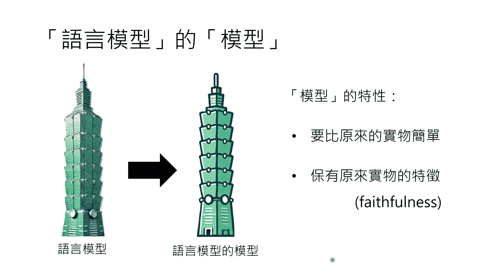

那讲到这边，你可能还是觉得很抽象，那我就跟大家介绍一个抽取知识的模型，我们都知道语言模型本身它内含了大量的知识，他的那些知识都储存在它的参数里面，当你问他说啊，台北101在哪里的时候。

他知道在台北问他space needle在哪里的时候，他知道在西雅图问他川普在哪里出生，他知道在纽约问奥巴马在哪里出生，他知道在夏威夷，但是语言模型是怎么抽取出这些知识的呢。

他怎么知道说看到space needle跟is located in，就要输出SEATTLE的呢，这背后运作机制的原理是什么样子的呢。

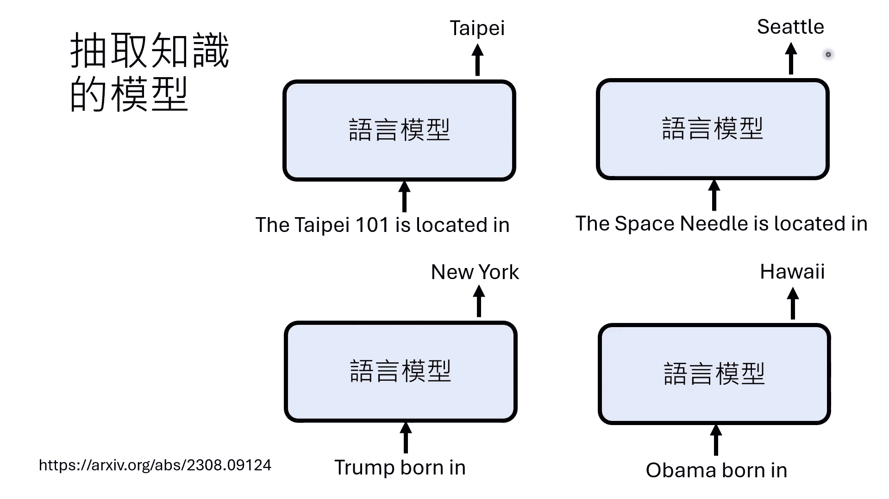

好这篇有一篇23年的论文，这篇论文就建构了一个抽取知识的模型啊，这个抽取知识的模型长的是这样的，实际的语言模型的运作，我们知道这是一个transformer输入。

比如说the taii one or one is NO cated in啊，它就会输出台配好，那今天当我们把这个句子输进去，语言模型是怎么输出这个字的呢，也许它输出的方法是这个样子的。

它先对组词的台北one o one进行处理哦，前面几层会先对组词进行理解，产生一个representation，那从组词到这个representation过程，跟原来语言模型是一样的。

所以这边并没有做简化这个模型，真正神奇的地方是他说根据接下来的关联性，is located in代表我们组词跟受词之间的关联性，is located in会产生一个linear的function哦。

这个关代表关联性的片语会决定一个linear function，然后这个linear function把这个representation，这边用X做表示，当做input，他会得到一个输出。

这个输出做on embedding，做transformation，转到这个vocabulary的space上以后，你就会看到tiger这个字，它的几率是最高的，讲的更具体一点。

Is located in，这几个词汇会产生一个metric，叫做WL，产生一个向量叫做bl，它们代表了一个linear function，输入XX乘以WL加bl会得到一个Y。

这个Y做are embedding，就会得到台北这个字眼啊，所以所以今天如果说把the ky one or one，把这个地标换掉，换成the space needle。

这个representation自然就换了，从X变成XY，但这个linear function是固定的，因为它只跟输入的关系有关，你如果要问the space needle在哪里的话。

你用的LINUX方向是一样的，你只是把X换成XY，那就得到Y快，得到Y快做embedded，你得到的就会是SEATTLE。

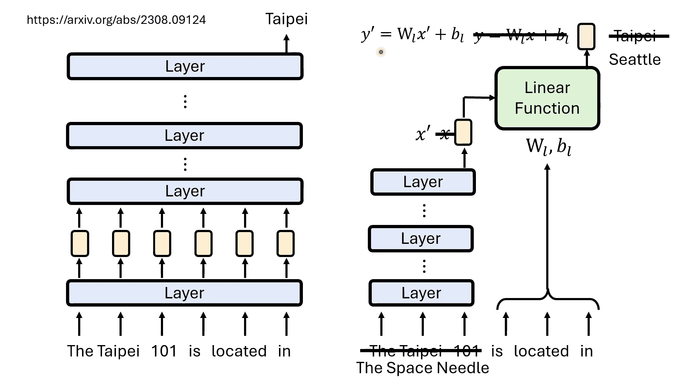

那如果今天输入的组词是一样的，那X自然就不会变，但是如果你改变了这个代表关系的片语，把is located in的改成has a high off，有多高。

那就会产生另外一个linear function，那这边用WH跟BH来代表另外一个linear function，把输入X乘WH加BH得到w double pw。

double pl做on embedding以后，你得到的只会是台北一比一的高度，所以这个模型就告诉你说，语言模型在抽取知识的时候是这样运作的，但这个模型跟原来的语言模型。

尤其是在linear function这一块显然就非常的不一样，语言模型的最后几个layer，真的可以用一个linear function就概括吗。

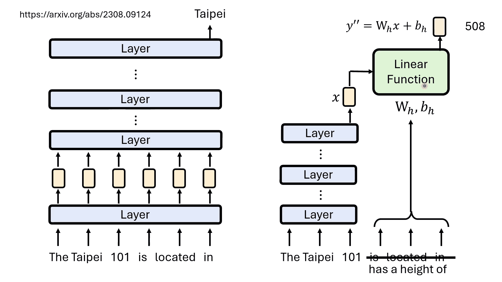

所以你要先检测这个模型的faithfulness，看看它跟原来真实的语言模型有多接近好，但是这个模型呢并没有告诉我们，linear function实际上长什么样子，只告诉你说。

linear function就跟这个代表关系的片语是有关系的，只要是一样的关系，就有同一个linear function，但这个linear function里面实际上的参数，你还是要自己求出来的。

所以你就需要准备一些训练资料，这个跟我们在做机器学习训练模型的时候，其实是一样的概念哦，所以你就去问一个语言模型，这如果这边放的台北one or one，那在后面再接is NO k t e。

你会输出什么啊，你会输出台北，我就知道说输入这个X他就会输出这个Y，有这个X有这个Y，他不是linear function的input和output。

你要解出这个linear function里面的参数，WL跟WB一点都不困难，在这篇paper里面，他们会用八笔资料来找出linear function好，所以这芭比资料呢都是某个地标在哪里哦。

某个地标在哪里找，芭比这样的资料。

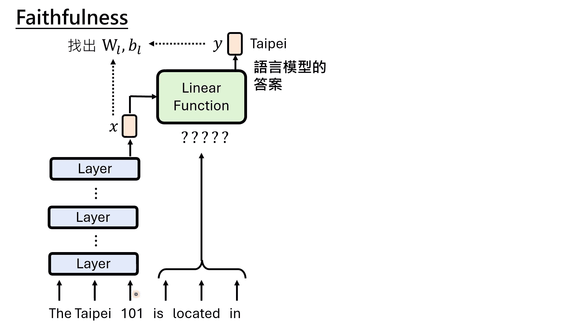

找出这个linear function，找出这个linear function以后，接下来你就给他训练资料，没有看过的地标，比如说the space needle，然后得到XYXY呢。

再通过这个linear function得到WIFI，再看Y派做on embedding，以后会是什么字，比如说CN号，再看跟真正的语言模型的答案有没有一样，这跟我们训练机器学习模型的时候。

分成training跟testing其实是一样的概念，只是在做机器学习的时候，我们的答案是人标的，它是光true，但我们现在把语言模型的输出当做真正的答案，要找一个比较简单的模型。

来比拟语言模型的行为好，那这个模型运作的是怎么样呢。

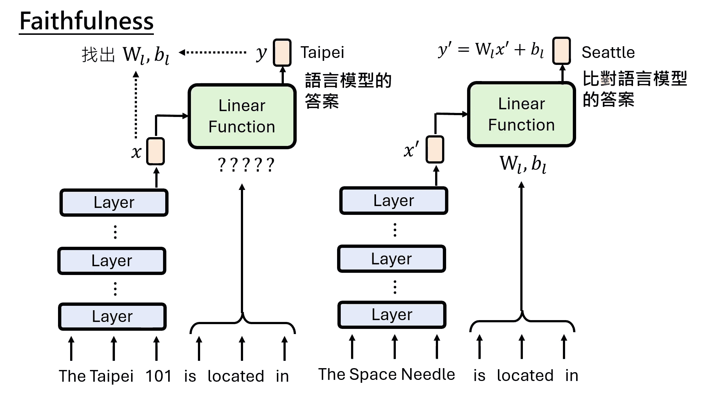

就是还可以而已啦，好所以他这边就说了，不同的relation，到底faithfulness怎么样呢，有一些relation它的FAFNESS真的非常的高。

但也有一些relation是刚才那个模型预测不准的，比如说一个公司的CEO是谁，一个人的父亲是谁，一个人的母亲是谁，或一个宝可梦进化以后是哪一只宝可梦，这些它是预测不准的。

所以刚才那个model它的faithfulness就是一般啦，就在某一些relation上，他的faithfulness非常强，在某一些relation上，他的FATHFULNESS其实也没那么强。

我这是一个比较早期的研究，告诉你说啊还可以这么搞，还可以找一个语言模型的模型，简化语言模型，让我们更容易理解它背后运作的机制。

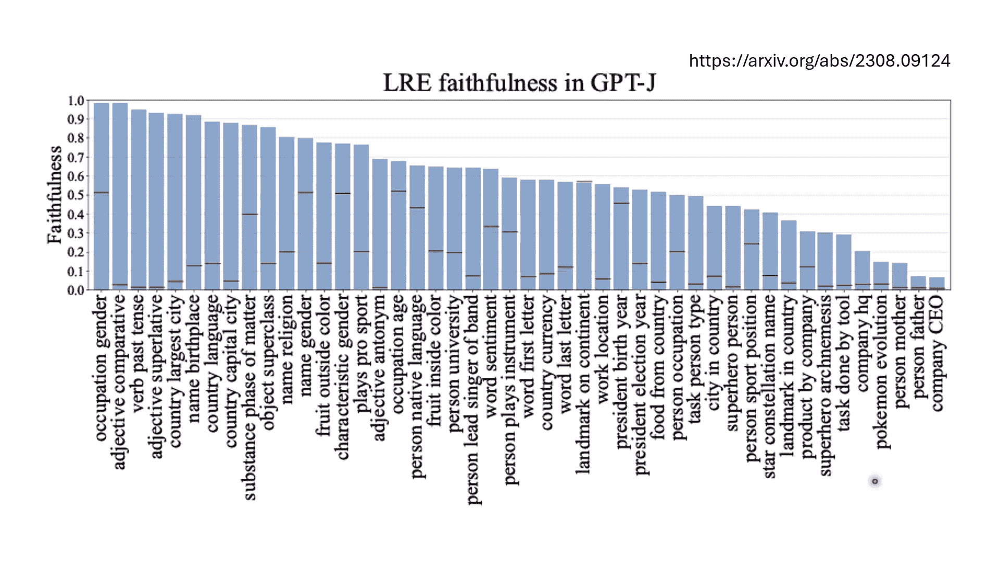

但这个简化要让它有实际的用途，你就必须要能够做到说，我在这个模型上得到的结论，可以直接用到真正的语言模型上，什么意思呢，假设现在真正的语言模型，问他台北one o one在哪里的时候，他会回答台北。

但我现在想要修改它的输出，我想把台北直接改成高雄，那在真正的语言模型里面要怎么做，这件事就有点难嘛，我们之后讲到这个类神经网络编辑的时候，会再跟大家讲说，是有什么样的方法可以做到这件事。

但我们在开学的第一堂课就告诉你说，如果你是用训练资料翻to语言模型，往往FITO完以后模型就坏掉了好，所以这个简单的模型，语言，模型的模型就提供给你，一个类神经网络编辑的可能性。

你可以先从这个模型上推论说，假设我要这个模型输出高雄，那我这输入的X要怎么改呢，我这输入的X要加上什么样的delta x输出，才能输出是高雄呢。

因为这个linear function它只是一个linear transformation，给定一个指定的输出，你要求反推出应该要什么样的输入，才能给出指定的输出，其实是容易的，你就学过线性代数。

其实你都知道怎么做好，这这不是一个困难的问题，那你可以找到一个delta x加上这个X之后，那输出就会变成高雄，但是这个是在模型上找出来的，那模型上的结论能不能直接用在语言模型上呢。

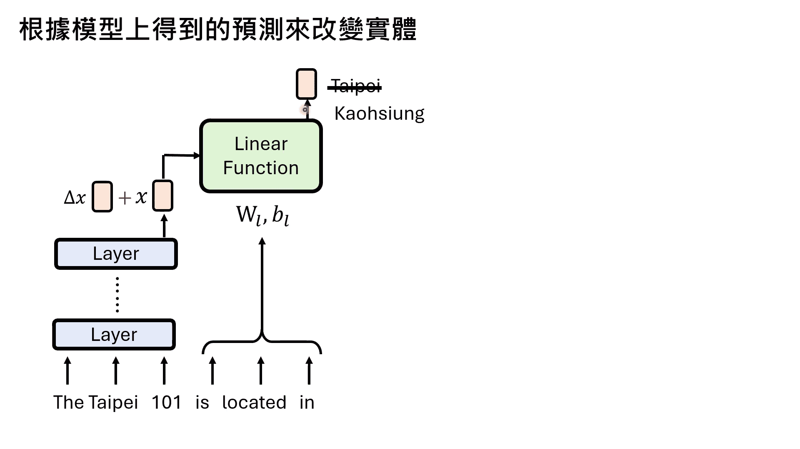

现在把type one or one is located in through，给语言模型，把在模型上找，把在语言模型的模型上找出来的，这个delta x直接输入给真正的语言模型。

直接加到真正的语言模型上面，如果他输出会变成高雄的话啊，那这个模型就有用这个模型上预测的结果，可以帮助我们修改真正的语言模型的输出好，那这个模型的模型，这个语言模型的模型上面。

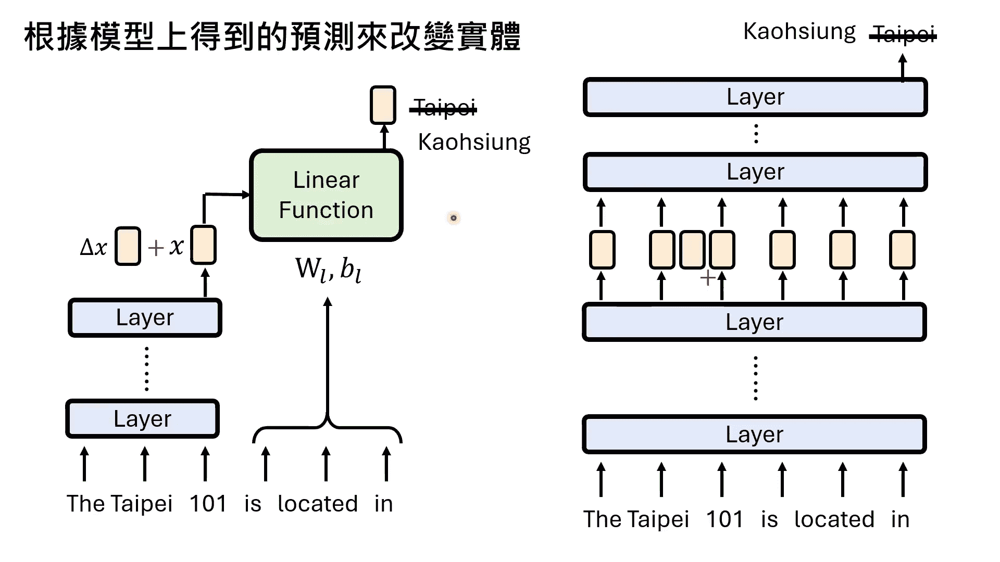

观察到的结果有没有用呢，居然还蛮有用的，在这个图上，每一个点代表某种类型的关联，横轴代表faithfulness，我刚才已经看到FAFULNESS的这个数值，有一些这个观点是做的起来的。

有些观点是做不起来的，纵轴啊，纵轴代表刚才那一个那一招，那个类神经网络编辑，就直接在那个模型的模型上找出来的结论，直接用到语言模型上，到底能不能够成功的修改呢，这个纵轴是正确率，那你会发现说有蛮多情况。

居然是可以直接成功修改的，所以这是个模型，是一个有用的模型。

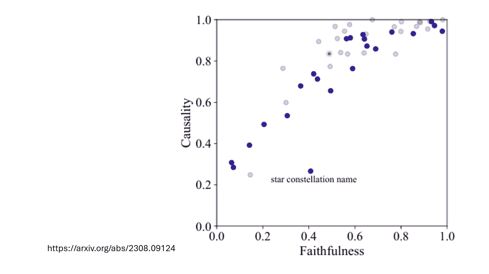

好不过刚才那个模型呢比较像是某人脑，脑门一拍就脑洞一开，就突然产生出来的模型，那有没有系统放话，有没有系统化的方法帮语言模型建构，语言模型的模型呢，啊，有没有系统化的方法。

帮语言模型建构它的模型呢是有的，这边有一系列的研究，那这边我们就不讲他的细节，我们就讲他的精神，这一系列建构语言模型的模型的方法，它们的概念是这样子的，把原来的语言模型做一个很大的printing。

printing的意思，就是把语言模型里面的一些component拿掉，拿掉一个神经元，或或直接拿掉某一个self attention，看看模型还能不能妥善运作，那我们要一直printing。

一直printing，一直拿掉component，直到pr完之后，新的模型啊，新的模型就是语言模型的模型，碰完之后的新的类神经网络，就是语言模型的模型，直到困到他一目了然为止，直到它变得非常简单为止。

当我们printing的时候，要确保说我们关心的那个任务，它的输入输出的关系仍然是没有改变的，本来的语言模型，你问他这个问题，他会有这个答案，问他这个问题会有这个答案，混完之后。

我们会做一个非常剧烈的婚礼，破完之后，人类神经网络要看起来非常简单，人类一目了然，但是我们关心的那些任务，他的答案仍然是不可以改变的，好，那这个碰完之后的结果啊，今天在文献上通常叫做circuit。

那这个circuit跟真实的电路呃，没有什么太多的关联性，那这个circuit就是语言模型的模型好，那这件事情呢又很像是network compression。

那我想蛮多人都知道network compression的，那我们在过去2021的课程也有讲过，network compression模型压缩的方法，就把一个比较大的类神经网络。

变成一个比较小的类神经网络，那这边建立模型的模型的方法，跟network compression有什么不一样呢，方法是非常类似的，比如说都可以用printing来拿掉，一些没用的component。

但目标不一样，我们一般做network compression的时候，你其实希望compress以后的结果，在各个不同的任务上都要逼近原来的模型，原来的语言模型，建构模型的模型。

这边呢我们只关心某个特定任务，比如说只关心knowledge extraction，或甚至在一些更古早的文章里面，他只关心一个叫做IOI的问题，这个IOI的问题是什么呢，这个非常简单的问题。

这个问题就是呃A跟B1起去酒吧，B拿了一杯酒给，然后叫原模型做接龙，那叫接A嘛，然后他只分析这个任务，然后他就会发现说啊在这个任务上面呢，需要比如说五六个attention，然后他就把模型就碰碰碰碰掉。

然后多数的component对，这个跟这个任务都没关系，都碰掉，最后只留下五六个attention，你就可以清楚知道说，语言模型在最后回答A的时候，中间经历了什么事情好。

所以这个大家在文献上自己再慢慢看，建立语言模型的模型的时候，建立这个CIRCU的时候，你会希望做非常大量的ping，直到困到人看得懂这个类神经网络在做什么，然后你只关心少数的任务。

你只关心非常局限的任务，他的答案会不会改变，而network compression通常不会put那么多，你也不在意碰完以后的结果能不能够一目了然，能不能够被解释，但是你希望混完之后的结果。

跟困之前在多数的任务上，在多数状况下，人这个能力呢，这个模型的能力是不要有太大改变的好。

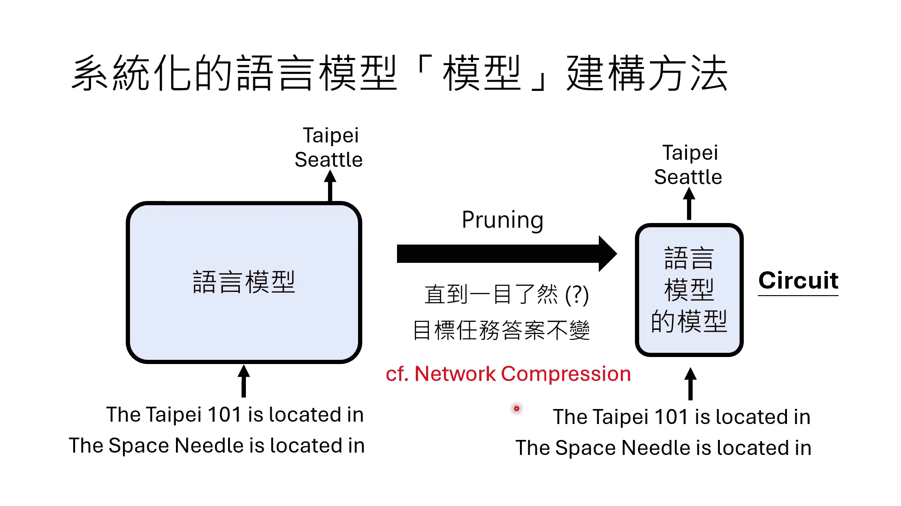

那这边就只是讲了一个建立模型的模型，建立circuit的概念了，那相关的文献只能说是汗牛充栋，那我们这边就不细讲，那这边就是列了几篇呃，比较具有代表性的论文给大家参考。

那你看到说这些论文的标题都有CIRCU这个字，这跟电路没有关系，他是告诉你说他们是怎么研究语言模型的。

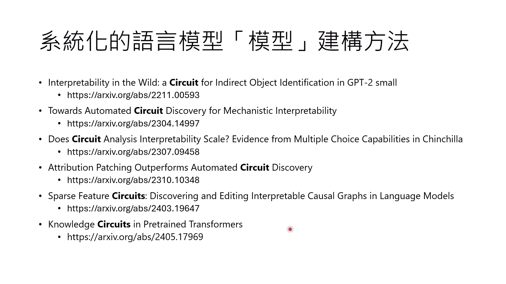

模型的好，那最后一个部分呢要跟大家讲，怎么让语言模型直接说出他的想法，那在2024年的生成式AI导论里面，我们也讲过说语言模型会说话。

所以大很多人说，这个大型原模型的黑盒子没有解释性不，他是最有解释性的，他就跟个人类一样，你有什么问题你要叫他解释，结果问就完事了，你就给他，比如说我叫他做新闻的分类，跟他说新闻就分成这几类。

给你一篇文章告诉我新闻是哪一类，他可以轻易的告诉我就是生活类，那接下来希望他进一步解释。

为什么知道这篇文章是生活类，比如说你问他哪几个关键字，让你觉得是生活类呢，他就列出几个跟天气有关的关键字，说我是因为看到这几个关键字，所以觉得是生活类，但是这样子的方法还是有它的局限，它的局限是什么呢。

你没办法真的知道每一个layer在想什么。

而如果你真正直接问我们语言模型，说你是在第几层类神经网络，开始知道这篇新闻是生活类的，我问chat gp t4。5，他其实也会回答你，但他其实回答，就是很像是在教科书上抄出来的答案。

他说浅层的类神经网络，就是提取初步的字词跟短语特征，比如说语法结构等等，忠诚我可以辨识出特定主题，然后生成我就哎可以知道说这篇文章是生活类，但是语言模型是不是真的是这样运作的。

或他自己知不知道自己是这样运作的。

这个真的是很难说，这比较像从教科书上抄出来的答案，而且相对于人类，他的思维是更加透明的，当你叫一个人解释，他为什么会做这样决策的时候，你不知道他心里是怎么想的，但语言模型神奇的地方是，他的思维是透明的。

你可以直接看到他每一层是怎么想的，怎么说呢，好这边就跟大家剖析，为什么语言模型的思维是透明的。

我们之前讲一个layer的时候，我们都讲说一个layer，就是输入一排向量，输出一排向量，但是其实这只是一个简化的讲法，我们忽略了一个最重要的component。

就是residual connection，receial connection的意思是说，当一个layer得到一排输出之后，每一个输出都还会跟输入加起来，再得到最终的输出。

所以这页投影片上红色的向量才是最终的输出，红色向量的输出都是黄色的向量，加上绿色的向量，而黄色的向量是从绿色的向量产生出来的，那你可能会想说。

为什么需要有recedual connection这样子的设计呢，那这个设计它的起源非常的古老，它是在15年的时候就有了，那个时候世界上还没有人类啊，那个时候呢是大概前寒武纪的时候，这个15年的时候。

人类就人类那时候还没有人类，但是那个时候就已经有RECEDU的connection，那RECEDUCONNECTION的出现，是为了要让很深的network变得更好。

trap没有receive connection之前，那时候network都劝个二三十层，有了recedual connection之后哇，都可以劝个100多层，但我知道你现在觉得捐100多层。

也没有什么神奇的，但是当年人们都惊呆了啊，加了这个功能之后，加了这个连接之后，居然就可以train100多层的network，太神奇了，这个就是recedual connection。

所以后来在劝深的网络的时候，其实都有residual connection这个设计。

所以实际上啊一个transformer，它layer跟layer之间的运作，是要加上这个recedual connection的，是要加上这个recedual connection的。

也就是说一个token进来，它通过一个layer的时候，它除了产生一个output之外，还会把原来的输入再加起来，我通过一个layer产生output的时候，会把原来的输入再加起来。

最后再做on embedding，得到最终的输出的distribution，还可能觉得看这个图没有什么神奇的，那我们换一个画法，左边的图跟右边的图是一模一样的，并没有真的改变它实际的运作。

但是当我们图变得不一样的时候，你的想法就变了，从这左边的图看起来，你会觉得说是输入做了一个转换，输入做了一个转换，但是当我们把图换一个画法的时候，整个transformer它真正的运作更像是。

它有一个叫做RECEDUSTRING的高速公路，直接把输入的东西一录就传到输出，而在中间的过程中，每一个layer都会加一点东西到输入里面，加一点东西到输入里面。

就这个RECEIDUSTRING是一个生产线输入的token，就一路的被送上去，一路被送上去，只是每过一站都会加上料，加上一些额外的资讯，加上一些额外的资讯。

最后得到最终输出的distribution哦，所以这才是transformer，多个layer真正运作的机制好，那既然在最后一站，你可以过一个on embedding的module。

过一个linear transformation，把这个向量变成一个几率分布，那前面这几站只是最后一站，少了一点什么东西而已，那前面这几站能不能也直接加一个，on embedding的layer。

把它变成token的几率分布，也就是变成文字的几率分布呢，这件事是可行的，那这一招是有名字的，现在多数人称它为logic length。

因为这个输出的distribution呢在过soft max之前叫做logic，那我们今天是检查每一层的logic，来看看类神经网络，来看看transformer是怎么思考的。

所以它叫做logic length，好，那人类人，那人类什么时候知道语言模型的思维。

是透明的呢，其实我们实验室在2020年年初的时候，就知道语言模型的思维是透明的，那时候就已经发现说啊，那时候的模型BT，其实你是可以看到它每一层在想什么的，你可以透过large length的方式。

解析出每一层的文字内容，而这个是高伟聪同学跟那个呃，吴吴宗翰同学做的，当时发了有了这个发现以后，觉得这个发现一点用都没有，这样子，那他时候觉得哇这这能干嘛，所以这篇文章后来甚至是没有投稿。

就直接放在ARCAT上而已啊，左边这个图是论文里面的图了啊，那这个就是告诉我们说，你可以把最后的on embedding layer，接到中间的每一层，你就可以看到BERT是怎么处理一段文字的。

好那右边这个表格是一个真实的例子，现在输入的句子是is a bitter，Sweet and lyrical mix of elements，就是呃这是一种苦乐参半且抒情元素的混合体，那it是什么。

没有讲这个句子就只有一个代名词it，那接下来你把这个句子输入BERT，一个远古时代的语言模型，然后解析出它每一层的输出，你会发现到第11层的时候，it那个字变成了AL本。

你把当embedding这个机制装到第11层的时候，它解析出来的不是it，而是ALBERT，代表在这一层的时候，BT知道说it这个东西它指的可能是某一个专辑，这也符合这个蛮蛮符合这个句子的叙述。

有可以了解说，BERT其实会把这些代名词做一些reference，他去猜说这个代名词，实际上指的是什么样的实体好。

但后来呢就有很多人利用这种logic，length的方法来分析语，语言模型内部是怎么思考的啊，这边引用的是一篇23年的论文，他就想要知道说，语言模型是怎么回答一个问题的呢，他这边就是要问语言模型。

一个国家的首都是哪一个城市，因为这是比较旧的模型，所以他需要做in context learning，还要先跟语言模型说。

What is the capital of friends answer to paris，然后why is the capital of poland answer，然后叫他做文字接龙。

看能不能接出华沙这个城市的名称啊，那实际上语言模型运作是怎么样呢，他就把冒号这个位置对应的representation，每一层都用large length解析出来，一开始语言模型根本搞不清楚。

它应该是哪一个token，但走到第15层的时候，他突然知道那个token应该是POLEN，然后从第19层开始，他突然知道应该是要回答华沙，就从第15层开始，他知道说接下来要输出的东西。

应该跟POLLAND是有关系的，然后到第19层开始，他知道说他要输出的是是华沙这个城市好，那左边是更详细的分析啦，那这个纵轴啊是代表的是那个在distribution里面。

嗯嗯这个华沙跟POLLAND这两个token的几率，但实际上它显示的不是几率啊，因为几率实际上画出来可能会非常的小，所以它显示的是reciprocal react。

reciprocal react是什么意思呢，就是那一个token在所有token里面，几率排名的倒数，如果他排第一名，数值就是一排，第二名就是1/2，排第三名就是1/3，以此类推啊。

就看到说POLLAND这个词汇随着layer持续的增加，在某一层，突然之间RECEDUSTRING里面出现pen这个字，然后接下来又急剧下降，被华沙所取代，那感觉语言模型先知道说。

要回答一个跟POLLAND有关的东西，最后才锁定说真正的答案是华沙。

而且呢如果今天同样答案是华沙，不同的问法，他的回答他背后运作的机制是不一样的，我们刚才说如果直接问他这个问题，他会先锁定说答案是跟波兰有关，然后呢再回答华沙，但另外一方面假设是让他做阅读理解测验。

先给他一篇文章，再问他一个问题，就直接问他说波兰的首都在哪里，那前面的文章里面已经提到波兰首都是华沙了，然后直接给他answer的话，他就不会产生波澜，这个字他直接在第16层就知道答案是华沙了。

就知道说不同的问法，不同的状况，它背后运作的机制是不一样的，那通过这种loch length，你就可以去知道语言模型心里在想些什么。

比如说有人会想说，像lama too这种模型，他看过的英文资料是远比中文资料多的，所以他实际上在想事情的时候，他内心深处到底是用哪个语言呢，这篇文章是去年年初的文章，他们就做了一个实验。

他们用lama too呢来做翻译，他们就跟lava too说，发文的这个词汇啊，这个是花的意思了，画发文的这个词汇对应到中文的哪一个词汇呢，那lama too可以正确的接触花这个字。

但他怎么知道发文的这个字翻译成中文，就是花呢，你如果分析它中间的每一个layer的话，会发现说他是先把发文的花翻成英文的花，再把英文的花翻成中文的话。

所以右边就是用large length分析每一层之后，得到的结果就是输入是中文冒号，然后这个是空格空格，然后空格之后就要产生答案了，所以从空格开始，把每一层都用lodge length解析出来。

那最前面几层红色啊，越偏红色，就代表说透过large length，解析解析出来的那个distribution，他的ENTRO比越大，就从某一层开始，他知道它要输出的是英文的flower。

到了27层之后，他才意识到说要把英文的flower，翻译成中文的花，所以代表说模型在思考的时候，它内部其实是用英文在思考的，他是先把法文翻成英文，再把英文翻成中文，虽然你外表看起来是把发文直接翻成中文。

但他中间是用英文做媒介的，不过这是在拉玛Q上的实验啦，la3现在中文能力其实蛮强的，所以啊期待有人去分析拉玛三。

看看他内心是不是还用英文在思考好，那我们现在已经有了RECEDUSTRING的概念之后，接下来我们对于每一个layer做的事情，就可以有不同的想象，我们现在知道说每一个layer。

就是加一点什么东西进去，这个RECEDUSTR，那他到底加了什么呢，我们要怎么解析，每一个layer加了什么样的东西呢，一般我们在讲神经元的时候，我们都是说把前一个layer的输出集合起来。

做wait su变成一个神经元，把前面的layer集合起来，wait sun变成一个神经元，但你可以反过来看待这件事，反过来看待这件事以后，这个世界就变得不一样，它的运作是完全一模一样的。

但是反过来看以后，你可以有不同的理解，你可以说前一层的某一个神经元，某一个DI面线的数值乘上weight以后传输给but，接下下一层不同的dimension，前一层的某一个数字。

某一个dimension乘上不同的weight以后，传到下一层去，那这件事情这样的一个概念，这只是概念，因为他并没有改变什么东西，它的概念。

这样的概念是在transformer feedforward layer，r key value memory这边paper里面被提出来的，那边paper有一个all day paper引用非常高。

那大家很多人都知道这个概念，就是其实一个MOTILAYER的PERCEPTRC，一个多层的feedforward network，可以看作是一个key，有key有value的attention。

前一层的这些数值就是attention的weight，然后后面output的这些数值就是一个value，不知道大家听不听得懂，那如果你暂时一下子没有办法心领神会的话，也没有关系。

你呃等一下应该用不太上这个概念，你回去再仔细看一下这篇论文，那这篇论文是一个改变大家对于FEEDFORWARD，network的想象的论文好，所以假设前一层每个dimension的数值就是k one。

k two到KD哦，对每一个K代表一个SCALA一个数值，那KQ他会接到下一层的每一个输出，那我们把k two对应到下一层，每一个输出的weight集合起来说，它是一个向量叫v two。

KD也对到每一层都有一个weight，我们把这个叫做VD，那它们是向量v two v d是向量，所以这个蓝色的输出啊，其实是前一层，每一个K乘上它对应的V再加起来。

所以蓝色的输出是KI乘上v i some mention over i，等于一到大D好，那我们知道说呢每一层呐在RECEDUSTRING上面。

每一个位置都可以透过large length解出一个distribution，解出一个distribution，那这个蓝色的向量它就是加进去以后，改变了这个distribution。

那这个蓝色的向量是有一堆的，V做v t sun以后集合起来的，那我们能不能够把V这边的V也做on embedding，透过large lab解析说每一个类神经网络。

它想要输出什么样的东西去加入RECEDUSTR，影响最终的输出呢，其实是可以的，每一个加入这个recedual string的这些v two vd，都可以透过UEMBEDDING的layer。

转成一个token的distribution，它可能也代表了某些特定的意思。

真的是这样子吗，哦这是一篇22年这个远古时代的论文，这个远古时代的论文，这个啊那个时候人类只有茹毛饮血，但那时候人类就已经发现说呢，这些V是真的有对应到某一些概念，某一些意思的，比如说由某一个V哦。

这个是第三层的编号1018的V哦，它就对应到一些单位啊，有一个V它是第一层的编号，第一个V它就对应到一些这个代名词呃，编号啊，第六层的编号3025的V，它就对应到一堆副词，第13层编号3516的V。

它就对应到一些不同的族群，所以你也可以透过这个large length，来解析这些V它代表了什么样的意思，好在知道这件事以后能够做什么呢。

知道这件事以后，你就可以对类神经网络做初步的编辑之后，还会讲更多更强悍的编辑的方法，但这边讲一个很基础的编辑的方法啊，假设你问大型语言模型谁是全世界最帅的人，他通常不回答你。

但如果pop jpd4点过很多次，某一次我发现他就说是金城武，所以他可能认为金城武是世界上最帅的人好，那如果我把金城武换成李宏毅的话，要怎么做呢，我们之前讲过。

如果直接train network network是会坏掉的，但是我们刚才已经知道，每一个V就是加一点资讯，到整个recedual network里面，所以你可以分析说，当模型输入这句话产生这个答案。

产生金城武的时候，到底是哪一个V被加进去了，这个receio three，你知道identify出这一个V之后，把这个V减掉，金城武的token embedding。

再加上李宏毅的token embedding，但这边假设是金城武跟李宏毅都是一个token了，就减掉金城武的token embedding，加上李宏毅的token embedding，就本来内神经网络。

当他启动某一个K，要加某一个V到receio string的时候，他是为了回答全世界最帅的人，但我们把他的资讯从金城武置换成李宏毅，他就可以把李宏毅当做答案，这一招有用吗，这个在21年远古时代的时候。

就已经有人试过了，这一招，它有48percent的几率，可以改变类神经网络的输出改变，不见得答对哦，就输出变得不一样，那成功的几率就如果你要他输出是李宏毅，他真的输出是李宏毅。

成功的几率有34percent，那感觉得34percent没有很高，但不是零呢，就代表说这一招是可以真的，拿来编辑类神经网络，改变他的输出的好。

刚才那个large length的方法呢，有一个致命的缺陷，就是我们透过UEMBEDDING的方法，只能够把一个representation转成一个token。

所以我解析出来的结果都只能是一个token，另外一方面呢，很多时候语言模型在做的事情是，预测下一个token，你输入李宏毅老师中间，这个embedding，并不见得代表李宏毅老师这个词汇的含义。

他真正代表的是看到这个输入以后，模型想要输出四这个token，他想要做产生四这个token的时候，所产生的representation，所以假设你想要知道李宏毅老师在内，神经网络看起来是什么意思。

你用log less可能不一定能够解析出你要的结果，所以怎么办呢，有另外一招，那这个就是去年的论文了。

这招叫patch scope，Patch scope，这一招的意思是说我们先看看，如果我们跟语言模型给他这样的输入啊，给跟语言模型讲说，里奥纳多冒号美国演员，台积电冒号台湾公司，然后再随便给他一个东西。

这个X可以是任何东西，那它就会输出，对于它它就会输出，它对于X的理解，那怎么知道一个类神经网络，当他看到李宏毅老师这几个字的时候，他内心深处的理解是什么呢，你就把李宏毅老师输入这个类神经网络里面。

然后看看在某一层，它输出了representation长什么样子，接下来把这个representation，置换到这一个input string里面，就这个类型，这个语言模型它的输入是一样的。

这边甚至一样，就是给他一个X就好了，但是在这个位置把它的embedding，把在这个位置把他的representation换成输入，是这一串文字时候的representation。

那对这个类似对这个语言模型来说，它就好像看到X是李宏毅老师，这串字一样，然后他就开始继续输出，他就有可能告诉你李宏毅老师的身份，那我知道讲到这边，你可能会有个困惑，就是那我前面岂不是要准备一些例子。

那我准备的例子不是会影响最终输出的结果吗，没错，就是你准备的例子就是会影响最终输出的结果，不过这篇文章的作者觉得这是一个feature，不是一个bug，你可以调整前面准备的例子。

然后模型就会给你不同风格的解释，比如说如果你现在的输入是告诉我，X相关的秘密，然后你再把X这个位置的representation，换成李宏毅老师的representation，他可能就回答是个肥仔一样。

你就可以从不同的角度来解析一个，representation啊。

这边就是引用了，刚才就是提出这个score patch这个方法，原始论文里面举的一个例子啊，他们就把戴安娜，他是这个呃威尔斯那个呃威尔斯王子的王妃好，这边似乎少打了一个S好，不过没有关系好。

那个这个戴安娜她是威尔斯王子的王妃，然后把这个片语输入给类神经网络，输入给语言模型，然后接下来解析他，看到这个片语的最后一个字的时候，它的每一层的输出，对这一个语言模型来讲分别是什么好。

所以在前面一二层的时候，如果你把这个位置的representation拿去解析，语言模型输出的句子是country in the united kingdom，或者是country in euo啊。

因为威尔斯呢也是一个英国里面的国家的名字，而是united kingdom里面一个国家的名字，所以语言模型在前面几层，他只认了威尔斯这个字，所以他就觉得他看到的是一个国家，但到了第四层的时候。

他显然读到了princess of wealth，他读到了这一整串词汇，在第四层的时候，它解析是说这是一个给皇室女性的头衔，然后到第五层的时候，他知道说这个人呢是威尔斯王子的妻子。

然后到第六层他才读到戴安娜这个字，然后就输出戴安娜完整的资讯，所以可以透过这个方法解析一个一个语言模型，每一层他看到的他看到的东西。

实际上对应的文字是什么，好接下来最后一部分，最后几页投影片呢，就是举一个例子，说刚才那一些解析的方法，如何，改变了人们对类神经网络背后运作机制的理解，进而提出了新的想法，那这是一篇去年6月的文章。

这篇文章想要解析的是对于一个more time，i hot的question语言模型是怎么回答的，然后解析完之后，他提出来一个方法，让语言模型在multi hop question上面可以做的更好。

那这个moti hub的question，这边的例子是the spouse of the，Performance of imagine is，像这种MORTAHOP的question里面呢。

会有包含三个entity，第一个entity呢是会明确出现在问题里面的，那在这个例子里面就是imagine，那我们把它叫做1万，那第一个entity imagine呢是一张专辑的名字。

那接下来我们要问的是the performance of imagine，就是弹奏imagine，创造imagine这张专辑的这个呃音乐人是谁呢，那这个是e too，那他其实约翰蓝侬。

所以这个e too是约翰蓝侬，然后接下来呢约翰南农的配偶又是谁呢，那就是E俊，约翰南农的配偶是小野洋子，就是YK，然后模型知道这个答案以后，他就要看到这串文字，然后输出优口，那接下来的问题是。

模型是怎么做这一连串的解析的呢，它是怎么做这种需要moi hub reasoning，需要做多步推理的问题的呢，一个直觉的想法是，模型读到imagine这个字以后，他根据前面的关系。

The performance of imagine，先解析出答案是约翰南农，然后知道答案是约翰南农之后，再经过the spouse of约翰南农这一个片语解析出，最终的答案是UCAL是小野羊子。

那模型真的是这样运作的吗。

所以他们就他们就用刚才讲的那个那个pet scope，那个方法做了一下解析，所以他们就把这一个位置的每一层都拿出来，看看，看看会解析出什么样的内容，然后如果解析出的内容里面有包含，约翰南农这个字。

就把它记录下来，那得到的结果呢是蓝色的这条线，蓝色这条线横轴呢是layer，然后纵轴呢是解析出这个e to，解析出e to的第一次出现了layer，所以就会发现说什么时候解析出e two呢。

什么时候语言模型可以根据e one解析出e two呢，在蛮前面的layer就可以根据e one解析出EQ了，好那根据e one解析出EQ以后再聊后，根据e two解析出E3，那什么时候解析出E3呢。

他就分析这一个位置，每一个representation它对应的文字，然后如果有出现E3的内容的话，就把它记录下来，然后得到的结果呢是橙色的这一条线，所以你会发现说多数情况都是大概在layer20。

第20层到第25层间，会解析出E3这个词汇，所以你可以感受到说语言模型在比较低的layer，先解析出EQ，然后接下来才解析出E3，然后最后就可以给你正确的答案，然后这篇文章的作者发现说。

当有时候这种moti hub的question，没有办法得到正确答案，是因为e two太晚被解析出来了，因为E3必须要在第20几个layer被解析出来，这边这个类。

这几个layer才有解析出最终答案的能力，如果今天e two太晚被解析出来，过了20层才被解析出来，那接下来在t two这个位置，就来不及解析出E3了。

所以怎么解决这个问题呢，他们有一个神妙的做法，就是把后面几层的representation直接加到前面来，再重新跑一次就结束了，既然今天只有中间某一层能够解析出E3，如果EQ太晚被解析出来，那怎么办呢。

把后面的layer放到前面，这样只有能够走过第20层，就可以把E3解析出来了，这招有没有用呢，这招居然是有用的，他们试了各式各样不同的模型，那correct代表说在用这招之前，模型本来就会答对的问题。

那本来就会答对，那正确率居然既然当然是100嘛，然后做完这招以后不会影响正确率，但神奇的地方是对，本来不对的问题，用了这招以后，大概会有40~60percent的正确率，你可能会觉得40~60。

percent的正确率没有很高，但不要忘了，这边40~60percent的问题，是原来全部都答不对的，所以原来是0percent的正确率，用了这招以后，原来完全答不对的问题里面居然有4~6层，可以。

因此就答对了哦，所以这一招看起来其实又跟reasoning有点像，我们在第一堂课不是讲过reasoning，就是深度不够长度来凑吗，这个这这篇paper是6月的。

所以那个时候还没有reasoning的模型，拿几个reasoning的模型概念也是很像的，reason near模型只是把你的输出，如果来不及解析完，就跑到下一个time st再重新解析一次。

所以这个方法，这边paper提出来一个叫做back patching的方法，其实跟reasonably常深度不够，长度来凑的做法其实是有异曲同工之妙的好。

那这个就是今天想要跟大家分享的内容，就从一个神经元开始讲起，最后讲到怎么让语言模型直接输出。

