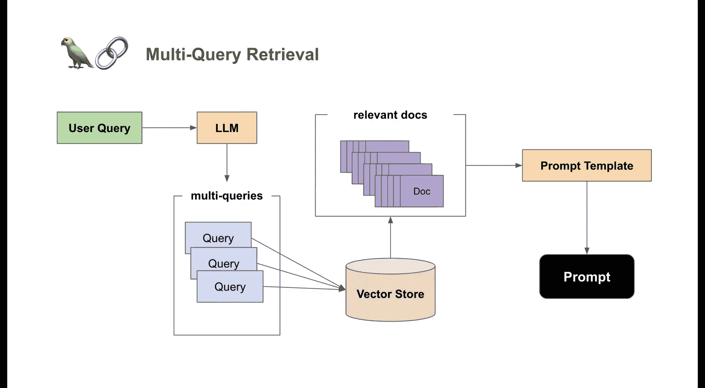
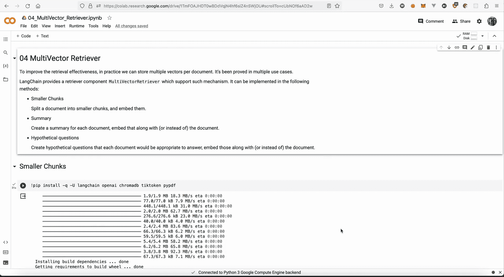
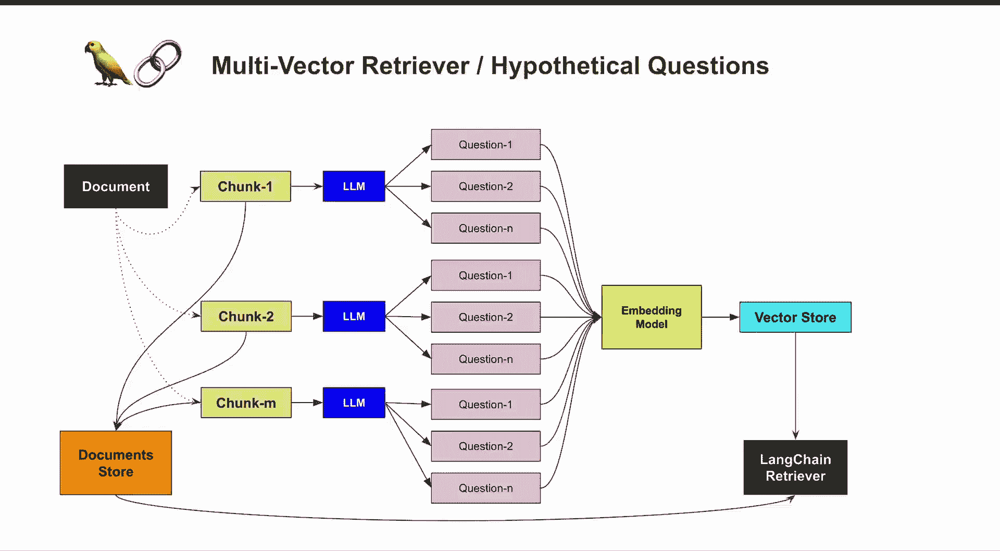
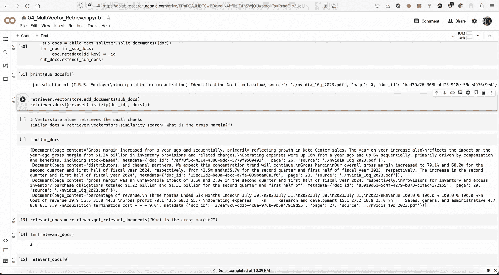
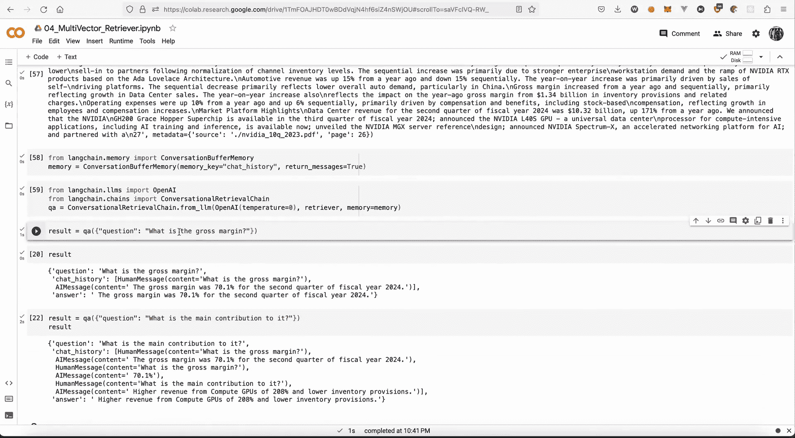
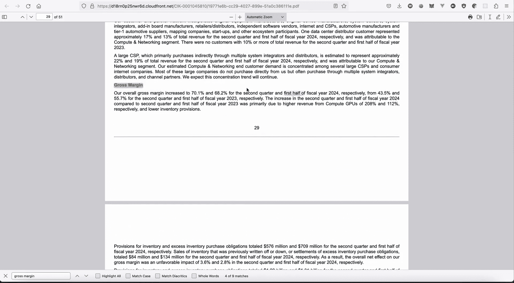
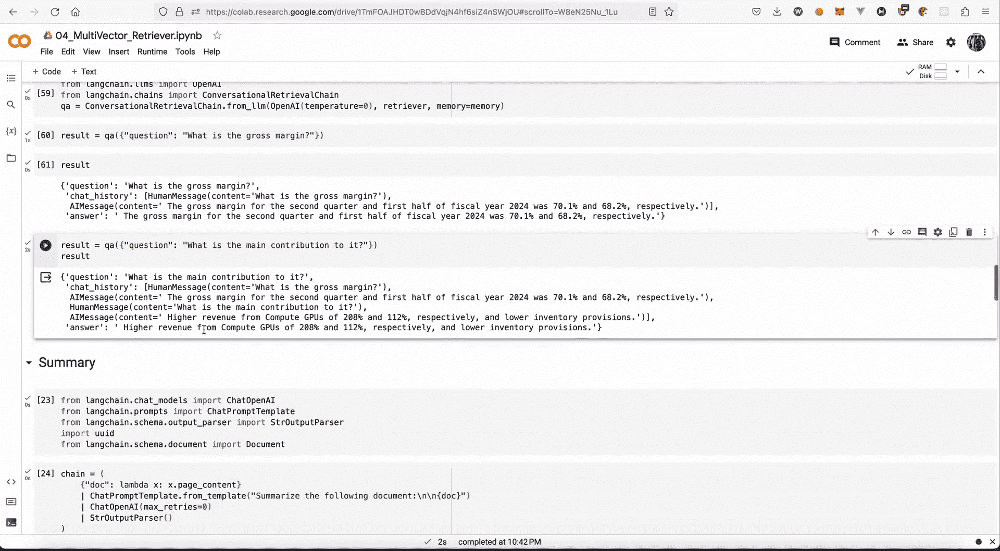
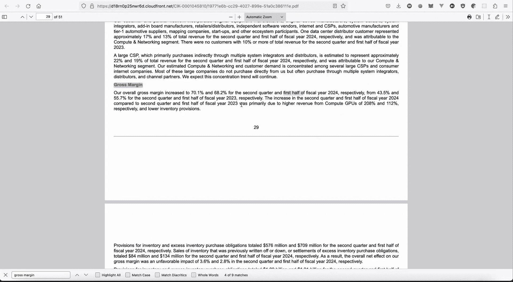
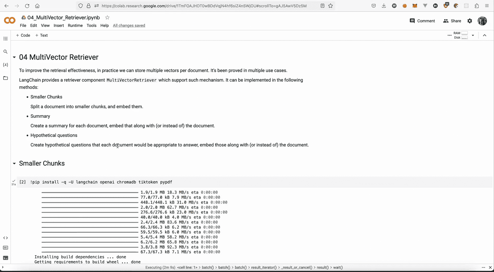

# 强推！(2026最新版) 李宏毅最新课程：智能体AI【AI Agent】71集全！人工智能／机器学习／深度学习／大模型／LLM - P50：49-19、构建高质量AI文档机器人 - 04 多向量检索器 - Ai人工智能工程师 - BV1QdzCB3Eu2

大家好，我是小木头，不久前我们开始了lunch进阶系列的分享，这个系列呢我们是从检索器，也就是retriever开始介绍的，今天我们介绍第四种完全框架所支持的检索器。

也就是multivor retriever，多向量的检索器。

在第一讲中，我们曾经介绍的multicky retriever多查询检索器，它是利用大圆模型，基于用户的提问生成在不同方面的多种提问，再利用这多种提问进行相似性查询，以此呢得到一个更大的相似文档集合。

从而克服基于距离查询带来的局限性。

今天我们所介绍的multifactory retriever，从名字上似乎非常的相似，但是呢机制有所不同，那我们就来看看moi vector trever，它究竟是什么样的工作原理。

在Python版本的LUNCHAIN官方文档，对multivector trial已经有比较详细介绍，那么今天的内容呢也是基于这份文档的内容，现在我们就来到这份。

为视频分享所准备的Python notebook，在实践中我们我们发现，针对每份文档做多层向量的存储，是有助于提升检索有效性的，这也是在多个应用场景中验证过的，LUNCHAN为了支持这种机制。

提供了一个检索器组件叫multivector retriever，要实现这种机制，我们有几种不同的方式，第一种叫smaller chunks，在这种方式的实现中，我们将每一份文档拆分为更小的分块。

再对它们做文本嵌入，第二种方式呢是summary，在这种方式中，对每份文档我们不做更小的分块的拆分，取而代之的是对每份文档做摘要生成的摘要，我们可以对它进行做文本嵌入，也可以将它与原始文档结合在一起。

做文本嵌入，我们所介绍第三种呢是hypothetical questions，也就是假设的问题，基于每一份文档，利用大圆模型来生成，假设会提的问题，也就是从文本内容中提取出可能会问到的问题。

将它们来做文本嵌入，或者结合文档原始文档来做文本嵌入，那这就是三种常见的实现方式来实现，Multivector retriever，那我们分别来看一下这三种方式中。

对文档是做的怎么样的处理，数据是怎么样的存储，我们现在所看到这个图表，就是对smaller chunks这种方法的解读，一份文档document被拆分成多个分块chunk。

那我们会有chunk12到chunk m，那small chunks，意思是对每一个分块再拆分成更小的块，Smaller chunk，这样呢在每一个分块，trunk1到M会分别有更小的分块。

我们在这里呢将它命名为了smaller chunk，一二到chunk n，那这样呢，三个分块就被拆分成了非常多的小分块，这些小分块会被基于embedding model来做文本嵌入。

生成的向量数据呢存储到一个vector store，向量存储中，我们可以使用PYON，也可以使用chroma dB等等，这就是更小的分块的拆分，另一方面对于分块chunk1，Chunk2。

一直到chunk m这些原始的文档分块呢，会将它存储到document store，也就是左下角这个文档存储中，很重要的一点是smaller chunk，这些更小的分块在被分块以后。

每一个小分块是会在原数据中记录它的副文档，也就是这个chunk1到chunk m，会将这些负文档的id记录在他的原数据，meta data当中，这样呢在vector store中进行相似性查询的时候。

定位到某一个smaller chunk，可以基于smaller chunk的原数据，来找到它的副文档，就是parent doc，这样呢上下文信息可以尽可能多的保留。

这就是document store和vector store之间是如何关联起来的，第二种summary，这种实现方式下呢，对每一个文档的分块，chunk会对做摘要得到summary12。

一直到summary m，每一个summary分块或者summary信息，会基于embedding model做文本嵌入，这样在vector store当中存储的向量数据呢，就是摘要的文向量数据。

当然了，我们也可以选择将原始的文本方块，chunk和summary组合在一起做文本嵌入，并存到向量存储中，在摘要数据做向量存储的时候呢，摘要数据也会将这些副文档，这些chunk1到chunk m。

以原数据的方式关联起来，如何做检索呢，要寻找相关的文档，那就基于vector store进行相似性查询，摘要信息的原数据中的副文档id，就会被用来在document store里面去寻找。

或定位较大的文档分块，这些文档分块就为我们提供了，更广的或更大的上下文信息，那我们来看最后一个实现方式，Hypothetical questions，在这种实现方式下，我们做的呢是针对每一个文档分款。

chunk基于大圆模型来得到一系列假设的提问，那每一个分块会得到一系列的提问，这些问题我们可以结合原始的分文档分块，chunk来做文本嵌入，也是基于embedding model，得到所有问题或问题。

和原始文档分块的向量数据存储到vector store，向量存储中，同样在这里呢，问题也会将副文档的id以原数据的形式嵌入，这样呢在向量存储中基于相似性查询，得到对应的问题的时候呢。

我们就可以拿到它的副文档的id，这样基于文档存储，就能查询到这些较大的文档分块，最后提供更大的上下文信息或场景信息，给到大圆模型，帮助我们回答问题，这就是三种常见的实现方式。

接下来呢我们回到Python notebook，看看在实现上究竟是怎么做的，在三种方式的介绍完成以后，我想实现就是非常简单的事情了，基于luncheon。

基于OpenAI的embedding model，基于OpenAI的大圆模型，我们还会用到chroma dB作为向量存储，我们会加载一个PDF文档，所以呢这还要一个PYPDF的包。

所使用的文档呢是NVIDIA今年的一份10Q的财，财务报告数据，我们通过这个链接下载，大家配置一个有效的OpenAI的API key，我们先加载文档，在这里呢我们来运行一下，加载文档的时候。

可以看到我们对文档分块呢是以trunk set，设置为1万，这样会对它进行文档的拆分，我们这里可以打印第六个文档分块内容，看看它内容是什么，向量存储，我们是用到了chrome dB。

使用OpenAI的embedding model，这里呢就定义了vector store向量存储，接下来还需要一个文档的存储，我们这里用到的是in memory store。

这里面就存储了每一个原始文档，或者叫原的文档分块，当我们准备好了vector store和这个emerge store，作为这个document store。

那就可以来构建个multivector retriever，他需要的呢就是三个信息，一个是向量存储，一个是文档存储，最后呢是id key，我们用的是dog下划线id，在将文档进行处理前呢。

还针对每个文档，这里呢用到u u id生成一个唯一的id，接下来呢定义一个新的文档拆分器，这个文档拆分呢器呢就是子文档拆分器，我们将块的大小设置为400，接下来要做的事情。

就是基于每一个副文档来拆分更小的子文档，在拆分中，每一个拆分出来的文档呢，会在v metadata当中指定这个id，key就doc id，它就指向了副文档的id，这样就将每个子文档和副文档。

通过原数据关联了起来，大家也可以在这里呢打印一下，拆分出来的子文档，看看它的内容，如果我们拉到最后会看到这里有metadata source，表示这个原文件是什么，页，是第零页，就是第一页doc id。

这就是副文档分块的id，当我们完成了这个更小的文档块的拆分，就可以来填充这个retriever当中的，vector store和dog store，分别将子文档这个数组塞进这个vector store。

这里头会用到OpenAI的embedding model，来做文本的文本嵌入，再将生成的向量数据存储到向量存储中，而dog store当中呢就是将拆分转副文档分块。

与它的文档id对应的存储到这个DOS store当中。

文档存处理，接下来呢就可以做两个事情，第一个是相似性查询，如果我们通过一个问题，what is the grass margin来查询相似文档，这里可以得到的文档，可以看到长度呢是短许多的。

这个长度呢大约就是更小的分块，chunk size等于400的时候的文档大小，这就子文档其中的metadata可以看到它包含了doc id，这就是副文档分块的id，包括了页和源文件。

那如果我们使用get relevant documents，查找相关文档，我们来执行一下，可以看到这里返回了我们两个相关文档，我们来查一查这个文档内容，可以发现在这里呢这个文档内容是非常长的。

这是什么意思呢，也就是说在查相关文档的时候，我们相先在向量存储中找到较小的文档分块，再基于较小的文档分块的metadata去定位到副文档，也就更大的分块，基于大分块来让大圆模型帮助我们回答问题。

这样呢能够提供更多的上下文信息，基于这个retriever，我们就可以构建一个链，一个问答链，我们来看看，首先创建一个buffer meme，帮助我们记忆绘画的历史。

接下来呢通过一个conversational tribal chain，来进行提问，提问并得到回答，我们用到的呢就刚才构建的multivector retriever，用的是OpenAI构建一个QA链。

然后现在提一个问题，什么是这个财报季的gross margin。

我们来看看他的回答是什么，我在这里呢打开了这份原始的PDF文件，可以看到在这里呢有他的介绍啊。

数据这个呢就是提问，那我们接下来呢还可以追问主要是什么因素，或者是哪方面对他这个贡献，在这里他提到了更高的。

这个revenue呢是来自于computer GPU，这个数据呢就来自于这里。

这就是我们在使用monkey vector retriever的时候，第一种实现方式使用更小的分块，第二种方式呢是摘要，那这里呢我们就快速的过一下，摘要呢是对每一个文档分块进行摘要。

蓝犬官方文档中的实现方式呢定义了一条链，这条链呢针对每个文档分块的内容，通过使用大圆模型来进行摘要，通过这个列来批量进行摘要生成，这里我们来对每一个文档分块做摘要，我们让它先执行，接下来在向量存储。

这里呢创建一个叫summaries的集合，然后将这个vector store和doc store，分别指定为，刚才我们定义的这个向量存储和内存存储，Emery store，关键步骤还在于。

基于每一份摘要来生成一个文档，文档的内容呢，就是这个摘要内容，S在原数据当中就嵌入了副文档分块的id，我们再将摘要文档存储到这个向量存储当中，在文档存储当中呢塞入原始的文档。

这样我们就可以基于提问来进行相似性查询，这就是基于摘要的方式，那最后呢是提问，当我们得到一个文档方块的时候，让大A模型帮助我们生成可能会提的问题，我们看看怎么做的。

首先这里呢他是用到了function code的方式，来帮助我们提取，大圆模型所给到我们的可能提的问题，我们在这里会定义一个函数，Hypothetical questions。

那描述呢就是生成假设的问题，参数是一个数组，这个数组当中呢就是一系列的问题，这参数就叫questions，我们将它呢绑定给chat OpenAI这个类，这样呢就通过最后呢是通过jason key up。

function passer来提取得到的问题，同样也是并发的来生成或得到所有的问题，基于这些提问就会构建向量存储，这个向量存储是如何构建的呢，跟摘要非常相似，得到的每一个问题就作为了文档的文本内容。

原数据中嵌入了复文档id，如果大家想将原始文档也嵌入文档中，那么可以在这里做一下修改，我们在这里呢列出了，这是我刚才已经执行结果，为了节约时间呢，给大家分享一下。

可以看到生成所有的question DOS，也就是问题的文档是这样的一个形式，所有的呢都是问题，原数据就包含了副文档分块的id，我们在这里，如果搜刚才我曾经提过的grass margin，这个问题。

可以看到问题在这里，它对应的这个doc id呢在这里，这就是副文档分块的id，那剩下的内容呢就与前面的非常相似了，在向量存储中塞入这些问题文档，然后呢在文档存储中塞入原始的文档分块。

接下来就利用这个retriever来构建问答链啊，进行提问和等待回答，那这就是我们所要分享的多向量的检索器，希望这个内容呢给到大家一些指引，关于如何将更多的信息存储到，向量存储或文档存储中。

帮助我们更好地获取回答问题所要的信息，好吧，那大家是有什么问题呢，也欢迎在评论区给我们留言，那咱们就下一期分享再见。

