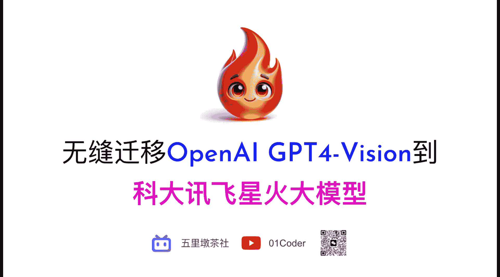
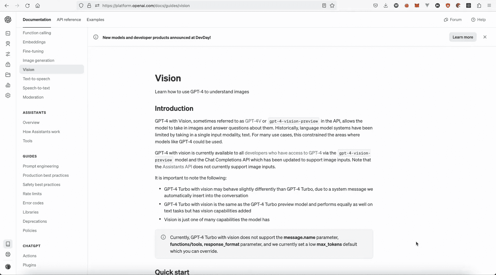
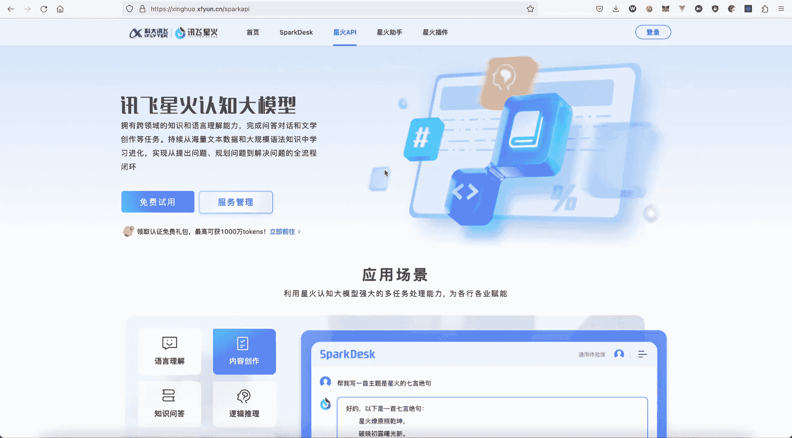
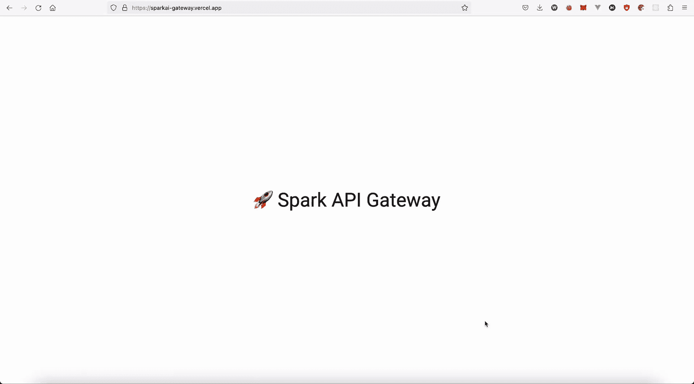
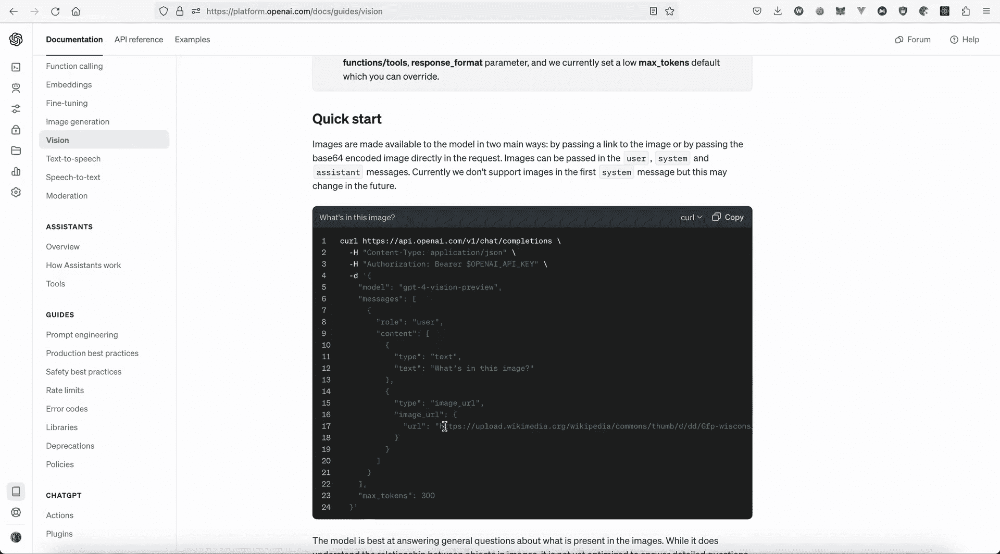
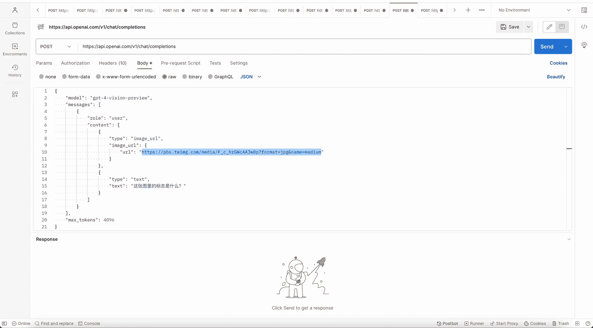
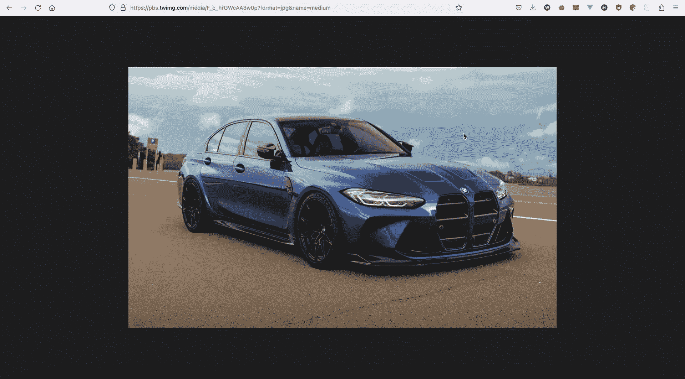
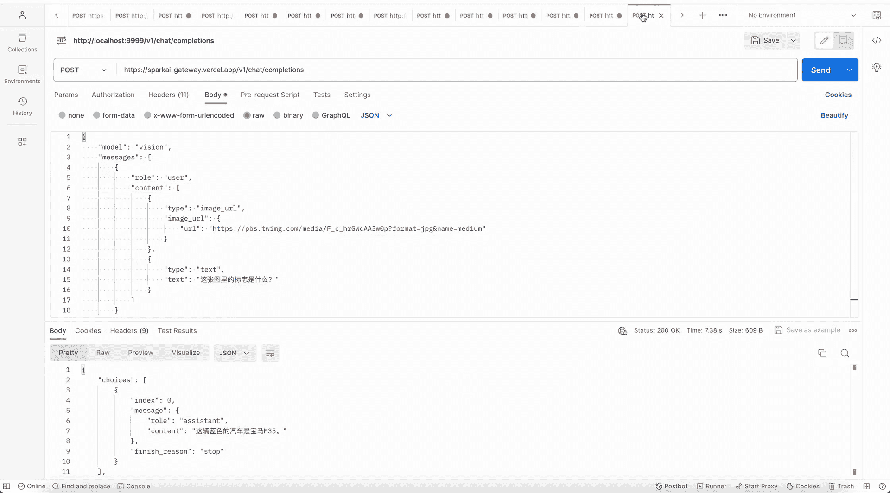
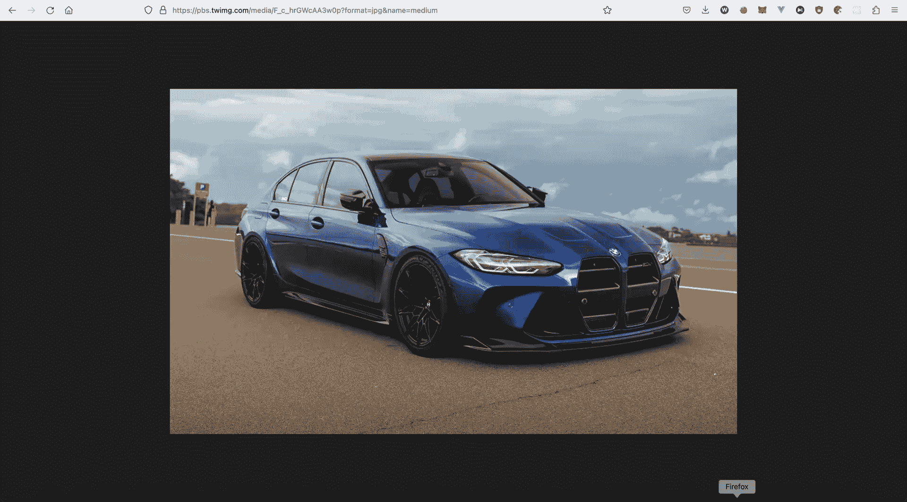
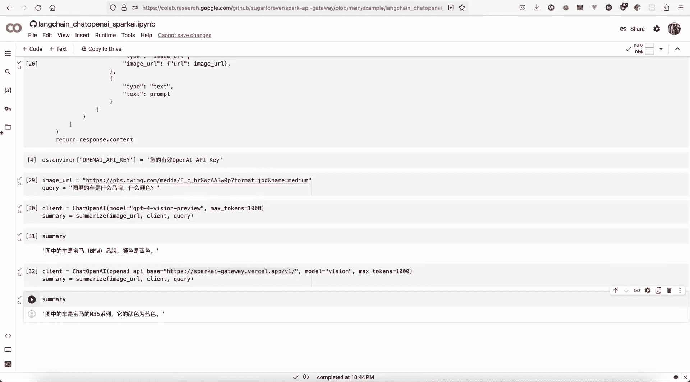

# 强推！(2026最新版) 李宏毅最新课程：智能体AI【AI Agent】71集全！人工智能／机器学习／深度学习／大模型／LLM - P51：50-20、、无缝迁移OpenAI GPT4-Vision到科大讯飞星火大模型 - Ai人工智能工程师 - BV1QdzCB3Eu2

大家好，我是小木头，欢迎大家回到我的视频频道，OpenAI最近发布了对图片理解能力的支持。

它是通过GBT4的模型，Gb t for vision preview，在聊天补全API上提供的服务，在咱们国产大模型中。

科大讯飞的星火认知大模型，同样具备图片理解能力。

我现在所分享的呢，这个正是讯飞开放平台上图片理解API文档，这里呢对API的使用和规范有非常详细的介绍，今天我们所要介绍的内容呢，是如何无缝的从OpenAI的vision模型。

切换到科大讯飞的星火认知大模型，在分享中我们会介绍的一个开源项目，就是现在所看到的spark API gateway，Spark api gateway，这个开源项目的目的呢。

是将星火认知大模型的API映射到OpenAI，a p schema相兼容的end point之上，这样呢我们就可以使用同样的请求，来使用OpenAI和星火认知大模型，这样呢也能够方便开发者。

很轻松的将基于OpenAI的应用，切换到星火认知大模型，在过去的视频分享中，我们已经介绍了，在spark API gateway上对聊天补全的支持，那在今天我已经对图片理解API做了添加。

这样呢开发者可以将自己基于OpenAI，GB t for vision preview模型的应用，非常轻松的切换到科大讯飞的星火认知大模型，图片理解API之上，那今天我们的分享呢分两部分。

第一部分呢是通过简单的API调用，来体会在SPA API gateway之上，是如何使用图片理解API的，我们通过比对OpenAI的API调用，和SPA API gateway上的调用。

看看它们的之间的差异究竟有多大，可以说是几乎为零，那么在另一部分的分享中，我们会看看基于luncheon的应用，如何从OpenAI的GB t for vision，preview模型切换到星火大模型。

那我们现在呢所分享的这个就是API，git的代码仓库，在这里最新的代码提交，对星火大模型的图片理解API已经做了支持，有兴趣的同学呢，可以点击在开源代码仓库这里的链接，申请星火大模型的API访问权限。

我也将申请链接放到了视频描述中，需要的同学呢也可以到描述中点击取用，目前呢我们支持多种方式，大家可以以docker的形式来运行，也可以在本地通过uv corn命令行运行，也可以使用。

我们现在部署在excel上面的一个二级域名，二级域名呢在这里，spark AI dash gateway dot recl到app，目前呢大家可以不提供app id，secret key这些参数来使用。

我们也提供了一套供大家免费试用的一个app id，当然啦请大家合理使用，毕竟这个资源呢也是有限的，这个部署呢我是在VERCEL上面完成的，那现在呢就可以通过像postman等API。

开发或测试工具来验证这个API是否正常工作。

我们先来到open advision文档，在这里对API的接口或他的schema有描述，我们可以看到他的这个示例的这个curl命令，这里面呢就揭示了我们如何传递的模型参数，如何传递消息参数以及图片。

在这个例子当中用的是图片的URLL。

我们在这里呢通过postman来测试一下，在这个例子当中呢会用到一张图片，这张图片是我在twitter上面临时找的。

就是这么一辆汽车的图片。

那我在这里先通过OpenAI的API调用，看看他的表现，两个参数，一个是模型GB t for vision preview，另一个呢是messages，在这里面就包含了图片的URLL，以及我提出的问题。

我期望模型告诉我这张图里的标志是什么，可以看到他告诉我的是，这张图里的车辆带有宝马的标志，这是一辆宝马汽车，这个理解呢是正确的，接下来我们来看看SPA a pi gway的表现，在另外一个tab里面。

大家可以看到这两个tab之间呢，请求的数据几乎一模一样，区别就在于model参数API gateway上面，我们的model使用的是vision，大家如果要使用我们的APIGV呢。

这个model参数也请指定为vision消息体，这里呢是一模一样的，我们来测试一下他的表现，可以看到他的回答呢略有一些不同，他给到的我们是这辆蓝色的汽车，是宝马M35，至少在标志的识别上。

型号的识别上几乎都是正确的，包括颜色也是正确的，那么我们可以认为，两个模型在这张图片上识别的表现呢是一致的，接下来我们就在应用层面来看看如何使用它。

在这里呢，同样我也准备了一份Python notebook。

这也延续了我们在之前的一部分分享，这个notebook呢是在这个SPA API gateway example，这里的一个示例，如果我们打开它，可以来看看，我在这里呢增加了一些内容。

首先呢是对OpenAI的vision模型做了简单的分享，关于它的API调用或aps schema是什么样的，我们期望spark API gateway，也能够将星火大模型的图片理解API。

映射到同样的schema之上，我们正是这样做的，在spark API gateway之上，我们将科大讯飞的WEBSOCKETAPI映射成了HPS的，与OpenAI的聊天补全兼容的接口。

那在下面这里就给到了一个例子，大家可以如何使用咱们的SPA AI gateway，我在VERCEL上面这个部署呢，大家可以不提供up id等参数来调用，但大家请节约啊，免费资源。

接下来呢就是安装luncheon和OPOPENI的Python包，我们跳过前面简单的聊天补全和，LLM chain的使用，这两部分呢，我们在过去视频分享中已经有所介绍，有兴趣的同学可以回到当时视频分享。

来了解这部分的内容，我们直接跳到示示例三，这里呢是对图片理解的演示，参考图片呢，正是刚才我们所分享的宝马汽车的图片，我们来到COLLAB，通过代码执行，看看它的效果，在这里呢参考图片已经给出。

我们会定义一个函数叫summarize，由它来帮助我们完成API调用时消息体的构建，那这部分呢主要是用户消息的构建，给到一个图片的URL，给到一个提示词，由它来构建一个消息体。

可以看到这里用的消息题呢是一致的，并没有星火大模型和open a的差异，在调用OpenAI的模型的时候呢，我们是需要一个API key的，那这里如果我们使用的是星火大模型呢。

这个API可以随便指定一个字符串就好，首先我们来设置一个提问，图里的车是什么品牌，什么颜色，我们来执行一下，首先用这个chat OpenAI包装类。

这是lunch提供的包装类来调用OPENAI的GBT模型，模型呢指定的是GB t for vision preview，这样呢我们就是使用的OpenAI的模型了，现在就让他给我们来做一番摘要，提出问题。

希望他帮我识别图里的车，什么品牌，什么颜色，我们来执行一下，执行完毕看看摘要信息是什么，图中的车是宝马品牌，颜色是蓝色，接下来我们通过spark API gateway。

来看看究竟这个代码的迁移成本有多大，在同样使用chat OpenAI这个包装类的时候呢，我们仅仅需要做两处修改，第一个呢是模型从g b t four vision preview切换成vision。

第二个参数呢是OpenAI API base，我们将它指定为spark AI gave way，Excel dot up，这样呢就将咱们OpenAI API的base指向了自己的。

我们的spark API gi的域名，当然这个域名呢是我部署的一个二级域名，大家如果愿意自己来运行一个网关，在自己的服务器上，那么也可以将域名指向自己的服务器，这样呢你就就已经完成了。

从open avision模型切换到星火大模型，我们执行一下这部分代码，执行完毕来看看suing，他告诉我们，图中车是宝马的M35系列，颜色为蓝色，可以看到在这里对图片的理解。

OpenAI的模型和星火大模型处于一个同一个水平，能够正确的理解图片中的车辆品牌和颜色，有兴趣的同学呢，可以通过咱们这个二级域名来测试一下，星火大模型的图片理解能力究竟如何，那么今天的分享呢。

主要是通过这一部分代码来为大家演示，如何以最小的代价，最小的迁移成本来完成，从open air的vision切换到星火认知大模型，非常重要的一点是，目前OpenAI的vision模型访问还是非常有限的。

资源非常宝贵，大家可能会频繁的遇到rate limit这种错误，那或许这个就是我们可以尝试，使用其他模型的机会，那大家如果对于spark AI gi感兴趣呢，就请参考咱们的开源项目。

或者使用咱们现在已经部署的这个二级域名，那有什么问题的同学请在评论区给我们留言，有兴趣的同学呢可以赶紧来尝试一下，可以自己部署一台服务器，也可以使用咱们的这个二级域名。

看看究竟这个API网关能够在多大程度上，帮助大家降低迁移成本好吧，那有兴趣的同学或有什么反馈的同学，对这个API网关有什么改进意见的同学，也欢迎在评论区给我们留言。

希望我们一起能够能把这个网关做得越来越好，能够帮助大家更加轻松地，在不同的模型之间切换，那咱们今天的分享就到这里，感谢大家的关注，咱们下次视频再见。

