# 强推！(2026最新版) 李宏毅最新课程：智能体AI【AI Agent】71集全！人工智能／机器学习／深度学习／大模型／LLM - P52：51-21、像用OpenAI一样使用稀疏混合专家模型Mixtral 8x7B - Ai人工智能工程师 - BV1QdzCB3Eu2

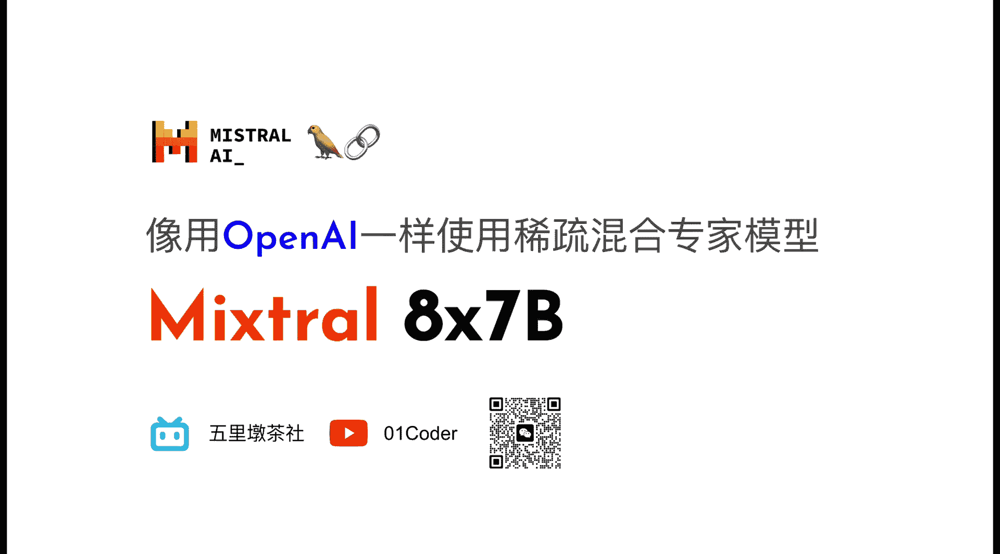

大家好，我是小木头，欢迎大家再次回到我的视频频道，master AI一直在为开发者提供最优质的开源模型。

而近期团队也发布了他们最新的模型。

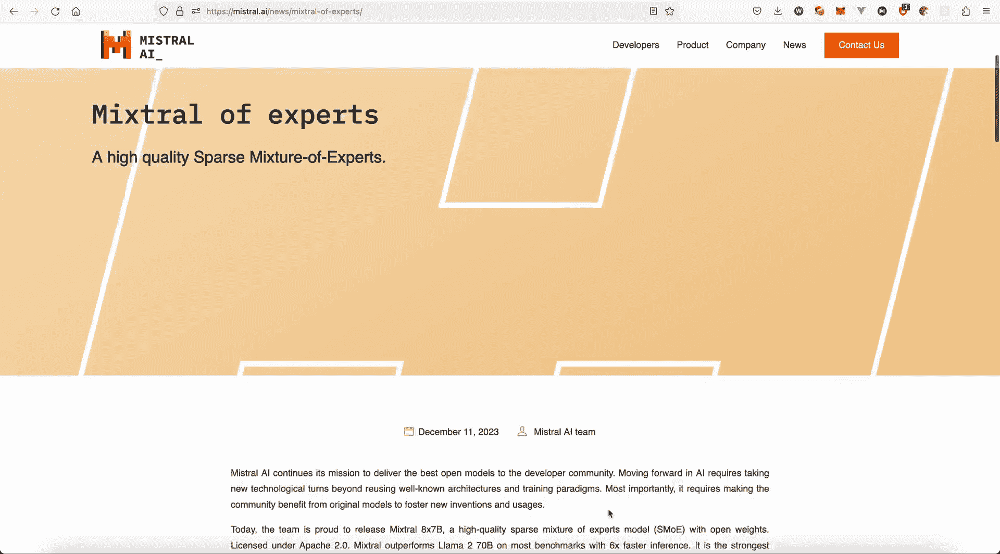

Mixture bix7 b，这是一个高质量的稀疏专家混合模型，也就是SMOE，我们在这里呢并不对这个概念做深入的介绍，总体而言，mixture在大多数基准测试中呢表现就非常的优秀。

推理速度要比lama two70B快了六倍，特别是在大多数标准的基准测试中，它与GBT3。5相比呢也毫不逊色，甚至在有些指标上还更加优秀，今天呢我们就来看看mixture box7B究竟如何使用。

首先是它具有32K的上下文环境，同时呢支持多种语言，像英语，法语，意大利语，德语和西班牙语，值得一提的是，在代码生成方面呢，他的表现也非常优秀，最后呢是可以通过微调来得到遵循指令的模型。

那今天呢我们先来看看它，发布在hogon face上的模型文件，那我们现在呢来看看模型的文件，在这个文件和版本这里可以看到，文件列表还是蛮长的，整体文件量数据量还是挺可观的，根据我的测试呢。

在自己的笔记本电脑上，要运行这个模型还是有点困难，不过幸运的是，master AI近期也发布了他的API服务，这就非常类似于OpenAI，允许开发者申请访问权限，通过API来使用模型。

在获得访问权限后呢，开发者就可以在控制台来管理自己的API key，在获得了访问权限后呢，如果大家来到console dot meo到AI，可以看到跟我现在这个类似的界面。

这里呢就给到了我们API key的管理，以及账单的管理页面，在API key这里可以创建自己的密钥，我在这里呢已经创建了两个密钥，那按照需要也可以自己动态的添加或删除，那我们先来看一下价格。

在文档这里呢有定价和限流方面的约定，可以看到价格方面是按照100万个token为单元，来计费，模型，包含了tiny small medium，那么价格呢各有不同，大家可以根据这个报价来评估一下。

在自己的应用中，成本大概有多少，而限流方面，real limit方面呢是每分钟200万个token，以及每个月200000000token的限流，那这方面如果有具体的需求。

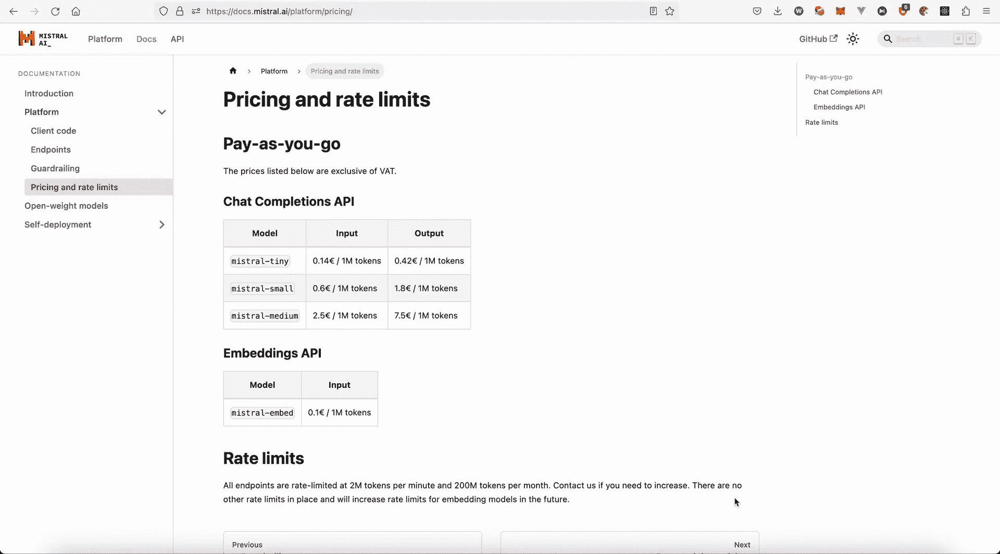

还可以跟官方联系，接下来呢我们来看看API文档，目前API的支持它包括了聊天补全，文本嵌入以及列出可用的模型，那我们先来看看聊天补全，这里对schema有非常详细的定义，那么在右边呢有示例可供我们参考。

大家仔细看可以发现，API schema呢是与OpenAI的schema一致的，这也能帮助我们以某种取巧的方式，在基于open air的模型中将接口迁移到master的模型。

这对我们来讲也是一个非常便利的方式，首先呢我们通过curl命令来体验一下，max ro的聊天补全，这部分呢我们可以参考这个文档。

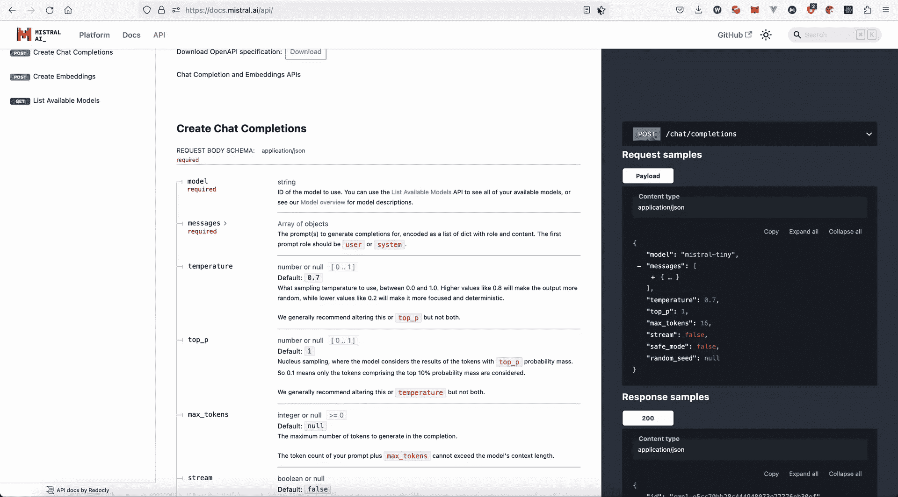

也就客户端代码这里提供了Python，JAVASCRIPT和curl的方式来访问，那么我们在这里呢就通过curl，在命令行来体验一下这个模型的访问，那现在呢我就用这个curl命令来调用一下。

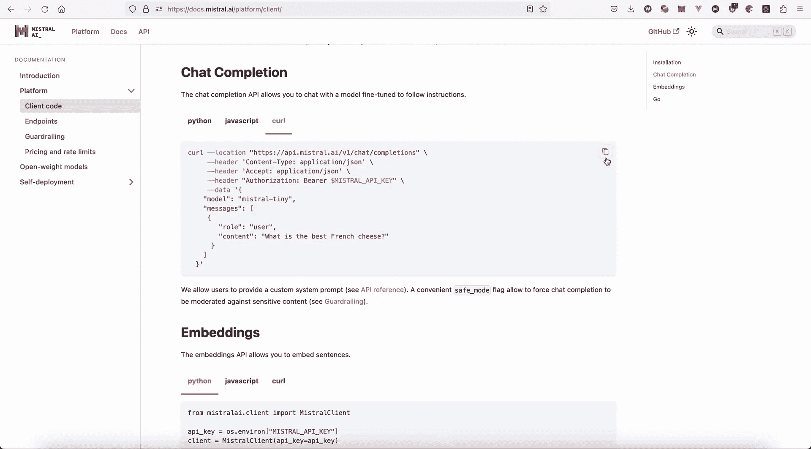

这个API，复制这个命令来到控制台，也就是命令行，我已经设置了环境变量，Metro api key，我就可以直接粘贴这个命令执行，模型呢使用的是metro tiny消息。

这里呢只有一个消息是用户角色的消息，问法国最好的cheese是什么，给到了有效的一个响应，我们这里呢就不深入去介绍响应的细节内容，可以看到在结构上，这个响应也跟OpenAI的响应的数据结构。

是几乎一致的，包括了模型choices，还有index message and finish reason，最后呢还有usage，都可以看到这个响应的schema呢是兼容的。

这也对于我们的应用的模型迁移也带来了便利，整体而言这个响应的速度呢还行，那么接下来呢我们看看在代码层面。

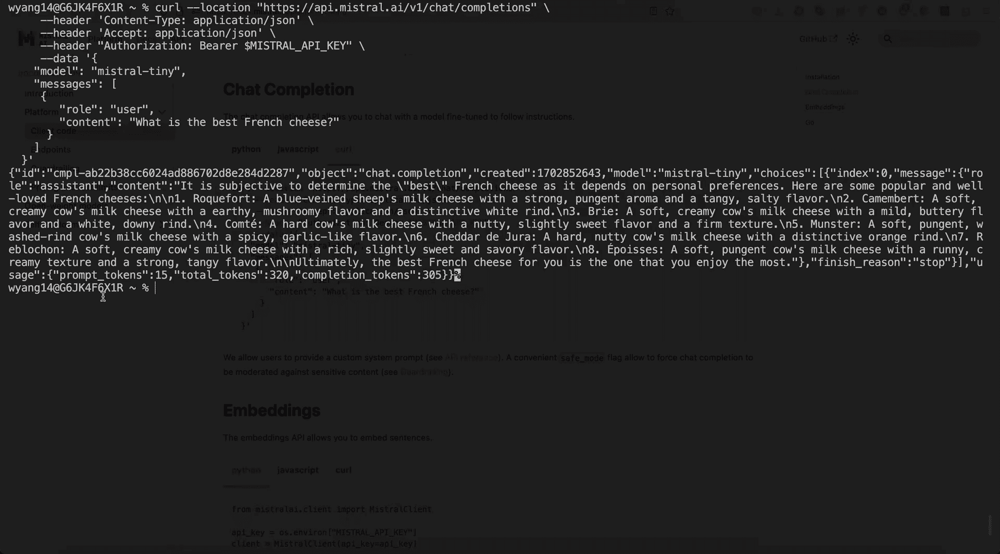

可以如何使用master的模型，在这里我依然准备了一份非常简单的Python notebook，来演示，首先呢是通过非lantern的模式，因为我们已经使用了太多，关于lantern与大模型的集成。

那么在今天的分享中，首先我们来尝试使用这个MESUREAI的Python SDK，这是一个客户端的开发包，帮助我们访问没学AI的API，pip install master AI就可以使用了。

那么代码呢我们就参考这里的这个Python代码段，在这个Python note当中，我还做了另外一个事情，是通过COLAB它的用户数据，也就是我们左边这个小钥匙这个密钥，来管理咱们的API key。

我们就不需要在代码当中，在COLAB的代码当中去用铭文来标记，或者设置API key，这样呢也能够起到相对安全的，保护自己的密钥的作用。

我在这里设置了一个key或者secret叫metro API key，设置的值，要使用它呢，我们只需要从google colab这包中导入user data，在基于密钥的名字来获取它的值。

这样呢就可以通过相对安全的方式来访问它，我们正式使用了这种方式，首先安装make sure AI这个包，然后呢设置ma准API key这个变量，这个变量就会在后面客户端的代码中使用。

构建消息呢是使用的metro AI，这里的聊天消息决策是user，内容呢是我期望他帮我做一个翻译，从英语翻译成翻译成法语，我们来执行一下，调用的是客户端的chat函数，给到他一个模型名称以及消息数组。

模消息数组呢正是我们刚才给到的模型呢，使用的是metro tiny，来看看响应，这个响应正是跟刚才我们在命令行中看到的，结构一模一样的，接下来我们是要介绍关于如何在luncheon in中。

使用METRAI提供的这个API服务，当然了，我们并不一定要使用lantern，但是呢我们在过去也介绍不少关于LON的知识，如何在应用中使用它与大模型进行集成，既然我们使用了它。

如果有一些应用已经在使用open end模型，又想轻松的迁移到METR，那方式很简单，我们来看看下面，首先呢是安装LAUNCHOPENAIJ包，这是必然要做的。

接下来我们既然发现MESUREAI的API和OpenAI的API，schema是一样的，那其实我们都不需要自己去构建包装类，我们直接使用chat OpenAI的包装类就行。

我们只需要修改它的base url，以及设置模型的名称就好，听起来呢这是一个比较不正规的方式，至少呢在功能上是可行的，如果有兴趣的同学呢，也可以将这部分代码抽取出来。

以OpenAI的schema作为基准，定义一个通用的类，这是一种挺好的方式，那我们在这里呢导入这些类。

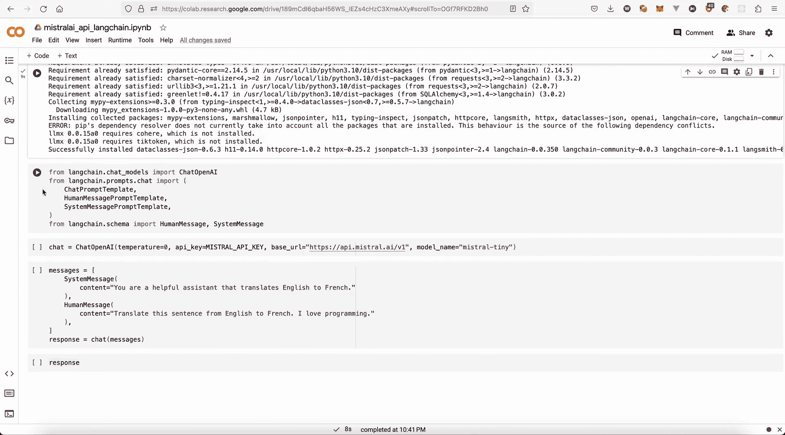

我们先通过命令行，这里我们刚刚在执行，可以看到这里用的API呢是API dot mesure到AI。

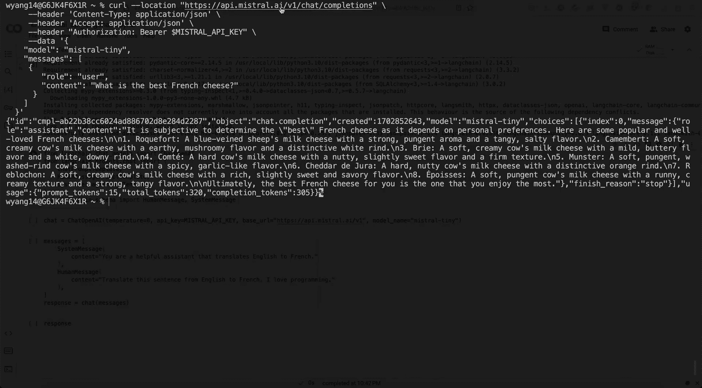

那我们在这个蓝全代码当中使用chat，OpenAI的时候呢，就可以将这个base ul l指向master AI模型，名称呢我们还是使用tiny模型，所以就是metro tiny。

看起来呢这是一个比较取巧的方式，那么API key呢同样也是使用metra API key，我们回到文档这里，在这个curl命令例子当中可以看到。

API的key是通过authorization header发送的，这个跟OpenAI的支持的authorization其实是一样的，因此呢在代码当中。

我们也直接就将metric API key给到了chat，OpenAI这个模型的包装类。

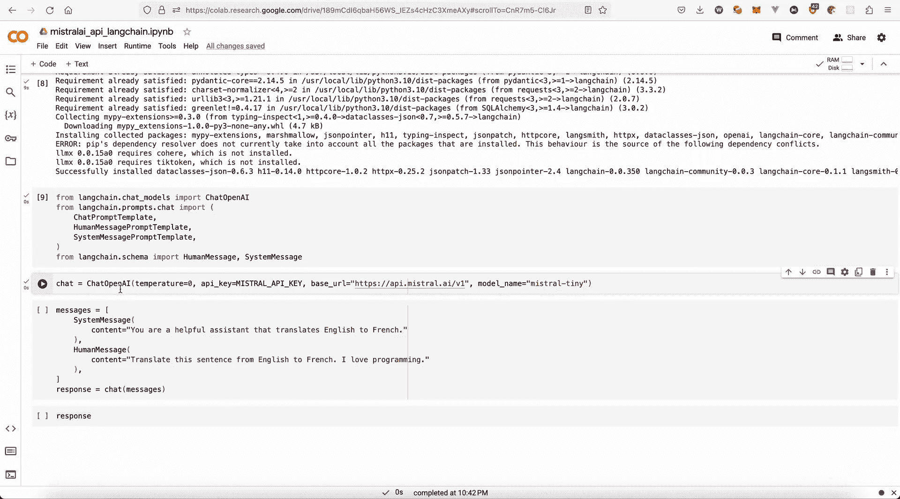

我们再次回到API文档这里，在这个消息的字段当中，可以看到他支持的角色包括了user和system，这个呢也是在OpenAI模型当中所支持的，可以通过system角色的消息来进行指令的设置。

通过user角色的消息来发送，用户的输入的查询或提示词。

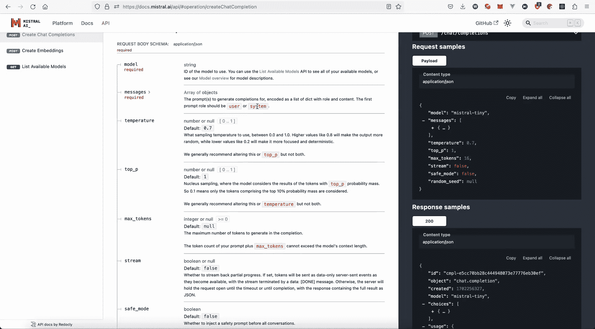

那最后呢，我们就是通过消息的发送来得到响应了，我们来看看它的响应是什么样的，他将i love programming翻译成了法语，那这就是我们如何使用match AI的API。

那这就是今天我们主要分享的内容，首先呢对metro AI，发布最新的box7B模型做了简要的介绍，重点呢是对他的API服务做了分享，同时呢分享了如何通过Mission AI的SDK来访问它。

并且尝试在launch应用中，将OpenAI的模型切换到Mac AI，方式也很简单，既然metro AI提供的API的schema跟open AI相同，那完全我们可以通过包装类chat OpenAI。

帮助我们清算进行模型的切换，虽然听起来呢这应该是一个比较取巧的方式，那么在实际的应用场景中啊，他还是可行的，至少可以帮助大家以最小的代价来切换模型，评估不同模型在自己的应用场景中的表现。

那有什么问题的同学呢，请在评论区给我们留言，我们就下期视频分享再见。

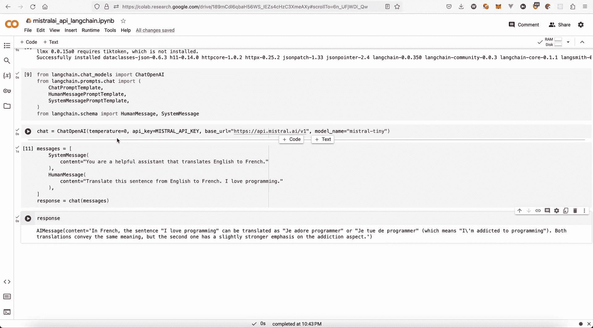