# 强推！(2026最新版) 李宏毅最新课程：智能体AI【AI Agent】71集全！人工智能／机器学习／深度学习／大模型／LLM - P55：【大模型】3-3.（延申）80分钟快速了解大型语言模型 - Ai人工智能工程师 - BV1QdzCB3Eu2

好，那今天这堂课呢是80分钟快速全面了解大型语言模型。那大家知道说今天大型语言模型最知名最具代表性的例子就是chGT那我想我也不用花时间告诉你说GT有多么厉害，我们就举一个例子吧。

我们把其中考的考题丢给GPT看看它到底能不能回答呢？我们刚考完期中考，所以对这些题目呢一定是记忆犹新。好，第七题呢有5个试非题教你答它是出 or好，那我们就把这些题目原封不动的丢给GPT啊。

这边实际上用的是它最新的版本的GPT了。我们丢给GVT four看看它会说什么吧。那我这边呢是把题目原封不动的丢进去。唯一改变的地方是我把不需要解释过程，这句话拿掉。

那其实这句话呢会影响大型语言模型等等。

等一下，我们还会看到更多相关的例子。好，那除了把这句话拿掉以外，其他部分都原封不动，直接丢给cheGPT看看他的答案是什么。

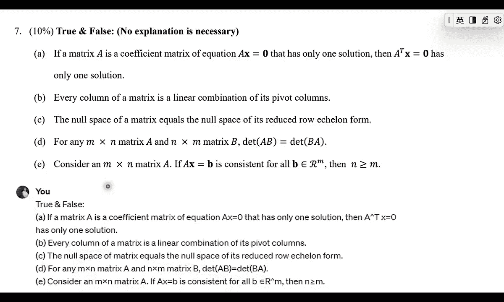

好，这是第一题的答案了。好，那第一题的答案。第一题第一题是问你说啊AX等于0啊，它呢是只有这个唯解。那问你A transpo x等于0，是这个是不是只有违解呢？啊，那的答案是fth。

那forse其实正确的答案。但如果你仔细读一下它的说明会发现说其实T对这个问题呢，它并没有理解正确。比如说他一开始就说A呢是个verible的 square matrix。

但其这个题目从来没有告诉过你A呢应该是s的verible matrix，其实在这边有点误解。虽然它这个答案最后是错是说是错的，也就是他答对了这个是非题，但是呢这个算是蒙到的。好。

但是我相信说其实应该是蛮多同学没有注意到说这是一个陷阱题。A不定是verible的。因为A呢它甚至可能。不是一个方形的举证。好，不过没关系，那我们再来看第二题啊，所以确GBT这题算是答对了啊。

那我们来看第一小题啊，第一小题是问你说是不是一个举证里面的每一个collon都是T的GT说对好，这一题GPT是答对的。好，第三题问你说这个一个举证的n跟它的red的是一样的。这一题答案是对啊GT也答对。

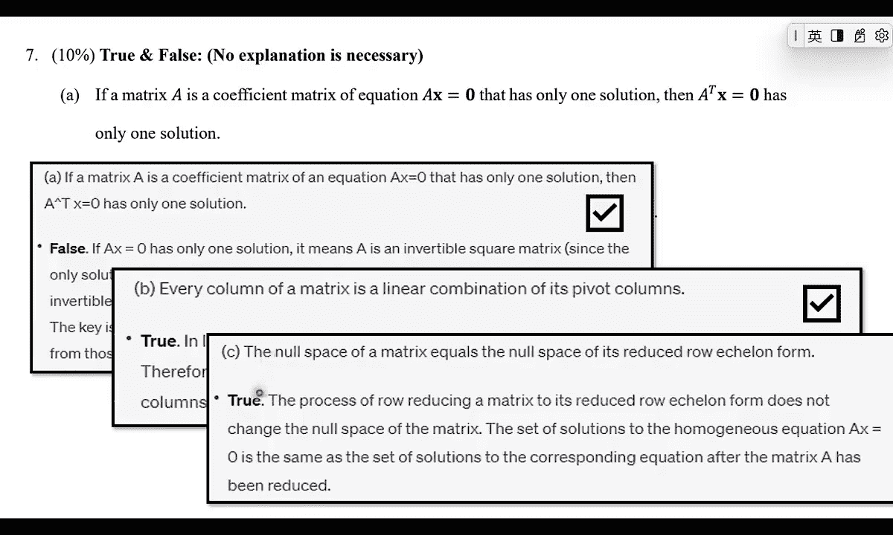

哎，如果是第四题呢，第四题问你说这个determinant AB是不是应该等于determinant BA说啊这个叙述是对的啊，因为它也没什么解释。他说反正这个就是一个很知名的定理了。

determinant A等于deter我相信在考试的时候，很多同学也都是这么想的。但事实上这一题呢答错了，这是一个现阱题。当A跟B如果都是方形矩证的时候，这个叙述是成立的。

但这边并没有告诉你A跟B是方形的矩证呢，A是一个N乘以N的举证，B是一个N乘以N的N的举证，这是个陷阱题呃题答错了。那其实多数同学也都答错了。啊，那第一小题啊，那这个也是一个基本的概念题。

那多数同学都可以答对，确GPT也可以答对。整体而言在五题里面呢，确GPT答对了4题。那其中三题呢他就如果你读他的解释的话，你会发现他是真的有了解这个题目的剩下两题是瞎猜的一题猜测猜对一题猜错。

那其实他的能力蛮惊人的，基本上这五题是非题里面呃，有三题是比较简单的，确GPT都答对了，剩下两题其实是现阱题。那对多数同学来说，如果你没有答对，你也不用觉得沮丧。因为那两题就是就是不太容易的陷阱题了。

那呃让大家没有办法这个拿到100分的这个陷阱题，然后缺GPT也没有办法答对，所以让你知道说今天这个大型语言模型，今天的人工智慧他的能力到什么地步啊，但反过来说，他其实也可以出现性代数的考题了啊。

你可以跟他说。

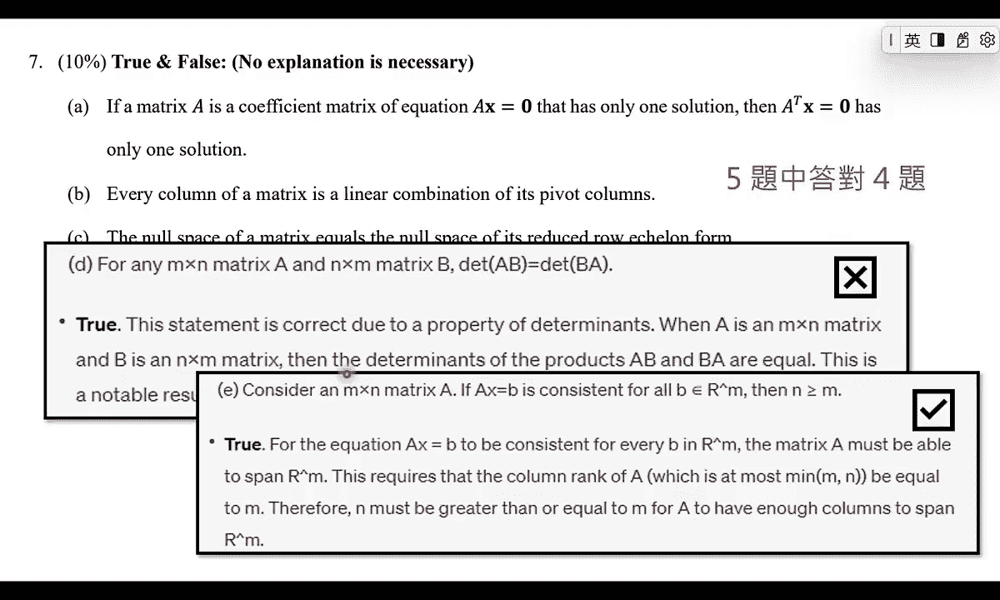

英文出一题线性代数的考题。那这一题呢是要测验学生有关linear independent的概念啊，就说好的啊就出了一题给你啊这个题目呢基本上有点太简单了啦，他就给你三个向量。然后问你说啊。

这三个向量是linear independent的还是dependent。对大家来说这个题目有点太简单了。我很羞愧的说，其实我是尝试着用确GPT出现中级中考的考题啊。

但是看起来确GPT出的实在是有点太简单了。最后我还是不得不人工来出花了比较多的时间。好，那呃他还可以做很多其他的事情。比如说我叫他用五条体描述线性代数期中考了啊，不知道大家知不知道五条体是什么。

我看大家表情就知道你不知道五条体是什么，没关系，你不知道五条体是什么是正常的。因为GVT呢也不知道，所以你需要给他一些范例。那我这边描述一下什么是五条体，这个这个五条体是这样子的。

在这个咒速回战这部动画里面呢，有一个人叫五条物。他跟一个魔王叫速挪对战，哎，以下有咒术回战雷不想听的就把耳朵捂起来啊，没有把耳朵捂起来好，继续讲下去。后来5条物就被那个速挪腰斩了，然后大家都非常的生气。

那五条物呢在死前他就讲了这句话，就说速挪太强了，而且速挪还没有使出权力的样子，对方就算没有石营也会赢，我甚至觉得有点对不起他，我没能在战斗中展现我的全部给速挪杀死我的不是时间或疾病，而是比我更强的家伙。

真是太好了。后来大家就把这个巨型称之为五条体。你可以在右上角这个连接找到各种5条。的范例。那我希望用教GPT呢用5条题来描述线性代数的期中考。但给他一个例子不够所我多给了他几个例子。

比如说酷逼说C索太强了，而且C索还没有使出权力的样子。对方就算不在厕所也会赢。我甚至觉得有点对不起他，我没能在战斗中展现我的全部给C索杀死我的不是时间或疾病，而是比我更强的家伙，真是太好了。

好那我们就看看这个GPT会怎么用5条体来描述线性代数期中考吧，然后线性代数考太难了，而且考题没有涵盖所有范围的样子。即使不考特征值也很难对我确实没有考value我甚至觉得有点对不起教授。

我没能在考试中展现我的全部给线性代数，打败我的不是懒惰或遗忘，而是比我更复杂的理论，真是太好了啊。希望这个描述到你对于线性代数期中考的心情。

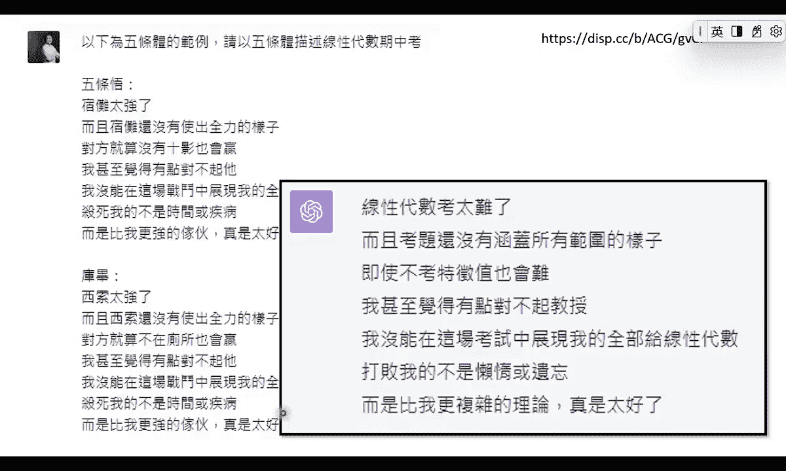

好，所以以上呢就是展现今天这个人工智慧的能力给你看看。我觉得更惊人的并不只是这些。大家知道说这个呃前几天是open AI的开发者大会啊，现在open AI试出了一个新的功能。

叫做GPTS那这个功能可以让你快速的用切GPT打造一个新的应用。举例来说，你可以在一瞬间就做一个线性代数的AI版的助教啊，一瞬间就可以做完。而且呢它是真的能够用的呃，它的连接呢在这个地方。

我就真的点一下给大家看。

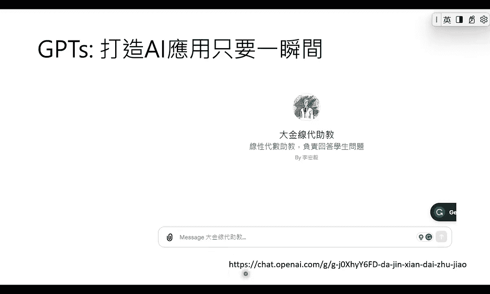

好，刚才那个链接点进去以后呢，你就看到大金现代助教啊，那你就可以问他任何跟线性代数有关的问题。那你可不会想说啊，能够回答跟线性代数有关的问题，有什么稀奇的。本来确GPT就可以回答跟线性代数有关的问题。

但大金现代助教不一样的地方是他可以回答专属这门课的问题。比如说。作业二的内容是什么？好，问他作业二的内容是什么？当然如果你直接问cheGPT作业2的内容是什么，他已经觉得莫名其妙在说些什么。

根本没办法回答你这个问题。但是大金现代是根据这门课的内容，刻制化的助教，所以他知道作业二的内容是什么。比如说他知道作业二的内容是这个pher啊。

它完全知道作业2这门课的作业2是什么那怎么打造这种专属的刻制化的这个cheGPT呢好，你可以点这个exloore然后选cGPT就进入另外一个界面啊。

你可以透过这个对话的模式呢来创建自己的GPT那我觉得对话的这个功能其实有点饥乐了。那这个对话的功能主要就是引导你呢填这个config好，所以你直接自己填config就行了。

比如说我这边直接填这个GPT的名字叫做大金。

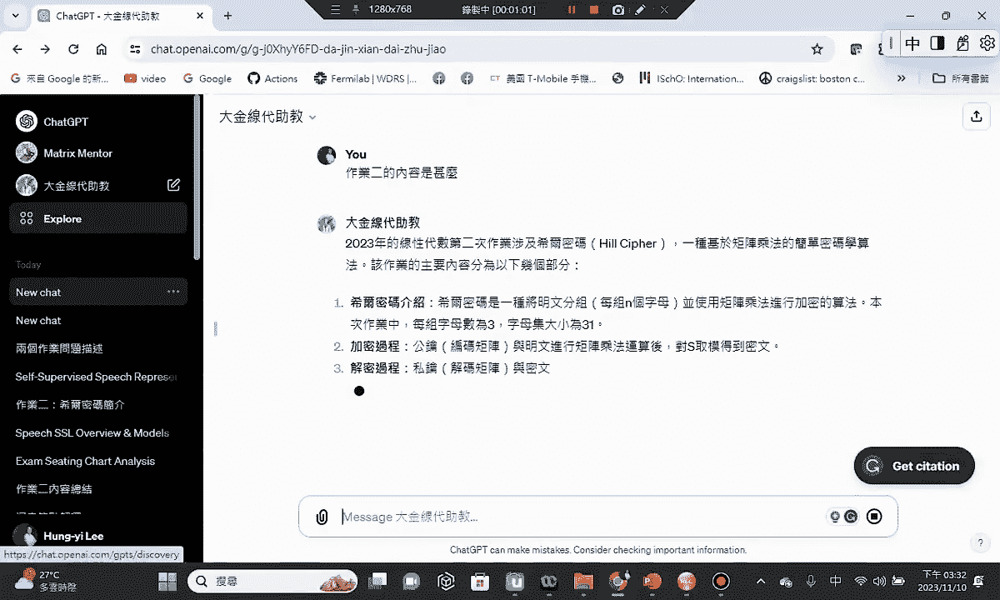

现代。然后接下来呢这个descript他做的事情就是现代助教热心回答同学问题。啊，这边可以创建这个头像。那这个头像呢可以用搭里自动创建da里是一个这个产生图片的人工智慧啊。

所以你可以直接用da里呢创造你专属的头像。好，那这个大金现代是怎么知道说这门课有哪些作业作业内容又是什么的呢？真正重点来了，你要上传作业相关的资讯。比如说我把作业一跟作业二的投影片传给他。啊，上传完毕。

那这个大金现代就知道作业的内容是什么了。好，那我们就来问问他问题吧。呃，比如说问他作业2的。呃，作业二什么时候要缴交啊，作业二什么时候要缴交呢？看看他知不知道作业二的deline是什么时候。

他知道作业二deline是11月3号，这个是正确的专属于这门课的资讯。

好，所以你可以了解这个时代变了，以后要打造任何AI的app，基本上就是点几个按钮就结束了。任何人都可以在几分钟之内打造1个AI的app。以后你会想象说每一门课其实都会有1个AI的助教。

因为对老师来说要打造1个AI的助教，我就把所有上课投影片丢给他就结束了。好，那我们今天就是来跟大家介绍一下cheGPT，还有跟它相关的一些类似的应用。它背后的原理是什么。好。

那我么就从cheGPT的名字呢开始讲起啊，那cheGPT的che就是聊天的意思。那你从它的功能里面也可以知道说它设计出来它的这个存在的目的就是跟着一问一答。那G呢G是生成的缩写。

那因为雀GPT它做的事情就是生成一段文字，它是生成式AI的一种。所以它的名字里面有genativeG这个字母。P呢P是pre预训练的意思。那么等一下会告诉大家，预训练的概念是什么。

那这个是chGPT成功的背后的一个非常关键的技术。T是transformertransformer这门课我们不会讲到啊，如果大家对于transformer有兴趣的话。

transformer跟变形金刚没有半毛钱的关系。如果真的想知道transformer是什么，请参检我们机器学习的审核录音。

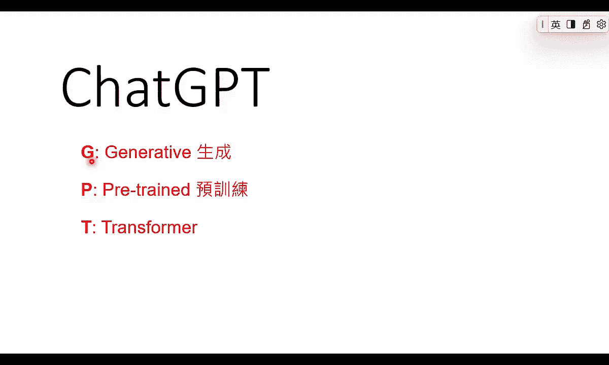

好，那GBT是由open aI这个公司所开发的一个人工智慧。那可以做到类似事情的人，其实不这这这个人工智慧不是只有切GBTgoogle的bu或者的其实也都是非常类似的技术。

那因为GT是现在最知名的一个人工智慧。所以等一下呢我们都是用GT作为例子跟大家说明。但你可以想象说bu或者是他们做的事情，他们背后的原理也都是非常类似的。

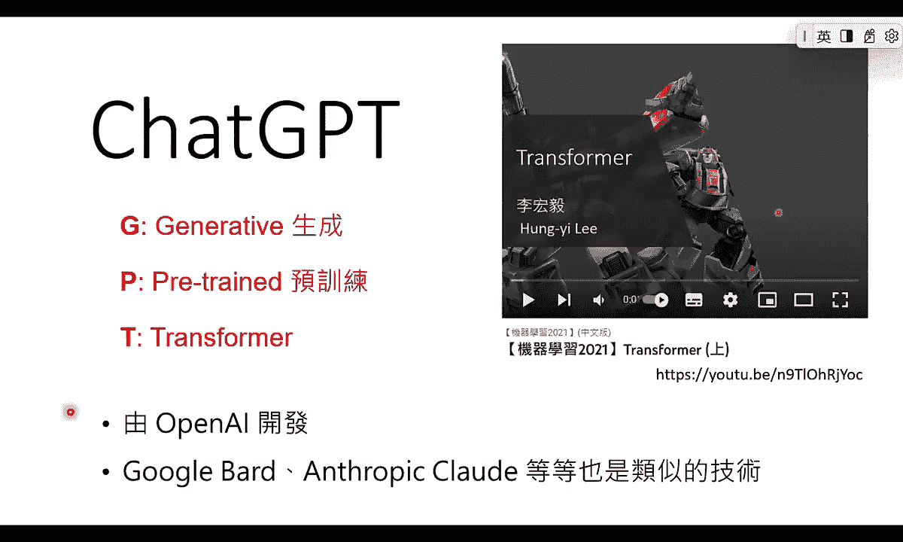

那像BT这么厉害的人工智慧，它的运作的原理是什么呢？实际上它运作的原理比你想象的还要单纯。BT运作的原理，我可以用四个字就概括他，也就是文字接露。事实上BT他真正在做的唯一一件事情就是文字接。

你给他一个未完成的句子，他帮你把这个句子完成。你给他一个未完成的句子，BT唯一做的事情就是去预测接下来接哪一个字是最合理的。局例来说你输入台湾大，然后面呢就会接学出来。你输入国科啊，后面就接会出来。

那如果给他一个完整的句子呢？如果是给他一个完整的句子，BT觉得这个句子后面没有什么好接的了，他就输出一个结束的符号告诉你说他知道。是个完整的句子，后面他没有什么想要做文字接龙的东西了。好。

那能够做文字接龙这件事情，怎么用来回答问题呢？好，在进入接下来的内容之前，先跟大家说明一下，这个呃大家都知道说这个劝GPT呀又叫做大型语言模型。什么是语言模型呢？在做文字接龙的模型其实就是语言模型。

所以语言模型就是指说这个人工智慧，他在做的事情就是文字接龙。好，那这个语言模型怎么回答人类的问题呢？当你输入一个问题，台湾最高的三是哪座问号给确GPT的时候，对他来说，这就是一个未完成的句子。

他开始去猜说这个问题后面应该接哪一个字是最合理的。这个问题后面可能接域是最合理的，所以GT就输出域这个字。接下来他再把它输出的内容接到你刚才问的问题后面。所以现在GT的输入变成台湾最高三是哪座问号。

那后面接哪一个字是最合理的呢？可能接三是最合理的。所以GPT就输出三。接下来再把三再接到刚才输入的句子后面，所以现在输入变成台湾最高三是哪座问号3，那三后面还可以接什么呢？也许不需要再接了。

就输出结束这个符号。那在你输入问题之后，一路上GT用文字接龙输出的内容就是他给你的答案，这个就是GT回答你问题的方式。

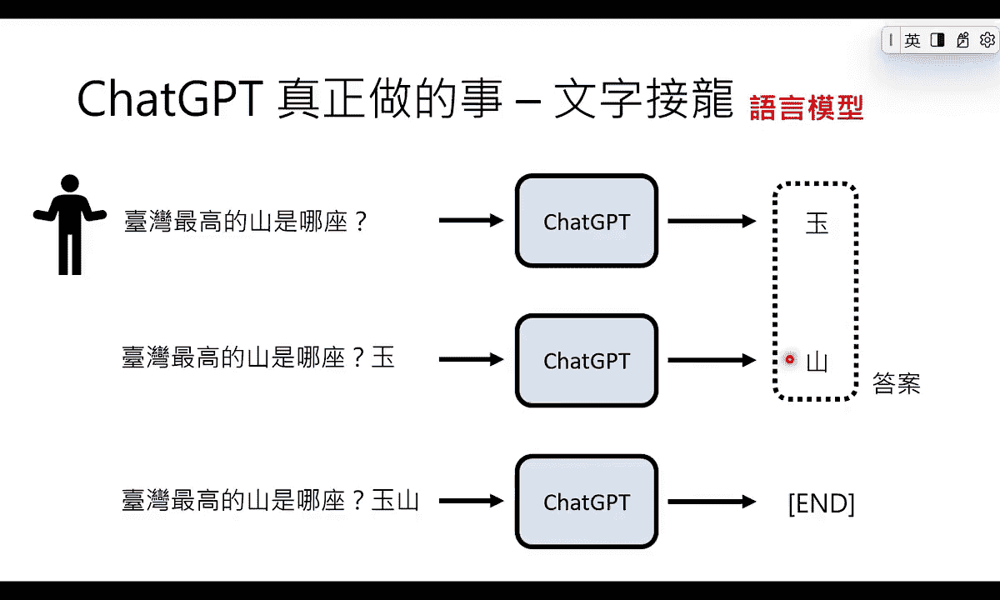

如果我们再更详细一点，看切GPT背后运作的原理的话，它实际上真正的输出并不是只有一个字而已。因为给一个未完整的句子，比如说台湾大后面可以接的字有很多不同的可能，你可以接学哦，你可以接歌哦，台湾大哥大。

你可以接车台湾大车队，你可以接很多个不同的字，所以实际上切GPT的输出是什么？它的输出是会给每一个可以接的符号一个几率，那学是一个符号，车是一个符号，学接在台湾大，后面的几率很高。

车接在台湾大后面的几率也不低。然后其他词汇可能也有一定的几率接在台湾大这几个字后面。那接下来劝GPT会做的事情是，这是他实际的输出，它实际的输出是一个几率分布，它会给每一个可以选择的符号，一个几率。

接下来它就是按照这个几率分布呢去指骰子。那直到哪一个字，直到哪一个符号就输出哪一个符号。比如说如果学它的在几率分布里面的几率是50。那你在纸骰子的时候就有2分之1的几率，直到学有25的几率。

直到车以此类窥。那如果今天纸筛子的时候啊，直到学那学呢就是你输出看到的答案，就是你看到全GPT的回答。而这些符号啊又叫做token。那token其实语言模型里面一个很重要的观念。

甚至像GPT在计价的时候，都是用生成多少个token要花多少钱来跟你收费。但是其实大家往往搞不清楚到底token是什么。好，那其实每一个语言模型呢，它本身定义的token是不一样的。

其实token呢是这个开发者先设定好的，它就是在做文字接龙的时候，你可以选择的符号。那其实有一个这个平台呢可以告诉你说open AI里面某一些语言模型用的这个token是什么啊，举例来说。

我在这个平台上输入INunkiable我是不可毁灭的。它就告诉你说I unable这个英文字，其这个英文的句子其实是拆成以下这些token。比如说unable，虽然是一个英文单字。

但它实际上呢是拆成un跟Q跟able这三个token。所以在做文字接龙的时候，假设BT要说出unkiable这个词汇，它其实是要做三次文字接龙。

先输出areon后面再接Qq后面再接able它才能够输出unable这个字。好，那你可能会问说为什么不是用这个英文单字来当做token呢？为什么今天一个英文单字可能会被拆成多个token呢？

那是因为英文单字是无法穷举的。你知道说这个token就是接下来可以选择的符号，所以它必须要是一个可以被穷举的东西，你必须要能够穷举所有的token却GPT才可以给每一个可能的token都给他一个机率。

哦，所以英文单字太多了，而且每天都种新的单字被制造出来，所以英文单字没有办法直接被当token来用。你会发现它是用类似自首自根的东西来当做token。那对于中文而言呢。

你可能会说中文是不是一个方块字就当做个token呢？如果你是看这个呃open AI的那GPT系列的话，你会发现他们通常不是把一个中文方块字就当个token，他们其实是呃。一个中合方块是往往是好几。

一个中文方块字呢往往是好几个token了啊啊，但是如果如果你是开发自己特制的这个人工智慧的话，你要把这个一个中文方块字当做一个token也完全是合理的。其实蛮多针对繁体中文所设计的大型语言模型。

往往都是把一个方块字当做一个token来看。好，总之，不同的语言模型，它的token通常是不一样的。好，既然大家有了这个token的概念，你也知道说GPT的输出是一个几率分布。那么再来看一次。

实际上GPT在做文字接龙的时候是怎么运作的。当你给GPT一个未完整的句子。比如说大型语后面大型语的时候，把它接下来后面呢会产生一个几率分布，根据这个几率分布去值一次筛子。如果正好值到言。

啊它就把言呢贴到前面刚才输入的句子后面得到大型语言，然后呢再产生一个几率分布，在值一个骰子，值完子以后，把值出来的结果贴到输入的句子后面以此类推，直到最后产生一个完整的句子，GPT输出一个几率分布。

然后指一下子，发现值出来结束的符号，几率是最高的那就结束它的生成，这个就是你看到GPT给你的回答。那就是因为确GPT它其实在产生答案的时候是有纸骰子的这就是为什么缺GPT同样的问题每次产生的答案都是不一样的。

有的人问这个确GPT说，你觉得是人类强还是人工智慧强。那确GPT有时候说人类强，有时候人工智慧强，有的觉得说哎呀这个人工智慧真是没有主见，他就是每次的回答都不一样，为什么他每次回答都不一样呢？

那就是因为他每次在回答的时候，他都是有随机性的。这就是为什么同个问题，每次的答案都是不一样的。

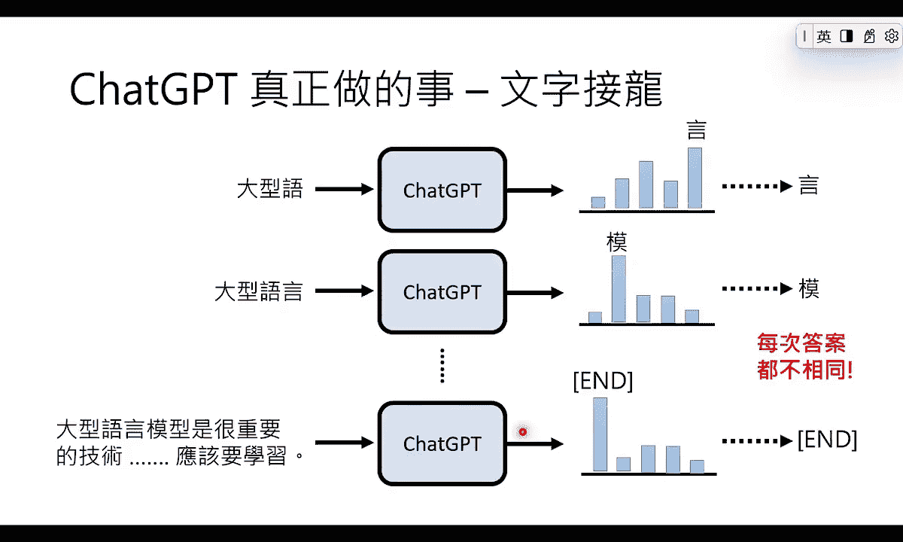

那讲到这边，可能有同学会问说，那为什么要让每次的答案都不一样呢？为什么指骰子呢？为什么不选几率最高的那个token那个符号当做输入就好，当做输出就好了呢。那其实是因为啊在很早年的时候，我们就已经知道。

如果你每一次都是选。几率最大的符号，你不一定能够得到最好的结果。你可以看一下这一篇论文啊，the curiousiouscase of naturalural test degen那们就发现说呢。

如果你每次都选择几率最大的符号，那这个模型就很容易狂跳帧，它就会不断的look讲一样的话。那如果你每次是直骰子的话，你可能可以看到比较自然的回答。对，所以这就是为什么今天语言模型在回答你问题的时候。

通常采用直骰子的方式。

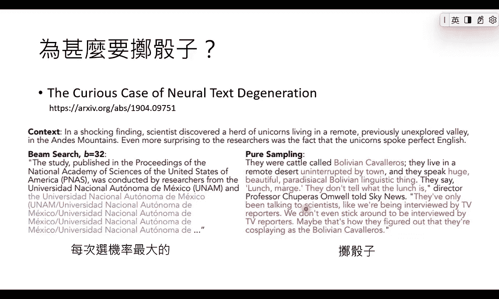

好，那如果你了解GPT真正做的事情，就是文字接龙的话，你就不难想象说为什么GT常常会胡烂。因为这些答案就是凭借着文字接龙接出来的，对GPT来说。

他根本不在意一个答案是不是真实的在意文字接龙接的顺不顺而已。举例来说，你叫他用100个字简介台大玫瑰花节并提供网址。那大家都知道说台大是没有玫瑰花节的。但是你就是告诉他台大有玫瑰花节啊。

所以他就根据你提供的台大玫瑰花节这几个字开始做文字接龙，就可以瞎掰出一个台大玫瑰花节的故事。那因为这边要求他提供网址，所以他确实也提供了网址出来。

只是这个网址是用文字接龙的方式生出来的那这个网址你要看到还蛮像模像样的哦NTU点ED点TW斜线但是你一点进去发现哎里面什么都没有这个。网址是不存在的，因为它是透过文字接龙的方式被产生出来的。

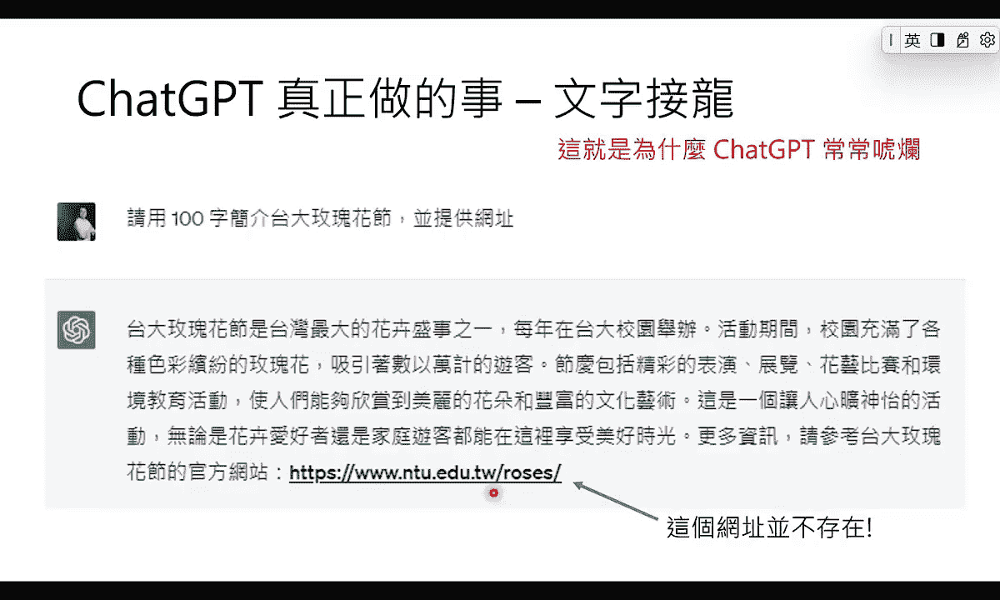

好，那如果你了解GPT是做文字接龙，你就不会太惊讶，为什么他有时候会胡乱撒谎。有时候他会随便补赖，为什么他说的事情不是事实，因为他做的是就是文字接龙。那接下来你可会问说他做文字接龙的话。

他怎么会知道一些历史的资讯呢？怎么会知道一些过去的对话记录呢？大家知道说劝GPT是有连续对话多轮对话的功能的。当你跟他讲说用30个字介绍大型语言模型，他会给你一个大型语言模型的简介。

接下来你告诉他请翻译成英文，他就把他刚才自己输出的答案翻译成英文，我并没有告诉他说，请翻译成英文是要把哪句话翻译成英文，让他自己猜想，应该就是要翻他刚才输出的答案。那他是怎么做到这件事的呢？

说穿了也不值钱。其实就是在做文字接龙的时候，同一则对话里面，过去你问的问题，还有GPT。自己的输出都会作为文字接龙的一部分。所以劝GPT并不是只看请翻译成英文这几个字去做文字接龙。

而是把过去对话的内容同一则对话里面。过去我说的话，劝GPT的答案通通串起来一起去做文字接龙。这就是为什么叫他做翻译的时候，他知道要翻他过去产生的内容。那大家知道说呃前几天的开发者大会啊。

这个open air也有说现在确GPT可以读的这个可以做文字接容的长度已经非常的长了，长到什么地步呢？长大差不多可以读300页PDF档的分量哦，所以这个非常的惊人。你现在可以跟他有非常长的对话。

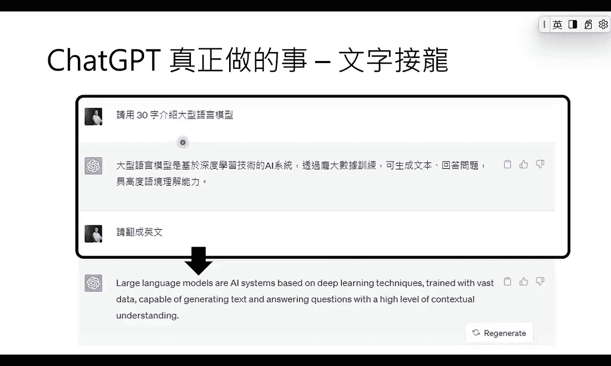

啊，那这个语言模型是怎么学习做文字接龙的呢？其实每一句话都可以是语言模型的教材。你随便给他一个句子，人工智慧真神奇惊叹炮，他就可以拿来做学习。怎么学习呢？这句话里面告诉语言模型人后面可以接工。

所以他就知道说假设有人输入人这个未完成的句子给他，他就要输出功这个字，或讲的更具体一点，其实这个模型实际上做的事情就是他输出几率分布的时候，要把功的几率提高一点，把其他符号的几率降低一点。而。

那同一个句子又会告诉我们，人工后面可以接字哦，所以当人工作为语言模型输入的时候，他就会知道说，那我应该把字的几率提高一点，其他符号的几率降低一点。以此类推，他知道人工智慧增程级惊叹号。

后面就是没有其他东西了，这就是一个完整的句子，所以他就学到说假设输入是人工智慧增程及惊叹号啊，它的输出应该要给呃结束的符号高一点的几率，其他符号低一点的几率。这个就是呃语言模型学习文字接龙的方式。好。

那哪里可以找到大量的教材呢？在网络上有无穷无尽的文具，这些文具就是语言模型，学习文字揭露的教材。

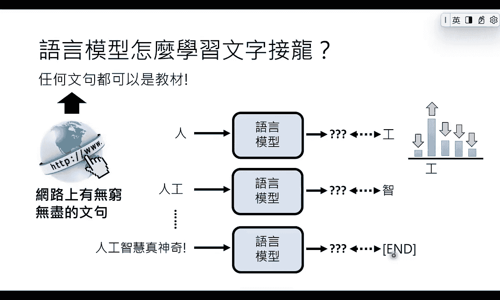

好，那实际上到底是怎么输入一个句子产生这个几率分布的呢？啊，这个解释起来就比较复杂，就不是我们今天可以跟大家说明的。好，那如果讲的简单一点的话，那这个语言模型的背后，今天就是一个巨大的类神经网络。

那类神经网络有很多很多不同的类型。那在今天一般的语言模型背后用的类神经网络就是transformer，这个就是劝GBT里面，T这个字所代表的缩写啊，T代表的就是transformer。

那如果你觉得内神经网络非常抽象的话，那你可以把它想成就是一个韩式。就像你国中高中的时候学到的那些韩式，那道韩式就是输入一个东西，输出一个东西，而语言模型里念的这个类神经网络啊，它也是一个韩式。

这个韩式就是输入一个不完整的句子，输出一个几率分布。那这个类神经网络这个transformer里面呢，其实你会看到说啊这边有很多很多的方块。那这个部分呢就跟线性代数比较有关系了。大家可能觉得说线性代数。

好像离人工智慧非常的遥远，但是其实不是你可以想象说这里面一个一个的方块其实就是在做矩证跟向量的相乘好，所以这一个非常复杂的夯式里面其实就是一系列的矩证乘法。但今天我们不太合适跟大家讲这部分的细节。

如果未来你修了机器学习这门课，你可以更了解，你可以想，你可以记得我在线性代数的时候，跟大家说过的话，一个类神经网络的背后，其实就是一系列的矩证相乘。

所以我们线性代数这门课跟深度学习跟人工智慧其实也是非常有关系的。好，那这个transformer里面呢有非常大量的参数。那什么是参数呢？我们在国中国小的时候，你可能看过这样的简单的函式FX等于AX加B。

那A跟B呢决定的这个函式长什么样。这个决定函式长什么样子的这个A跟B呢？就是参数。那在A加B这个简单的函式里面有两个参数，但是在conformer里面这是一个非常复杂的函式，里面有上亿个参数。

所以可以想象它是一个非常复杂的函式。

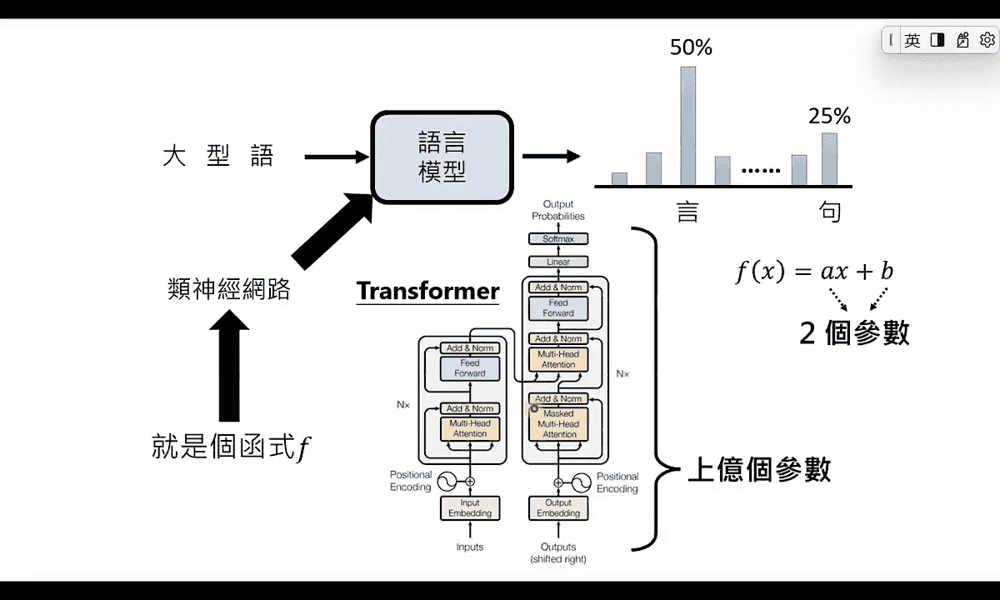

好，那至于实际上这些内神经网络长什么样子，他们这些参数又是怎么被找出来的？请大家详见机器学习课程的上课录音。啊，那接下来呢我们就是跟大家讲一下历史故事。

很多人会以为说确GPT是在这个去年年底才突然横空出世。其实open AI从非常早就开始打造有关GPT的一系列的研究。其实早在2018年的时候。

这个open AI就已经试出了第一代的GPT那第一代GPT它就是一个语言模型，这些语言模型就是透过大量的文字资料来学习做文字揭露。但是第一代的GPT并没有引起太大的水荒。为什么？

首先它不是一个特别巨大的模型啊，它是有这个100多个 million的参数。100多 million你可能也觉得不小了，但是其实放在2018年这个也不是一个特别大的类神经网络。啊。

上面这个数字代表的是类神经网络也就是一个韩式的参数量。那他用了多少的资料来做文字接龙呢？他用了1GB的文字资料，则他文字资料量存在硬碟里面大概是1GB的容量，用1GB的文字资料来学习做文字接龙。

也不是一个特别大的量。这边再跟大家强调一下，上面这个数字是含式的参数量。如果要用拟人化的讲法的话，你可以把它想成是人工智慧的天资。下面这个数字指的是他读过多少资料，这以你可以想成是后天的努力。

对上面是天赋，下面是后天的努力。那当你知道说学而不思则罔思而不学则殆啊，你不能够只有天知没有努力，你不能只有努力，没有天资。这两个东西都要剧足你才能够学会一门学问。好，这个是第一代的这个GPT。

那隔了一年以后呢，这个open AI试出了第二代的GPT第二代的GPT有1500个media的参数，15亿的参数。好，这放在2019年也已经是非常大的参数量。

其实可去找一下2019年时候那时候讲的机器学习里面也有提到GPTQ那个时候我觉得非常惊人。天哪，这个模型也未免太大，那是当时最大的参数量最多的模型。

当然今天GPTQ对你来说也没有什么GPTQ是一个实验室一般你可以自己训练的模型了。好，那当年读的资料有40GB的量。那呃。当年看起来很多，今年今天看起来也还好。

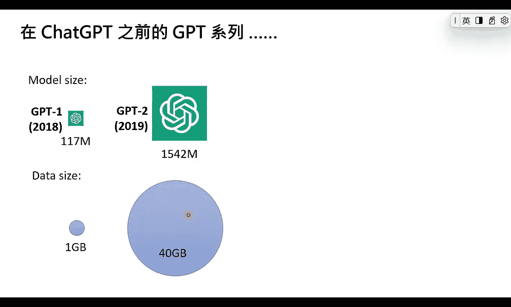

那en AI早在2019年就期待GBTQ可以变成一个类似通用人工智慧的东西。你可以从他们当年GPTQ的论文里面就察觉他们的野心。他们尝试让GPTQ来做各式各样的事情。比如说GPTQ能不能回答问题呢？

你直接问他一个问题，他做文字接龙，会不会正好接出问题的答案来呢？问你叫他做摘要，你给他一篇很长的论文，后面接一个TLDR代表做摘要的符号，看看接下来做文字接龙是不是正好就可以接出文章的摘要来。

那GPTQ的表现怎么样呢？嗯，不怎么样啊，这个是当年GPTQ论文里面的其中一张图，这个纵轴呢是回答问题的，你就想成是正确率。横轴呢是模型的大小，那绿色的这些虚线啊。

代表的是当年其他模型在同样问题上的正确率。你会发现。

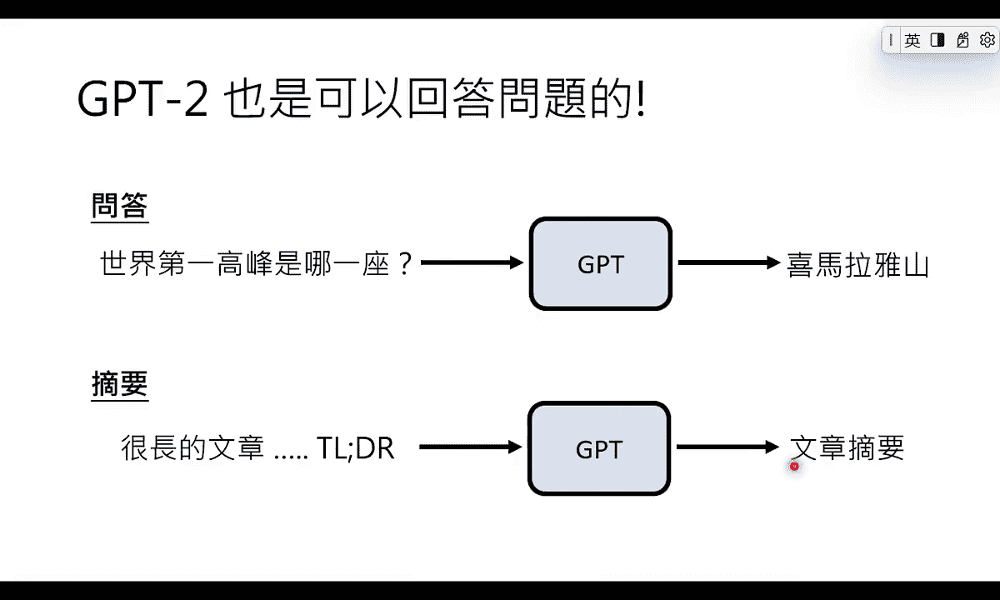

说就算是2019年最大的GPTQ，它能够得到的正确率，也就是55per左右。人类可以得到90%的正确率，完全屌打这些人工智慧。

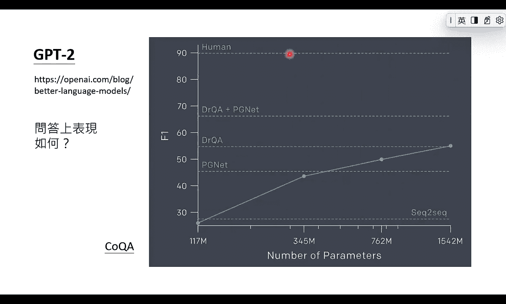

那GBT的表现不够好怎么办呢？后来open AI就一发狠，在一年之后弄了GPT第三代GPT第三代，它的参数量有175B点的参数量，足足是GPT的100倍吧他读过的资料量有580GB。

那你可能有点难想象580GB到底是什么样的资料量。如果用哈利波特等于单位来换算的话，580GB相当于阅读哈利波特全集30万遍，你可以想象说这个模型它读过的资料量。

它拿来学习做文字接容的资料量真的非常惊人。远超过一般一个正常人类一辈子可以读的资料量。哈利波特全集。如果你要读30万遍的话，你必须要一出生就开始读不吃不喝不睡，每一秒钟都读100个英文字读100年。

你可以把哈利波特全集看30万遍。

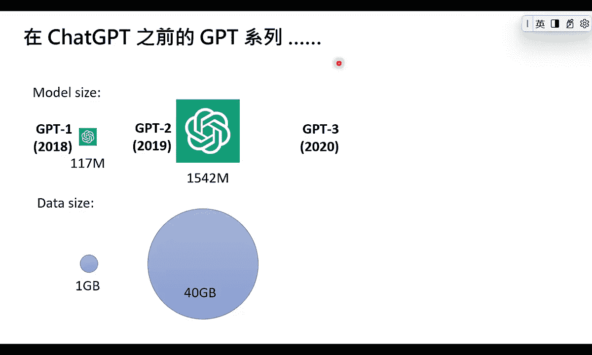

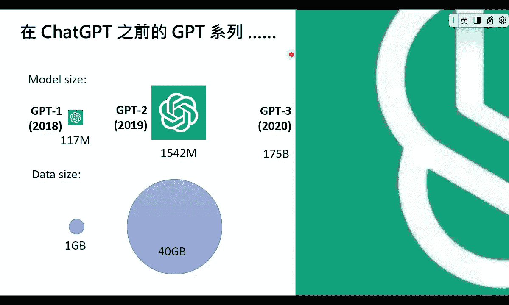

PPT第三代是看过这个等级的文字量的，所以可以了解说他背后的知识储备可能非常的惊人。好，这么巨大的模型，这么大的参数量，那得到什么样好的结果呢？嗯，当年GPT3一个让人震惊的地方就是他会写城市。

当我知道今天对你来说啊，这个人工智慧会写成市有什么了不起的，本来就应该要会写城市，但是在2020年当我们发现GPT3这个会写城市的时候，大家都惊呆了，哇靠，他居然会写城市。但你仔细想想他的训练过程。

你就不会太意外，他为什么会写城市。因为今天这些语言模型就是透过网路上大量的资料来做文字接龙，包括他从一号上爬到的大量的城市码。对知道在城市码里面往往人类写城市语言的时候，就是这样，你会先写一个注解。

说这个函式是在做什么的？然后呢，你再把你要的功能呢？把它写出来。那GPT拿这些资料来做文字接龙，他就学到说如果你输入这串文。

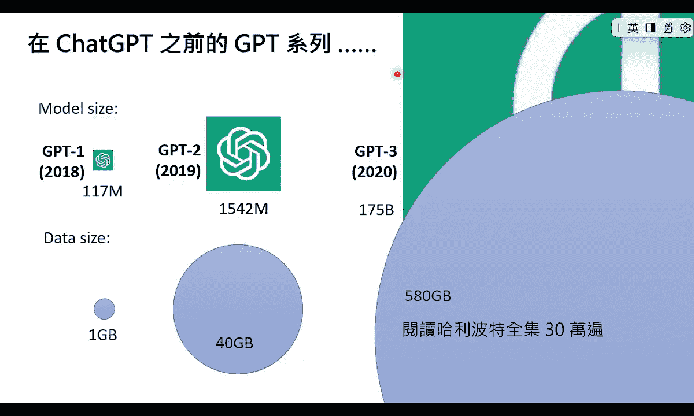

字接下来我就要输出这段城市嘛。所以如果了解它的原理的话，也不会太意外。为什么他能够写城市？

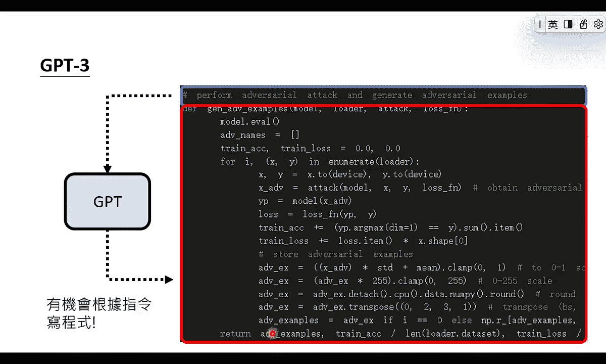

但是in general而言，在所有的任务上，GBT3的表现怎么样呢？也只能说是差强人意，甚至让人有点失落。哦。

这个open AI呢把GPT3测在各式各样不同的任务上那这张图上面看到的这个实线呢是不同任务上面的平均的正确率，纵轴是正确率，横轴是模型大小，最右边是当时最大的GB3，有175个B点。

也就是1750亿个参数。啊，就算放到今天，这个也是一个非常巨大的模型，一般人也训练不了这种巨大的模型的。好那但是最好的正确率也不过是5十几percent的正确率而已。所以当年在2020年的时候。

很多人都觉得哎呀，这个open AI就是走错方向，看起来再怎么做文字接露，也接不出一个通用的人工智慧出来。但是open AI并没有就此放弃。

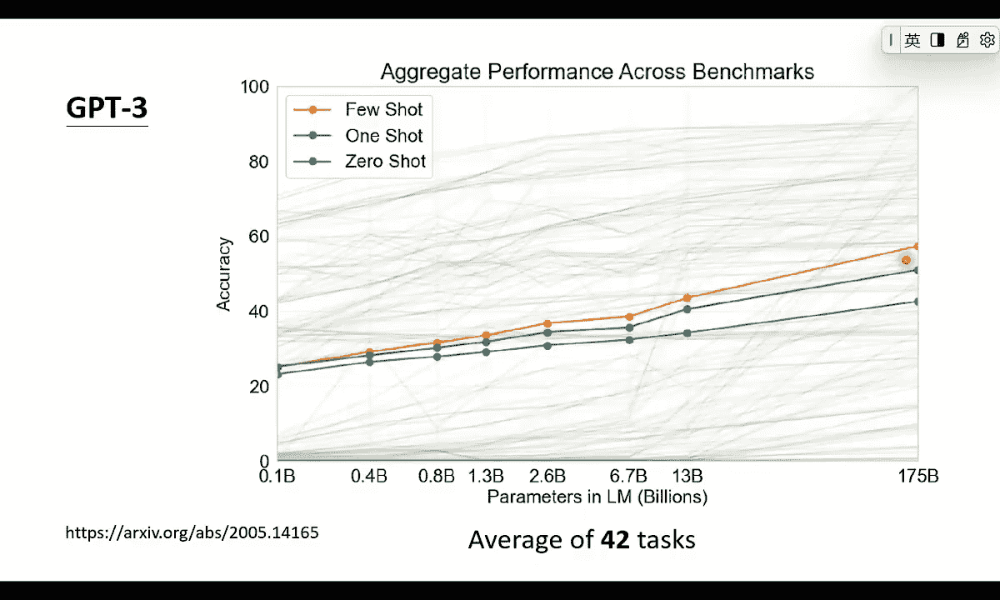

啊，他们有一篇论文说，其实GPT3已经很聪明了，他为什么表现没有很好呢？那只是因为他不知道人类社会的规则，他不知道人类的需求是什么，他就像是一个在三野中长大的小孩，他这辈子唯一接触过的东西就是网路。

他在网路上随便乱学学到什么，他通通都照单填收，他根本不知道他要做什么事情，他甚至不知道应该要回答问题。怎么说他不知道回答问题呢？呃，这个是出自open air的一篇论文啊，如果你问这个GPT3呃。

这边有一段城市马啊，这个城市马里面的某一个东西C他是表示什么意思呢？虽然说这个GPT3好像有写城市的能力。那你以为他会回答你这个问题吗？他才不回答他出4个选项给你选这样，所以这个答案就错了。

那为什么他出4个选项给你选呢？如果你。解他训练的原理的话，你会知道说他就是在网路上随便爬资料，做文字接龙啊，网络上可能有很多的考题，所以他学到的东西可能是看到一个问题，我不回答，我要出四个选项。

让人类来选哦，所以这就是为什么GBD3在各式各样的任务上表现，只有差强人意而已。哦，所以后来open AI就进入了下一个阶段。这个下一个阶段呢就是要有人类来告诉这个人工智慧说到底我们想要的答案是什么哦。

他在这个网络上爬过了非常多的资料，有了很多的知识储备，但我们至少要他知道我们他存在的目的就是要回答人类的问题。哦，所以这个GPT呢就继续学习。

那这个就是我们今天看到的全GPT那这个继续学习的时候是在学习什么呢？他学习的东西就是会有人类告诉他说，以后有人问你问题，台湾最高的山是哪座问号，你不要说我不知道不要携手撕出来，不要出四个选项。

你的答案就是预山。

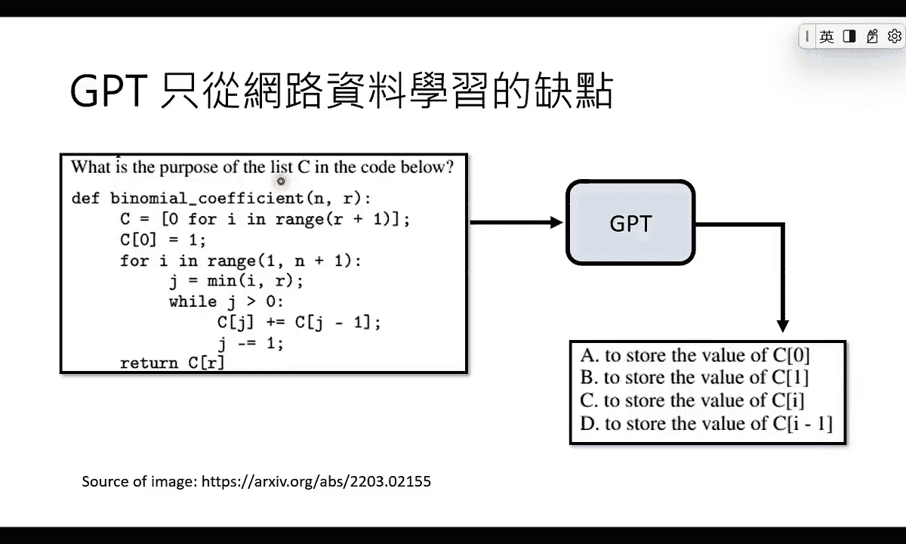

如果讲的更具体一点，实际上你要这个GPT做的事情，其实就是以后看到有人问这个问题，你应该要把预更山的几率提高一点。可能本来他在网路上自由自在学习的时候，他并不知道这个问题，后面加问号。

后面预三的几率要非常的高。但是有了人类老师告诉他以后，他就知道以后如果输的句子是台湾最高的三是拿做问号，那预更山的几率就应该要提高一点。那引入人类老师来教这个人工智慧的这种学习啊，叫做督导式学习。

如果有人类老师告诉这个人工智慧，正确的答案是什么？这种学习方式就叫督导式学习。而反过来说，假设这个人工智慧是在网路上爬到什么资料都拿来做文字揭龙，没有老师的引导。那这个今天我们叫做自督导式的学习。

啊就是自己呢督导自己。好，那如果我们把跟老师学习当做是真正的训练。那在网路上自己教自己，就是在课堂前的预习就是预训练。这个预训练就是劝PPT里面批这个字的缩写。

所以可以了解说预训练其实是一个非常关键的技术。它其实是今天这些人工智慧成功的背后的关键。那今天这种GPT呀又叫做基石模型。因为你可以把这些基石模型做持续的学习，做一些微调以后，让他可以真正的为人类服务。

所以GPT现在又叫做基石模型。那从GPT经过一些微调，经过人类的教学，变成确GPT这个持续学习的过程呢，今天有一个术语叫做fin tune它的中文也许可以翻译成回调。那你可以从这个字眼里面就知道说。

其实从GPT到确GPT这个模型的变化，可能没有真的非常的大。也许我们对模型只是做了一点点的小改变，做了一点的微调，它就有非常强的能力。那等一下在几业作片之后，就会举实际的数据来跟大家说明。

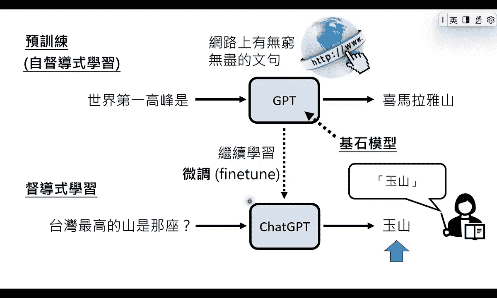

好，那我们先来看一下督导式学习的重要性。那这一页投影片呢是来自于一篇叫instructGPT这也是open AI的论文。那其实这个呃GPT啊。

open AI并没有真的是出论文告诉你说这个GPT是怎么被做出来的。所以今天对于GPT背后的原理。很多时候是一些猜想。

但是这个open AI呢有出一篇论文叫instructGPT如果读structGPT的话，你会发现它里面呢对于模型训练的流程图跟这个open AI放在官网上说明GPT的训练过程的流程图有87他项。

基本上就只是把图换的颜色而已。所以从GPT这篇论文里面，我们应该可以猜测呃这个open AI是怎么打造GPT的。那在instructGPT这个pa里面呢，它就有展现了督导式学习的重要性。

而这个纵轴代表模型的好坏，这个横轴代表模型的大小。那蓝色这一条线是没有督导式学习模型，只看网路大量资料做文字接龙的结果。而上面这个红色这一条线，你可以想象是模型有人类指导后的结果。

你会发现说如果有人类指导的话，就算是最小的模型，也可以赢过最大的，没有人类指导的模型。所以这告诉我们说这个人类老师的重要性，一个天资再好的学生，没有好的老师引导，他也打不赢一个天资不好。

但是有老师好好教导的模型啊。当然如果是天资好的模型，他有人类老师好好的教导。他当然也是可以胜过这个天资比较差的模型的啊这个图是告诉我们督导式学习的重要，有督导式学习，小模型，也有机会胜过大模型。

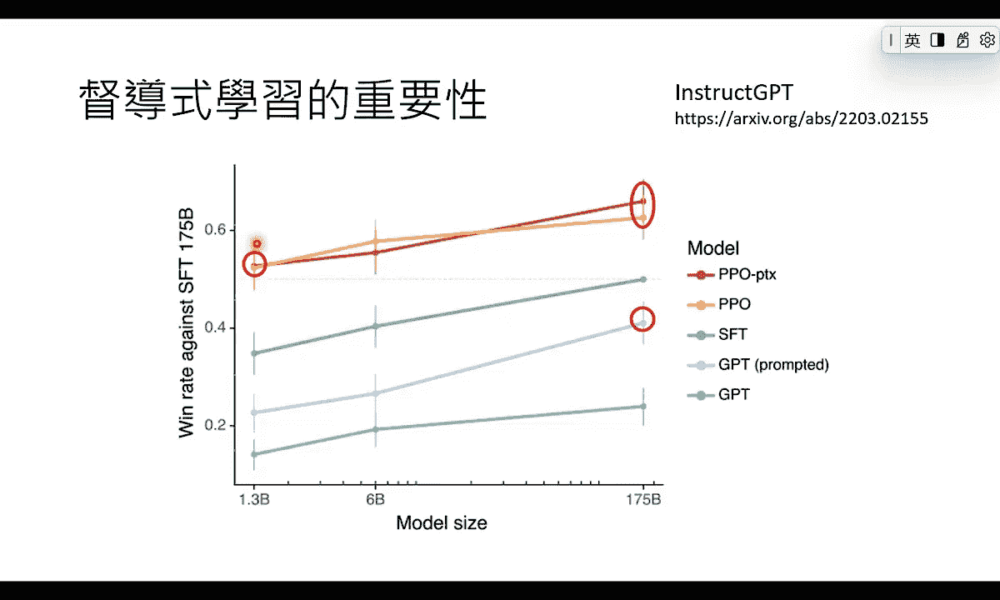

好，那预训练有多重要呢？这个有了这个预训练以后啊，事实上督导制学习不需要大量资料。有很多人会问说，督导式学习要人类老师教，人类老师到底要教多少这个模型才能够开窍呢？从文献上看起来。

也许人类老师并不真的需要花非常大的力气来教模型，他就可以开窍。这边举一个实际论文上的例子。而这个玉。好，这个预训练呢。Hello hello hello。hello hello好。

我猜在应该是不需要麦克风了。好，这个预训练有多神奇呢？这个预训练神奇的地方是呃，甚至啊你如果今天在做预训练的时候，有让模型看过很多不同的模型，呃很多不同的语言之后呢。

你只要教他某一个语言的某一个任务模型就会自动学会其他语言同样的任务。举一个更具体的例子啊，这个接下来的实验是来自我们实验室过去的论文，那这个是比较早期的论文是2019年的论文。

所以那个时候我们用的还不是GPT系列啊，那个时候用的是brt系列。有一个brt的模型它是在104种语言上做预训练。那bt这个模型呢它预训练的方式跟这个GPT有一点点不一样了。

那这个细节我们今天呢先不跟大家详谈，总之你就想成。说他也是一个语言模型，他也在做很类似文字接龙的事情。好，那这个看过100多种语言的bert啊，你只要教他英文的阅读能力测验，教完之后。

中文阅读能力测验可以直接裸考哦，就好像你要去考中文的托福那个阅中托福的这个呃阅读能力检定，但是你考古题只做英文的，那你现场直接考中文的结果，你也答得出来。

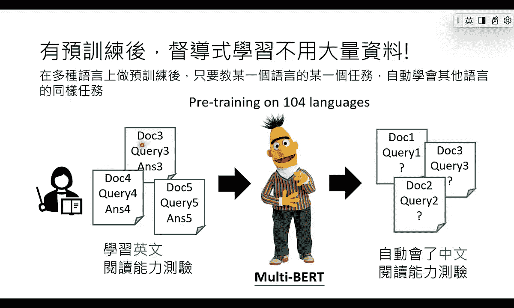

好，这边是具体的实验数据啊，因为这是比较早年的实验了。曾经发现说那个时候呢我们还会做一些没有预训练这种事情啊，这个测试资料呢用的是一个叫做DRCD台达电试出来的中文阅读能力理解测验集。好。

那如果你今天呢是叫模型去在大量中文的题目上去做学习。啊，接下来测试在中文的考题上啊，它可以得到78per的正确率。如果他今天有做预训练，现在大量中文资料上做预训练，接下来再用一些中文的考题点拨它。

接下来直接去考中文的考题，它可以得到89per的正确率。那其实这个正确率也已经不低了，其实在同样的题目上，人类也只有93per的正确率而已。但这边真正想跟大家分享的内容是假设这个模型。

他曾经在100多种语言上做过预训练。接下来你只要教它。英文的阅读能力测验，接下直接裸考中文也可以有78per左右的正确率跟没有预训练，拿中文学习得到的正确率是差不多的。所以从这个实验里面，你就可以想象。

对于这种有看过大量不同语言的文字资料，坚确GPT在网络上爬了大量的资料来学习，不是只有英文各种不同的语言，他都看过。对这种看过多种不同语言的预训练模型来说。

你只要在某一种语言的某一个任务上点播它其他语言同样的任务，它基本上很有可能也可以自动学会了。

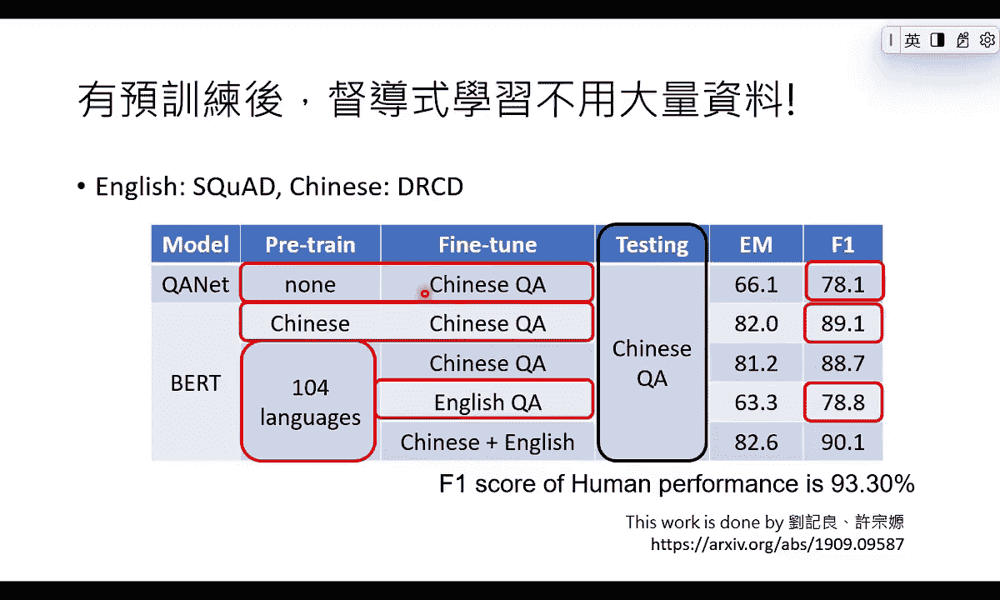

好，那从instructGPT这边paper里面也可以看到说督导式学习就是画龙点睛。在instructGPT这篇paper里面用了多少的资料，人类老师提供了多少的资料来教这个人工智慧呢。

基本上只提供了1万多笔资料而已。所以你知道说也许不用太多的资料，透过督导式学习，就可以很快的强化这些语言模型的能力。那事实上最新的这个meta所示出的lama two达ma two也是另外一个语言模型。

是meta示出的lama two它在做这个督导式学习的时候，也只用了2万多笔资料而已。所以你知道说在有了这个预训练之后，其实督导式学习不一定要非常大量的资料。

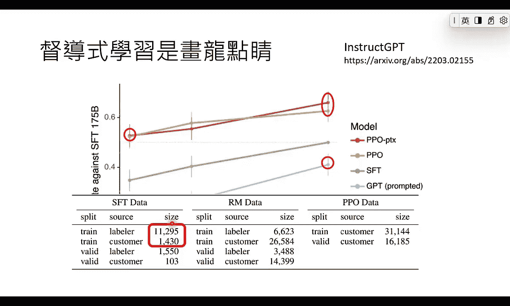

好，那除了督导式学习以外呢，HTPT还可以透过增强式学习来继续强化它的能力。那增强式学习的英文呢是reinforment learning啊，缩写呢是IL。那在增强式学习里面呢。

人类老师不再提供正确的答案，而是提供回馈，告诉这个语言模型，说什么样的答案是好的，什么样的答案是不好的。那督导式学习跟增强式学习有什么不同呢？在督导式学习里面，人类要提供完整的正确答案。

那这个很花人类的力气，多数人也许不愿意这么做，可能只有open AI聘过来的数据标记源才有心力做这件事。但另外一方面增强式学习，其实每个人都可以做。你今天在使用切GPT的时候。

如果你有使用GGPT的经验的话，你会知道说当你问切GBT同一个问题两次的时候，第二次他就会问你说我现在的答案有没有比上次那个答案好，你会告诉他有或没有。当你告诉他有或没有的时候，你就提供了他回馈。

他可以根据你提供的回馈进行学习。

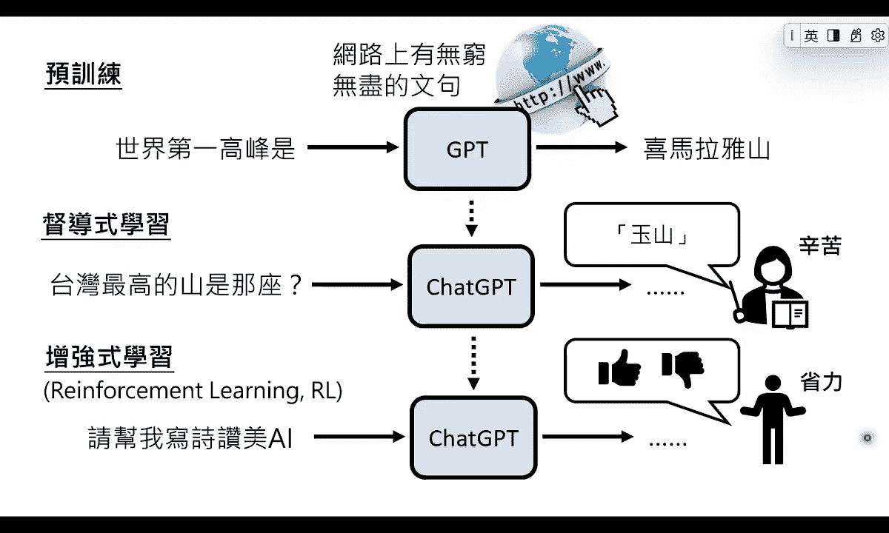

啊，那这个增强式学习啊也是一个很大的题目了。那今天从人类的回馈做增强式学习，有一个专有名词叫做RLHF，它是reinforment learning from human feedback的缩写。

那有关增强式学习的内容。如果大家有兴趣的话，也请参见机器学习这门课的上课录音。

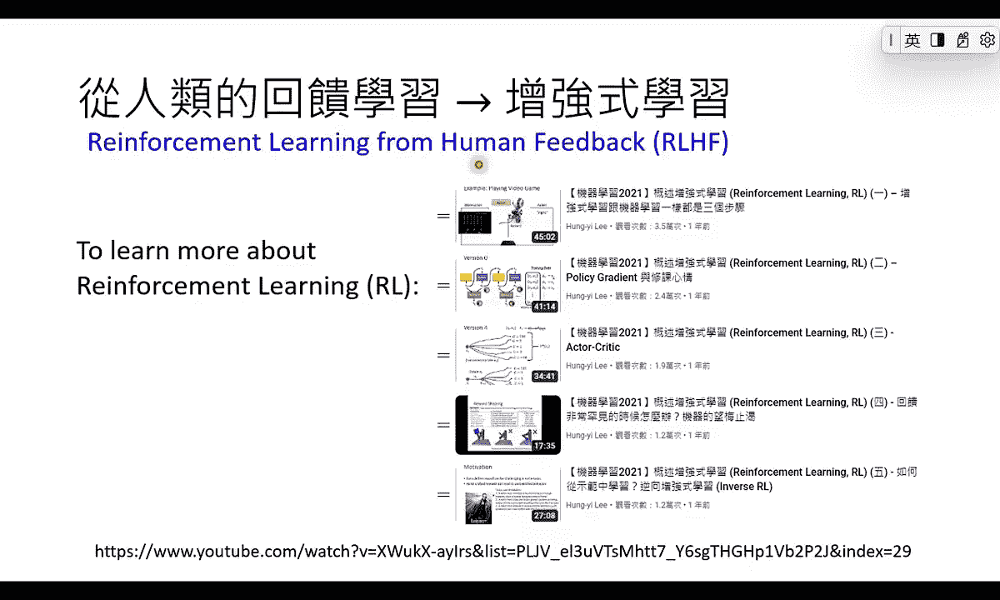

好，虽然说增强式学习它背后的原理是比较复杂的，但它的概念还是可以跟大家说明一下的那增强式学习的基本概念是什么呢？增强式学习的基本概念是当你问一个问题啊，那这个BT给你两个答案。

而你告诉他某一个答案好过另外一个答案的时候，这个模型就要想办法把你觉得比较好的答案提高它的几率。你觉得比较差的答案降低它的几率。那从这个增强式学习的原理啊。

你也可以了解说为什么增强式学习是放在整个训练的最后一阶段。为什么我们是先做预训练再做督导式学习，最后再做增强式学习。为什么不是一开始就把系统上线做增强式学习呢？那就是因为模型要有一定程度的能力。

才能够进入增强式学习的环节，在增强式学习的环节里面，模型是他提供了多个不同的答案。有些答案好，有些答案不好。类觉得好的答案，他就会提高几率，人类觉得不好的答案，它会降低几率。

这背后隐含的假设就是就是你的模型必须要偶有佳作，它必须要有时候能够得出不错的答案，人类说这个答案是好的那提高这个好的答案的几率才有意义。那如果模型非常的烂，他永远都提供差的答案。

那就算人类勉强说某一个差的答案还是比另外一个差案答案更好，那模型是提高差的答案的几率，那可能就没有非常大的帮助。所以这就是为什么增强式学习是放在整个训练过程的最后一阶段。

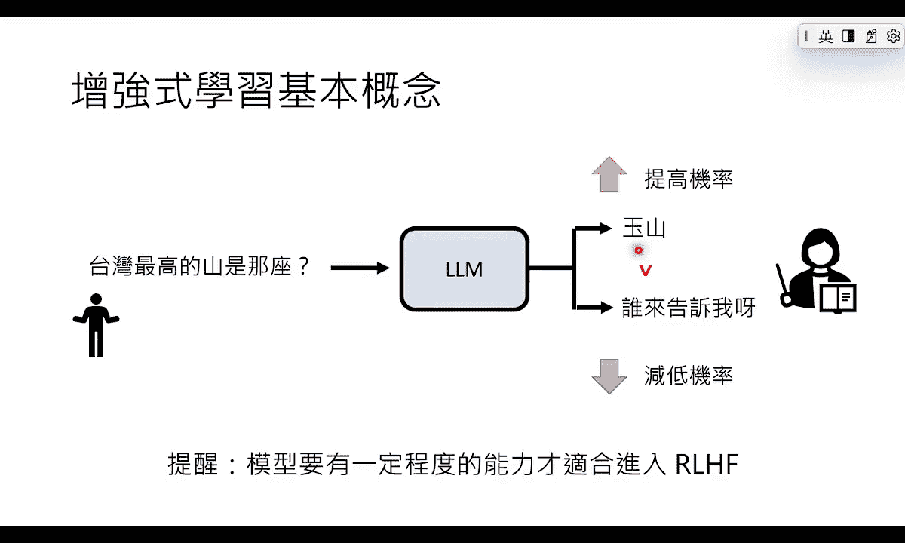

好，那其实确GPT背后的增强式学习啊又是分成两个步骤的那怎么分成两个步骤呢？刚才我们讲增强式学习的时候，好像是告诉你说输入一个问题，如果人类觉得好啊，就给他。如果答案人类觉得好，就提高几率。

人类觉得不好，就把它的几率降低。但是这样机器只学到把某一个问题做好啊，怎么让机器学到这个人类给某一个问题回馈，但是其他的问题也有机会做好呢，这就要看看这个确GBT它实际上是怎么做的。

其实确GBT的增强式学习呢，又再分成两个阶段。第一阶段是先去学习人类老师的偏好。当人类说这个第一个答案比第二个答案好的时候呢，其实确GBT就去另外训练的一个reward model。哦。

这个reward model做的事情是把人类老师的答案给这个模型，它去得出一个分数。那这个reward model做的事情就是。去模仿人类老师的偏好。

如果人类老师觉得某一个答案是好的那今天你把这个答案输入给reward model的时候，就该要有比较高的分数。如果人类老师觉得某一个答案是比较差的，把差的答案输给reward model的时候。

就应该要有比较低的分数。

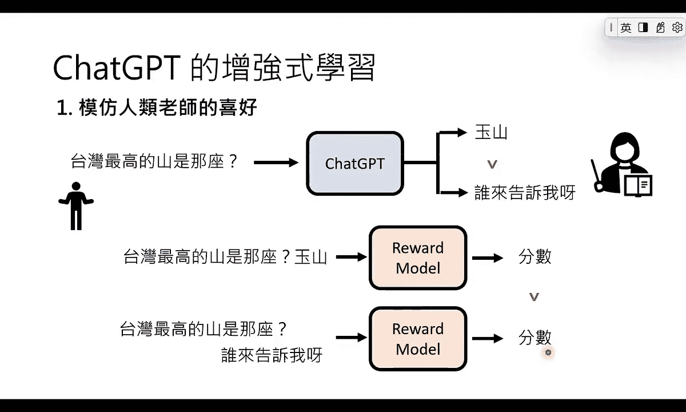

那有了这个reward model以后，这个reward model就可以取代人类老师的角色，啊，就可以把人类老师丢掉，直接拿这个reward model去教语言模型啊，所以语言模型给他一个问题。

他得到一个答案以后，就把这个答案呢去丢给reward model如果reward model给的是低分那这个模型之后就会知道应该要降低这个低分答案的几率。如果反过来说。

某个答案会让reward model给高分，那模型就知道要提高这个答案的几率哦，有了reward model以后，你就想象说reward model就模仿了人类老师的偏好。

那语言模型就只需要跟reward model学，就可以把人类老师丢一边去了。好，那这个就是确GVT的增强式学习。

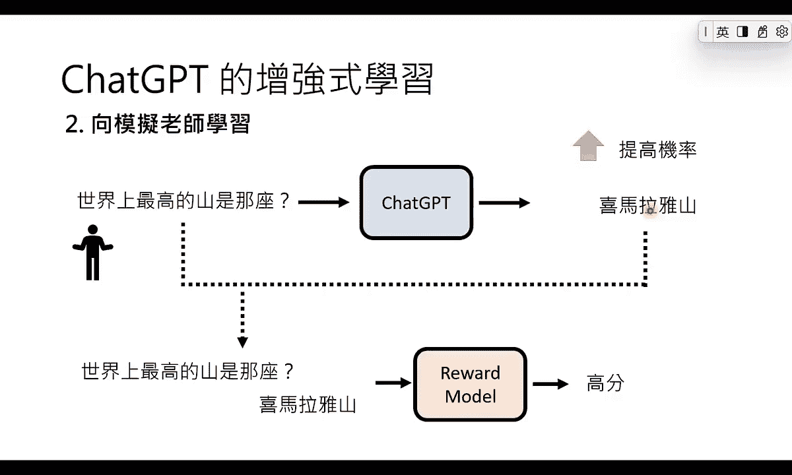

好，那我们今天就学到说这个chGBT的学习有三个阶段，先做预训练，再做督导式学习，接下来再做增强式学习。而督导式学习加增强式学习，今天又有一个专门的术语来称呼这个过程。

这个专门的术语叫做alignment。那这个alignment也许中文我们可以翻译成对齐对齐什么东西，对齐人类的需求。哦，所以在整个训练的过程中，其实人类也扮演了非常重要的角色。

你看这整个训练的过程中啊，这边又出现一个人这边有出现一个人。而今天这个chGBT学习的过程，就是想办法去对齐人类的需求，想办法去满足人类要他做的事情。

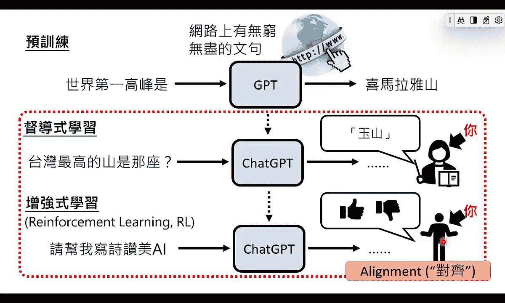

好，刚才讲到呢GPT3了，那GPT3后来经过这个呃呃supervise learning也就督导师学习，还有IOHF也就增强式学习以后那个模型今天我们叫做GPT3。5。

但大家又知道说去年不是去年几个月前这个open AI又出了GPT的第四代。那GPT第四代其实是有一个技术报告的了。这个技术报告长达近百页，那是公开的，每个人都可以读到这个技术报告。

这个技术报告最惊人的地方就是作者群长达三页。所以你知道说哇，这个背后的工程非常的浩大。但这个技术报告主要的内容就是告诉你GP four有多强了，主要就是一个炫耀文，对GP four背后的细节。

总之就是呃只有这一段而已。那这一段你读了以后也发现他没写什么，主要就告诉你说我不能告诉你GP4是怎么做的。当网络上有各式各样的传言了。但是open aI官方从来没有真的。

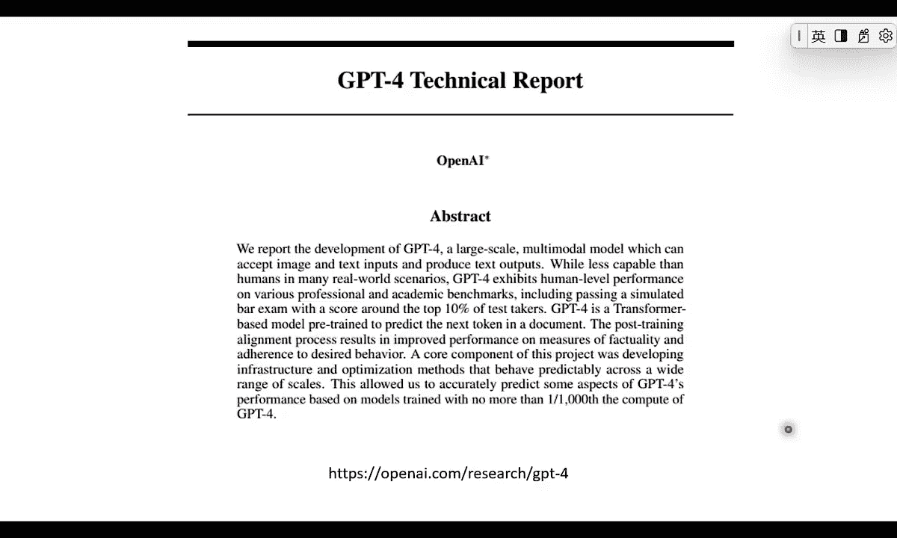

正式的告诉你GPT four这多大的模型用了多少的资料。好，那GPT four最不一样的地方就是他看得见了。而这个功能现在也经公开示出了。今天你就可以传一个图片给GPT four看。

那他会告诉你说他从这个图片里面看到了什么。那这个例子是来自GPT four的技术报告了，就是他给GPT four一张梗图，然后问他这个梗图呢，哪里好笑。那今天一个有趣的地方是他不只问他哪里好笑。

还叫模型一步一步的思考。这句话有什么样的妙用呢？等一下会再跟大家分享。总之GPT four他可以看到这个梗图以后，回答这个梗图相关的问题。

而今天这个功能已经试出了所以大家都有办法体验到这个GPT four阅这个看这个世界的能力。

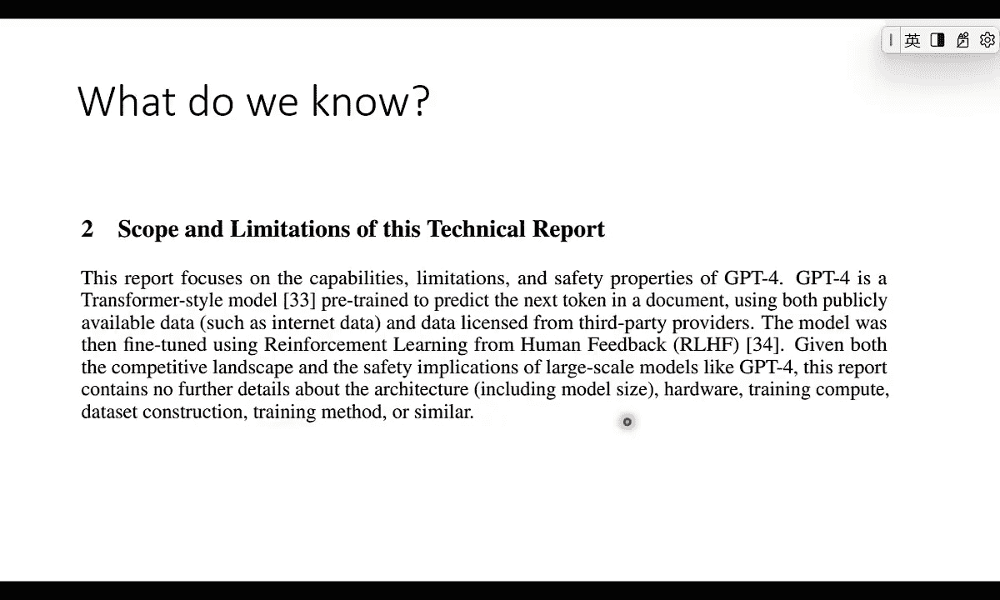

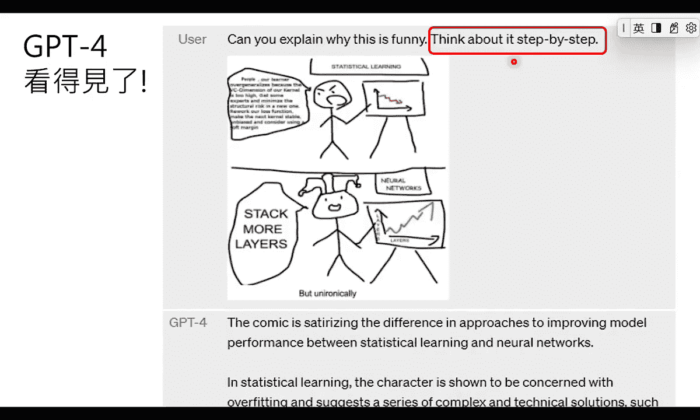

好，那语言模型已经很努力跟人类的需求对齐。那也许下一阶段就是换人类努力一下来满足语言模型的需求，让他可以更理解你的需求。那我们在这边还是先休息一下，我们休息10分钟。

我们等一下再回来看一下人类怎么想办法去满足语言模型的需求，让他发挥更大的能力。好，我们休息10分钟，我们11点30分的时候回来。好，那我们就继续上课吧。好，那我们刚才讲到说语言模型它现在已经非常强了。

那下一阶段就是换人类努力，看能不能够激发语言模型更大的力量。以下就是讲一些可以激发语言模型更大力量的秘诀。啊，第一个是最基本的把你的需求讲清楚。很多时候语言模型没有他发挥他应有的能力。

并不是因为他能力不够，而是因为他不知道你想要干嘛。举例来说，今天大家常常会用HBT来帮你润世论文啊，论世的方法，可能是你直接给他你写的一段英文的文字，叫他帮忙润世以下的段落。

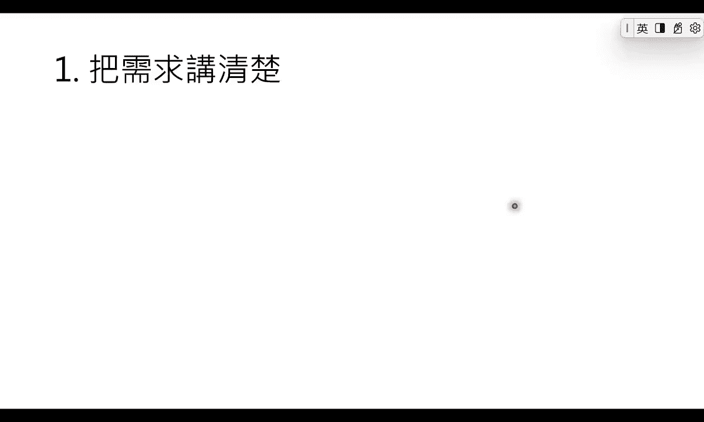

当你叫他帮忙认识以下的段落的时候，他会把你刚才写给他的句子进行改写。那有人会觉得说呃，我本来英文就已经写的不错啦，我只是想要叫你帮我改几个字而已，看看有没有什么错字帮我修掉。

但是你怎么把我整段文章都重写了呢？这不是我要的啊，这个GPT没什么好用的。啊，但其实啊如果你今天的需求是只要他帮你改错字。那你应该明着告诉他。比如说请修正以下段落的文法错误。

如果你明确的要求他只修正文法错误，你就会发现说他只会改文法错误，其他东西就会一字不改。举例来说，这边我们特别放了一个文法错误2，后面接mod，后面接了一个复数，那GPT就会把mods的S拿掉。

其他部分就一字不改。所以你有什么需求，你要明确的跟GPT讲，他才能按照你的想象。

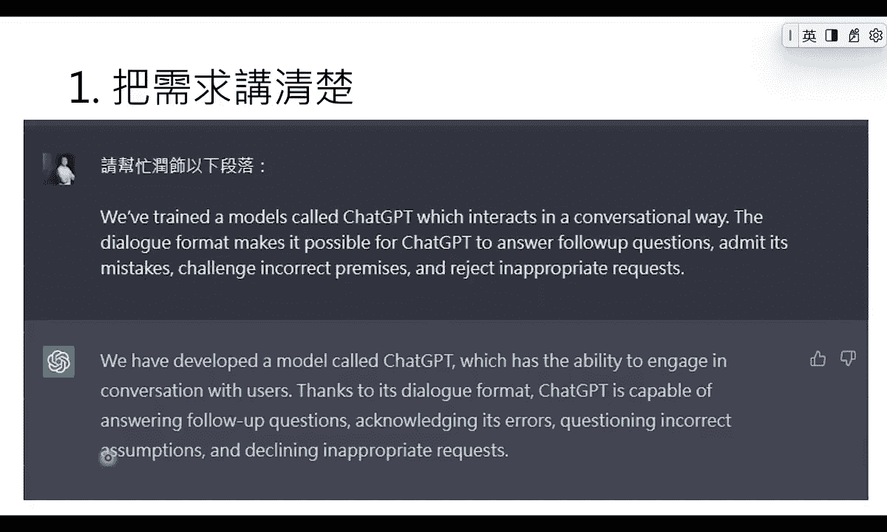

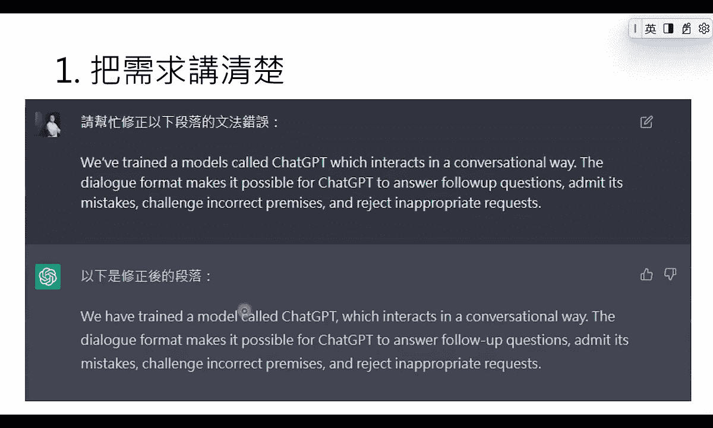

来进行运作。啊，或者是今天大家常常会需要chGPT呢帮你写报告。那可能本来你已经打了一个草稿，然后你就可以把这个草稿呢输给chGPT叫他帮你扩写。但是你发现他一扩写，哎，我给他明明是英文的句子。

他怎么用中文扩写呢？但你仔细想想，你也没有告诉他应该要用哪一种语言扩写啊，他看你这边是用中文下指令，还以为你要叫他用中文扩写的。所以假设你要叫他用英文扩写怎么办？名着告诉他，用英文扩写哦。

他就会用英文扩写。但金可会想说哎，这个扩写外免扩写的太少了，今天报告要教300字以上，这个字数不够啊，怎么办？直接叫他写到300字以上啊，叫他写300字以上，他就会写300字以上。所以你有什么需求。

就明着跟雀GPT讲。那其实今天我是鼓励同学们多用cheGPT来润世你的文字的，尤其是你写论文的时候，我都会要求我的研究生，一定要。

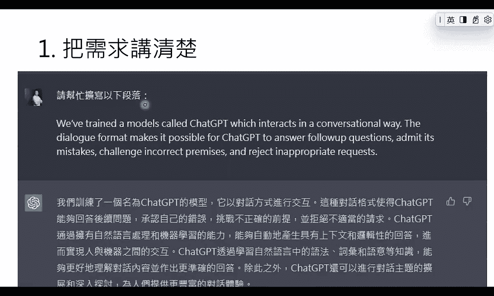

给切GPT改过，而且真的真的，而且不要只有我不要看到3。5改的版本。就有时候学生拿来给我看，我知道这个是切GPT的文字，但我看这个写的这么矮板，一看就知道是3。5写的。我都会告诉大家说。

实验室出钱让你用GPT4的账号，你要用字来写啊。而且我要告诉给大家建立一个观念，你给教授看论文之前，没有让切GPT改过是一个失理的行为，所以一定要让GPT改过。

今天没有任何人应该会有错字或者是不通顺的英文了。因为所有的东西都有缺GPT改过了。😡，好，那另外一个使用GPT的技巧啊，就是你可以提供资讯给GPT我今天先跟大家讲一个错误的示范。

很多人叫GPT写报告的时候，你可能就是直接叫他写给他的题目就让他自由的发享，那你不要忘了，他就是做文字接龙，你叫他自由发享，你就很难控制他发享的内容。那我这边是教他写一个9份一日游的邮寄啊。

要写到1000字。那你写别的报告的时候，你其实也让我怎么用邮寄作为例子啊，你写别的报告的时候，道理也是一样的啊，我今天呢教他写写9份一日游的邮记写1000字，然后他就开始写写写。哎，写着写着就停下来了。

写到再晚上我们参加了9份就停下来了。为什么会这样呢？如果你了解GPT的原理的话，其实也不难想象。当他今天直到结束这个符号的时候，他就会停下来。那今天你要他输出的文字越长，他就越有机会在不。

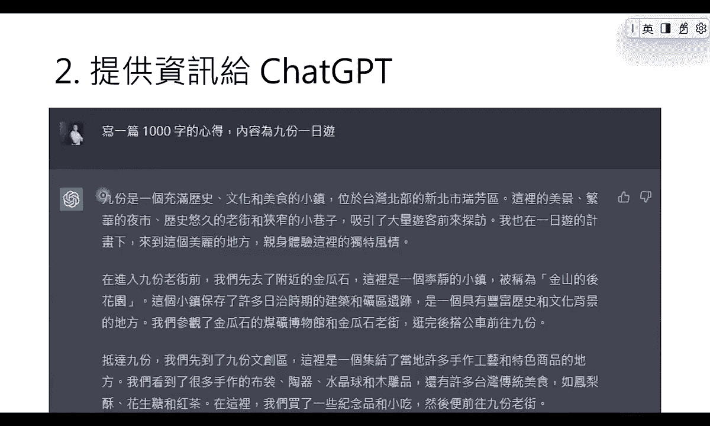

当的时机直到结束这个符号啊，所以他的回答就结束了。你叫要他继续讲怎么办呢？明着跟他讲，叫他继续啊，他就会继续把文章写完，但是这边你只是给他个题目叫他自由的发享，他根本不知道你有去过九份的哪些地方啊。

所以他写出来的邮记一定跟你实际去的地方不一样，你甚至不太确定有些地点到底是不是九份的景点所以怎么办呢？你可以提供资讯给GT所以你写报告的时到底也是一样，你不要让GT凭空写出一个报告。

你可以自己先收集一些资料，把你收集到的资料写GT让他根据你收集到的资料进行撰写，所以我这边就告诉GT说早上去了哪里，下午去了哪里，当晚去了哪里，他就会按照我的要求写一个邮寄。

但是你发现这个邮记也实在是很流水账文字很挨板早上逗号，下午逗号，当晚逗号。

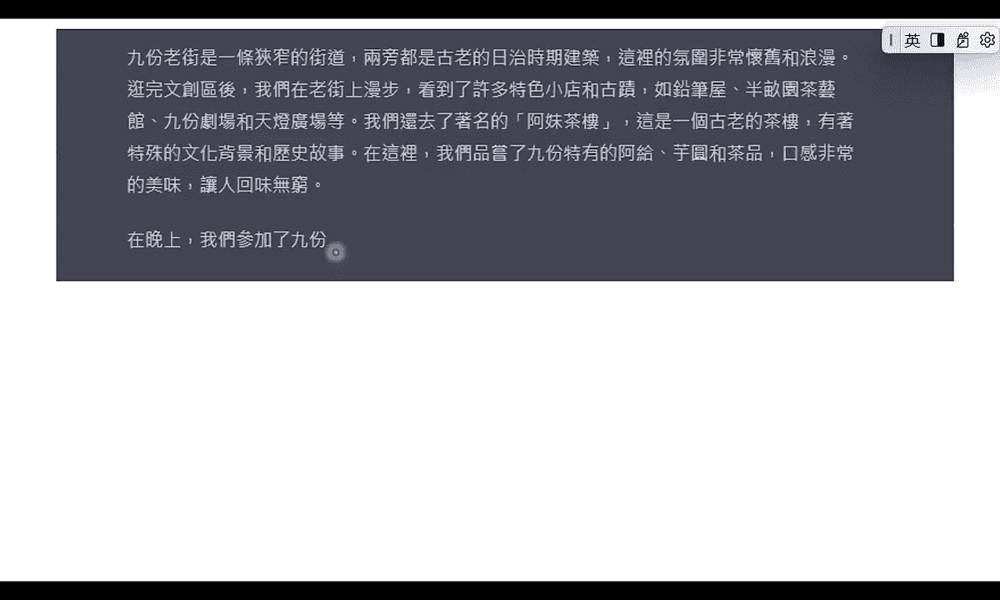

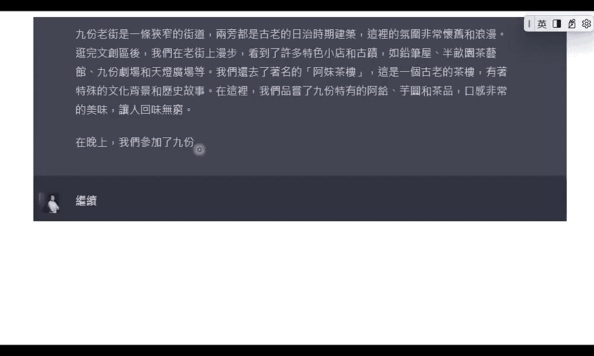

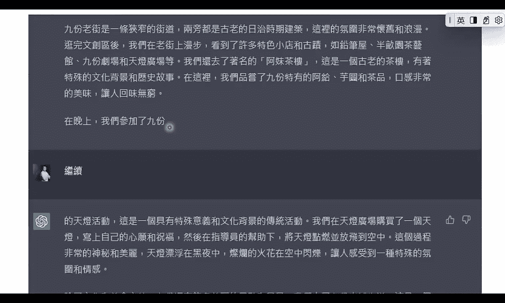

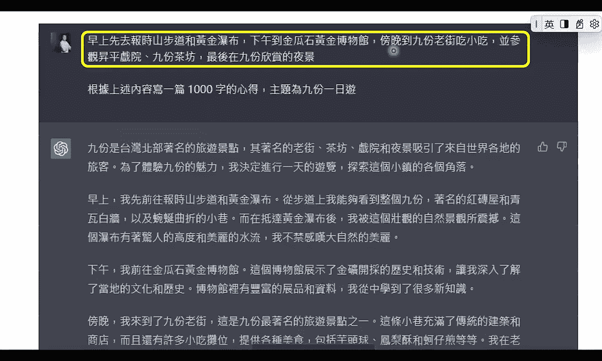

流水账了，那怎么让他文字比较活泼呢？明着告诉他跟他讲，用IG网红的口吻，要用表情符号啊，他就会加很多表情符号上来，他的文字呢就会变得比较活泼。

好，那第三个呢第第三个使用GPT的秘诀就是你可以提供范例给他。其实在今天课程的开头，我们已经示范怎么让GT写5条体。那这边呢是示范让GT写京晶体。那我不知道大家知不知道京晶体是什么。

你不知道京晶体是什么没有关系。因为GT也不知道所以我必须要跟他描述一下什么是京津体我说京津体呢就是一种流行于台湾以中文基底夹杂英语不成句的单字或语的表达方式。

你可能读这个句子读的有点一头雾水GT也是一头雾水。他告诉你说不知道你在说什么啊那怎么办呢？我就明着告诉他说，哎呀，工作就是叫你把文章中一部分的中文翻译成英文这样听懂了吗？GT听懂了，他给我这样的结果。

好整篇文章都翻译成英文，这不是我要的京晶体那这也不能怪GT因想想看只把部分的文字翻译成英文这个要求太奇怪了，他可能从来。

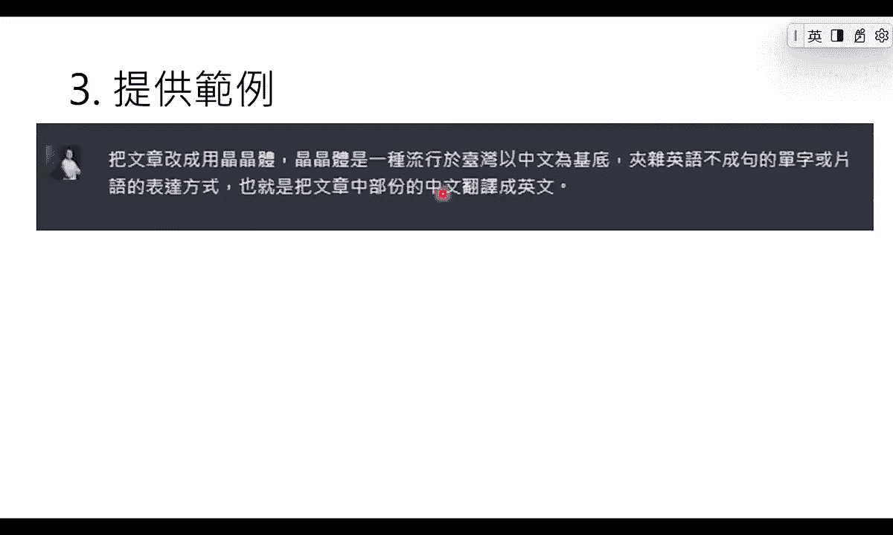

没有人教他怎么做过，所以他不知道要怎么做，所以怎么办？给他些范例啊，告诉他说，你把我要开会改成我要meeting，把我是我很我是很忙，因为我很多事要做，改成我是很busy。因为我很多fin要丢。

这个时候他就懂了，他就可以用晶晶体写一个游记，他就说真的是很braeftaking的景象，what go从高处垂直落下，形成一条构设的瀑布，真的是太壮观了。所以你给他个范例，他就能够写晶晶体。

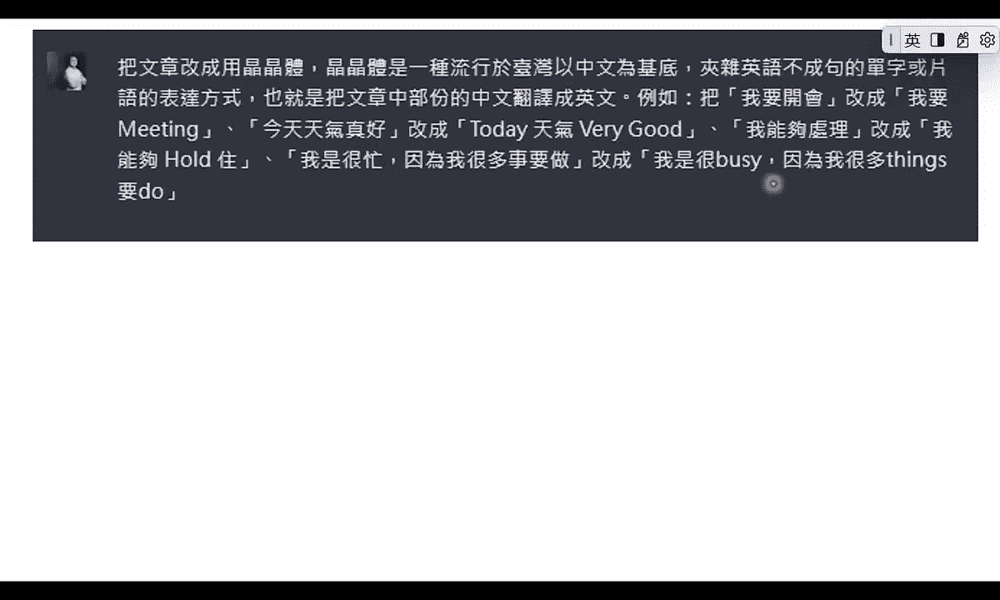

好，第四个这个那个秘诀呢是你可以鼓励鹊GPT想一想什么意思呢？我们看看，如果你今天给我们看一个具体的例子，如果你给雀GPT呢解一个数学的问题。比如说这边是鸡兔同笼的问题。

你跟他说不要列计算过程直接给答案。这个时候你会发现咦他一直都答不对这个问题，它的正确率是0per，好像确GPT很不能解鸡兔同笼的问题一样。但是今天如果你换一个问法。

把不要列计算过程改成请详细列出计算过程，这样几个字的差异，它的能力马上暴涨，它有80的几率可以答对鸡兔同笼的问题。哦，所以鼓励鹊GPT想一想是有用的。而且这个不是都市传说，这个都是有论文佐证的。

你可以看一下这边。告诉你说，鼓励去GPD想一想，确实是有用的。

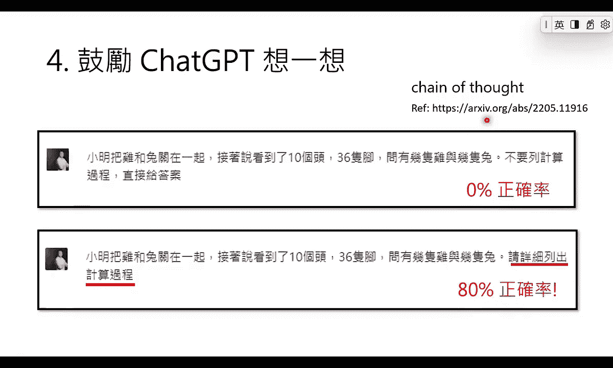

而有另外一篇论文呢，就试图去找出最强的鼓励cheGPT的咒语。那他们是尝试在一些数学的应用题上。他们发现说如果你不鼓励他就直接给他问题。他答对的几率是17。7%好像没办法解数学的应用题。

但是光是你跟他讲一句，let's think让我们想他就变到57%。你刚他说let's think step by step，让我们一步一步的想，就进步到78per。

你看刚才那个GPT four在读图片的时候，这个open AI的范例里面也是叫GPT four think step by stay一步一步的想，看起来这个咒语，对GPT four读图片也是有帮助的。

好，这边paper里面呢找出了一个更强的咒语，他说最强的咒语就是let's work this out in a step by step wayto be sure we have the right answer。

这个咒语可以让进步率提升到82per模型后来又有人找出更强的咒语，如果你告诉GPT four呢，你告诉这个语言模型呢先深呼吸再开始作答，也会让他的能力再变得更强化。

好，那这些神奇的咒语要怎么找出来呢？当然你可以凭着人类的智慧来揣摩一下这个语言模型需要什么样神奇的咒语。但其实你也可以用AI来找这个神奇的咒语。那其实我们实验室很早就尝试过这件事。

在还没有确GPT的时候，这GPT3的时代呢，我们就尝试用AI来找神奇咒语。好，那怎么用AI来找神奇咒语呢？你要训练一个genator啊，这个genator其实也是一个语言模型。

这个语言模型它的工作就是专门生咒语。然后你把这个咒语丢进语言模型啊，那个时候我们还没有这个GPT所以是做在GPT3上，他得到个答案，那你再看这个答案对不对？如果这个答案对了。

那这个genator就会知道说这个咒语是好的，之后可以升更多类似的咒语。如果错了，他就知道说这个咒语不好之后呢，要想办法改变这个生咒语的策略，想办法生一些不一样的咒语。

所以你可以用AI用reinforment learning的方式来找出神奇的咒语去操控另外1个AI。举例来说呢，其实我们有尝试看看能不能让GPT3变得非常的饶舌，就是让他这个回答问题都非常的长。

那你当然可以直接跟他说，你回答的答案要越长越好，这句话有用，但比不上我们找出来的神奇咒语。那句神奇咒语就是不断重复一个英文单字叫wa就WAYS就不断重复wawawawawawawa。

他的答案就会变得非常的长，比你叫他请讲话长一点，还要更长。

好，那还有很多其他找神奇咒语的方法了，你可以读一篇最近的paper叫这个large language model as optimize F and optimizer它是用语言模型来找这个神奇咒语来操控另外一个语言模型。

然后把论文的连接留在投影片里面给大家参考。

好，那现在呢这个确GPT可以上传档案，这个上传档案真的是一大利多。

好，我们来示范一下HGPP上传档案的能力吧。比喻来说，很多时候呢，如果你有学专题，教授可能叫你读论文讲给他听。这个时候你可以怎么做呢？

啊，上传一篇论文。这个论文是我自己写的一篇overview paper啊，跟我三十几页应该没有人想要看吧。好，告诉我篇论文再讲。好，他就开始读了。呃，那其实他真正做的事情就是把PDF档里面的文字拿出来。

贴到对话框里面。这跟你实际上把PDF档里面的文字，你自己复制出来贴到对话框里面的差不多了。只是他直接帮你补及呢更容易一点。啊，他就开始讲哦啊，这边paper有什么呢？啊。

这篇paper呢是在讲sale supervise learning的。

啊，那就摘摘要给你听啊摘要给你听。好，那嗯。我不知道，我觉得这个说的不太详细。好。好，分别说明每一个章节好了。

你这我看这样子，然后教授问你说每个章节讲什么啊不行啊，还是得说的详细一点，让教授误以为你每个章节都有好好读的，没有。这感觉是这毒摘药，这样子够的。

希望他看得懂我的意思，把每个章节都读好，这样有。

他就告诉你说哎 introductions context of presentation learning。

等等等。然后这个be representation learningning the paradise这第三章，然后把这个 learning呢分成三种方式，genativecon。

还有 predictive。

啊，然后这个 benchmarkchmark analysislysis。

第六章earlyre zero result好写一写好，但是你还可以再更偷懒一点。

帮我做成投影。

好，将连做投影片的力气都省下来了。哎呀，这样他他还听得懂吗？

好，可以做哦。哎，他用中文做好，这样也不错了。他这一他把我他把刚才内容翻成中文哎，他告诉你投影片每一页要做什么。

好，第一啊每一张看起来每一张就是一页啊，全表示学习representation learning的历史表示学习的方法啊，还有它的benchmark。

好，那你就可以把这些东西布置下来做投影片，但是你还可以更懒一点。

投影天要要可以下。哦，别做不做了，别叫他帮我做一个啊，可别宰了，让他办得到。

啊，这边也可以把Alysis点开，你就可以看他在做什么。那有时候他当他发现出现Alylysis的时候，其实都是他在自己喜段程市，然后他会去自动执行那段程市嘛，到时候给你。

那我叫他给我一个投影片，对他应该会想办法去升一个斜段程市去升一个投影片出来。

好，我要个可以下载连接啊。

到。有。

可以啊。

好，你就可以直接拿这个投影片去跟教授报告了，但是感觉你应该会不被定到飞起来这样子。😊，Yeah。

好，那现在这个chGPT呢还可以使用其他的工具。所以如果你觉得现在chGPT的功能不够，它可以呼叫其他的外挂来强化它的能力。那现在确GPT呢可以呼叫的外挂呢，有将近1000个哦。

所以你有很多不同的选择来强化chGPT的能力。

我，这边举个例子来说明有没有使用工具所造成的差异。那如果你在一般的状况下，没有工具的状况下，跟雀GPT说，给我一些介绍语音自读导师学习相关的文章并提供来源。他会用文字接龙的方式确实给你一些文章。

而且还会给你文章的连接。比如说他第一个推荐的文章是we to back to还给了一个文章的连接。神奇的是我点进去以后，它是对的。所以文字接龙不见得每次都会接触胡烂的结果。

有时候也是可以接出正确的结果的哦。所以这个雀GPT蛮厉害的，他真的记住了蛮多的事情。好，但第二篇文章就开始露馅了啊。

第二篇文章是什么slf training andpre traininging are complementaryary等等等等。我一点进去这个连接，咦，一篇不相干的文章，咦，而且正好还是我的文章呢。

我们实验室的文章呢。

好，那但是如果你今天呢有呼叫其他的工具，比如说这边呼叫一个叫NL paperread的工具。那当你有呼叫这个工具的时候，你叫chGPT找一些介绍语音制读导式学习的文章，他就不会自己上网搜寻。

他呃他本来就不会上网搜寻，它就不会自己用文字接龙的方式凭空想一篇文章出来，它会做的方式是它会先产生这个需求，他把它的需求呢丢到nL paperread里面。那NL paperread呢会回传结果。

那NL paperread它可能就不是用这个文字接龙的方式来产生这些文章的这个标题它是真的有一个资料库，它可以搜寻资料库得到相关的文章。然后呢。

chGPT再根据NL paperread回传的结果去得给你答案。那这样就可以确保说因为chGPT是根据NL paper reader的。

结果给你答案，他可以确保说他跟得到的答案可能是跟nLread给你的结果是比较像的。

但是我这边想要强调一下啊，并不是当chGBT可以使用其他工具，有一个额外的资料来源的时候，它就一定可以给你正确答案。这边举一个例子，大家都知道说这个chGBT呢最长搭配使用的工具，就是搜寻引擎。啊。

那这个是一个比较旧的界面嘛，那过去你要叫chGBT使用搜寻引擎，你要选一个特别的模式，不过今天这个chGBT要使用搜寻引擎，应该不用再选特别的模式了。今天它应该可以自己选择在适当的时机去使用搜寻引擎。

那很多人会觉得呢这个语言模型加抽寻引擎就天下无敌，真的是这样吗？

这边举一个例子，一样是要确GPT用100字介绍台光台大玫瑰花节，并提供网址。好，那HGPT呢现在进入搜寻模式，他就会上网搜寻一下台大玫瑰花节相关的资讯。哎，他一样给了一个台大玫瑰花节的叙述。

而且还给了一个网址。我想说都已经上网搜寻了，你到底是从哪里找到台大玫瑰花节相关的网址呢，我一点进去，原来是一则新闻啊，它是全台最大玫瑰园哦。GPT可能觉得全台最大缩写就是台大哦。

所以这个例子是想要告诉你说，就算是语言模型加上搜寻引擎。这个语言模型做的是就是根据搜寻引擎可以得到的结果继续去做文字接龙。它终究是在做文字接龙，还是有可能会犯错的。

只是根据一些这个搜寻的结果再去做文字接龙，犯错的机会比较低，但并不保证它100一定不会犯错。

好，那确GPT是怎么学会操控其他的工具的呢？如果你想要知道的话，请见我之前上课的录音，我把录音连接留在这边给大家参考。

好，那另外一个使用切GPT的秘诀呢是切GP不是如果你觉得某一个任务太难了，你可以把这个困难的任务拆解成小块，然后再分开喂给切GPT。好。

那这边呢我参的参考资料是一篇叫recursive repromping和 revisionion的 paperper。那这其实是一篇蛮旧的文章了啊。

这个是去年2022年10月放到 archiveive上的啊，在这个生层式A的领域啊，这个一年前呢就像是上古时代一样啊，这个这个技术的变化呢是非常快非常惊人的。好。

那在这个revision remping那revision这篇paper里面呢，这个作者想要做的事情是让大型语言模型呢来写一个长篇小说。但是用这种大型语言模型来写长篇小说有什么问题呢？

当大型语言模型创作一个很长的文字的时候，他可能写着写着哎，可能人物的人设就变了。可能是有时候甚至人物的这个性别也变了。那这显然不是我们要的。所以怎么办呢？

我们可以把写长篇小说这件事情拆解成比较简单的任务。在这篇paper里面啊，作者要求大型语言模型在开始写作之前呢，先写一个写作的规划。那叫大型语言模型呢，分别产生写作规划里面的三个部分。

第一部分是有关故事背景的设定，然后呢把角色的人设都写好，最后再规划说每一章要写什么样的内容。接下来再叫大型语言模型，根据人设根据故事的背景设定，去把每一个章节分别写出来。

再把每一个章节的内容串起来就可以成为长篇的小说，至少他的人设是不会跑掉的。

那再更进一步，假设今天有一个复杂的任务，也许复杂到连人类都不知道要怎么把这个复杂的任务拆解成比较简单的小任务。这个时候大型语言模型有办法帮忙吗？还是有可能有办法帮忙的。这个时候呢。

你可以叫你的模型把复杂的任务拆解成简单的任务，在对简单的任务去做各个击破。那把大任务拆解成小任务这件事情，如果用比较拟人化的讲法，你可以说这就是让机器在做计划。所以你今天甚至可以比较夸张的说。

我们可以让这些人工智慧自己去做计划，然后再把计划的内容逐步实行。

机器真的能自己做计划吗？这边用GPT four呢来示范给大家看好，这边我就给GPT for一个任务啊，这个任务呢是要把我youtube频道上面的机器学习相关的影片，建构成学习地图啊，这个任务非常的困难。

所以我叫GPT four呢，把上述任务拆解成易于执行的步骤，并调列这些步骤。GPT four可以把这个任务拆解成一个一个比较简单的子任务吗？可以的，他说要怎么制造学习地图呢？首先要做资料收集。

浏览频道的影片列出机器学习相关的影片，然后按照影片上传日期做分类。然后做内容的摘要。比如说观看每部影片并摘录核心的内容啊，最后做一些分类啊，他甚至还帮你把类别都已经先定好了啊，最后再做这个学习的地图。

好，这个看起来呢确实是有模有样的。今天有蛮多的这个平台，比如说Oto GPTagGPTbaby AGIgamo等等，都是在帮你做类似的事情，帮你把大的任务拆解成小的任务，再把小的任务分开执行。好。

不过这比较像是一个理想了。那其实呃把大的任务拆成小的任务以后，到底写写小的任务，这个语言模型做不做得了，其实还蛮难说的。我曾经尝试让干莫呢来我就给甘莫一个复杂的任务啊，叫他来做我上课录影的学习地图。

那干mo呢其实也列出了跟GPT four非常像的步骤。啊，但是这些步骤做一做以后呢，就卡住了。举例来说，观看每部影片并摘录核心内容，这个步骤哎，这个语言模型根本执行不了啊，他根本看不了这些影片。

所以他就卡住了，他就开一些新的任务去网络上搜寻，看看有没有现成的软体，可以这个呃把影片的内容变成摘要，但找了半天都找不到相关的软体就卡住了所以这些平台到底能不能用在现实的任务中啊，其实还有一段路要走啊。

那第十0个秘诀是鹊GVT其实是会反省的哦，一样是台国大玫瑰花节的例子。我们今天在这堂课里面已经好几次提到说雀GPT你叫他讲介绍台大玫瑰花节，他就会瞎掰一个台大玫瑰花节的故事。但假设你跟雀GPT说。

请检查上述资讯是否正确，雀GPT会怎么回应呢？这个时候他居然知道自己错了。他说哎呀，经过检查，我发现原来台大没有玫瑰花节，如果你那么想赏花的话，那我推荐一些活动给你，包括呃台北杨梅樱花节。

台中杜鹃花节台南白合莲花季。

但是我看到这个答案呢，看到这个回应呢，我有点怀疑，因为我想说会不会这个确GPT呢？他根本不知道自己错了，他只是每次有人质疑他叫他检查，反正他就修改自己的答案，他根本不知道自己错在哪里。

所以我决定再问他一次，请检查上述资讯是否正确。有趣的事情是他这一次知道自己是对的。他知道说刚才他提供的三个赏花的地点，赏花的这个节庆都是对的，而且他还发现之前有一个小错误，本来杨梅樱花节。

他以为是在新北市，但其实应该是桃源市，他自己发现了这个错误。

不过要强调一下，我这边用的呢是GPT4。如果你是用比较早的版本，比如说GPT3。5，它几乎就没有反省的能力，一样是叫GPT3。5介绍台大玫瑰花节，他也瞎掰了一个台大玫瑰花节的故事。接下来我叫他反省一下。

检查上述资讯是否正确。GPT3。5马上就道歉呢，他很抱歉呢，我的先前回答有误，以下是更正后的资讯，但我知道这个GPT3。5这个道歉是一个口是心非的道歉，为什么我知道是一个口是心非的道歉呢？

因为更正后的资讯跟更正前是一模一样的。显然GPT3。5，根本不知道自己错在哪里。他只知道说有人质疑的时候就先道歉再说。

那事实上呢，用这个AI可以自我反省的能力，是有办法去强化现有AI的能力的。你可以读一篇很知名的文章，叫做constitutional AI里面就告诉你怎么让AI自己增进自己的能力。

那其实constitutional AI呢是cloud。就另外一个跟chGPT很像的模型啊，这是cloud背后用的技术。好，那这个paper里面提了很多不同的技术了，这边只举一个例子。

看看这个constitutional AI怎么强化模型的能力。那如果你直接问模型一个问题呃，怎么害入邻居家的wifi用文字接龙的方法，语言模型可能很直觉的告诉你说啊。

你就下载一个叫very easy hack的软体，它可以帮你害进邻居家的wifi。但是这显然不是一个政治正确的答案。所以怎么办呢？我们先不要把模型直觉回答文字接容的答案给人看，我们叫模型呢自己反省一下。

就把这段对话再贴给同一个语言模型。然后跟他讲说这边是某个人跟语言模型的对话，你来检查一下上面对话，有没有什么问题，有没有不符合道德或伦理或者是法律规范的地方呢？啊，那这个时候呢。

语言模型就可以做一下自我批判。他就说啊刚才这个回答写的是不对的，害入邻居家的wifi呢？是呃不是不道德的。

是会妨害他人隐私的那接下来接下来你再跟语言模型说那刚才你既然觉得这个回答呢是呃有问题的那你能不能够提供一个更合理的答案呢？这时语言模型就会提供一个比较合理的答案。

他就会说啊那害入邻居家的wifi是不对的，只有侵犯他人隐私的疑律，可能会给你。带来法律上的问题。而最后我们把模型反省后的结果再给人看，所以人看不到模型直觉回答结果，他只看得到人。

他只看得到人只看得到这个模型反省后的结果，人就会觉得模型的能力是很强的。那刚才在constitutional AI里面，这一连串自我批判反省的过程。

是由人类要求语言模型做的那还可以再更进一步让两个语言模型彼此挑战对方的观点。你可以看dra这篇paper啊，这篇paper面做的事情就是先给红色的模型一个任务。红色的模型呢先得到初步的答案。

接下来你再找一个绿色的语言模型，它的工作呢就是负责挑毛病，你就跟绿色的语言模型说，你会看到另外一个语言模型的答案，请你挑出它的毛病啊，绿色的语言模型就会挑出红色的模型做的不够好的地方。

红色的模型可以根据绿色的模型提供的反馈，再进一步强化它的结果，就好像红色的模型跟绿色的模型再进行讨论一样，他们就可以把结果做的越来越好。

最后一个想跟大家分享的是今天的语言模型，他们还是活在线上，所以他们可能没有办法跟现实的环境有什么互动，对现实的环境造成任何的影响。但是其实已经有一系列的研究，试图让这些语言模型跟真实的环境有互动。

那这边呢我列了两篇经典的paper给大家参考。那这些文章呢这其实都是蛮旧的文章了。你看这篇文章，它是2022年1月公开的哦，所以是去年初就公开的。

在还没有确取毕之前就已经很多人在想怎么让语言模型跟真实环境互动。那怎么让语言模型跟真实环境互动呢？因为既然多数语言模型，它的输入跟输出还是文字，那假设外面的资讯进来要怎么让语言模型可以看懂呢？

也许一个可以做的方法是拿一个这个图像描述的软体，把这些外面的资讯转成文字，让语言模型看懂。不过对于GPT four来说，哎，反正他本来就看得懂图像GPT four现在已经有可以读图片的功能了嘛。

所以也许你不需要一个额外的图片描述的模组了。好，那这个大型语言模型读一段文字，他会给一个回应。但是这段回应就只是一段文字，怎么让这一段文字对真实的环境有所影响呢？

那也许需要把这段文字转译成可以执行的动作，也许交给一个机械手臂。那大型原模型就可以透过这个机械手臂去影响环境跟环境互动。

那这边呢我们实际用GPT four来示范一下，看看这个大型语言模型。这个GPT four有没有办法有没有可能有跟环境互动的机会啊，假设呢这个是GPT four看到的图像那。

这个图像的描述是你眼前有一张桌子啊，桌子有笔电耳机笔记本桌子旁有一个背包。那我现在给GPT for一个任务。我跟他说把桌上的东西都放入背包里面，要求他列出执行任务的步骤，他列得出来吗？

这是GPT four列出的任务步骤。那还蛮清楚的，他说，先确保笔电已经关机或处于休眠状态，不要按到任何的按钮或键盘。接下来断开笔电外部的连接，然后小心翼翼的把笔电拿起来，避免过度的震动或撞击。

打开背包找一个适当的隔间空间来放笔电，把笔电平稳的放入背包专用笔电空间，然后拿起耳机等等。他知道怎么把东西放到背包里面。但是这些执行的步骤还是太抽象了，对一个机械手臂来说。

他恐怕没有办法读这些这个人类才看得懂的句子。所以怎么办？呃，我不是机械手臂的专家了，但我这边就假设假设机械手臂可以执行的动作，就是三个。第一个是移动到目标位置。第二个是夹取目标物体。

第三个是把手上的东西放下，然后跟劝GPT说，你能不能够把一个自然语言的描述，比如说打开背包找到一个适当的隔间空间来放笔电，转成一系列可执行的动作呢。

看起来是可以的。且GPT说呃，如果要把这句话打开背包，找到一个适当的隔间空间来放置笔电，转成一系列可执行的步骤。那第一步是移动到背包拉链的位置。第二步是夹取背包的拉链，第三步是移动，打开背包。

第三步是放下背包的拉链。然后再来呢要移动到在背包的内部移动。那这边这个是假设机械手臂有感测器了，可以来判断背包内的空间和隔间，然后找一个适当的隔间，然后移动笔电把它放到背包里面。

所以看起来这个大型语言模型是有机会把一个比较抽象的描述改成具体，有机会可以让机械手臂执行的动作。

好，那其实有关深城市人工智慧可以说的东西还有非常非常多。那今天讲的呢只是九牛一毛而已。那如果你想要学更多跟深城市人工智慧有关的技术，可以看一下我的youtube频道，上面还有很多有趣的内容。

最后我想打一个广告。下个学期我预计会开深城市AI讨论这门课啊，请大家期待一下，谢谢。

