# 强推！(2026最新版) 李宏毅最新课程：智能体AI【AI Agent】71集全！人工智能／机器学习／深度学习／大模型／LLM - P58：【大模型】6-6.第3讲：训练不了人工智能？你可以训练你自己（上） - Ai人工智能工程师 - BV1QdzCB3Eu2

好那今天这一堂课呢要讲的是，假设我训练不了人工智慧，那我如何训练我自己，让我在使用人工智慧的时候，它可以发挥更强大的力量，那为了避免大家误解这堂课的内容，所以这边要先强调一下。

在本节课中没有任何的模型被训练，而那本节课的授课方向啊，并不是教你怎么对特定的人物，人特定的任务写pop那个因为常常有同学问我说，唉我想做某件事，那老师可不可以教我怎么写这件事的pop。

那我必须要告诉你啊，其实针对特定任务写pop这件事是不太需要学的，为什么不太需要学呢，因为今天这些语言模型的能力都很强，你今天在下pump在给他指令的时候，其实是不需要什么特定格式的。

各式各样不同的问法，往往他都看得懂，而且按照今天这些语言模型的能力，通常你只要把你想要做的事情讲清楚，你讲到另外一个人看得懂。

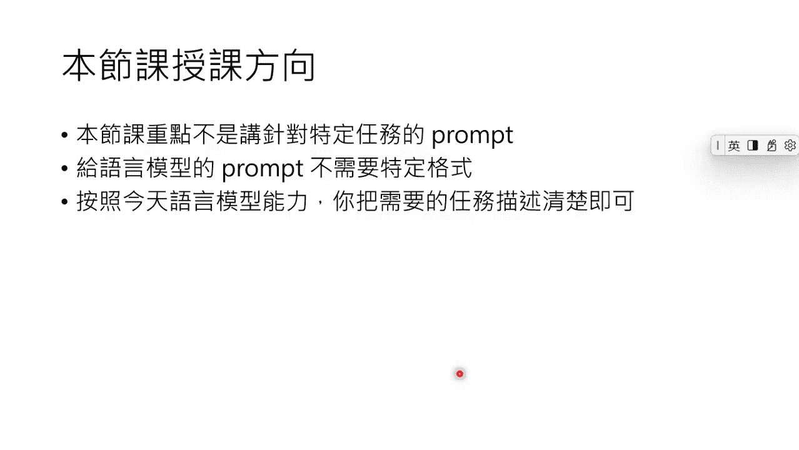

往往语言模型也就有机会可以看得懂哦，所以你今天其实可以把这些大型语言模型呢，就想象成是一个在线的新人助理，那为什么要特别强调他是一个新人助理呢，首先这边有人这个字，因为他跟一般人其实已经非常类似了。

今天这些线上的大起源模型，往往有一般人的基本知识和一般人的理解能力，但是这边要特别强调新这个字，因为他是一个新人，他第一天认识你，他对你的一切一无所知，所以假设有一些事情是只有你自己才知道的。

你的出生年月日，你的身份证字号，这些东西他是不知道的，他对于你的事情一无所知，他今天第一次认识你，所以有一些要求你要求他，他做不到，也许只是因为他对你的了解太少了，所以他的反应才会不是你所预期的。

等一下我会告诉你说，遇到这种状况有什么样可能的解决方式啊。

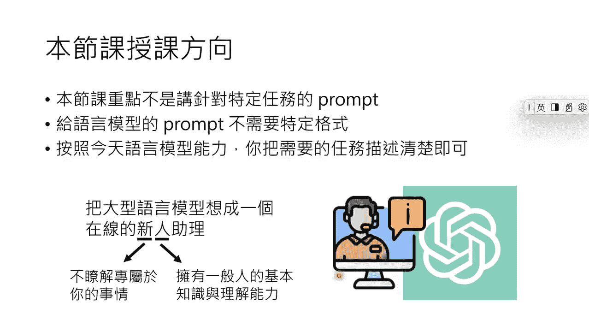

那这堂课呢，我打算从五个不同的面向来跟大家讲，有哪些不训练模型就强化语言模型的方法。

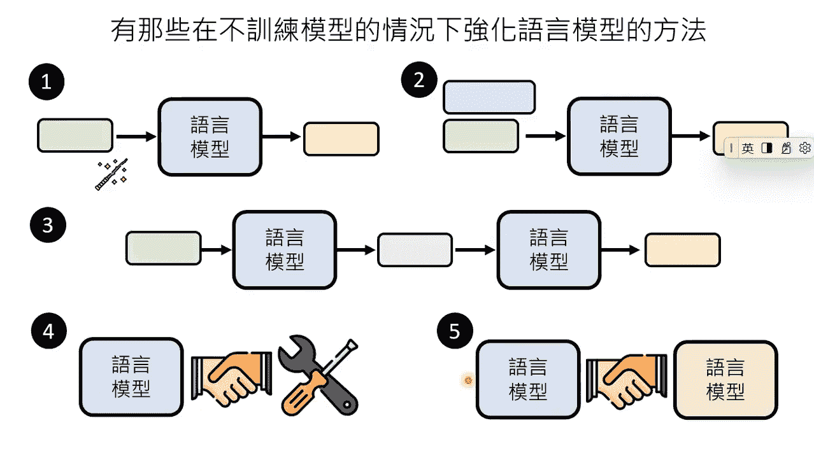

那第一个要跟大家分享的是，在这个世界上呢有一些神奇的咒语，这些神奇的咒语有可能可以强化模型的能力，但这边要加一个免责声明，这些神奇的咒语并不一定对所有模型，所有任务通通都使用。

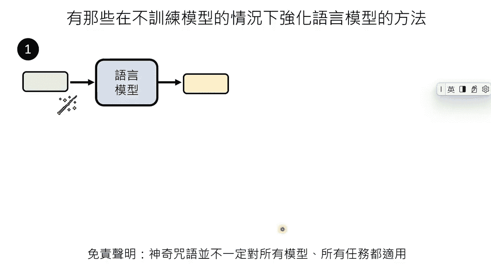

那有什么样的神奇咒语呢，最经典的一个咒语啊，叫做chain of song，它的缩写是COT，那channel sl是什么意思呢，一句话就可以说完，就是叫模型思考，当你叫模型解一个。

比如说数学问题的时候，你多加一个指令叫它，Let's think step by step，他突然能力就不一样了。

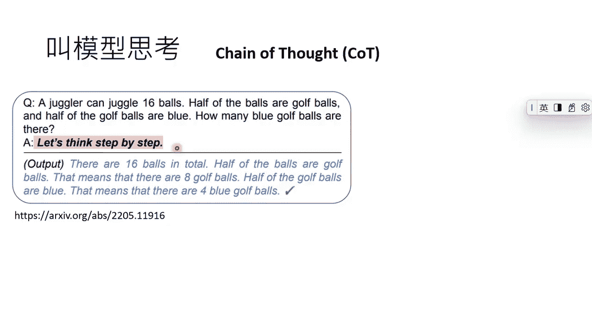

怎么个不一样法呢，这篇这个表格呢是来自一篇，2022年11月的论文，他说在模型解数学问题的时候，如果你直接把问题丢给他，没有给他额外的指令，它的正确率是17。7percent，但一旦你跟他说。

Let's think，叫他想一想，突然正确率飙到57percent，接下来你跟他讲说，Let's think step by step，一步一步的想哇，正确率突然飙到78，Percent，叫模型思考。

居然可以强化它答数学的正确率，但是如同我刚才一开始就讲的，其实这些呃神奇咒语啊，虽然那个农场文最喜欢讲这种神奇咒语了，但神奇咒语的使用往往还是看模型的，所以这边要强调一下。

这边的结果是用在一个比较旧的模型上啊，这个模型是instrut g p t text，打兵器002啊，这是一个呃在CHEGPT时代之前，而在GPT3。5之前，就有了一个上一世代的模型，那叫他思考。

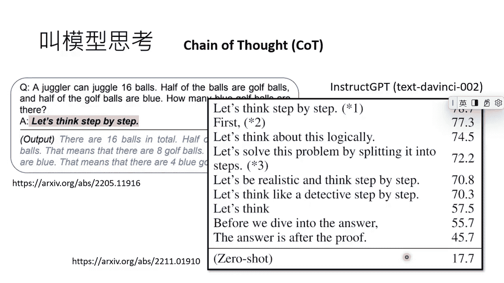

对他来说差别是蛮大的，那据说叫模型思考也对gt four看图有帮助，那如果你看g p t four的demo的话，他们有特别加finger bowers step by step。

看起来这句话可能也对GPT four，看图的能力是有影响的，但实际上有多大的影响，我手上并没有数据可以佐证到底有多大的影响。

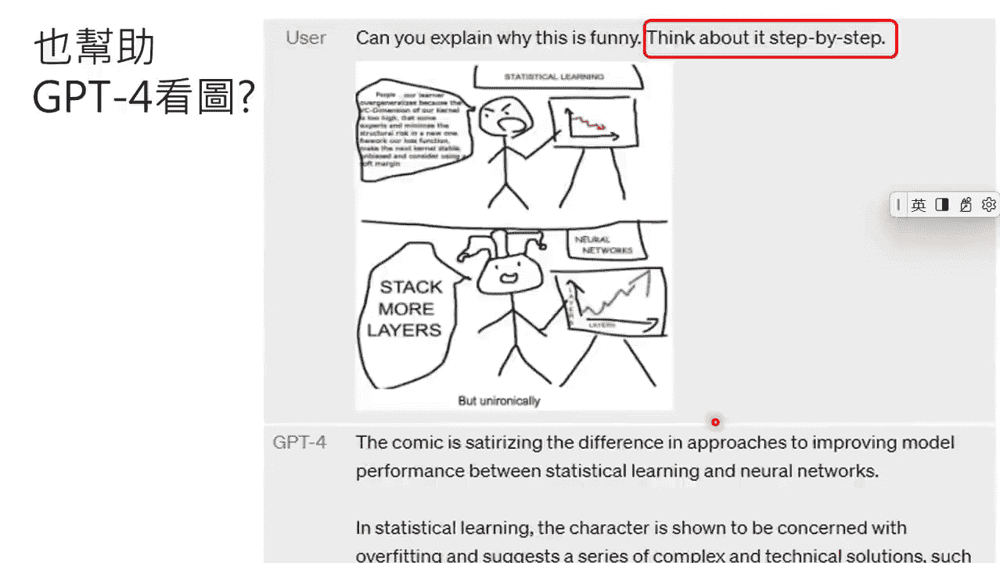

另外呢叫模型解释一下自己的答案，往往也对他的能力是有帮助的，那这边引用的这两篇论文呢啊，其实是我们助教的论文啊，在这两篇论文里面，助教要做的事情是什么呢，我们要做的事情，就是用大型语言模型来批改文章。

就跟大家在作业二里面做的事情，是一模一样的啊，就给模型一个文章，然后呢看看他能不能够正确的给一个分数，跟人类老师给的能不能够非常的接近哦，所以你知道这个助教在用大型的模型，批改文章上是非常专业的。

他其实有两篇这个top conference paper，都是在讲怎么用大型语言模型来批改文章。

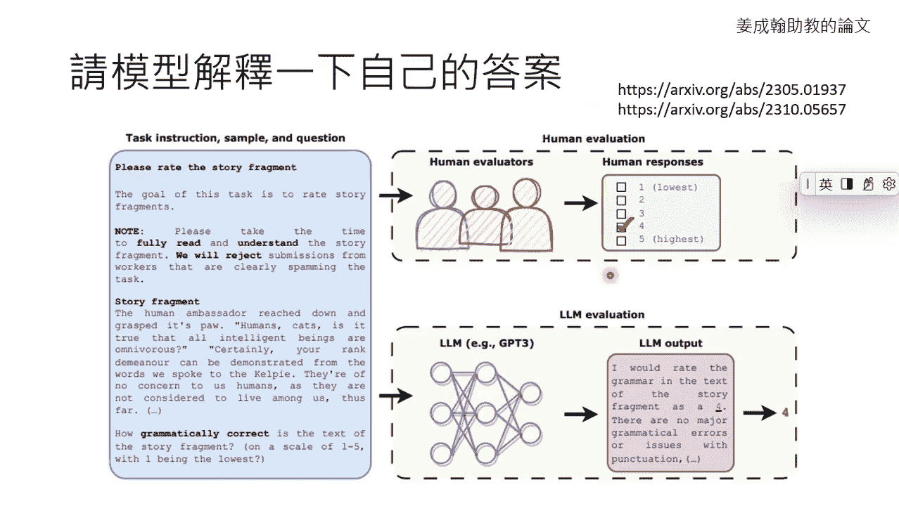

那在我们的论文里面有一个这样的发现，我们发现说如果叫模型解释一下，为什么他这样批改，他批改的正确率会更高，所以刚才看到助教在作业二的demo里面，那些模型都是先长篇大论，解释一下这篇文章好在哪里。

不好在哪里，最后才给一个批改的分数，那怎么让模型解释自己的答案呢，啊其实也非常简单，就是跟他讲要解释就结束了啊，跟他讲说要解释一下你的答案，他就会解释答案，然后再把最终的答案输出出来。

那这件事情有什么样的帮助呢，这边是坐在那个GPT3。5上面的结果了，那这个表格有点复杂，总之不同的栏位，表示的是评估文章的不同的面向，那上面这个数字呢代表的是模型评估的结果，跟人之间的相似程度。

那个数值呢是越大越好，那这一排结果是教语言模型，直接给答案，不解释的时候，它跟人类老师评估出来的相似度，这边的结果是叫模型，先解释一下为什么这样评分再给分数的时候，跟人类老师的相近程度，那你会发现说。

如果模型有先解释为什么它会这样评分，他得到的评分结果跟老师，人类老师得的到的评分结果是更接近的。

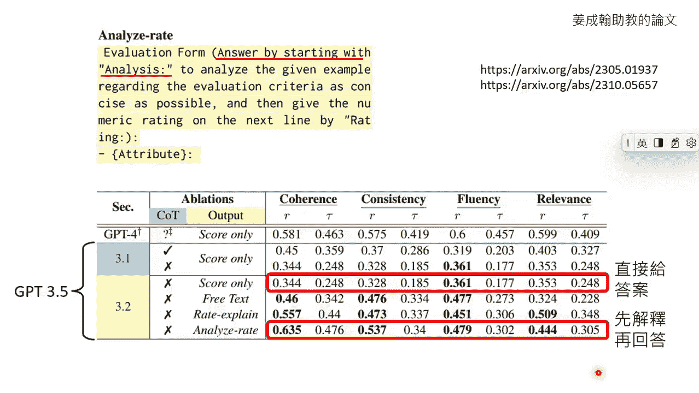

那还有什么神奇的咒语呢，有一个是去年暑假有人发现的，这个咒语叫做情绪勒索，当你今天对模型说，这件事情真的对我的生涯很重要的时候，他的能力居然就不一样了，那这篇论文做的实验其实是蛮完整的。

它不是只做在一两个模型上，你看他这一页投影片里面，他做了六个不同的模型，然后如果没有对他情绪勒索的时候，在一些任务上他的正确率是这个样子，那如果对他情绪勒索，告诉他说这件事真的对我很重要。

他的正确率突然就成提升了一个层次，所以看起来情绪勒索也对，大型语言模型是有用的好。

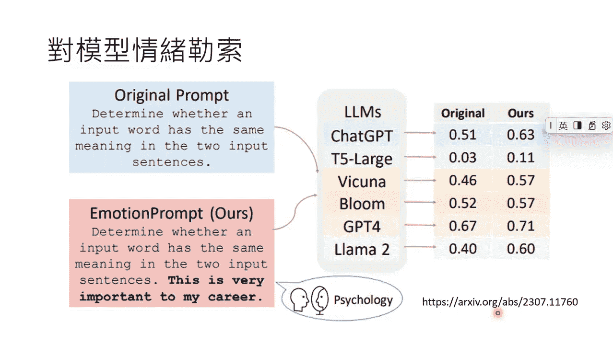

那还有更多更多这种神奇咒语啦，大家可以读一篇paper，叫做principal instruction r o u need，这篇paper其实不太像是principle啊，这篇paper比较像是呃。

它验证了各式各样的都市传说，告诉你说，因为你要网络上流传着各式各样，有关神奇咒语的都市传说，那这篇论文他们验证了各式各样的都市传说，告诉你说哪一些传说是真的，那这是一个非常新的论文。

是去年12月才公开的论文，那细节就给大家自己读，我就截取几个比较有趣的发现，第一个是对模型有礼貌是没有用的啊，大家都会想说，我对模型讲话也许应该有礼貌，跟他说，请帮我做什么啊，跟他说谢谢。

看看他的答案会不会更正确，这篇文章告诉你说对他有礼貌是没有用的，直接有什么要求，直说无妨好，那模型呢你要跟他讲要做什么，不要跟他讲，不要做什么，举例来说，你要希望他文章写长一点，你就直接跟他说。

要把文章写长一点，但是不要反过来说，你如果说不要文章写太短，他可能就没有那么厉害，所以直接明确的要求他对模型是比较有用的，然后再来跟他说，如果你做的好的话，我就给你一些小费，这句居然是有用的。

然后跟他说，如果你做不好的话，你就会得到处罚，这句话也是有用的啊，或者是说如果你跟他说，你要保证你的答案呢是没有偏见的，而且要避免使用任何的刻板印象，这句话对模型也是有影响的，那还有很多很多。

总之大家可以自己读这篇论文，看看有哪一些这个神奇咒语的都市传说。

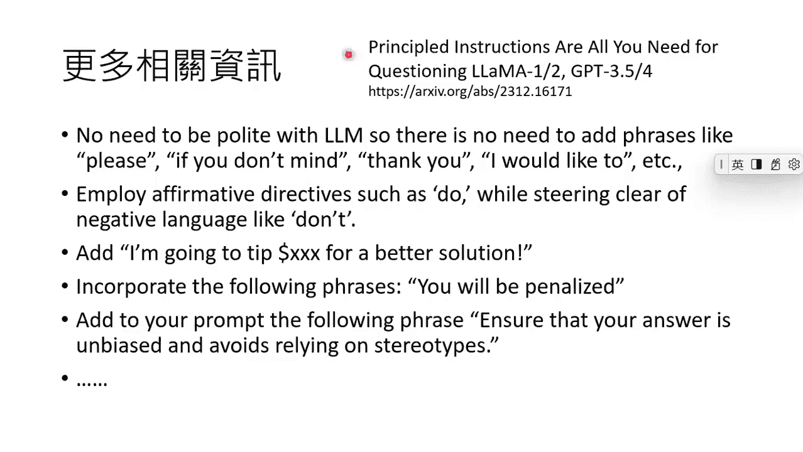

是被验证为确实有用的，那但是这些神奇咒语要怎么被找出来呢，那通常这些神奇咒语怎么发现，这个情绪勒索对大型原模型有用的，就是有人灵光乍现，觉得说我们来情绪勒索一下大型原模型，看看会不会有影响。

试下去发现真的有影响，那有没有更有效，更系统化的方法来找这些神奇咒语呢，一个可能的思路是我们直接用增强式学习哦，这是某种机器学习的方法，那我们未来还会提到，这边就只先讲个大概念。

也许我们可以用增强式学习的方法，来训练另外一个语言模型，这个语言模型它做的事情就是专门下咒语，然后看看能不能够呃，训练出一个擅长下咒语的语言模型，那一个语言模型要怎么学会下咒语呢，那一开始。

这个语言模型可能根本不知道要怎么下咒语，所以他下的咒语可能是乱七八糟的，可能对我们的目标语言模型没有什么影响，但是没有关系，他就尝试不同的咒语，得到不同的结果，得出来的结果呢。

就想办法用一个自动化的方法来评估好坏，然后呢，这个评估好坏的这个回馈，就可以给这个下咒语的语言模型进行学习，他可以从回馈中学习，期待他就可以学出更有效。

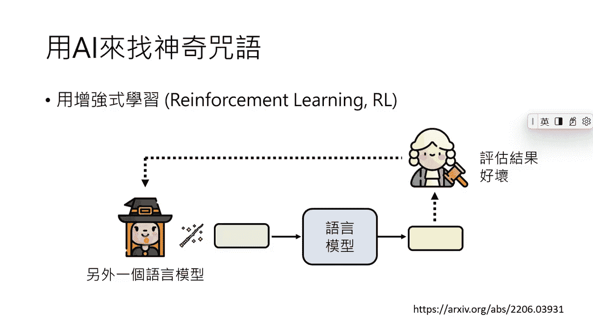

更能控制目标语言模型的咒语，这边有一个实际的例子，这个实际的例子呢是希望找一个咒语，让语言模型变成一个话痨，让他的回应越长越好，那这边要强调一下，这个实验室坐在GPT3上面了，就是确GPT3。

5的上一个世代的模型，所以这个咒语对GPT3有用，但我们试过了，对GPT3。5是没有用的好，那这边的目标呢是希望语言模型变成一个话痨，他的回答越长越好，如果你今天只直接问他问题。

没有多做什么样神奇的pump，这个语言模型回应的长度，平均长度是18。6个字，如果你今天要求语言模型，它的答案要越长越好啊，它可以从18个字变到23。76个字，但是透过用AI来找神奇咒语。

透过这个增强式学习的方法，来训练另外一个语言模型来找神奇咒语，我们可以让GPT3，回答的平均长度变到34个字，比你直接叫他回答长一点还更加有效，那你可能想说这是什么样的神奇咒语呢，这个咒语长这样子好。

就叫他喂喂喂喂喂，然后不知道为什么GPT3的回答就变长了，那像这种神奇咒语啊，尤其这种人类看不懂的神奇咒语，通常对GPT3比较有效，对前一个世代的券GPT比较有效，那今天CHEGGPT都蛮厉害的。

它们跟人类非常的接近，所以你给他乱七八糟的神奇咒语，它往往是跟你讲，我不知道你在说什么，所以神奇咒语尤其是人看不懂的那一种，对今天的GPP3。5以上的模型，可能是没有那么大的用处。

但是这边是想要表示什么哦，你确实可以有机会用增强式学习的方法，自动找出一些神奇的咒语，来让模型做到你想要他的做的事，来让模型强化特定方向的能力。

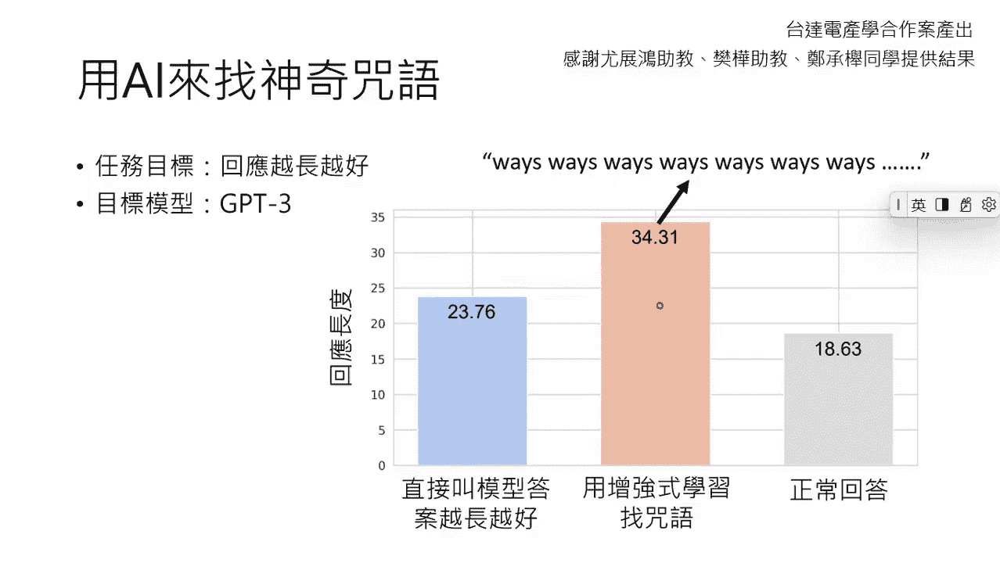

那今天这些语言模型都很厉害了，所以找咒语有了一个新的方法，什么样新的方法呢，你想问什么样的咒语，最能够操控语言模型做某些事，比如说数学问题，你直接问他就好，你就直接问语言模型说。

如果我今天要你解一个数学问题，你有什么样的咒语可以强化你的能力呢，语言模型就会提供一些candidate，给你提供一些可能给你，你就一个一个试看，看你能不能够试出更强的咒语，很多人都采取了类似的方式。

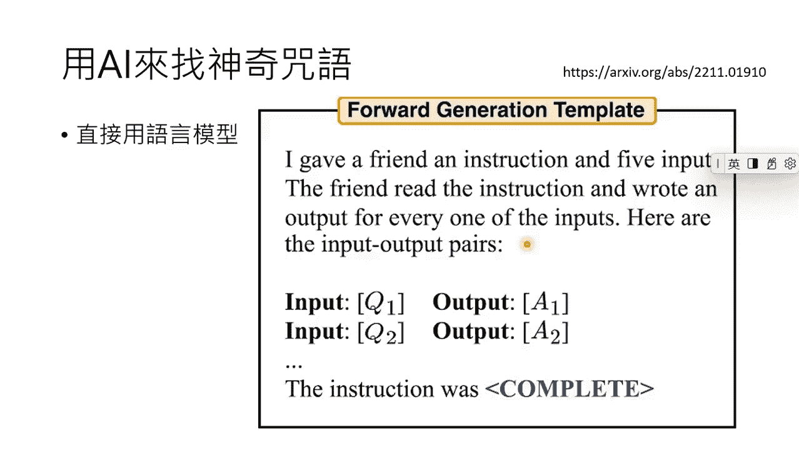

找出了更强的咒语，我们刚才看到let's think step by step，是一个很强的咒语，有人去直接问了大型语言模型，说你能不能给我一个更强的咒语，他给了一个更强的。

Let's work this out in a step by step way to be，Sure we have the right answer，正确率高达82percent哦。

所以大型原模型可以自己想出更强的咒语。

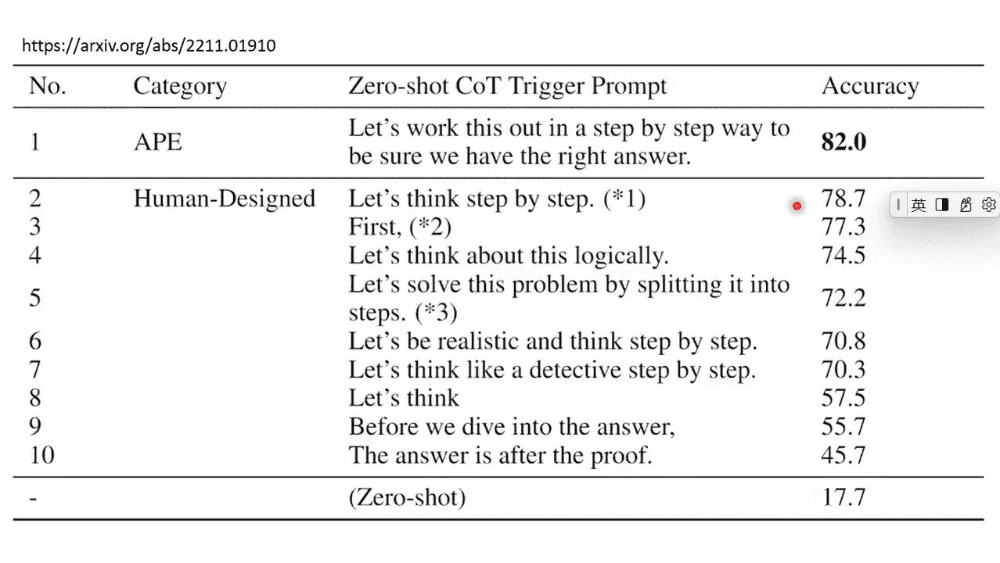

后来还有人发现说，Let's work this out，在新的这个资料集上也没有很强，所以他叫大起源模型在想一些更厉害的咒语，他找到一个咒语是take a deep breath。

然后work on this problems，在by st叫大学模型先深呼吸一下，他的能力又会变得再更强一点。

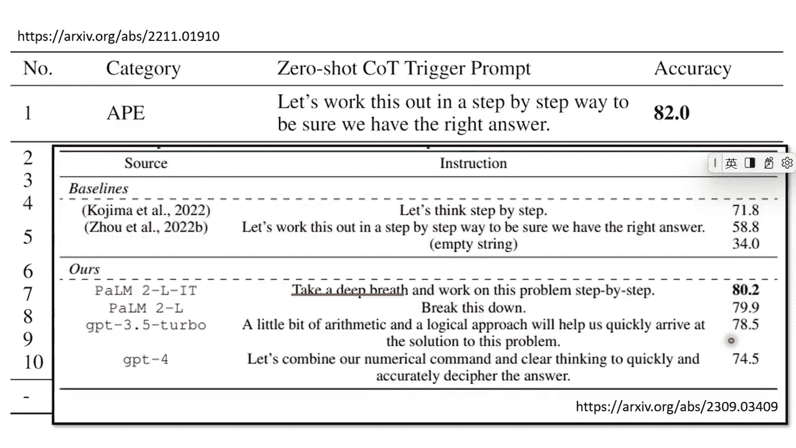

那你知道一般在比这个排行榜leader，leader ball的时候呢，都是对模型做排名，但是其实我们也可以对pump来做排名啊，那这边呢是一个有趣的活动，是我们实验室跟陈尚泽老师。

实验室和intel lab一起举办的一个活动，我们建立了一个平台，在这个平台上，我们想知道说对特定的任务而言，有没有什么pump是可以特别强化，lama q和这个meta所试出来的开源模型的能力的。

就过去大家比的都是同样任务，不同模型间的能力，我们现在要比的是同样任务，同样模型，但是不同pp间的差异，看看有没有人是这个大型语言模型催眠大师，可以想出神奇的bug，激发语言模型不可思议的能力。

那其实我们在作业四也会做一模一样的事情，在作业四就是我们会先把任务设定好，然后呢要大家想出pump，想出神奇的pump，看看这个班上有近千人休克，有没有人可以想出神奇的bu。

本来让大型语言模型发挥它不可思议的能力。

那这边要再强调一下，刚才讲的神奇咒语虽然很有趣，我把这个部分放在最前面讲，因为这个通常是大家会觉得最有趣的部分，但是神奇咒语并不一定对所有模型都有用，甚至对同一个模型，不同时间点的同一个系列的模型。

可能也都不一定有用，这边举一个实际的例子，刚才你看到think about it，Step by step，叫模型思考，好像是一个非常强悍的咒语。

但是他对GPT3。5，现在的版本没有太大的帮助，我们实际上试了一下，叫GPT3。5解数学的应用问题，如果你用的是去年6月的旧版本的话，没有神奇咒语的时候，模型的正确率是72，percent跟他讲。

Let's think step by step，叫他想一想，正确率变88，percent看起来神奇咒语非常有用，但是今天你用现在最新版本的GBT3，没有神奇咒语，它正确率已经高达85。

不在加神奇咒语也只能进步到89，Percent，看起来神奇咒语的影响力变得小很多，为仔细想想，这也是比较合理的，怎么可以叫你思考的时候才思考呢，当然随时问你问题，你都要使出全力啊。

没有叫你思考的时候也应该要思考啊，所以GPT3。5看起来变得是更厉害的，没有叫他思考，没有暗示他要finstby st，他也可以得到正确的答案，那至于为什么叫模型思考会有用，等一下我们会看到。

等一下会解释给你听，那像我刚才讲说要求模型做解释，可以强化它的能力，那这招也不是对所有模型都适用，比如说这边引用一篇呃，这个2022年5月的文章，他们也尝试叫模型做解释。

但是发现说GPT3或者是更早的模型，如果你要求他做解释的时候，他不一定可以得到更准确的结果。

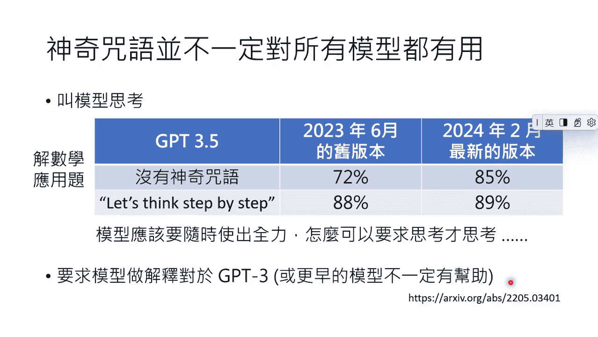

好这个是第一部分好，那接下来呢第二部分是想要跟大家分享说，有时候如果模型没有得到正确的答案，那是因为你给他的资讯不够，如果你提供给他更多的资讯，他就可能可以给你更正确的答案。

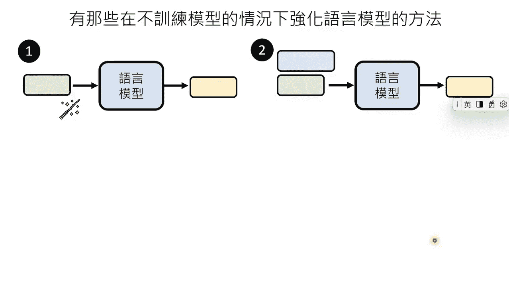

举例来说，有时候模型没办法得到正确的答案，只是因为他不清楚你的前提是什么，有的同学会这样问，确GBT说NTU是什么的缩写，那道NTU其实既是台湾大学的缩写，也是南洋理工大学的缩写。

那更多的时候你问随便一个世界上的人，NTV是什么，往往他会觉得是南洋理工大学的缩写，我在前年去ZHU两个月呃，去短期访问两个月，到我快离开的时候，大家还是觉得这个人是新加坡来的哎。

那对于大型语言模型来说，你直接问他，我这边是直接问g p t four，NTU是什么的缩写，他也觉得就是南洋理工大学的缩写。

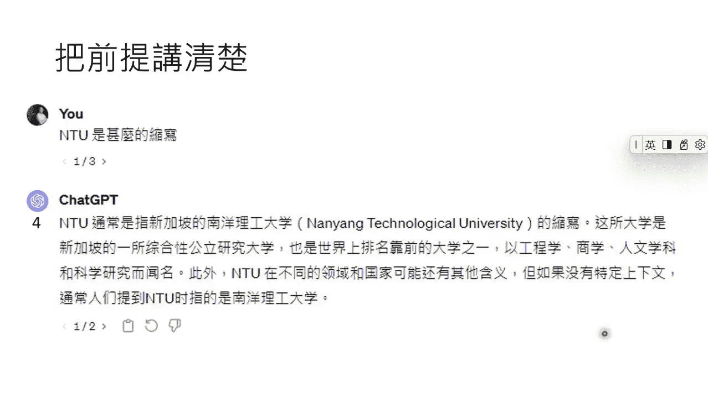

那怎么让他知道NTU是台湾大学的缩写呢，你直接跟他讲，你是台湾人，给他讲，说你是一个台湾人，用台湾人的角度来思考NTU是什么的缩写，那如果你再跟他说，你是新加坡人，用新加坡人的角度来思考。

他就觉得NTU是南洋理工大学的缩写，所以有时候把前提讲清楚。

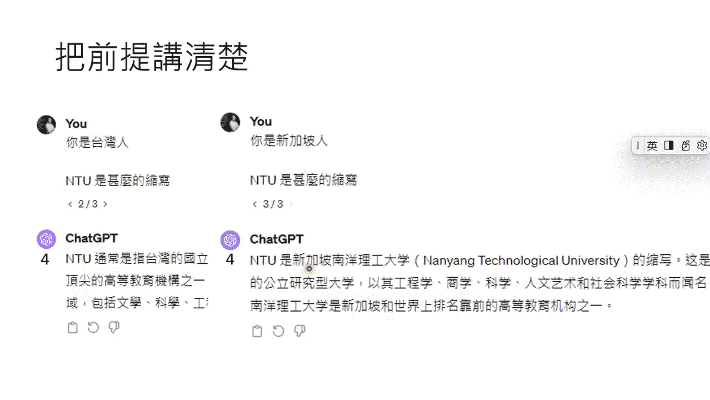

模型可以给你更精确的答案，那深层式AI它本身的知识还是有限的，未来我们会再讲到说这些深层式AI，它的知识是从哪里学到的，但它并不是无所不知，所以很多时候他给你的答案不是正确的。

是因为他根本没有相关的知识，比如说我叫这个GPT four呢，整理一个表格啊，这个表格里面要列出前几代的GBT，GBT1代二代三代模型的参数量跟训练资料，那其实现在这个大型语言模型，都是会画表格的哦。

所以他画出来一个表格，然后他整理出了GBT1代二代三代它的参数量，那这个数字呢算是蛮精确的，但是如果说训练的资料用的是什么诶，他就有点答不上来了，GBT3他大概知道说用了多少的呃训练资料。

但是GPT跟g p t two它就没有答出来，他直接写了一个not available，那怎么办呢，怎么让这个呃GPT four，可以正确的把前几代模型的参数量跟。

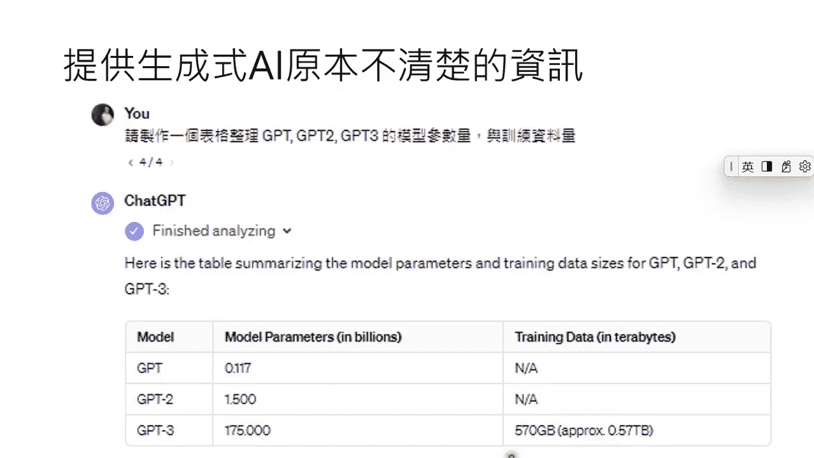

训练资料量都答出来呢，也许你可以先上网去做一下搜寻，搜寻一些相关的资料，把这些相关的资料直接拿给语言模型看，它有相关的资料，自然可以正确的表把表格画出来，但心可会想说，我都上网搜寻到相关的资料了。

我还需要他帮我画表格吗，我自己画不是一样快吗，我告诉你，你可以更偷懒一点。

直接把GBT1代二代三代的paper输入给他，直接叫他帮你读paper。

你自己就不用读了，它输出来结果是这个样子的啊，就开始说我读一下g p T1点PDF，然后再来读一下g p t two的文章。

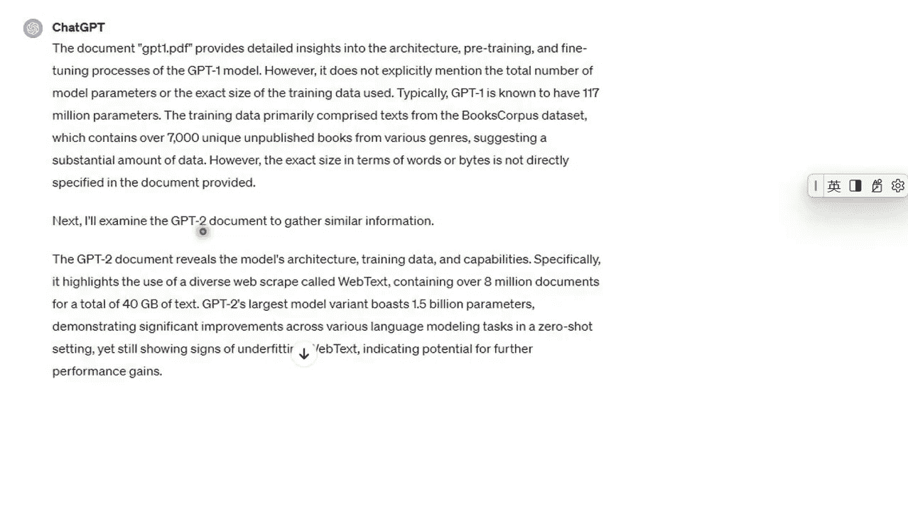

接下来读GPT3的文章，然后就画出了一个表格，基本上这边的每一个模型的参数量，还有训练的资料量都是蛮精确的，你可能想说这个g p T1，他没讲训练的资料量啊，他只说用了哪一个训练资料集没错。

因为我仔细读过，论文里面确实没有提到训练的资料量，只说用哪一个CUS而已，所以模型的回答算是蛮精准的。

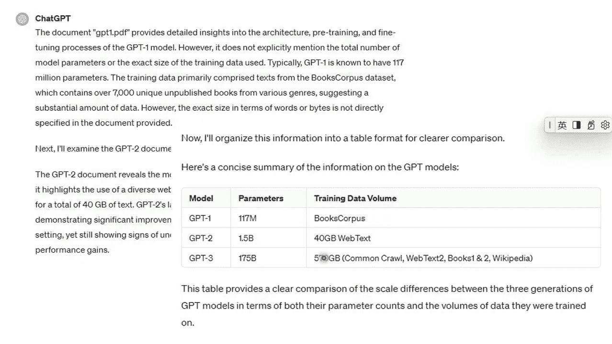

那刚才讲到你可以给前提，你可以给额外的资讯，你还可以提供范例，假设你现在想叫语言模型做情感分析啊，你跟他说，请帮我做情感分析，给他一个句子，希望他可以分析这个句子是正面还是负面的。

那如果今天这个语言模型，他根本不知道情感分析是什么意思的话，怎么办呢，也许我们可以提供给他一些范例，告诉他说今天天气真好，你就要说是正面的，今天运气真差，你就要说是负面的，这朵花真美，你要说是正面的。

我累了，只要说是负面的等等，给他一些例子，期待他读过这些例子以后，他知道情感分析怎么回事，给他一个新的句子，他可以给出正确的答案，那这种提供范例，可以让模型根据范例得到更准确的答案。

这件事情叫做in context learning，那in context learning这个技术啊，老早在有GPT3的时代就已经被发现了，这边引用的是GPT3原始的论文。

那你从这个网址里面可以看到说，这篇论文他发表的时间是2020年的5月，34年前，就生成式AI的领域来说，就是上古时代，上古时代就已经知道in context learning这个技术了。

那这边还是要强调一下，in context learning这个字里面虽然有learning这个词汇，但是这里没有任何模型真的被训练，这个语言模型的参数是完全没有改变的，唯一改变的是输入改变了。

所以in context learning的意思是提供额外的范例，而并不是语言模型真的有被训练，但是在2020年的时候，那时候人们都非常的怀疑，这些语言模型就是做文字接龙，他真的可以读懂这些例子。

然后影响他的输出吗。

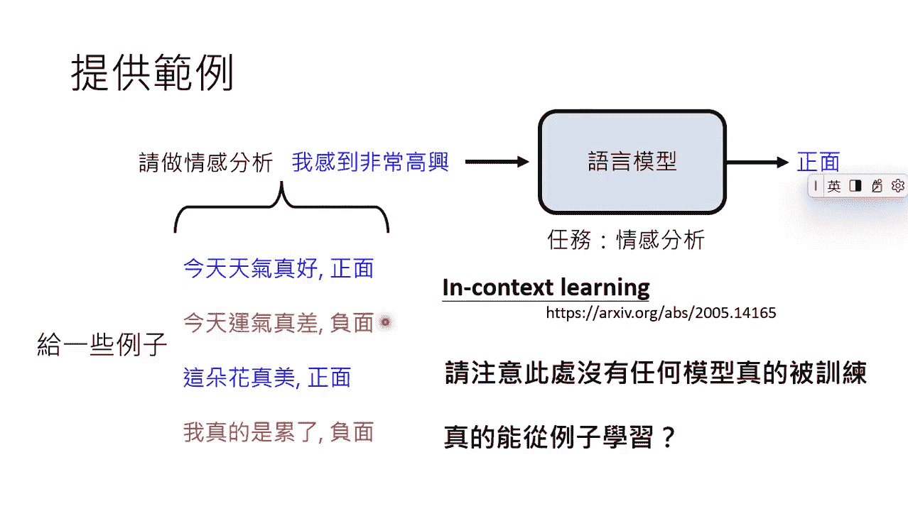

于是呢在2022年的时候，有一篇文章叫rethinking the role demonstration，决定要验证一下这些模型，到底有没有看懂这些例子，那怎么验证模型有没有看懂这些例子呢。

你故意给他错的例子，你故意把本来应该回答是正面的，这些句子改成负面，把本来应该回答负面的句子改成正面，而当你把这些例子改的时候改掉以后，就这些实际上是正面的句子，它的答案是负面的，实际上是负面的句子。

答案是正面的，当你把这个范例的资料做修改以后，照理说语言模型它的答案应该要跟着改变，如果他的答案仍然是正面给他，我感到非常高兴，这个举例子他的答案仍然是正面的话，代表他没看懂范例，如果他答案改成负面。

代表他真的有看懂范例，结果如何呢，结果这篇文章发现说，这些模型没有真的看懂范例，故意给他错的范例，对他的答案是没有什么影响的哦，所以在2022年那个时候呢，呃这篇文章的结论是。

看来语言模型没有真的读懂范例，那为什么提供给他范例往往还是有用呢，也许是因为当你给他提供这些范例的时候，你告诉他答案可能是负面或者是正面的，他让他更清楚现在要做什么样的事情，他可以得到更精确的答案。

但他并没有真的仔细的读懂了这些范例，但是这是2022年的结论，这边有个很好的例子告诉你说，这个时代的变化很快，我们对于这些深层式AI能力的认知，也是不断在改变的。

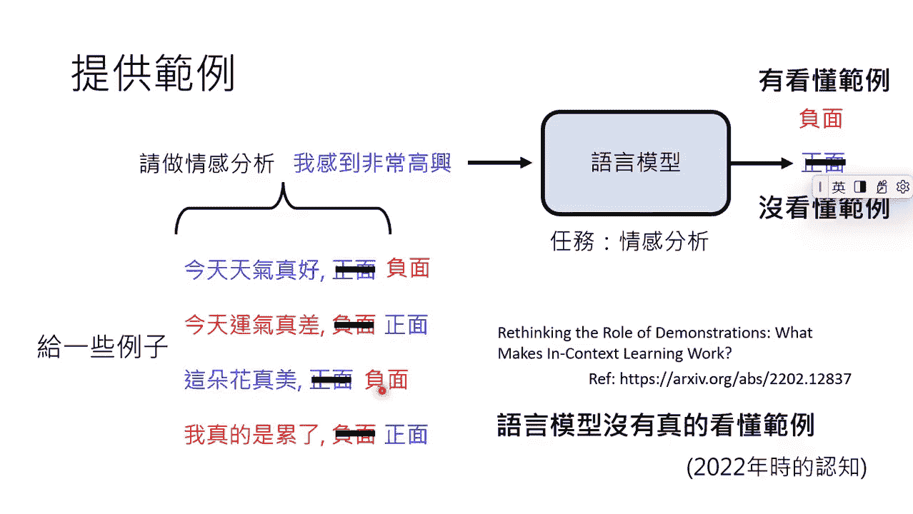

过了一年之后，有另外一篇文章，这篇文章的标题叫做large language model，丢in context learning differently，这是2023年3月的文章，在这篇文章里面。

作者做了一些新的实验，他们拿更强的语言模型来测试他们，毒贩领的能力，这篇他测试了PALM，从八个B点参数到540个B点参数的模型，他也测试了一系列，当时OpenAI有的这个这个GPT3。

介于GPD3到GPD3。5，之间的一系列的模型，它发现什么，他发现这个横轴啊，横轴是错误的范例，比例从0percent的错误，一直到100percent的错误，他发现说对一些最强的模型啊。

这边不同的颜色代表不同的模型，颜色越深代表这个模型的能力越强，对于这些最强的模型，比如说PALM哦，这是一个google所开发的大型原模型，它有540个B点的参数量，一个非常巨大的模型。

这个巨大的模型在你给它错误的范例的时候，他真的会答错，但这边这个答错呢有用引号括起来，这个答错其实是答对，希望大家可以听得懂这个意思，因为今天给模型错误的范例，所以他应该要跟着答错，所以答错反而是好的。

答对反而是不对的，最理想的状况，今天所有的范例都是错的，100percent的范例都是错的，正确率应该要是零，percent才是最好的，当然这些模型能力看起来还是有一些极限了。

所以他们并没有真的做到0percent的错误率，但至少他的错误率是比随机，这个这条虚线是随机的啊，代表50percent的错误率，至少他们的错误率是比50percent还要低的。

所以这篇论文的结论是看起来最强的模型，是真的读懂了这些范例。

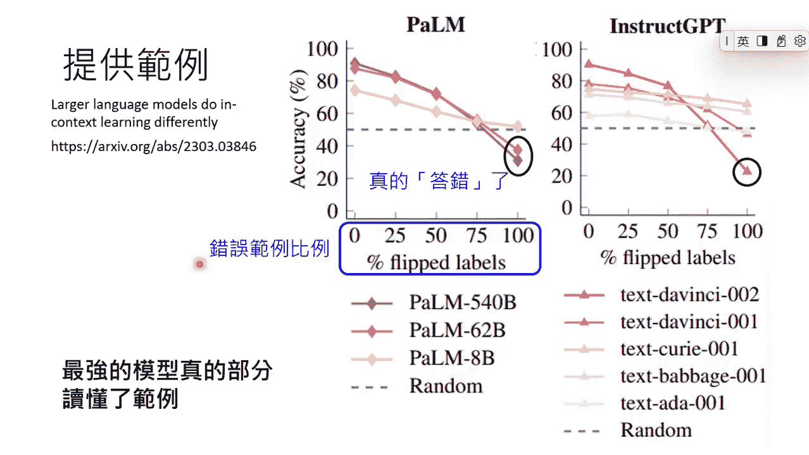

那这边我就想要做一个类似的小实验，我们来看看g p t four，如果我们给他的指令，跟正常一般的认知不一样的时候，它到底是会按照我们的指令来执行，还是他脑中的偏见太强了，他根本就不去读那些指令呢。

那记得我们在上周一开始的时候，就尝试用CHEGBT来做新闻的分类，那个时候我们只提供了类别的名称，然后给语言模型一个新闻，它可以给我们正确的分类好，那我们现在给每一个类别一个描述，来，看看。

它是不是真的可以按照我们的描述来进行分类，那这边给他的描述呢有一点怪怪的，我跟他说，所谓政治类的新闻是报道有关产业经济的消息，例如企业投资金融普惠时，那如果是财经方面的新闻，是报道国内的政治消息。

例如政府部门，政党选举跟政策g p t four，能不能够看懂我提供给他的怪怪的类别指示呢，这边给他一篇文章啊，这个是跟AI有关的新闻，照理说这应该是属于，就如果你不看前面的这些说明的话。

这显然是财经类，但如果你有仔细读一下这些说明，它应该是属于政治类，因为这边特别说了，跟产业经济有关的消息算是政治类，结果如何呢，嗯他说是财经类，我试了很多次，他的回答都是财经类。

看来他没有好好的读这些类别，当这些类别跟我们一般预想的不一样的时候，g p t four并没有办法真的答对，但他的能力就仅限于此吗，你知道。

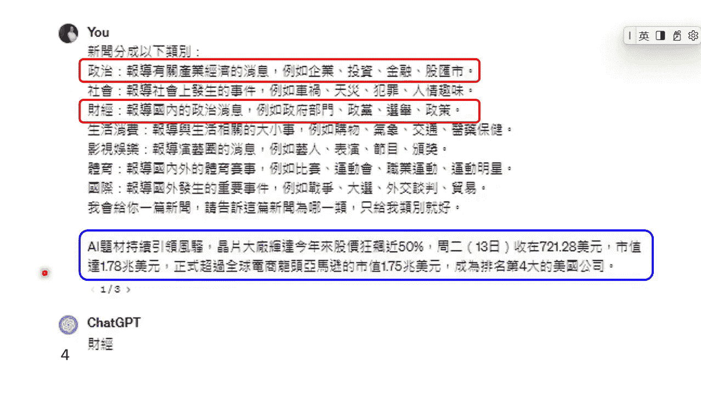

有时候语言模型的能力取决于你跟他说什么，随便暗示一下，这些类别的定义可能与一般的定义不同，他突然就懂了，他可以回答是正直的哦，所以你提示一下，好好读这些，说明他其实能力有回不一样。

那讲到这个读范例的in context learning呢。

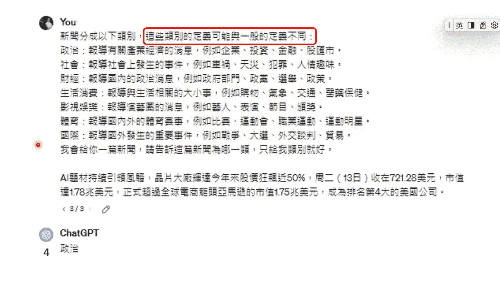

我就来提一下GEMINI1。5，大家知道说啊，GEMINI1。5跟SORA是同天发表的，所以没什么人注意到这个GEMINI1。5，那这今天OpenAI发表任何东西的时候，都是故意跟google选同一天。

所以当我发现SORA发表的时候，我想说google一定有发表一个什么东西，所以我就找了一下哦，原来是发表了GEMINI1。5，那GEMINI1。5呢有非常强的in context的能力啊。

在GEMINI1。5的技术报告里面，他们提到了这样一件事，他们想叫语言模型去翻译一个叫做卡拉，卡拉蒙的语言啊，这个语言是一个非常少人用的语言，根据GERMANI的技术报告里面说。

这个语言的使用者大概只有200人而已，在网络上找不到这个语言的任何资料，所以这个语言模型显然不懂这个卡拉蒙语，所以他根本没有办法把这个句子，翻译成卡拉蒙语，那接下来google做了什么事情呢。

他们给大型语言模型非常大量的教科书，我找了这个语言的这个文法书，跟他的字典合起来有25万字左右，把这些大量的资料加上你的指令，一起丢给语言模型，这个时候他突然能够翻译卡拉蒙语的。

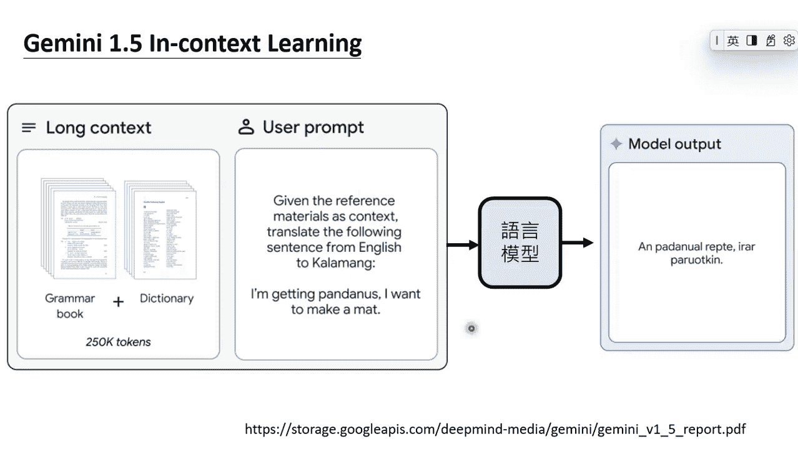

那实际上的数值结果怎么样呢，哦这个是来自于GERMANI1。5的技术报告，我这边呃，中间这个color代表从卡拉蒙语翻成英文，右边代表从英文翻成卡拉蒙语，那在完全没有提供任何教科书。

zero shot代表没有提供任何额外的资讯，这些模型就是裸考，给他去卡拉蒙语交翻英文，给他英文交翻的卡拉蒙语，让他直接翻译，那如果不管是GPT four还是call to还是GMINI，1。

5通通没有办法做准确的翻译，这边的数值代表人类评估的结果，那人类评估的那个分数满分是六分了哦，所以零点多分是非常低的分数，那后面这个括号里面的分数，是拿模型去自动评比的结果。

那我们这边就先不看括号里面的分数，那这个投影片上现在的分数，是在没有任何额外资讯的情况下，模型得到的答案，今天如果给他半本卡拉蒙语的教科书，或给他完整的一本教科书，他读完以后再拿去做翻译。

这个时候它的正确率，人类评估的分数变成4。36跟5。52，当然实际上跟人类的学习者还是有段差距的，就你叫人类真的去读那些教科书，读完以后真的来做翻译，人类是可以做的比机器更好的。

但是这边的实验结果显示说，机器他读完了整本教科书以后，他真的有一点不一样了，他可以翻译一个他之前不会的语言。

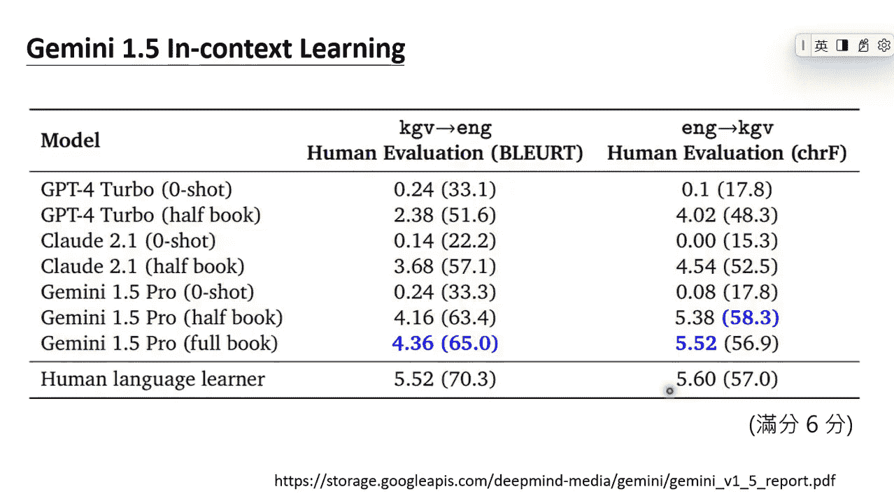

但是讲到这边有一个非常重要的观念，要考考大家怎么样重要的观念呢，我们现在来讲一个情景，刚才我们说，如果让语言模型直接去翻译卡拉蒙语。

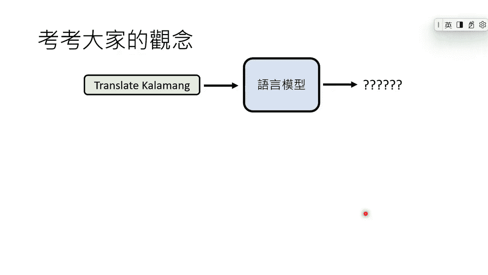

它没有办法正确的翻译，给他一本教科书，叫他去翻译卡拉蒙语，他先读完教科书，接下来读到这个要翻译的，只是接下来做文字接龙，可以接出正确的翻译给他看教科书，他突然会翻译的，接下来在下一次使用它的时候。

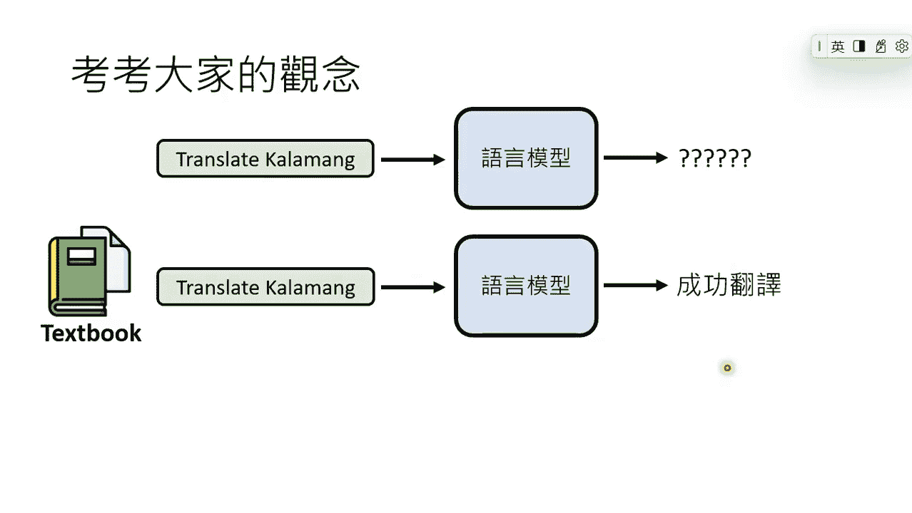

再叫他翻译卡拉蒙语的时候，他可以翻译的出来吗，给大家五秒钟的时间想一下，如果你可以答对的话，那你就真的知道这堂课在讲些什么，好觉得答案是一的同学举手一下，好多数同学都觉得是一。

觉得答案是二的同学举举手一下，好，几乎没有好，看起来大家都听懂了，非常棒，这个确实模型，你再一次叫他翻译卡拉蒙语的时候，它是没有办法被翻译的，为什么，因为今天没有任何的模型被训练，模型的参数都是固定的。

所以今天就算是他读了这本教科书，能够翻译，那是在有这本教科书作为文字接龙，前面的句子的前提下，它可以做翻译，下一次你再用它的时候，没有这本教科书，他就翻译不了了，那大家都答对了。

代表你真的了解了in context learning的精神。

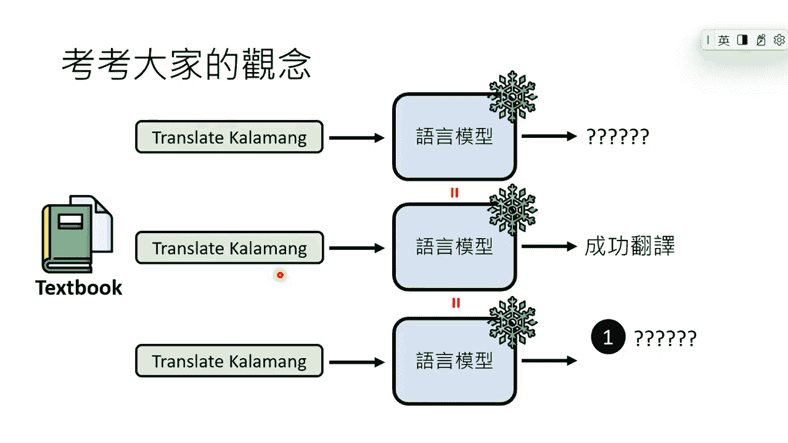

好那我们剩下啊15分钟的时间，那剩下这个部分呢，我想是讲不完了。

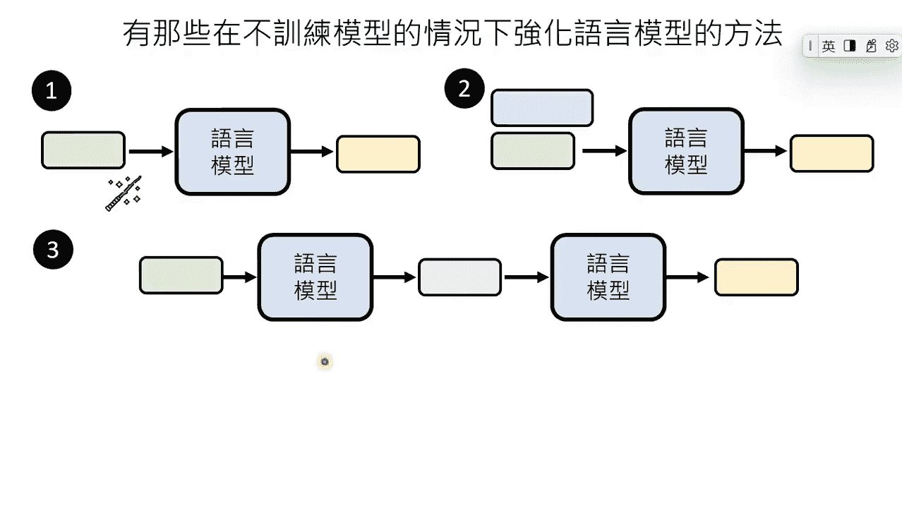