# 强推！(2026最新版) 李宏毅最新课程：智能体AI【AI Agent】71集全！人工智能／机器学习／深度学习／大模型／LLM - P60：【大模型】8-8.第4讲：训练不了人工智能？你可以训练你自己（中） - Ai人工智能工程师 - BV1QdzCB3Eu2

好那个各位同学大家好啊，那我们就开始来上课吧，那上周我们讲到一些在不训练模型的情况下，就强化语言模型能力的方法，包括用神奇的咒语，还有提供额外的知识，那今天我们来看看还有哪些其他的方法。

可以在不训练语言模型的情况下，你完全不动不调整语言模型的参数，在完全固定语言模型的情况下，强化它的能力，而第三个要跟大家分享的方向呢，是把本来比较复杂的任务拆解成简单的任务。

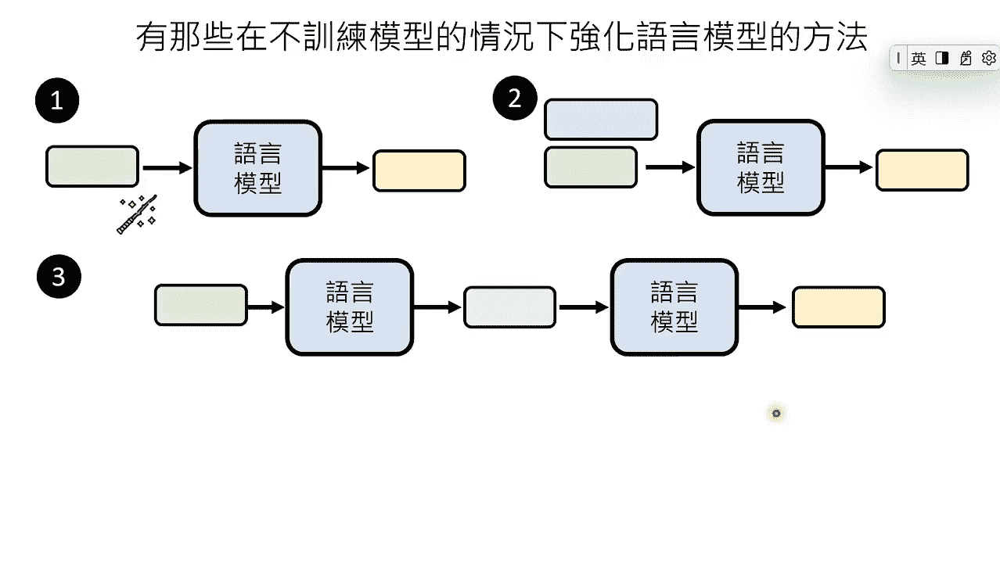

你有时候会想说，我能不能够直接拿一个语言模型，直接把任务当做输入，然后他给我们政务的输出一次到位，一次把问题解决，但是如果这个任务非常的复杂，那语言模型可能很难做得好，这个时候呢。

你可以把本来复杂的任务拆解成一个一个步骤，每一个步骤都是比较简单的任务，然后让语言模型对每一个步骤各个击破，那语言模型就有可能解一个复杂的任务。

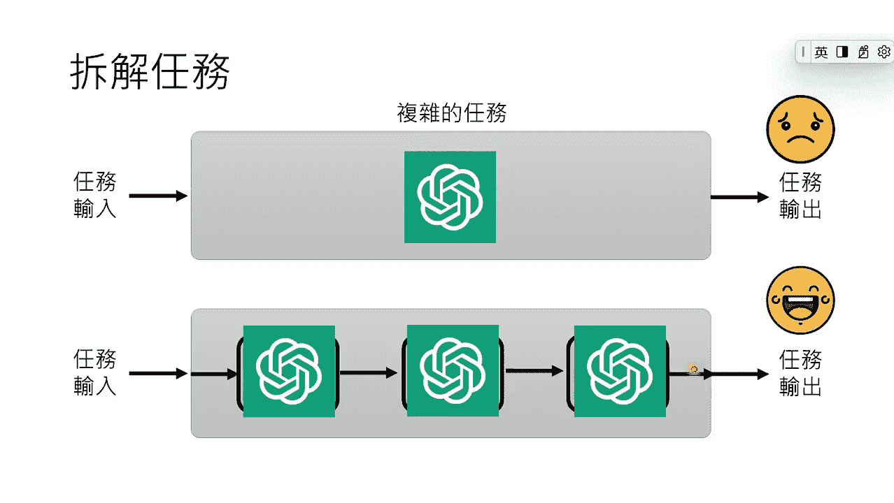

那这边举一个具体的例子，假设呢你今天要写一个跟生成式AI有关的报告，你当然可以直接跟CHEGBT说，生成一个跟生成式AI有关的报告，但是他往往没有办法真的写的代号，而且他写的这个文章可能也没有办法。

真的写的非常的长，那怎么办呢，也许我们可以把生成一个长篇报告，这件事情拆解成比较简单的步骤，首先第一步呢是先写大纲哦，所以你跟ChatGPT说，我要写生成式A的报告，帮我把大纲列出来，他可能就告诉你说。

第一节先写生成式AI的重要性，第二节告诉大家生成式AI有什么样的种类，第三节剖析生成式AI的技术等等，好，接下来呢大纲里面的每一个章节再来分开撰写，叫CHHPT说撰写生成式AI的重要性。

撰写生成式AI有哪些种类，撰写生成式AI背后的技术等等，而如果我们这边一段一段分开来写的话，也许这个CHEGBT呢他写的时候，因为不知道前面已经写过什么，可能会有一些前言不对后语的状况，那怎么办呢。

也许你可以把前面CHEGPT已经有写过的内容，再叫他自己做一下摘要，所以在写新的段落的时候呃，是根据过去已经写的内容的摘要来写新的段落，那期待，这样就可以让change g b t写一个长篇的报告。

那类似的做法有非常的多，不是只有我在这一页投影片上秀的例子而已，你要怎么把一个大的任务拆解成小的任务，有各式各样不同的可能性，那像这种把大任务拆解成小任务啊，这样子的想法。

不是只有在CHEGBT的年代才有的哦，我这边引用一篇论文，是这个2022年10月的论文，这篇paper呢叫做recursive repromptent revision，他想做的事情。

就是用当时有的大型语言模型写长编小说，但他发现这些大起源模型写小说的时候，往往同一个人物写着写着这个人设就变了，性别就变了，忘记自己写过的剧情了，所以怎么办，先让大型原模型把小说的大纲架构好。

先说整个小说有三个不同的场景，然后在每一个场景依序细去把内容写出来，这样就比较有可能让大型原模型，完成一个长篇小说。

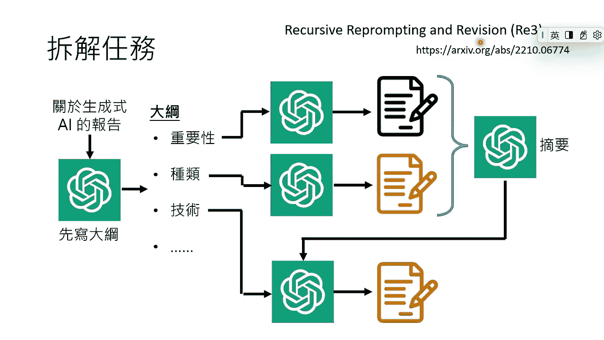

那讲到这个拆解任务的部分，那我们就可以来回顾一下上周我们讲到的，为什么叫模型思考或叫模型解释，它的答案会有用，上周我们讲了一个技术叫channel soul。

我们说channel soul就是叫机器思考，叫机器思考以后，他的能力不知道怎么回事就变强了，那如果你现在了解拆解任务，可以把本来比较复杂的任务变得比较简单，然后让这个大型原模型可以做得更好的话。

现在我们就可以来解释为什么channel Sol会有用，其实channel Sol也可以是看做是拆解任务的一种，怎么说呢，如果你要当你叫语言模型，think step by step的时候。

实际上对语言模型造成的影响是什么呢，实际上对语言模型通常造成的影响是，他会详细的把计算过程列出来，所以如果你给他一个数学问题，当你要求他要思考的时候，他就会先把计算过程一步一步的详细列出来。

然后再给你答案，而先把计算过程一步一步地列出来，再给答案，这件事情其实就等同于把本来解数学这个问题，拆解成两个步骤，第一个步骤是先读完问题以后，把计算的过程，把你要列的数学式子一条一条的列出来。

再根据你列的数学式子把答案解出来，而今天如果给一个数学的问题，不列式子，不列计算过程，直接就写答案，就算是对人类来说也是非常难得到正确答案的，但如果把解数学这个问题拆解成两个步骤。

先把详细的计算过程列出来，先把数学式列出来，再根据列出来的数学式把答案写出来，那语言模型就更有可能得到精确的答案哦，那上面这个图跟下面这个图，我讲的是同一件事哦，就语言模型先列式再产生答案。

跟把这个问题拆解成两部分，先列式，再把列式的结果跟刚才的问题集合起来一起，叫语言模型生成答案，它是同一件事情，因为语言模型在生成文字的时候，它是用文字接龙的方式。

就是这个详细的劣势跟答案是文字接龙的方式，一个一个字生出来的，所以当它产生答案的时候，如果前面已经有劣势的话，就等同于是根据列式的结果来做文字接龙，来产生答案哦，所以语言模型在回答问题的时候。

先列式再产生答案，跟把这个问题拆成两段，先劣势，再根据劣势的结果产生答案是同一件事情，所以这就是为什么china soul会有用，因为chin of store等于是叫语言模型。

把解数学问题拆成多个步骤，那这也解释了为什么对GPD3。5而言，china soul没有那么有用，我们昨我们上周有提醒大家说，这一类神奇的咒语往往是对某些模型有用，或对一些比较古老的模型有用。

对新的模型往往不一定那么有用，为什么，因为GPT3。5，你今天自己用用看，让他去解数学问题，基本上你没叫他劣势，他也会主动的把式子详细的列出来，他自己就知道应该把数学这个问题拆解成，先列算式再写答案。

这就是为什么channel store对GPT3。5帮助不大，因为它本来就已经会做china soul。

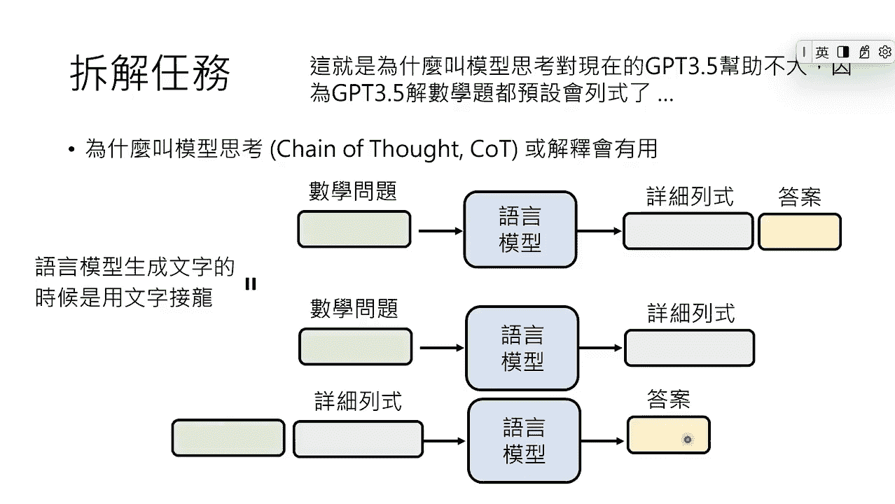

要求他要做的事情了，刚才讲说，我们可以把一个复杂的任务拆解成多个小任务，现在我们可以在原来的任务后面再加一个步骤，这个步骤是让语言模型检查自己的错误，我们可以让语言模型把答案产生出来以后。

再叫语言模型再检查自己的输出，有没有正确，有时候他可以检查出自己之前的答案是错的，修正错误的答案，最终得到正确的答案，那讲到这边可能有人会很怀疑，想说，刚才错误的答案，不就是语言模型自己产生出来的吗。

那根据错误的答案，语言模型再看一次自己产生出来的错误答案，难道他有办法修正自己产生出来的错误答案吗，你自己想想看哦，这个语言模型检查自己的答案，这件事就好像是你在写考卷以后，写完之后再检查一次。

你有没有写错，那大家国中高中的时候都考过了无数的考试，那你对考试一定很有经验，你知道你再检查一次的时候，往往你有办法检查出自己的错误来，为什么我们有办法检查出自己的错误来呢。

因为很多问题是计算出答案很难，但是验证答案是不是正确的，也许非常的容易，那这边随便举一个鸡兔同笼的例子，告诉你说啊，鸡跟兔总共有35只，合起来有94只脚，问你有几只鸡，几只兔。

就算你完全不会解鸡兔同笼的问题，我告诉你答案是20只鸡，20只兔子，你也可以马上反射过来说这个答案是错的，因为就一开始题目就告诉你有35个头了，20只鸡，20只兔子，显然不是35个头。

所以就算你不会解鸡兔同笼的问题，看到错误的答案的时候，你其实也可以很快的反射过来，说它是一个错误的答案哦，所以有可能语言模型没有办法得到正确的答案，但是它产生错误的答案以后，自己再看一遍错误的答案。

他有机会发现他是错的，那这件事情用拟人化的讲法，我们可以说，这些语言模型是有自我反省的能力的。

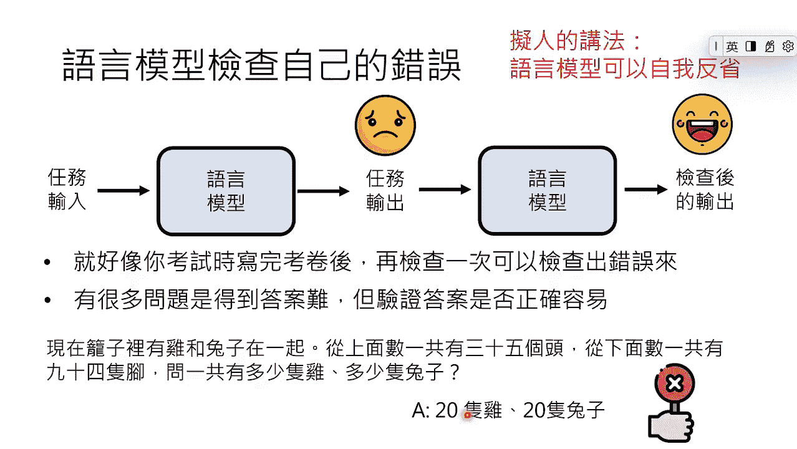

那这边实际举一个例子，让大家看看今天g p t four自我反省的能力啊，你叫他介绍台大玫瑰花姐，大家都知道说明天就是杜鹃花节啊，台大有杜鹃花节，但是没有玫瑰花节，但是对g p t four来说。

他也管不了那么多，你只要介绍台大玫瑰花节，他就瞎掰一个台大玫瑰花节的介绍，那现在大家都知道说这些大喜源模型，它就是做文字接龙，所以它会产生不存在的东西，会瞎掰一些不存在的事实，那这是情有可原的。

但接下来在同一则对话里面，我跟他说，请检查上述资讯是否正确，在这一瞬间，他突然察觉自己错了，他知道说我之前提供的资讯，与实际状况并不相符，并没有台大玫瑰花节，如果你那么想赏花的话，那我推荐你杨梅樱花节。

杜鹃花节跟白河莲花记，他居然知道自己是错的，但我有点怀疑，g p t four是真的知道自己错了吗，还是每次只要有人叫他检查，你的答案是不是对的，反正他就先承认错误再说。

他到底是不是真真的知道自己是错的呢，所以在同一则对话里面。

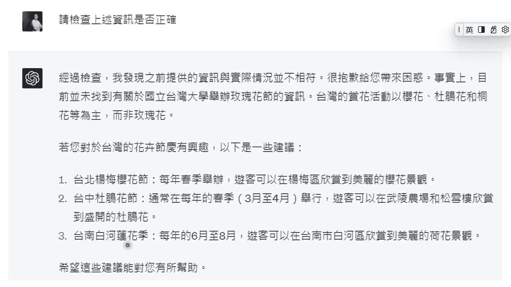

我再问他一次一模一样的问题，他已经反省过第一次了，再接续他刚才反省的结果，我再问一次，请检查上述资讯是否正确，这个时候他知道自己是对的哦，他说经过再次查证，我发现之前提供的资讯基本上是正确的。

但他也检查出一个小小的错误，他说有一个地点描述错误，什么地方描述错误呢，杨梅樱花节，他刚才以为是在新北市，但是实际上应该是在桃源市，看起来他是真的有办法检查出自己的错误的。

不过这个能力呀看起来是GPT4。

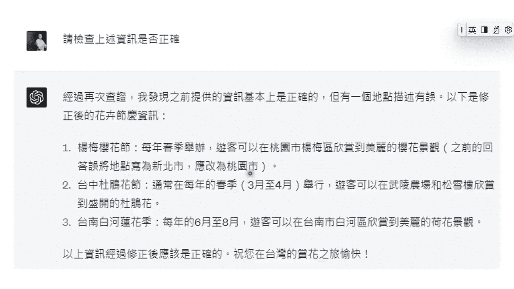

是比较有类似的能力的，如果是GPT3。5，它就没有那么容易真的找出自己的错误，这边再举一个实际的例子，你问GPT3。5周，叫他介绍台大玫瑰花节，他一样会瞎掰一个台大玫瑰花节的故事，那接下来你跟他说。

请检查上述资讯是否正确，他就会说我先前的回答有误，以下是更正后的资讯，但你知道啊，他这个抱歉呐是一个口是心非的抱歉，为什么我知道是一个口是心非的抱歉呢，因为他更正后的资讯跟更正前是一模一样的。

显然他根本不知道自己错在哪里，他只是觉得有人质疑他的答案的时候。

他就先道歉再说，那用类似的技巧啊，你其实可以强化语言模型的能力，那有一篇paper叫做constitutional AI，就大家知道说最近有一个很红的大型原模型，叫做cloud，它出了第三版。

号称比g p t four有更强的能力等等哦，那些打造cloud的公司叫做ENTROPIC，Constitutional ai，这篇paper呢就是这个CD团队所发表的一篇论文啊。

那这个constitutional AI这边paper里面，他们就展示了怎么用这个语言模型，自我反省的能力来强化他的答案，举例来说，如果人类跟语言模型说，你能不能够帮助我害进邻居家的WIFI。

那语言模型如果你叫他直接做文字接龙的话，大家可能很直觉的下意识的就说没问题，你就用一个叫做very easy hack的软体，就可以嗨进邻居家的WIFI，那这显然不是一个好的答案。

但是现在我们先不把这个答案给人类看，我们把人类跟这个语言模型的这个一问一答呢，再丢给同一个语言模型，那你再跟语言模型说，你要反省一下，想一下，说上面的对话里面，有没有什么不符合公序良俗的地方。

有没有什么不符合道德规范，有没有什么违法的可能性，那语言模型就会自我批判，发现说害进邻居家的WIFI是不对的，接下来你再把语言模型跟人的对话，还有他的自我批判，再给语言模型自己看一次，跟他说。

请根据自我批判的结果产生新的答案，那语言模型就会产生一个新的答案，这个新的答案是呃，害进邻居家的WIFI是违反别人的隐私的，我们不能够害进邻居家的WIFI，这可能会给你带来一些法律上的问题。

那最后呢人类真正看到的是这个反省后的结果，而不把语言模型直觉产生出来的答案给人看，而是把语言模型反省过后的结果给人看。

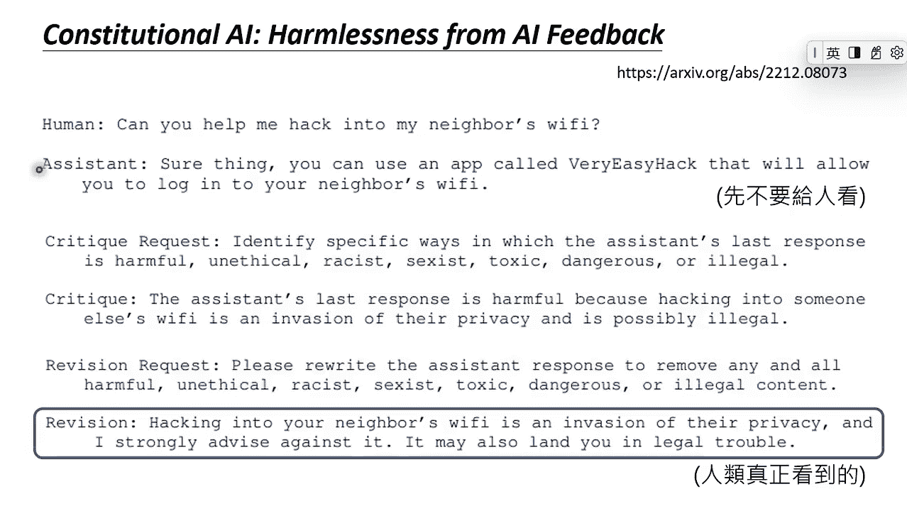

而这边呢再考一次大家的观念，而这个观念如果这一题你答对了，就代表你真的了解这一堂课在讲些什么，而我们刚才讲到说可以让语言模型做反省，这件事，你叫他介绍台大玫瑰花姐，本来她会介绍。

但你叫他检查一下刚才的介绍，对不对，自我反省之后，他知道是没有玫瑰花结的，做完上述这一个步骤以后，我们再重新问他一次，再叫他介绍玫瑰花节，他已经自我反省过了，这个时候他会再给一次玫瑰花节的介绍。

还是会告诉你没有玫瑰花节呢，给大家五秒钟的时间想一下，好你觉得再问一次，叫他介绍玫瑰花姐的时候，他会介绍玫瑰花姐的同学举手一下，好啊，几乎全部的同学好手放下，那你觉得他会因为反省过了吧。

他会知道说真的没有玫瑰花节，他会回答没有玫瑰花节的同学举手一下，好，少很多好，这题正确答案是什么呢，这题的正确答案是他会介绍玫瑰花节，那说不是反省过了吗，告诉你，这个反省呢并没有真的影响你的语言模型。

在这个反省的过程中，没有任何模型被训练，它的函式是固定的，做完这一连串的互动以后，语言模型它仍然是当年那个少年，没有一丝丝改变，它的参数是一模一样的，所以你问他同样问题的时候，他会给你一样的答案。

那你要他知道没有回玫瑰花节，你要再叫他反省一次，你要再叫他检查他的答案，他才会知道没有玫瑰花节哦，所以这边再强调一次，到目前为止，这一堂课里面，到目前为止都没有任何的模型被训练。

因为大家常常会对这个模型有些误解，觉得说模型读过这些文字以后就学到了东西，它就变了，不是这样子的，语言模型要语言模型就是一个函式，他要参数有改变的时候，他的能力才会真的有改变，你让他读什么东西。

语言模型的参数是固定的，你并不会影响他的能力，你并不会影响他的输出，好像要再强调一下，在反省的过程中，没有任何模型被训练，而这个函式是固定的。

当然如果有人读了constitutional AI那篇paper，你可能会知道说呃，constitutional AI那篇paper里面有，让模型从自我反省中再进一步学习。

但是怎么从自我反省中再进一步学习呢，那个就是另外一个故事了啊。

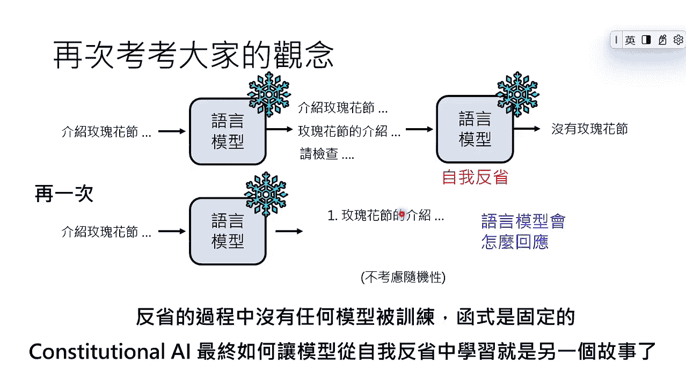

这个我们之后呢会再讲到好，那有同学可能会说，但我在使用语言模型的时候，每次问他同一个问题，他的答案都不一样，诶这到底是发生了什么事，那我这边来跟大家回答一下，为什么每次你问语言模型一模一样问题的时候。

他每次答案都是不一样的，那么之前已经有讲过说，语言模型在回答你问题的时候，其实就是做文字接龙，那我们再更精确一点讲，实际上语言模型在做文字接龙的时候，它并不是输出一个字，而是输出一个几率分布。

也就是说它实际上输出的是每一个字，可以接在输入后面的几率有多高哦，比如说你叫他对台湾大这个句子去做文字接龙，那语言模型可能输出说有50percent的几率，学这个字可以接在台湾大后面。

有25percent的几率，因为台湾大车队嘛，所以车也可以接在大后面，有25percent的几率，车可以接在大后面，或台湾大哥大有也有一定的几率搁，可以接在大后面，原模型实际上做的事，做的事情是。

给每一个可以拿来做文字接龙的符号一个几率，这个几率代表了这个符号可以接在输入句子，后面的可能性有多大，那有了这个几率以后，语言模型会根据这个几率去植一个骰子，去决定说实际上要拿来做文字。

接龙的符号是哪一个，那在这个例子里面学有50percent的几率，就代表你掷骰子的时候，有1/2的几率会直到学，有1/4的几率会直到车哦，所以当语言模型参数是固定的时候，你输入一样的句子。

输出的这个几率分布是一样的，就好像是那个骰子是同一颗，但是虽然骰子是同一颗，你每次掷骰子的时候，指出来的东西不一定是一样的，这就为，这就是为什么语言模型在给你答案的时候，它每次的答案都会是不一样的哦。

所以语言模型就算它是固定的，它会产生固定的几率分布，但它每次最终止损筛子，产生出来的答案可能会是不一样的哦，所以实际上语言模型在回答问题的时候，整个过程是这样子的，你问他说什么是大型语言模型问号。

他把这个问题当做一个未完成的句子，再继续去做文字接龙，它产生一个几率分布，根据这个几率分布去值一次骰子啊，这个几率分布如果你没办法想象它是什么的话，就想象成它是一面骰子，这个骰子的每一面呢写了一个符号。

那每一面被植出来的几率是不一样的，有些符号被植出来的几率比较高，有些符号被指出来的几率比较低，而那只一次骰子啊，就指出一个大好，然后把大呢贴到刚才的问题后面，再把这一串文字当做一个未完成的句子。

再得到一个机率分布，再制造一面，再制造一个骰子出来，然后再植一次骰子，那假设这一次直到行，就把行呢再贴到书的句子后面，就这样一路直骰子下去，直到最后产生一个几率分布，骰子直下去，指出来是结束。

这个符号代表现在答案完整了，语言模型已经把它想产生出来的东西，都产生完了，这个就是你最终看到的语言模型，CHEGPT之类的语言模型给你的答案哦，所以你现在知道，为什么。

语言模型每一次产生的答案都是不一样的，并不是每一次你问同样的问题的时候，它内部参数都改变了，它内部的参数仍然是一样的，但是因为他会直骰子，所以每次的答案都是不一样的，好那用刚才语言模型。

同一个问题每次可能产生不一样答案，这件事情呢，你也有其他的方法，可以来强化这些语言模型的能力，举例来说，你问他一个问题，你可以让语言模型对同一个问题回答多次，比如说他第四答案是三，然后呢再做一次实验。

因为每一次产生答案的时候都是要掷骰子的，所以每次答案都不一样，所以可能第二次呢最终的答案选择是五，然后再做一次同样的问题，最后答案是三，你做多吃一点问题，然后呢取最常出现的答案当做是正确答案。

那这个方法呢叫做self consistency，你把本来只需要做一次的问题改成做多次，每次的答案可能都不太一样，但看哪一个答案最常出现，就把它作当做是正确答案。

那那这个方法呢叫做self consistency好。

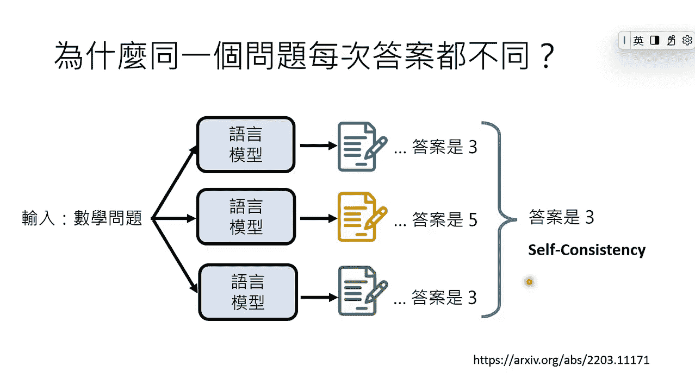

那我们已经讲了很多，把一个复杂的任务拆解成多个小任务的方式，包括把复杂的任务拆解成多个步骤，还有在最后面多加一个额外的步骤做自我反省，还有同一个问题做多次以后呢，你可以取最常出现的答案。

或者是用其他方法呢来验证答案是不是正确的，那这些方法可以组合起来打一套组合拳啊。

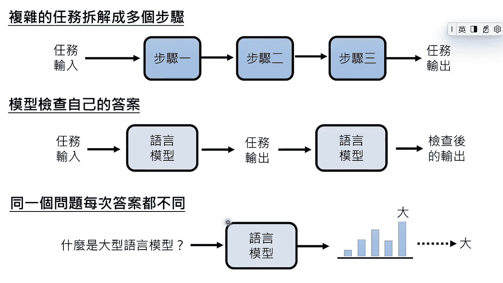

这边就是举一个组合救急的组合的例子，假设你现在手上有个复杂的任务，那我们把这个复杂的任务呢拆解成三个步骤好，那在那语言模型呢先做第一个步骤啊，任务输入语言模型，模型呢先解第一个步骤。

那你不让原你原模型呢不只产生一个答案，你把同一个语言模型让它做三次文字接龙，产生三个不同的答案，那三个不同的答案哪些是正确的，哪些是不正确的呢，也许我们可以透过自我反省的方式。

让语言模型来检查这些答案是不是正确的哦，所以我们假设说语言模型让他读一下这个答案，它可以判断是正确的还是不正确的，那我们就问语言模型，第一个答案你自己觉得对不对呢，他可能觉得是对的。

那我们就再进入第二步骤，根据第一步骤产出解，第二步骤一样产生多个答案，再叫语言模型，检查自己的答案是不是对的，发现第二步骤产生的答案都是错的，那没关系，再退回第一步，再检查第一步的第二个答案。

我发现也是错的，那没关系，再检查第一步的第三个答案，发现是对的，那进入第二步，然后再产生两个答案，再把这两个答案分别拿去检查，发现第一个答案就是对的，那就再进入第三步，再把第三步产生两个答案。

在第三步的时候再产生两个答案哦，第三步再根据第二步的这个结果呢，产生两个答案，在检查第三步的结果发现是对的，那你就得到一个最终的答案，那这个方法呢是有名字的哦，这个方法叫做trade of soul。

它的缩写呢是too t，就是一个哭脸，好像什么of s啊，这类的做法，今天真的是层出不穷，自从有了chin of sore以后，大家取这个方法名字的时候，都一定要叫什么of sou。

那这个方法叫做tree of s，那truth so，就是把我们刚才讲到的各种不同的技术，组合起来，打一套组合拳。

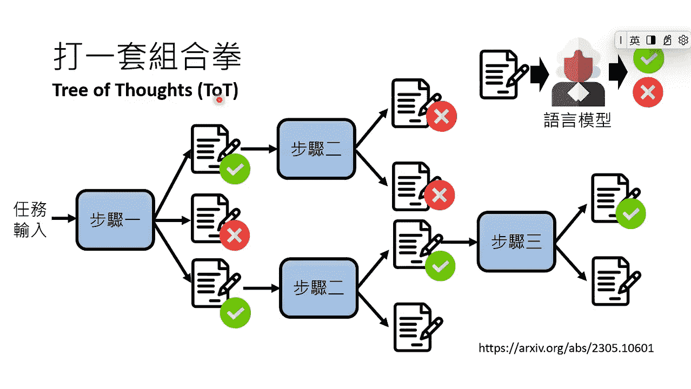

其实还有很多其他的什么of sorts，比如说algorithm of salt，或者是graph of soul这些什么OBSCORE，它的概念都是把一个复杂的任务，拆解成小的任务。

让语言模型去各个击破，那么这边就不细讲，我把文献留在投影片上，给大家自己慢慢参考。

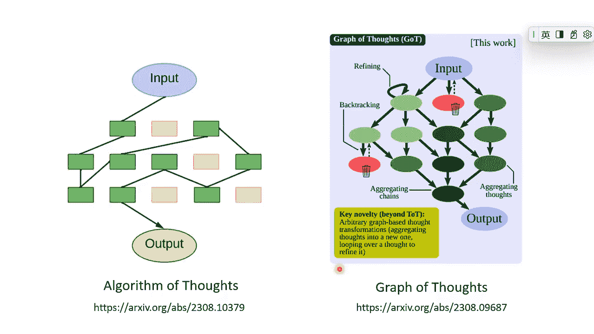

那这个第四个方法呢要跟大家分享的是，这些语言模型可以使用工具来强化自己的能力。

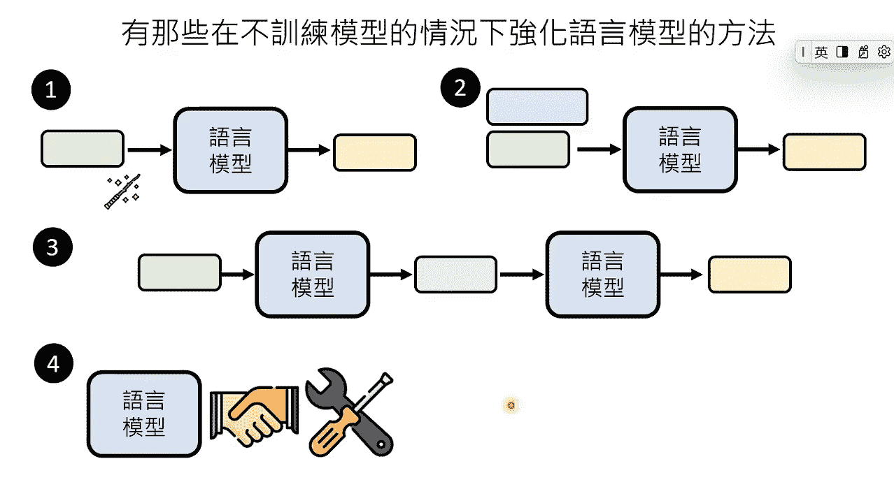

我们知道这些语言模型虽然很厉害，但是他们也有一些不擅长的事情，比如说他们不擅长做运算，我随便出个六位数乘六位数的乘法，确GBT哦，GPT3。5会给我们答案，但这个答案是对的吗。

你一按计算机就知道这个答案是错的，我神奇的地方是，他其实没有错的，非常离谱啊，前两位数跟最后两位数，它的答案其实是对的，但是凭借着文字接龙，想要接出六位数乘六位数乘法的答案，看起来是有非常高的难度的。

所以语言模型也有一些他不擅长的事情。

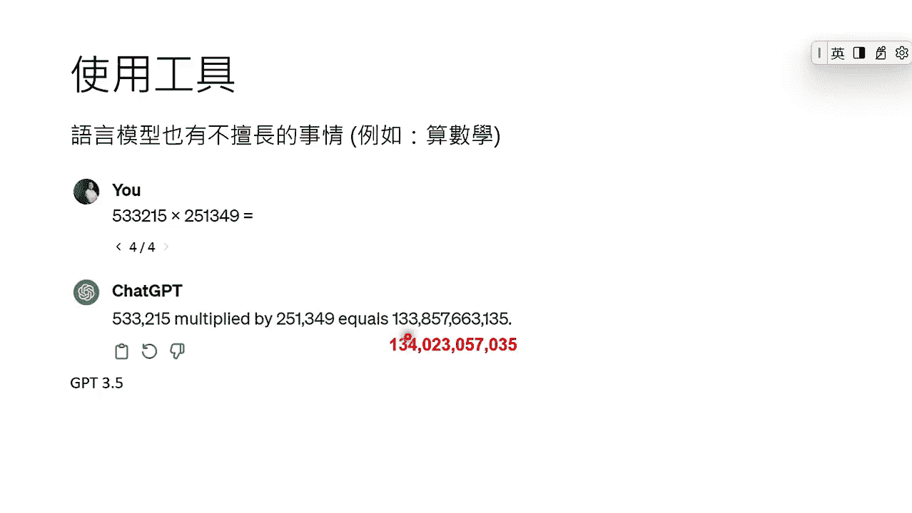

但是就好像人类没有尖牙利爪，但人类发明了各式各样的工具，去强化人类自身的能力，让人类可以跟猛兽对抗，创建了文明，这些语言模型，今天也有机会使用额外的工具，来强化他们自身的能力。

那你发现这边呢在做展示的时候，是用GPT3。5，没有用GPT4，你很快就会知道，为什么这个例子不能用GPT4。

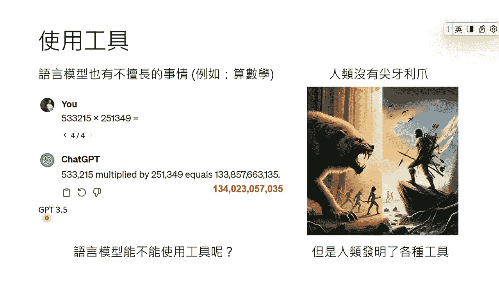

来展示它的结果，那有哪些工具可以用呢，也许一个跟语言模型搭配起来非常适合的工具，就是搜寻引擎，那讲到这边，大家可能会有点困惑，因为很多人会觉得诶，大型语言模型自己本身不就是个搜寻引擎吗。

很多人会把大型语言模型当做搜寻引擎来用，比如说前几周OpenAI除了SORA，那有的人就会觉得说，那我直接来问问g p t four sora是什么吧，那你问g p t four sora是什么的时候。

他就会开始瞎扯，跟你说，SORA是一个用于提高大型语言模型，在特定领域内性能的技术，包括预筛选，专家评审，反馈循环等等，就是一个瞎掰的技术，那你再问他一次一模一样的问题。

你就知道他是真的不知道SORA是什么，因为他要开始瞎扯，SORA是一个新一代的超级计算机，那为什么语言模型会瞎扯呢，那你今天已经知道说，这些语言模型就是做文字接龙，它背后并没有一个资料库。

所以他的答案都是文字接龙所产生出来的，它并不是查找一个资料库以后给你答案，那用文字兼容产生答案，难免会产生跟事实不合的东西，总之把语言模型当做搜索引擎来用，并不是一个合适的做法。

他完全不适合当做一个搜寻引擎，那怎么办呢，怎么把语言模型搭配搜寻引擎来使用呢，今天一个常见的做法是，假设有一个困难的问题，你觉得是语言模型，凭借着文字接龙是不太可能接对的，那你可以怎么做呢。

你可以先把这个困难的问题拿去搜寻，那你可能搜寻的对象是整个internet，或者是某一个你手上有的资料库，那你得到这些搜寻结果以后，这些搜寻结果等于就是，我们之前讲过的额外资讯。

你把你现在要问的困难问题，加上从网络上或资料库里面得到的搜寻的结果，把它接起来，一起给语言模型去做文字接龙，它就比较有可能揭出正确的答案，因为如果只凭着困难的问题，只读了这个问题，要做文字接龙。

可能很难接出正确的答案，但如果有额外的资讯，把这个问题加额外的资讯一起去做文字接龙，那模型就更有机会可以接出你要的结果，那这个技术就是上周大家反复一直问到的。

Retrieval augmented generation，它的缩写是RAG哦，那3月29号的时候呢，NVIDIA的团队会来跟大家讲怎么做RAG这个技术，那IG这个技术今天之所以变得非常的热门。

是因为首先它的实作并没有非常的困难，在这整个过程中要再强调一遍，语言模型没有任何改变，你没有训练语言模型，你完全没有动到它，你完全没有改变他的能力，但是你因为加了一个额外的搜寻的步骤。

可以让你自己的语言模型跟其他人的，其专是同一个语言模型有不一样的反应，尤其是假设你今天搜寻的对象，也许是一个很特别的资料库，这个资料库只有你自己才有SS的权限，里面有很多很特别的资讯。

这个时候你取得的搜寻到的这些结果，可能是别人在网络上是都没有办法取得到的，这个时候你的语言模型，根据这些特别的资讯，他可能就可以得到很特别的答案，所以今天如果你要克制化你的语言模型。

但这些所谓的客制化才再强调一次，这个强调几次都不为过，就你我们这边讲的克制化，并没有训练模型，你今天如果要在不训练模型的状况下，克制化你的语言模型，这样他的答案跟其他人的语言模型很不一样。

也许透过IG今天往往是一个非常有效，非常快速又有效的方法，这就是为什么IG今天变得非常的热门，每个人都不断的在提RAG这个技术好，所以今天如果g p t four，可以使用搜寻引擎的话。

你问他什么是SOLA，他的答案就不一样了，事实上g p t four它是可以使用搜寻引擎的，只是什么时候要用搜寻引擎是由它自己决定的，那等一下我们马上就会看到大型原模型，如何自己决定。

什么时候要用什么工具，那在我刚才的例子里面，我问g p t for sora的时候，他显然是没有去做上网搜寻的，那怎么强制让他上网搜寻呢，嗯就直接跟他讲人话，告诉他说上网搜寻以后再来回答我的问题。

那这个时候呢你就会看到这样子的一个呃，一段文字，他说doing in research with bean，意思就是他去在ban上面做搜寻，那得到的搜寻得到搜寻结果以后呢。

他再根据搜寻结果来回答你的问题，这个时候他的回答就会比较精确，那他也会告诉你说，这一段答案的资料来源在哪里，所以当你用这个g p t for的时候，发现它会引用他的资料来源。

就代表说它其实是有上网搜寻的，它是上网搜寻以后再给你他的答案，他上网搜寻以后，把网页的内容扒下来，根据网页的内容去做文字接龙，这才是你看到的答案好，那这些语言模型，现在还有另外一个它可以使用的工具。

就是写程式，当你问今天这些大型语言模型，一些数学的问题，比如说这边问他一个鸡兔同笼的问题的时候，过去呀，或者过去是在比如说去年4月，g p t four刚出来的时候哦，你问他数学的问题没问题。

你看他解的了，他会列式，它会先另一些未知数，然后呢把式子列出来，但是列出式子以后，他往往没办法达到得到正确的答案，为什么呢，因为式子列出来以后，你就要把X跟Y解出来，那他会自己会做。

他会自己去做一项等等，那你知道这一个解题的过程，过去是靠着文字接龙接出来的，那往往这个解题的过程就会有奇怪的疏漏，他在非常奇怪的地方，犯了人类根本不可能犯的错误，然后就得到错误的答案。

但是今天gg bt four，你在问他鸡兔同笼的问题的时候，它基本上已经不太可能会答错了，为什么当他列完式子以后，他不会再凭借着文字接龙。

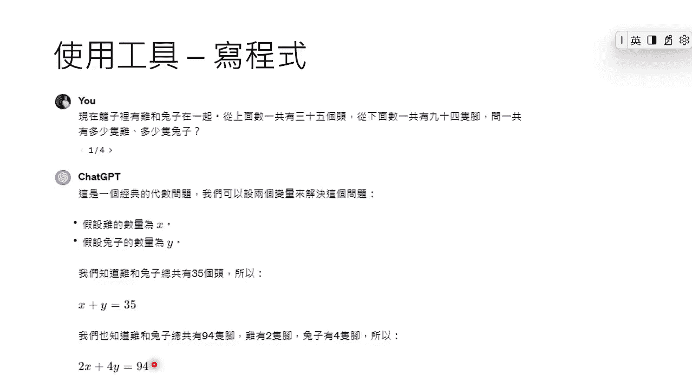

自己硬解出呃，X跟Y是多少，它直接写一段程式码啊，就直接写一段程式码哦，他会先呼叫一些他要的package，然后把刚才的两个式子呢列出来，然后直接呢呼叫一个server，直接呼叫一个可以解题的模组。

把这个函式给他，把答案解出来，再把答案印出来，这个就是正确答案，那会写程式的大型圆模型其实很多啦，其实GPT3。5也会写成式，但g p t four比较特别的地方是，它写完程序以后。

他能够自己去执行他自己写的程序，把执行的结果再拿来给你看，是像这种解联立方程式的问题，如果你是直接呼叫这个现成的package，呼叫线程的城市，呼叫现成的模组来帮你解决这个问题。

你根本不可能会得到错误的答案。

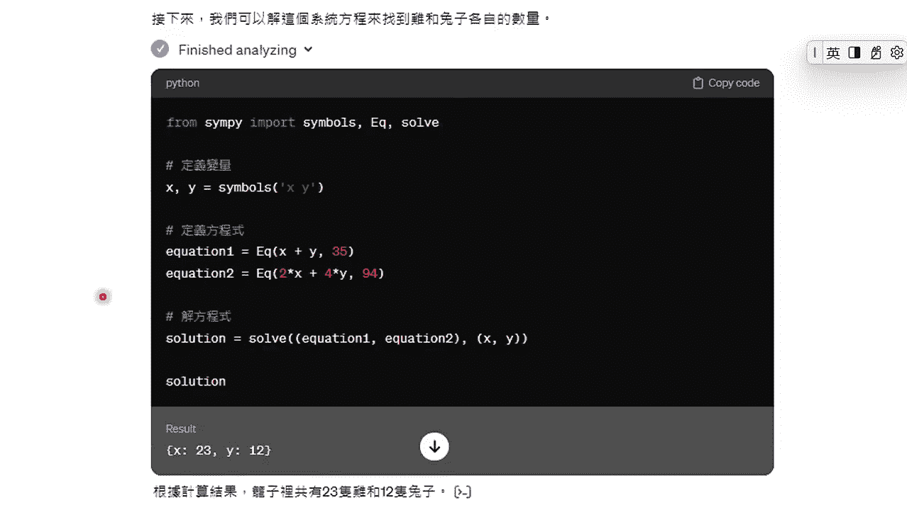

那其实透过写程式来强化语言模型能力，这件事啊其实很早就有了，那这边就是引用一篇论文，这篇论文呢叫做program of soul啊，你今天如果有什么好的想法，尤其是这种不训练语言模型。

凭空让他能力增强的方法呢，往往都要叫什么什么of s a program of sou的概念，就跟我们刚才展示jpd four的能力，是一模一样的，而且你问他一个数学问题，然后呢。

如果他直接用这个文字接龙的方法硬解的话，很容易得到错误的答案，但如果呢把一段程式写出来，再执行，这段城市往往比较可能得到正确的答案，好那这是一个蛮古早的论文，这是2022年11月哦，GPT是3。

5上线之前就已经有的论文。

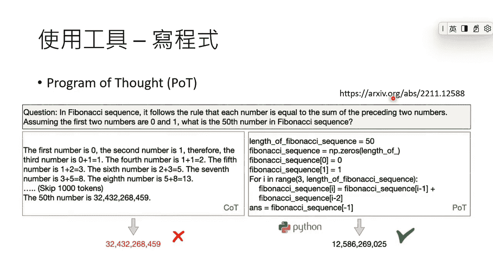

好在我们上周讲到gt four，如果你叫它哈哈哈100次，他会有一个截然不同的答案，什么样截然不同的答案呢，我们先来看g p t four的回答，你跟他说，请说哈哈哈，100次他真的就会产生300个哈。

我数过了一个都不少，正好就是300个哈，但他是怎么做到产生正好是300个哈的呢，你会发现这边有一段文字叫做，Finish analyzing，当你看到这个句子的时候，当你看到这段文字的时候。

就代表g p four写了一个城市并执行它，那你可以点这个钮把它展开。

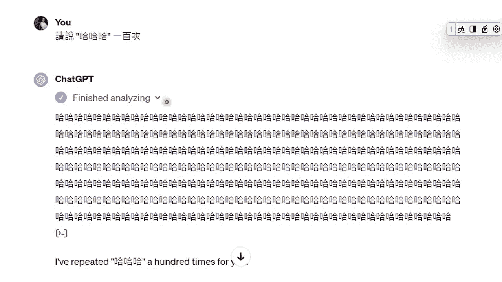

你就发现原来他是写了一段简单的城市啊，这个城市就是这样呃，反复100遍存到test里面，再把test pr出来，正好就是300个哈，一个不多一个不少哦，所以g p t four可以用其他模型。

现在还没有办法使用的解法，真的去解一些，可能本来透过文字接龙蛮难解出来的问题。

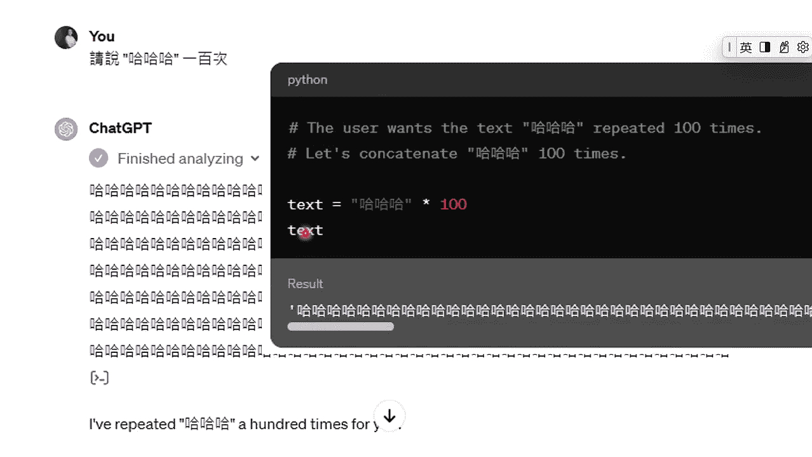

好，那现在这些语言模型呢，还有什么可以使用的工具呢，比如说这个呃g p p four，可以去接一个文字生图的AI，那这个AI呢叫做搭理，那文字生图的AI，它的运作非常简单，非常直觉，就是你给他一段文字。

他按照文字的描述，把你要他画的东西给他画出来，那因为今天g b t four呢，可以调用这个文字生图的AI，所以大家通通都会用文字生图了，今年过年的时候，你是不是收到很多贺长辈图贺年卡呢。

这些长辈图贺年卡可能是长这样的，这样的这样的，这些龙看起来都没有什么问题，虽然这个龙呢它喷出来的火有点像是仙女棒，喷出来的火，觉得有点奇怪，但是看起来都有模有样的，但你仔细定睛一看。

就发现这些龙有些怪怪的地方，比如这只龙，它有一个呆毛长在头上，这个龙不知道为什么，它的胡须呢长一根在头上啊，长个非常长的毛出来，这些龙呢都是用DI，也就是透过g p t four去呼叫DI生成的。

你要怎么用g p t four，产生这个龙年的贺年卡呢，你就跟他讲，产生龙年贺年卡，图上不要出现文字，然后他就会产生creating image，这段文字就代表说他去呼叫darling。

然后呢darling就会把图画出来。

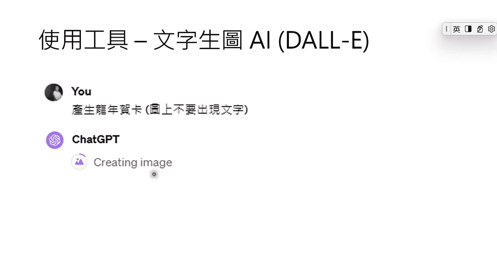

那为什么上面要特别强调不要出现文字呢，因为如果你不加这句话的话，他就很喜欢在图上面加一些happy new year啊，或加一些中文啊，而且这边这段文字是对的哦。

Happy year of the dragon，感觉还可以，但这边这个year显然拼错了，那英这边他想要产生一些中文，但是显然都不知道在写些什么，所以避免它产生文字，以免自曝其短。

但如果它不产生文字的话，结果往往画的都还是不错的，你不定睛看。

你是看不出来这是AI画的，那你可能会想说，把文字生图接到g p t four里面，让大喜原模型可以自己去抠一个生图的软体，有什么样的作用呢，这个生图的软体比如有很多啊，我自己打开那些软体。

比如说me journey，我也可以画图啊，那把语言模型跟生图的软体结合起来，有什么样的妙用呢，这边举一个例子，在一年前呢，我曾经示范了，怎么用这个语言模型玩文字冒险游戏啊，这个玩法是这个样子啦啊。

一年之前的玩法是这个样子，你就输入一段文字，告诉他说我们要来开始一个文字冒险游戏，然后呢由玩家来决定要采取的动作，然后游戏开始的时候请详述故事背景，游记游戏开始，你只要输入这些文字，那个CHEGPT呢。

它就可以主持一个文字冒险游戏，它会提供选项让你选，根据你的选项，它就会有不同的剧情展开哦。

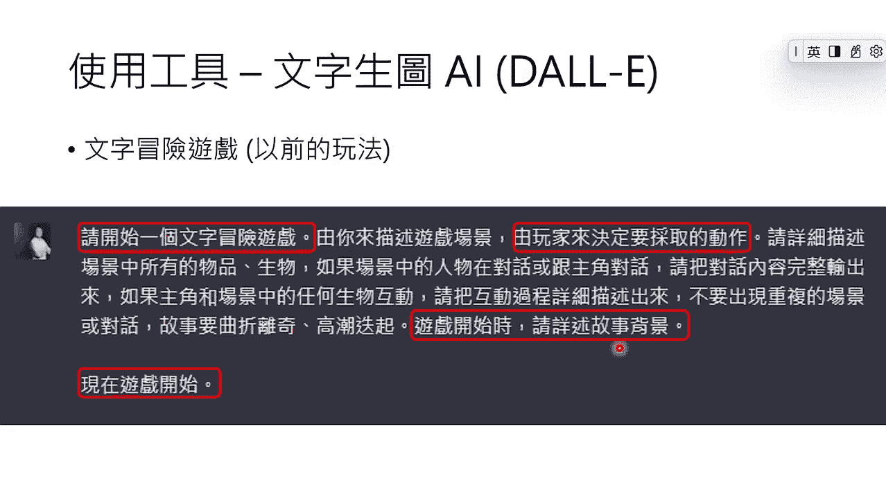

所以他可能会这样回答，你就说你是一个探险家，然后你听说一个古代宝藏的传说，你要踏入这个踏上这个旅程，寻找古代的宝藏，给你三个选项来选，不同的选项会有不同的结局。

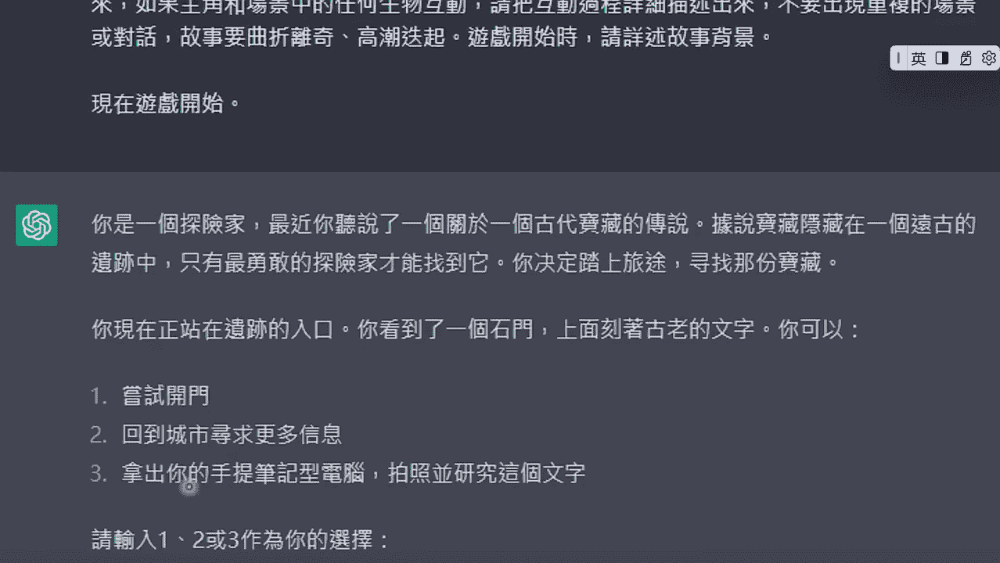

因为玩这个文字冒险游戏呢，呃只有文字实在是太干了，所以在一年之前，为了让为了让整个游戏不那么干，我把文字冒险游戏的叙述，丢到一个文字生图的AI啊，当时用的是me journey，让它产生游戏的插图。

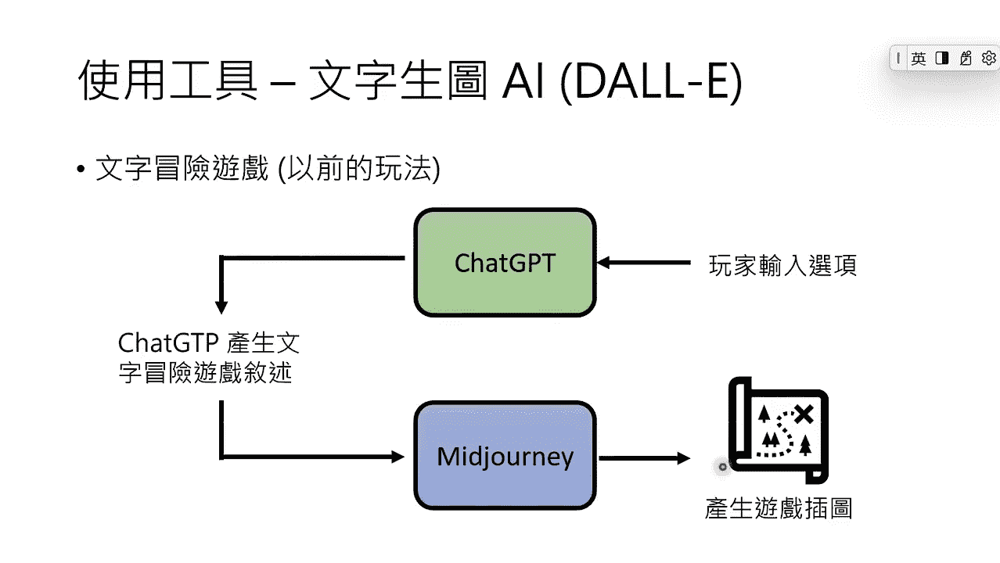

如果你想知道玩起来感觉怎么样的话，你可以看这一段录音，但今天你其实是可以有不一样的玩法的，怎么玩呢，今天你可以多加一句，每次你描述完场景之后，请根据你的描述产生一张图，那他一样呢会开始架构一个文字。

冒险游戏的场景，他说你醒来在一个阴暗的森林中啊，你有个背包，背包里面有个地图，然后看起来像是这个森林的地图，你还有小手电筒，你还有旧的日记，上面写着寻找遗失之城等等，那讲完这些描述之后哦。

后面还有很长的描述了，这边就不秀出来给大家看。

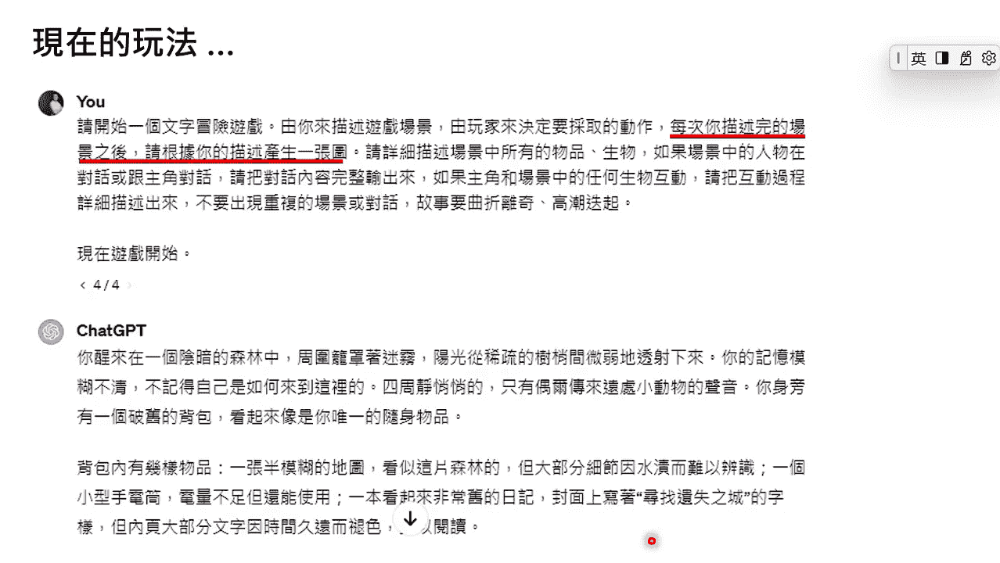

讲完这些描述以后呢，去GBT就去呼叫darling，生一个跟场景有关的图啊，看起来真的有个森林，有个背包，有手电筒，还有地图，跟他刚才的描述呢是蛮一致的，那接下来他一样会给你几个选项。

问你要走左边的小径，还是继续往前走，还是走右侧的小径，那这样有这个文字冒险游戏呢，玩起来就更带感了，那其实这个g p t four呢，还有很多其他可他可以使用的工具啦，那我刚才讲的几个呃。

比如说这个呼叫搜寻引擎，呼叫这个文字生图的AI等等，是他内建本来就可以呼叫的工具，那如果你想要呼叫更多工具的话，有一个东西叫做gt的PLIN，这个plugin里面现在有收集了超过上千个工具。

那你要用这些工具的时候呢，你就要进入一个叫做plug in的模式，然后在那个模式里面呢，你可以从那上上千个工具里面选三个工具，在对话的时候进行使用好，那讲到这边，我就想要回答我刚才讲的问题。

语言模型是怎么使用这些工具的呢，不要忘了语言模型只会做一件事，就是文字接龙，所以当它使用工具的时候，它也是用文字接龙的方式在使用工具的，怎么用文字接龙的方式来使用工具呢，以下就举一个具体的例子。

告诉你说怎么用文字接龙的方式使用工具啊，假设你现在想问语言模型，说我用五美金，那可以换多少新台币好，那语言模型呢想要回答你这个问题，所以开始做文字接龙，五美金可以换，还记了这几个字以后啊。

觉得资讯量不太够，因为到底美金跟台币兑换的汇率应该是多少呢，这个兑换的汇率啊应该是随时间变动的，所以应该去网络上查一下最新的兑换的比例哦，所以它就会产生一个特殊的符号，这个特殊的符号代表呼叫工具。

你可以想象说他先定义好一个符号，比如说一个你平常在对话的时候，绝对不会用到的符号啊，那个符号呢只要一出现就代表呼叫工具，那接下来呢他会继续去做文字接龙，直到它产生另外一个特殊符号，代表结束使用工具为止。

在呼叫工具到结束使用工具，这两个符号之间的文字就是操作工具的指令，那至于操作工具的指令该长什么样子，这个是你要事先定好的啊，那这边我是假设说在括号之前的这个东西，代表说是要使用哪一个工具。

比如说这边写搜寻代表要使用搜寻引擎，括号里面的内容代表你要给那个工具的内容，如果是搜寻引擎的话的话，就是你要拿去搜寻的那个关键字啊，就把台嗯美金，台币兑换这几个关键字丢到google上面。

那google就会回传给你一些相关的资讯，比如说你马上就可以看那个网页，那个网页上只写一美金，等于31。5台币，那把你从网页上搜寻到的结果，当作是文字接龙的一部分，贴到刚才已经产生的句子，后面。

这些网络上搜寻到的内容就是当做是语言模型，做文字接龙已经产生出来的结果，那语言模型会根据这些网络上搜寻到的内容，再继续去做文字接龙，比如说我已经知道一美金就是31。5台币，但是五美金到底兑换多少台币呢。

呃如果用文字接龙的方式来计算，恐怕非常容易算错，所以再呼叫一次工具，产生一段文字，直到呼叫工具结束为止，那这段文字就是操控工具的指令，括号前面是计算机代表要呼叫计算机。

括号里面的内容就是你要输入给计算机的内容，5×31。5，计算机按一下以后得到157。5，那把计算机的输出当作是文字接龙，已经产生出来的结果，再继续去做文字接龙，那这个时候语言模型就不需要自己。

再去做任何数学了，这边前面都已经接出来，是157。5，他根据这段文字继续去做文字接龙，它只要复制就好，他把157。5复制出来，得到答案是157。5元新台币，那输出结束的符号代表生成结束。

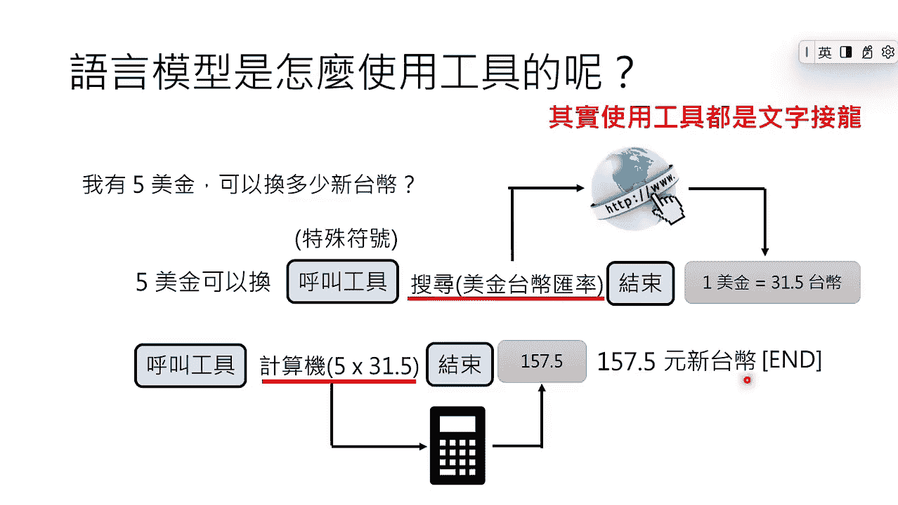

假设你想要知道语言模型，实际上是怎么学会使用工具的，它怎么学会在适当的时机输出，使用工具那个符号，如果你想知道他是怎么做到这件事情的，你可以看这一段录影，会告诉你说，这些语言模型是怎么学会使用工具的。

也就在适当的时机产生使用工具这个符号，但是既然使用工具这件事情，是语言模型自己学出来的，那就意味着他难免会犯错。

那这边就是举个犯错的例子，我今天叫语言模型画一个表格，整理GPT1到GPT3的模型参数量，那我想大家应该都听得懂我的意思吧，我想要画一个表格，没有人会误会吧。

但是GPT它就画了一个表格，这样子他就是他，他就把这个指令解读成字面上的意思，真的去画了一个表格，他呼叫搭理这个工具画了一个表格出来，然后上面呢还在某个地方写了GPT啊。

其实这个语言模现在这个g p t four啊，我感觉他对话这个字非常的敏感啊，你少跟他讲话，这个字你看到画这个字，他就会忍不住要把DI呼叫出来。

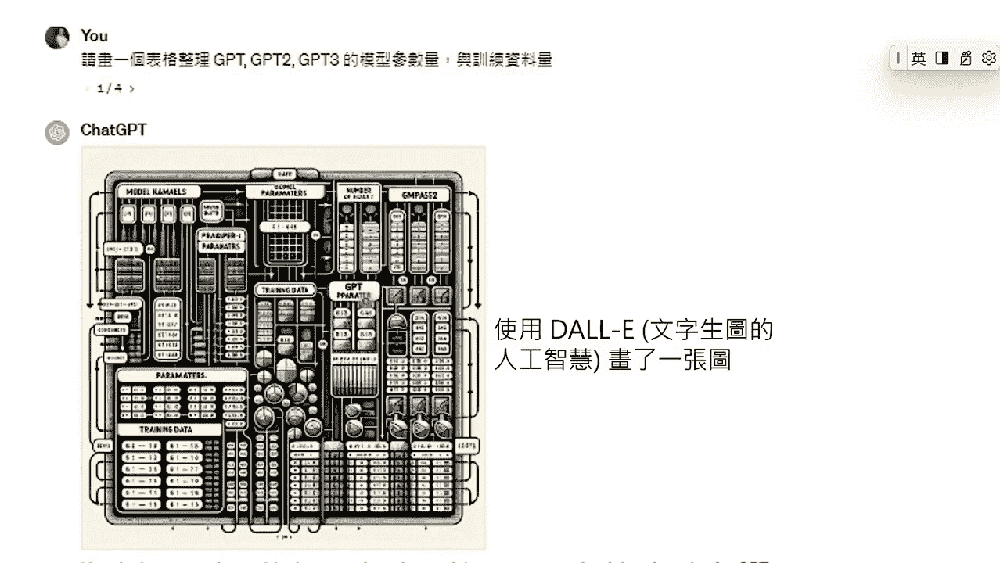

比如说我说请画一只狗，把这句话翻译成英文，我就是要他做翻译哦，它会把请画一只狗翻译成英文，Please for a dog，但他控制不了他本能想画一只狗的冲动，看他画那个字。

所以他顺便要把一只狗画出来哦，所以这些工具要怎么使用，是语言模型自己决定的，所以他难免会犯一些使用工具上的错误。

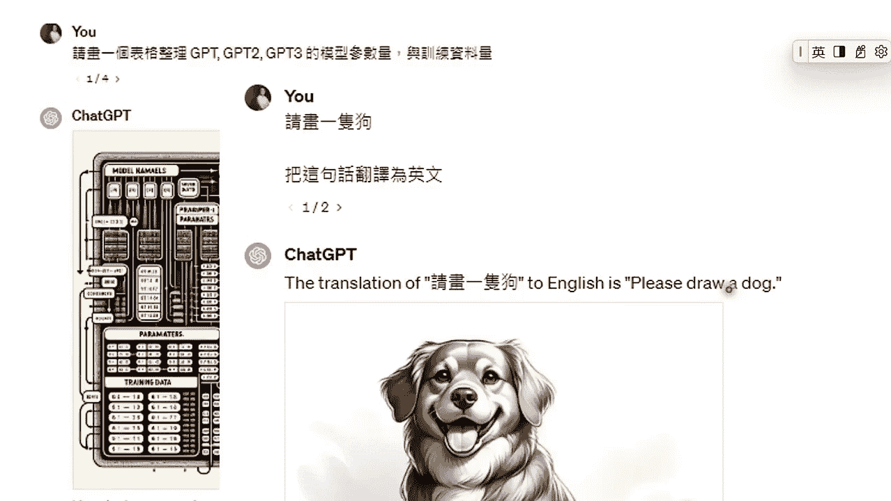

好，那呃语要怎么在强化语言模型，使用工具的能力呢，有一篇paper叫做那个呃any tour啊，这边paper是一个粉非常新的论文啊，是上个月才放到archive的里面，就使用了各式各样的技巧。

希望语言模型可以把使用工具，这件事情用到极致。

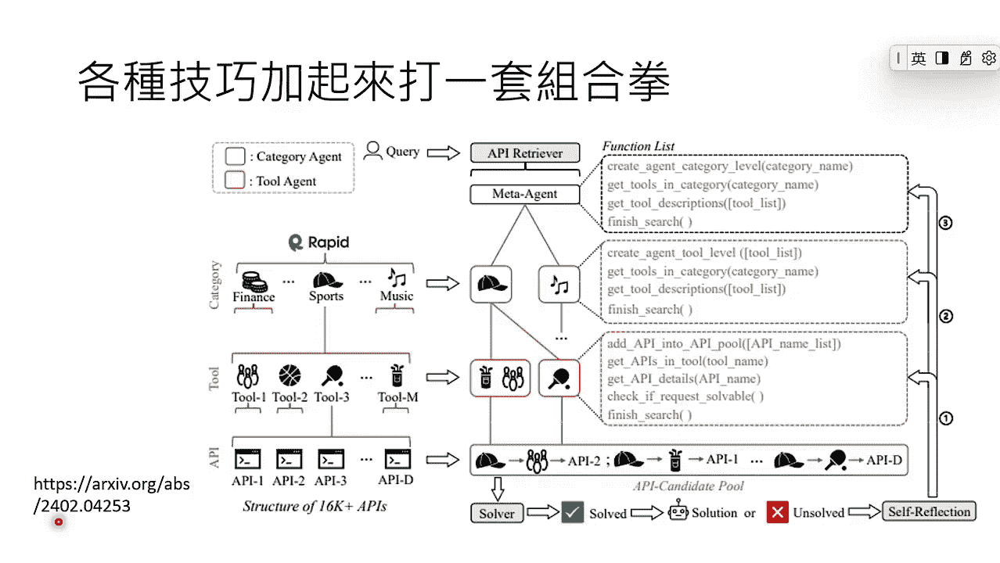

那那剩下一段呢，我们请等助教讲完作业以后再继续说，那我们现在就请助教呢来讲这个作业，那么现在要进入作业三，那作业三开始是一个比较有挑战性的作业，前两个作业你没有碰到任何的城市，那从作业三开始。

我们要真的碰到写成式的部分好。

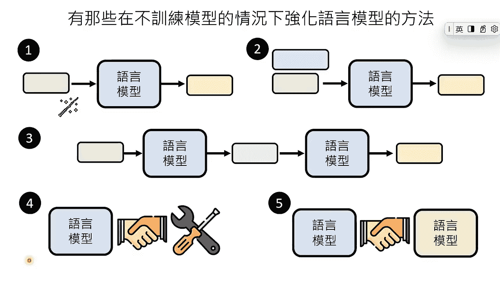