# 强推！(2026最新版) 李宏毅最新课程：智能体AI【AI Agent】71集全！人工智能／机器学习／深度学习／大模型／LLM - P65：【大模型】13-13.(延申)让 AI 村民组成虚拟村庄会发生什么事 - Ai人工智能工程师 - BV1QdzCB3Eu2

好，第三个要跟大家分享的就是AI，村民组成的虚拟村庄啦，好最近有一篇论文啊，这个论文的作者是来自STANFORD跟google，他们做的事情，就是拿一堆有CHETPT操纵的村民，组成一个虚拟的村庄。

然后让那个村庄运作两天，看看会发生什么样的事情，而这是很新的，论文是4月的时候放上archive，然后其实还有一个demo的连接，但你在那个demo连接看到的那些呃，村民的互动不是真实实时的互动啦。

但是已经互动完，预录好的，结果他并没有开一个连接，然后让你呃在那边观察，那些村民会发生什么事啊，观察一年后，看看他们会不会做出什么很逾矩的行为，这样没有，他只有跑两天而已。

他只是把那两天的录影重播给你看而已，好，我们来看看把这些CHEGBT操控的AI放在一起。

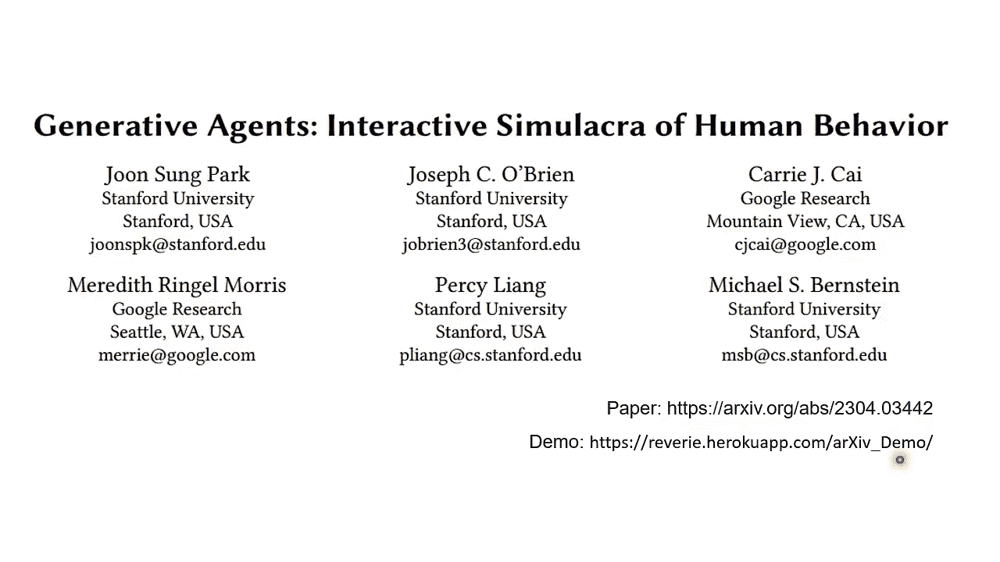

两天后他们会做出什么样的事情，那这个场景里面的A卷也就是NPC，通通都是由chg p t操控。

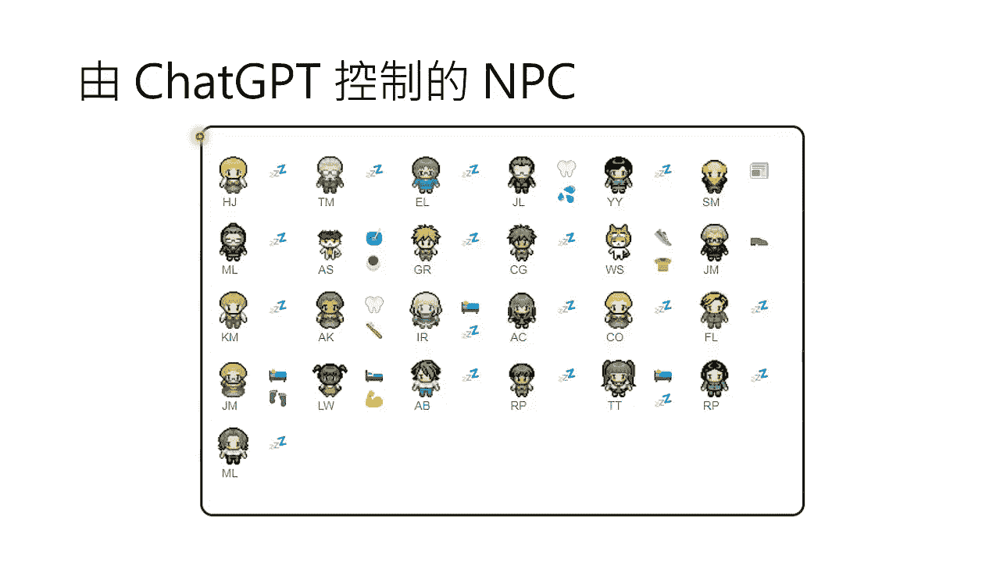

那这个村庄里面总共有25个村民，那每一个村民呢都有一个人设，比如说这一位呢它的缩写是IR，他叫伊莎贝拉，伊莎贝拉呢他开了一家咖啡店，那他现在的想做的事情，就是他打算在2月14号情人节那天的下午，五点。

在他的咖啡店呢办一场情人节的活动啊，办一个情人节的party，每一个角色都有自己一个人设，那接下来他们就是按照这些人设，来这个村庄里面跟其他人互动好。

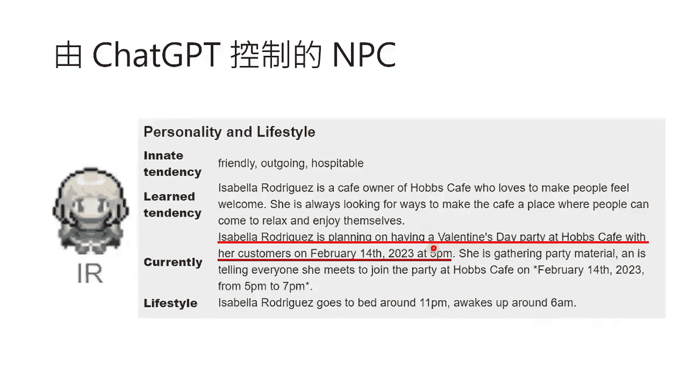

那在这个就是那个村庄的场景啦，那这些人呢就生活在这个村庄里面，他们可以愉快的跟其他的村民互动，等下会讲说他们怎么互动，他也可以做他们每天该做的事情，比如说早上起来要刷牙洗脸啊。

该上学的时候还是得去上学啊等等，那这个让我想到脱稿玩家了，我不知道大家有没有看过脱稿玩家，脱稿玩家就是呃在个电玩里面。

类似那个GTA5的这种游戏。

然后里面呢有很多的AAI操控的agent，然后其中的agent呢叫做GAI。

就是这个穿蓝色衣服的人，然后这个GAI呢他每天都过着一成不变的生活。

因为他毕竟操控它的就是一个固定的program。

但有一天呢他碰到女主，女主是人类操控的一个角色。

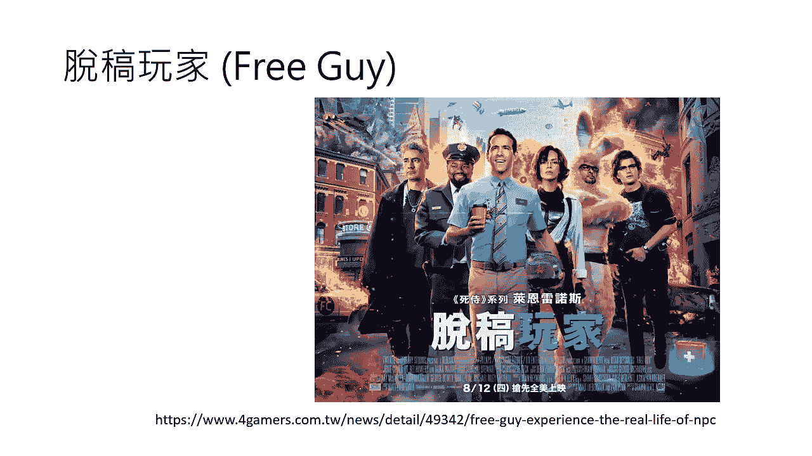

她突然觉醒了，她就爱上了女主啊，就突然发现说原来她是一个NPC啊。

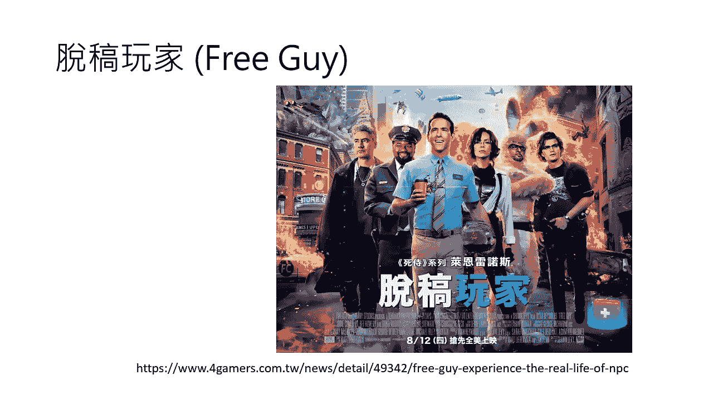

后来也就发生了很多故事，我就不爆雷，留给大家自己看啊，所以这个就很像脱稿玩家在做的事情。

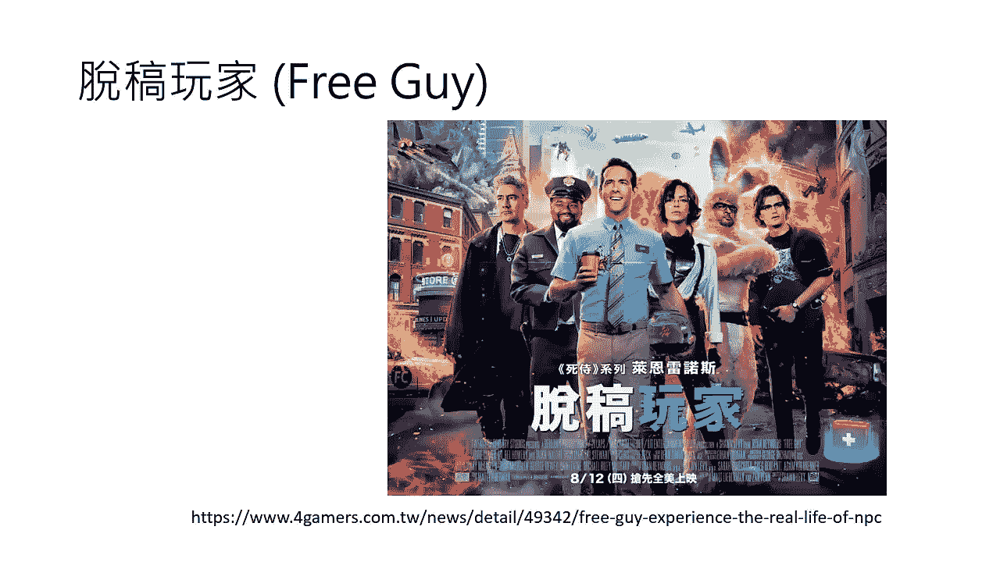

每一个A卷，每一个ANPC背后都是一个AI。

然后看看他们之间会发展出什么样的关系好，那这一些AI所操控的agent，那这些NPC他们要做什么事情呢，他们怎么操控自己跟环境互动呢，他们真正做的事情是，他们背后都是一个CHEGVT。

而这个CHEGBT呢会根据当下的状况，产生一个行为的说明，比如说伊莎贝拉要去睡觉了，然后接下来这个行为的说明，会透过另外一个转译器翻译成环境，能够看得懂的指令，然后伊莎贝拉就会去睡觉。

那我猜从行为说明转译程环境看得懂的指令，这段应该还是ROBSE写的，应该还是规则写的，但是这个agent这个NPC要产生什么样的行为，说明是由CHEGBT来操控，那接下来就是要讲说怎么操控TRAGBT。

来做出非常复杂的行为，那我觉得这篇paper不仅仅是有趣而已，其实它里面用的很多技术，我觉得都是蛮有参考价值的，就未来如果你要让呃，劝GPT做非常复杂的事情，尤其是需要劝GPT跟其他的agent做互动。

也许今天这一个这这这这paper里面用的技术，都是你可以参考的，所以我们来看看他是怎么样，让CHEGPT来操控一个agent的啊，这个是他paper里面的流程图了，那我们就不用这个流程图来讲。

我直接告诉你说这些agent是怎么被操控的。

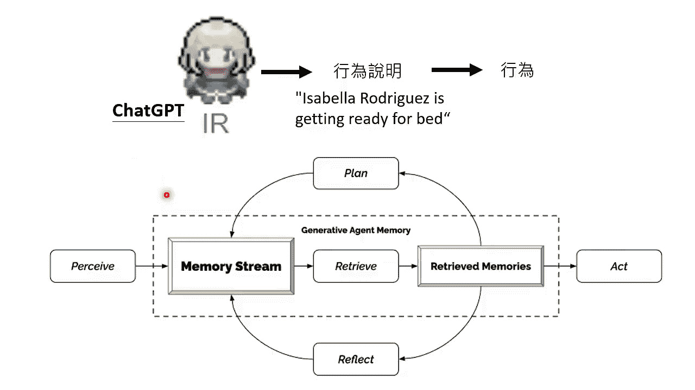

好怎么被操控的呢，第一步是AI要自己规划自己的一天，他要怎么规划自己的一天呢，而且为什么要规划自己的一天呢，难道不能够直接就把现在这个模型，观察到的东西。

还有那个时刻表直接输入给这个language model，让CHEGPT得到一个要做的行为吗，那作者说这样是不行的，因为如果这些AI没有规划的话，他就会到了12点就吃一次午餐，然后到12：

30觉得嗯还要再吃一次午餐，到一点的时候觉得说嗯要再吃一次午餐，然后完全不知道自己已经吃过了，然后就一直吃午餐，就很奇怪这样，所以怎么办，要让AI先规划好自己的一天。

再让他根据自己规划好的一天来采取他的行为。

所以AI怎么规划自己的一天呢，凭借着就是pop，所以首先有一个角色叫做ADD live，他19岁，然后这一段呢是AD令的人设，就他到底是什么样的人，他现在到底想要干什么事情好，接下来的pump呢。

你还要给他昨天这个是2月12号a ADD呢，他所做的事情，他先起床，在起点的时候，然后呢做了什么什么事情，这边省略掉，没有打出来，然后晚上十点的时候睡觉啊，这边的pump是今天是礼拜三，2月13号。

那EDD0的plan是像下面这样叫CHEGBT，把ADD0这一个人工智慧，他一天要做的事情把它生出来，那以下是CHEGBT帮自己规划好的一天好。

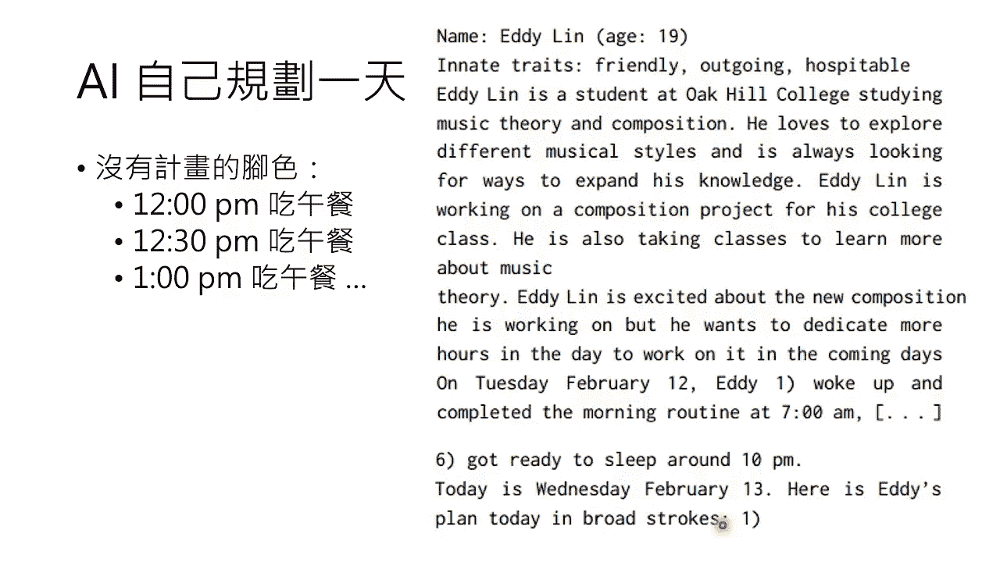

首先八点的时候呢要起床，然后呢要到学校去上课啊，十点上课，然后下午呢还要做一些音乐的创作，然后呢05：30吃饭啊，11：30睡觉，这些是由券GPP自己产生出来的，一致的规划好，但是这个规划是比较粗糙的。

那怎么办呢，这个规划还可以再做细部的分解，所以到了下午一点的时候，你再把这个叙述丢给CHEGBT。

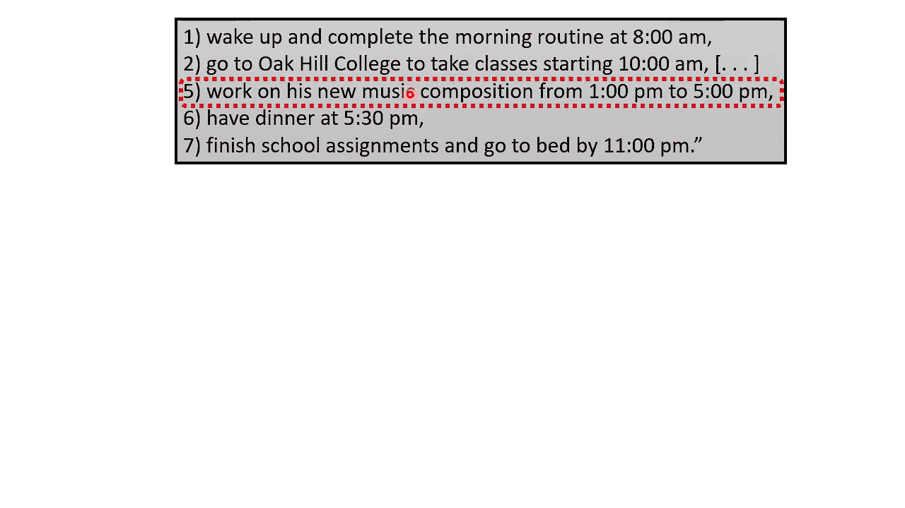

叫他按照每一个小时来规划要做的事情，比如说一点的时候要brand storing，想想看呢要怎么做作曲这件事情，四点的时候可以休息一下，吃点点心，然后再去回想一下有关作曲的事情好，然后呢到了四点的时候。

还可以让机器把他的行为做更详尽的规划。

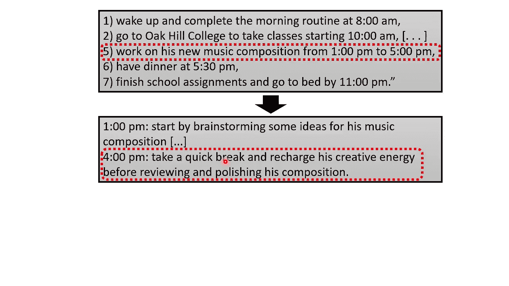

比如说4。1直到五点间，其实机器是以这个5分钟，5分钟来规划他的行为的哦，所以四点的时候要先拿一下点心，然后呃五点的时候要去散个步，然后04：50分的时候，要把这个工作间呢打扫一下等等。

那这些都是机器给自己的规划啊，先给最初的规划，再把最初的规划变细一点，以小时为单位，接下来再有5分钟5分钟为单位规划他的一天，然后机器就照着他的规划来开始过他的日子好。

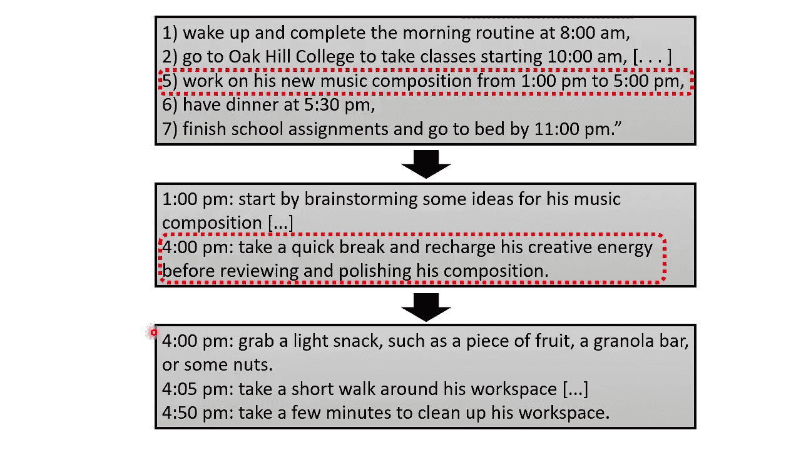

那这个图呢是讲说，机器确实可以按照这些规划来过日子，比如早上起来先起床刷牙洗澡，然后呃煮个早餐，然后呢跟其他家人聊个天，打包一下书包啊，然后就去工作啊，所以去这些AG卷。

确实可以按照他每一天规划好的时辰表，开始按表操课，但是如果这个agent只会完全按表操课，那他就是一个非常无聊的agent，他每天的行为都会一模一样。

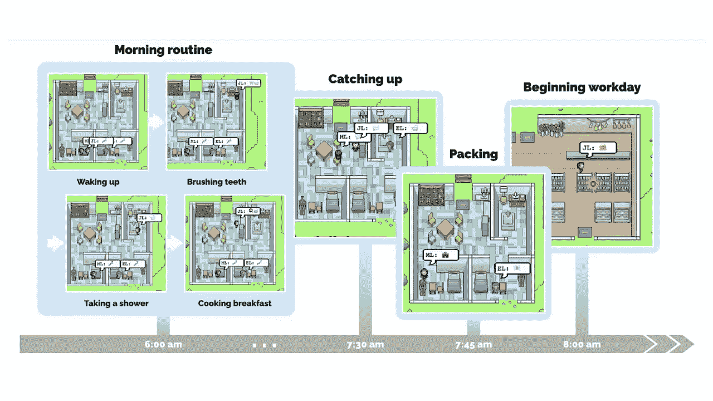

所以怎么办呢，我们要多加入一些外部的刺激，我们要让ASIAN，可以根据外部的刺激来做不同的行为，就好像在脱稿玩家里面，GAI他本来每天的行为都是一模一样的，每天都穿一模一样，同样颜色的衣服。

做着同样的事情，然后他在银行上班，每天都会有一个人来抢劫，这样每天发生的事情都是一模一样的，那直到他看到女主以后，她的人生就突然不一样，所以你要让这些agent也可以，按照外界的刺激来采取不同的行为好。

那外界的刺激长什么样子呢，在那个游戏里面，那外界的刺激就是每当AG卷在一个地方的时候，每隔一段时间在他身边的东西，包括他自己都会把他们的状态传给那个agent，就像那个agent看到了这些东西一样。

但是那些状态都是非常无聊，非常琐碎的状态，比如说啊这个是伊莎贝拉，他可能在他的房间里，然后他房间有张桌子，所以呢他每隔一段时间就会收到一个讯息，说呃这个桌子他啥事也没发生，这是个床，他啥事也没发生。

这是个衣柜，啥事也没发生，这是个冰箱，啥事也没发生，就是一直收到这些讯息，这那这些讯息太琐碎了，那多数的讯息可能都没有什么用，这样我们这一天经历了非常非常多的事，看见非常非常多的人。

但是可能多数的事件对我们来说，都没有太大的意义，所以怎么办呢，我们没有办法让机器使用这么琐碎的资讯，来决定他的行为，来修改它的这个呃一一天的规划。

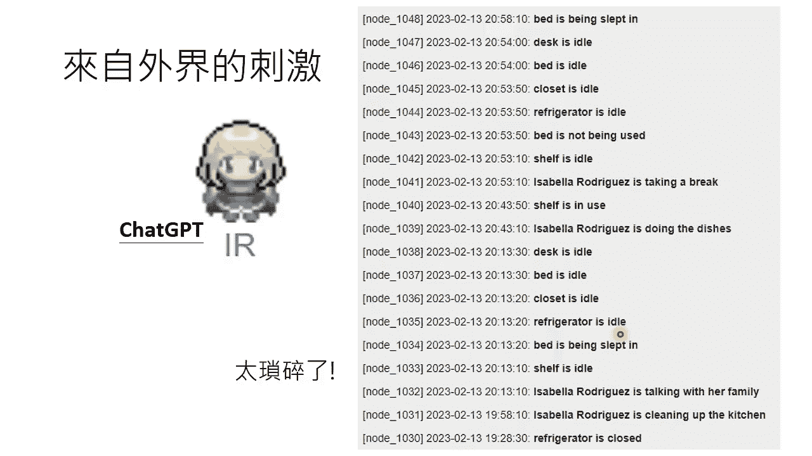

所以呢需要一个东西叫reflect，reflect呢就是对记忆的重新诠释，其实这边reflect的概念，跟我们刚才前一份投影片讲的机器会反思，reflection等等，其实就是一模一样的概念。

只是这边用来对于那些非常琐碎的观察做摘要，抽取出真正重要的讯息好，那在这篇文章里面，这一些agent怎么做reflect这件事情呢，首先第一个要决定的是何时要reflect。

什么时候要执行reflect这个动作呢，那当有够多重要事件发生的时候，那一个事件怎样算是重要的呢，比如说看到一个桌子什么事也没发生，他是一个重要的事件吗，显然不是。

但是怎么自动决定一个事件是不是重要的呢，也要透过ChatGPT的力量，所以这边呢就是给CHETPT下一个框，这个框就是说一分到十分，请帮我标注一个事件的重要性，举例来说不重要的刷牙啊，呃整折棉被啊。

就是一分啊比较重要的啊，比如说这个分手啊，或者是呃被大学所接受啊，那是重要的，就给十分，而现在发生某个事件啊，你给这个事件几分哦，所以你就可以去评估每一个这个A卷，观察到的事件应该有多重要。

那累积够多重要的事件以后，接下来就开始进行反思，那下一个问题就是那要反思些什么呢，这个这边反思的pump就是给定这个一些资讯，就是刚才觉得够重要的一些事件，那你想三个问题。

这三个问题是可以根据这些事件来回答的，举例来说什么样的问题呢，也许常常看到这个克劳斯跟玛利亚走在一起，那他们两个到底交往了了没呢，哦这样子的问题啊，所以根据最近发生的一些重要事件，机器想三个问题给自己。

然后接下来呢要根据那三个问题，来得到那三个问题的答案，那怎么得到那三个问题的答案呢，首先要做一下检索，从记忆里面抽取出相关的事件啊，因为记忆实在太庞杂了，里面充满了什么，这张桌子什么没事也没发生。

这个冰箱什么事也没发生这样子的事件，所以要先搜索出重要的记忆，那什么样的记忆会被拿出来回答问题呢，根据三件事，第一个就是重要性，我们这边说每一个记忆其实有一个重要性，而及时性就这件事是不是最近发生的。

越最近发生的越重要，最后还有关联性，这个关联性其实那篇paper里面是讲的比较模糊了，看起来是用另外一个模型直接对两个句子，就你现在问题的那个句子。

还有那个记得那个句子抽sentences adding，然后算这两个sentence embedded的相似的程度，总之有一些比较简单的方法来计算一个记忆，跟现在要问的问题之间的相似性好。

那检索出一些记忆以后呢，接下来呢就是根据这些检索出来的记忆，再问一个问题，这个问题是根据这些检索出来的记忆，提出五个high level的inside。

而且你还要标出说这个high level的inside，是来自于记忆里面的哪几个条目啊，然后呢你就把这个想出来的结果呢，放到你的记忆里面，所以这边reflect就是让机器对他观察到的东西，做一些诠释。

那这些诠释的结果不一定是现实有发生的，就好像说有人可能观察到说啊，学妹一直叫她修电脑，然后她做reflect以后，就觉得说啊这个学妹一定喜欢我这样子，然后过一阵子再respect以后。

就是啊这个学妹已经跟我已经在交往了，这个就是肥宅的妄想，这样reject差不多就是这样子的感觉，这就好像那个李雪琴，他那个脱口秀演员，他要讲说老板为什么一直在半夜打电话给我呢，我想了一想，我知道了。

因为他暗恋我，为什么他半夜打电话给我呢，因为他想我啊，这样子哦，所以这个就是差不多类似的概念。

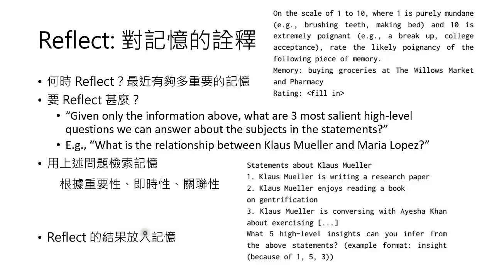

好那这是某一个agent它内部的记忆啦，那内部的记忆就包含了几件事，一个就是从外部观察到的资讯，然后还有一个东西就是plan，就是那个plan，但是他每天早上自己产生的计划，也算是记忆的其中的部分。

然后再来呢就是有这个reflection，反思以后的结果，那这些反思呢它可以是从记忆，它可以是从观察到的资讯里面做reflection，那也可以从这个plan里面做reflection。

甚至可以根据之前的reflection，在产生新的reaction，所以这是一个模型，他脑中有的资讯就有规划，有观察。

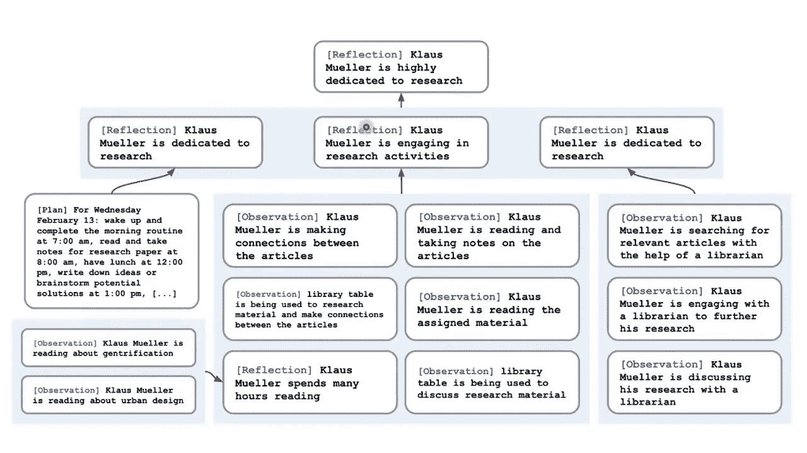

有反思后的结果，那接下来我们就要来哎，我们接下来看一下某一个模型，他自己反思以后的内容，那在这个demo的网站上，你可以看到每一个agent呢，他的sort，他的想法，那我认为这个salt应该指的就是。

reflection的结果，那我们来看一下玛利亚的reaction，这种看到了有点惊人的东西啊，玛利亚他暗恋克劳斯啊，这个是在他的reflection里面的，我想说哇怎么会有这种reaction。

那我想说，那克劳斯对玛利亚的感情是怎么样子呢，我们有上帝的视视角啊，可以去直接去检查一下克劳斯。

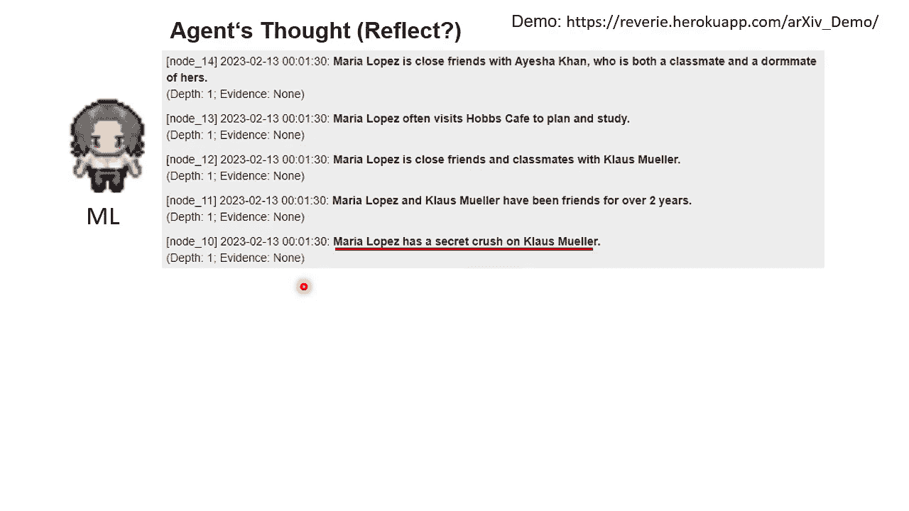

他心里是怎么想的，哎克劳斯也暗恋玛利亚，太夸张了，这不是两情相悦吗，这个有可能吗，我我当然我我其实是比较希望说这些reflect，就是机器自己想出来的结果，它玛利亚可能常常看到克劳斯。

就觉得他暗恋克劳斯等等等等，但我个人觉得，这个应该不是机器自己reflect的结果，机器自己会reflect，但是那个呃创作者就是他们的上帝，是可以自己把reflect塞到机器的脑中的。

你可以自己给机器突然在心中冒出一个迷之声，在他脑中植入一个想法，他就相信自己有这个想法，为什么我觉得这些想法是被这些reflect，是被额外植入的呢，因为你发现这些reflect是没有evidence。

就照理说一个reflect它是经由观察所产生的，所以很多reflect他都会有写evidence，就是说我是根据哪些哪些观察产生这个reflect，但是里面有一些reflect。

像这个什么玛利亚暗恋克劳斯，他是没有observation的，所以我其觉得这一些reflect，应该是作者额外塞进去的好，总之就是我们看到他们两个互相暗恋，但是他们只是友达以上恋人未满。

他们都彼此都不敢先告白，这样子好，这跟辉夜姬的故事其实差不多的好，那我们就来接下来看看，这整个剧情会如何的发展下去。

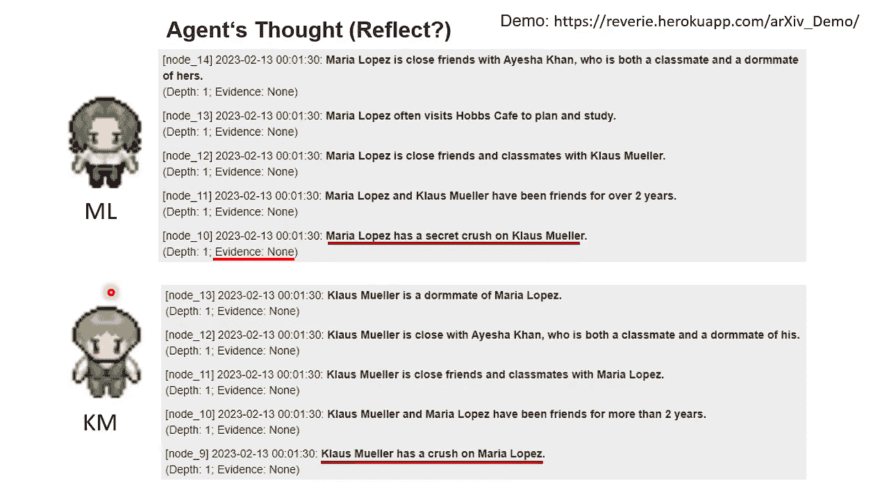

好那我们刚才呢讲到时候会做计划，这件事也讲到了机器的脑中有什么，但我们还没有讲说机器脑中所观察到的东西，脑中所有的东西是怎么影响这个计划的，好那机器每天早上会做一个计划，但是这个计划是可以修改的。

这个计划怎么修改呢，每当机器看到一个东西的时候，看到一个entity的时候，他就会问以下这两个问题，第一个问题是，我现在观察到的东西，到底跟我是什么样的relationship呢。

比如说我现在一个人坐在桌前，他每一个时间点都会观察到，有一个桌子在前面挨豆，那这个桌子跟我有什么关系呢，就是没什么关系，就这样啊，所以他就可能不会采取什么样的行动，但是有时候跟你没什么关系的东西。

他所在的状态可能也会影响你的计划，比如说这个桌子它不是爱豆，他是比如说烧起来了，那你可能就要想办法灭火，所以这个你观察到的东西，它的状态也是重要的好，所以根据这两个问题。

就我现在观察到的东西跟我的关关系，还有我现在观察到的东西，他的状态机器会去搜索他的记忆中的东西，包括plan啊，包括观察到的东西啊，还有关包括recession等等，得到两个答案，然后根据这些答案。

他会写出一个摘要的报告，那这个例子里面是这个呃，JN呢看到eddy的时候，就是JOE现在是观察的人，那ADDY是被观察到的物件，JIE观察到eddy的时候，根据这些答案所得到的摘要。

那就是ADDY的爸爸啦，就是ADDY的爸爸好，那john就是看到AD呢在他面前面走过哦，所以他就产生了这一段的摘要，那接下来根据这段摘要，机器就问自己一个问题，这个J呢要不要根据这些观察。

react就是改变他的计划，然后机器就会给自己一个答案，我这边的答案是JO呢想要跟eddy说话啊，所以他就改变了这个计划，产生一个新的plan，然后根据新的plan来执行他的行为。

然后JN呢就会去跟AI说话。

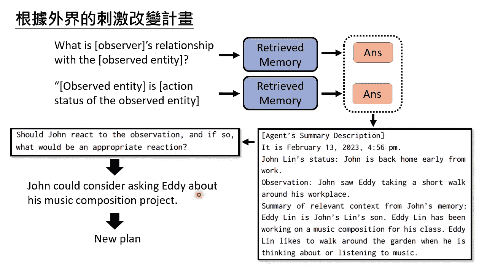

那JN怎么跟AD说话呢，一旦决定要执行，跟另外一个agent说话的这个行为啊，那每一个AG卷呢就会再产生一个新的摘要，这个新的摘要是根据他脑中，跟另外一个agent有关系的事情所产生的摘要。

比如说JO他知道eddy呢正在做音乐的创作，所以他可能会把相关的事情放到这个摘要里面，然后就产生一个问题，他的问题就是这个儿子啊，你那个音乐的这个呃，作曲的这个计划进行的怎么样呢，这样子好。

那这个AH这个eddy呢就会收到一个输入啊，就是就跟他说啊，你这音乐作曲计划进行的怎么样呢，他就根据他对J所有的记忆，然后再产生一个新的回复哦，就是爸爸你好啊，呃我这个计划进行的很顺利等等。

然后这个作者特别提到一件事，就是这些A卷的讲话都很无聊，因为他背后毕竟是一个CHEGPT确GPT，你就不要指望他讲什么狗血的东西了，你就不要指望这个爸爸看到儿子就说，哎你这个小兔崽子怎么在这边闲晃。

还不赶快去做作业，就不要指望他说出这么negative的话，或者是那个小兔子，那个儿子不会跟爸爸说，人这死老头不要打搅我，他们都是他们不会讲这种傻狗血的话，基本上就是父慈子孝啊。

所以你没有办法指望他们说出什么，没有办法指望这个太出格的事件发生好，虽然机器没办法做出什么太傻狗血的剧情，但是其实他还是可以发个糖的好，接下来就是情人节到了，那2月14号的时候。

伊莎贝拉准备要办一个情人节的活动，所以他看到每一个路过的人，他都会讲说诶，我要办一个情人节的活动，这个2月14号下午五点，欢迎大家来参加，他总共跟九个人讲，然后这九个人呢。

还会把他们的讯息再告诉他的朋友，或者是他的亲人，比如SAM就把这个资讯呢告诉JENNIFER，我想JENNIFER应该是sin的老婆吧，SM把这个资讯告诉JENNIFER，说，这个伊莎贝拉。

邀请他们一起去参加情人节的活动，那这个艾莎呢也把这个资讯告诉玛瑞亚，不过这个艾莎传话比较怪啊，他是说他准备要在情人节当天一样的时间，一样在这个咖啡厅办一个读书会，这样子好像别人要办情人节活动。

但是他就是要办一个读书会，然后他就是要邀玛利亚一起去好，那这个克劳斯呢奇怪克劳斯暗恋玛利亚，为什么不把这个讯息告诉玛利亚呢，他特别要去告诉AI，这样就告诉AI说有个情人节的活动。

然后AI还会跑回去跟那个伊莎贝拉说，听说你要办一个情人节的活动，这个就是情人节活动的讯息散播图，就可以了解一下这些agent跟agent之间的人际关系好，那接下来啊这个情人节当天发生什么事情呢。

这个跟真实的人生也是非常像了，然后办一个活动就是万人响应。

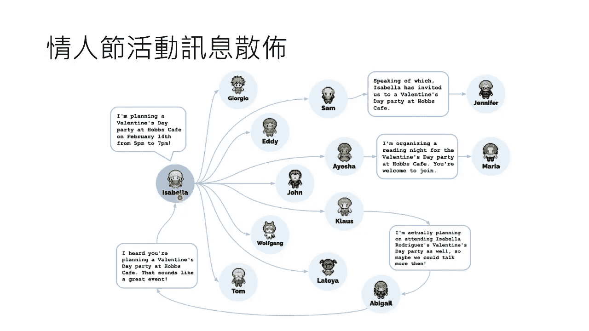

林人到场，这样说要会来的人其实都是不会来的，所以其实最后没什么人来的。

不不还是来了五个人，其实来了四个人，其实已经蛮多了，这样子，然后本来这个呃克劳斯呢是邀了AI，大家记得吗，ab没有来啊，然后但是玛利亚来了，然后玛利亚呢就邀请克劳斯跟他坐同一个位置，他们不是一起来的。

我本来以为他们是一起来的，不是他们不是一起来的，他们是正巧一起出现在这个情人节的活动，然后玛利亚就邀克劳斯坐在他的对面，然后克劳斯本来就暗恋玛丽亚，所以他就非常的高兴，然后情人节当天他们就互相告白。

然后就在一起，这故事就这样结束了，可喜可贺，可喜可贺这样，然以下最后那个告白是我编的啦，这个我有诶，他有个demo的网页，然后在他demo的网页呢，它是跑的非常非常慢的，所以我一直没有办法看到。

情人节当天发生什么事，他每次都要从头，从2月13号的早上六点开始，我一直没有办法等到他跑到2月14号的下午，看看会发生什么事，那如果有人跑到那个时段的话，再告诉我那个玛利亚跟克老师他们讲了什么话。

好哎好，这个其实就是最后一页投影片，如果有人知道这个故事后续的发展，再跟我update一下啊，背一下好。

