# 强推！(2026最新版) 李宏毅最新课程：智能体AI【AI Agent】71集全！人工智能／机器学习／深度学习／大模型／LLM - P6：5-第三讲：Transformer架构 - Ai人工智能工程师 - BV1QdzCB3Eu2

好那这堂课开始呢我们要讲network的架构。

那在作业四里面呢，我们会训练transformer啊。

transformer现在是一个非常广泛的。

类神经网络的架构，它除了被用在大型语言模型里面以外。

很多其他地方也都会用到transformer，比如说产生语音也会用到transformer。

其实今天很多时候产生图片。

也会用到transformer，那在我们的作业里面，是要做一个产生图片的transformer。

这我们特别不是教大家做语言模型，因为我想语言模型你已经看的太多了。

所以我们特别呢是选择用transformer。

来产生图片，让你知道说transformer有各式各样不同的应用。

不是只局限在大型语言模型里面而已。

好那这一堂课的主轴呢是要讲有没有哪些架构，有可能可以取代transformer。

transformer有哪些潜在的竞争对手。

那讲到transformer的竞争对手啊，最最知名的就是man靶。

那man靶呢又是一种蛇的名称，所以只要讲到这种transformer的竞争者。

一个很俗套的封面，就是要画一个transformer。

一个变形金刚跟曼巴打起来这样，那我今天除了打起来以外呢。

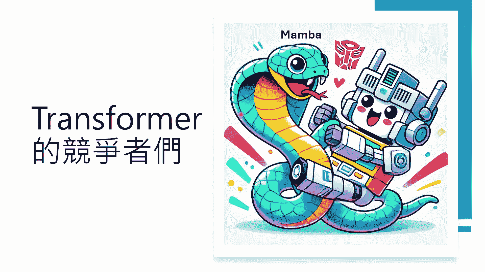

他们中间有一个爱心人就告诉你说，他们其实是非常类似的东西。

但其实这堂课呢不会讲到太多跟MB有关的东西。

我们主要讲的是一个系列曼巴的一群好朋友们。

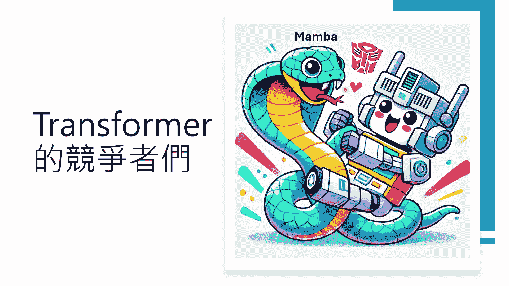

啊那我们这一堂课呢，我们着重的点就在于类神经网络的架构，大家每次看到一个类神经网络架构的时候，要记得每一个架构都有一个它存在的理由，每一个架构是因为不同的理由而被设计出来的。

比如说CNN存在的理由是什么呢。

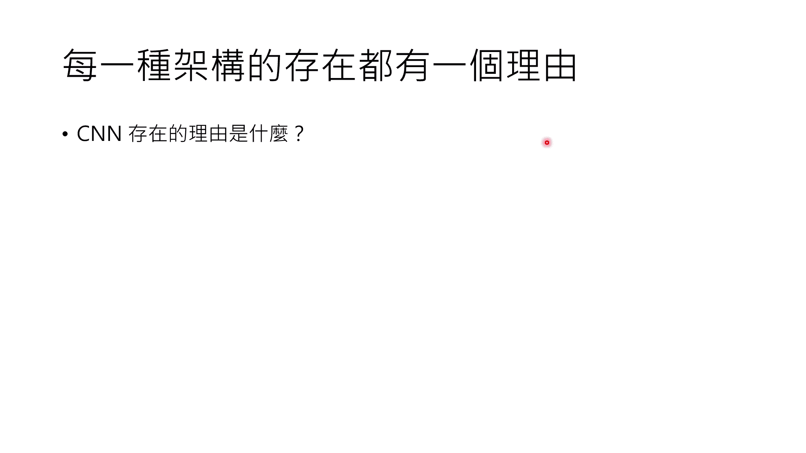

CNN存在的理由是呃，CNN是fully connected的feedforward network的一个special case。

你把原来的最general的fully connected的feedforward network。

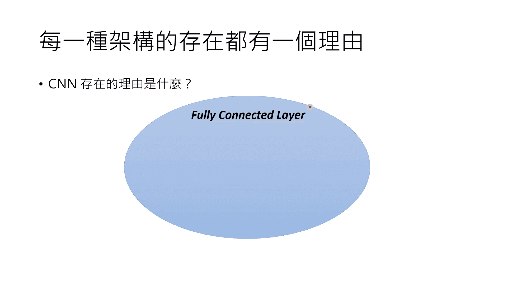

做receptive field，拿掉一些不需要的weight做parameter sharing，让一些weight的参数是一样的，让一些参数的数值是一样的。

那就是convolutional layer，就是CNN，所以fully connected people for one network是一个更泛用的network架构。

而convolutional neural network是专门为影像所设计的，所以CNN存在的理由是什么，它是根据影像的特性减少不必要的参数，减少不必要的参数有什么好处。

可以避免OVERFITTING，让你可以用更少量的资料，就成功训练你的类神经网络。

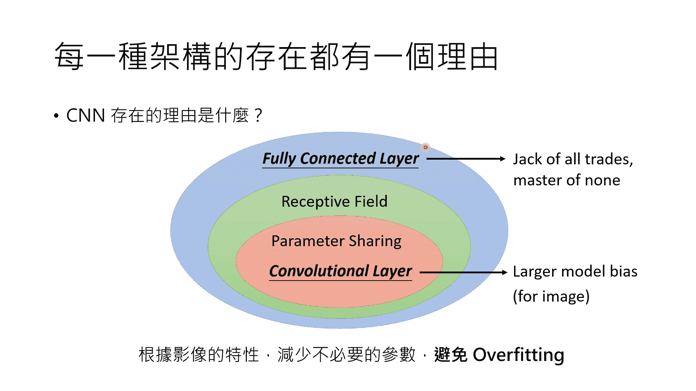

那CNN存在的理由，假设刚才讲的那一段你没有听得很懂的话，CNN存在的理由是我们过去上课的录影是讲过的，那如果你刚才讲的没有听得很懂的话，那再赶快去复习过去上课的录影。

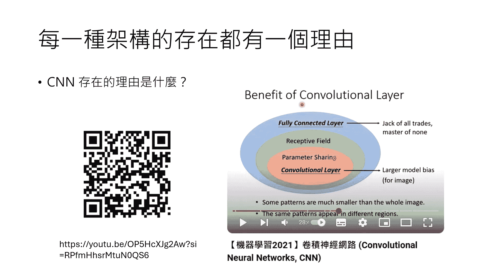

那或者是residual connection存在的理由是什么，residual connection存在的理由跟CNN是不一样的，residual connection存在的理由是什么呢。

Recedual connection，我们上周也有提到过，我们说这是一个在寒武纪之前就已经存在的，类神经网络架构，很多人说2016年那个出现阿尔法go呢，是人工智慧的寒武纪大爆发，那这样2015年哦。

这recedual network是2015年年底就有的，那它就是前寒武纪时期的东西了，而RECEDUNETWORK存在的理由是什么呢，那个时候人们发现了，如果训练一个很深的network，结果不太好。

而横轴呢是训练的iteration，那纵轴呢是测试资料上面的错误率比较，56层的类神经网路跟20层的类神经网路，发现56层的类神经网络是比较差的，很多人很直觉的认为说。

是不是因为OVERFITTING56层参数太多了，训练资料有限，所以over feat在train训练资料上面好，但实际上不是，因为如果你观察训练资料的话，会发现在训练资料上。

56层的类神经网络也是TRA的，比20层要差的，所以类神经网络深结果不好，并不是OVERFITTING的问题，而是在训练的时候比较深的network，他的optimization就比较困难。

你本来就比较难训练好，而recedual connection的存在。

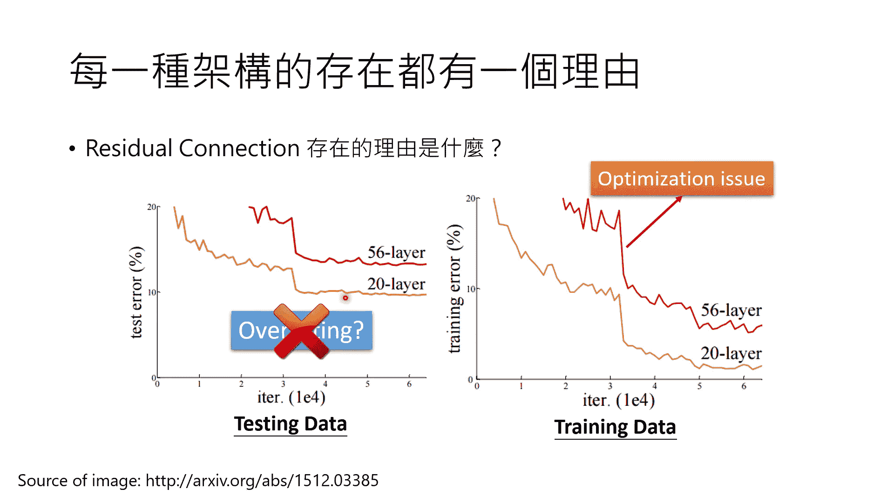

是为了让更深的network可以被训练好，所以它是为了让optimization更容易啊，那怎么让optimization更容易呢，这边是引用一篇2017年的论文，如果2016年是寒武纪的话。

那2017年大概就是中生代侏罗纪时代左右，而在侏罗纪时代呢，那时候就已经发现说呢有加跟没有加，Receio connection，那在这边paper里面叫skin connection。

这个error的surface会是非常不一样的，这两张图代表了，训练两个不同的类神经网络的时候，你的loss长什么样子，那其实这篇paper最主要想要分析的，其实也不是skin connection了。

他就是发明了一个visualization的方法，发明了一个可视化的方法，可以让你看到error的surface长什么样子，因为实际上error的surface，应该是存在一个高维的空间中。

参数是非常高维嘛，投影到二维的平面，让你可以想象一下error的变化，loss的变化长什么样子，那这篇论文就分析了一下，没有residual connection。

跟有residual connection的loss的变化，发现说没有，residual connection lost非常的崎岖，就像是一个山水画一样，所以你比较难做，Optimization。

比较容易卡在local minimum或者是settle point，而如果用recedual connection的话，那error surface看起来比较平坦。

所以optimization比较容易，所以这边举两个例子是想要告诉你，直播每一种架构都有它存在的理由，而它们存在的理由不一定是一样的，比如说CNN跟recedual connection。

它存在的理由是不一样的，所以后大家看到一个新的架构被提出来的时候，你要想想他是为了什么而被设计出来的啊。

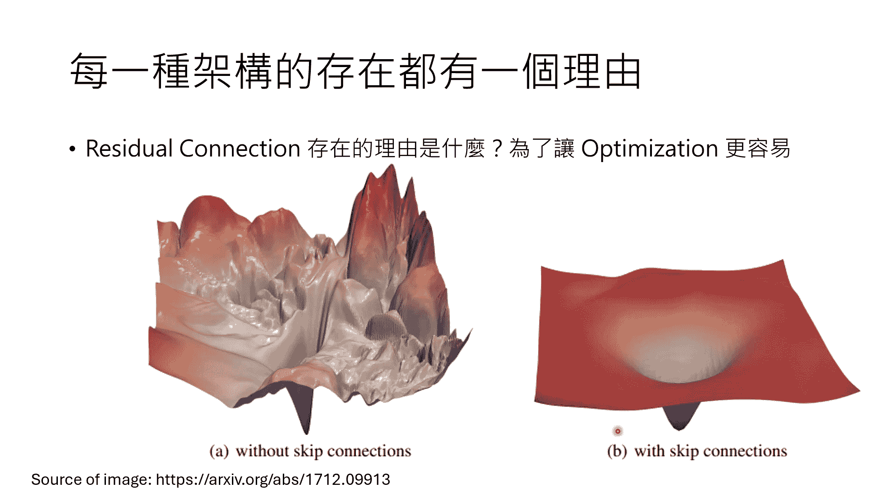

那transformer的出现是因为什么样的理由呢。

那这边要讲的更精确一点，我们实际上指的是在这门课里面，我们实际上讨论的是self attention，那transformer是一个比较大的架构，那它其实有非常多不同的变形。

事实上2019年GPT two用的transformer，跟现在拉马用的transformer，虽然都叫transformer，中间还是有一些差别的，而这些差别其实会造成他们显著的能力的差异。

那到时候在作业四，当你自己劝transformer的时候，你会真的体验一下这件事，你用lama的架构跟用g p t two的架构，你会得到不一样的结果。

好那我们这边讲的并不是完整的transformer，我们要讨论的是transformer的layer，里面的其中一个layer叫做self attention layer，好。

那在讨论self attention layer之前，我们要讲的是self attention layer是怎么取代掉。

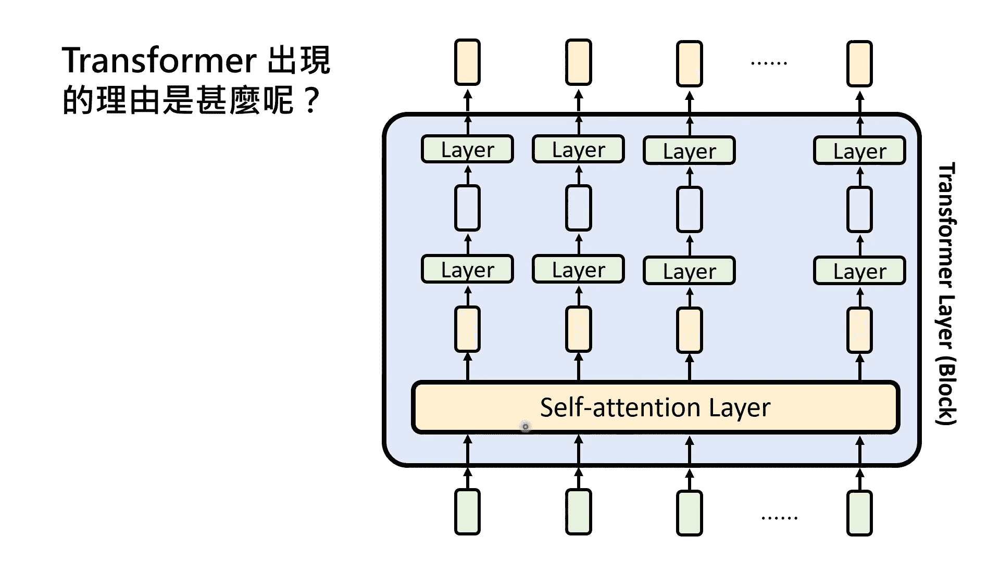

在self attention layer之前。

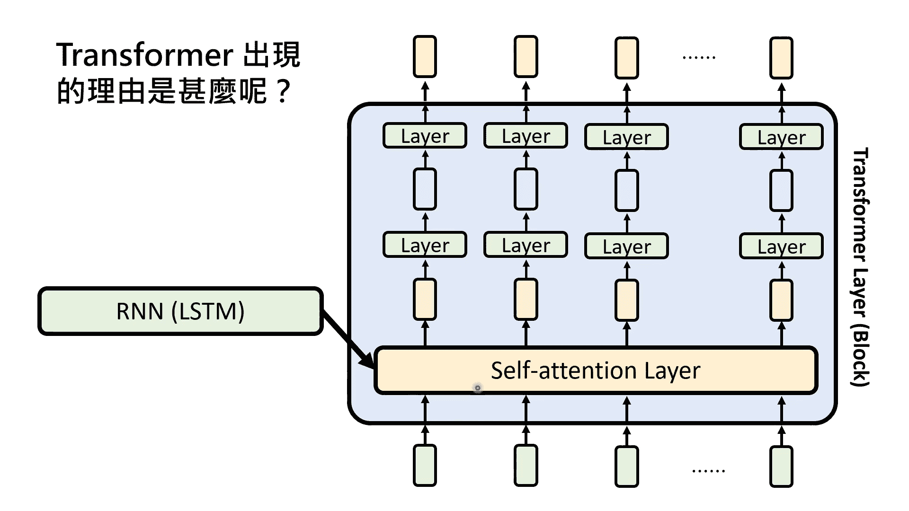

大家比较常用的RNN或LSTN，那你知道self attention是怎么取代。

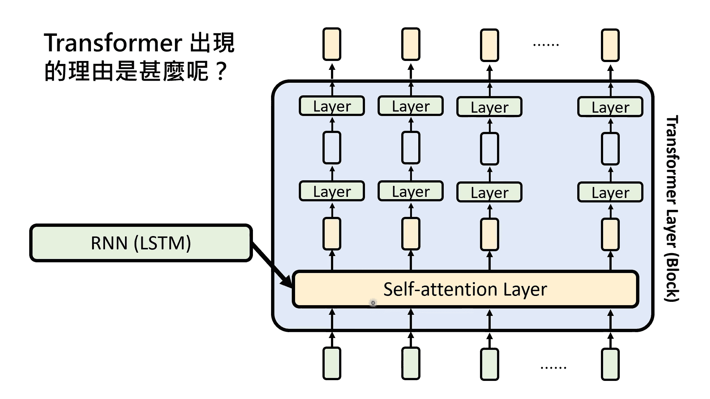

RNN跟LSTN之后，你更能想象为什么其他的架构。

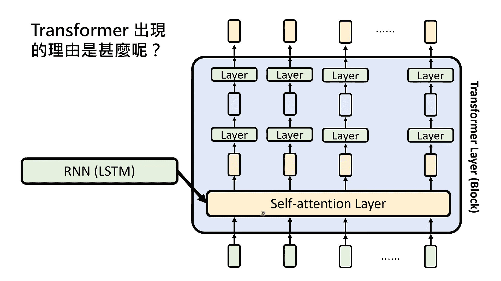

比如说MONA会取代了self attention。

那这个self attention在机器学习这门课呢，是从2019年开始引入的。

后来从2021年开始，课程里面就没有出现RNN了。

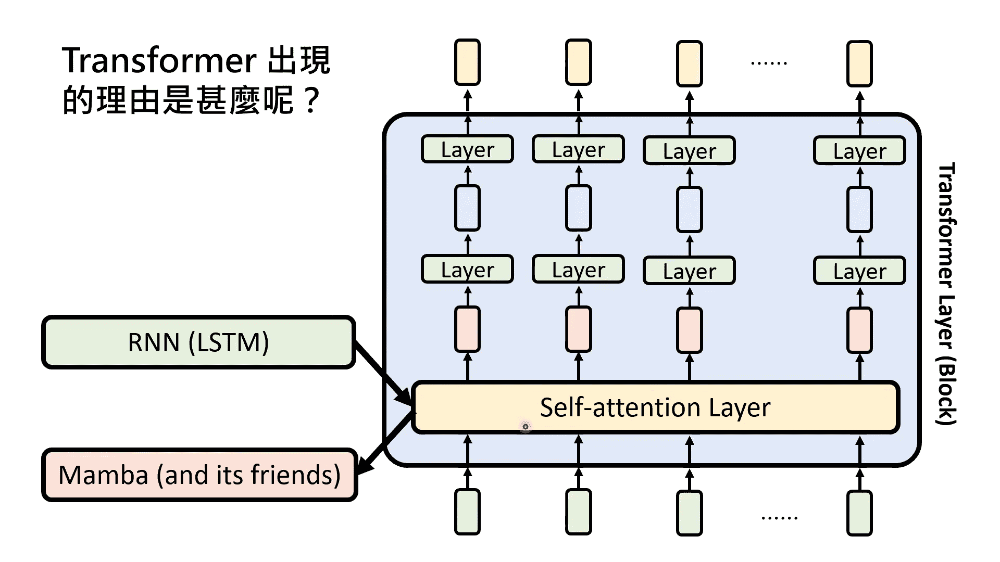

但事实上这堂课呢是会告诉你RNN又回来了。

其实曼巴就是RNN啊。

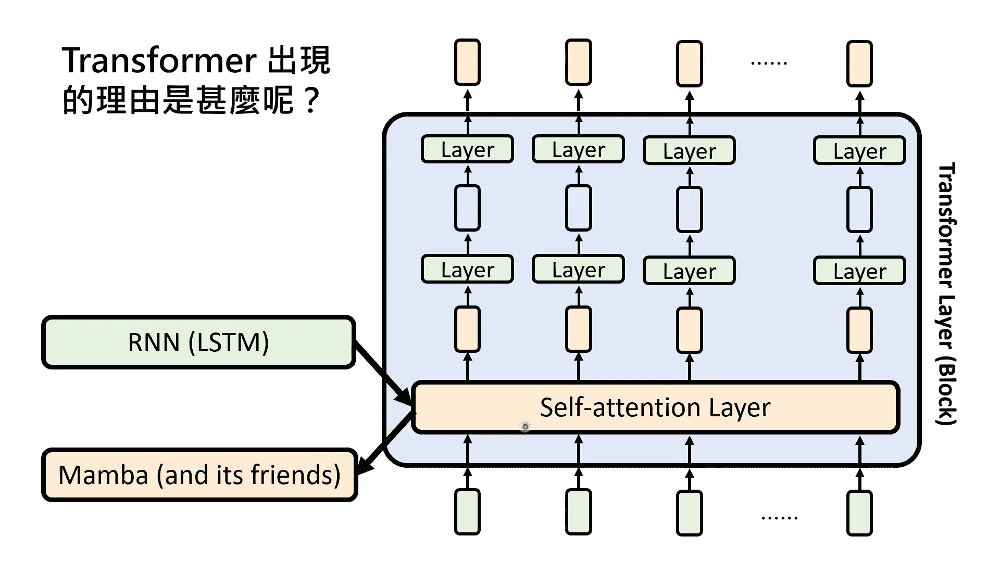

等一下你会知道为什么曼巴就是RNN好，那这些什么RNN啊，self attention啊，或ma他们真正想要处理的问题是什么，他们要解决的问题类型是，输入一个vector的sequence。

要输出另一个vector的sequence，输入一个vector sequence以后，这一个layer要把输入的资讯做某种混合，产生另外一个vector sequence，那如果在做语言模型的时候。

通常每一个输出都只能看左边更之前的输入哦，所以我们在输出y one的时候，会只考虑x1的资讯，输出y two的时候会只考虑x1 x2的资讯，输出，Y3的时候会只考虑x1 x2，X3混合起来的资讯。

以此类推，但在其他的应用里面不一定是这样，可以把整个input sequence合起来混合起来，再产生输出的sequence，不过在等下课程里面，因为我们主要专注于讨论语言模型，所以我们就假设说。

每一个输出的Y都只能够看到比它更左边的，在他之前就已经输入的X好。

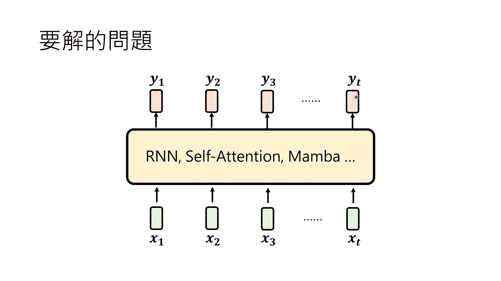

那我们来看看RNN是怎么解这个问题的，事实上RNN比较像是一整群不同架构的代，称作人，这边在RN后面加一个style，就是RNN流，然NN流的这种network架构，它的基本精神是怎么样。

把输入x1到XT混合起来，最后输出YT呢，有一个东西叫做hidden state，hidden state的作用，是把目前已经看到的输入全部混合起来，存在hidden state里面，输出的时候。

只需要根据hidden state就可以决定现在的输出。

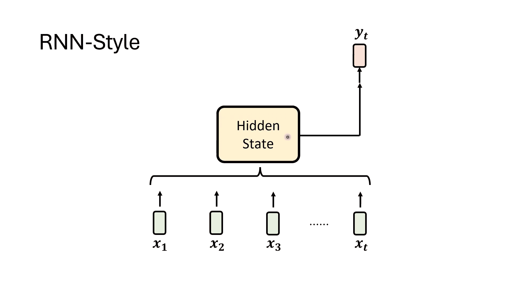

那讲的更具体一点呢，RNN流的方法，他一个广义的这个呃写法呢可以写成这个样子，这个H呢代表的是hidden state里面存的资讯，那我们这边没有特别告诉你。

H它应该是一个vector还是一个matrix，其实两者都是可以的好，所以H是存在hidden state里面的资讯，那在第七个时间点，hidden state里面的资讯是怎么被得到的呢。

它是由前一个时间点的hidden state的资讯，HT减一跟现在的输入XT所共同决定的，HT减一通过一个FA啊，这个FA是一个函式，它长什么样子，是你自己设计的，通常里面有一些参数是需要透过训练资料。

训练出来的，HT减一通过FA再加上XT1，通过FB得到HTHT，再通过FC得到YT啊，那如果把它视觉化的话，整个运作的过程是这样，首先有一个H0，现在输入x1，根据x1跟H0。

还有FAFB产生H1h one，通过FC产生y one，同样步骤就反复进行输入x2呃，这个x2通过f b h one通过FA加起来得到h two，H two，再通过FC1再乘上产生y two。

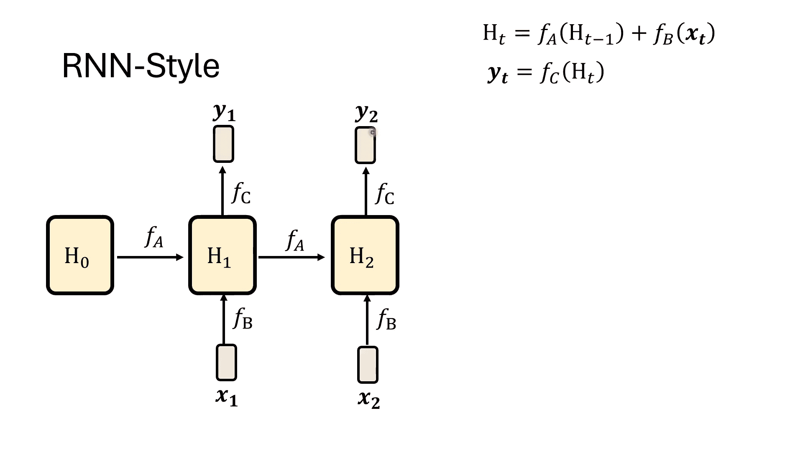

那这个过程就反复继续下去，输入X3产生H3，再产生Y3，一直到输入XT1产生HT产生YT，那这个H0呢，我这边没有特别告诉你说它是什么样子的东西，那最早年的RNN通常H呢是一个向量。

但其实它不一定要是向量，它也可以是一个很大的矩阵，那很多人对于RN有一个误解，觉得说RNN他hidden st就是一个向量，可以存的资讯很少，这是个误解，它可以不要是向量，它可以是一个很大的矩阵。

那更泛用的一个写法呢，是会把这个FAFB跟FC呢加上一个下标小T，代表说呢，FAFBFC这三个函式并不是一成不变的，它们是会随着时间变化的，那怎么让FAFBFC随着时间变化呢。

那你可以让这三个函式跟X有关系，跟输入的X有关系，你可以让X来决定FAFBFC长什么样子，那因为每个时间点输入的X都不一样，那这三个函式就会随着时间变化而不同，那你可以想见说这样子跟时间有关的操作。

可以带给这个RNN很好的性质，比如说假设呃今天一对一个语言模型来说，它想要看完一整个文章的段落以后，就遗忘过去的东西，然后有新的开始，那可以怎么做呢，假设这是一个语言模型。

他可以说假设输入的XQ是一个换行符号，那f a two就执行清除这个动作，把之前存的资讯清掉，或者是说假设x2是一个不重要的资讯，那干脆fb two可以采取关闭这样的行为。

不要让x2的资讯进入h two里面去，占用宝贵的储存空间等等，所以把这个FAFBFC让他们跟输入有关，你就可以做更复杂的操作，好让让FABC跟输入有关。

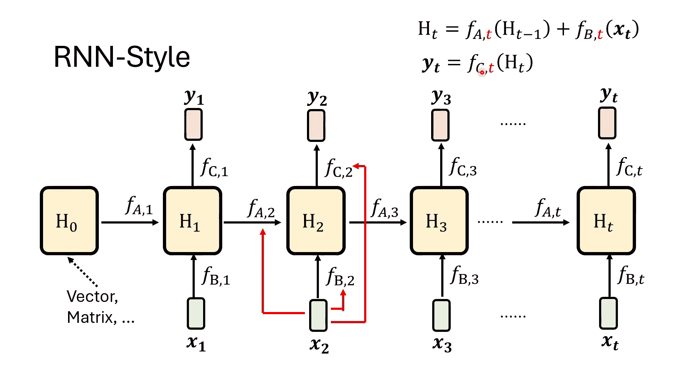

这是什么呢，其实这就是LSTN啊，那我不知道还有多少人知道什么是LSTN啦，LSTNGRU这一些有gate的RNN，其实就是让FAFBFC跟时间有关，也就是跟输入有关啊，那这个图看起来蛮复杂的。

那就是取自过去投影片的图，这个图2021年以后就再也没有出现过了啊，这次是2021年以后第一次再用这个图，那我们不会再细讲，总之就是告诉你说过去常用的RNN的变形，就是最简单的RNN。

以前叫VINA的RNN，最简单的RNN其实实用度很低，多数人都是用LSTM或gr u，LSTN或GRU，就是让FAFBFC跟T有关，这个T就是一个gate，那其实在LSTN里面，它就是有三个gate。

一个叫做input gate，它就是对应到FBT，一个叫forget gate，会决定模型要不要忘记东西，就是对应到FA at一个output gate，决定什么东西要被输出来，就是FCT。

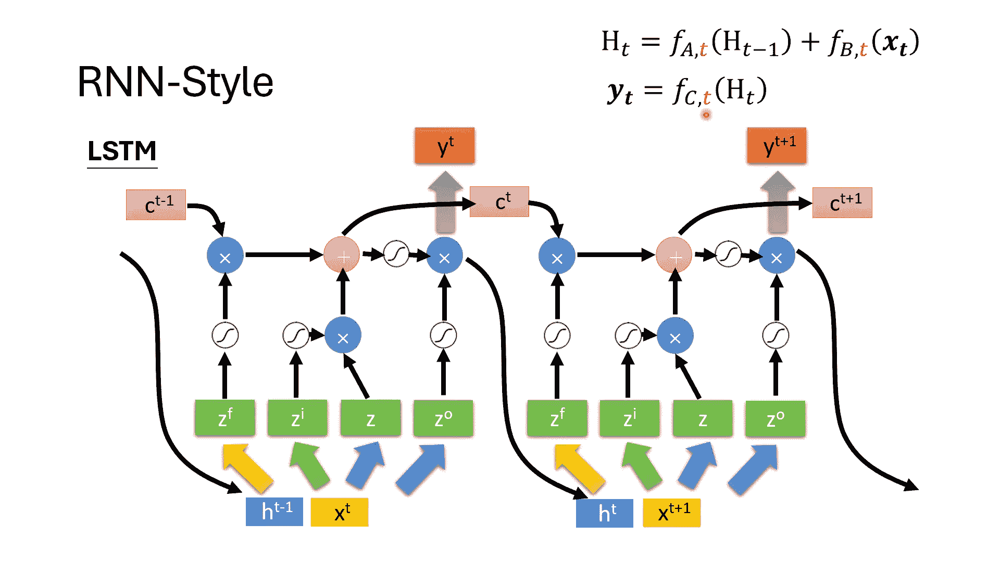

那其实RN流的做法，跟我们第二堂课讲的AI agent怎么处理memory，也有异曲同工之妙，我们在讲AI agent的memory的时候，说，我们要三个模组，一个书写的模组。

决定什么样看到的东西要被放到记忆中，一个reflection的模组，对记忆中有的资讯重新整理一个读取read的模组。

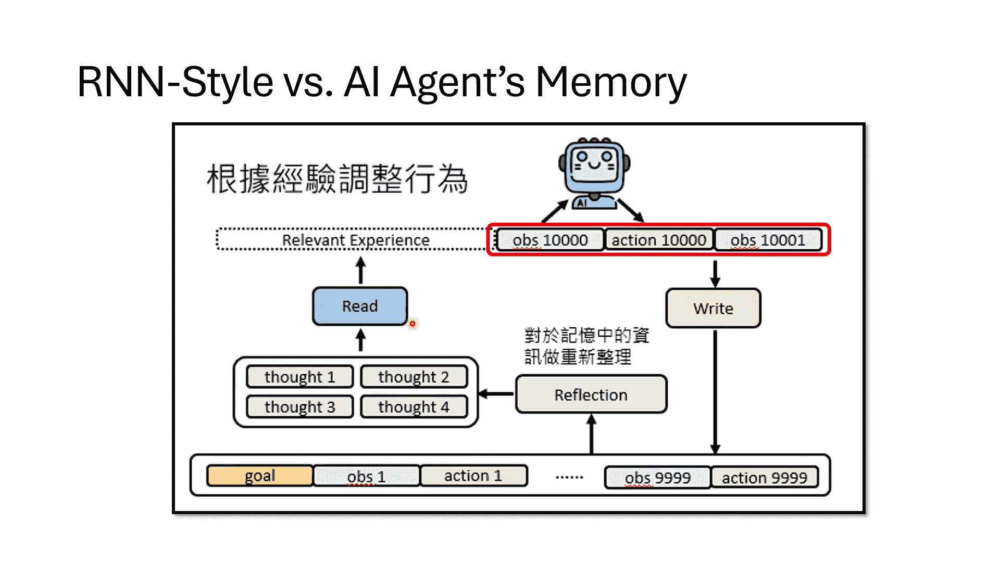

从记忆中读取资讯出来，而RN流的这整套做法呢，H就是我们的记忆，B就是书写的模组，决定什么东西要被放到记忆中，那FC就是读取的模组，决定要怎么从记忆中把资讯读出来。

而FA就是reflection反思的模组，决定记忆中的资讯要不要有变化好，那以上呢就是跟大家介绍一个RNN流，最泛用的式子好。

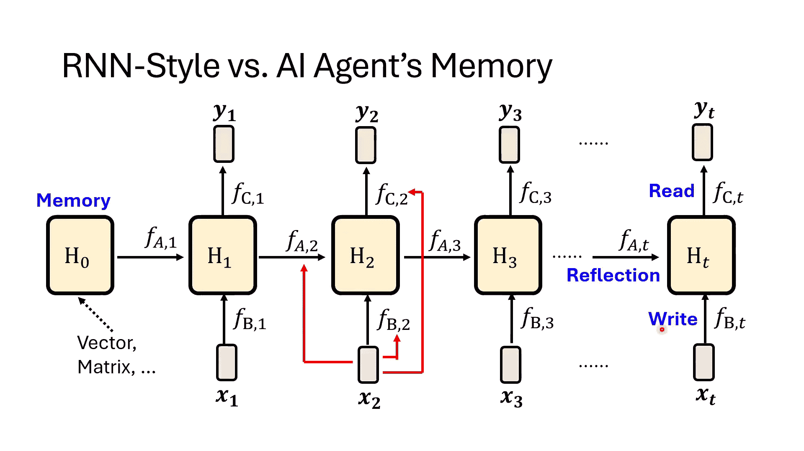

那在inference的时候，就假设你network已经训练好了，要使用它啊，比如说它是一个语言模型，你要用它来产生一个句子的时候，那RN流的做法是怎么运作的呢，首先你要有一个H0。

那是不是要注意一下这整个LLN，这整个语言模型还可能有很多其他的layer，还可能有很多其他的部件，比如说mlp fully connected feforward的部件。

我们在这个图上只把RNN相关的部分画出来，那RNN也不会只有一层，它也有很多层，所以叫想成说当我画这个图的时候，我就是把原来大家常见的transformer里面的。

self attention layer换成RNN好，按RN层要有一个输出时的状态叫H0，输入第一个符号，它用第一个符号是begin of sentence这个符号。

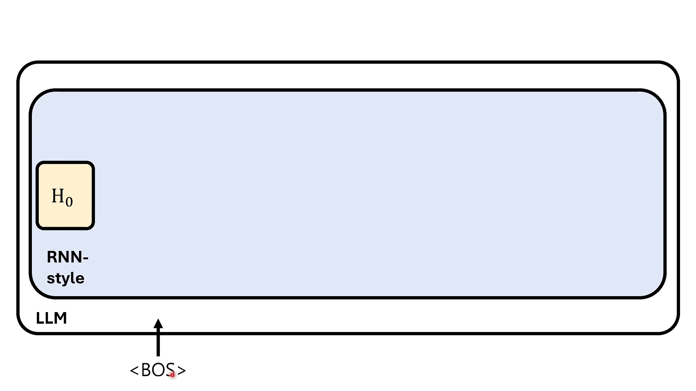

然后呢产生x1 x1让我们有H1h one，让我们有y one再送到接下来的layer去处理，最后输出一个字叫大，然后呢做auto regressive。

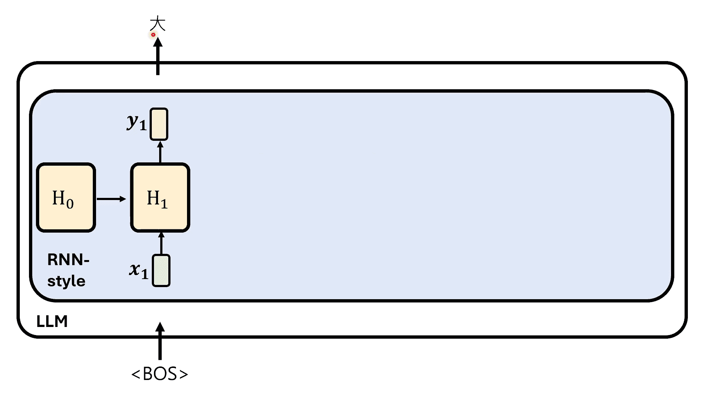

大变成下一个时间的输入，再产生x2，再产生h two，再产生y two。

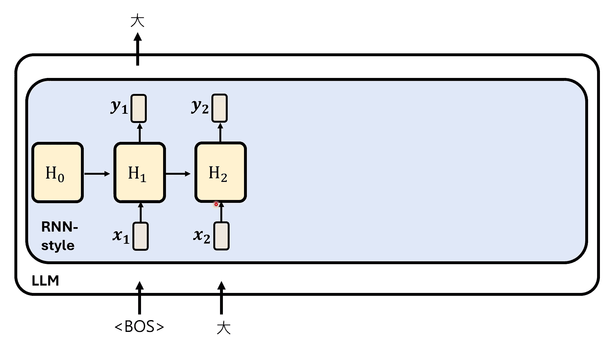

再产生加加载，变成输入产生H3，产生Y3产生好。

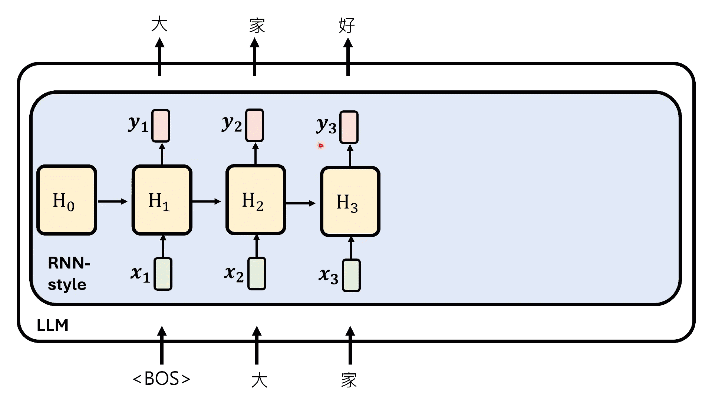

同样的步骤就反复反复一直进行下去。

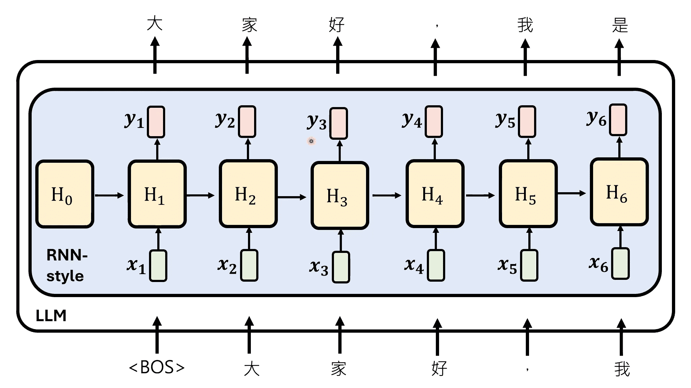

这就是rn influence的时候所做的事情，好这个是RNN。

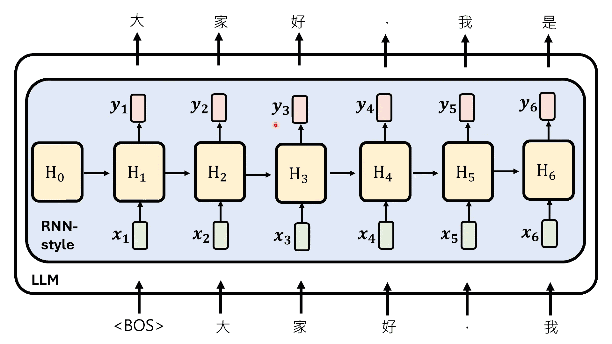

接下来我们来讲self attention，我们来看看self attention相较于RNN有什么好处，凭什么能够取代RNN，我们来看一下self attention。

self attention怎么运作的呢，输入是一个sequence x1到XT，然后现在输入的每一个vector，都乘上三个不同的transform，制造出三个vector。

x1就制造出v one k one，Q one，x2就制造出v two k two q two，以此类推，那假设我现在要算YT的时候，第T个位置对应的输出YT的时候，要怎么计算呢。

我把第七个位置的输入产生出来的这个Q去，跟每一个位置的K都算inner padda，算个内积哦，那我用阿尔法来表示这个内积后的数字，内积后得到的数字。

那这个阿尔法呢现在通常叫做attention的weight，虽然它有weight这个字，但它并不是一个参数，它并不是类神经网络的参数，但我们也叫它attention the weight就是了。

好那这个阿尔法T1代表qt跟k one的inner pada，那阿尔法t two代表qt跟k two的inner pada，以此类推，那你会做一个soft max，让这些阿尔法的值呢合起来是零。

那soft max看起来是个不起眼的动作，但等下会告诉你，soft max其实哎妙用无穷好，然后这边的阿尔法呢跟每一个时间点的V呢，做相乘，做wet sn。

最后就得到Y这是self attention做的事情。

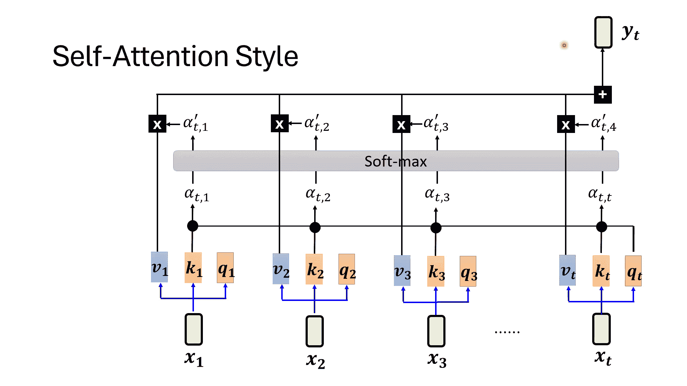

那希望这个大家都已经很熟悉了好，那在以下的课程里面，如果要简化的话，我就会直接把x1到XT直接指到YT，代表说YT对x1到XT做attention，然后做wait son，最后得到YT，那很多人误以为。

attention这个概念是来自于attention，is all you need google那一篇2017的paper。

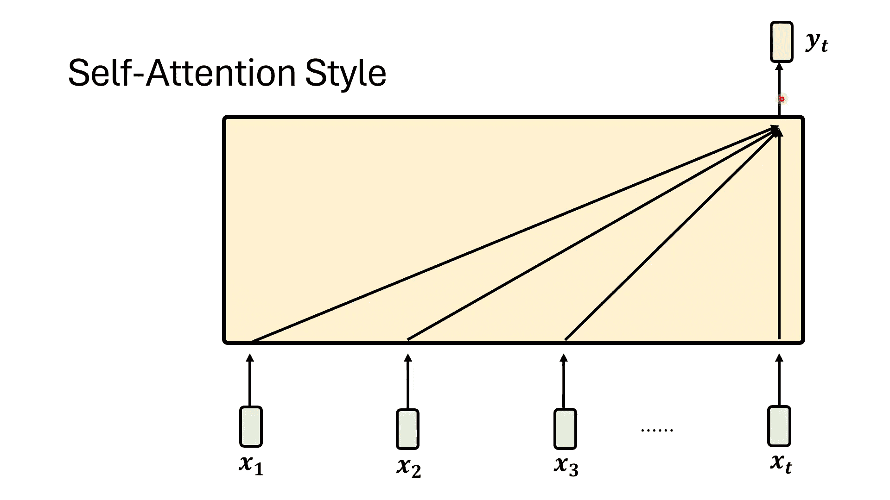

其实不是attention的概念，其实很早就有了，据我所知，最早可以回溯到neural terrimachine，还有memory network，他们是什么时候的类神经网络呢。

你看这边的archive连接，它们是2014年的类神经网络啊，那个时候地球上还没有多细胞生物，只有单细胞生物的时候，就有attention这样子的概念了。

而且这两个提出attention的network架构，你仔细看看，它的连接都是在14年10月放上阿凯啊，前后只差几天而已哇，在这个只有单细胞生物的时代，就已经非常的卷了。

那把attention用到语言模型里面。

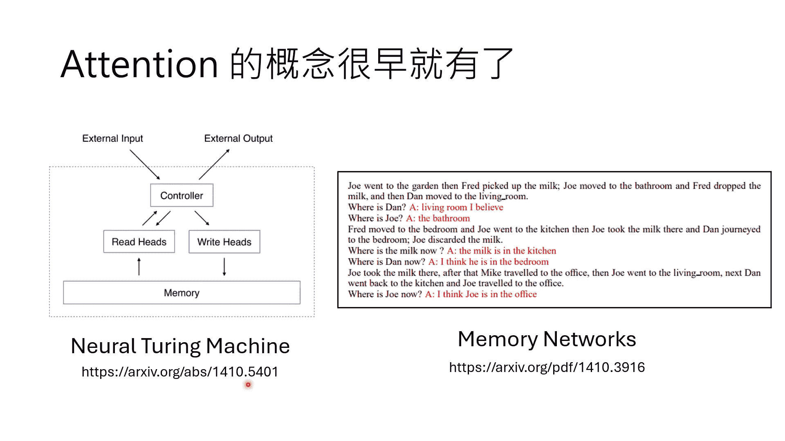

也从来都不是一个新的想法，比如说我们实验室在2016年的时候，就尝试把attention加到语言模型里面哦，这个是刘达荣同学做的，他做的时候呢还是大学生，现在都博士班毕业好多年了啊。

所以这个是一个这个寒武纪时代的东西啊，那他那个时候寒武纪时代放在这个language model里面的，attention跟现在有什么不同呢，就是没有任何不同，就是你看我这个在那个时候只是不叫做Q。

KV而已，notation不太一样，产生一个这个叫做query，不过当时是用K来表示它，然后呢这个是key，这个是value，然后就做你所熟知的attention放在language model里面。

只是在attention之前，还会先做LSTN才做attention好。

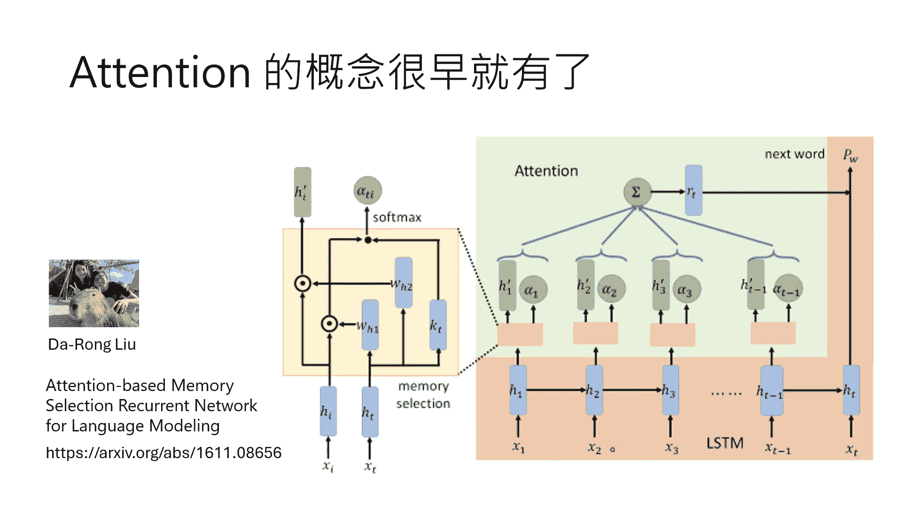

那我们来看这个attention的这个架构啊，在inference的时候，在生成句子的时候是怎么生的。

好第一个输入进来产生x1，那x1没有更值钱的东西。

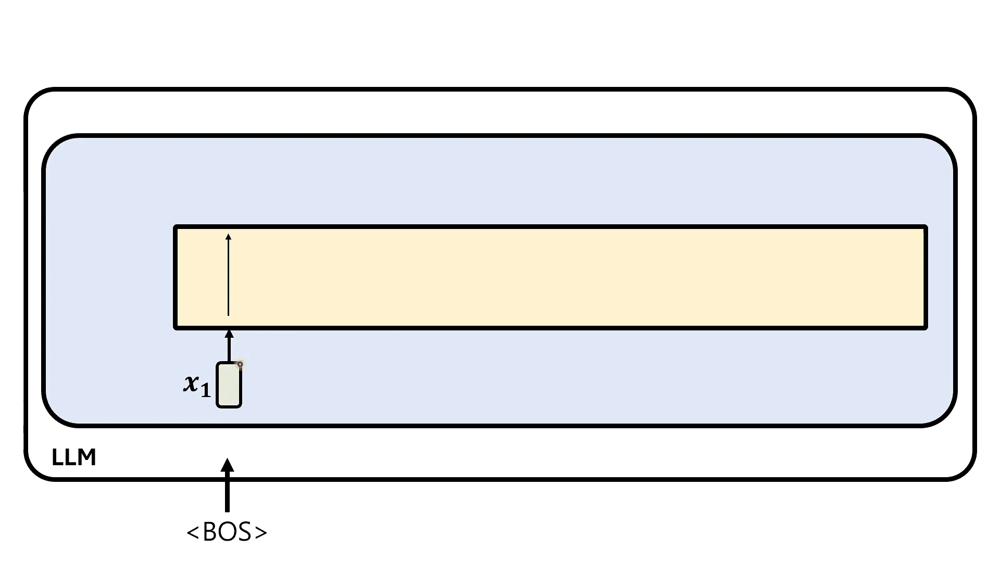

所以他只能自己跟自己做attention，产生y one，产生第一个字大好，那大呢被作为第二个输入产生XT，可以对第一看第二个位置都做tension。

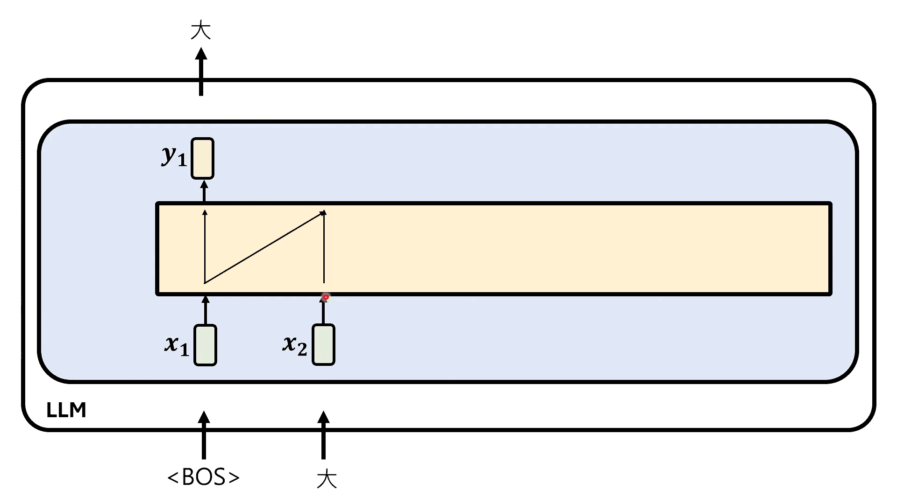

产生y two，然后产生加，然后以此类推，第三个时间点输入的是加。

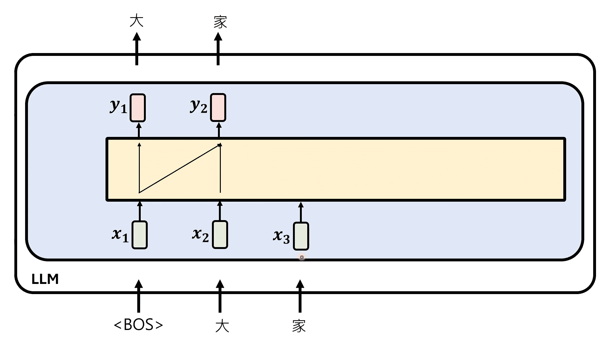

可以对123个位置都做attention，产生Y3。

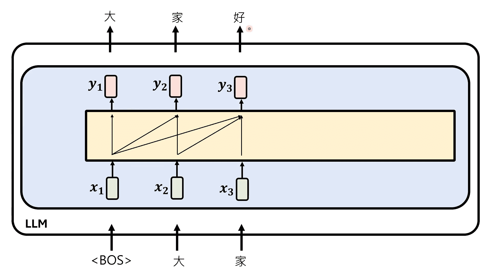

产生好这个步骤就持续继续下去，持续继续下去，每一次都要对前面所有的位置做attention。

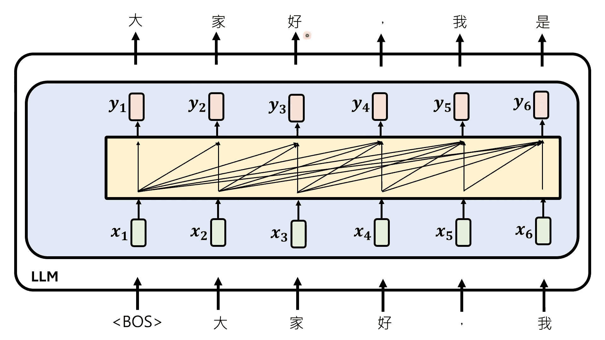

我们来比较一下RNN跟attention的这样的架构。

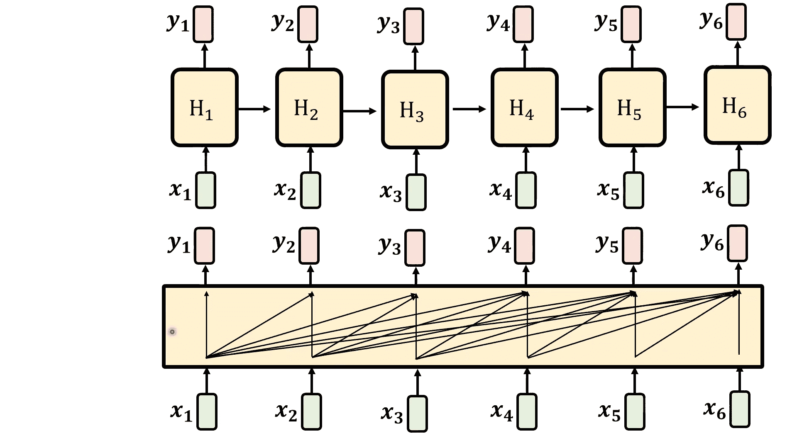

在influence在生成的时候有什么样的不同。

如果是RNN每一步的运算量都是固定的。

如果是attention的话，你越往后箭头就画越多。

越往后输入的序列越长，运算量就越来越大。

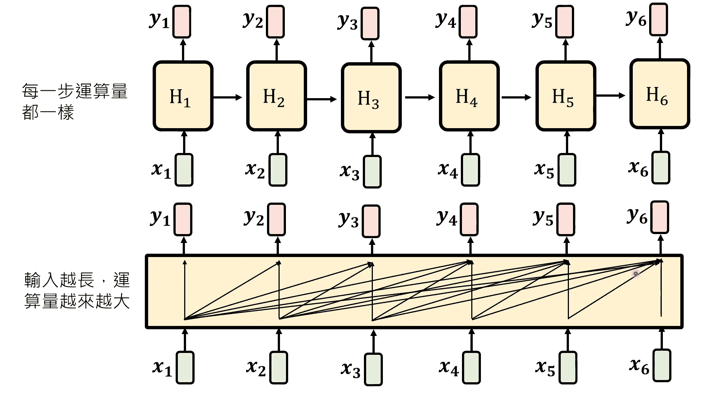

那如果你看memory的话，对RN来说，每一次我要产生新的输出的时候。

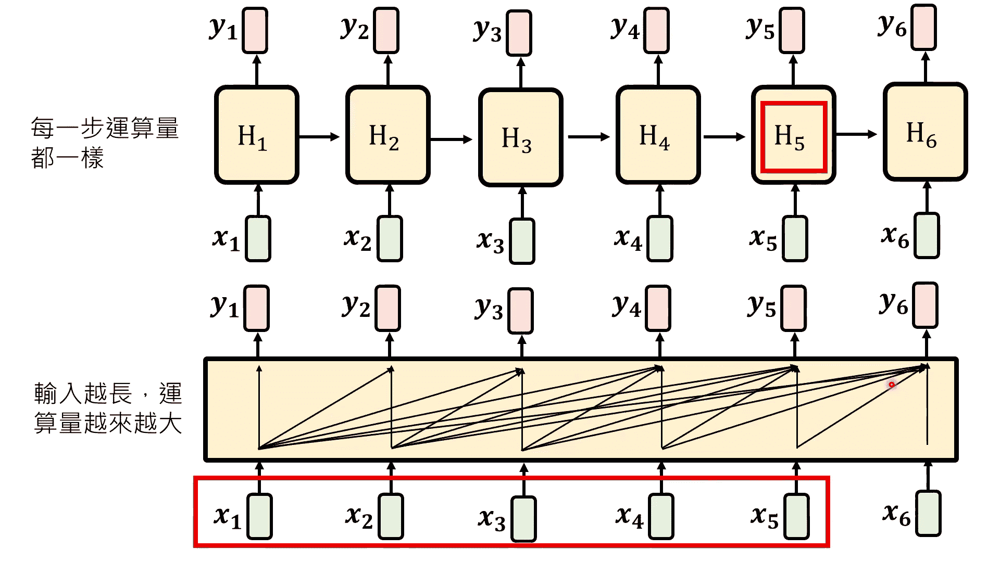

我只要记得前一个时间点的H是什么。

我就能够做运算，对attention而言，我要产生Y6的时候。

前面x1到X5发生了什么事，通通要被记住才能产生Y6。

所以attention也非常的耗费memory。

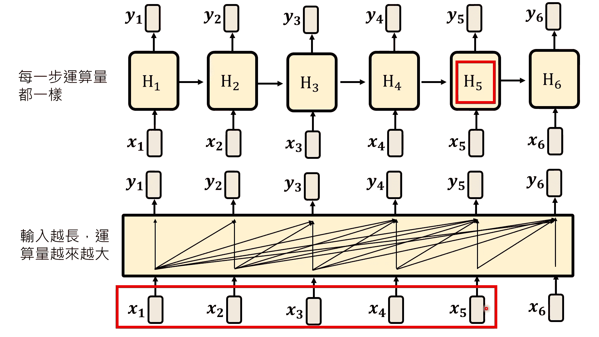

随着input sequence越长，attention这个架构需要的memory对memory的需求就越大。

那讲到这边有人会说。

但attention还是有好处的啊，你可以感觉说啊这个RNN呢它的memory很小。

只有这么小块，感觉应该没办法记很多资讯吧。

attention感觉可以记无穷长的咨询，那等一下的课程会告诉你说。

这是一个对RNN的误解啊，等下告诉你说attention可以存无限长的资讯。

只是一个假象，所以讲到这这边。

你可能觉得啊这个attention就是一无是处，这样没什么好的地方。

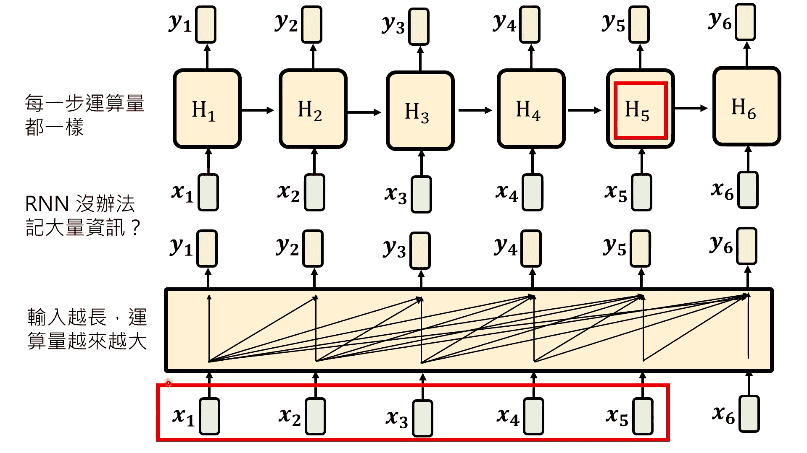

没什么好的地方，那为什么从2017年到最近，attention这么DOMINA深度学习的领域呢。

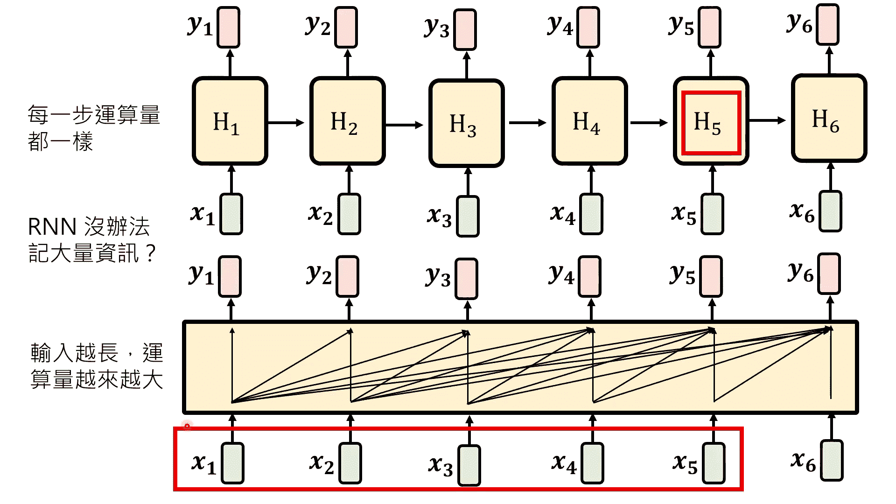

好那我们来看看当年attention is all you need，这篇最知名的attention相关的论文，他是怎么说的，那你从他的title attention is all you need啊。

你其实可以发现这篇文章，它并不是发明了attention，很多农场文以为attention是2017年，这篇文章发明的，其实不是这篇文章，他的贡献不是发明attention。

而是拿掉attention以外的东西，所以才叫做attention is all you need，那时候人们觉得只有attention，应该是没有办法好好做语言模型的。

他们把attention以外的东西拿掉，发现还是可以好好运作，大家就惊呆了，那attention is all you need。

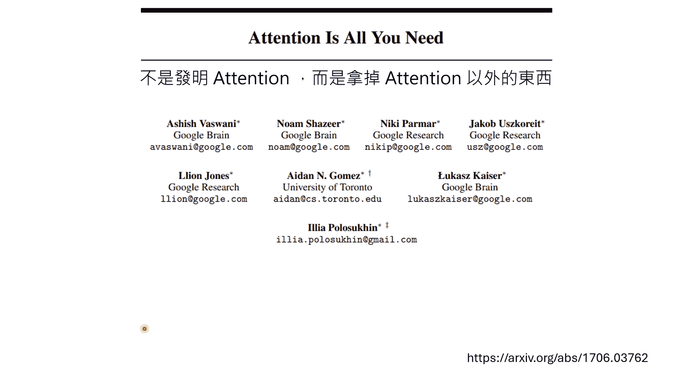

这篇paper在他introduction里面，他就说这个attention的好处，也就是那时候他们就把transformer和attention，混在一起，当做同一个东西讲啊。

这个transformer的好处是什么呢，他第一个最大的好处是，他在训练的时候可以更加平行化，当然他们也得到了不错的结果，什么叫训练的时候可以更加平行化呢。

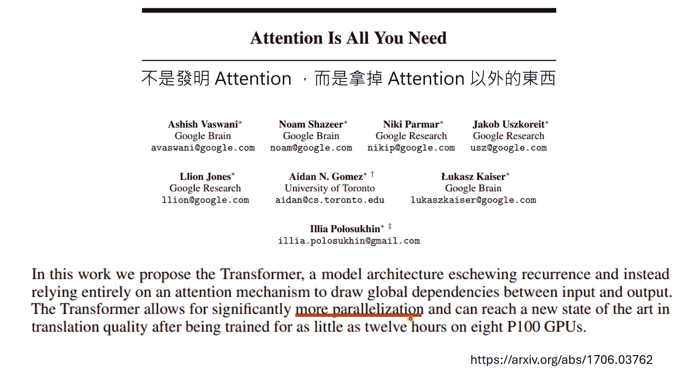

啊那在这堂课里面，我们没有花太多时间讲类神经网络的训练，所以如果你想要深入了解呃，是怎么被训练出来的，除了看2021的课程以外，你可以更深入看过去的课程，过去有讲过bad propagation。

那是一个一小时左右的录影，那还讲了另外一个更深入的，怎么自动做back propagation的方法，也就是computational graph，那这个也是花了一个小时左右的时间讲的。

因为上课时间是有限的，所以后来这部分就没有放在呃实体的课堂上，但如果大家有兴趣的话，还是鼓励你把这些技术深入的去了解它，那其实了解训练的原理啊，对你的帮助。

就是你会更清楚为什么有些network架构是这样设计，Transformer，它真正的设计的好处并不是什么无穷长的memory，那个就是个假象，那是个hallucination呃，它真正的好处是。

训练的时候可以更容易平行化好，那我试着来解释，为什么他训练的时候可以更容易平行化好。

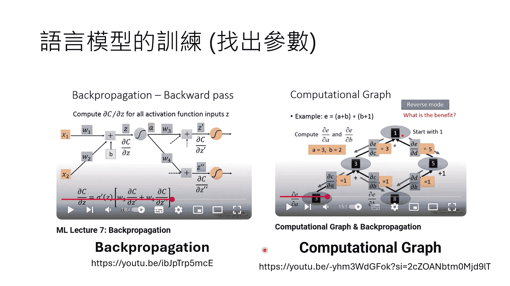

虽然我们没有讲怎么真的训练network，但是训练network基本的步骤是这个样子的，假设我们今天要做的事情，就是要教一个语言模型，说输入token z1到ZT减一，然后呢你要产生ZT好。

你要怎么教语言模型这件事呢，第一个步骤是先算出目前的答案，算出输入Z1到ZT减一的时候，语言模型目前的输出是什么，知道目前的输出以后，再跟正确答案计算差异，计算完差异你才能够更新参数哦。

所以更新参数之前，第一步是要能够计算出现有的答案，所以你可以想象说计算出现有答案，这件事情做得越快，你就可以越有效的更新参数，而transformer它厉害的地方就是，它可以快速的计算出现有的答案。

好这件事是怎么做的呢。

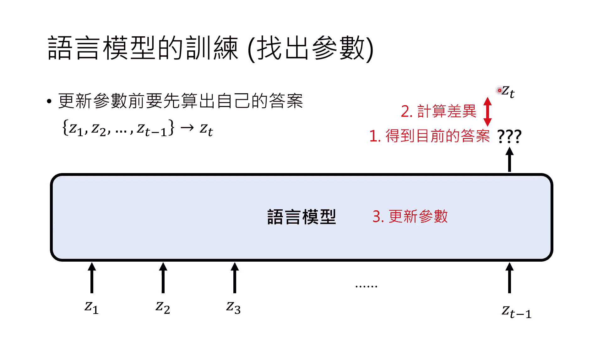

假设我们今天要教语言模型说一句话啊，大家好，我是人工智慧，在概念上你做的事情可能是这样的哦，输入起始代表起始的符号，然后告诉语言模型说，输入代表起始的符号，那你要输出大是正确答案。

输入代表起始的符号跟大输出加才是正确答案。

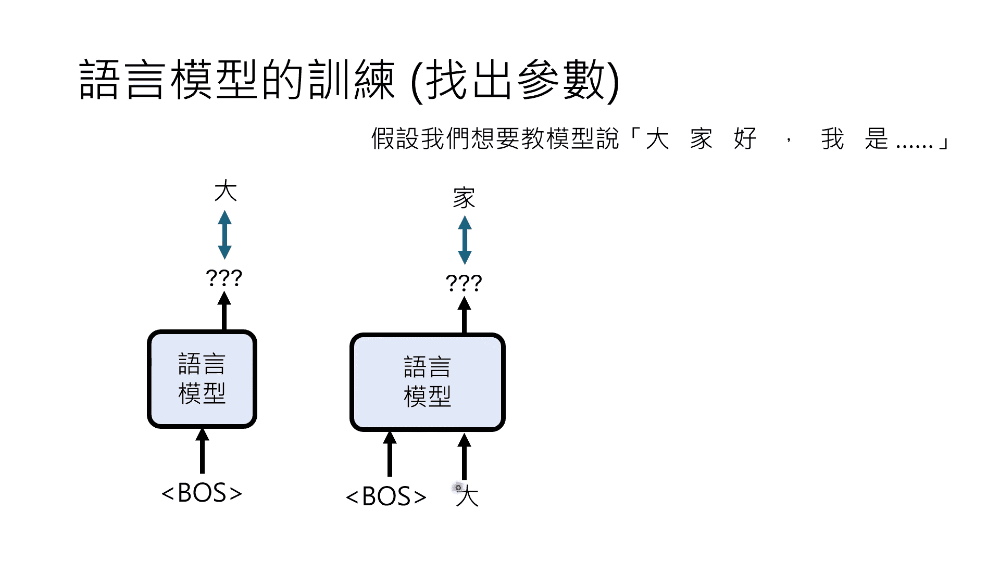

输入代表起始的符号，输入大输入加好是正确的答案，这个是概念上的做法，但是transformer有一个更有效的运算方法，这更有效的运算方法是什么呢。

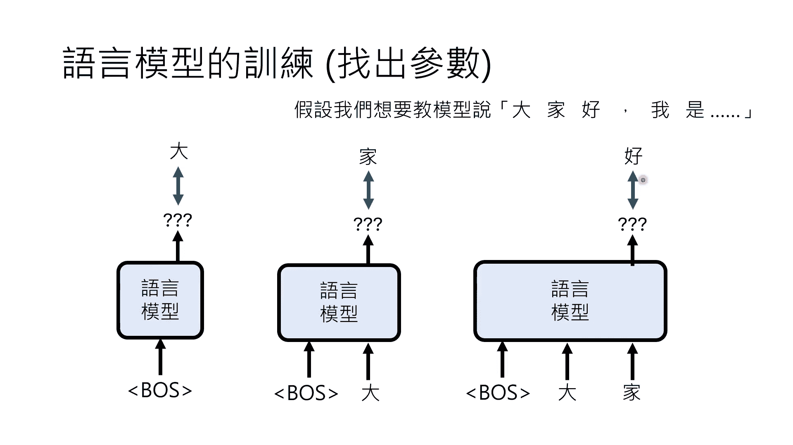

呃我们今天教模型的时候，我们会有一个完整的句子，我们介绍胶模型说出这个完整的句子，大家好，我是人工智慧，实际上的操作是这个样子的，你把目标，你把要让语言模型说出的这个句子。

你把你的光truth通通向右移动一格，前面放起始的符号塞给语言模型，语言模型可以平行的，就语言模型背后如果用的是transformer的话，transformer可以平行的一次输出每一个时间点。

所有的答案你可以一次计算，所有的答案跟正确答案的差异，你可以一次看这么多的差异去更新参数，所以transformer厉害的地方是，如果给它一个完整的句子，它可以平行地计算出在每一个时间点语言模型。

这个transformer要输出的下一个token是什么，它可以一次平行计算出begin of sentence，他会输出哪一个token大，后面会输出哪一个token，大家后面会输出哪一个token。

大家好，会输出哪一个token，这一切是可以透过transformer，透过self attention的架构被平行计算出来的好，那如果讲的更清楚一点的话。

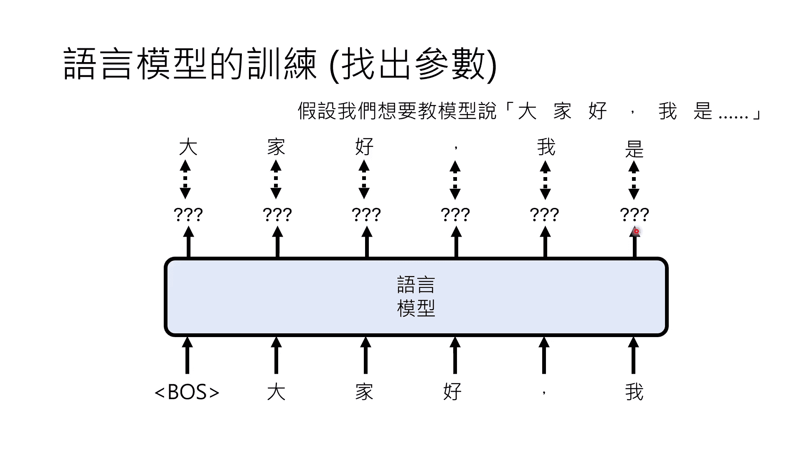

我们来看看当我们用self attention的layer的时候。

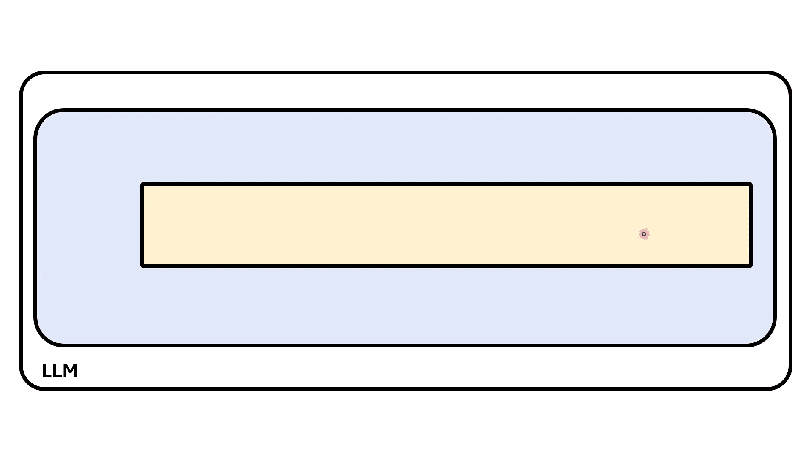

如果我们一次给self attention layer一个完整的输入，给他一整个sequence的输入，不是一个一个token产生的，不是auto regressive的情况下。

这个self attention会怎么运作好，你输入一个完整的sequence。

sequence里面的每一个token都会变成一个向量。

我们这边用x1到X6来表示，X1到X6生成的步骤可以是平行的，它们彼此之间并没有任何关联，所以你可以平行的把x1到X6产生出来。

接下来做self attention。

你可以平行的产生y one到Y6，因为y one到Y6。

它中间生成的过程彼此之间没有任何关联性，所以y one y two一直到Y6。

这六个向量是可以平行被生成出来的。

平行生成出来y one到Y6之后，你就可以平行的输出每一个时间点。

这个语言模型要predict next token的时候，要猜下一个符号的时候。

它会输出的token是什么，所以self attention，它真正的好处是给一个完整的输入。

可以同时产生每一个时间点。

语言模型预测下一个token的token是什么。

给定一个完整的输入，可以平行的输出每一个时间点，接下来要输出的token是什么。

所以这个是transformer的好处。

好那另外一个观点来看这个transformer啊，你可以看发现说这个self attention的计算，是一个非常GPU friendly的计算，是可以大幅应用GPU效能的计算。

那有关这个GPU做语言模型的时候，扮演什么样的角色，下周呢王秀轩助教会有更详尽的剖析，那在这堂课你就先记得说，只要你做的是矩阵运算，GPU就会觉得开心，这样他就会觉得他被妥善利用了。

好那transformer其实就是一连串的矩阵矩矩呃，矩阵运算啊，怎么说transformer是一连串的矩阵运算呢。

而现在绿色的这一排向量是输入的，X到是输入的x1到X6好，那这每一个X呢，每一排X呢乘一个transformation，变成每一个时间点的query，每一个时间点的key，每一个时间点的value啊。

接下来呢我们要算attention，要算inner pta。

那怎么算inner pa呢，把这个代表key的矩阵做transpose，直接乘上这个由query所组成的矩阵，你就得到每一个时间点两两之间的attention了哦。

所以今天这个向量两两之间做inner proa，其实可以看作是两个矩阵直接相乘啊，不过有一些attention我们是不要的，因为我们假设说只有后面的时间点，可以attend到前面的时间点。

所以有一些attention我们就直接补零，我们就直接把它设为零，那些是我们就算计算出来也不需要的。

然后呢你做一个soft max，得到另外一个attention的matrix，把这个attention matrix再乘上，由value vector所组成的矩阵就得到输出了哦。

所以从输入X到输出X通通都是矩阵运算。

那假设这个步骤你没有听得很懂的话，反正你就记得，今天你只要弄成self attention那个样子，那你的运算的过程通通都是矩阵运算。

这是一个可以让GPU欢喜的运算过程。

可以有效的利用GPU的效能好，那另外一边我们就来看。

为什么RNN没办法在训练的时候，有效运用GPU的效能，今天假设在训练的时候。

一次给RNN完整的输入，会发生什么事呢，进入RNN这一层之前的x1到X6，你可以平行，你可以平行运算出来。

但是RN本身是没有办法平行运算的，输入x1之后。

你才能够产生HY有了h one才能有h two，有了h two才能有H3456。

所以你要计算H66，你必须把前面H1到H5计算出来之后。

你才能计算H6。

那这是GPU最讨厌的状态，你要记得GPU讨厌等待那一些加速GPU的方法，其实就是避免GPU去等待。

尽量不断的塞事情给GPU做，像这种前面H5要算完才能算H6。

这个是GPU最讨厌的状态，因为他必须要等前面的东西算完。

他没有办法发挥它平行化的优势好。

所以你如果要让y one到Y六一次产生出来，你得把H1到H6都算出来以后。

你才能一次把y one到Y6搜算出来。

而计算H1到H6，这个步骤是不容易平行化的，它是一个没有办法有效运算的步骤哦。

所以现在我们可以比较self attention。

跟RNN流的做法，你就知道说如果我们看influence的时候，我们在使用这个语言模型，让它产生一个序列的时候，如果self attention，那你的计算量跟计体的需求，会随着序列长度增加而增加。

而RNN计算量跟记忆体的需求是固定的，但是self attention的好处是，在训练的时候我们容易平行化，容易发挥GPU平行化的能力，而RNN它的坏处是它难以平行化，所以在2017年到最近。

人们选择了self attention，加快训练的速度，但是RNN难以平行化，后面我们加了一个问号，那这堂课就是要告诉你，RNN其实在训练的时候是可以平心化的。

self attention在influence的时候。

遇到长的sequence就比较不利，但今天人们需要长的sequence，今天语言模型都需要处理，非常长的输入，比如说做IG的时候，语言模型从网络上搜寻了一大堆文章，作为它的输入。

你需要长的输入或AI agent要运算好几个回合，跟环境不同的，跟环境一直的互动，那也需要很长的sequence，今天又流行多模态的模型，那多模态的模型跟处理文字的模型，它背后的原理其实很像。

你只是把语音或者是把影像表示成token，sequence而已，但是语音跟影像表示成token sequence，它会是比文字还要长的非常多的sequence。

所以我们真的需要有效的处理长sequence的方法，那现在语言模型可以处理的sequence越来越长，然后以下这张图片呢是来自右下角这个链接，他就说啊，在2022年刚有GPT3。5的时候哇。

它大概只能读哈利波特的一个章节，但到g p t four的时候，他就可以读完神秘的魔法石，一直读到第二部，那如果是靠2。1，他就可以把哈利波特第一部跟第二部，神秘的魔法石跟消失的密室都读完。

如果是GERMINI1。5，它可以读两个million的token，它可以读200万个token，它不止可以把哈利波特第一集，一直读到最后一集，还可以几乎把魔戒三部曲看完，所以现在这些语言模型。

我们希望它可以读很长的sequence，而attention这个方法，在读consequence的时候是不利的，所以人们就开始怀念起RNN的好，所以有人就问了一个灵魂的叩问。

RNN训练的时候真的没办法平行吗，我们来看看有没有让RNN平行的可能好，那我们先把H1到HT通通都列出来，看看它们长什么样子好，右边呢是RNN最泛用的式子，那HY是H0过FA加上x1过FB。

h two是h one过FA加上加上x2过FB，H3是h two过FA再加X3过FB以此类推，那因为算h two的时候知道h one，算H3的时候知道h two，所以没有办法做平行运算，但真的是这样吗。

我们能不能把这些式子展开来看看，我们就假设FAH0是一个zero matrix，所以我们就不考虑这一项，那HY等于f b of x1哦，HY等于x1，通过FB接下来我们已经知道h one是什么了。

我们把h one直接塞进去，把h two展开，让它的输入没有h one好，把h one用x1通过FB替代掉，所以h two就变成x1，通过F1，再通过FA加上x2，通过FB以此类推。

把h two带到H3的式子里，让H3的输入没有h two，所以就变成H3，就是x1通过FB通过FA，再通过另外一个FA，那这边这个sq也要通过好，这个有点复杂，这XT5要通过FB再通过FA。

然后X3要通过FB，总之你可以把整个式子通通都展开，你可以把每一个h one到，你可以把H1到HT展开，让他们彼此不要有dependency，但这样真的就能够平行运算了吗，看起来是不行的。

因为展开到最后，你会发现你的式子里面有非常长的，连续的韩式的呼叫啊，比如说到HT的时候，x1要先通过FB，要再通过FA再通过FA，再通过fat减一，再通过FA at。

还要通过一连串的FA才能够计算出答案，这个也是TIDEPENDENT的，这个也是会让GPU等待的，因为你要前一个函式算完才能交给下一个函式，算这一个这个地方也是不容易平行的，但你会发现呐。

这些被呼连续呼叫的函式都是FA，既然是FA造成的问题，那我们能不能就直接把FA拿掉呢。

所以我们直接把FA拿掉，我们就说不要FA了，这个RNN呢我们就把reflection的部分拿掉，HT等于HT减一，加上ST过FB，然后我们就把H1到HT通通写出来，h one是H0加x1过FB。

h two是h one加x2或FB，以此类推，然后呢我们再把H1带进去，把h two带进去，把H之间的dependency拿掉，那我们计算出来的结果就是h one是x1或FB。

那h two是x1过f b x2过FB，H3是x1过f b x2过F1X3过FB，然后看起来就比刚才的式子简单多了哦，所以今天如果要算HT的话，它就是T项相加，把x1到XT分别都过FB以后。

加起来就是HT了，好那像这样子的式子有没有办法平行呢，其实是有一些加速的方法的，比如说你可以用一个叫skin algorithm的东西，把这一排数字用一个更有效的方法把它算出来。

但是这个部分我们就今天就先不讲，因为其实还有更有效，更简化，更能平行的做法，怎么做呢，好我们先简化一下式子的运用哦，我们先简化一下我们的符号，那我们先假设HT呢是一个D乘以D的矩阵。

而H可以是任何东西啊，我们这边就假设它是一个D乘以D的矩阵，那既然H是一个矩阵，那f b of x也得是一个矩阵，它们这样才加得起来，那我们把f b of x t用大D下标题来表示好。

那我们就知道说h one就是d one，h two就是d one加d two，H3是d one，d two加到D3，HT就是d one加d two加到DT，我们现在呢再做一下简化。

我们假设fc of HT，就是把HT这个矩阵跟一个向量qt做相乘，然后qt呢是输入XT，因为这个qt呢它是跟T有关的，那它怎么来的呢，它是把XT乘上一个矩阵WQQ得到qt。

qt乘上memory里面的东西，HT就得到最终的输出Y哦，所以y one就是d one乘q one，y two就是d one乘q two加d two乘q two，Y3就是d one乘Q3加到D3乘Q3。

YT就是d one乘QT加到DT乘，其实这一切都还有更有效的简化方法，什么样的简化方法呢。

我们把DT写成VT乘上kt的transpose，V跟K分别是两个向量，把V这个向量乘上K这个向量的transpose，就是展开变成一个矩阵哦，所以一个向量乘上另外一个向量transport。

你得到一个矩阵，我们叫做DT，而VT跟kt是跟XT有关的，XT乘上WV得到VT，XT1乘上wk得到KT，然后DT就是VT乘上K的transpose，所以我们现在可以把所有的D通通都置换掉。

所以y one就是v one k one的transport乘q one，y two就是v one k one的TRSPORT，乘q two加v two k two的transpose乘q two。

一直到YT就是v one k one的transpose乘qt，加到VTKT的transpose乘qt，讲到这边，你有没有发现了什么，这个就是attention呢。

我们已经把符号把QKV通通放到式子里面了，如果你还没有意会到，为什么它就是self attention的话。

那我们再继续做运算，刚才我们是先把V1k one算出来，再乘Q，那能不能换一下计算的顺序，先算K跟Q呢，先计算K的transpose乘以Q呢，K的transpose乘以Q是什么。

K的transpose乘以Q1个向量的transpose乘以，另外一个向量假设它们dimension是一样的，所以可以直接做相乘，那你得到的结果就会是一个SCALER。

我把k one qt命名为阿尔法T1，k two transport qt命名为阿尔法t two，以此类推，我们先把K跟Q相乘，剩下V那你得到的就是v one乘一个SCALA阿尔法。

v two乘另外一个SCALA阿尔法，VT成另外一个SCALA阿尔法，如果你不喜欢SCALA放在向量后面，那就把SCALA放到向量前面，这个不就是对一个叫做v vector。

v one到VT的东西做weighted sun吗，这其实就是self attention，它跟原来你知道的self attention唯一的不同，只是少了soft max。

那因为它少了soft max，所以它跟原来soft attention还是有点不同，所以他自己有一个名字叫做linear attention好，所以讲到这边我们知道了什么。

讲到这边，我们知道说linear attention，就是RNN拿掉reflection，我们把RNN拿掉，FA拿掉reflection就变成linear attention。

而linear attention就是self attention，没有soft max就是这么神奇，那我们知道linear attention就是self attention。

没有soft max，有以后有什么好处呢，那linear attention这样子的RN它就是inference的时候，你用它来产生东西的时候。

它像是一个RNN在训练的时候，你就展开把它当transformer来train，而它就transformer扫了soft max啊，他完全可以套用transformer的平行化的方法。

来直接加速训练的过程，所以假设刚才的讲attention的时候，到底怎么加速的，你其实没有听得很清楚的话，也没有关系，你只要记得self attention是一个可以加速的东西。

长得像self attention一样，类似的这个network架构都可以用类似的方法来加速，而linear attention根本就是self attention，拿掉soft max。

所以self attention能怎么展开，能怎么加速，linear attention就能怎么展开，能怎么加速，训练的时候像是一个self attention，但是influence的时候。

它就像是一个RNN嗯，就是这么神奇好。

那也许讲到这边你会觉得说唉呀，这个linear attention这边有一个奇奇怪怪的式子，VT乘以kt的transpose，感觉没有非常的直观好，那我现在提供给你一个直观的解释来解释。

linear attention为什么这样运作好，那linear attention为什么这样运作呢，那在解释之前呢，我们先定义一下这整个式子的dimension。

那在做linear attention的时候，你需要先算出一个V，算出一个K，算出一个Q，我们假设Q呢是一个低维的呃向量，那它是由XT11个矩阵得到的，K呢也是一个低维的向量，XT乘三个矩阵得到的。

V呢是一个D派维的向量，XT乘三个矩阵得到的v d pine可以等于D，在刚才说明里面，我都是预设d pine等于D，但DEPAY其实是可以不等于D的，只要Q跟K的dimension一样就好了。

他们就可以做in a pa，其实V没有必要跟Q跟K的dimension一样，V的dimension可以是不一样的，好，那我们来看这个update那个memory的式子好，HT等于HT减一。

加上VT乘kt的transpose，把它画出来的话，就是HT等于HT减一，加上VT乘VT的transpose，VT乘VT2transpose是一个矩阵，那么等于就是把这个资讯加到memory里面。

VT乘kt的transpose到底是什么意思呢，我们来想想看VT乘kt的transpose，到底是什么，这个矩阵呐，它的每一个color都是VT的倍数哦，这个矩阵绿色的矩阵。

每一个color都是VT前面乘上一个SCALA，这个SCALA的数值由K里面的数值所决定，第一个colon的VT，就乘上K这个向量的第一个dimension，第二个colon的VT。

就乘上K这个向量的第二个dimension，以此类推，然后我们会把这个矩阵加到HT减一，我们会拿这个矩阵来更新HT减一好，那这个VT是什么意思，这个VT就是我们预计要写入memory。

写入hidden sth的资讯，而K指的是什么，K指的是要把这个资讯写到哪里去，举例来说，假设K这个向量只有第二维是一，其他维度都是零，那就意味着说我们把V这个资讯写到H这个memory。

H这个hidden state，它是一个matrix，这个matrix的第二个color，当然你可以写到不止一个color，你可以把通用的资讯分散到不同的color去，所以你知道V是要被写进去的资讯。

而K它决定了这个资讯要被写进哪里。

是不是觉得这个式子其实也挺直观的呢，好那怎么得到输出，输出就是把H乘上QT得到YT，那这件事情的含义是什么呢，Ht，我们刚才说它每一个color就是存了不同的资讯，由K来决定什么资讯要被存到哪里。

而Q就是把资讯从color中取出来，Q决定要从哪一个color取多少咨询，假设现在这个Q是01000之后，第二维是一，那就是从第二维，从这个H的第二个color把资讯取出来。

这个就是linear attention。

那其实linear attention从来都不是什么新的想法，Linear attention，是20年的时候就已经知道的东西了啊，最早就我所知啊。

这个linear attention的paper应该是transformers，are RNN这篇paper所提出来的，从他标题就知道他想干嘛，他就想告诉你说transformer。

他发现原来就是RNN，他们两个只差了一个soft max而已，就是这么神奇哦，所以这是20年就已经知道的事情，然后在机器学习这门课的22年，我们有讲过linear attention。

只是那个时候是从另外一个角度来切入的，那个时候是从transformer1路讲过来说，transformer怎么简化变成linear attention，那这一次是反过来讲。

说RNN怎么变成linear attention，就像是一个transformer一样好，那既然这个linear attention是20年就已经有了哦，这个20年，这个那时候应该现代智人还没有出现吧。

露西还在东非的大草原上吧，那个时候人类已经就知道，linear attention就是RNN了，但为什么现在linear attention没有被用的。

到处都是呢，因为linear attention实际上干不赢transformer的，是干不赢self attention的。

那为什么linear attention干不赢self attention呢，赢不过self attention呢，很多人的解释是这个样子，他说哎呀。

你看RNN哦，RNN它的机翼就是很小，但我刚才也讲过，RN的记忆并不小，它的机翼有多大，是你自己决定的，你可以开一个很大的矩阵，让RNN有很大的记忆好，那也许你说啊，那我就不说他记忆太小。

我说他记忆是有限的，毕竟这个H的大小你开多大，它终究是有个上限吧，所以RN的记忆是有限的，那你看transformer。

它可以attend到最开始的token，要attend多长就attend多长。

它有无限的记忆好，那RNGE有限当然是没有问题，也非常的直观，怎么说RNGE有限呢，而假设第一个时间点，我们的KY是10000，那么就是把v one写到第一个color，那k two是0100。

就写到第二个，就把v two写到第二个color k34001000，那就把V3写到第三个color，那H他假设最多只有第一个colon的话，那最多只能够存第一个不同的V，然后他们彼此之间不会受到干扰。

再有更多的V你就要你就可能会重叠起来了，就会存在这个重叠的memory里面，你的memory就放不下那个你存入的资讯，就会彼此互相干扰了，所以RN它能够储存的记忆有限是非常直观的，但接下来我要告诉你。

transformer能够存的东西也是有限的，怎么说transformer能够存的东西也是有限的呢，假设现在Q跟K的dimension是用小D来表示，如果今天我们的sequence不长。

Sequence，比如说T现在是小于等于D的状态，那没有问题，你完全可以设计出一组key，设计出一组K让你的memory之间彼此不会冲突，我可以说k one是1000，k two是0100。

K340010，那如果我今天要把v two取出来的话，我要把第二个时间点资讯取出来的话，我只要Q设成0100，那只01000只跟第二个位置的K算出来，attention是一其他位置算出来的。

attention的数值都是零，你就可以把v two原封不动的取出来，但是这是在T小于等于D的状态下。

如果今天sequence非常长长过低了呢，第一你通常就设个4096吧，那今天我们都希望T1可以产生T1，可以处理非常长的输入，比如说100万个token，你总是有机会遇到T是大于D的状态好。

如果T大于D的时候，会遇到什么样的问题呢，你会遇到说明明你的Q跟k two它是一模一样的，你的query跟第二个位置key是一模一样的，那照理说跟第二个位置key计算inner padda。

算出来attention是一，但是在整个漫长的sequence中存在着某一个key，这个key它在t play的地方出现，它跟qt做inner pda的时候，他算出来的inner pa是大于零的。

那为什么会这样呢，那你可以回去想想看，想想看线性代数里面学过的东西，在低维的空间中，你最多只能够找到第一个ORSAGAL的vector，你找不到D加一个ORSAGAL的vector，所以当T很长的时候。

你总是会出现一些key，这些key跟你的query，就你没有要retrieve这个地方的资讯，但是这个key就是跟你的query，做inner product以后大于零。

那你今天retrieve出来的资讯就是不同位置的，Wait sun，你的模型的记忆就开始错乱了，所以今天attention它能够存的资讯也是有上限的。

其实linear attention存的资讯会有上限呃，self attention存的资讯就会有上限，因为他们其实一样的东西啊。

他们并不是不一样的东西，他们真的就只差了一个soft max而已，所以如果linear attention赢不过transformer，那差就是差在少了soft max。

所以看起来soft max算是一个简单的运作，它其实蛮重要的好，那linear attention它最大的问题是什么呢，Linear attention，它最大的问题就是他的记忆永远不会改变哦。

你看每一次HT减一，你不会做任何处理，就会被放到HT，那每一个时间点你都会输入XT1过FB的资讯，进入HT减一里面，输入以后就永远进去了，它就再也不会被做出任何改变了，这样会造成什么问题呢。

这样会造成模型永远不会，以往它输进去的东西就永远输进去了，它永远不会改变，那soft max为什么可以做到记忆的改变呢，明明存的东西应该是一样的，为什么soft max有机会做到记忆的改变呢。

以下是我的解释，好这个我们想象说现在是一个比较短的sequence，然后呢只有三个位置，你算出来的attention的weight是0。61跟0。4，那你过soft max1这个位置对应到的。

过完soft max的attention的weight是0。45好，那我们假设呢在过soft max之前，Q跟K做inner product，算出数值是一的话，就代表这是一件很重要的事情。

好今天假设这个sequence变得比较长，一样有一些位置算出算出attention的weight，过soft max之前的attention的weight是一，它是重要的事情，但一件事情有多重要。

取决于在同一个sequence里面，有没有更重要的事情，如果更重要的事情，本来件重要的事情，它就变得不重要了，因为在做soft max的时候，整个sequence里面。

所有的attention是会共同被考虑的，所有的attention之间是会互相影响的，本来一件很重要的事情，如果出现更重要的事情，它就变得不重要了哦。

本来一过完soft max在这个sequence里面是0。45，那这边attention的weight算出来是一，但是出现更重要的事情，attention weight算出来是二。

那它出现那一他的他过完搜max以后，就变成只有0。17而已，所以一个事情的重要性，是相对于其他事情而言的，就好像在那个在那个暗影军团里面，本来觉得艾恩很强，但是后来又出现了一个尖牙。

就觉得尖牙比艾恩更强后，就没有人再叫艾恩出来，只会叫尖牙出来，后来又出现了贝尔，贝尔又比眼尖牙更强，所以后来都是贝尔出来了，就是这样啊，没有人知道我在说什么啊，算了哎我我看了这个我独自升级以后啊。

我有一个巨大的发现，我发现呐，原来谦和已入侵事件，在日本官方的记载，跟韩国官方的记载是非常不一样的，我现在才知道原来这个梅露艾姆，他就是贝尔，我现在才知道原来济州岛就叫做东果陀岛。

红的事件之前可以入侵事件，在两个国家，两个猎人协会官方的记载是非常不一样的，诶那个我可以问一下，现在我独自升级动画演到哪里了吗，诶有人可以告诉我吗，你打野打蚁王了吗，刚要打野完哇，那以下有暴雷啊。

不想听的就把耳朵捂起来，但是我觉得那个接下来剧情，你应该都猜得到了嘛，对不对，好现在要去答，现在要去答好，不想听就把耳朵捂起来，现在要去打蚁王了，对不对，好，后来呢就是呃韩国猎人那边有一个叫做好。

忘记他名字了，反应该是个姓崔的人，就发射了很多火球，然后同时间日本那边呢那个揍迪克，这杰诺揍迪克呢也发射了群星龙，就引开了蚂蚁的注意，然后那些韩国猎人就潜入了蚁穴，就看那个蚁后，然后就把蚁后杀了。

然后蚁后被杀了以后，过一阵子蚁王才出现，就把那些韩国猎人统统都打趴下去，为什么以后被攻击的时候，以后明明被攻击了很久以后，有八护卫，八护卫团灭的时候，蚁王都没有出现呢，因为蚁王在另外一边被尼特罗缠住了。

尼特罗不是跟打了半天，然后他杀了尼特罗以后，尼特罗就放了一个蔷薇，把他炸的手脚都断了，然后就吸收了其他护卫的能量，结果又复原了，然后这个时候他就发现了那韩国猎人，他复原了以后，虽然还是很弱。

那个韩国猎人太弱了，虽然就回来把那些韩国猎人统统的都打趴了，然后后来这个我独自升级的主角叫什么名字啊，叫做叫陈振宇哦，他叫陈振宇，然后陈振宇就出现，然后又把梅路艾姆干趴，然后把他改了一个名字叫做贝尔。

就这样子诶，这解释了很多次，你想想看，如果看日本官方那边的记载，梅路艾姆被炸死，被那个核弹炸了以后，他其实没死，还复原了，但跟小麦下棋下着下着，不知道怎么回事就死掉了，日本官方的解说是核辐射死了。

但你想蚁王这么强，被炸断，四个手脚都会复活，他怎么可能因为核辐射又死掉了，原来是被陈振宇杀了啊，哦这个故事我终于得到了，我终于得到了满意的答案，这可喜可贺，好没了，就这样子，这总之就是这么一个故事好。

所以我们今天呢就啊就学到说千鹤一个事件呢，在日本跟韩国记载是不一样的，好，那我们既然说这个linear attention的问题，就是记忆不会改变。

那我们能不能够就让他的记忆会改变呢，比如说加上reflection的机制，刚才为了平行化，把reflection的机制丢掉了，好把reflection的机制加进来。

让今天这个linear attention可以逐渐遗忘，所以有一个network叫做retention network renet，他做的事情就是在HT减一的前面，乘上一个常数项，叫做伽马。

那这个伽马的作用就非常的直观，它就是让一些过去的记忆逐渐被淡忘，但这伽马你要设小于一啊，通常是设于0~1之间，你让伽马是0~1之间，那你就可以让记忆逐渐被淡忘好。

所以在influence的时候，就是HT减一到HT中间要乘上伽马，那training的时候呢，对training而言，这边我们实际上就不推导，你可以自己回去想看看，对training而言，没有什么不同。

唯一的不同只有算attention weight的时候，每一个attention weight，后面要再乘一个伽马的次方向，阿尔法t attend到E的attention位，要乘上伽马T减一。

阿尔法t attend到I的attention位，要乘伽马T减I每一个tension位，且妙成一个伽马的次方向，它并不会影响平行化的过程哦。

所以加一个伽马没问题，但是加一个伽马显然是不够的，每件事情都只会被淡忘，我们其实希望模型有些事可以牢记，有些事可以淡忘，应该是依据不同的情境决定要牢记还是要淡忘。

所以后来就有一个RENET的更进阶的版本，叫做gated retention，Get retention，就是把伽马改成伽马T，也就是让伽马可以随着时间改变，那怎么决定伽马T的数值呢。

那你就把XT乘上一个transform w，就伽马再过一个SIGMOID，让它输出是0~1之间就得到伽马T，这个W伽马它也是network的参数，也是需要被训练出来的好。

那所以呢这个gated retention，就是在HT减一到HT中间乘上一个伽马T，这伽马T是学出来的，每次都不一样，让模型决定什么东西要被记得，什么东西要被遗忘，也许看到一个换行的符号。

代表要进入一个新的段落，他就决定要遗忘伽马T就趋近于零，就可以把过去的资讯清空，那实际上在training的时候，你要把这整个运作的过程展开回，self attention的样子。

那怎么展开回self attention的样子呢，就是在本来的QKV之外，你都要多计算一个伽马，那如果是阿尔法T减一的话，就在后面乘上伽马I加一，伽马I加二，一直到伽马提。

所以你就是改变了原来attention位的计算，那也不会影响你最终训练的时候，平行化的过程好，但是这一些reflection的方法实在都太简单了。

有没有更复杂的方法呢，有人就想说，那我们设计一个矩阵叫做gt，这个gt会跟HT减一做element wise的相乘哦，这个符号代表element wise的相乘，如果我们可以把HT减一。

跟gt做element wise的相乘，我们就可以操控HT减一，里面每一个memory要被记得，还是要被遗忘，但是如果这个gt没有做什么特别设计的话。

你其实就没有办法展开回原来attention的样子了，你在训练的时候加速就会有问题，那这边直接告诉大家结论，如果gt可以写成ET乘上s st的transpose，一样。

可以把这样子的reflection写回self attention的样子，那后来在实作上啊，呃有人比过了，发现说这个ET呢，直接设成一个都是一的向量就好，就不需要再多决定ET是什么。

那这样的结果跟ET是一个学出来的数值，比起来是不会有什么太大的差距的，这一的意思就是一个向量里面是我的数值，都是一好，那到底乘上这个gt哦，把这个H对gt做element wise的相乘。

代表什么样的含义呢，它的物理意义是什么呢，我们来看一下这个gt，它是一乘上ST的transpose，它到底是什么样子，那这个gt它每一排，每一排每一个roll就是这个ST哦。

它每页个color的数值都是一样的，但是同一个color里面数值的大小，取决于s st里面数值的大小，当我们把这样子的一个矩阵跟H做element，wise的相乘的时候，它代表了什么样的意思呢。

假设在第一个dimension，s st的第一个dimension是零，那相乘之后就代表抹去这个color原来的记忆，如果是一就代表记住这个color原来的资讯，那如果是一个介于0~1之间的值。

比如说0。1就代表减弱这个colon原来的记忆，所以你看到gt呢，它就是对HT里面每一个COLUM存的information，它决定要保留还是要减弱，还是要抹去哦。

所以这个gt如果你把它写成一乘上s st的话，它是蛮有物理意义的。

那事实上类似的设计非常非常多，只能告诉你汗牛充栋，那这是引用自某一篇paper里面的table，他就告诉你说有这么多这么多的network架构，他们通通都可以看作是广义的recurrent。

Neural network，那这个表格里面用的符号，跟我刚才用的符号略略有不同了，它把hidden state用S来表示，那我是用H来表示，那你可以看到说这一些network架构的设计。

通通都是hidden stay，前面做点什么事，再加上点什么，得到新的hidden day，新的hidden day，再做点什么，就得到最终的输出，他用O代表最终的输出，好在这里面。

我们终于赫然发现了M靶啊，发现曼巴讲了这么久，终于出现了慢靶哦，这MON靶是什么呢，你看曼把它是对ST减一做了一个非常复杂的，element wise的相乘，至于为什么会出现这么复杂的东西。

我们今天就不解释，那你去看原始的论文，你会发现蛮难读懂的，因为他是从它是从continue state space的概念开始讲起，跟一般类神经网络切入的点呢其实不太一样。

所以你不太清楚为什么他这样子设计，不过这是第一代的mom吧，诶他这样子设计之后就会导致平行化有点问题，所以他必须要用一个叫做skin algorithm，来加速MOBA的训练。

它没有办法像self attention一样，展开成只有纯粹的矩阵相乘，那后来到了MON8two，你就会发现moba two其实跟gated retention是一样的，他就把原来很复杂的设计。

改成成一个time dependent的伽马而已，那在这一系列的类似的研究中，当然MONA是最有名的。

大家通通都听过曼巴，我想他最有名的原因就是因为他是真的能打的，而且他出来的又早，MOBONE是在23年的年底出现的哦，所以是远古时代就已经有了一个设计。

而在那个时代确实没有人打得赢transformer，那个时候只有曼巴曼巴在than paper里面大力强调，他是第一个真的能赢过transformer的啊，这种linear attention的设计哦。

所以这个图上横轴是不同大小的模型，而且训练的fast不太一样，他这边是做到了一二，最大的是一点多B的模型，那纵轴呢是PROPITY，是你就想成PAPITY越小代表模型越好好。

那橙色的这条线是transformer，加加就transformer再加了一些改进了，比较好的transformer啊，现在比较常用的一个transformer，然后呢曼巴是紫色的这一条线。

然后慢把呢是可以在多数状况下都围服，赢过transformer加加的，然后这个漫骂paper就大力炫耀这件事，说这是第一次，这一种linear attention的架构可以赢过。

真正赢过transformer啊，那MONA，当然这个这些linear类似linear attention架构的设计，他最大的目的就是在influence的时候要加速。

那MANA当然提供了非常强大的加速啊，那这个图上这个蓝色跟绿色代表的是曼把，橙色跟红色代表的是transformer，纵轴是每秒可以处理多少token，在influence的时候才可以发现。

绿色跟蓝色的bar都远高于橙色，红色的B，所以MONA可以比transformer，在inference的时候有更好的加速，前年年底出现的时候引起了一波轰动。

大家都觉得哇这个transformer的挑战者出现了，而那时候常常做的一个梗图，就是有一个巨大的石人是MON吧，然后其他下面跪着的都是transformer，我现在才知道。

原来那个图是出自我独自升级的梗图啊。

好，那另外一个想跟大家分享的，这个linear attention的变形呢叫做dota name，DOTA内的式子啊，你如果乍看之下发现他写的奇奇怪怪的哦，什么HT减一是identity matric。

减掉贝塔乘上kt乘上kt的transpose，加贝塔K乘上VT乘上VT的transpose，后面这一项你现在已经不会有觉得奇怪了吧，但前面怎么会有kt乘上kt的transpose呢，到底想要搞什么。

到底想要做什么事情好，那这边我们来解释一下，为什么delta net是这样设计好，这个是最原始的linear attention啊，这是最原始的linear attention，然后呢。

NETANE他想要做的设计是，我们现在把资讯放到memory里面，但是memory在同样的位置，它也有存一些资讯呢，我们能不能够把前面的资讯把它先去除掉哦。

所以他就看说现在kt到底要放资讯到哪些color，然后把本来存在H里面，那些color的资讯把它去除掉，那他是怎么做的呢，他先去计算一下，本来kt要去放置的那些color里面，到底存了什么样的V。

所以他就把HT减一乘上KT，得到另外一个向量，这边用v old来表示v old是什么意思呢，v old就是原来存在HT减一里面的资讯，如果我今天用kt把它写入的话，原来存在HT减一里面的资讯长什么样子。

然后呢我们现在先减掉VO的，先把本来要存进去的资讯先减啊，先把把本来要存进去的位置的那些资讯先减掉，然后再把新的资讯加进去哦，所以它就像是遗忘的过程，我们本来要把资讯放到memory的某个地方。

那先把memory清空才好放进新的资讯，我们前后呢都成一个贝塔，代表说我们没有要亲到非常空，没有亲到零就亲一定程度就好了，那至于要清多少程度，这个贝塔有一个下标。

K代表说它也是让network自己决定的，然后呢把VO用HT减一乘上kt，把它直接带进去，带进去以后就结束了，你把这个式子稍微整理一下，你就可以得到上面这个式子，但是这边真正想要跟大家分享的。

是一个脑洞大开的观点，这个DOTNE接下来神奇的地方是这个式子，这两个式子前面都有贝塔K，后面都有kt的transpose，把它们提出来，所以delta net更新HT的式子又可以写成HT。

等于HT减一减掉贝塔K乘上HT减一乘kt，减掉VT再乘上kt的transpose，这边都是简单的矩阵运算，你可能觉得没有什么神奇的，但有人脑门一开，说这是gradient descent。

这个式子是一个gradient descent的式子，H就是一种神秘的参数，它其实是memory，但这边我们把它当参数来看，等号左边的HT是gradient descent update后的参数。

等号右边的HT减一是update前的参数，贝塔T哦，贝塔K好，这边应该写K吗，C应该好像应该写T才对，不过没有关系，这个不是很重要，这个贝塔是一个learning rate。

就是gradient descent的learning rate，而贝塔后面乘的这一项HT减一，kt减VT乘上kt的transpose，就是gradient，再来问题是他是谁的GRADI呢。

它是这一个loss function的GRADI，这个loss function如果你把H当做参数，对它算gradient的话，正好就会是红色底线的这一个式子，而右边这个loss它到底代表了什么含义呢。

右边这个loss是把kt乘上H再减掉VT，取它的弄平方再乘1/2啊，这1/2没有很重要，这只是微分的时候要让你结果比较好看而已，HKT减掉VT的弄平方是什么意思。

他是希望H这个memory我用kt当做是query，从里面取资讯出来的时候，取出来的结果要跟VT越接近越好，所以今天我们每一个time step，我们会update memory里面的内容。

那怎么更新memory的内容呢，更新的方向就是要让用kt取出的资讯，跟V越接近越好哦，所以但这件事情其实也很直观，因为我们现在就是用kt跟BT，把资讯放到H里面嘛，那我们当然希望接下来用kt。

可以把VT完整的抽取出来，然后这边有一个formulation告诉我们说，这个H更新的方向就是要让用kt当做query，可以从H里面把VT存取出来啊，代表我们今天把这个VT放进去的时候。

我们接下来是可以用同一个kt把它取出来的，那事实上原来的linear attention，这个你也可以看做gradient descent，只是看做gradient descent以后。

他的LT是另外一个LT就是了，那用这个方法就有人发明了TITTEN，就是TITTEN，这个这个今年1月的时候不是有个很红的东西，叫做TITTEN，然后他的title告诉你说。

这是learning to memorize at testing time，它标榜的就是它有一个神奇的memory，这个memory相关的参数，是在模型一边做influence的时候，一边会改变的。

其实他用的就是dota net的概念，把原来memory存的数值当做是参数，把memory update做reflection，这件事情看做是做gradient descent。

这个就是titan learning to memory at test tai啊，大家有兴趣的话再去研究这篇文章。

这是今年年初的文章好，那像现在像这种MON8类型的network啊，最早啊他们都只劝了一些比比较小的模型，所以不知道它是不是能真的实用，但是现在已经有比较大的MON拔类型的模型，比如说肩膀啊。

肩膀是背上曼巴的一个呃language model，它比较大的版本有52B，那今年年初有一个模型叫mini max01，mini max01也是用了linear attention，那它是500多哎。

它是400多B的那种大模型，所以linear attention真的可以用来训练，巨大的语言模型，那也可以达到跟现在transformer一样好的结果。

那这些linear attention的概念也不只是用在文字上。

它也用在影像上，那最近呢有一个影像生成的模型叫做塞纳塞纳。

它标榜的就是它非常的快。

它模型非常的小，那其中它用到的一个概念就是linear attention。

还用了linear attention，在influence的时候加快塞纳这个network啊。

当然在做影像处理的时候，并不是加上linear attention总是好的。

那从他的title就知道他想要讲什么，jin paper的标题是do we really need mumba for vision，那曼巴奥特曼paper在开头就玩了一个梗了。

他就说KBYBRYAN说过，What can i say mumba out，结束了，这什么意思呢，就是KOBEBRYAN在退休的时候，他讲的最后一句话就是mana out。

MUMBA其实就是KOBEBRYAN的绰号，他的绰号就是black mamba，我还想说，为什么大家讲MUMBA的时候都是放个蛇呢，其实感觉放KOBEBRYAN其实也是可以的。

好总之这边paper就是告诉你，他就玩了个梗，告诉你说漫吧也不一定要用在影像上，还说过去有很多有用影像的，这个SSNN指的就是类似曼巴linear attention，那一种network架构。

而现在有很多这种影像版本的ma，他们就故意把影像版本的MOBA里面的MOBA拿掉，然后看看会不会比较好，但发现在分类的任务上，mona out的模型表现是比其他模型要好的。

所以看起来MON8在影像分类上并没有帮助，但是其实你要注意啊，这篇文章并不是觉得慢吧，不需要，因为你想看这篇文章啊，他是把类似这种attention的架构都拿掉，它真正表明的是在分类的问题上。

你不见得需要用到attention这种架构，因为attention它的目标就是考虑非常大的范围，在分类的问题上可能不需要考虑这么大的范围，只要用CNN就足够了，在同篇paper里面。

它其实又有说这个没有曼巴的架构，在其他影像的任务上，比如说影像分割上面还是会做的，比没有这种self attention的架构，或没有曼巴的架构做的还要好的好。

那今天另外一个流行的趋势，就是因为现在啊那些off the shelf的language model。

比如说拉马都非常的巨大，所以如果你想要做这种linear attention有关的研究，你自己设计network的architecture，你自己训练，你是怎么训练都干不赢拉马的啦，那所以怎么办呢。

所以现在一个流行的趋势就是不要再从头做起，如果你只是想要研究把self attention改一个样子，会怎样，那你何不从现有的语言模型，比如说lama开始fight to呢。

你就把它里面的self attention拿掉，直接换成MON吧，然后再翻Q看看MONA有没有办法发挥作用，或甚至很多人会尝试说，把self attention里面的一些参数保留下来。

直接加到新的设计里面，这样让新的network需要train的参数越少越好。

那看看你能不能有一些设计，能赢过传统的语言模型，那这边就引用了大量的论文，那你从标题里面可以知道他们在做什么，比如说the mana in the la或transformer to s s n。

他们就是从一个现有的self attention based language，model开始做起，那微调中间跟self attention有关的layer。

那可以展示说插入一些attention的变形。

还是有用的好，那最后几两页投影片呢。

就是其实线上有一个赌局，这个赌局赌的是is attention，All you need，那这个赌局是说呃attention是从2017年开始，10年之后到2027年。

人们是不是还会觉得attention是最强的network架构，那现在离验证这个预言差656天。

然后呢，这个预言就是想说，到2027年1月1号的时候，到底self attention，transformer base的架构是不是还是霸榜的啊，支持这个选项的人是JENNIFERFRANCO啊。

他是这个哈佛的教授，也是MATHETICLM的chief scientist，那反对这个proposal的人是SASHAROTH，那他是孔内尔的教授。

也是hacking face的research scientist，他们就是赌，应该是赌各自在公司里面的股份，这样子哎对有这么压抑吗，然后看看最后2027年的时候。

到底transformer还会不会继续霸榜，那sasha roof呢，其实他也是个YOUTUBER，那我其实从他的影片里面学到很多东西，所以这边把他的名字放在这边，也推荐给大家。

