# 强推！(2026最新版) 李宏毅最新课程：智能体AI【AI Agent】71集全！人工智能／机器学习／深度学习／大模型／LLM - P71：【大模型】19-19.第9讲：以大型语言模型打造的AI Agent - Ai人工智能工程师 - BV1QdzCB3Eu2

好，那现在这堂课呢，要跟大家讲的是一个大型语言模型，未来的趋势，用大型语言模型打造AI agent，今天多数人呢在使用AI帮我们做事的时候，我们往往只要求AI做一个步骤，举例来说。

你想要去GBT帮你做翻译，你就给他，你要翻译的句子，他就给你翻译的结果，或你想用CHEGBT帮你画图啊，你就说请帮我画图，CHEGPT就呼叫达利去给你一张图出来。

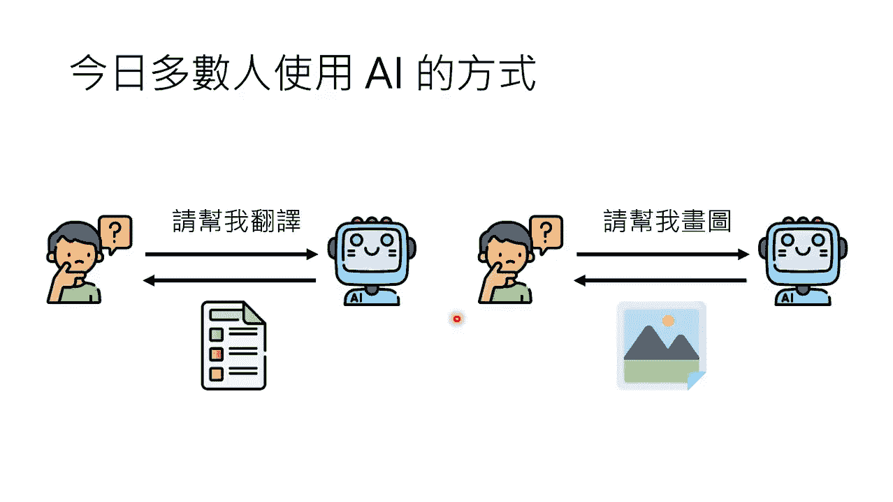

但是今天我们人类可以做更复杂的任务，而这些任务往往是需要多个步骤才能够完成的，举例来说，我现在接到一个任务，是要举办朋友间的聚餐，那我可能需要先做一下计划哦，就我要先调查时间，调查大家有空的时间。

统计一下最多人有空的时间，然后呢我就订我们常常吃的餐厅A啊，然后所以呢，我可能接下来呢就是先执行第一个步骤呃，发出一个google表单给我的朋友们，然后呢我的朋友们就会填写google表单。

我过两天之后呢，再来统计一下时间，看最多人有空的时间是在周四晚上，然后呢我就跟餐厅A定位，但是餐厅A说不好意思，周四晚上没有位置了，所以我就得订另外一家餐厅。

那这个时候我可能会用google map查询一下，还有没有其他可以去的餐厅，然后呢，google map会给我一些餐厅的推荐，那我可能就选了另外一家餐厅，B要完成举办朋友间聚餐。

这个任务是需要多步骤的呃，所以我需要先做一个规划，而这些步骤他的先后顺序是重要的，我不能先订餐厅再来调查时间，我一定要先调查时间才能够订餐厅，不然没有人来就糟糕了，而我在执行的过程中。

这个计划赶不上变化，原来我计划要订餐厅A，但是可能餐厅A没有位置了，我只好改订另外一家餐厅，这样这一种多步骤的复杂的任务，今天我们有没有可能让AI来办到这件事呢，如果AI可以办到这件事呃。

在这堂课里面我们就称之为AI agent，那我知道agent这个词汇呢，在不同的领域可能有不同的用法，那呃甚至就算是在谈论AI的时候，讲到AIA卷的时候，每个人可能也都有不同的想象，但这一堂课里面。

我所谓的AI agent，指的就是让AI能够执行多步骤的复杂的任务，能够做计划，而且能够修改计划，那今天AI有没有能力做到这样子的事情，也许你现在还没有看到，太多AI可以做到类似的事情。

但是有了大型语言模型之后，只凭借着大型语言模型的能力，也许不久的将来，AI agent就会出现在我们的日常生活中，你可以想想看我今天所做的这些步骤，包括做计划，包括呃调整计划，包括使用工具。

这些都是今天的语言模型，有机会或已经已经能够做到的事情哦。

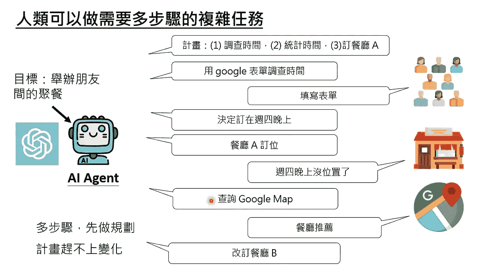

那今天假设你想要体验一些AI agent的话，有一些现成的AI agent，那我就把几个比较知名的AI agent，列在这页投影片上，其中最知名的也许就是auto g p t吧，你可以给他下一个任务。

比如说帮我做个网页，接下来就不要管他了，让他自己去想办法，他会偶尔上网搜寻呐，偶尔使用一些工具呀，偶尔自己reflection啊，想办法完成你的任务啊，不过他是否可以真的完成你的任务，那个就不好说了。

auto g b t曾经一度非常非常的红，不过很多人觉得他也许有点过誉了，有个网红呃下了一个指令给OTOGPT，然后就跑了一个晚上，最后什么都没有跑出来，把所有OpenAI的钱都喷光了。

然后那网红就非常生气，其中auto g p t他毕竟还是有一些能力的极限，今天语言模型它有一些能力的极限，你叫他自己想办法解决任务的时候，很多时候他还是解决不了的。

但是AI agent会是一个未来的趋势，未来语言模型帮人类做事的时候，不会再局限于一问一答，也许未来你不会再期待，语言模型马上给你一个答案，而是语言模型有能力自己跟环境互动。

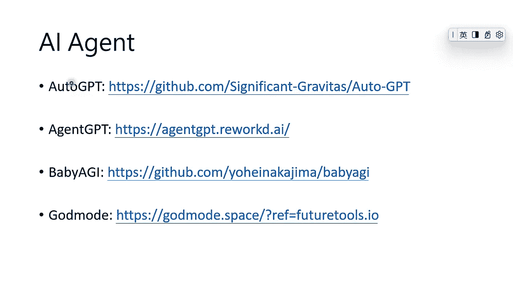

最终想办法解决问题哦，那要讲到这个AI可以自主运作的这件事情呢，也许最知名的例子就是我们之前有提过的，由AI村民所构成的STANFORD小镇，那我之前的上课录影也已经讲过这一段。

希望大家都有看那一段录影，那除了让这个呃AI呢活在这个小镇里面以外，还有人让AI呢玩MINECRAFT，让AI还活在我的世界，活在MINECRAFT里面，AI就会自己想办法做各式各样的探索。

打造各式各样的工具，那你可以看一篇叫做voyager的论文啊，这个是去年5月的论文，他会展示说他如何让一个AI，在MINECRAFT的世界里，AI自己不断的做各式各样的探索，学习新的任务。

那这是那篇paper里面的一个截图啦，那不同的这个icon呢就代表AI学会了不同的技能，那不同的线代表不同的方法，那这篇论文提出来的方法当然是最好的成色，这一条线他表现是。

他要展示说他的方法真的非常厉害，AI很快的就学会用木质工具，很快马上就学会用十字工具，那马上就学会铁器工具，最终呢它的模型可以学会打造出钻石剑，其他的方法都打造不出钻石剑，他的模型呢会越来越强。

学到的技能会越来越多，大概继续玩下去。

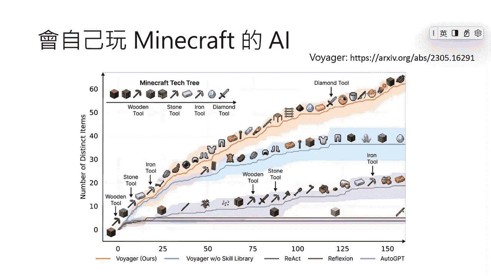

很快就会打到中介龙了，那刚才举的例子都是让AI活在虚拟的世界中，未来也很有可能这些AI agent他们是有实体的，可以跟物理的世界互动，那最近最广受瞩目的一个例子就是figure one哦。

大家应该都看过这个影片了，所以我们这边就不播放给大家看，就这个机器人它背后有一个大型圆模型，所以你可以对他下指令，叫他清理桌子，我拿点吃的给我，他是有办法能够做到的，但其实用语言模型来操控机器人。

不是最近才有的观念，Fer01，它真正厉害的地方不是拿语言模型操控机器人，而是他那个机器人的机械手臂跟手指，非常的灵活。

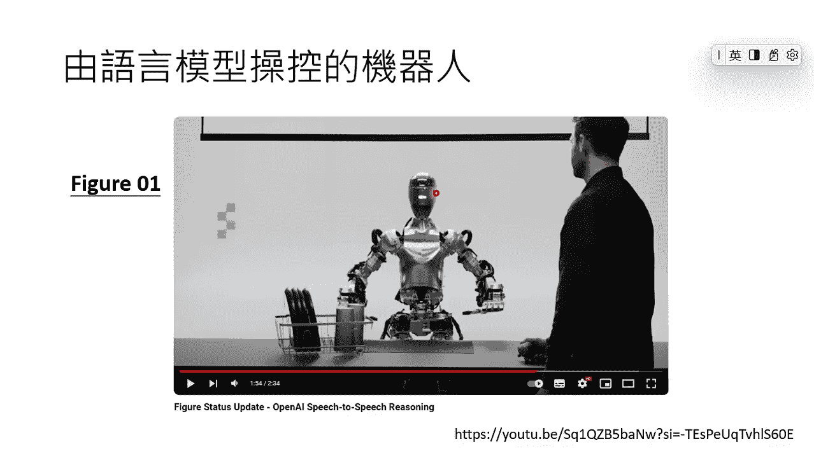

那至于用语言模型操控机器人这件事情，其实早在有CHEGBT之前，就已经有人尝试类似的方向了，这边是引用一篇叫做inner monologue的论文，他是2022年7月的论文。

是CHEGPT之前上古时代的论文，那我们来看inner monologue运作起来是怎么样的，啊就这个机器人背后呢有一个语言模型，所以人下一个指令给我一个汽水啊。

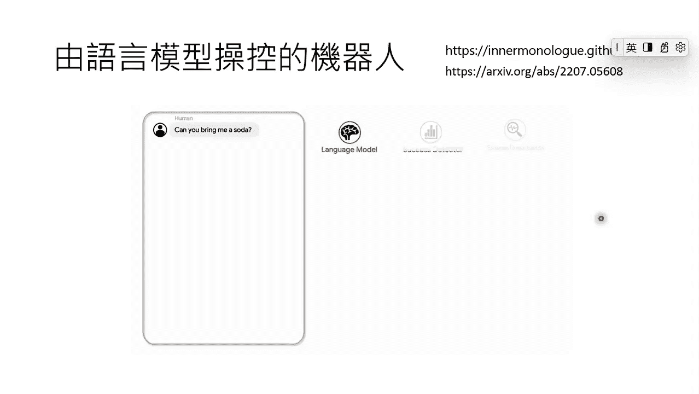

那语言模型呢就开始想要做什么啊，语言模型说去找汽水，然后机器人就去找汽水。

好，看到汽水了啊。

看到一杯可乐，我想把可乐拿起来，重点是在这个过程中遇到困难。

这个人很坏啊，把他的这个可乐抢走了哇。

没可乐怎么办呢，他自己反思一下，发现做不到这件事，这男孩就跟人说，看到一个orange soda。

喝orange soda好不好呢，人说不好，要喝点别的东西，所以机器人只好再去找其他的饮料哦。

所以你就会看到说，这个是一个用大型语言模型来操控机器人。

的例子，那也有人尝试用大型语言模型开自驾车，你可以看一下talk to drive这篇paper啊，呃这是去年年底的论文啊，这个图就讲的很清楚了，它背后呢是一个large language model。

那人类司机呢下一个指令，那这个large language model呢就会根据各种的情报，比如说天气啊，交通状况啊等等去开自驾车，那他并不是真的去操控方向盘，它并不是说输出啊，呃左转方向盘。

踩刹车这样的指令，它是会写一段程式码，用那一段程式码去操控自驾车的各个零件，然后人呢可以提供给这个自驾车回馈，比如说不要超速啊，或者是啊路边停车的时候要小心一点啊等等，人可以提供各式各样的回馈。

然后这个机器呢就会把回馈存起来，日后再做决策的时候，会根据人过去所提供的回馈来进行决策。

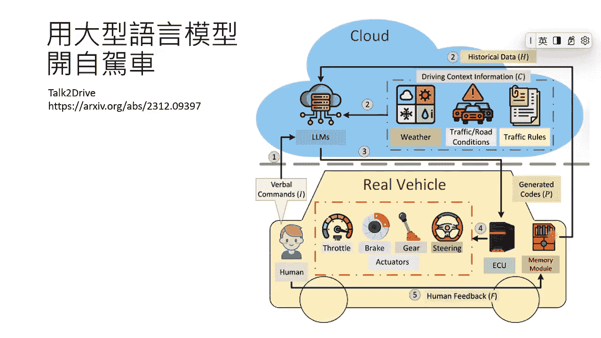

好那讲到这个AIAH，那它实际上背后可能是怎么运作的呢，我们现在来讲一下AI agent运作的可能原理，而那右边呢是AI agent，左边呢是外界的环境，那AI agent会有一个终极的目标。

然后终极要达成的任务，那他可能会有记忆，这个记忆代表他过去在跟环境互动的时候，所获得的经验，那他会从环境呢了解现在的状态，比如说它可以透过文字的输入，比如说他可能有视觉，他可以看得到外面的世界。

比如说他有听觉，他可以听到其他人的声音，或听到外面世界发生什么事情，或甚至假设他有实体的话，大家可能有触觉，他可能可以感受到现在碰到一个很烫的东西，又碰到一个很冰的东西等等。

总之它可以从外界透过一些感知器，透过一些sensor了解外界的状态，那根据他的终极目标记忆跟状态，这个AIA卷可以产生一个计划，那这个计划就是AI agent的短期目标。

也就达到这个终极目标之前需要采取的行动，那根据这个短期目标，这个AI agent就可以执行他的行为，那这个行为可以是输出文字，也可以是产生图，也可以是说话，那如果机械手背的话。

也许你可以期待这个AIA卷，还可以去操作那个机械手背，那至于要怎么操作机械手背，也有可能是产生一段城市码，用这段城市码来运作机械手备，或者是跟其他的A卷，其他的AI互动等等。

好那期待说AI agent透过一系列从环境得到的输出，透过一系列的记忆跟计划，那他可以采取适当的行动，那他采取行动以后呢，会对世界造成一些影响，会改变现在外面世界的状态。

所以它可以根据外面世界的状态修改它的记忆，他可以从外面世界的状态学习到新的经验，修改他的记忆，他也有可能可以修改他的计划，他不会计划，一定以后就永远要照着那个计划执行，那这样子太不灵活了，太死板了。

它可能可以根据外面世界的状态的变化，来修改他的记忆，那这个是今天我们想象中，一个AI agent应该具有的能力，那今天这些语言模型是否具有这些能力呢，它是否可以呃根据记忆做回复，修改记忆。

这个是他是否能制定计划并修改计划呢，其实今天的大型语言模型，对于产生记忆或修改计划等等，算是有一定程度的能力了，所以我会说AI agent其实就在不远的地方，也许你今天这个时间点。

还没有看到太多AI agent的应用，但我相信在一两年之内，AI agent应该会满地跑好。

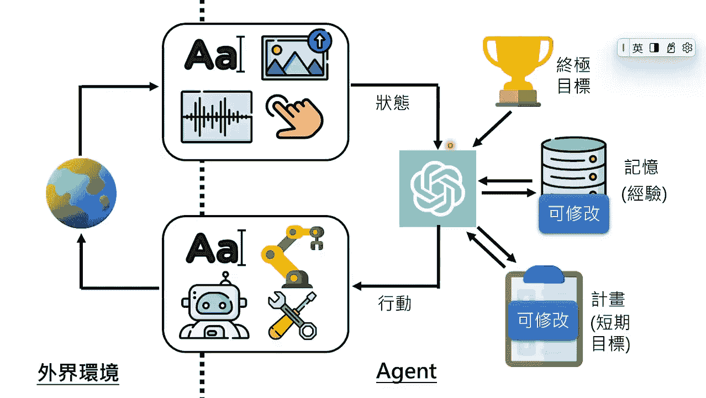

那讲到记忆这件事情呢，大家知道说确GPT其实是没有长期记忆的，今天CHEGPT能够记得的事情，都发生在同一则对话里面，一旦你按了开始新对话，你之前跟他讲过的事情，他一概不知道，一切都要从头来过。

但事实上呢。

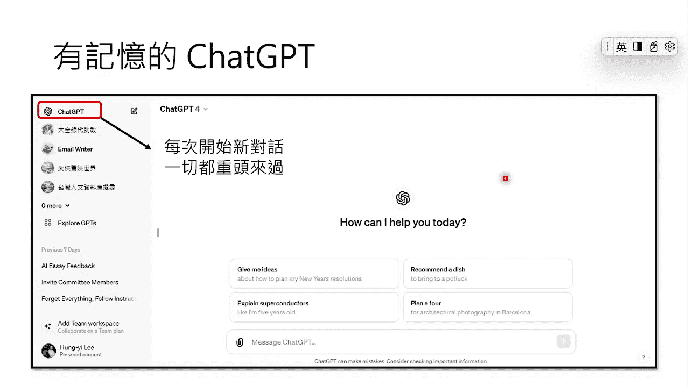

chg p t OpenAI也曾经一度声称，他们在打造有记忆能力的CHAGBT，那他们有一个blog，就是讲说，他们准备要试出有记忆能力的CHEGBT，甚至twitter上有一些人讲说。

诶我拿到的这个版本它是可以有记忆的，但不知道为什么后来这个功能就不见了，至少我手我是还没有看到这个功能，出现在我的CHAGBT的账号里面了，如果有人手上有的话，记得跟我讲一下。

但是总之OpenAI显然在打造有记忆力的change g b t，你有记忆力的CHEGBT，运作起来可能是什么样子呢，当你跟CHEGBT对话完之后，他可能会把对话里面的关键讯息进行摘要。

比如说他知道你现在正在准备期中考试，接下来当你开始新的对话，原来的CHEGPT1旦开始新的对话，一切过去对话的内容都会清空，但这一次他有做一些摘要，所以他知道过去对话的内容里面有哪些重点。

所以也许你下一次跟他对话的时候，他会先对他过去的记忆做一下，i g search1些跟你相关的资讯，但他看到你跟他讲话的时候，他甚至可能会问你说，那你期中考考的怎么样等等哦。

所以有可能给CHEGPT记忆，那如果CHAGPT有记忆的话，它就可以更加的个人化，那虽然现在OpenAI的CHEGBT，还没有真正试出记忆的功能，但是其实也有很多人试图在以CHEGT为基础。

打造有记忆能力的G举例来说，你可以看一篇paper叫做memory g p t么，它就会展示大型语言模型，怎么加上RG让他有这个记忆的能力好，那以上呢讲的是一些对于AI agent的想象。

那如果你觉得讲到这边很模糊，没有很具体的话。

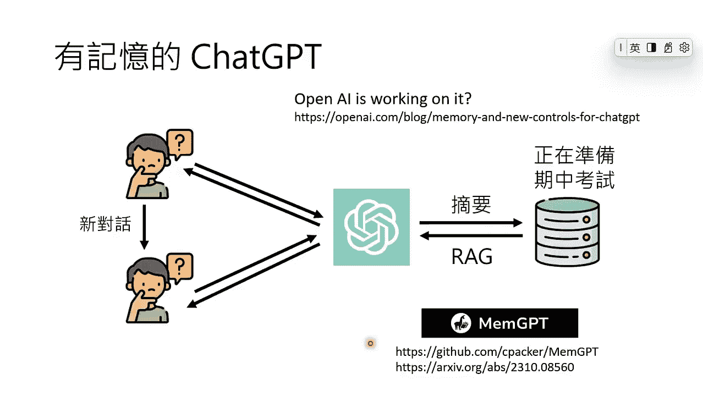

那我们来举一个具体的例子，这边又要讲一个福利联的莫名其妙的故事了。

这个故事是这个样子的，大家都知道在福利联里面有一级魔法师考试，一级魔法师考试的其中一关，就是要攻略林洛的王座这一个迷宫，那在进入这个迷宫之前，因为进入这个迷宫很危险，所以在进入这个迷宫之前。

主考官呢就发给每人一个逃脱用割列姆，逃脱用割列姆是什么呢，它是一个装在瓶子里面的泥人，如果你遇到危险的时候，就打破这个瓶子，格列姆呢就会救你，带你带你离开这个迷宫哦，所以在迷宫里面呢。

在一级魔法师考试进入迷宫之后，有一个考生叫艾黛尔，他就遇到了染泽的复制体，所以他就受了重伤，所以他决定放弃这场考试，他就打破了这个瓶子啊。

那这个格列姆呢就出来，一开始出来的时候，他是坐着的。

感觉，正在做一些运算，而这个时候呢，呃染泽的复制体就对爱戴尔发动攻击，然后这个格列姆呢就帮艾黛尔，挡住了染泽的攻击。

挡住了染泽复制体的攻击，那爱戴尔还赞叹了一句哦。

他还能确保使用者的安全呢，真是太方便了，然后格列姆就把爱戴尔抱起来逃出了迷宫，那这个歌列姆是怎么做的呢，你可能以为割列姆是用魔法做的，我告诉你，在这个动画里面有讲这个割列姆。

割列姆呢是列努林这几年才开发出来的，你想魔法的发展都已经有上千年了，为什么这几年才开发出，可以自动运行的歌列姆呢，那是因为，割列姆背后是用大型语言模型在运作的。

它是一个用大型语言模型运作的AI agent，那个列努林就是发现了大型原模型以后，决定把它加到割列姆里面，才让割列姆可以做自主运行好，那我们来看一下这个歌列姆是怎么做，自主运行的。

它是一个AI agent，所以它需要有一个终极目标，他的终极目标是什么呢，我想他的终极目标可能是你会自律行动，安全的把考生带出迷宫，那格列姆刚创造出来的时候，他是没有任何记忆的哦，所以他的记忆是空的。

现在他看到的状态是呃，眼前是遭遇复制体攻击而受到重伤的爱戴尔，那你可能会想说，可是实际上的状况看到的是画面呐，要怎么把它变成文字输入给语言模型呢，也许你可以用的是image captioning的技术。

现在已经有很多技术，可以把图片转成描述的文字，所以也许你可以呼叫一个image caption in the model，把现在的状况翻译成文字，那大型原模型就可以读到。

现在的状态是眼前是受到重伤的爱戴尔，而接下来呢，这个语言模型就可以根据它的终极目标记忆，还有状态来制定接下来运行的计划，现在的g p t four可以做到类似的事情吗。

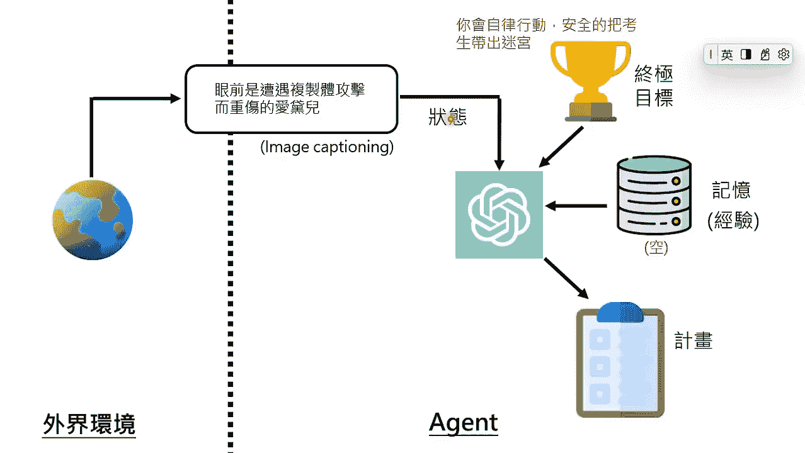

可以做到类似的事情，我就给他一个目标，然后他的目标是你会自律行动，安全的把考生带出迷宫，然后他的记忆目前是空白的，他的状态是看到受到重伤的爱戴尔，接下来你只要叫他请产生行动计划。

它就会自动产生一个行动计划给你哦，他的行动计划第一点是立即评估爱戴尔的伤势，第二点是提供急救。

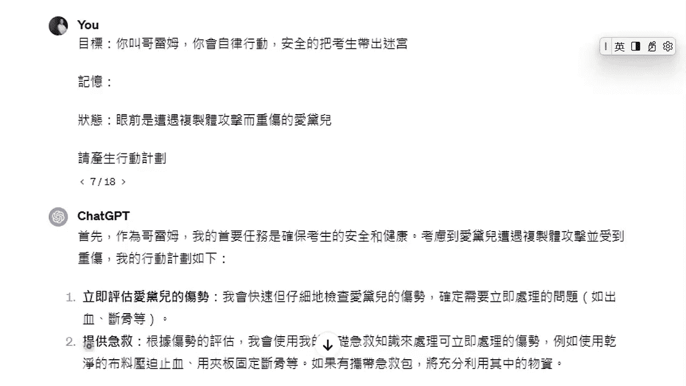

看起来都非常的合理，现在呢有了这个行动计划以后，我们就把这个行动计划给大型语言模型，叫他按照这个行动计划进行执行，大型原模型可以按照计划进行行动吗。

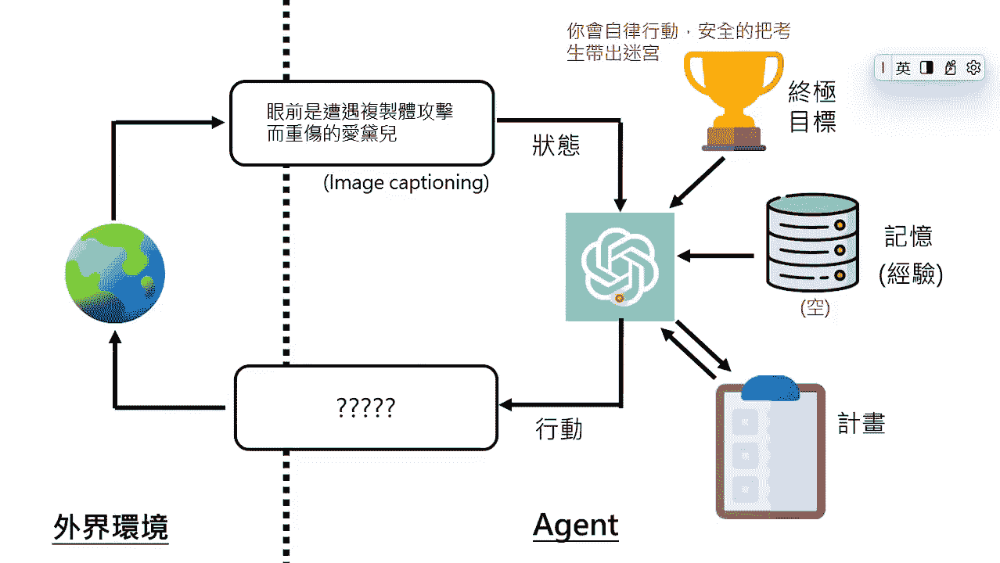

完全可以哦，你就把刚才的目标记忆状态，还有刚才产生的这个行动计划呢，给大型语言模型，接下来你跟大型语言模型说，请采取下一步行动，那我这边有强调说执行一个动作就好，不然他会把所有的动作都执行完。

我叫他采取下一步的行动，他就说，那我下一步的行动就是评估艾黛尔的伤势，比如说他会仔细检查身上的每处伤口，看有没有大出血或骨折的迹象，会看看他是否还有意识，是否有震荡或其他休克的迹象等等。

那这边的一个难题是，这边产生的是文字的行动，这个文字的行动要怎么转成具体的行动呢，一个机械人，一个呃念的一个这个歌列姆，一个泥人，他要怎么按照这串文字真的进行行动呢，这就是整个AI agent。

我觉得目前最困难的地方，你可以找到很多的论文，在尝试把这些文字的指令转成真实。

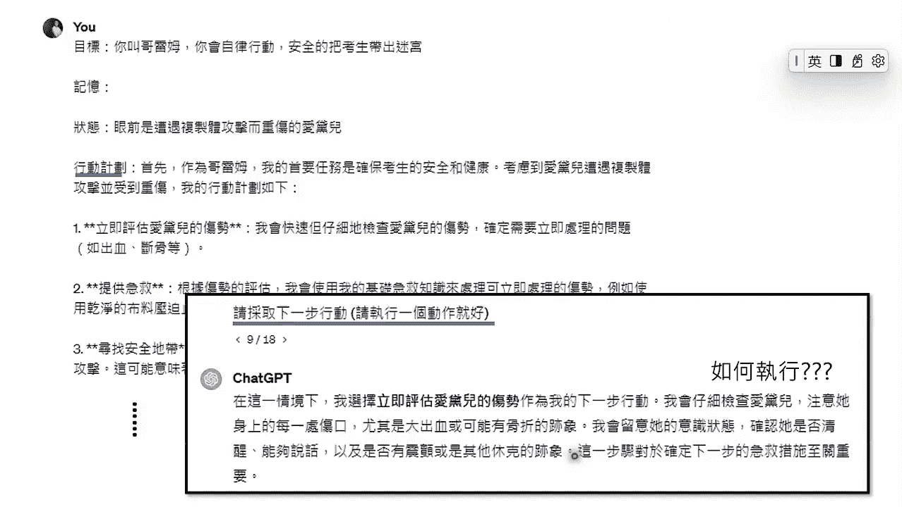

在物理世界或在虚拟世界可执行的行动，我这边引用了一篇今年2月的论文，他就说这个agent呢要有两个，一个叫slow agent负责高层次的行动，Slow agent。

它产生的指令都是人类可以理解的自然语言，但是我们还需要一个fast agent，Face agent，就是按照slow agent的指令去想办法，真的执行这个行动，举例来说。

他可能可以训练一个类神经网络，专门执行特定的行动，或者是这个face agent可以干脆就产生一段城市码，运行这段城市码以后，把自然语言本来用自然语言描述的行为，转成在物理世界或者是虚拟世界。

真的可执行的行动，那到底做起来怎么样，我把论文的链接留在这边给大家参考，至少它看起来是可以运作，在这个MINECRAFT的虚拟世界里面的。

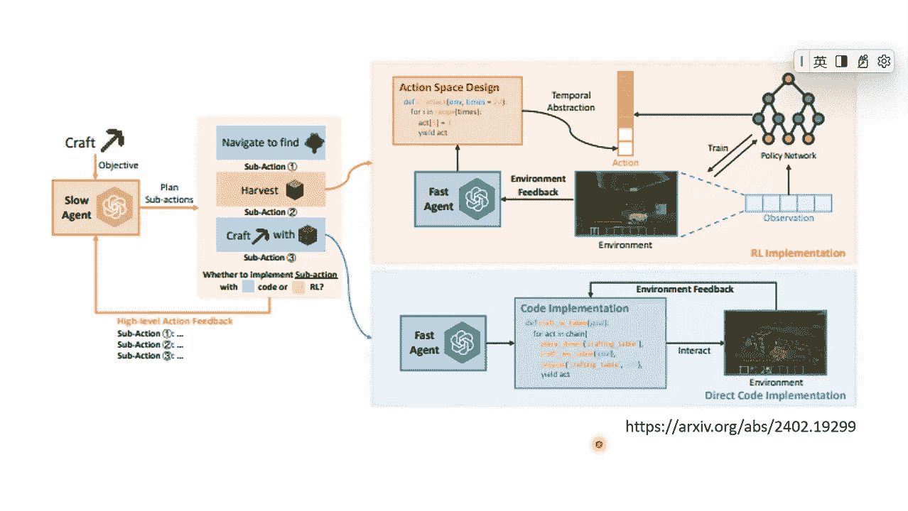

那总之假设我们的现代的行动是可以执行的，真的能够评估爱戴的伤势，那在评估伤势的过程中，外界的环境可能是会改变的，比如说会有什么样的改变呢，不要忘了染泽的复制体还在那里，所以呢染泽的复制体可能会袭击列。

可能会袭击割列姆哦，所以割列姆受到染泽的复制体的袭击，所以怎么办呢，现在外在的状态变了，所以计划也应该跟着改变，那这个自然这个语言模型，可以透过反思的方式来改变它的计划。

如果你想要看语言模型怎么改变计划，你可以参考一篇叫DEPS的paper，它也是运作在MINECRAFT里面的，让语言模型在MINECRAFT里面，可以根据环境的变化改变它原来的计划。

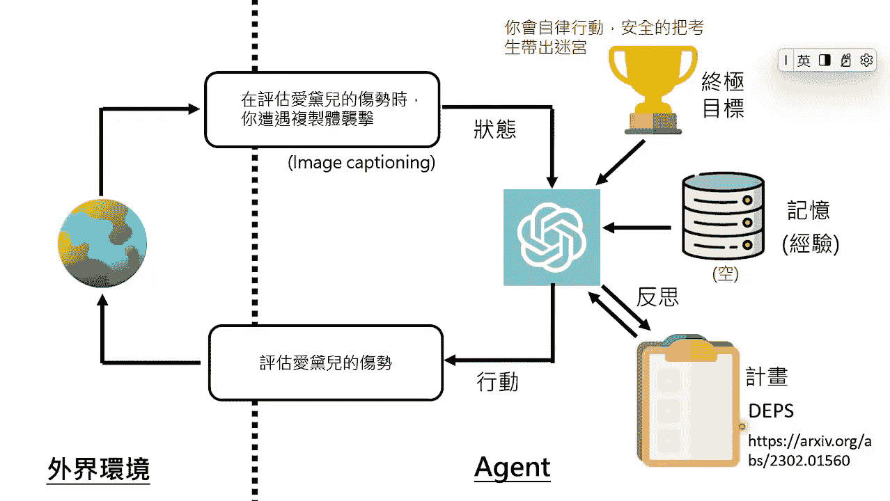

那我们就来试试看，当状态改变的时候，计划是否会跟着改变，所以我现在就告诉语言模型，除了刚才有的那些资讯以外，告诉他现在执行的动作，正在评估爱戴的伤势，然后有新的状态，这个状态是在评估伤势的时候。

遭遇复制体的袭击，请产生新的行动计划啊，接下来呢，这个自预言模型就可以产生新的行动计划，那发现它新的行动计划的第一点呢，是要保护爱戴尔，因为评估伤势现在已经没有那么重要了，所以更正更真正更重要的事情是。

他要优先保护爱戴尔，他就可以产生一个新的行动计划哦。

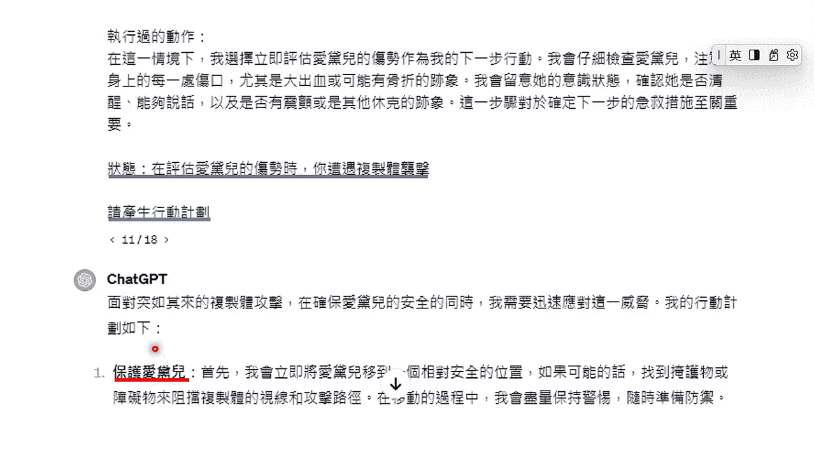

那除了产生行动计划以外，这个语言模型能不能够反思刚才的状态，然后得到一些未来可以用的经验呢也是可以的，如果你想要知道语言模型如何透过反思，取得未来可用的经验。

可以参考react跟reflection这两篇paper，那我会把论文的链接留在同一篇上，我们就来实际试试看。

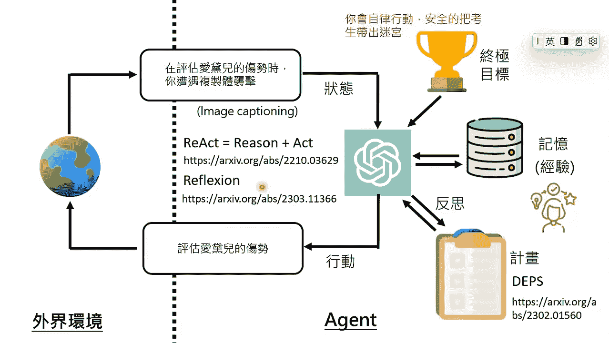

语言模型能不能够产生有用的经验，语言模型如何产生经验呢，你就下一句指令告诉他简短总结，值得记下来的经验，他就反思之后列了几点，他觉得应该记下来的经验，包括要对环境有警觉性啊等等。

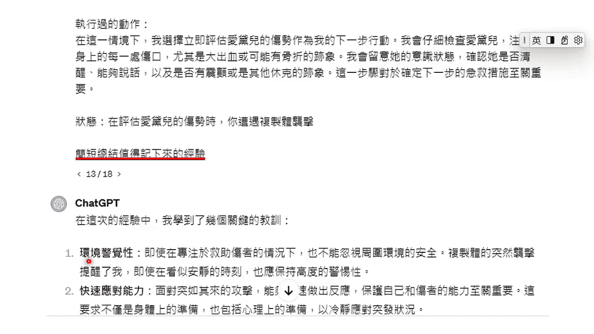

而有了这些经验以后，如果再遇到同样的状态，这个模型就可以根据过去所得的经验，产生不同的行动，这些经验会影响模型采取的行动，那我们就来看看刚才实际的例子，看看格列姆的例子。

看看模型是不是真的会因为为经验而改变。

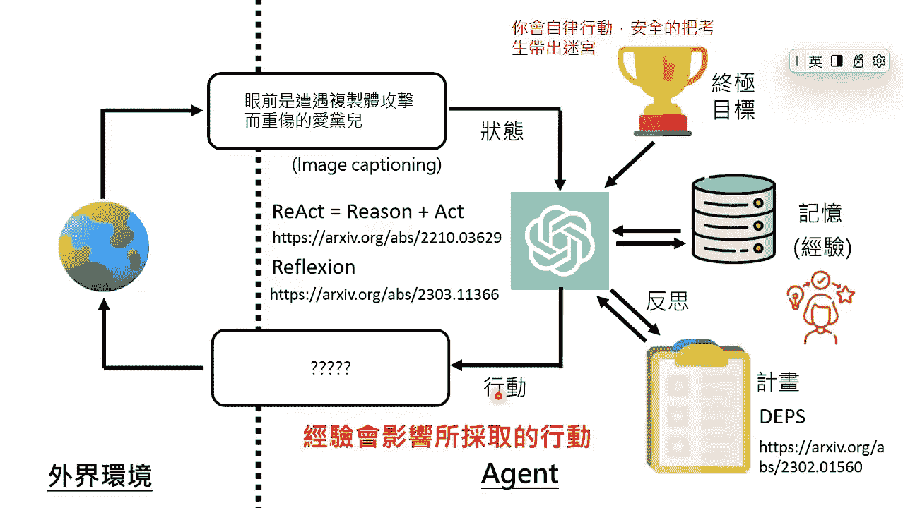

他的行动好，那这个是模型的目标啊，他现在呢有记忆了，那刚才记忆是空的啊。

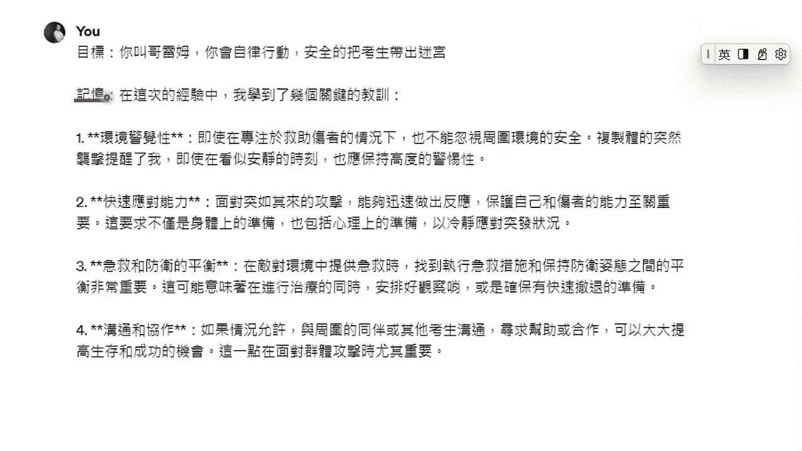

现在是有记忆的，在有了记忆的情况下，叫他产生行动计划的时候，他现在行动计划的第一点，仍然是评估爱戴的伤势，但是第二点呢是要保持高度的环境警觉性，刚才在没有记忆的时候，他的第二点是立即施与急救。

但现在他的第二点呢变成要保持高度的警觉性。

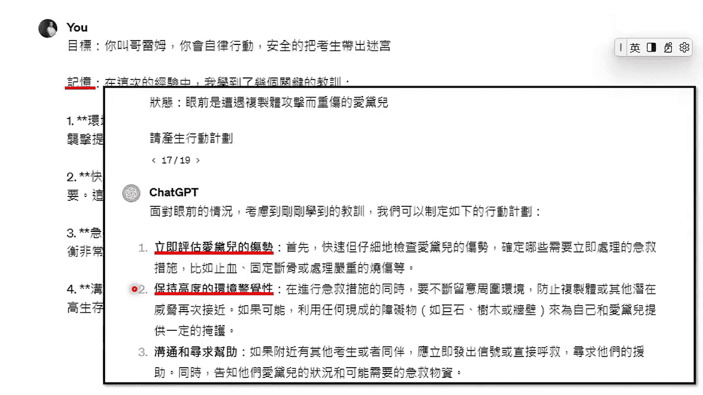

然后接下来根据这个计划呢，我们来产生下一步的行动，如果在没有任何记忆的情况下，这个大型语言模型，他下一步的行动是会立即评估爱戴尔的伤势，那如果有记忆的话，他的行动就会略有不同，你看他这边多加了一句话。

就在评估爱戴尔伤势的过程中，我也会保持高度警觉，注意四周是否有复制体或其他潜在的威胁哦，所以有了记忆会影响有了记忆，有了经验会影响这个模型的行为，让他采取更好的行为，他可以透过他的经验。

改变他未来所会采取的行动哦，所以这个就是一个想象中的未来，AI agent可以做到的事情，那依据今天大型语言的模型能力，我相信其实AIAH很有可能在一两年后，你就会看到满坑满坑满谷的AI agent。

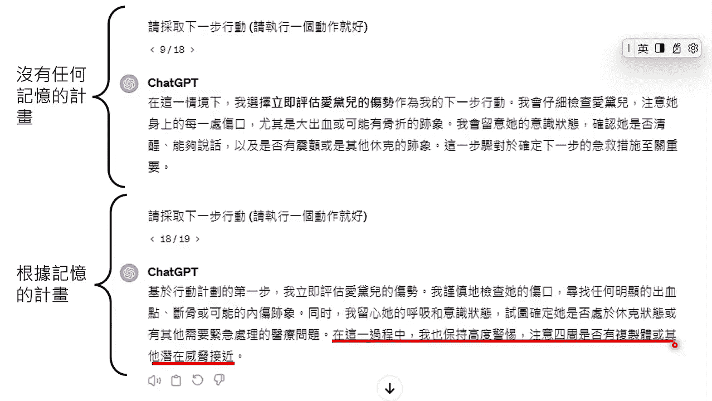

生活在我们的周遭，而如果你想要知道更多关于AI agent的事情的话，我这边放了一篇overview paper，然后这一个图是从overview paper里面截取出来的啦，这是作者想象了一个未来。

充斥了AI agent的虚拟世界，好那这个部分呢我其实就讲到这边，那我们还有大概5分钟的时间。