# 强推！(2026最新版) 李宏毅最新课程：智能体AI【AI Agent】71集全！人工智能／机器学习／深度学习／大模型／LLM - P8：7-第四讲：大型语言模型训练方法 - Ai人工智能工程师 - BV1QdzCB3Eu2

好那各位同学大家好啊，那我们就来上课吧，今天我们要跟大家分享的是pretrain alignment，预训练对齐这样子的PARADIM，它的强大与极限。

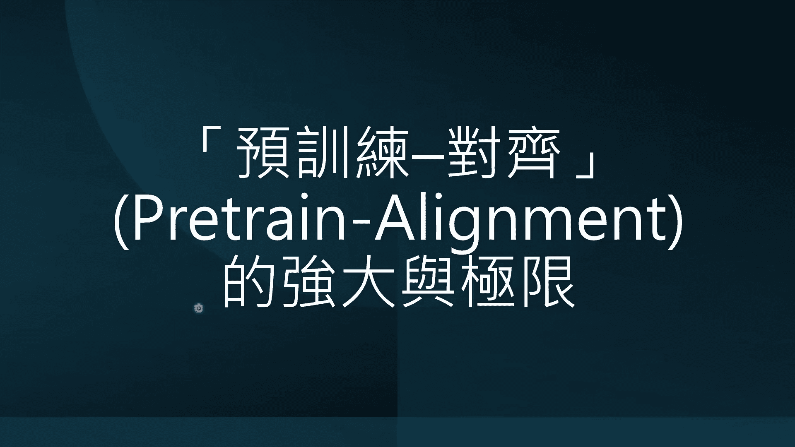

那大家知道说今天呐在训练语言模型的时候，基本上就是分成三个阶段啊，大家知道说第一阶段就是PRETRAIN，Pretrain，就是透过大量网络查到的资料，让机器有基本的文字接龙的能力。

那第二段呢叫做supervise fine tuning，那缩写是SFT，有人叫instruction fine tuning，那就是告诉模型说看到某个输入的时候，某个样子的输出才是对的。

那第三阶段呢是LHF，那由使用者来告诉机器说，什么样的回答是比较好的，什么样的回答是比较不好的，那在第二阶段跟第三阶段会引入人类，在第二阶段需要人类提供正确的答案，在第三阶段需要人类提供回馈。

我们把需要人类参与的阶段叫做alignment，那alignment有很多不同的定义了，你可能也在其他的文献上看过，有人是只把第三阶段还有hf叫做alignment，不过在这堂课里面。

我们所谓的alignment指的是第二阶段的supervise，FTUNING加第三阶段的LHF，那alignment指的是我们想要达成的一个目标，我们希望机器的输出是呃赖到人类的价值观的。

跟人类的需求是对齐的，那alignment这个步骤呢很多时候又叫做find you，所以等下课程里面讲到find you的时候，指的也就是alignment这个步骤，在第二阶段。

第三阶段只是根据PRETRAIN已经得到的参数，进行微调，进行翻译。

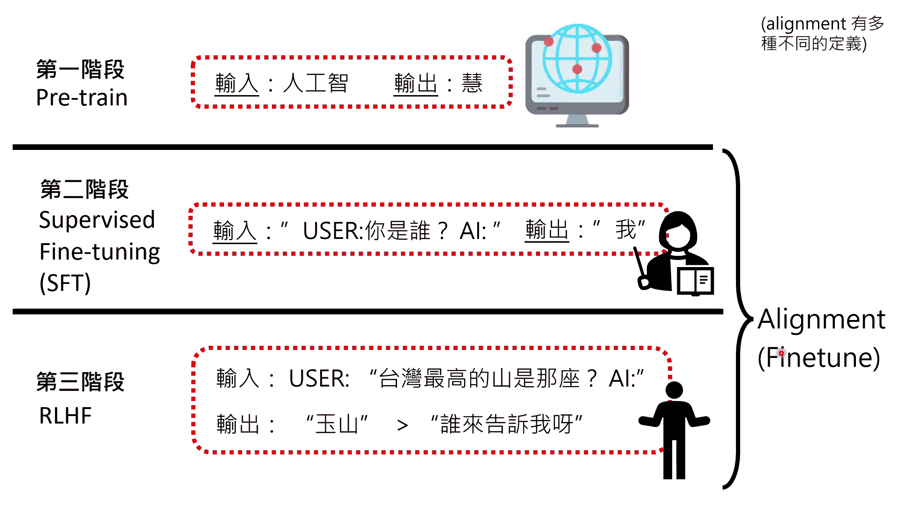

听好，那今天呢首先要跟大家分享的是，PRETRAIN有多强大，那有人可能会想说，PRETRAIN根本没什么用啊。

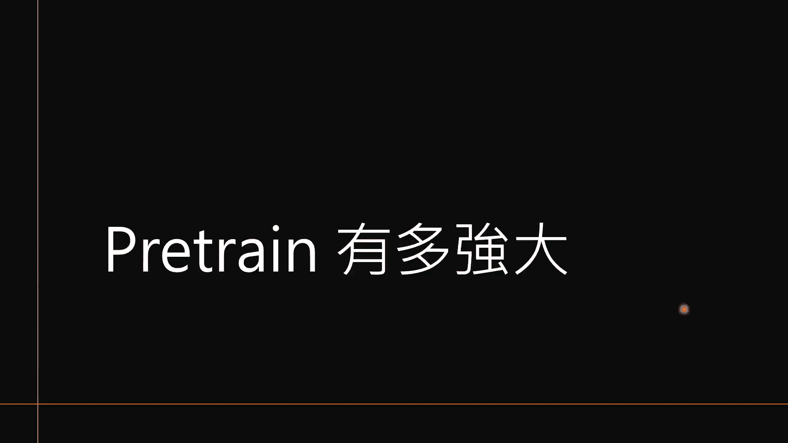

PRETRAIN完的模型根本就没有办法使用，举例来说，假设你拿拉马Q7b base这个模型哦，以后大家看到模型的名字里面有base这个字，通常指的就是一个只有做PRETRAIN。

没有做alignment的模型，那如果你问这个larva two7b base，What is machine learning，他也会回答你，他其实知道什么是machine learning。

他还说machine learning是computer science的一种，然后呢就是要让机器呢学会某种能力，那你不需要explicit的programming。

然后我们训练learning呢是AI的一个subset好，但是呢模型讲着讲着就越讲越奇怪，这一段讲完以后还要再重复一样的内容，再一次还有再重复一样的内容，一次不断重复不断重复，怎么讲都停不下来。

就突然暴走了，那可能觉得这个模型根本是烂爆了，那alignment呢确实大幅改变了模型的行为，那lama two7B有一个经过alignment的版本，大家看到的base是没有alignment的版本。

那lama two7b chat是有做过alignment的版本，那通常看到模型的名字里面有chat啊，或instruct啊，这些字眼代表说这个模型是做过alignment的。

那这种做过alignment的模型，你问他什么是machine learning，他就会好好回答你，他就会告诉你machine learning是什么，他会详加解释。

而且还后面还会调列的告诉你machine learning有哪些种类，看起来的回答就非常的像模像样。

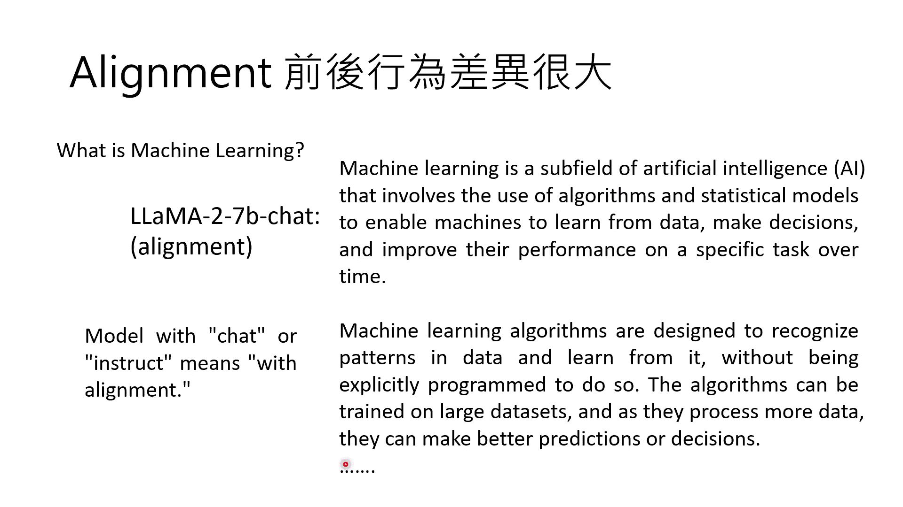

那在数据上看起来，alignment前后也确实对模型造成了非常大的影响，比如说我们来看nt bench这个benchmark copus的效能，nt bench里面是有80题，有这个八个不同领域的问题。

每个领域十题啊，那回答完以后呢，通常就是拿一个比较强的语言模型，比如说g t t g p t four来打分数，那分数越高代表你的模型表现越好，我们来看一下拉马三七十B这个模型的表现。

那这边这个模型指的是一个只有PRETRAIN的模型，它是一个base的模型啊，他在mt bench上得到分数呢是2。7，四舍五入以后呢就是三分好，那七lama三七十b intro，这个模型呢它得到8。

63分，这是天与地的差别，看到这边你可能会觉得说啊，这个拉玛三七十speed intra有做alignment，进步这么多啊，所以alignment他得了这个MVP啊。

这个base model就是躺赢狗，但是我要跟你讲的，就是你这么在意这个评分系统的分数做什么呢，这样子会把一个模型的努力给异化掉的懂吗，知不知道什么是异化，什么是具体化，你看这个base模型。

你看他的贡献就是3。0，而这个intro模型它得到8。6carriage哦，所以你觉得intro模型是MVP，base模型就是躺赢狗好，到底这个base model pretrain是不是躺赢狗。

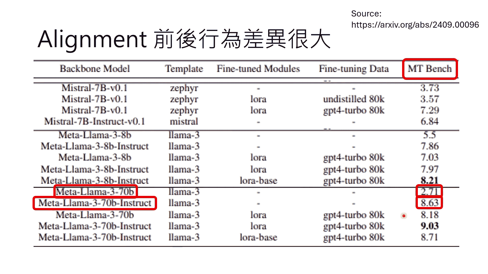

而实际上对整个模型的训练而言呐，Lemon，这个步骤其实做的事情相对于PRETRAIN，反而是非常少的，等一下跟大家讲，PRETRAIN现在都用多少的资料。

而alignment这个步骤用的资料其实是非常少的，你不要看刚才lama too啊，base model跟chat model，alignment之前，alignment之后它的结果差这么多，哎。

但是其实在alignment的时候用的资料是非常少的，lama two的这个技术报告里面告诉你说，他们在做这个SFT，在做fine tunsupervised，fine tune的时候。

只用了2万7540笔资料而已啊，当然你可能会想说，那拉马two除了这个呃SFT以外，后面还有做IHF啊，也许IHF大幅增加模型的能力，但是其实他第二段还有讲说，那个只做FFT的模型，其实就已经很强了。

他强到跟人类的标注其实答案是差不多的，所以其实一个模型只用2万多笔的资料，做一下微调，做完alignment以后，其实结果就已经非常好了，那有另外一个模型叫做LIMA。

这篇paper的标题就是less is more for alignment，在这篇论文里面，那群作者只准备了1000笔资料而已啊，他们只用1000笔资料来微调模型。

但这1000笔资料是作者精挑细选的资料，他们除了从网络上搜集资料以外，还有自己标注，自己写了一些问题跟答案，凑了1000笔他们觉得最有效的alignment的资料，然后拿来微调模型。

那如果你看LIMA这篇paper的话，那经过1000笔资料的alignment之后，模型表现是非常好的，但还没有到跟g p t four不相上下了，但是也是可以跟g p t four打的，有来有回。

是一个蛮好的模型，看起来做完alignment以后，对模型的能力是有非常大的影响的，但是alignment只需要非常少量的资料，所以alignment就是画龙点睛，龙的主体是PRETRAIN。

但是光化龙的身体是没有用的，得把眼睛点上去，龙才会飞起来，这个把眼睛点上去的步骤就是alignment，但是点的位置也很重要，要点到适当的位置，龙才能够飞起来，所以alignment的资料虽然不用多。

但他的quality很重要，在拉马to name paper里面，他们有讲说，他们一开始呢先去找第三方的公司，去买一些可以做alignment的资料，因为做alignment的资料是需要人力去介入。

才能够生成的，你需要问题跟答案，所以他们一开始是先找第三方的公司，帮他们做了一些资料，然后做了上百万笔的资料，结果他们后来发现说，那上百万笔的资料根本没什么用，还不如他们自己做的那2万多笔的资料。

得到的结果好，所以这告诉我们说，alignment的资料虽然不用多，品质很重要，这就是为什么这个lama too的论文，在讲到这一段的时候，他的标题是quality is all you need。

但是什么样alignment的资料才是好的资料呢，今天仍然非常难说清楚，这边举一个有趣的例子跟大家分享啊，有一篇论文呢他就是收集了各式各样的资料啊，组成一个比较大的资料的集合。

这些资料是要拿来给你做fine tuning，给你做alignment用的，那他们的资料有很多不同的来源，他们就想要知道说，哪一个来源的资料是最有用的好，那在这个表格里面。

每一个color呢就是不同的任务，那我们就看最后一个color，指的是各个不同任务的平均啊，那这边呢他们先试了一些没有alignment的base model，比如说如果是千问27B。

那得到平均分数是53分，在这些不同的资料里面，第一个呢这个是知乎啊，啊知乎用的资料是蛮多的，那有用了8000多笔资料，做完FQ之后从53进步到63，虽然知乎的资料很多，里面的资料也是一问一答的。

而且知乎是比较知识性的，所以感觉应该很有用，但他还不如这边这个结果呢，这边有一组有一组资料呢，它只有240笔，但是做完final之后，可以得到83percent的正确率，这些资料是什么呢。

这些资料是来自于弱智吧的资料，是不知道大家知不知道什么是弱智吧，这个实验在有看过这篇论文之前，我其实是不知道弱智吧的，但是有了这篇论文之后，大家都在讨论自八上面的资料，农场文呢就突然之间非常的兴奋。

每个农场文都在讨论弱智吧的神妙之处，好，那这边呢就是找了一些弱智吧的问题，让大家感受一下弱智吧里面的问题长什么样子，弱智吧里面问题就是都是这种的啊，我在我的银行卡呢，在高压锅里煮了一晚。

为什么还是冻结的状态，或者是我16岁了，未满18岁，正常吗，或是一斤铁，一斤棉花掉到水里，你先救谁，或者是说哎关羽一小时能攒20个颜良，华佗一小时能救17个颜良，假设有233。3个颜良。

那关羽要攒多久才能够斩杀所有的颜良，或者是我老板要我发送原图，我发了可莉的图给他，为什么会被骂，都是这类型的问题，啊那可能会想说，为什么弱智吧上面的问题比知乎上面的问题诶。

拿来fighting语言模型还有更有效呢，其实就很难说清楚，其实在原始论文里面也没有讲的特别清楚，那作者只是猜测说，也许你看弱智吧的问题，它特别的丰富，你看他各种问题都有，还有数学的问题。

有这么丰富的问题，也许就是弱智吧，能够激发语言模型能力，让他alignment以后结果特别好的关键，但是其实啊呃这篇论文里面有一个小细节，也许才是弱智吧，特别有用的原因，就是他的弱智吧的答案不是人写的。

他的弱智吧的答案是用g p t for生的，它其实叫g p t four去回答这些问题，然后再从这些问题里面挑选g p t four，回答的特别好的，来当做alignment的资料。

所以实际上呢弱智吧那个资料集就拿弱智吧，那个资料集来训练，相当于对g p t four做了knowledge destination，就把GDP four当做你的老师，也许这才是模型可以进步。

在弱智吧的资料上，只有240B却进步非常多的原因好，那我们讲到了knowledge destination，knowledge destination这边指的是什么意思呢，曾经有很长一段时间。

人们不知道要怎么做alignment，alignment的资料非常的重要，那什么样的资料才是high quality的，alignment的资料可以画龙点睛，激发模型的能力呢，有一段时间大家不知道。

所以后来有人就想说，CHEGBT做的那么强，大家来对它做逆向工程，来跟CHEGBT学习怎么做alignment啊，这个就是knowledge destination啊。

那这边的基本概念就是你就问CHEGBT，跟你想要align的自己的模型，可以问他们一样的问题，然后呢看CHEGBT回答什么，你的模型就跟CHAGPT回答的一模一样，把CHEGBT当做老师。

跟CHEGBT学习，就可以快速点燃模型的能力，那很多知名的模型，尤其是那些在试出的时候炫耀，说只用了1。1。1点点的钱，就训练起来的模型，通常就是指的是他们已经有一个base model。

有个现成的base model，他们去对CHEGBT或其他很强的模型，做alignment以后，就模型就可以瞬间得到能力的暴增，然后alignment需要花费的这个effort。

需要花费的cost非常少，他就可以炫耀说他只花费了多少多少的cost，就可以达到CHEGBT多少层的能力，那其中比较知名的模型由l parka跟VIKA，还有比较最近知名的模型sky T1跟SY。

那l para跟VIKA呢是比较早期的模型，他们是对CHEGBT去做alignment，他们是从la one7B的模型开始做起，那他们花费呢都大概是100美金左右。

那skt one他用千问32B当做student model，他的老师是千问，另外一个比较强的版本叫QWQ，那他们花了450美金，那S1呢s one是用GERMANI当做老师。

从千万2点五三十二B开始挑起，他们只用了1000笔的资料，它里面有很多不同实验的组合啦，那用1000笔的资料其实就得到不好了，就得到很不错的结果了，那对于这边的经费呢，大家就不用看得太认真。

这都是一个非常非常粗略估算的经费，比如说s one这个钱是怎么估算出来的呢，他们是说这个他们H100只需要用七个小时，那H100用七个小时到底是花多少钱呢，其实取决于你用哪个平台。

所以实际上这个估测的经费，是一个非常粗略的估测，而且事实上这边估测的经费都不包含，升资料的时候的花费，升资料的时候，你需要对一个模型，你要需要对这个老师老师的模型做noise desolation。

你得问老师模型，很多问题得到老师模型的答案，那这个也是要花钱的，再来你要清资料，这些老师模型生出来的答案，你不是全部都能用，因为老师模型也有可能讲错，他也有可能回答的不好，所以你会挑品质比较高的资料。

这些都是需要成本的。

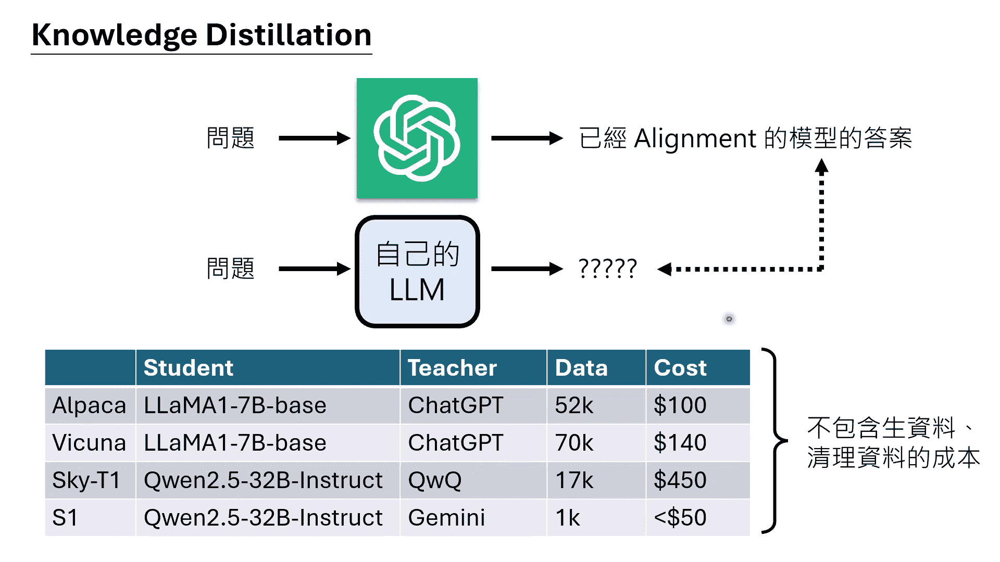

所以这边的花费大家就看看就好哦，那刚才讲到说，老师模型不一定能够得到好的答案，所以清理资料还是需要的，那像l parka这篇paper里面，他们从这个GPT3。5，得到了5万多笔的资料，那GPT3。

5的能力也是有限，所以不是所有的资料品质都很高，后来l pa就有另外一篇论文叫APOGASES，而前面也有LP，然后为了要呼应l pa l pa就是羊驼啦，那l para gazis呢是飞马哦。

就是这一支，那ALPAGIS做的事情，就是把ALPA他们训练的资料5万多笔拿来，然后去问语言模型，说这笔资料是不是高品质的资料，叫语言模型，打个分数，比如说这笔资料很差，只有两分，这笔资料也很差。

只有两分，这笔资料不错，给五分，低分的资料就丢掉，只留下高分的资料来进行训练，那APOGEEIS虽然用的资料比l parka还少，但是他挑了高品质的资料出来训练，所以可以比l par卡得到更好的结果。

那ALPGIS是拿一个语言模型来挑资料。

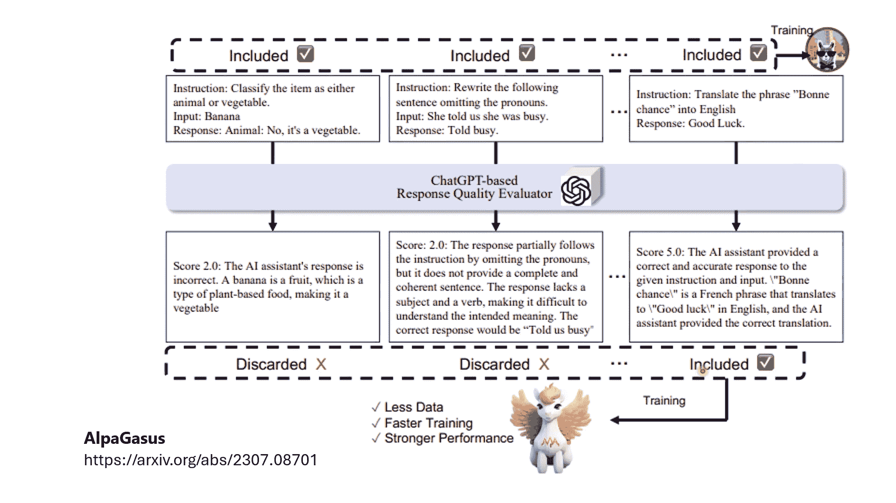

那要怎么挑资料才是最有效的方法呢，这仍然是一个尚待研究中的问题，有一篇paper叫做long is more for alignment，从它的标题你也可以知道他想做什么，这篇paper说的就是啊。

像APOGEEASIS用的语言模型来挑资料，太复杂了，他怎么挑资料呢，挑最长的就好了，就这样哦，所以从那个l para的5万多笔资料里面，这个long is more for alignment。

这篇paper就挑了长答案，长度最长的那1000笔资料就结束了，而他们拿最长的那1000笔资料训练出了模型以，后来跟有原版的l pa，用5万笔资料的alpa guesses，用原模型挑资料的。

还有LIMA，就有人工非常精心制作的，1000笔资料的三个模型来对打，然后这边深色蓝色的代表是选最长1000笔资料，那个模型赢的状况，那你会然后浅比较浅的蓝色是平手，那右边是他打输了对手的那个模型。

然后这边有两个不同的裁判，用g p t four当裁判跟用PALNQ当做裁判，那你会发现在多数状况的时候，只选1000笔，答案，最长的资料所训练出来的模型，是可以打趴其他模型的，就告诉你说选资料很重要。

但是要怎么选，还不知道，有人选了最长的1000笔资料，就得到了惊人的结果，那讲到这边，当然有人会质疑说，会不会是因为你选了答案最长的1000笔资料，所以说模型就学到回答很长。

然后那些judge那些评审都喜欢藏的答案，所以让这篇paper里面的模型占到便宜了呢，所以这篇paper就做了一个分析，那这边我们可以比较这篇paper用的资料，跟LIMA用的资料。

那蓝色代表说训练资料的长度，他们发现说其实他们选了1000笔最长的资料，还没有LIMA的那个COOPPOSE长，LIMA那个COPUS里面用的资料是更长的，答案是更长的。

但是尼玛那些资料训练出来的结果还没有，选1000笔答案最长的，但是都是由语言模型所生成的资料，效果好哦，所以很神奇，不知道为什么选最长的资料，结果就会最好，那这个还有很多研究的空间。

那事实上在我们的作业五里面，就是会教大家做alignment，我们用的资料比1000笔更少，我们只用100笔，那也可以想办法选择最好的100笔资料，看看你能做到什么样的程度。

就算我们作业里面只用了100笔的资料，你也可以很明显的感受到说，base model在经过alignment以后呃，表面上的行为有了很大的改变好。

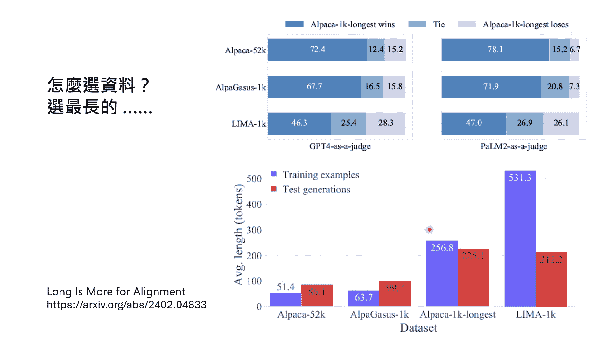

那这边还有一个问题，还有一个盲点，我们要做knowledge distation，那你需要有一些问题去问老师模型，这个问题要从哪里来呢，怎么挑出关键的好问题来问老师呢。

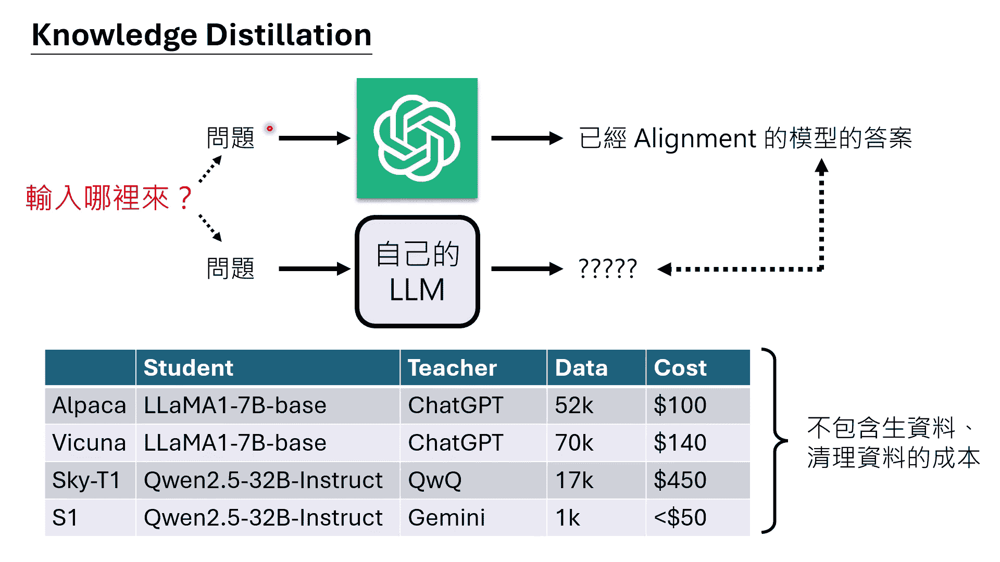

那我们实验室谢俊成同学发现，说那些问题根本就不重要，我们做了一个这样子的实验，从那种网络上爬下来的资料集里面，随便选一个句子，把这个句子的后半段截掉，只保留前半段。

直接把前半段丢给CHEGBT跟你自己的模型，那也是问说前半段会是一个问题吗，不会是它甚至是一个不完整的句子，把前半段呢丢给CHEGBT，让CHEGBT自己做文字接龙，把后段半段接出来。

它接出什么就是什么，把这个chg p t接出来的内容当做模型，要学习的对象，模型就学习CHEGBT截出来的内容，你可能会想到这输入甚至不是一个问题呢，那这样子的alignment的方式有用吗。

先给你看一下在这个work里面，我们用的训练资料长什么样子好，所以这个是输入给CHEGBT的上半句话啊，这个是原始的下半句话，那我们在训练的时候，并不会用到原始的下半句话。

而是叫cheer pg p t去做续写，他就把这个句子继续写完，这个就是我们模型的答案啊，或是这是另外一个例子啊，这个句子是有一个人叫DAVIS，然后呢他最近呢成为一个晨间主播。

she is scheduled to啊，他计划做什么呢，那原始的下半句是呃，Start from january second，那CHEGBT的续解就是begin her new role。

Despite the reason arrest，那总之就是把句子确GPT做的事情，就是把句子写完，我们就直接拿这个资料来训练模型，这种乱七八糟的问题，跟看起来根本不像是答案的，答案到底有没有帮助呢。

非常有帮助，我们来看一下实验结果啊，那最左边呢是base model啊，如果我们拿metro7B啊当做base model，而MITCHELL7B在还没有做fine two的时候。

它在n t bench上的分数是3。73，那如果我们只是把网络上找到的句子，直接切成两半，前半段当做输入，后半段当做正确答案去训练metro7B结果更差，比没有做alignment还要更差。

就代表说网络上的那些资料，没有什么神奇的东西，但是有趣的是，如果后半句话是g p t four续写的，一把GPT four续写的内容当做答案，再去fight two模型，模型能力突然暴增。

从三分进步到7。3分，这个分数比mistral官方释出的instruction的模型，得到06：84分还要更高，所以我们拿莫名其妙的资料直接去find you，MCHO的base model。

比MCHELL自己用base model翻you出来的entruction model，得到的分数还要更高，同样的实验坐在拉马上也有用啊，这个坐在拉玛38B上，拉玛38B的base model。

ani bench分数是5。5分，instruction的model是7。86分，那如果你用我们的资料，那些莫名其妙的资料来find you lama3base的话，你可以得到七分。

然后如果你从instruction model再继续find you，你可以得到7。97分或8。2分，甚至比原来的interruption model还要更好，那在更大的模型上，拉A三七十B上也有。

用拉马374B什么都不做，才2。7分，intrction model是8。6分，如果用莫名其妙的那些资料来fight to的话，其实B的模型可以进步到八分。

如果从instruction model开始find to的话，可以进步到九分，所以那些资料甚至不是一问一答的资料，但神奇的事情是，他对于alignment非常有帮助，好为什么这些甚至不能够算是答案。

甚至不能够算是问题跟答案的资料。

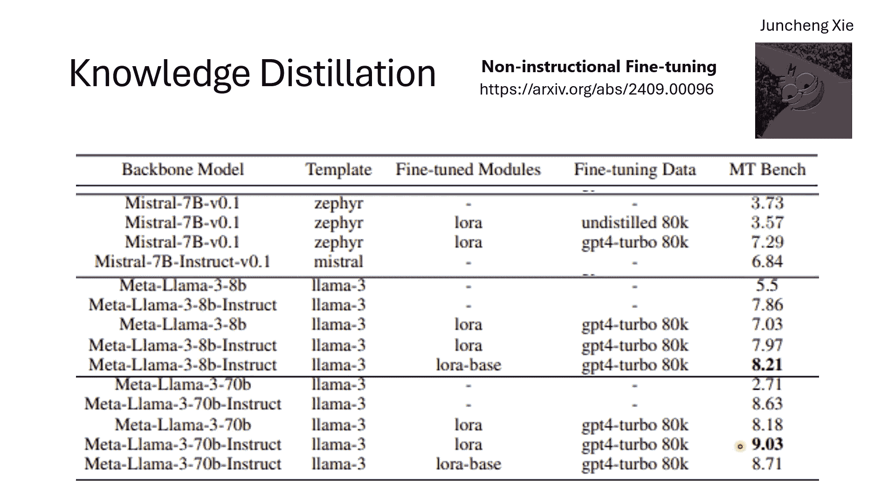

对alignment有帮助呢，这边引用另外一篇，其实稍微早一点的论文来解释这个现象，为什么这个只要拿怪怪的资料，alignment其实就有可能有好的结果呢，因为其实alignment前后。

虽然你觉得模型的答案好像很不一样，但是模型实际的行为也许差异没有这么大，在这篇论文里面就做了一些分析，他们想要分析一个语言模型，在ALI前跟ALI后他们的行为差异有多大，那怎么判断一个模型。

怎么比较ALI前跟ALI后模型的差异有多大呢，那先给ALI后的模型一个未完成的句子，比如说how are you，问号i am啊，这个模型呢可能就输出five，那实际上模型输出的是一个几率分布。

那fight可能是几率最高的一个token，接下来把同样未完成的句子，丢给alignment前的那个模型，接下来会分成三个状态，第一个状态是，如果alignment前的模型输出的几率分布。

fine也是几率最高的token，那这种状态叫做on shift，那如果find这个token呢，他的几率排名是所有token的第二名或第三名，叫做marginal，就代表有一点点的变化。

那如果fine呢不在前三名的话，那就叫做shift，代表说现在alignment前的模型跟alignment后的模型。

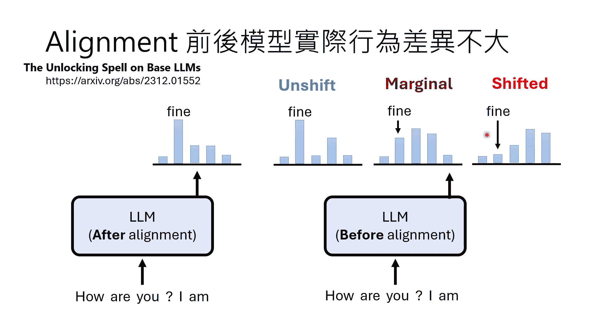

他们的行为有很大的差异，那我们先看一个论文上的例子啊，在这个论文里面就先举了一个例子，他说假设你问一个align的模型，哪一种品种的狗是最小的狗啊，那align模型当然可以回答你这个问题好。

但是他回答的这个答案，跟ALI前的模型差距有多少呢，蓝色的词汇，蓝色的token代表是on shift的，token代表说ALI，前后模型都觉得这个token就是几率最高的。

marginal代表几率只变了一点点，只有shifting才代表几率有很大的变化，那你会发现说几率有很大变化的那些词汇，其实都是一些比较像是连接词的词汇，或者是打招呼的词汇啊。

比如说这个align的模型，一开头他会说，Thank you for asking，那现在模型很喜欢开头讲这种话吗，啊但是PRETRAIN的模型它可能就不知道，开头要先感谢人类。

那online的模型才知道开头感谢人类，所以有一些地方确实，align的模型跟没有align的模型，他的行为有很大的差距，但是有很大差距的地方，好像都是一些连接词的地方。

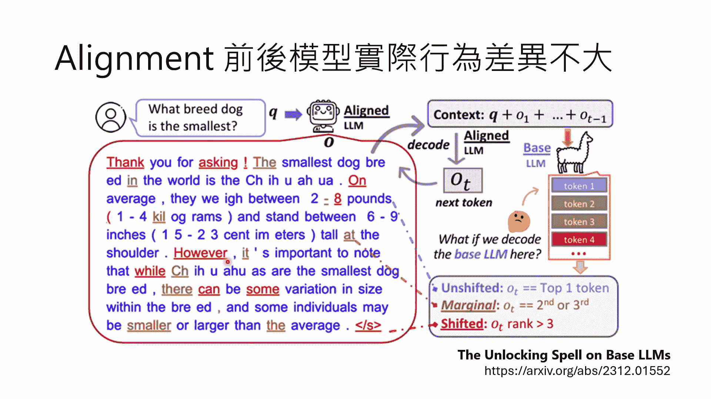

那这篇论文也做了比较完整的统计，他们比较了lama two7B的base，模型跟chat模型之间的差异，lava two7B的模型跟VIKA的模型的差异。

还有metro7B的模型跟metro7b intro的差异，那这边分别展示了当模型在回答问题的时候，有多少比例的token是on shift，多少比例的token是marginal。

多少比例的token是shift，所以发现说比较online前后的模型，shift token的比例非常非常的少，就代表说模型在align前后，他的行为其实是没有那么大的变化的，那你可能会问说。

为什么答案看起来那么差那么多，行为也没有很大变化，为什么答案差那么多，那你知道这个模型做文字接龙的时候，就是一步错步步错，中间有个地方错了，那接下来接的东西就会非常的不一样。

所以实际上虽然online前后看起来答案差很多，但模型的行为并没有非常大的差距，那是哪一些token被shift的呢，如果我们看这些token的分布。

你会发现说多数被shift的token都是一些连接词，而且你会发现说啊，这三个case里面都有代表结束的符号，代表说模型在ALI前后，它会不会输出结束符号，这个token的能力倒是差异蛮大的。

那等一下会再用到这个概念，好像我们已经知道模型ALI前后。

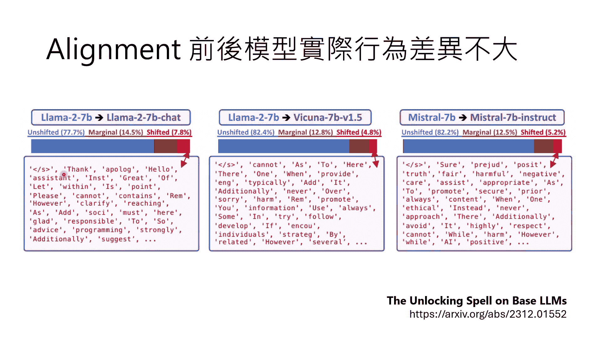

他其实真实的行为没有那么大的差异，所以也许ALIE其实是一件容易的事情，那有一篇paper就做了这样的尝试，他说一般呐我们做align的时候，你都要有一个问题，有一个答案。

这个叫instruction tunney，我们能不能没有问题，只有答案，既然ALI前后真正的差异，可能只是某几个词汇输出几率的差异，会不会根本就不需要想问题，直接叫模型学习，产生某个样子的答案。

就可以展现align的能力了呢，这篇paper确实发现，他们把他们这个方法叫做response to y，就只拿答案来find to模型的输出，不给模型问题，他们发现response tuning。

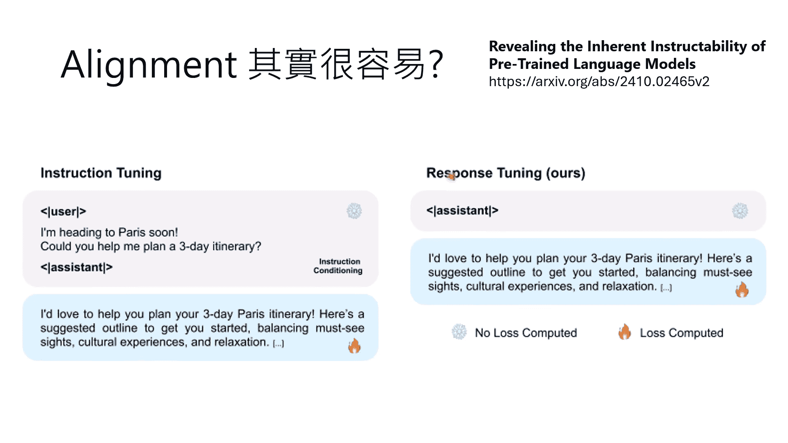

居然是一个蛮有效的方法，左右两边的图分别是两个不同的base base model，左边是拉玛3。18B，右边是ja two9B，那最右边的这个bar。

代表的是没有做过fine tuning的base model，然后这边不同的颜色代表使用者的接受程度，他们这个是直接找人来打分数的啊，深蓝色代表使用者觉得这个模型的答案好，然后浅蓝色代表还可以。

那浅色浅灰色代表模型的答案是不能接受的，那你发现说在有fight to之前，那个base model它的答案都是人类不能接受的，但是一旦有fight to之后，一旦有alignment之后。

不管你是用instruction的fine tuning，就是有一问一答这样的资料，还是做response to unity，他们这边缩写叫做RT，就只教模型产生答案，根本没给他失误的问题。

居然只给模型答案，也可以得到很不错的结果，但看起来只给模型答案，还是比instruction tune还要稍微差一点，但你可以看多数的状况，用L8A的资料，用兜里的资料，这也是某一个资料集。

还有用LIMA的资料，在两个不同的模型上，都可以用response tuning的方法，让模型只学习产生答案，根本没给他问题，就可以得到不错的alignment的效果。

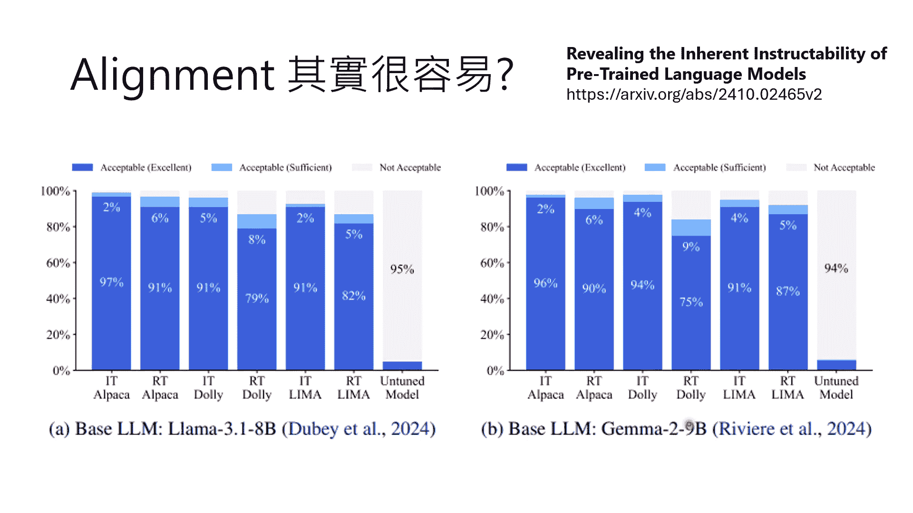

那其实这个response tuning的发现了一个，稍微早一个月的这个paper里面就也已经发现了，有一篇paper呢叫做instruction following with without。

Instruction tuning，他也发现了alignment其实很容易在这篇paper里面，作者试了三个方法，第一个方法就是response tuning，那第二个方法呢是只教模型。

一个任务发现模型有非常强的举一反三的能力，那我这边要讲的是最后一个方法，最后一个方法他们是说，既然online前后真正的差异只是某些token的差异，我们能不能就直接改那些token出现的几率就好。

连FTUNE都不find to，直接改token输出的几率，会不会就可以让没有align的模型。

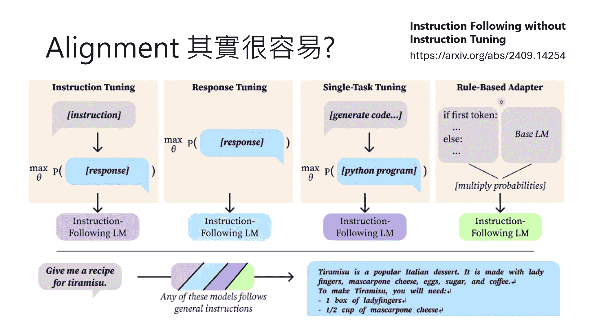

它的表现类似alignment的模型呢，所以他们就定了三个规则来改变，没有align的模型，它输出了token的几率，第一个是改结束符号的几率，因为刚才发现说啊有没有align模型，其实差距最大的。

在所有不同状况里面都有差的，就是会不会产生结束的符号，没有align的模型，一个最常见的镜头啊，就是它很容易讲话，讲不停不断的暴走，不断的反复说他已经说过的话，那就是因为他一直不产生结束的token。

所以他只好一直讲下去，但是有ONALIGN模型，他比较知道什么时候应该不要再讲下去，所以这篇论文的第一个规则就是，既然现在没有align模型，它的问题就是讲话讲不停啊，那就增加结束符号的几率。

而且随着答案越长，结束符号的几率就增加越多，所以这第一个规则，而第二个规则就是手动改变一些符号，出现的几率，有某些词汇，比如角括号啊，i will wash啊，几率改小一点，这些符号几率改大一点好。

最后一个呢就是没有align的模型，很容易讲他前面已经讲过的话，他很容易反复讲一样的内容，所以怎么办呢，呃就给他一些penalty，就如果讲重复的token输出，重复的token。

那重复的token几率就比较低一点，强制手动设计了一些规则之后，是什么事都没有做，没有FQ任何模型没有改参数，只是强制增加了一些规则以后。

本来base model如果跟instruction model比，他们这些是把base model跟intrction model答案拿去评比，然后用的语言模型去评说，哪一个模型的答案是比较正确的。

那原来的base model，他赢过intro model的几率只有2percent左右，但他完全是被intrction model吊着打，但是当把这三个规则apply上去以后。

今天这个base model居然有24percent，将近14的几率可以赢过instruction model哦，所以加上这几个规则以后，base model它的输出突然就起飞了。

就变得跟instruction model有点像，可以有跟instruction model1战的能力，然后没有尝试拿掉这三个规则，发现这三个规则都是有用的，当然只凭这规则是没有办法真的做的非常好啦。

但真paper就是告诉我们说，就算没有FITO模型，光凭这一些规则，他也可以做出一个看起来还不错的模型，所以看起来alignment做的事情并没有那么多，alignment很容易这件事啊。

就解释了为什么self alignment，这个技术是有可能可以成功的，那self alignment，有很多paper都提出了self alignment的想法啦。

那我想最有名的就是去年年初的self rewarding model哦，这个是meta的paper啊，这篇论文讲的是什么呢，他提出了一个乍看之下很神奇，但仔细想想。

如果你知道说alignment其实很容易，就不会觉得这个方法很神奇的一个技术，这个技术是这样做的好，他们不用alignment的资料，他们希望没有alignment的模型。

可以自动alignment怎么做，他们先问模型一个问题，让模型产生多个答案，y one y two y3代表三个不同的答案，把这些答案呢都拿去给模型自己评分，那当然你可能会需要提供给模型一些指示。

那不同的论文提供的指示不一样，你可能会定一些规则，告诉模型说什么样的答案是好的，什么样的答案是不好的，那模型给予三个答案评分，然后再拿这些评分。

对没有align模型做reinforcement learning，然后就反复这个过程数次，那这个模型能力就突然起来了啊，也不能说能力起来，就说这个模型。

突然之间看起来就像是有做了alignment一样好，但是如果你了解说从没有alignment变成有alignment，中间的变化其实没有那么大，你就比较容易想象说，为什么只给了一些评分的指示。

就有办法把模型从没有alignment的样子，变成有alignment的样子好，所以我们知道说，其实alignment并没有对PRETRAIN的模型造成，非常非常大的变化。

所以今天之所以alignment以后模型能力很强，是因为PRETRAIN非常的有效，在PRETRAIN的时候，模型已经学到很多事情，但是要怎么样才能够做出alignment之后。

有效的PRETRAIN模型呢，那这篇论文就提供了一个思考的方向，那这篇论文是一整个系列中的第三篇，这个系列叫做physics of language model哦。

就是现在很多人都在study language model，但是有关language model完整的观察跟理论都非常的少，所以这这篇论文的作者是希望建构language model的，物理学。

先透过大量的观察，尤其是现在呢，一般你都从网络上随便拿一个language model，别人劝好的来进行分析，这些language model training过程中到底发生了什么事，你无从得知。

所以这群作者呢，他们的language model都是自己train from scratch的，他们都是自己SYMPASIZE资料，自己训练模型。

希望能够控制整个language model训练的过程好，这是physics of language model的研究好，那这边就是引用他的part three point one啊，在这个研究里面。

他们想要知道什么样的retrain才会有效，才能让alignment后有强大的能力啊，他们先制造了一大堆人的呃简历，他们就仿照那个wiki上我的风格，就创造了一大堆人的简历，但每个人只出现一次啊。

比如说这个艾因是买购的吉他手啊，同时也是羽秋女子学园高中一年级的学生，还有登也是羽丘女子学园高一的学生，是天文部唯一的社员，然后是买购的主唱，而有这样的普券资料以后，去present出一个模型。

接下来呢，他的普片资料里面包含了N个人的资料，N个人的咨询，然后接下来把这N个人里面的，二分之N个人拿出来，制造一些可以做alignment的问题啊，比如说把艾因拿出来，然后呢你就制造一个问题。

说谁是买go的节奏吉他手啊，答案就是爱因，那你就拿这个资料再去微调模型，得到一个可以回答问题的模型，那接下来呢把没有用在alignment里面的人嗯，自创造一些问题以后去问alignment之后的模型。

比如说登的资料没有出现在alignment里面，就拿灯的资料来创造一个问题，比如说问谁是买购的主唱来，可能会想说，虽然在alignment的时候没有看过灯相关的资讯。

但PRETRAIN的时候已经知道灯相关的资讯了，那模型既然会回答问题的话，他应该可以知道它应该可以回答出，买够的主唱就是灯吧，但你会发现模型是没办法回答这个问题的，它的正确率是零。

percent在这个任务里面，它正确率是趋近于零，那明明在PRETRAIN的时候就已经看过了，alignment的时候也学过类似的题型，为什么在测试的时候没有办法回答呢，为什么没有办法回答呢。

好这个作者其实做了一个分析啊，这个分析是这样子的，他们有分析模型的行为，那细节我们就不讲，留给大家自己看论文，他们发现说啊，假设在你的PRETRAIN资料里面，每个人只有出现一次模型。

对于这个普TRA资料会有巨大的误解，比如说对他来说，有关高松登的资讯，就是她是羽丘女子学园高一学生，是天文社的一员，是买购的主唱，你以为模型可以学到高松灯，他是读什么学校，他参加哪一个社团。

他是买购的主唱，因为他可以学到这件事，其实不是模型学到的事情，是有一个东西叫做高松灯，而且是羽丘女子学园高一学生，而且是天文部，这这些东西合起来是一个entity，她是买购的主唱，所以但是你仔细想想。

你从语言模型的角度来思考，他是怎么学习的，他会这样学到这样子的结果也没有很奇怪，因为语言模型在PRETRAIN的时候，他唯一学过的东西就是文字接龙，他根本不知道灯是什么东西，对他来说。

他学到的是有一个这样子的东西，是灯，又是高一的学生，又是天文部的这个东西，这样全部的资讯合起来才是买购的主唱，那高松灯不是买购的主唱，这些东西合起来才是买购的主唱。

所以他对一个人的资讯是有非常大的误解的，这是为什么他没有办法回答谁是买go的主唱，但是如果今天呐同一个人的资讯，有各种不同的介绍方式，就比较有机会让模型正确地理解，这个人相关的资讯哦。

所以你可能有另外一个介绍，另外一个介绍，其实内容差不多，只是词汇的顺序换了啊，先说高松登是买购的主唱，再说他是羽丘女子学院高一学生，再说他是天文社的一员，这个时候模型就知道说。

原来高松登他是一个entity，他有什么性质，他可能是买购的主唱，他可能是某个学校的学生等等哦，所以我们发现说同样的资料，同一个人有很多不同的介绍方式。

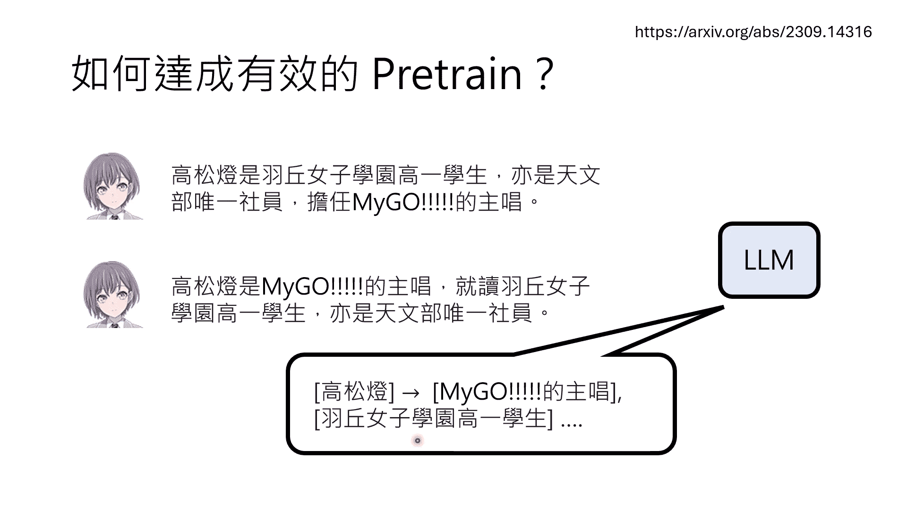

其实对于普train是一件重要的事情，而对于真实的普TRA来说，真实的普TRA通常就是拿大量网络上的资料，来训练，那高松登的资料你可以在wiki上找到，但你也可能可以在萌娘百科上找到。

他们介绍可能是有一点不一样的，所以同的人，你确实可以找到各种不同版本的介绍，那在这篇paper的实验里面，他们就试着去产生了同一个人不同版本的介绍，再拿去做PRETRA，然后做alignment的时候。

只有拿某二分之N个人的资讯，拿来制造alignment的资料，问问题的时候，测试的时候问剩下另外2N个人，lemon没有看过的人，他的相关咨询，这个时候模型就可以正确地回答问题。

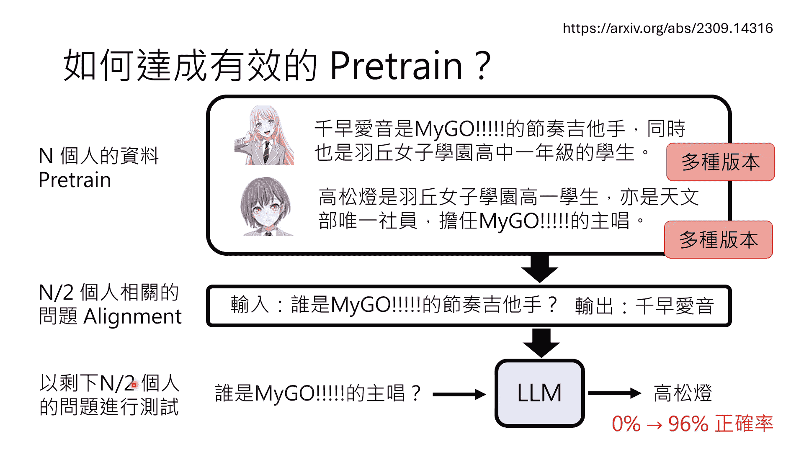

而且有非常高的正确率，而这篇论文还有另外一个发现，他发现说不需要所有的角色，都有多种版本的介绍，只要训练资料里面，只要普券资料里面有一些角色，有多种版本的介绍就够了，比如说爱因的资料有两种不同的版本。

模型就足以学到说艾因是一个人，他有这样子的性质，而看过艾因有各种不同的介绍，可以让模型的思维，但这个是用比较拟人化的想法，就模型的理解，模型对世界的理解就变了，他就知道说原来不是一大段的东西。

才是一个entity啊，原来爱因这样是一个名字啊，他原来可以有不同的性质啊，原来我要这样理解一段文章，所以就算高松登的介绍只有一段，只有一个版本，模型也可以正在PRETRAIN的时候，正确解读说。

主卖购主唱跟羽秋女子学员是高松登的性质，所以在培训的资料里面，你只要有部分的empty有多种不同的版本，似乎就足以让模型在PRETRAIN的时候，可以学到更泛用的知识，可以强化模型理解的能力好。

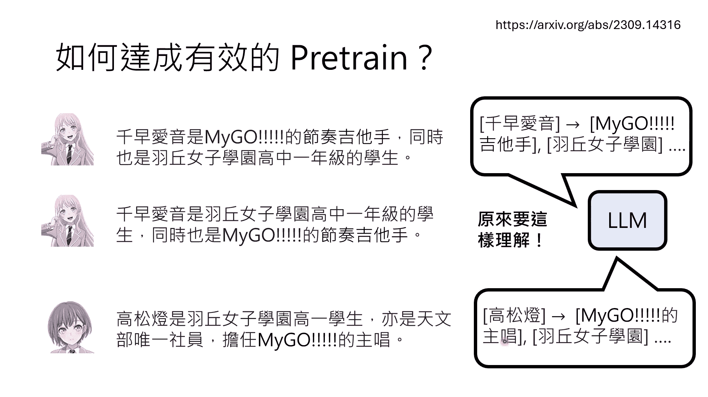

所以他们的实验结果就是假设在N个人里面，只有某一些人，他的介绍有多个版本，那如果没记错的话，应该是指他们只加了1/10哦，只有1/10的人，他的介绍有多种不同的版本。

那接下来呢你在做alignment的时候，只拿那些有多种不同版本的人的资料，去制造alignment的资料，然后在做测试的时候，其实也可以得到80percent左右的正确率。

那这边是放了一个大约的数字啊，因为在paper里面，其实他们尝试了非常多不同的setup，包括训练了各式各样不同大小的模型，得到的结论都是一致的，所以我们现在知道什么样的普片资料有效。

就是同样的东西要有多种不同的版本，也就是多样化的资料对于PRETRAIN是有帮助的，但你不需要所有相关的资讯，所有的knowledge通通有多样化的资料，只要有部分的knowledge。

有多样化的资料可能就足够了，当然需要大量的资料来PRETRAIN。

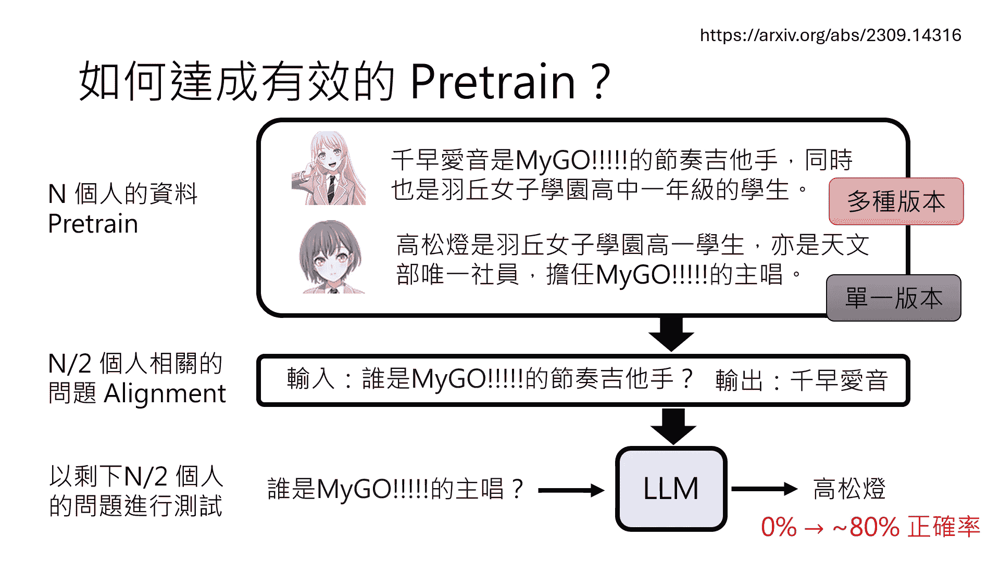

也不是什么新闻啊，这个大家早就都知道了，那其实在2023年的机器学习，已经花了很多时间讲了大资料的重要性，那大家如果有兴趣的话，可以看看过去的这个上课录影，你还是可以学到很多东西好。

那现在啊这个时间点，PRETRAIN一般都用多大的资料吗呢，我们来看看最近几个比较知名的模型，PRETRAIN用了多少资料，lava3普圈用多少资料呢，用15T个token，DC v3用了多少资料呢。

用14。8T个token哦，所以现在一个好的pretrain model都需要大量的资料，那这个资料多到什么地步呢，多到已经有人担心，会不会网络上所有可以取得的资料，已经要被用尽了。

那伊利亚呢甚至在NEURISE给的一个talk，也提到了这个概念，农场文呢很喜欢讲这件事情啊，这个呃过去其实在22年的时候啊，哇这个是还没有CHEGBT的时代啊，这个史前时代就有人讨论过这个问题。

那可能想要史前时代，他怎么知道拉玛三这个数据是那个同一篇paper，他后来再补上的，但这篇paper最早呢放到arcs的时间是22年的，11月是史前时代啊，史前时代就有人开始担心说会不会这个啊。

现在训练语言模型，很快就要把网络上能够用的资料用尽了，好那这篇paper里面讲的内容是什么呢，这个纵轴啊指的是token的数量，横轴指的是时间，那这个绿色的这个线呢，代表的是网路上大概有多少token。

他们去估计了一下网络上可能有的token，再推测了一下未来token可能增长的数量，得到了绿色这条线，但这个估计它是有一个range的，因为他这个估计不可能太精准，他们的估计方法。

其中一个就是看这个在做google search的时候，你打某一个关键字可以搜寻到多少文章，然后再反推说，这个关键字在一篇文章里面出现的几率，大概有多少啊，假设呢呃某一个词汇。

那在google search的时候可以搜寻到1万篇文章啊，这个词汇呢在1万篇文章里面会出现一篇，那你就知道网络上的文章是1万×10000，那你就可以估测说网络上大概有多少个token。

他们是大概这样估算网络上的token的，然后这个蓝色的线呢是他们预估，未来在训练的时候需要用到多少token，那这个虚这条线是怎么估算出来的呢，是参考两个数据啦，一个数据是现在在训练模型的时候。

用到多少token，还有大概或者大概人类可以制造出，在未来几年可以制造出多少的算力，把这两者平均以后得到的数值，然后最后呢会被这个token的数数量所蚌得住，因为在网络上可能找不到更多token了。

所以你想要做更大的训练，可能也没办法了啊，就是我们人类呢需要token的数量，比网络上token的数量增长的还要更快啊，当然现在啊这个15T的token，相较于整个网络上有的资料。

其实还是有一大段距离啦，你看这个距离你不要看很近，这个是log scale啊，所以现在用的资料大概是网络上有的资料的呃，一1%吧，好但是呢如果你看lama two呃，la two用了1T多的资料。

la3用了15T的资料，一年之内增长的速度是十倍，那网络上的token的数目的增长没有十倍，所以大型语言模型所用的训练资料，可能很快就会追上网络上所有token的数目，那这篇文章的估测是。

大概在2028~2030年，我们就会用尽网络上所有能够训练的token，他还估测了另外一个数值，这个另外一个数值是这样，他假设人类可能会OVERTRAIN你的模型。

所以OVERTRAIN模型的意思就是说，本来如果你的算力有限，那你的模型如果越小，你会用的训练资料就会越多，因为你的算力是固假设算力是固定的，模型小，你就可以放比较多的算力在增加训练资料上面，然后呢。

假设说未来大家会想要开发比较小的模型，因为看现在其实现在的趋势就是呃，虽然有人会开发大模型，但你真正能用的其实小模型，你在作业里面，你是不是都扣不了70B的模型，你主要扣的都是7B的模型。

事实上在一般笔电里面，7B模型还是太大了，在笔电上跑7B模型是有困难的，所以其实现在开发的一部分面向，已经走向开发小模型，而不是开发一个真正非常大的模型，而假设说人们想开发小模型。

然后把算力投资到使用更多的训练资料上，那资料用尽这件事呢会比我们想象的更早到来，可能会在2028年之前就来到，训练资料用尽的状态啊，不过这个就是一个对未来的预测了。

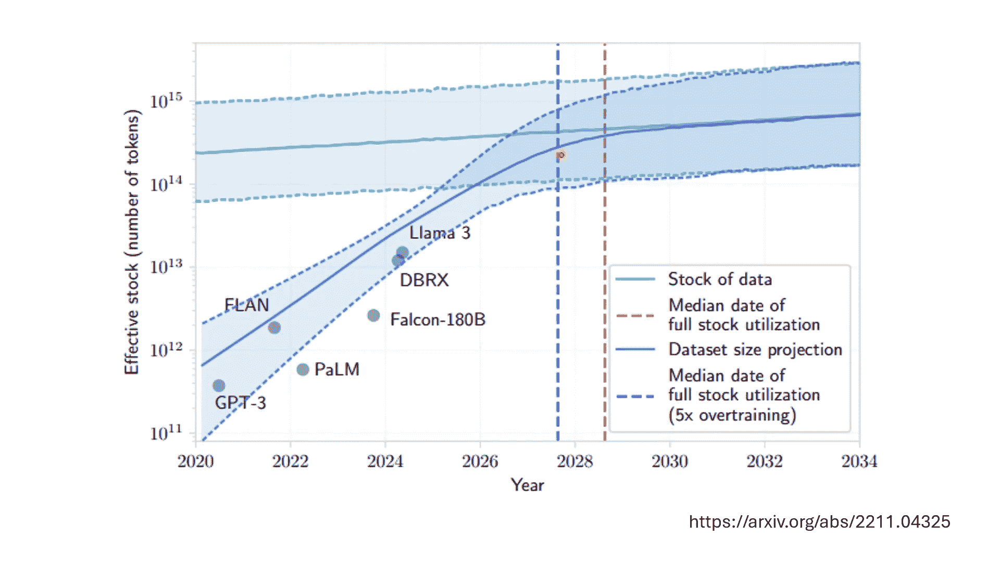

好那你可能会想说，拉马3DCV3都用了15T的资料，我上哪里去找15T的资料呢，我告诉你，现在15T的资料是唾手可得的，因为hacking face试出了一个资料集，叫做fine web。

这个资料集是他们爬了网络上的资料以后，经过清理得到的，也正好有15T个token啊，但15T了，所以现在15T的token每个人手上都有，你差的只是算力而已，你没有办法算。

这么你没有办法做这么大规模的计算好，所以如果假设你有算力，要创一个有15b token，用15B的token来训练模型的话，其实资料已经在这里了，hacking face已经试出你可以用的资料了。

而刚才讲说呢，hacking face花了很大力气去清理资料，因为资料的品质是非常重要的啊，有一篇论文叫做textbook，are all you need啊。

这是MICROSOFT他们打造翻系列的其中一篇论文啊，这篇论文是说他们发现PRETRAIN资料的品质，对于模型最终的能力有非常大的影响，那他们试了三个资料的来源，第一个资料来源呢是网络上爬的一些资料。

他们主要是想要训练可以写城市的模型，网络上爬了一大堆的城市，另外呢第二组训练资料是这个啊，城市语言的教科书，第三组训练资料是城市语言的教科书，后面还附上习题，那么就训练了三个不同版本的模型。

那在三个不同case都用一样量的训练资料，那会发现说用教科书加上后面有习题的，这种资料，训练出来的结果是最好的，这个纵轴呢是在城市的资料集上，回答问题的正确率，那数值越高代表结果越好。

但是这边呢有一件事情是呃，大家不常看到这个结果，不常提到的，就是你想你可能会问说这些教科书哪里来，这些教科书其实是GPT3。5升的，就它不是真正的教科书，是这篇paper呢是叫GPT3。

5去写一些语言模型，幻想出来的教科书，再拿去训练翻，所以这篇paper呃不完全可以告诉你，Textbook is all you need，所以这篇paper并没有办法完全验证说。

如果只要你的资料像是教科书，就可以增强模型的能力，在PRETRA的时候很有用，它也有可能会这么有用，是因为这些文字就是CHEGBT生出来的，用CHEGBT生出来的文字，特别能强化模型的能力。

我们刚在讲lemon的时候，有看到说确GBT随便讲点什么，你的模型跟他讲一样的，你的模型能力就突然之间暴涨了。

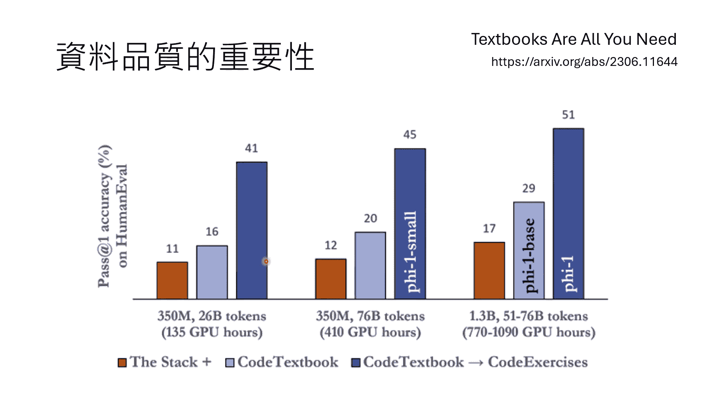

好这是另外一篇，这是apple的paper，那今天paper的title呢叫做refreshing，the web那种，他抬腿可以猜到他在做什么，他做的事情就是从网络上搜寻到的资料。

从网络上扒下来的资料往往太脏了，所以他们先用一个rephrase的model，这个模型呢会换句话说，那么用的其实MIXTRO7B啦，有一个可以换句话说的模型，把网络上的这一些文章改写一下。

改写成比较容易读的，然后再把这一些改写过的文章，加到普TRA的资料里面再去训练，他们发现加上这些改写过的文章，这些改写过的文章，他可能内容比较干净，他可能用字遣词比较不奇怪，他可能是人类比较容易读的。

这样子的资料比较适合拿来训练模型好，那右边就是实验结果，那纵轴呢是模型的表现，分数越高代表模型表现越好，横轴是指用了多少的token，不同颜色的线代表不同的资料集，那它们之间比较的对象有c four。

还有这个应该是这个应该是那个refine web，这个refine web跟刚才那个哈根face的翻译web，其实不同的东西，但是不同团队做的只是取的名字有点像而已好，那他就发现说啊。

如果在同样token数量的情况下，又有改写过的PRETRAIN资料，来训练模型是比较有效的，如果要达到同样的正确率，那又没有改写过的资料，那你需要花另外三倍的资料量，才有办法得到差不多的能力哦。

所以告诉我们资料的品质是很重要的。

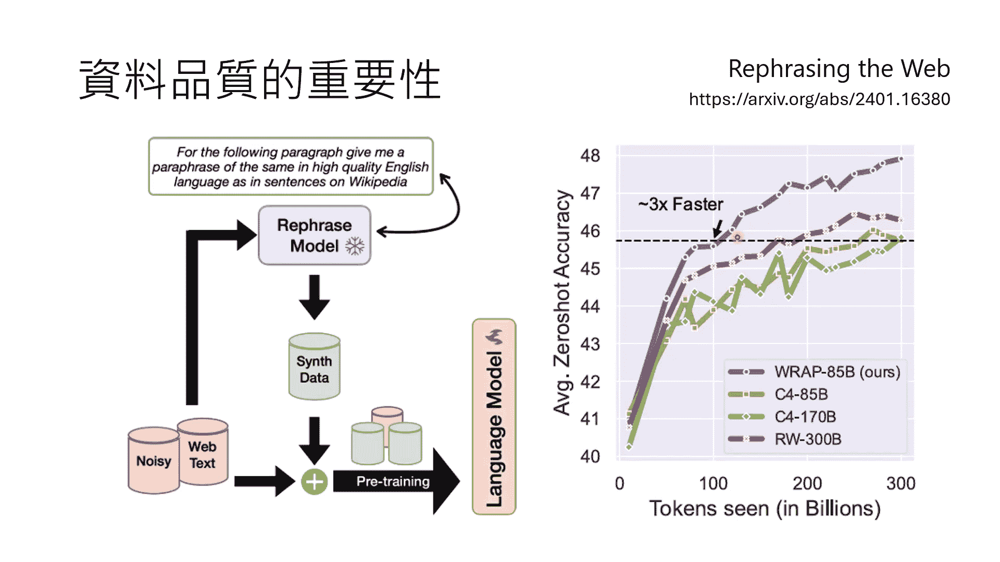

所以今天呐你如果要PRETRAIN模型的话，直接从网络上查到的资料往往没有办法直接用，你需要经过多个不同的步骤进行清理以后，才能够拿到真正可以PRETRA模型的资料。

那那这张图呢是引用自一篇叫做refine web的paper，那这篇paper里面就是讲说他们怎么打造了，focus这个model，那他们用的资料清理的过程就放在这个图里面，那你会发现说。

原来他们是使用一个叫做common CORE的资料集，这是一个从网络上扒资料的project，他们用这个从网络上扒资料的project，里面爬下来的资料，经过诸多清理，最后只保留了大约1/10的资料。

来做语言模型的PRETRAIN，那在这个训练的过程中啊，你会发现有好几个步骤都是在去除重复的文章，比如说replication，Removal，Fy deduplicate。

还有exact deduplicate，都是为了去除掉重复的文章或者是重复的段落。

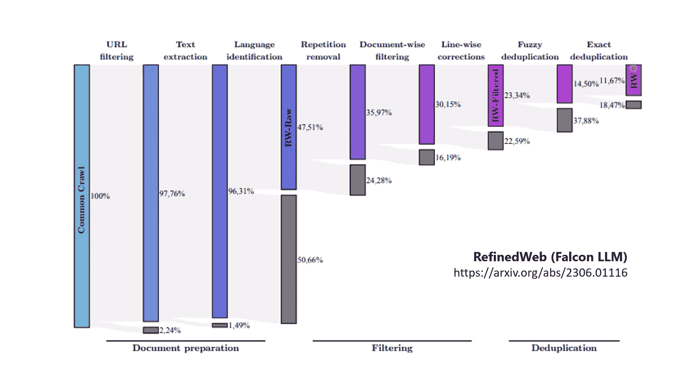

那为什么去除重复的文章，重复的段落是一件重要的事情呢，因为已经有文献发现说，假设在固定的算力，固定模型大小的情况下，那你应该要尽量让你的模型看不同的资料，因为有的会想说到底应该让模型看一样的资料。

但是不断地复习，强化他在同一组资料上面的理解，还是让他尽量看不同的资料呢，那这篇论文告诉我们，你应该尽量让模型接触各式各样不同的资料，而不是让他反复看一样的内容好，那这篇论文呢是这篇。

就是引用那篇论文的一个实验结果，横轴代表所使用的PRETRAIN的token的数目，那纵轴呢是PRE是一个这种类似perplexity loss啊，反正纵轴的值是越小越好。

那虚线代表的是你不断的让模型看不同的资料，都不重复哦，所以这边所谓的1。2T指的是1。2T，完全不一样的token，如果你让模型看不一样的token的话。

它在testing data上的loss会呈虚线这个状态下降，但是如果假设你全部的token数目就只有12B，你全部只有12个billion token，那你这样模型反复看一样的token。

反复看一样的token会发生什么事呢，当模型看到四次token以后，当模型反复看四次一样的token以后，当他同样的资料看到第四次以后，你就会发现有看重复的资料，跟没有看重复的资料开始有显著的差距。

当模型把同样的资料看超过40遍以后，他基本上就不会再有能力的增长了，所以今天你需要尽量让模型看不同类型的资料，看不同样子的资料，那在其他的模态上，其实结论也是一样的。

那这个实验是我们实验室刘庭伟同学做的实验，那么实验室主要是做语音相关的研究了，所以这边做的是语音的模型，那跟文字的模型其实也很多地方很类似，就是你可以PRETRAIN一个语音的模型。

然后把它翻Q在各式各样不同的语音任务上，那这边比较的就是假设在固定算力的情况下，我们到底应该要把960小时的资料看一遍，还是一个小时的资料看960遍呢，那结果是非常显而易见的。

越深色就代表说模型看得越多，资料越浅色，就代表模型反复看了越多同样的资料，那上面是在某五个任务上面的表现，那上面五个任务都是数值小越好，下面这五个任务都数值越大越好，但是什么任务在这边也没有那么重要。

反正就是模型看过越多不同的声音，他的表现在下游任务上面的表现就越好，而如果模型太长，反复复习同样的输入太长，反复复习他们的pretrain data对模型是会有伤害的，好。

那我们刚才讲到说focus那个LLN，它有一个非常复杂的data filter的pipeline，那你可能会问说，那什么样的data filtering的过程才是有效的。

对PRETRAIN完在LY后的模型是有帮助的呢，对PRETRAIN模型是有帮助的呢，那我告诉你HuggingFace啊，那个find web那个计划，他们有一个blog里面就告诉你。

怎么样过滤资料是最好的，而且他们过滤资料的方式不是那一种脑洞一开，觉得嗯这个方法应该好，而且告诉你这个方法好，他们每一个步骤都是有做实验的，就在某一个步骤有三个不同的方法可以决策哦。

三个不同的方法都试一下，告诉你哪一个方法，最后PRETRAIN出来的模型会是最好的，而且他们不是只看PRETRAIN模型的perplexity，他们是看这个PRETRAIN的模型，如果用在下游任务上面。

在好几个大家会关心的任务上面，它的正确率的平均是如何，他们是用这个方法打造了find web这个资料集，让他们很自豪的地方，就是在同样token数目下，翻译web是比其他的资料集都还要好的，好。

比refine web好，也比c four好，c four是那个GPT3用的资料，就common pro再经过清理变成c four，Gp t3，就是拿c four来进行训练的，然后不过那是九院的事啊。

那个时候open该还不愿意告诉大家，他们在做什么的时候，现在已经没人知道他们拿什么样的资料来进行，训练了，好那所以总之就是说是过滤资料也是很重要的，如果你想知道什么过滤资料的话啊。

有好心人已经告诉你哪些步骤有用，哪些步骤没有用了，好那最后一小段呢我们要讲alignment的极限，我们已经看到说，alignment主要就是改变了模型书写的风格。

它只是让某几个token输出的几率做改变了，既然如此，那alignment这件事情会不会非常有极限呢。

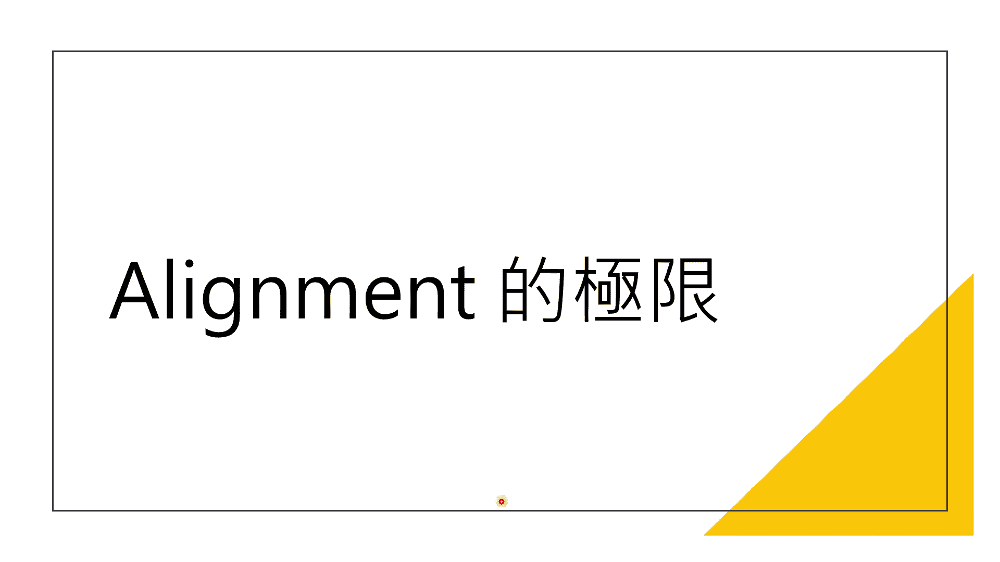

而早在2023年的年初，在古代就已经有人发现alignment这件事情，感觉蛮有限制的，在2023年的年初，那个时候meta呢试出了la one，有了la one以后。

就一堆人去对CHEGBT做逆向工程，又弄出一堆可以拿来训练base model的align资料，去微调拉马one，那一开始很多人都说，你看我这个FITWO过后的模型。

应该有这个g p t four的九成能力呀，有那么多有很多的这种炫耀文，但是过了一两个月之后，就有人写了这篇文章，他发现说这些fighting过后的模型，表面上看起来很强。

但实际上并没有CHEGBT那么厉害，这些模型最常会有的状况就是它输出的答案，TCH起来像模像样，但是内容是错的，比如说这边就是问这一种翻译，to在la one上的模型。

说呃呃actor cricke be reinforce，这个algorithm好在哪里，那他也洋洋洒洒讲了一大堆话，他就列1234加overall，你知道确GPT最喜欢结尾是overall了吗。

所以看起来他就是很能够模仿CHEGBT，这种ALI过后的模型，它的书写的风格，但是红色就代表说这些模型讲的话，这个模型讲的话是错的，所以这个模型他讲错了非常多的内容哦。

所以看起来alignment是有它的极限的，alignment能够对模型的影响是有限制的。

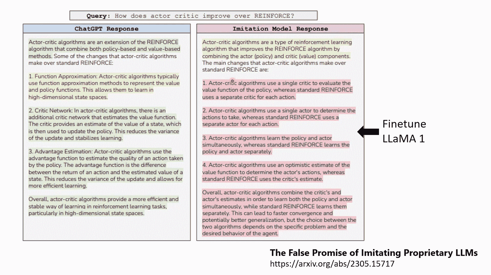

那到底什么事情是可以透过alignment影响模型，什么样的资料是alignment学得会的，什么样的资料是alignment学不会的呢，这篇论文就提供了一个比较完整的分析。

他们把alignment的资料分成四类，第一类是模型本来就会的东西，就你模型，你问模型这个问题，他做grad decoding，所以grady decoding的意思就是，每次做文字接龙的时候。

都选几率最大的那个token模型，回答出来的答案本来就正确，就代表说这笔alignment的资料是模型，本来就可以答出正确答案来的，Base model，没有没有alignment。

只有普圈的模型本来就会的知识，那前面这边呢我特别讲说呃，会放范例问题跟范例答案，是因为说这些base model啊，通常它不太有follow instruction的能力，所以你问他一个问题。

他不见得要回答你，他可能会出四个选项给你或反问你更多问题，所以通常你要这些模型真的回答问题，那你需要前面放一些范例做in context learning，比较容易能够控制它。

真的能够回答你输入的问题好，所以呢能够回答能base model本来就会的东西，叫做highly non的问题好，那有一些问题是呃，用某一组范例问题跟范例答案，base model做规定。

decoding不会得到正确答案，但是换了一组范例问题跟范例答案，就可以得到正确答案了，这种叫maybe NO，就模型应该有这方面的知识，但你问法要问对，你要问对问题，模型才能够给你答案。

base model才能给你答案，第三类的问题叫做weekly NO，Weekly no，就是说今天你问模型问题的时候，他不一定可以给你正确答案，但如果你做simply，你抵扣的时候有直骰子。

每次得到的答案都不一样，有机会让base model得到正确的答案，就base model觉得这个问题有很多不同答案的可能性，所以他需要指一下骰子，才有机会得到正确的答案，这叫weekly NO。

还有unknown，就是你怎么做sample模型都无法答对的，那是模型真正不会的，这种叫做UNKNO，你直觉可能会觉得应该是要UN弄的资料，训练模型才有用吧，这些模型都已经会的知识拿来训练模型。

有什么特别的意义吗，有什么特别的用处吗，但是实验的结果跟人类正常的直觉是相反的。

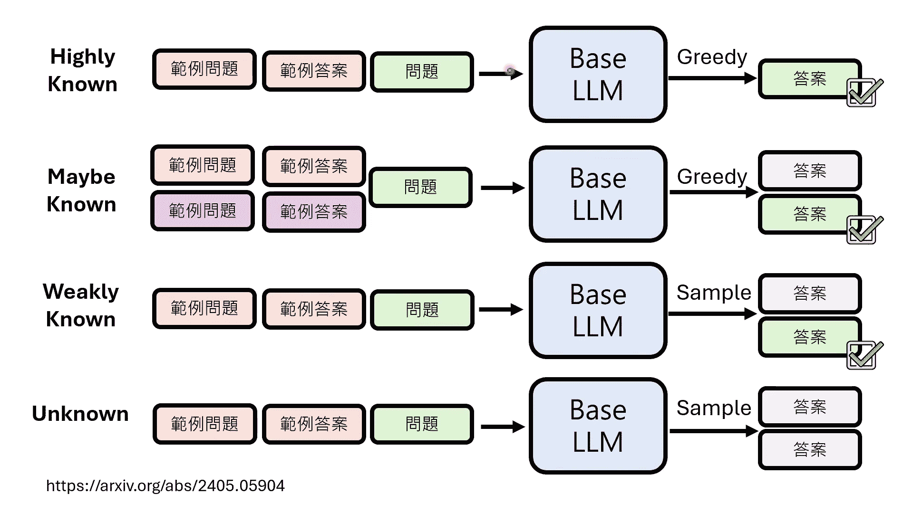

我们来看一下这篇论文的实验结果，这篇论文就是把刚才上述各种不同的资料，全部倒在一起进行训练，但是他们在分析结果的时候，他们把训练资料里面的弄的那一些呃，呃资料跟unknown的资料。

他的诶正确率拆开来看，就你的训练资料里面，我们说刚才说有四类，前三类都算是弄的，最后一类算是unknown的，他把所有资料都倒在一起进行训练，在训练的过程中，他会分析弄的问题，正确率的增长程度。

跟unknown的问题正确率的增长程度，那你发现弄的问题正确率增长的非常快，这也没有什么令人意外的地方，因为这些问题模型本来就会了嘛，所以稍微微调一下，他马上就可以给你正确答案，而unknown的问题。

模型需要一定程度的学习之后，才能够得到正确答案，但是重点来了，在训练完之后，你会把模型测试在development set上训练的时候，没有看过的资料上，你发现当模型呐开始学习这些。

UNKNO资料的时候，就是他在development set上面坏掉的时候了，一开始他都是学这些弄的东西，development set上进步很快，但当他开始想要学这些unknown的东西的时候。

它就开始坏掉了，它在测试资料上的正确率就开始下降，所以看起来让模型学这些，他本来就有可能知道的东西是有用的，但当你叫模型去学那些他不知道的东西的时候，这个时候你反而在破坏模型的能力。

他不止没有学会新的知识，他反而能力是下降的，好在刚才那四类问题里面呢，作者有做了分开的测试，发现说maybe NO哦，就是第二个程度就是你正确的问模型，可以得到正确答案的这一类型的问题啊，是最有帮助的。

那他做了两个不同的case啊，我们就看右边这个右边这个是convert，就是说训练模型的时候，不管development set on performance，就是训练固定的epoch数目。

那它分四个状态来讨论，一个是资料，全部都是highly known的资料，全部都是模型已经知道答案的资料，还有资料全部都是maybe弄的资料，这是模型正确的，问他可以得到正确答案的资料。

还有全部都是weekly弄的资料，模型有时候知道，有时候不知道的资料，还有UNKNO的资料，那最下面这个是把各种资料综合在一起的，结果我们就先不干它，而如果比较这四种不同的资料，你会发现。

如果你只用unknown的资料，这些问题模型本来不会，你以为可以让模型学到最多东西，不是它最烂，然后呢，如果你今天只让模型都学，他会的东西是有点帮助的，但最有帮助的是让模型去学。

那些你要用正确的问法问他，他才答得出来的，就是他本来就知道他只是没有很懂你的问法，那这样子的类型的问题再去做，alignment模型是最能够正确回答的，但如果他本来就不会的东西。

你拿去训练模型还是没有用的，而且如果你看右边啊，右边这是那四种不同的问题的，那四种不同类型的问题在测试资料上面的变化，那你会发现说呢对这些maybe NO，还有WEEKNONE的问题而言。

在经过微调之后，他的进步量是最大的，但是那些unknown的问题，就算你教模型了，他其实在测试资料上还是学不会的，然后这篇paper观察到的现象并不是一个特例，其实有一沓论文都在讲一样的事情。

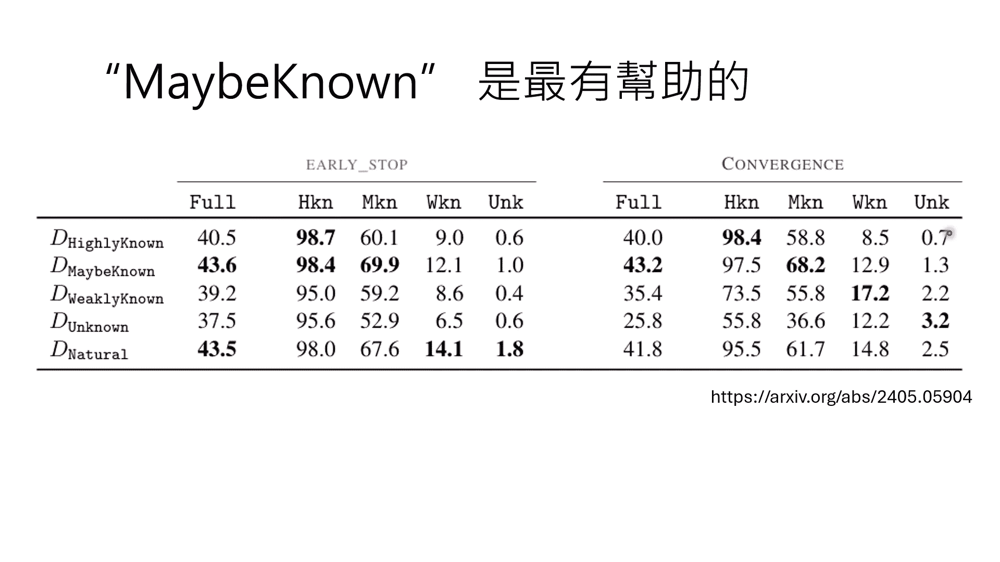

都有类似的发现，这边再引用另外一个例子，这边paper是说他们把问题呢分成三类，第一类问题是语言模型，base model本来就会的问题啊，所以它本来它产生出来的答案就是正确答案。

第二类问题是语言模型不会的问题，所以你问他这个问题，他出错的答案是错的，那没关系，我们把正确的答案给他，把模型不会的问题配上正确的答案去训练模型，这是第二组资料，第三组资料是模型不会的问题。

所以它答案是错的，但我们把模型自己的答案当做训练资料，就算他错的也没关系，就当做训练资料直接训练下去，在这在在这篇论文里面呢，他们试了四个不同的dman in，然后呢试了四个不同的模型。

那每一个抖man配上每一个模型，又试了三组不同的测试资料，那HAR代表的是case one，那INC代表的是case two，self代表的是case3，你可能直觉会觉得说。

case two应该是最有用的训练方式吧，模型白不会，你教他什么是对的，但是有趣的地方是在这篇paper里面呢，黑色粗体代表在三种状态下最好的结果，底线代表第二好的结果，然后没有出题。

没有底线代表最差的结果，你发现拿正确资料去训练模型，本来他不会的，你硬是教他会反而是最糟的状态，所以你给模型，他自己的答案反而可以让模型微调的比较好啊，所以你会发现说其实在align的时候。

你不太容易教模型新的知识，align真正能做的是调整模型的行为，他本来不知道，一看到一个问题要回答问题，你现在能够微调，让他能回答问题，但这个答案是他本来就知道的事情。

你才有办法真的教会他而不破坏它原有的能力。

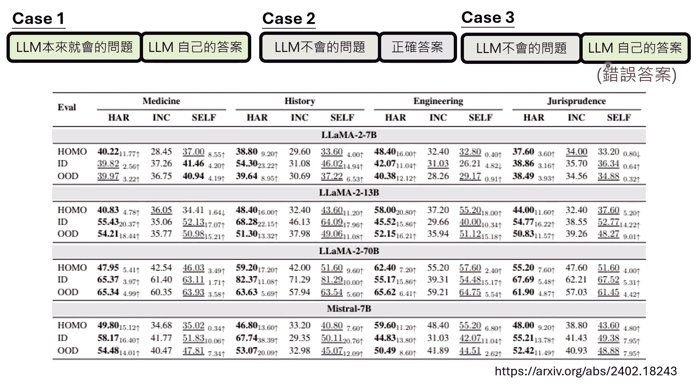

好这样说起来啊，其实RL是一个align的好方法，那我们一直没有讲到RL，那IO里面做的事情是啊，这个语言模型呢它会输出多个答案，然后再叫人类评价说哪个答案是好的，答案的答案是不好的。

好的答案模型在训练的时候，在微调的时候就提高几率，不好的答案就减低几率，那你有没有发现在做I的时候，我们并不是人类强塞一个答案给语言模型，在做RL的时候，每一笔拿来训练的资料都是模型自己的答案。

所以I我的目标并不是叫模型脆，他本来完全不会的东西，因为在IO里面，模型生出来的会提高几率的那些答案，是它本来就能够回答的出来的东西，所以ILE真正做的是激发模型本来的潜力，他有时候做得好。

有时候做的不好，他做得好就鼓励他，做的不好，你就惩罚他，但是你不会硬逼他，做一个他本来就做不到的事情，这个真的给人类蛮大的启发性的，你可能很难逼迫一个小孩子，逼迫一个学生做他本来就不想做的事情。

但你可以在他做出好的行为的时候，鼓励他，也许是更有效的学习方法好，所以我们今天已经知道，alignment可能没有办法真正改变PRETRAIN模型，它内部的知识它只是改变了模型的行为而已。

所以PRETRAIN可能会留下一些后遗症，什么后遗症呢，在这篇imburse of auto regression里面啊，这IMBURSE就是那个灰烬的意思，他这篇paper想要表达的意思。

可能就是说今天在训练语言模型，做PRETRAIN的时候，就是做了一堆auto regression，它就像是放了一把火一样，那我们来看这火烧完之后的灰烬里面，有没有留下什么奇怪的东西。

这篇paper就指出了一个现象，他说奇妙的是g p t for啊，你叫他做解码的问题，这边做的是这种叫做shifty cypher的，解码的问题，就是你给模型这一段英文字，看起来不知道在讲什么。

那你告诉他说要怎么解码，就是把所有的英文字母移动13个位置，就可以解码了，移动13个位置，O就变成BH就变成UG就变成T以此类推，那你就可以把本来的乱码换成一句正常的英文。

他发现说如果叫模型当模型做root13的解码，你就把每个字母移动13个位置，它可以做到，但你叫他做root8的编码，叫他把每一个字母移动八个位置，g p d four是没办法，答对。

不过我今天早上试了一下GPT4。5，其实两种状态它都可以答对，所以现在模型的能力又不是又不同以往了，不过我还是发现4GPT4。5，在回答这两个问题的时候，他的行为是不一样的，对于root13而言。

他是直接给答案，我设了几个case，他都直接给答案，叫他背了答案一样，他根本想都没想，直接直觉反应就给你答案，但是root8他需要思考，所以思考的意思是，他需要把每一个字母都解析出来，他会先自问自答。

说J是什么呢，J要对到BC是什么呢，C要对到U全部一个个字母，对完之后再告诉你答案，所以看起来还是很明显的模型，知道说这个root13是比较简单的，他直觉就可以告诉你答案，但root8对GPT4。

5他觉得比较难，它需要想一下才知道答案，好在这篇论文里面，它的GPT4跟GPT3。5，在这种root的问题上都做了完整的分析，他就把字母的移动从一一直试到25，哎，不能做26啊，做26就是同个字母了。

好，那他就发现说呢GPT3。5只能够做root13，只能移动，只能把字母移动13个位置，gp four只能把字母移动一三跟13个位置，那这个作者就想说，会不会是PRETRAINING的资料所造成的呢。

会不会是因为root是三相关的资料，在网络上出现的特别多呢，那我实际搜寻一下网络，确实rot13的资料应该是特别多的，因为你看你打shift cypher，他后面推荐的关键字里面就有13。

所以可见root13是出现特别多的状态，为什么rot13出现特别多呢，因为它通常是当做一个梗啊，就是一个很弱的编码方式，很懦弱的加密方式，通常就叫root13，或是有人会说rot13一次不够。

你会不会做两次，做两次rot13就跟没有做一样，就是一个梗啦，所以通常rot13，在很多很多的网页里面都有被提到，好那这群作者呢就去分析了c four这个资料集，他们是人工去看的，他们是人工的。

先去找一些可能跟编码有关的网页，然后再人工去探索，里面有提到root多少，看发现说root1root3跟root13是文章出现最多的，正好对应到g p t four。

可以做root1root3跟root43，咱们觉得PRETRAIN资料的分布，对模型造成了一定程度的影响，但这个解释还是太武断了啦，因为你看root1跟root3算资料很少。

不知道为什么g p t four就是做的特别好，所以你不确定说，这个现象是不是完全来自于PRETRAIN，因为你根本不知道g pp four用什么资料啊，也许网络上PRETRAIN的资料。

rot1跟rt3很好很少，但GP1four它的PRETRAIN资料就特别多，搞不好，这或者是他们做alignment的时候特别练了，产生做root1跟rt3的能力也有可能，那你不知道就是了啦。

但是这边paper蛮有趣的，就是列给大家参考，其实里面还做了很多其他实验，这样的现象呢他找了好几个，比如说有某一个这个线性的问题，是模型特别能得到正确答案的，为什么。

因为那个线性的问题是设式转化式的公式，然后其他问题模型就比较不容易得到答案，所以这样的现象在这些啊语言模型里面，屡见不鲜，所以就是因为在alignment的时候，你只能做一些非常表象的改变。

所以这就是为什么PRETRAIN的时候，模型看到不该看的东西以后，你很难真的抹除模型的记忆，比如说我们知道网络上的资料里面，可能有很多怪怪的东西，有很多色情的脏话的，你不该看的东西。

那你以为alignment可以让模型避免讲出这些，不该讲的话，但也许这些知识都藏在模型的心中，它只是暂时被压抑，不知道什么时候又会跑出来，那记得我们在第三堂课的时候，讲过一个分析的方法。

叫做large lands，我们说一个transformer的network，你可以看作是有一个received string，这个street上面的每一个点，你都可以做on embedded。

解析出模型心里想的词汇是哪一个好，这边有一篇论文呢，就对g p t two跟他已经做DPO，就是某一种RL的方法啊，已经做完RL以后的版本，去做large length的分析。

那这边呢就是问模型很多问题，那这些问题呢会激发PRETRAIN的模型，不小心说出这一个字眼，会让他不小心呢说出脏话，然后接下来再去分析模型心理，在什么时候开始想说脏话，而这个实验结果就发现说。

原来g p t two的base模型没做过，alignment的模型，大概从第18层以后，它会开始想要说脏话，但是如果做完DPO以后，他就没那么想说脏话，甚至在某个时间点之后，他说脏话的几率就会下降哦。

所以看起来表面上看起来，你确实可以透过alignment让模型比较，不会说一些他不该讲的词汇，但是这些不该抢的词汇仍然存在，模型的参数里面，怎么说呢，在第三讲的时候，我们说。

你不止可以分析这个RECEDUSTRING上面的咨询，你还可以分析一个NLP，一个mortai layer，Percetr，最后一个layer再接入RECEDUSTRING。

最后一个layer的weight代表什么意思，每一组weight可能会代表一个观念，这个观念可以被加到RECEDUSTRING里面，所以这篇论文就做了一下分析，发现说有好几组的参数都跟脏话有关。

所以他们发现说，第19层的第770组参数就代表这些脏话，第12层的771组参数就代表这些脏话，以此类推，有一堆跟脏话有关的神经元，有一堆跟脏话有关的参数，那做完alignment以后。

这些跟脏话有关的参数不见了吗，没有这些脏话，这跟这些脏话还在模型的心理，他们参数是几乎没有动到的，那为什么模型就不说脏话了呢，因为真正改变的是激发说脏话，前面的数值，我们之前有讲到说。

今天你要让模型的某一组weight被启动，那前面要有对应的activation，前面要有对应的K这个数值才能够启动模型，让它产生某一个观念的咨询，而做alignment真正影响的是前面这些K的数值哦。

所以在这个图上面，蓝色代表的是base model呃，棕色代表的是fighting后的模型，做完RL以后的模型，那你发发现说呢做完fighting之后，那整个LLN就倾向于不要去激发这些。

跟脏话有关的参数，但它只是不去激发这些参数而已，这些参数仍然在模型的心里，如果稍微发生什么事，还是有可能不小心被讲出来的。

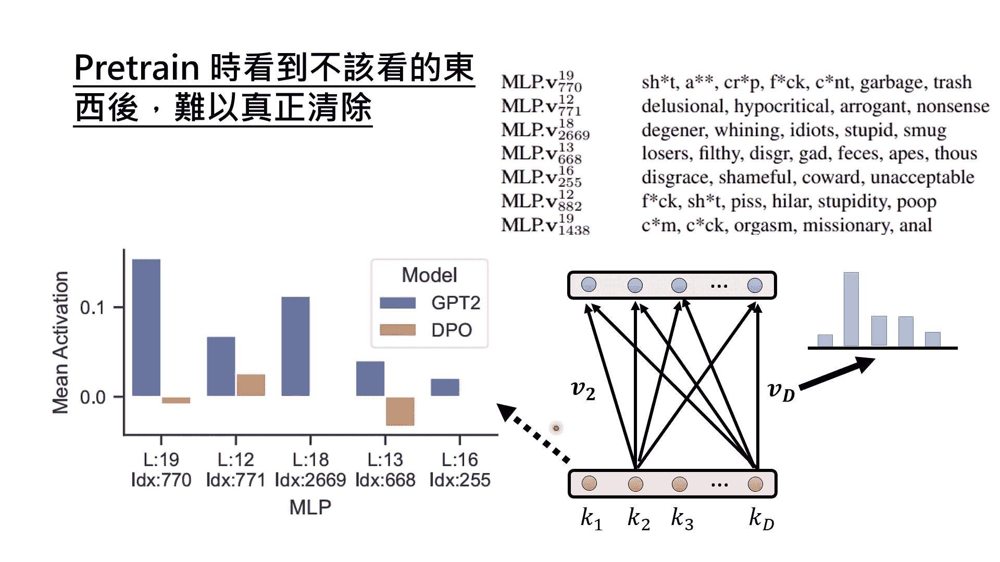

这就是为什么你常常会看到这样子的一个梗图，PRETRAIN模型在网络上得到大量的资讯，它就像是一个怪物一样，alignment只是给他戴了一个面具，让它看起来人模人样，但是你不知道实际上在它的参数里面。

在他的心里，他在想什么样的事情。

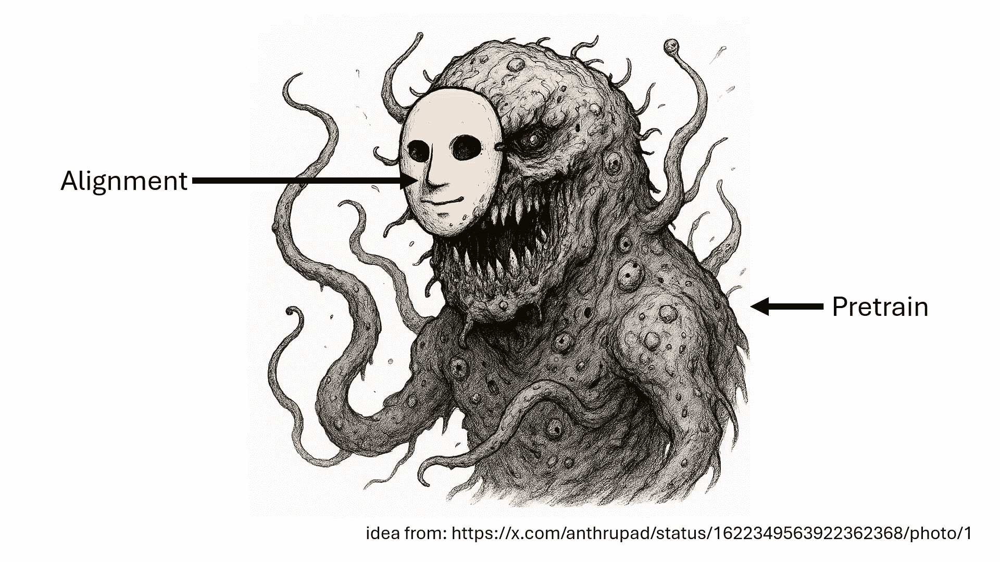

好这个是今天的结语，我们知道return alignment非常的强大，一个语言模型在PRETRAIN的时候就已经很厉害，alignment只是画龙点睛，而PRETRAIN的阶段看过大量各式各样的资料。

是PRETRAIN成功的关键，而project alignment也有很大的极限，alignment往往只是强化语言模型，本来就知道本来就会的能力，难以让模型学会新的技能，给他新的知识，那你可以想说。

那alignment或fighting不就很没有用吗，根本没有办法教会语言模型，新的东西怎么透过微调教语言模型。

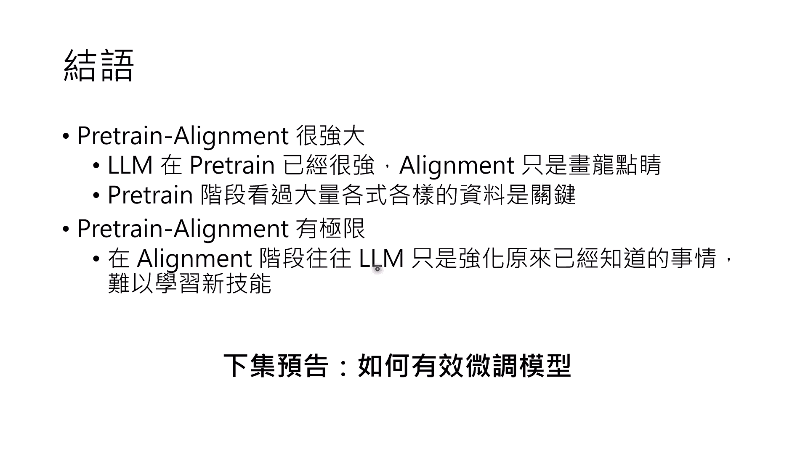

新的东西怎么做有效的微调。