# 1：第0讲：课程说明 📚

在本节课中，我们将要学习这门课程的定位、目标、内容规划以及作业安排。我们将了解为什么需要开设这门关于生成式人工智能的课程，它与传统机器学习课程的区别，以及学习这门课程能为我们带来什么。

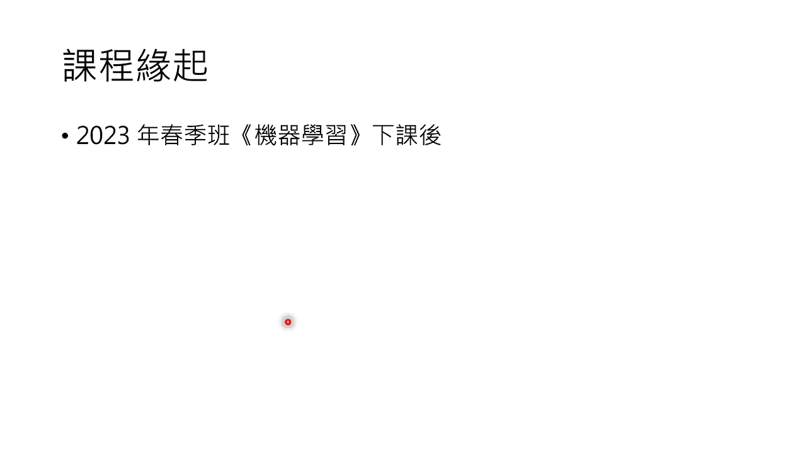

## 课程缘起：为什么开设这门课？

我从2014年开始在台大任教，自2015年起每年都开设机器学习相关的课程。在去年的春季班，机器学习课程下课后，发生了一件事促使我思考开设新课程的必要性。

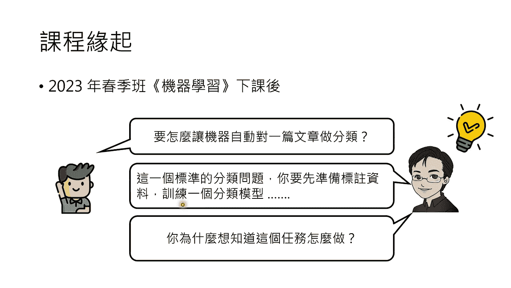

一位同学前来询问如何让机器自动对一篇文章进行分类。作为机器学习课程，我自然从机器学习的角度进行回答：这是一个标准的分类问题，需要先准备标注数据，然后训练自己的模型。

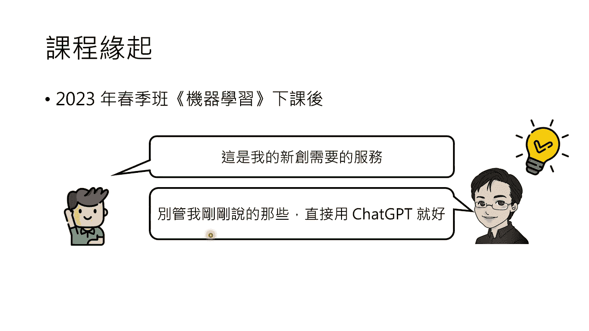

讲到此处，我脑中突然产生了一个新的想法。我问他：“你是真的想学习机器学习的原理，还是仅仅想知道如何实现文章分类？你为什么要做文章分类呢？”

他回答说这是他创业项目所需的服务。于是我告诉他：“别浪费时间学机器学习（我刚才说的那些）了，直接调用 ChatGPT 就好了。”

这句话是什么意思呢？也许通过实际操作，大家能更好地理解。

## 生成式AI的威力：以ChatGPT为例 🚀

这是 ChatGPT 的页面。我使用的是 GPT-3.5，它是免费的；GPT-4 则需要付费。因此，我展示的功能是每个人都可以轻松获得的免费功能。

初次看到 ChatGPT 页面的人往往会不知所措，因为页面上只有一个对话框。在这个对话框里可以输入任何文字。但这样一个能与我们对话的人工智能，究竟有什么作用呢？我们真的需要每天和它聊天吗？可能并不需要。

很多人认为这不过是一个聊天机器人，能有多大作用？但事实上，ChatGPT 可以成为你的得力助手。你有什么需求，直接告诉它即可。

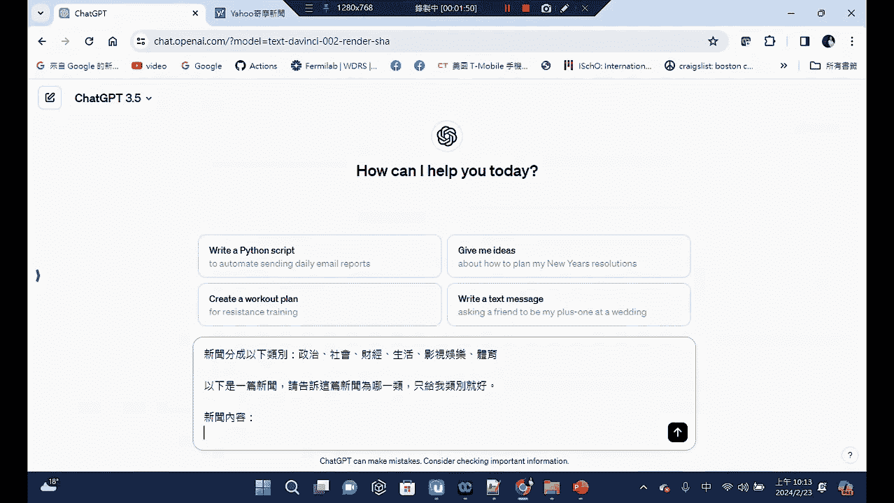

例如，我们今天想对新闻进行分类。

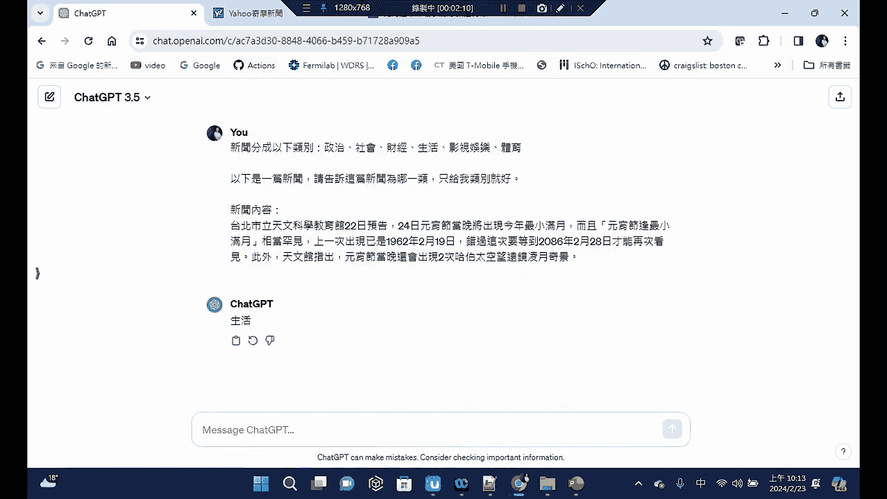

你只需直接将指令贴给它，告诉它：“新闻分为以下几类：政治社会、财经生活、影视娱乐、体育等。” 接下来告诉它：“以下我会给你一篇新闻，请告诉我这篇新闻属于哪一类。只给我类别就好。”

然后贴一段新闻内容给它。

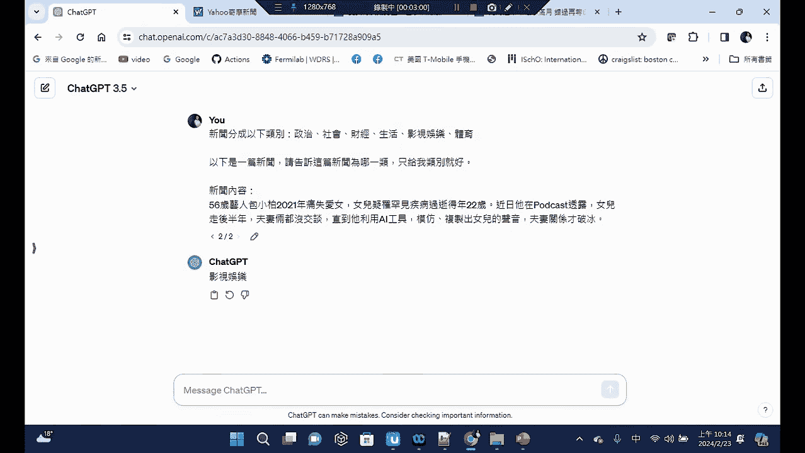

比如，这里随便找一则新闻“元宵逢最小满月”，贴一段内容。输入后，它会告诉你这则新闻属于“生活”类。我们再试另一个例子。

这是一则关于 AI 的新闻。我们把这段新闻贴到这里，GPT 知道这是“影视娱乐”类。

因此，你可以轻易地用 ChatGPT 打造你想要的 AI 应用。但有人可能会想，这是一个演示网页，如何将这个功能嵌入到我自己的应用或服务中呢？在这门课的作业中，会告诉你如何在自己的程序中调用像 ChatGPT 这样的人工智能来帮你做事。

总之，我的想法是：大人，时代变了。过去在开发人工智能应用时，我们往往需要自己开发、训练机器学习模型，这就像决斗时用剑。而今天，有人可以直接掏出一把枪，瞬间完成人工智能应用。

所以，作为一门人工智能的基础课程，我想开设一门新课，告诉大家今天这个世界，如果你想做人工智能相关应用，可能是什么样子。当然，有能力自己开发模型仍然非常重要。这并不意味着机器学习课程不重要，也不代表我以后就不会开机器学习课。

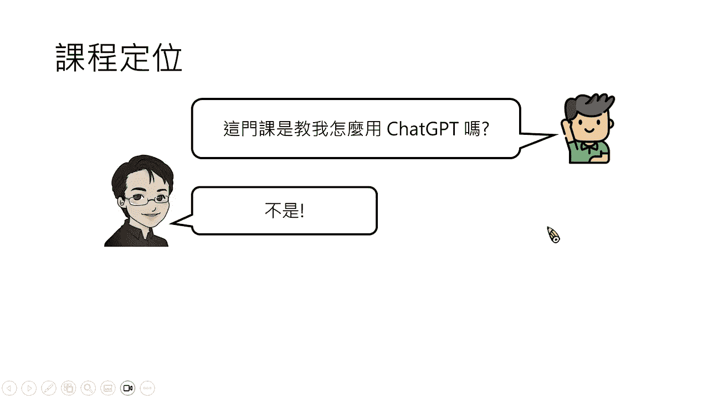

我只是想告诉大家，了解今天生成式 AI 的趋势和技术发展到了什么地步，可以帮助你更精确地判断：什么时候应该自己开发模型，什么时候可以使用现成的人工智能。

## 课程定位：这不是一门“ChatGPT使用教程” 🎯

在开始课程之前，我来讲一下这门课的定位。因为课程一开始就提到了 ChatGPT，可能会给你带来一个误解。我看到网络上有很多同学说，这是一门教大家怎么用 ChatGPT 的课。

但这其实不是一门教大家怎么用 ChatGPT 的课。

ChatGPT 只是众多生成式人工智能中的一个例子。当然，它是今天最具代表性的应用，所以我们课堂上一定会反复提到 ChatGPT 这个人工智能。但它只是生成式 AI 的一个例子而已。这门课要讲的，是希望能带给大家生成式 AI 的全貌。

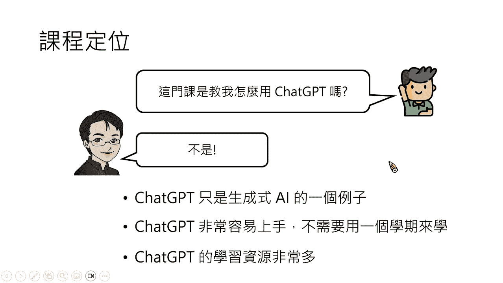

其实 ChatGPT 非常容易上手。很多人会问怎么学习使用 ChatGPT。使用 ChatGPT 这件事是不用学的。只要你能跟另一个人沟通，你大概就有办法跟 ChatGPT 沟通。所以学习使用 ChatGPT 这件事，其实不需要花一整个学期的时间。

而且另一方面，关于 ChatGPT 的学习资源真的非常多。你在 YouTube 上搜索 ChatGPT，满坑满谷的网红都在教你怎么用 ChatGPT。在去年年初 ChatGPT 刚火的时候，只要是个网红，都在讲 ChatGPT。历史的频道就让 ChatGPT 伪装成历史古人对话；打游戏王的频道，也逼迫 ChatGPT 跟他玩游戏王（虽然 ChatGPT 玩不了）。总之，已经有太多人提供 ChatGPT 的教学资源。

所以，这门课要讲的并不是教你怎么使用 ChatGPT 这个人工智能应用。

## 课程目标受众与核心内容 🎓

这门课预设的目标受众是：假设你已经用过 ChatGPT 这类的生成式 AI，你知道它们可以做什么，你知道它们有多厉害。但是你想要更进一步了解这些生成式 AI 背后的原理：它们到底是怎么来的？怎么被训练出来的？怎么变得像今天一样这么厉害？以及你想要知道这些人工智能未来有什么样的可能性，还有哪些可能的发展。

这门课就是为你开的。

为什么这门课不会特别着重某一个应用（比如 ChatGPT 的使用）呢？因为今天这个技术真的是日新月异。如果你在 2022 年年底 ChatGPT 上线时就开始使用它，你会发现 ChatGPT 现在的界面和能力，与刚上线时相比已经有了很大的差异。这个应用是日新月异的。

所以，即使你在某一门课中学到了怎么使用 ChatGPT，可能同样的技巧在几个月甚至几周之后就已经不适用了。我们在大学开一门课，是希望可以教你一些在往后数年，甚至一辈子都可以用得上的东西。

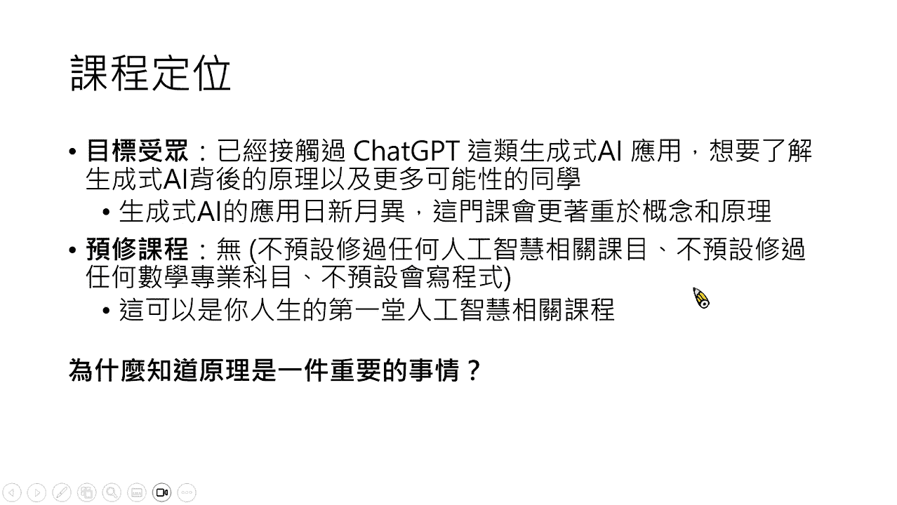

因此，这门课真正想要传达的，并不是教你怎么用 ChatGPT 这一个应用，而是告诉你生成式 AI 背后的概念和原理。

## 先修要求与学习意义 ❓

这门课没有预设需要任何的先修课程。如果你想要修这门课，你不需要修过任何人工智能相关的课程，不需要有任何数学和编程的背景，也不需要修过任何机器学习相关的课程。这门课可以是你人生的第一堂人工智能相关课程。

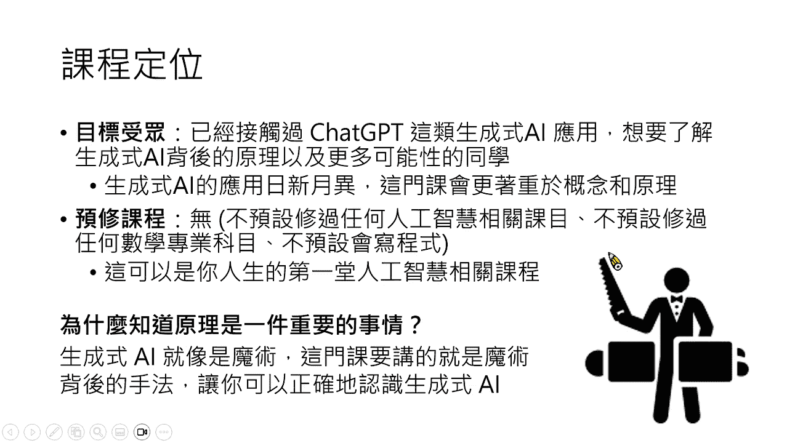

有人可能会问：我已经会用 ChatGPT 了。使用 ChatGPT 就是如此简单，只要你会说话、会打字，知道怎么跟另一个人沟通，你就可以用 ChatGPT。我已经会用了，那会用就好啦，我干嘛要知道它背后的原理是什么？

确实，就算你不知道 ChatGPT 的原理，你也有机会打造人工智能的应用。但是，了解它的原理可以带你走向另外一个层次。

就像魔术非常神奇，今天的人工智能也像是魔术一样。但是如果你知道魔术背后的手法，你在观看魔术时，可以更能够欣赏魔术师厉害的地方。你看到魔术师把一个人锯成两半再粘在一起时，你不会觉得他是真的把人锯成两半然后用念能力粘在一起，你会知道这是一个手法。你不会觉得魔术师是一个有超能力的人。你知道这是魔术的手法。

对于生成式 AI 也是一样的。今天生成式 AI 展现出非常神奇的能力，但是假设你可以正确了解它背后的概念和原理，那就好像是了解了魔术背后的手法。你可以更精确地认识它，至少你不会对它的能力有错误的误解或错误的期待。

有同学问我，这门课跟我自己开的机器学习课有什么重叠的地方吗？你应该问还有什么一样的地方。基本上就是没有什么一样的地方。所以，就算你修过我的机器学习课，或者修过其他老师开的机器学习课，我相信这门课也可以带给你很大的帮助。

我刚才说过，这门课可以作为你人工智能的第一堂课。你可以把这门课作为你学习人工智能的基础，未来再去学习其他机器学习相关的课程。

## 课程深度与期望声明 📖

需要声明一下，在这门课你不会学到什么。因为这是一门入门课，如果我们继续用魔术这个比喻，这门课会手把手带你变几个魔术，但是可能不足以训练你成为魔术师，也没有办法带你创造新的魔术。

但这并不代表这门课是没有用的。这门课可以作为你成为魔术师的开始。假设你的目标是未来成为顶尖的魔术师，要做些大变活人之类的，那这门课可以作为你的起点。

上课时间有限，这门课设定为两学分的课，所以我们上课时间只有两个小时。因为时间有限，我们无法深入提到所有的技术。很多地方可能会让你觉得“我什么都脱了，就只给我看这个？”。所以很多地方可能没有办法讲得非常深入。

但是，这是你的第一门人工智能的课，它不会是你最后一门人工智能的课。未来你可以修其他相关的课程。或者，假设你想要深入研究上课所提到的一些技术背后的原理，你可以看投影片上引用的论文。

## 关于引用与最新研究 📄

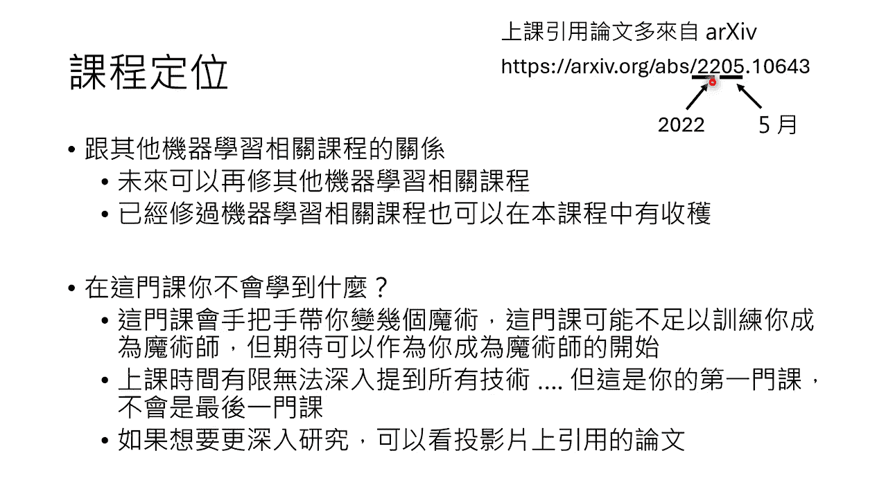

讲到引用，我说明一下。在我们这门课的投影片上，多数的论文都是引用自一个叫做 arXiv 的网站。我看到有同学问，上课引用的论文链接上会写 `arxiv.org`，arXiv 是什么呢？

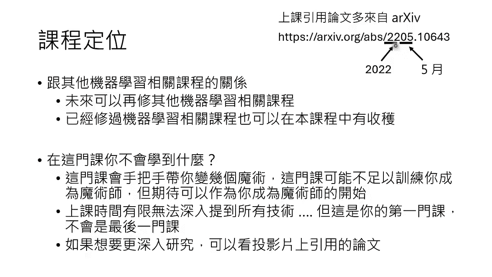

如果是计算机科学领域的同学，一定都知道 arXiv 是什么。但我知道选修这门课的同学来自于各个不同的领域，所以我介绍一下什么是 arXiv。

通常我们在做研究时，有了新的想法，会写成论文发表在国际会议或国际期刊上。但是国际会议、期刊的论文审稿往往需要一年半载。对于 AI 领域而言，技术变化太快了，一年半载的时间往往就会有翻天覆地的变化。往往你投一篇文章，六个月后被国际会议接受时，那个技术可能已经过时了。

那怎么办呢？有一个网站叫做 arXiv。今天，往往有了新的想法（尤其是计算机科学、人工智能相关的新论文），会先不投国际会议，而是直接放在 arXiv 上抢先公开出来。所以在 arXiv 上比较容易找到最新的研究。

这边教大家怎么看 arXiv 文章上传的时间。arXiv 的文章后面都会有一个数字，这个数字的前两位代表年份，后两位代表月份。所以 `2205` 的意思就是这篇文章是在 2022 年 5 月被公开放在 arXiv 上的。

之后，你在我们课程的投影片上会看到很多文章，这些文章往往是几个月前，甚至是几周前才被放在 arXiv 上的。

## 技术发展的迅猛：一个有趣的对比 ⚡

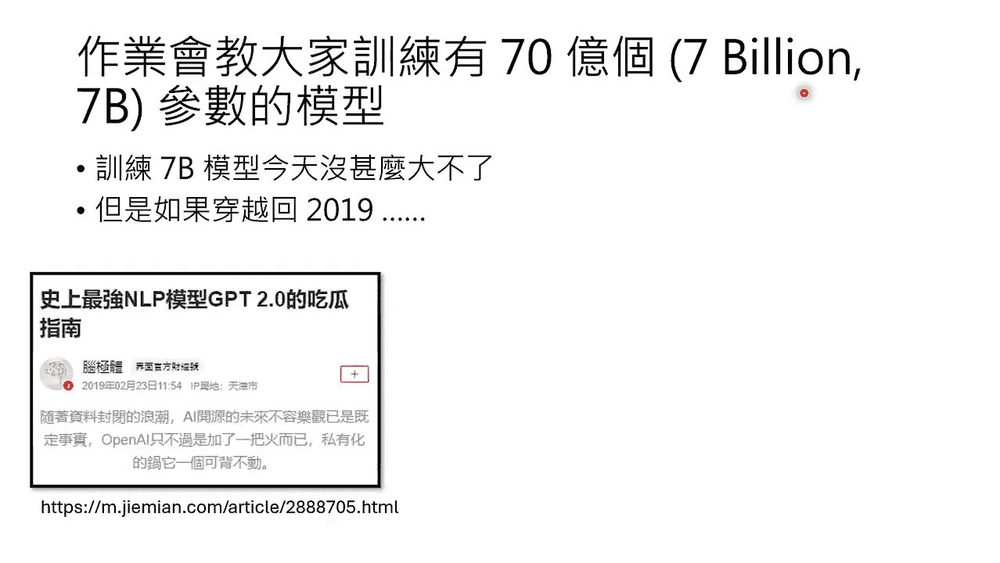

讲到技术迅速变化这件事，我想分享一个例子。在这门课里，我们的作业会教大家训练一个拥有 70 亿个参数的模型。70 亿的英文是 seven billion，缩写是 7B。

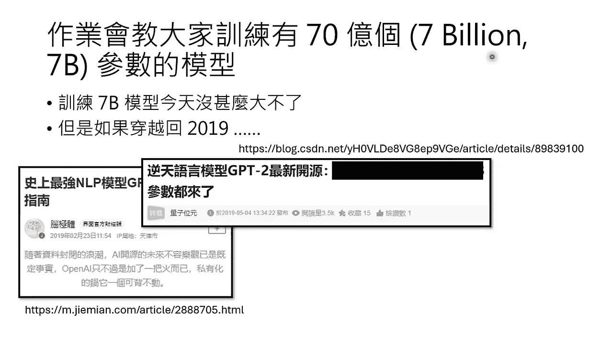

虽然说是训练，但实际上是微调。我们还没有讲到训练和微调的差异，这个之后会讲。现在就先当做你要训练一个 7B 的模型。

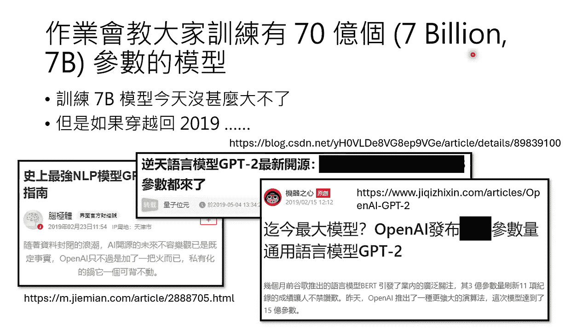

这 70 亿个参数到底是什么意思呢？我们下一堂课会讲参数的概念。现在可以先理解为：参数量越多，通常代表模型越厉害（实际上影响模型能力的因素还有很多，不只是参数数量）。不过今天大家往往把参数数量当做夸耀模型能力的一个指标。

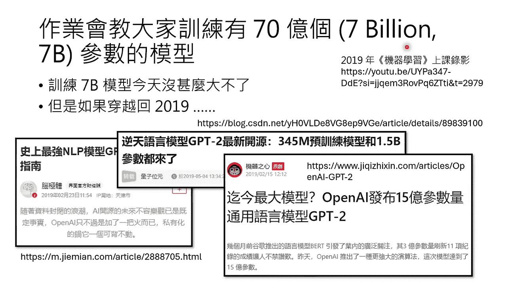

一个有 70 亿个参数的模型，70 亿听起来是个很大的数字，跟地球人口差不多。但它是一个很大的模型吗？它显然不是一个特别大、特别厉害的模型，因为这是我们课堂的一个作业。你可以想象，修完这堂课后，有上千人都能够训练 70 亿个参数的模型，而且你今天用免费的运算资源就可以做到。所以它显然不是一个特别厉害的模型。

但是，如果你穿越到 5 年前，穿越回 2019 年，会发生什么呢？2019 年时，OpenAI 发布了第二代的 GPT（GPT-2）。那个时候网络上各种文章也在拼命吹捧，比如“史上最强 NLP 模型 GPT-2.0”、“逆天语言模型 GPT-2.0”、“最大的模型 GPT-2.0”。

这个 GPT-2 到底有多大呢？它只有 15 亿个参数，大概是你今天作业要用的模型的 1/4 到 1/5。所以，今天假设你带着我们的作业穿越回 5 年前，你手上拥有的是一个在当时看来毁天灭地的巨大模型。OpenAI 和 Google 看到你都得“下跪”。这是一个当时大家无法想象的巨大模型。

这让我想到《葬送的芙莉莲》这部动画（第三话的内容，动画已播出一段时间，不算剧透）。芙莉莲是一个精灵，她在 80 年前曾参加勇者小队讨伐魔王。魔王手下有一个很厉害的干部，叫做“普贤库瓦尔”。他发明了一个“杀人魔法”，可以穿透任何防御，无人能挡。所有的勇士都被他杀了，连芙莉莲都无法打倒他，只能暂时将他封印。

80 年后，封印松动，库瓦尔复活了。芙莉莲带着她的弟子费伦想要来干掉库瓦尔。一开始费伦非常紧张，因为库瓦尔的杀人魔法是无法防御的。芙莉莲说：“到时候就知道了。”然后库瓦尔对费伦使出了一记杀人魔法。芙莉莲对费伦说：“你就把防御展开。”结果就挡住了。费伦说：“这什么杀人魔法，不过就是普通攻击而已。”

是的，80 年前的杀人魔法，过了 80 年后就只是普通攻击。因为 80 年对人类来说太长了，人类已经钻研了库瓦尔的魔法，寻找到了防御的方法。

在生成式 AI 的领域也是一样。当年的 GPT-2 就像是库瓦尔，当年一个毁天灭地的巨大模型，今天在你的眼中也已经不算什么了。

这个例子是要告诉你，生成式 AI 技术的变化非常快。不要说是 5 年，有时候 5 个月、5 个星期都会有很大的变动。

## 作业规划与体验目标 📝

讲到作业，就跟大家说一下作业的规划。作业的目标是让大家体验生成式 AI。

这个体验分成两个面向：
1.  第一个层面是体验如何用生成式 AI 来打造某些应用。
2.  第二个层面是教大家如何训练出自己的生成式 AI 模型。

当然，代码助教都已经写好了，你要做的事情往往就是一直按 Enter 键。但是你可以体验如何训练出一个自己的生成式 AI 模型。

在这门课里，我保留了一些“负面”的体验。什么样的负面体验呢？
*   比如训练模型很花时间。当然，今天所谓的“很花时间”，在作业里可能就是两三个小时。你知道痛苦是比较出来的。你可能觉得训练两三个小时很花时间。事实上，如果你要训练真正的大模型，时间往往是以“周”为单位来计算的。
*   另外，你可能还会发现，就算你完全按照助教的指示按 Enter，你得到的结果也可能跟助教得到的结果不一样。很多第一次训练模型的同学会觉得非常惊奇：训练模型不就是写个程序吗？它是电脑啊，怎么每次还会得到不一样的结果呢？我告诉你，训练模型你不要用“编程”来想它，你要想成好像是在养小动物、种花种草一样，其结果往往是有可能无法预测的。

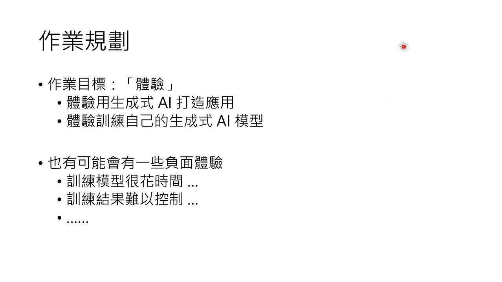

当然，我们可以把这些负面体验拿掉，不让你自己训练模型就好。但是我仍然把好几个训练模型的工作保留在作业中，为了让你得到一些负面的体验。期待这些负面的体验可以像疫苗一样，帮助你在未来面对更大的挑战。

我知道在座各位不是每一个人未来都会成为工程师，不是每一个人都会训练模型。但也许透过这堂课的体验，你可以知道训练模型是可能很花时间的，是可能很难预测的。有一天你当了大老板，也许可以对你手下的工程师多一些宽容。

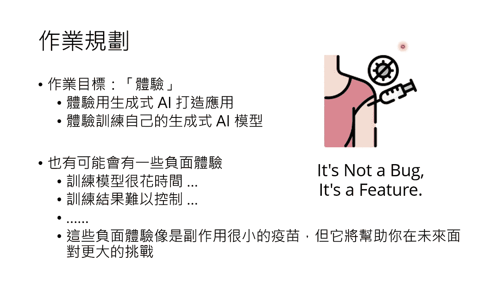

以下是作业内容的详细规划：
这门课总共有十个作业。公告的日期都已经写在投影片上。每一个作业如果没有特别说明，预设它的截止日期就是在两周后。

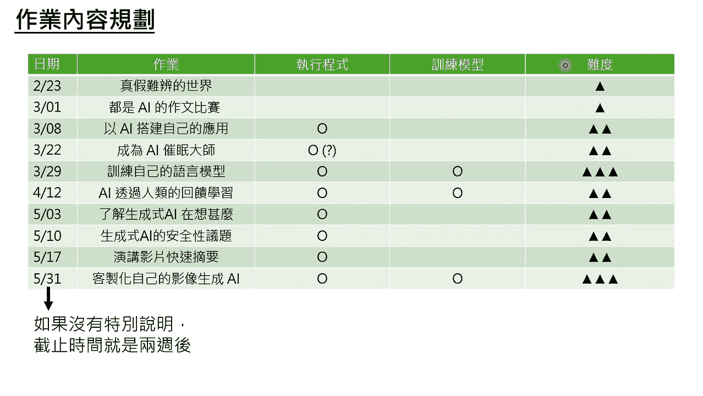

这些作业有好几个是需要写程序，甚至是训练模型的。有同学就会问：要训练模型，我需要准备什么东西呢？我需要买自己的 GPU 吗？

**你什么都不用准备。** 在执行程序训练模型的部分，我们都会用 Google Colab 或 Kaggle。你不知道 Colab 或 Kaggle 是什么也没有关系。总之你只要记得你什么都不用准备。

这边我稍微估算了一下作业的难度：
*   如果打一个三角形（△），就是送分给你。所以作业一，还有下周讲的作业二，基本上就是送分。开局就先送大家 20 分。
*   如果打两个三角形（△△），代表假设你不在意分数，这个作业也可能可以非常快完成。但是假设你想要拿到满分，你还是需要花一些时间自己努力。
*   如果打三个三角形（△△△），代表这个作业是需要训练模型的，所以你至少需要好几个小时才能完成。

再强调一次，痛苦是比较出来的。好几个小时已经算是非常快了。过去2015年我刚开机器学习这门课的时候，有好几个作业的训练时间大概是三天。我就跟同学讲这个作业就是要训练三天，所以今天假设离作业截止日期不到三天，你唯一能做的事情就是放弃，因为你已经不可能把模型训练出来了。但今天，训练模型最多就是几个小时，你在作业截止前一晚再赶也许还来得及。

有关这门课的分量，我给一个注解：因为有十个作业，几乎每周都会公布作业，所以如果把它当做通识课来看（毕竟这门课的名字里有“导论”二字），它不会是一个太难的课程，但可以是一个非常充实的通识课。当然，如果把它看作是选修课，那它可能是一个负担比较轻松、不那么重的选修课。这是给大家参考的作业负担说明。

有关上课内容的规划，我们下一节再讲。

## 关于使用AI完成作业与致谢 🤖

大家常常会问的一个问题就是：这门课能不能用人工智能（比如 ChatGPT）来写作业呢？

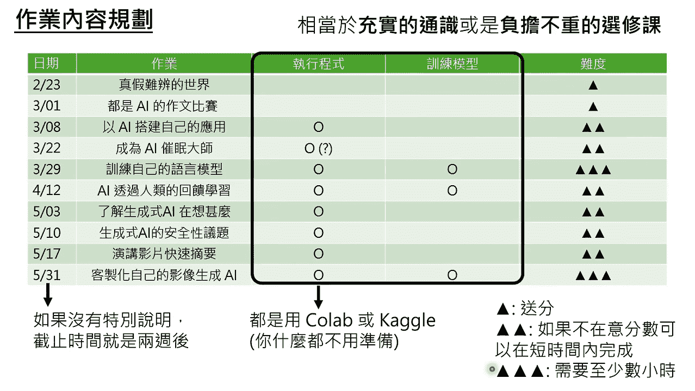

**答案是可以。** 这是生成式 AI 导论，这门课当然应该可以用生成式 AI 来写作业。

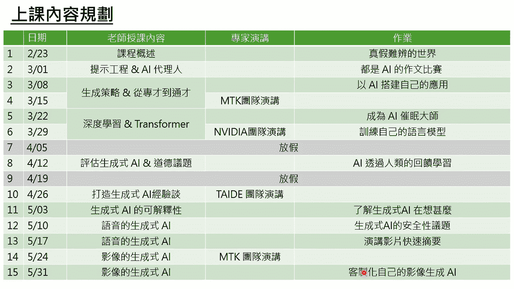

但是同时，老师也要用人工智能来改作业。到时候我们的作业，基本上能够用大型语言模型批改的，我们都会用大型语言模型来批改。

这边特别感谢 **MTK（联发科）的“打兵器-达哥团队”**，提供给我们“打兵器”平台、算力以及平台支持，让我们可以透过“打兵器”平台来批改作业。就算他们知道我们这堂课可能会有超过 1000 人选修，他们也愿意无条件地大力支持。在此特别感谢 MTK 的达哥团队。

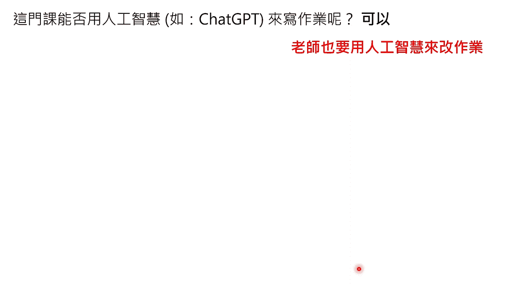

在 3 月 15 号的时候，MTK 的团队会来跟大家分享他们是怎么使用生成式 AI 的，以及他们对生成式 AI 在业界有什么样的看法。在 5 月 24 号的时候，MTK 自己也开发了大型语言模型，他们的技术团队会来跟大家分享。

---

本节课中，我们一起学习了《生成式人工智能导论》第0讲“课程说明”的全部内容。我们了解了开设这门课程的背景与必要性，明确了课程定位（并非ChatGPT使用教程，而是探究原理与全貌），知道了课程的目标受众和先修要求，并初步感受了生成式AI技术的迅猛发展。最后，我们也清楚了课程的作业规划、难度以及一些特别安排（如允许使用AI、MTK团队支持等）。下一节课，我们将正式开始探索生成式人工智能的精彩世界。