# 4：作业 1：真假难辨的世界 👨‍🏫

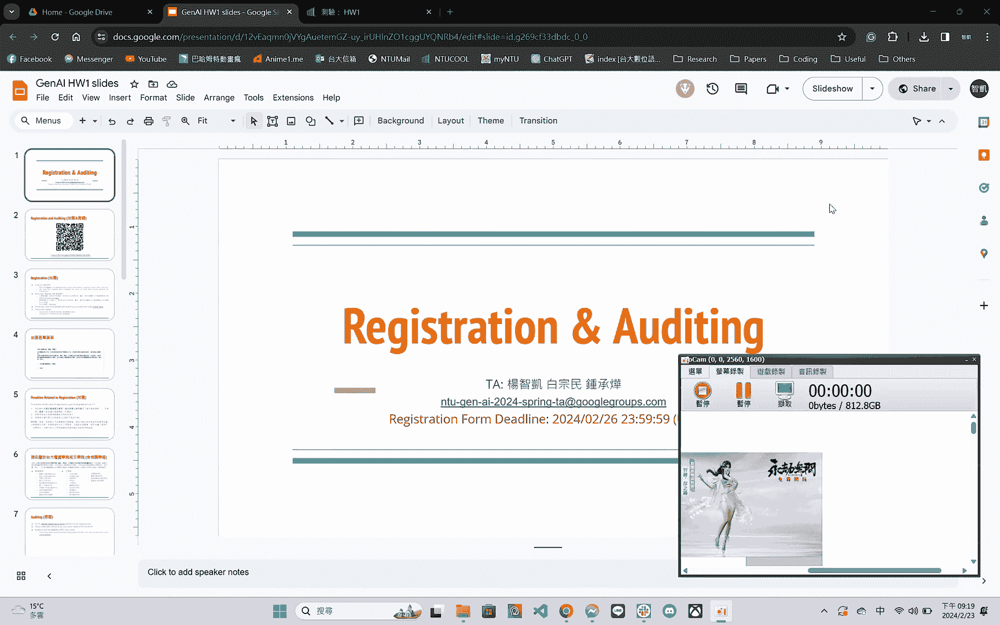

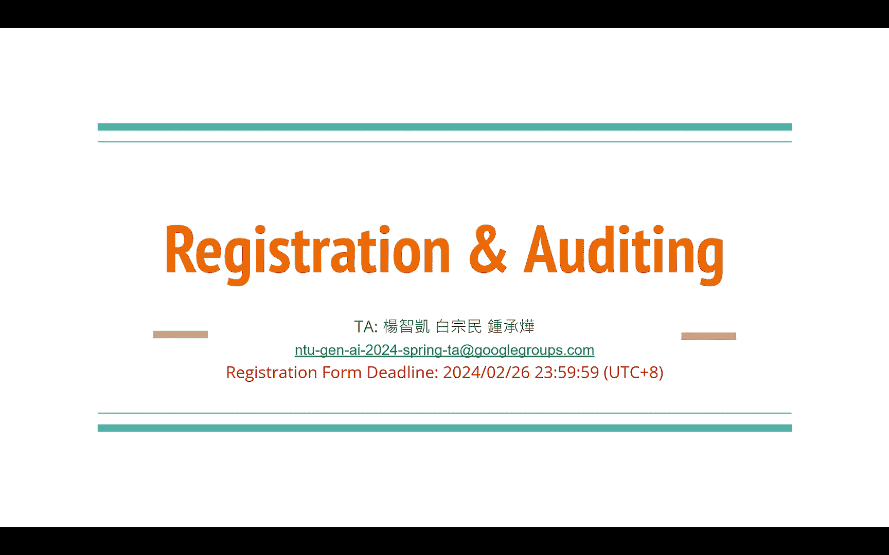

在本节课中，我们将要学习本课程的加签与旁听规则，并详细介绍第一份作业“真假难辨的世界”的具体内容、任务目标、评分标准和提交方式。

## 课程加签与旁听规则 📝

首先，我们来讲解本学期的加签与旁听规则。任何想要修读本课程的同学，都必须填写指定的加签表单。我们将仅从准时填写并正确提供信息的申请者中，通过抽签方式决定修课资格。

### 加签资格与流程

以下是加签资格的优先顺序和具体流程说明。

*   **直接获得授权码**：目前学籍（包括双主修、辅系或学程）隶属于台大电机资讯学院和文学院的同学，无需抽签，可直接获得授权码。
*   **需要参与抽签**：目前学籍（包括双主修、辅系或学程）不隶属于上述两个学院，但属于台大的同学，需要参与抽签。目前暂定抽签名额为50人，最终人数可能调整，但不会少于50人。
*   **无法加签**：很抱歉，本课程目前未开放给台大系统以外的学生（如师大、科大学生）加签。

上一节我们介绍了加签资格的划分，本节中我们来看看关于“当前学籍”的具体定义以及维护公平性的规则。

我们仅考虑同学“当前”的学籍状态，不会考虑任何未来计划申请或就读的学系。例如，计划本学期结束后才辅修相关学系，或已推甄但尚未入学的同学，均不属于优先范围。

为了维护加签公平性，我们制定了以下规则，违反者将被处以期末成绩为 **F** 的惩罚，且无任何通融余地。

以下是违反公平性的具体行为列表：
1.  身份不属于电机资讯学院或文学院，却在表单上勾选属于该学院。
2.  将自己获得的授权码转让或出售给他人，且本人仍在修读本课程。
3.  使用不属于自己的授权码，无论对方是否同意。

### 重要日期与旁听须知

接下来，我们关注几个重要的时间节点以及旁听的相关信息。

*   **加签表单截止**：2024年2月26日，UTC+8时区 23:59:59。
*   **授权码寄出**：最晚于2024年3月1日，UTC+8时区 23:59:59 寄出。若届时未收到授权码，即表示未加签成功。

关于旁听，填写与加签相同的表单即可。若在表单发布前已来信申请旁听，则无需重复填写，我们会统一处理。请注意，旁听生的NTU COOL权限会稍晚加入。

许多同学询问若加签未成功，能否转为旁听。答案是可以的。我们已在加签表单中新增一题：“如果没有加签到，需要加入旁听吗？”。同学只需用原Google账号登录表单，仅回答此题即可，无需修改其他答案。

## 作业 1：真假难辨的世界 🎭

介绍完课程准入规则后，我们正式进入第一份作业的讲解。这份作业的主题是“真假难辨的世界”。

### 作业目标与内容

本课程旨在让大家了解生成式AI（魔术）背后的原理。而理解原理的第一步，是亲身感受其强大与惊奇之处。这份作业的目的正是让同学们通过实际案例，体验当前生成式AI模型的能力，并可能在过程中发现它们的局限。

作业将涵盖多种形态的生成内容，不仅包括常见的**文字**（如Gemini, GPT）和**图像**（如Midjourney, DALL-E），还包括**语音、歌声、视频**等。

具体任务非常简单：同学将接触到一段音频、文字或图像等素材，在观察后判断该内容“是AI生成的”还是“不是AI生成的”。作业总共包含40道题目。

### 作业示例与素材获取

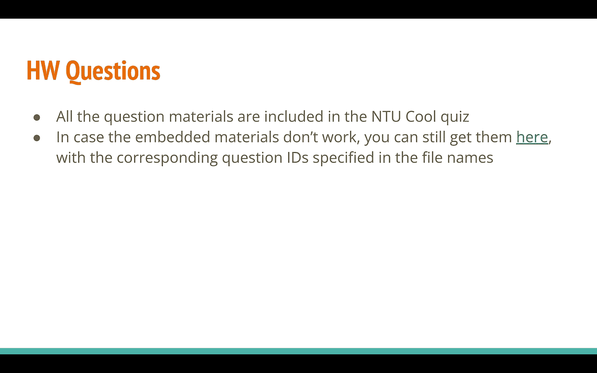

为了让同学们更清晰地理解任务，这里提供几个示例。

*   **音频示例1**：一段类似李宏毅老师问候的语音。若听起来很真实，可选择“不是AI生成的”。（实际可能是AI生成）
*   **音频示例2**：一段歌声。根据听感判断其是否为人声。
*   **文字示例**：一段由ChatGPT生成的文本，可通过分析其文风、逻辑等判断。
*   **图像示例**：一张生成内容为“I ❤️ Generative Models”的图片，若图像中的文字模糊或有明显瑕疵，则可判断为“是AI生成的”。

所有作业题目已放置在NTU COOL的测验区。如果遇到素材无法播放或显示的问题，同学们也可以通过提供的云端链接直接访问所有40个题目的原始文件。文件名（如 `Q2.mp3`）对应题号。

### 评分标准与提交方式

接下来是大家最关心的评分部分。本作业共40题，每题2.5分，总计100分，占学期总成绩的10%。

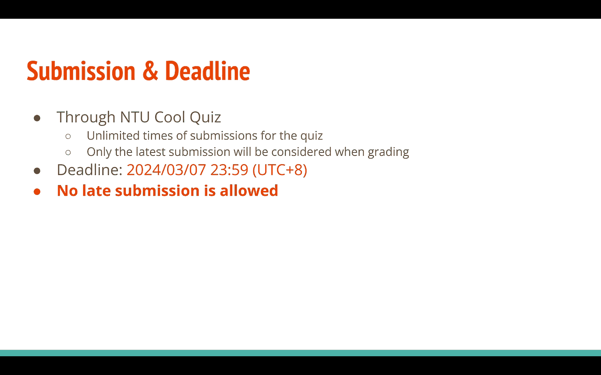

本作业的核心目标是体验与探索，而非用难题误导或惩罚同学。因此，评分标准非常特殊：**只要对某题作出了选择（即选择了“是”或“不是”），即可获得该题的分数**。无论答案正确与否。

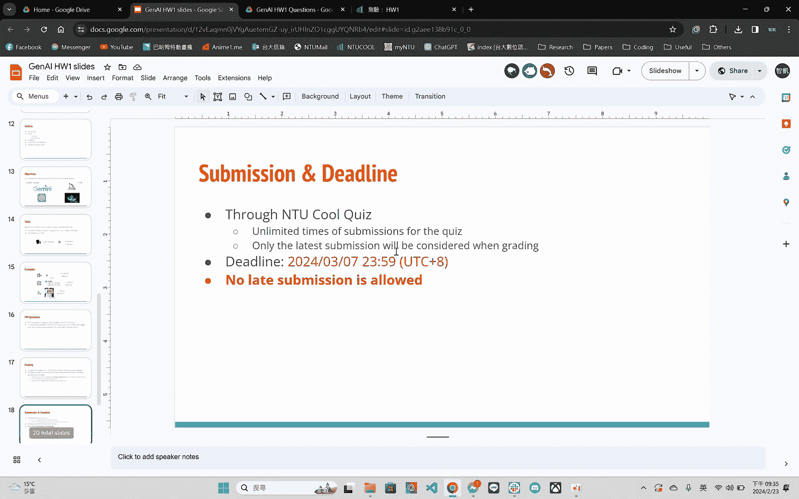

所以，若想在本作业中获得满分，唯一的要求就是确保所有40题均已作答。提交后，系统只会记录最后一次提交的答案。

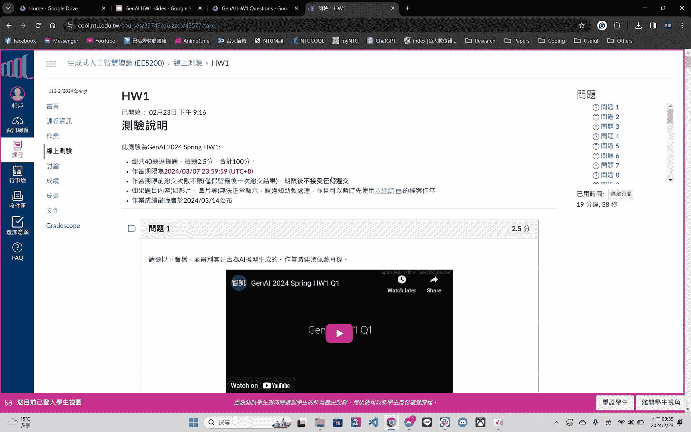

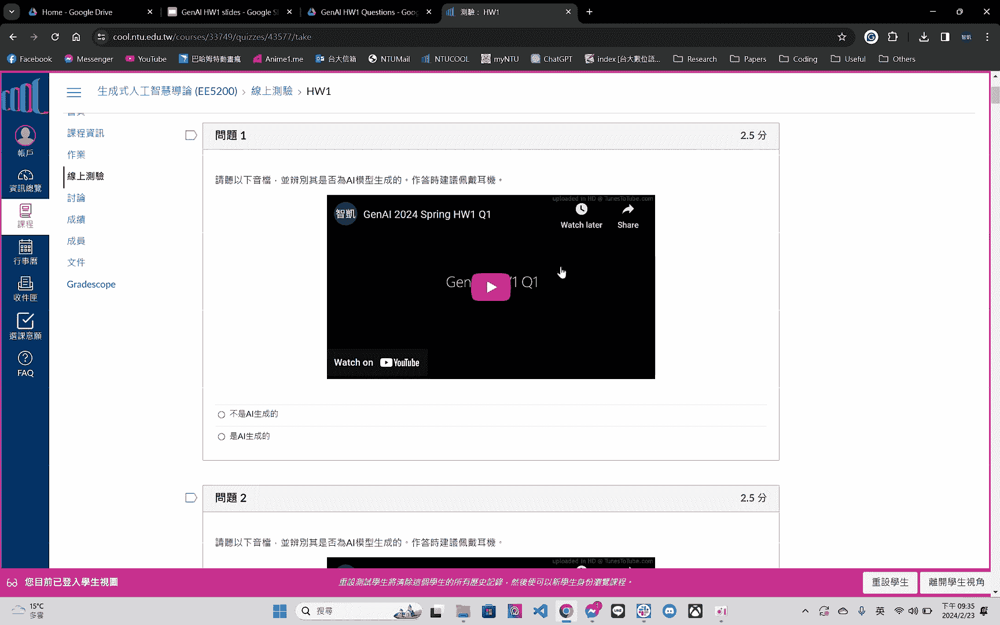

**截止日期**：2024年3月7日，UTC+8时区 23:59:59。逾期不接受任何形式的补交。

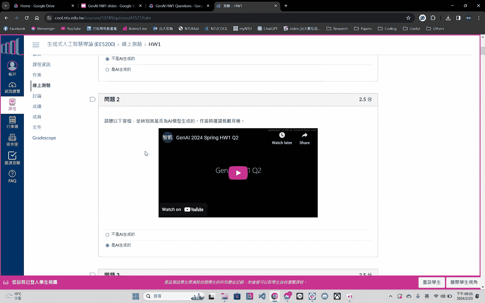

在NTU COOL提交作业时，若存在未作答的题目，系统会弹出提示。这是一个检查自己是否完成所有题目的好方法。

### 成绩公布与问答渠道

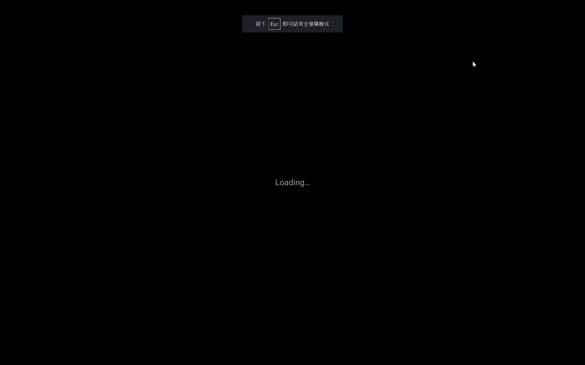

最后，我们来了解成绩公布的时间和遇到问题时的求助方式。

**成绩公布日期**：2024年3月14日，UTC+8时区 23:59:59。届时将公布每道题目的正确答案（Ground Truth），以及生成该内容所使用的模型或API等信息。由于NTU COOL系统功能限制，无法在提交时即时显示对错，敬请谅解。

如果在完成作业过程中遇到问题，可以通过以下三种渠道联系助教：

1.  **NTU COOL课程讨论区**：对于非私人问题，建议优先在此留言，助教会优先回复。
2.  **课程邮箱**：如需咨询私人问题，请发送邮件至指定邮箱。**务必**使用特定标题格式：`[ML2024Spring HW1] 你的问题`，否则邮件可能无法被处理。
3.  **课后TA时间**：可于指定日期（2月23日、3月1日）下课后，在综合教室现场询问助教。

---

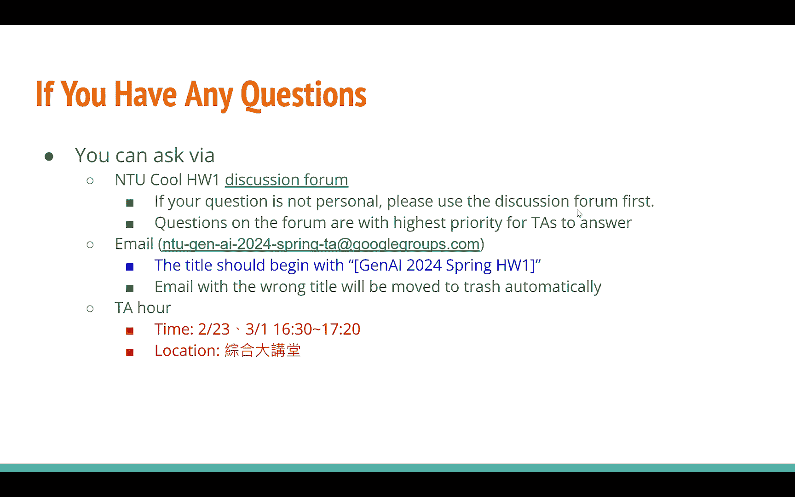

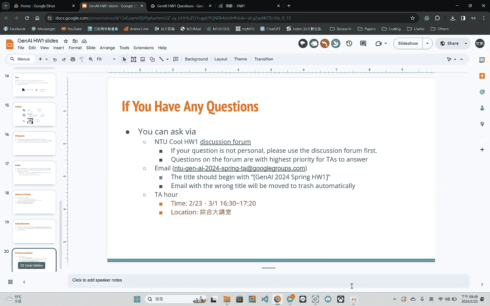

本节课中我们一起学习了《生成式人工智能导论》课程的加签、旁听规则，并详细了解了第一份作业“真假难辨的世界”的目标、内容、评分方式和重要时间节点。请大家务必注意各项截止日期，并按照规则完成作业。祝大家学习顺利！