# 11：第5讲：训练不了人工智能？你可以训练你自己（下）🤖

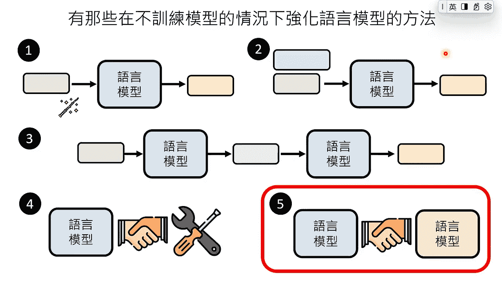


在本节课中，我们将要学习如何让多个大型语言模型进行协作，以发挥出超越单个模型的能力。我们将从合作的基本概念开始，探讨模型间讨论、角色分工以及团队优化的具体方法。

## 引言：合作的重要性 🤝

上一节我们介绍了如何通过自我反省来提升语言模型的表现。本节中我们来看看，如何通过让多个语言模型彼此合作，来达到“1+1>2”的效果。

最近《葬送的芙莉莲》漫画的剧情提供了一个生动的比喻。在故事中，主角芙莉莲需要挑战一个能复制她能力的迷宫守护者。尽管芙莉莲本人非常强大，但仅凭自己也无法战胜复制体。最终，她与弟子费伦合作，利用配合找到了复制体的破绽并将其击败。

这个故事说明了合作的重要性。即使是能力极强的个体，也可能存在盲点或弱点。通过与其他个体协作，可以弥补这些不足，发挥出更强大的力量。这个道理同样适用于大型语言模型。例如，GPT-4虽然强大，但成本高昂。如果能让它与其他成本较低但胜任简单任务的模型合作，就能在保证效果的同时降低成本。

## 模型协作的基本方式 🔄

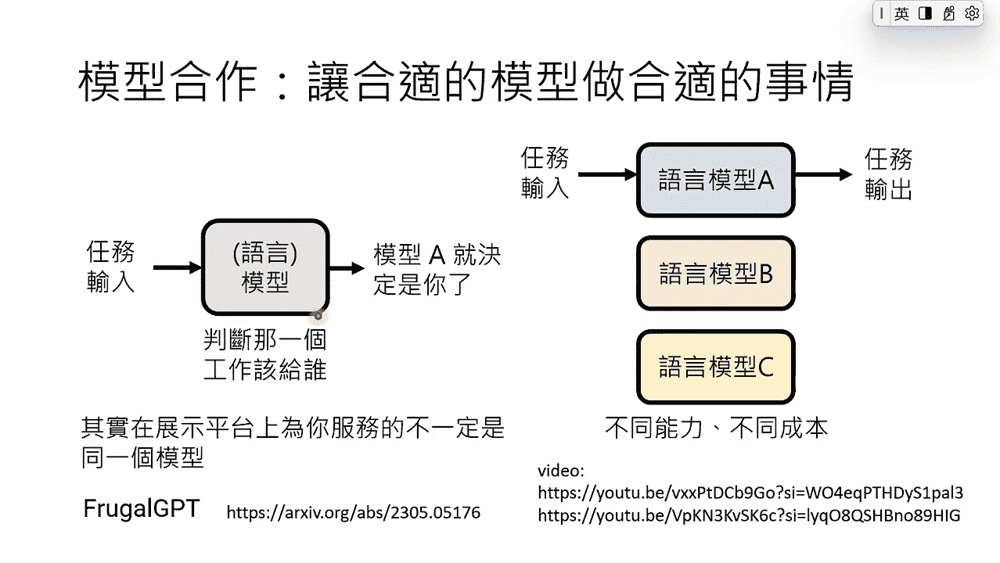

让模型彼此合作有多种方式。一种常见的方法是使用一个“调度模型”。这个模型负责判断新来的任务应该分配给哪个具体的模型来处理。

以下是其工作流程：
1.  用户提交一个新任务。
2.  调度模型（可能是一个小型语言模型或分类器）分析任务。
3.  调度模型根据任务复杂度、所需能力等因素，决定将其分配给模型A、模型B或GPT-4。
4.  被选中的模型处理任务并返回结果给用户。

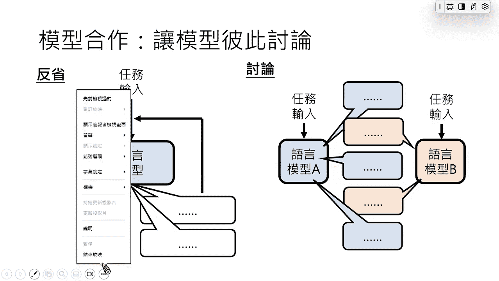

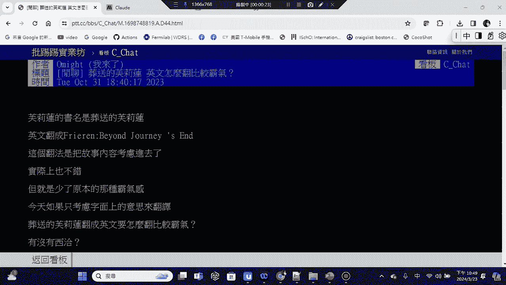

这种方式的核心优势在于**成本优化**。调度模型可以判断“杀鸡焉用牛刀”，将简单任务分配给廉价模型，将复杂任务留给强大的模型（如GPT-4）。许多现有的语言模型服务平台已经在后台采用了类似的技术。

如果你对如何实现一个高效的调度模型感兴趣，可以参考论文 **FrugalGPT**，它详细探讨了如何以更低的成本达到媲美GPT-4的效果。

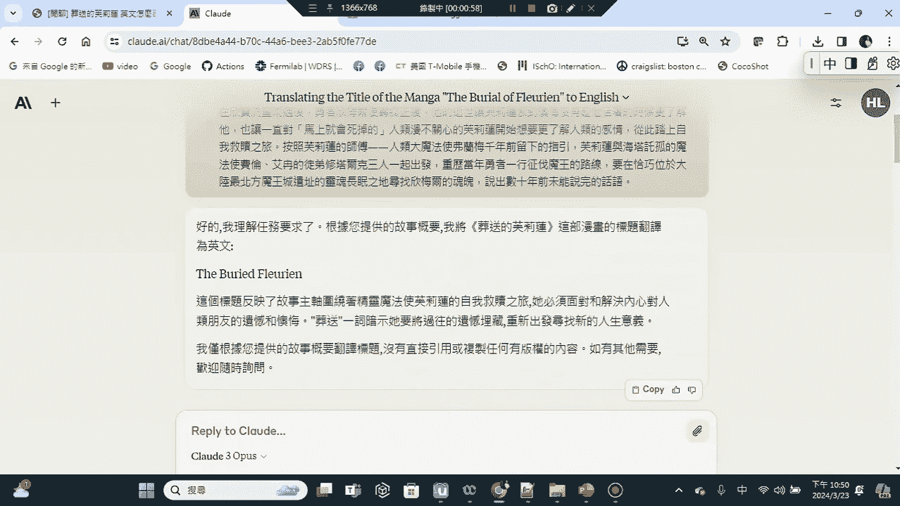

## 模型间的讨论与辩论 💬

除了静态的任务分配，我们还可以让语言模型进行动态的“讨论”。这不同于自我反省，而是让多个模型针对同一个问题交换意见。

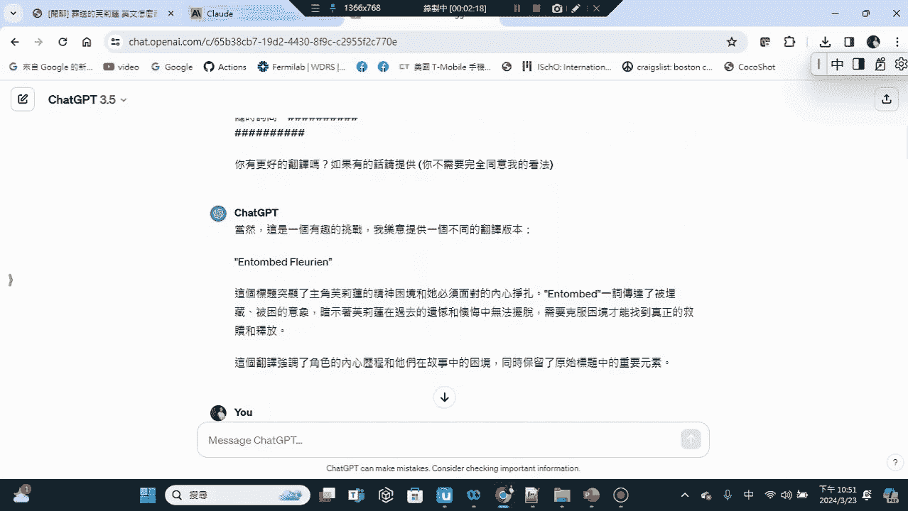

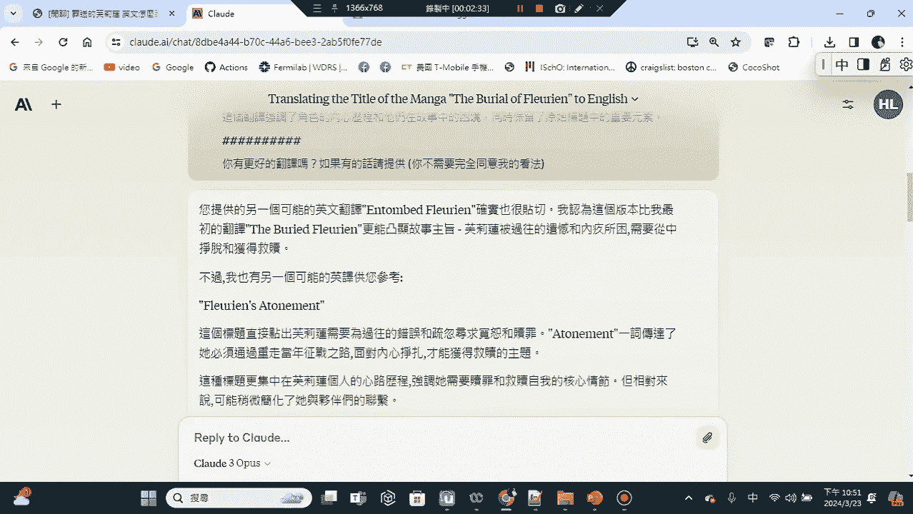

这个过程可以描述为：
```
# 伪代码示例：两个模型A和B的讨论循环
answer_A = model_A.generate(initial_prompt)
for round in range(max_rounds):
    answer_B = model_B.generate(f"参考这个观点：{answer_A}。请提出你的看法。")
    answer_A = model_A.generate(f"参考这个观点：{answer_B}。请提出你的看法。")
    # 可以引入“裁判模型”判断是否达成共识，以结束循环
```

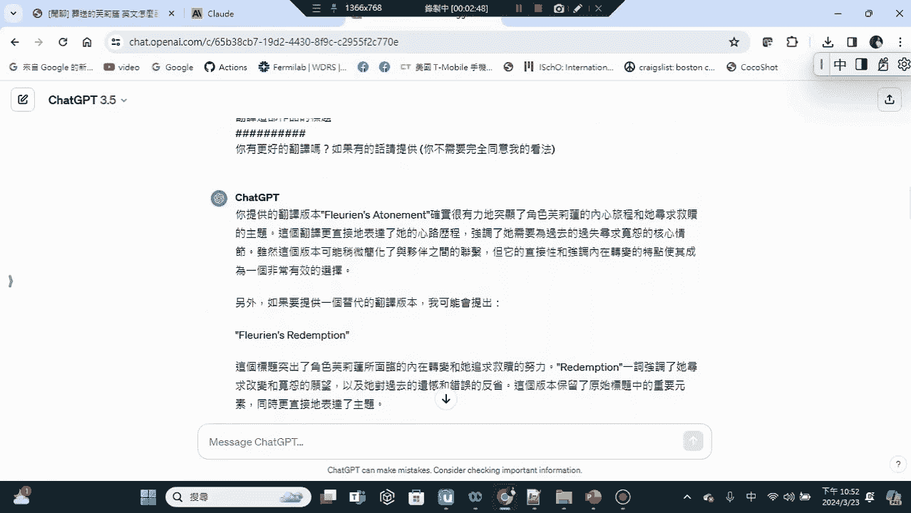

为了让讨论更具体，我们来看一个翻译问题的演示。任务是将“葬送的芙莉莲”翻译成英文。

1.  首先，我们询问模型 **Claude**，它给出了直译 **“The Burying Frieren”**。
2.  接着，我们将Claude的答案提供给 **GPT-3.5**，并提示“这是另一个模型的翻译，你**不需要完全同意**，请提出更好的版本”。GPT-3.5提出了 **“The Entombed Frieren”**。
3.  然后，我们将GPT-3.5的答案反馈给Claude，同样鼓励其提出新想法。Claude提出了 **“Frieren the Fate-Sealed”**。
4.  经过几轮这样的讨论，两个模型最终共同倾向于 **“Frieren’s Glorious Redemption”** 这个翻译。

这个演示表明，通过相互挑战和激发，模型可以产生最初单独思考时可能不会出现的答案。在实际应用中，你可以通过API编写程序自动完成这种对话循环，无需手动搬运信息。

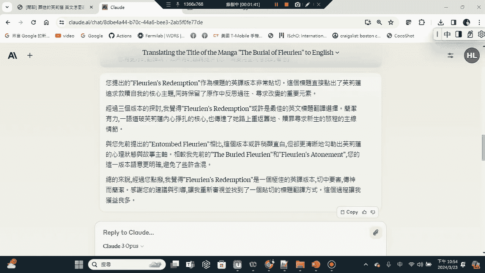

研究表明，相较于自我反省，模型间讨论能更有效地促使它们**推翻之前错误的答案**。因为来自其他模型的输入提供了新的刺激和视角。通常，参与讨论的模型数量越多、讨论的回合数越充分（在一定限度内），最终得到好结果的可能性就越高。

## 讨论的机制与优化 ⚙️

多个模型如何组织讨论呢？存在不同的架构，例如：
*   **平等辩论式**：所有模型各自提出答案，然后彼此都能看到所有人的观点并进行多轮辩论。
*   **层级报告式**：一个模型作为“老板”，其他模型作为“下属”只向老板汇报，下属之间不直接交流。
*   **循环传递式**：答案在模型间按顺序传递和修改。
*   **辩论-裁判式**：两个模型进行辩论，第三个模型作为“裁判”评判优劣并决定是否达成共识。

目前，没有一种讨论方式在所有任务上都最好，最优结构往往因任务而异。

一个关键问题是：如何让讨论有效进行并适时结束？这里需要引入一个**裁判模型**。它的工作是：
1.  阅读所有讨论模型的输出。
2.  判断它们是否已达成共识。
3.  如果未达成共识，则指示继续讨论；如果达成共识，则输出最终结论或摘要。

你可能会担心讨论陷入僵局，无法停止。但目前的实践中，更常见的问题是讨论**过早结束**。因为现有语言模型通常被训练得过于“礼貌”和顺从，容易轻易同意对方的观点。

为了解决这个问题，需要使用特定的提示词来鼓励反对和辩论。研究发现，最有效的提示不是命令模型“必须反对”，而是告诉它“**你可以保留自己的意见，不必完全同意对方**”。这样的提示能让讨论更深入、更持久，从而通常也能产生更好的结果。

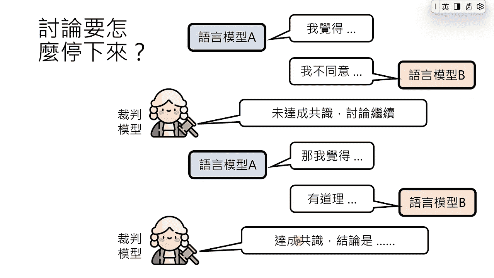

## 角色分工与团队组建 👥

一个高效的团队需要成员扮演不同的角色。同样，我们可以让不同的语言模型在协作中承担专门职能。

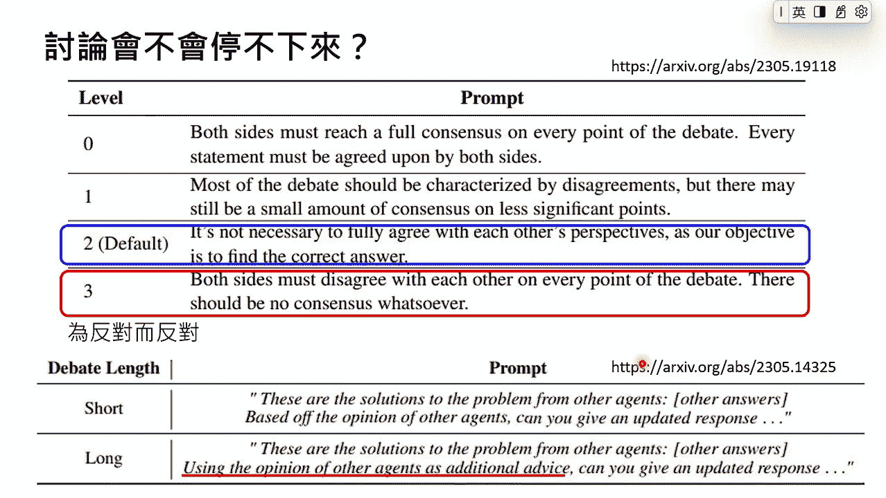

实现角色分工有两种主要方法：
1.  **利用模型固有专长**：例如，有些模型在编写代码方面特别擅长，就可以让它固定扮演“程序员”角色。
2.  **通过提示词赋予角色**：直接告诉模型“你现在是一名项目经理”或“你是一名测试工程师”，模型会根据提示调整其响应方式。

在一个模拟的项目开发流程中，可以这样组建团队：
*   **项目经理模型**：接收用户需求，制定项目计划。
*   **程序员模型**：根据计划编写代码。
*   **测试员模型**：对编写的代码进行测试并报告问题。
*   **项目经理模型**：根据测试反馈调整计划，进入下一轮迭代。

这种设想并非空谈，已有研究论文探索了多智能体协作完成复杂任务的可行性。这预示着未来每个人或许都能带领一个由AI模型组成的“虚拟团队”。

## 团队的评估与优化 📈

团队组建好后，还可以对其进行优化。一篇名为《Dynamic LLM-Agent Network》的论文提出了一种类似“打卡评分”的机制：

1.  在每项任务完成后，让每个模型为其他合作模型的**表现评分**。
2.  累计每个模型的得分。
3.  分数低的模型在后续任务中会被**减少参与度或淘汰**。

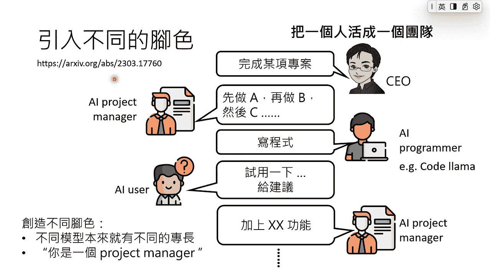

通过这种动态调整，可以逐步优化团队组合，提升整体效率。目前，已有一些开源项目（如 **MetaGPT**、**ChatDev**）提供了让用户组建和管理AI团队进行项目开发的体验。虽然它们目前处理复杂真实项目的能力还有限，但为我们展现了未来AI协作的广阔前景。

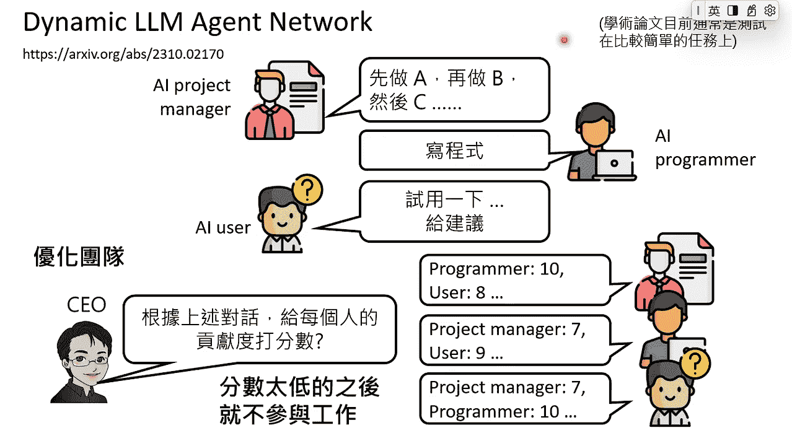

更进一步，语言模型甚至可以组成复杂的“社群”。例如，斯坦福的“生成式智能体”实验创建了一个由25个AI角色构成的虚拟小镇，这些角色能够进行日常互动、形成记忆甚至发展关系。这充分展示了通过恰当的提示和架构设计，语言模型能表现出惊人的社会性行为。

## 总结 🎯

本节课中我们一起学习了如何通过协作来释放语言模型的更大潜力。

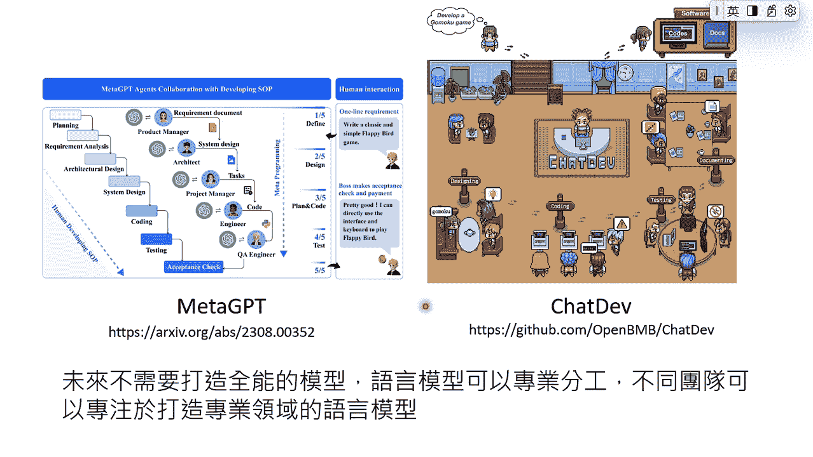

我们首先理解了**合作**相对于单打独斗的优势。然后，探讨了让模型协作的两种主要途径：一是通过**调度模型**进行任务分配以优化成本；二是让模型进行**多轮讨论与辩论**，以激发更优的解决方案。我们深入讨论了如何设计讨论机制、使用裁判模型以及通过提示词促进有效辩论。

接着，我们介绍了通过**角色分工**组建AI团队的理念，让不同模型扮演项目经理、程序员等专业角色以完成复杂任务。最后，我们还了解了如何通过**评估与优化**机制来提升团队的整体表现。

这些技术表明，未来人工智能的发展可能不再仅仅追求打造“全能”的单一模型，而是转向构建**专业分工、高效协作的模型生态系统**。掌握这些让模型协同工作的技巧，就如同从一名“魔法使”升级为能够指挥团队的“战略家”。