# 12：第6讲：大型语言模型修炼史 — 第一阶段：自我学习，累积实力 🧑‍🎓

在本节课中，我们将要学习大型语言模型是如何从零开始，通过海量数据自我学习，从而获得广泛但尚不精确的知识能力的。我们将回顾语言模型训练的第一阶段，理解其核心原理、面临的挑战以及早期模型的局限性。

---

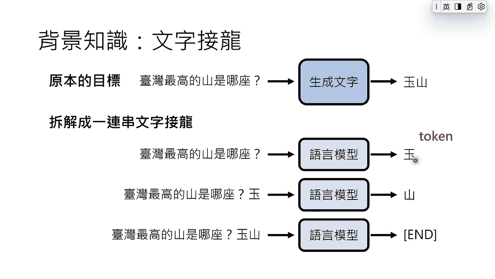

## 背景知识：语言模型与文字接龙

在深入探讨训练过程之前，我们需要明确一些核心概念。我们再三强调，大型语言模型的核心任务就是**文字接龙**。当模型生成答案时，它实际上是在将答案中的文字（或符号）一个接一个地预测出来。

在预测过程中，模型每次产生的符号被称为 **token**。在本课程中，为简化说明，我们将一个中文字视为一个token。实际上，不同模型对token的定义可能不同（例如，ChatGPT可能用两三个token表示一个中文字）。

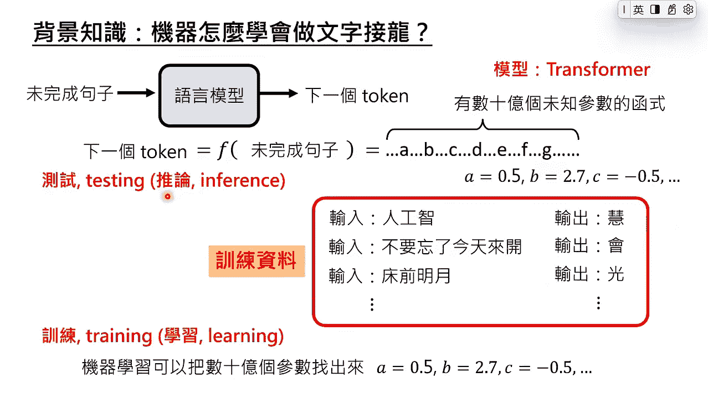

那么，机器如何学会文字接龙呢？这需要通过**机器学习**来实现。

### 机器学习与模型训练

一个语言模型可以看作一个函数 **F**。它的输入是一个未完成的句子，输出是这个句子接下来最可能接的token。这个函数非常复杂，可能包含**数十亿个未知参数**。

*   **模型**：这个拥有大量未知参数的函数就是模型。
*   **训练资料**：我们需要收集大量训练数据来告诉模型，给定一个未完成的句子，正确的下一个token是什么。例如：
    *   “人工智” 后面应该接 “会”。
    *   “床前明月” 后面应该接 “光”。
*   **训练/学习**：机器学习算法根据这些训练资料，自动找出那数十亿个参数的过程。
*   **测试/推论**：找到参数后，使用这个函数来进行文字接龙预测的过程。

**总结来说，机器学习分为两步：寻找参数（训练）和使用参数（测试）。**

---

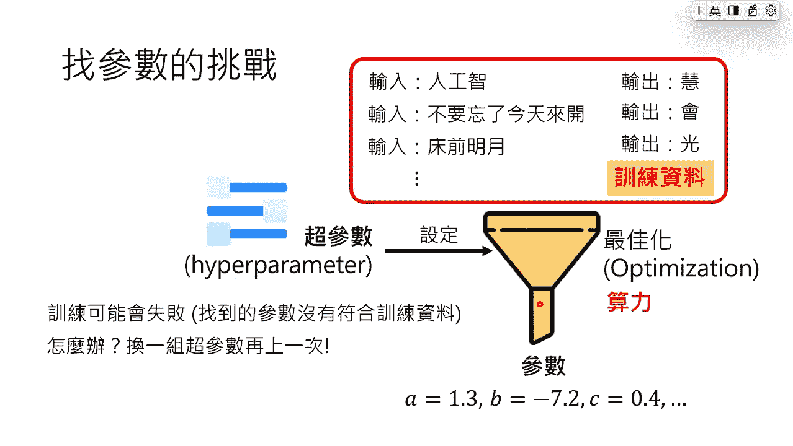

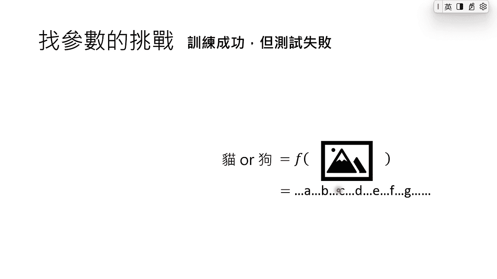

## 训练中的挑战：最佳化与过拟合

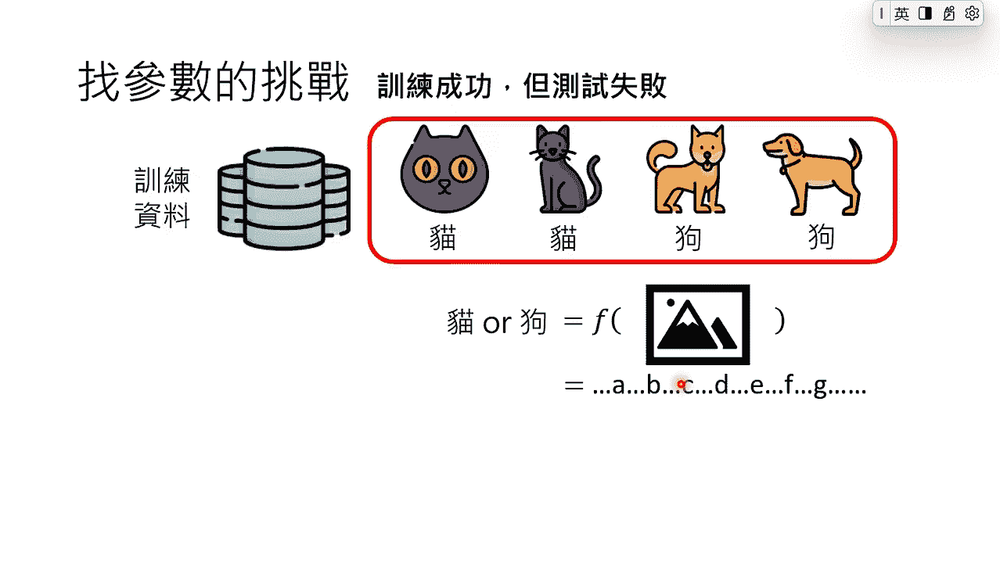

上一节我们介绍了训练的基本概念，本节中我们来看看训练过程中会遇到哪些主要挑战。

### 挑战一：训练过程的随机性与超参数

寻找最佳参数的过程也称为**最佳化**。你可以将其想象成一部机器，启动前需要设定一些**超参数**。设定好超参数，就固定了最佳化的方法。

然而，训练具有随机性，可能失败（即找到的参数不符合训练资料）。常见的解决方法是**更换一组超参数重新尝试**。由于超参数与结果之间的关系复杂难明，往往需要大量计算资源进行反复尝试，这就是所谓的“调参”（调整超参数）。

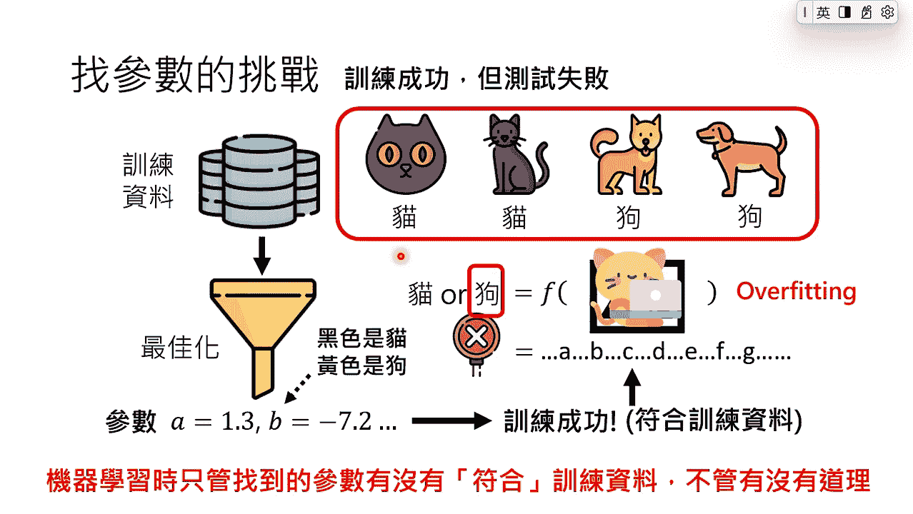

**注意**：人们常说的“深度学习就是调参数”，指的是调整**超参数**，而非模型内部那数十亿个自动学习的参数。

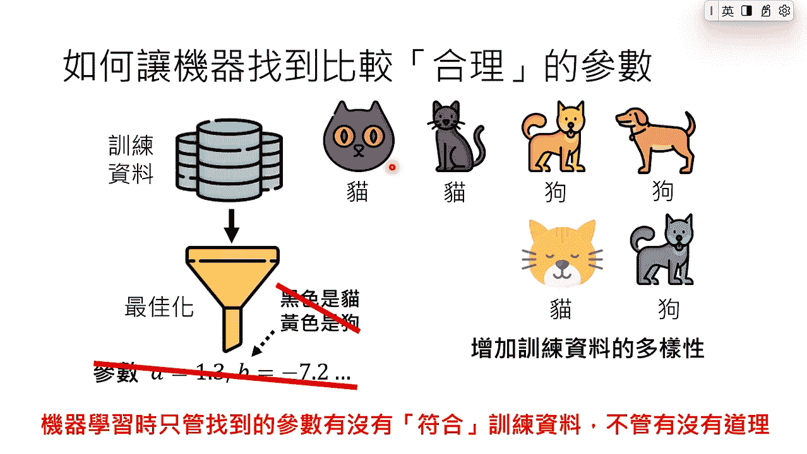

### 挑战二：过拟合

另一个更棘手的问题是**训练成功但测试失败**，即**过拟合**。

举个例子，假设我们要训练一个猫狗分类器。训练资料中恰好所有猫都是黑色的，所有狗都是黄色的。模型可能会找到一组参数，简单地认为“黑色就是猫，黄色就是狗”。这组参数能完美匹配训练资料（训练成功），但当遇到一只黄色的猫时，模型会错误地将其分类为狗（测试失败）。

**关键点**：机器在学习时，只关心参数是否满足训练资料的限制，而不会像人类一样思考“颜色不重要，形状才重要”。它完全不会考虑参数的“合理性”或泛化能力。

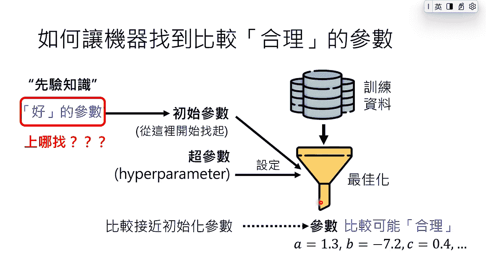

如何缓解过拟合？一个核心方法是**增加训练资料的多样性**。例如，在训练集中加入黄色猫和黑色狗的图片，迫使模型寻找更本质的特征（如形状、纹理）来区分猫狗，而不是仅仅依赖颜色。

---

## 训练第一阶段：自我监督学习

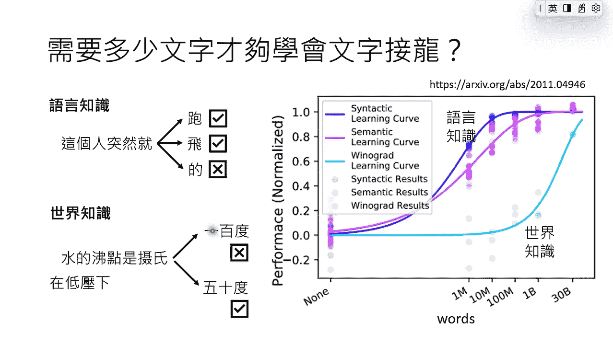

了解了训练的基础与挑战后，我们正式进入语言模型修炼的第一阶段。这个阶段的核心是：让模型通过海量文本，自学文字接龙。

### 需要学习什么：语言知识与世界知识

要正确地进行文字接龙，模型需要掌握两类知识：
1.  **语言知识**：理解人类语言的语法、句法。例如，“这个人突然就”后面可以接“跑”，但接“的”就不通顺。学习语言知识可能不需要极大量的数据。
2.  **世界知识**：理解物理世界和人类社会的常识。例如，“水的沸点是摄氏”后面接“100度”是正确的，接“50度”则不符合常识。世界知识层次复杂，需要**极其庞大**的数据量才能让模型掌握。

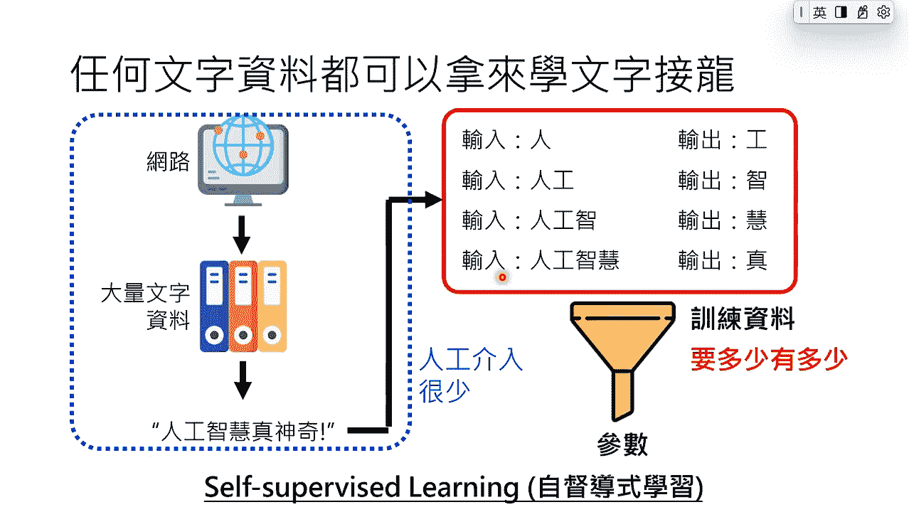

### 数据从何而来：网络爬取

那么，海量的训练数据从哪里来？最主要的来源是**互联网**。网络上有近乎无穷无尽的网页和文字。

训练数据的构建过程如下：
1.  从网络上爬取大量文本。
2.  将句子整理成文字接龙的训练格式。例如，句子“人工智能真神奇”会被转化为多组训练对：（“人”, “工”）、（“人工”, “智”）、（“人工智”, “会”）、（“人工智能”, “真”）……

这种几乎不需要人工标注，由机器从原始数据中自行构造训练目标的学习方式，称为**自我监督学习**。

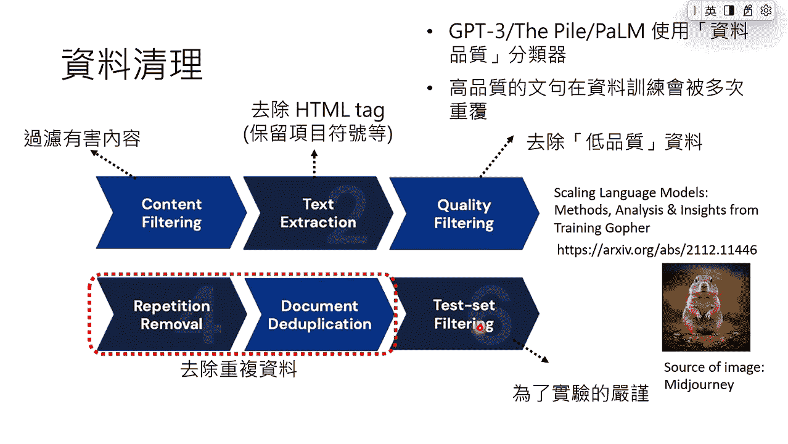

### 数据清洗：必要的加工

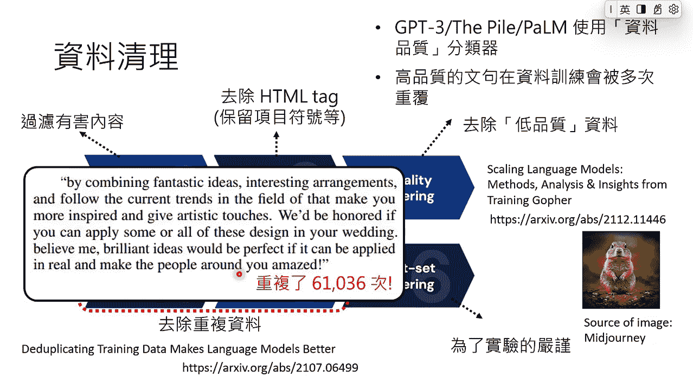

虽然网络数据丰富，但直接使用往往需要经过清洗和处理。以下是常见的处理步骤：

以下是数据清洗的主要步骤：
*   **过滤有害内容**：移除涉及色情、暴力等内容的文本。
*   **移除无用符号**：清理HTML标签等对语言模型无意义的符号（但可能保留表情符号等有用符号）。
*   **质量控制**：使用分类器判断数据质量（如维基百科、教科书类文本被视为高质量），并在训练中让高质量数据有更大权重。
*   **去除重复数据**：网络数据存在大量重复（如某婚礼广告重复了六万次），去除重复可防止模型过度学习并输出垃圾信息。
*   **法律与授权考量**：并非所有文本都能随意使用，需注意数据版权问题。

---

## 早期模型的探索：从GPT-1到GPT-3

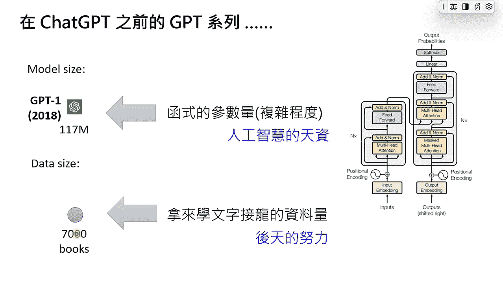

接下来，我们通过OpenAI的GPT系列模型，回顾第一阶段修炼的历史进程。

我们可以将**参数量**比喻为模型的“天资”（天生复杂度），将**训练数据量**比喻为“后天的努力”。两者缺一不可。

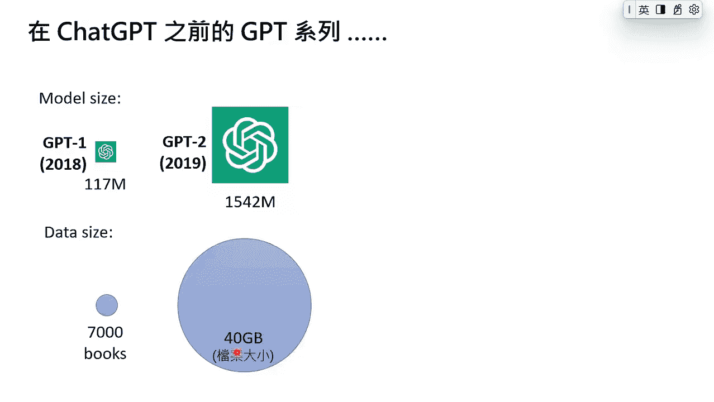

*   **GPT-1**：2018年发布。参数量1.17亿，训练数据约700本书。模型较小，未引起广泛关注。
*   **GPT-2**：2019年发布。参数量15亿（是GPT-1的10倍），训练数据40GB。虽然模型变大，但在多项任务上的表现（如回答问题正确率约55%）并未显著超越同期其他模型。
*   **GPT-3**：2020年发布。参数量1750亿（是GPT-2的100倍），训练数据达3000亿个token（约相当于阅读《哈利波特》全集30万遍）。这是一个在规模和数据量上都空前巨大的模型。

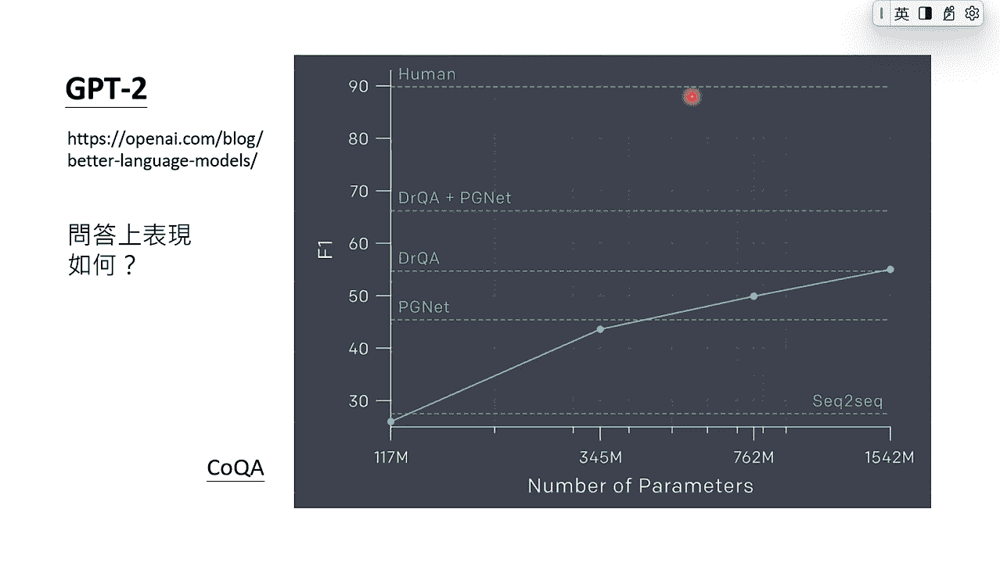

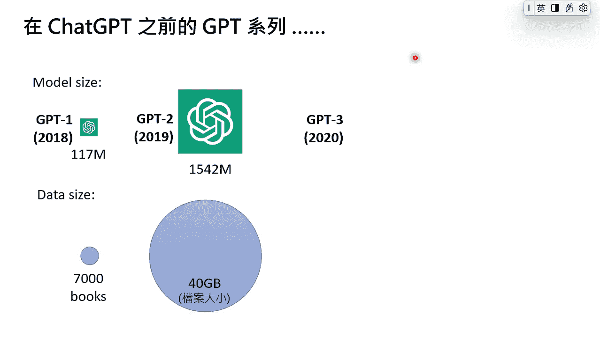

然而，即便是庞大的GPT-3，其表现依然不尽如人意。在标准测试中，其回答问题正确率仅提升至50%多，且在实际使用时问题显著。

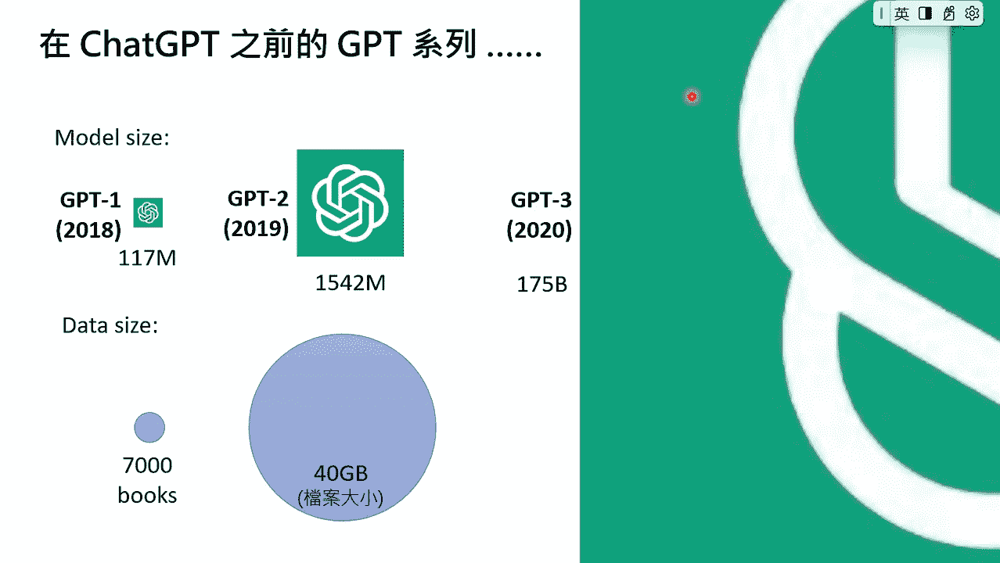

---

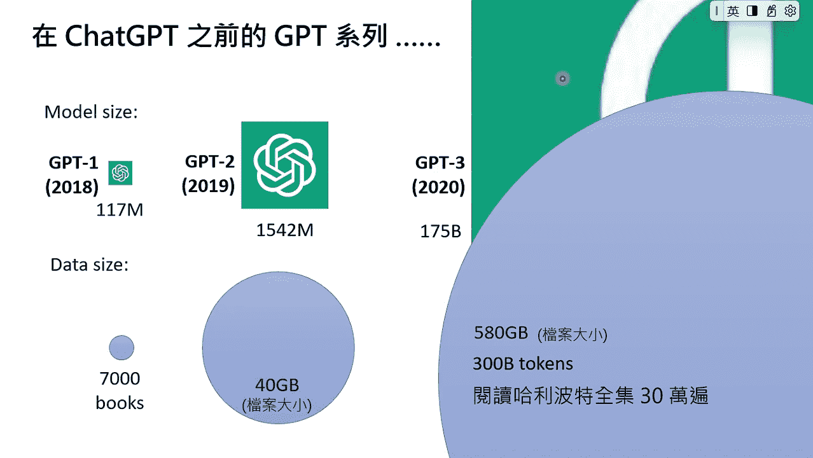

## 第一阶段模型的局限性

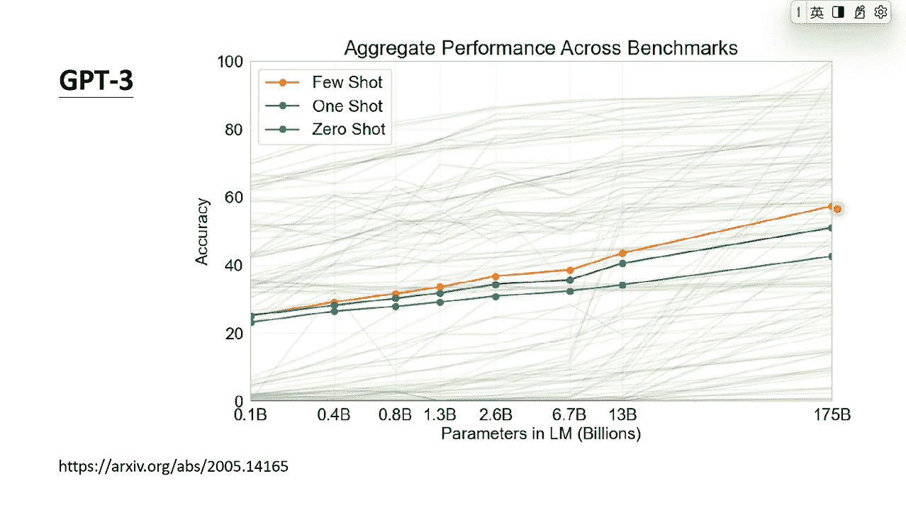

那么，用如此巨量数据和参数训练出的GPT-3，用起来到底是什么感觉？其核心问题是：**难以控制，且经常不按指令行事**。

例如，当你问它“What is machine learning?”，它可能不会直接回答，反而会反问“What course should I take?”。你需要精心设计提示词，比如在问题后加上“Answer:”来强制它生成答案，它才会照做。即使如此，它仍可能自问自答，产生无关输出。

为什么模型会这样？**因为我们在第一阶段只教了它“文字接龙”，从未明确教它“如何回答问题”**。它从网络上学到的模式是：一个问题后面，可能跟着选项、评论、广告，或是另一个问题。它并不知道人类期望它直接给出简洁准确的答案。

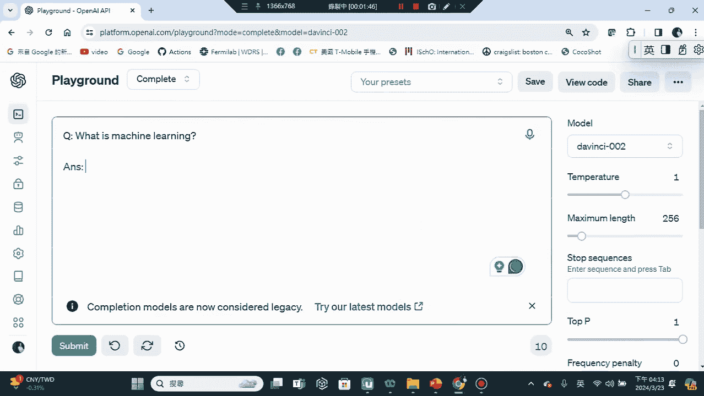

Google同期训练的更大模型PaLM也存在类似问题，经常在回答中反问用户更多问题。

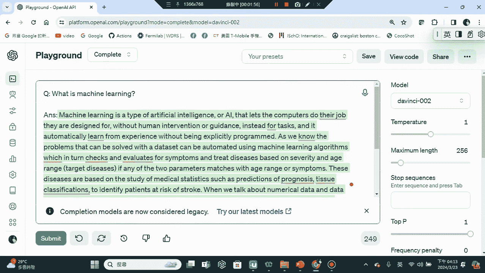

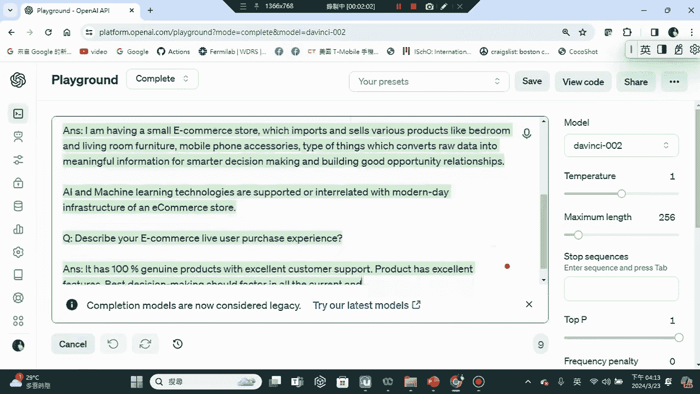

---

## 总结与过渡

本节课中，我们一起学习了大型语言模型修炼的第一阶段：**自我学习，累积实力**。

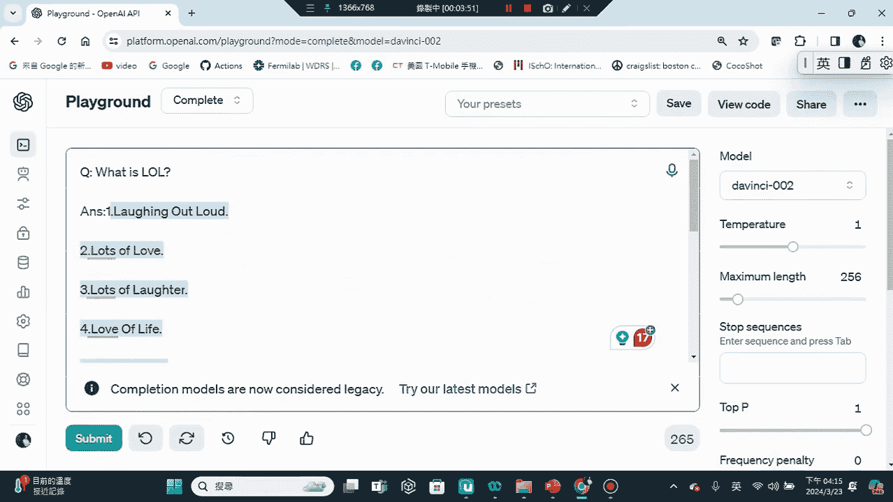

在这个阶段，模型通过**自我监督学习**的方式，从海量网络文本中学习“文字接龙”，从而积累了广泛的**语言知识**和**世界知识**。从GPT-1到GPT-3，我们看到通过不断增大模型规模（天资）和训练数据量（努力），模型的知识储备越来越丰富。

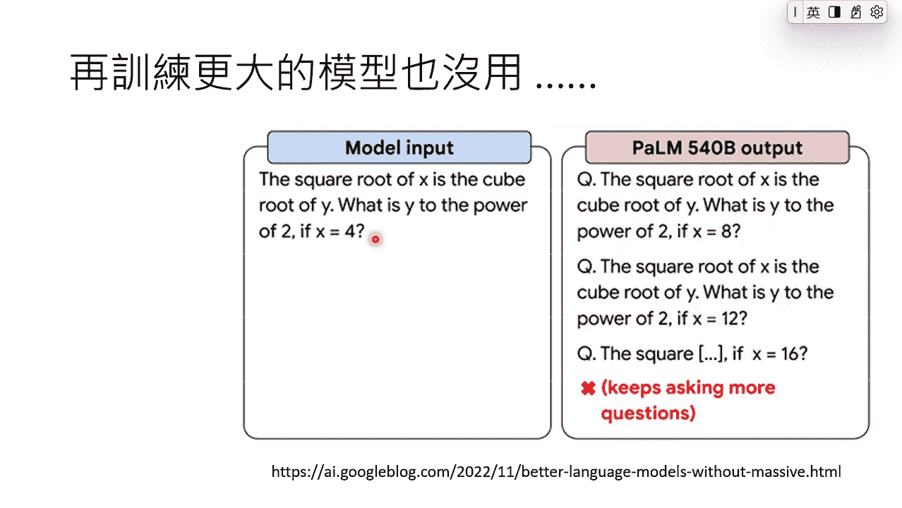

然而，这个阶段的模型就像一个**“啥都会一点的研究生”**：它博览群书，知识面广，但却**不知道如何运用这些知识来完成任务**。它缺乏与人类意图对齐的能力，输出难以控制且不稳定。

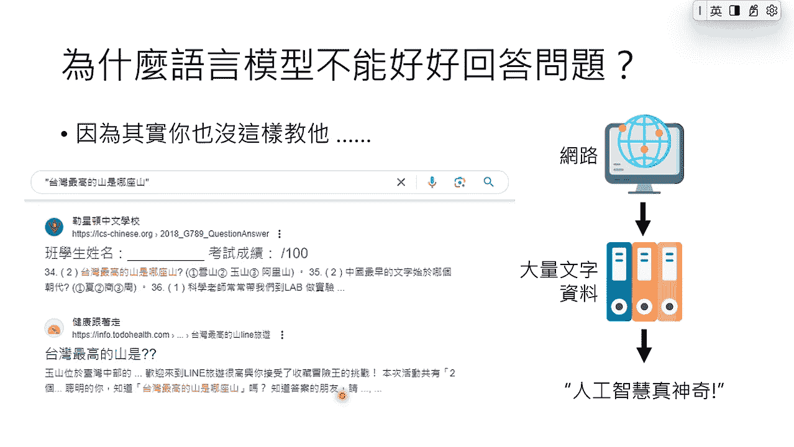

这就像是武侠小说中的石破天，在摩天崖上练就了深厚的内功，却完全不知道如何使用。因此，接下来就需要进入修炼的**第二阶段：由人类进行指导**，教会模型如何正确地使用其能力来服务于人类的需求。我们将在下一讲中详细探讨。