# 13：AI村民虚拟村庄实验 🏘️🤖

在本节课中，我们将要学习一篇来自斯坦福大学和谷歌的研究论文。该研究构建了一个由25个AI村民组成的虚拟村庄，并观察他们在两天内的互动与行为。这些村民均由类似ChatGPT的大型语言模型驱动，并拥有各自的人设和日程。我们将深入探讨这些AI如何规划生活、处理外部信息、进行“反思”，并最终发展出复杂的社会关系。

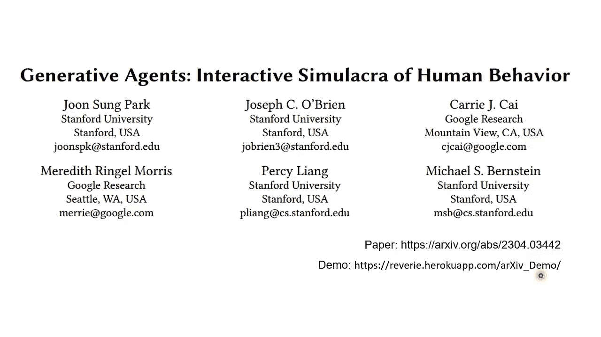

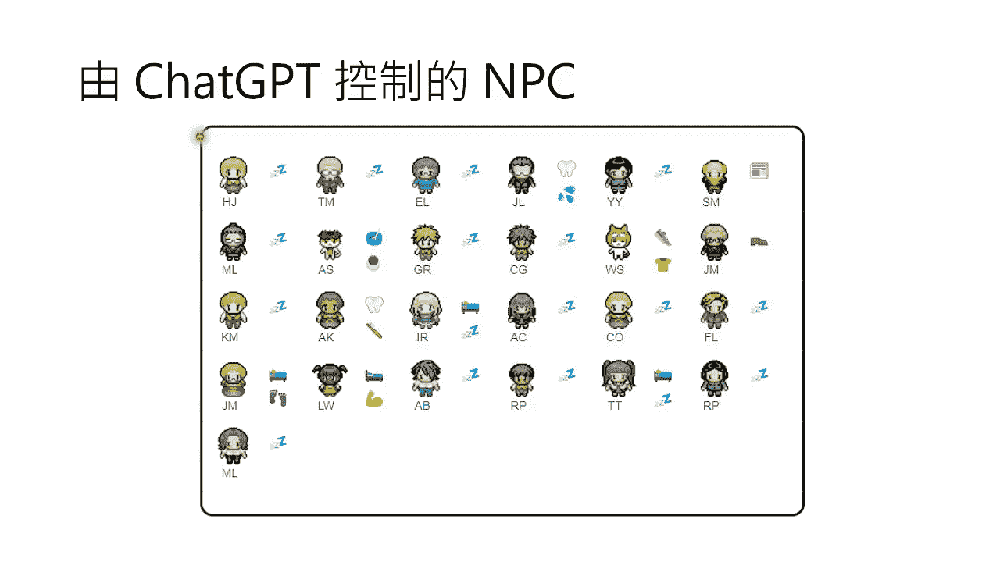

---

## 实验概述


该研究构建了一个虚拟村庄，其中所有村民（即智能体或NPC）均由大型语言模型操控。每个村民都有预先设定的人设和初始目标。例如，一位名叫伊莎贝拉的村民经营一家咖啡店，并计划在2月14日举办情人节派对。研究的目标是观察这些具备自主规划与互动能力的AI，在模拟环境中会自然演化出何种行为与社会动态。


这个实验让人联想到电影《失控玩家》，其中由程序控制的NPC在遇到玩家（人类）后，行为模式发生了改变。在本研究中，每个NPC背后都是一个AI，它们依据内部规划和外部刺激进行活动。


---


## AI村民的行为机制


上一节我们介绍了实验的基本设定，本节中我们来看看这些AI村民具体是如何被操控和运作的。

每个AI村民的行为生成遵循一个核心流程：首先由背后的语言模型根据当前状态生成一个“行为描述”，然后通过一个转换器将此描述翻译成虚拟环境能够理解的指令，从而执行具体动作。

**核心行为生成流程**：
```python
# 伪代码示意
当前状态 = 获取环境感知()
行为描述 = 语言模型.生成(当前状态， 记忆， 规划)
环境指令 = 转换器.翻译(行为描述)
执行(环境指令)
```
其中，“行为描述”的生成是智能的核心，而“翻译”步骤可能由预设的规则系统处理。

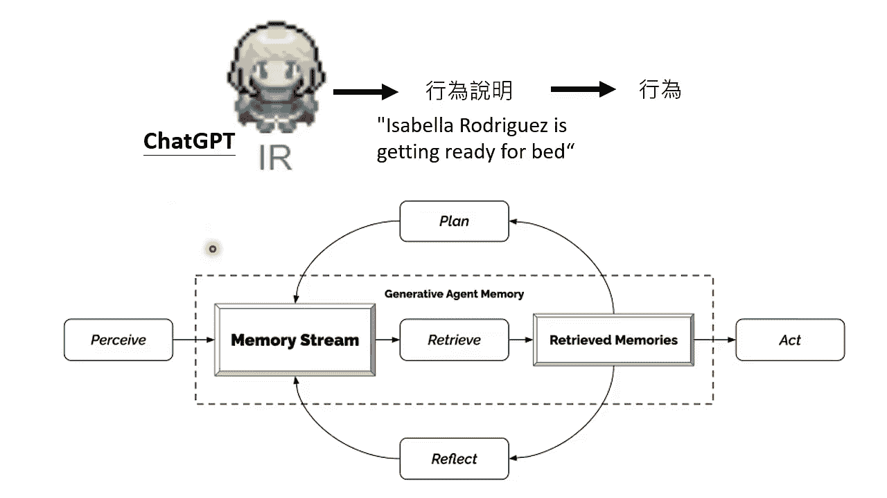

---

## 关键技术：分层规划与反思


如果AI只是被动响应环境，其行为会显得重复且呆板。为了让它们的行为更丰富、更适应动态环境，研究采用了两个关键技术：分层规划和反思机制。

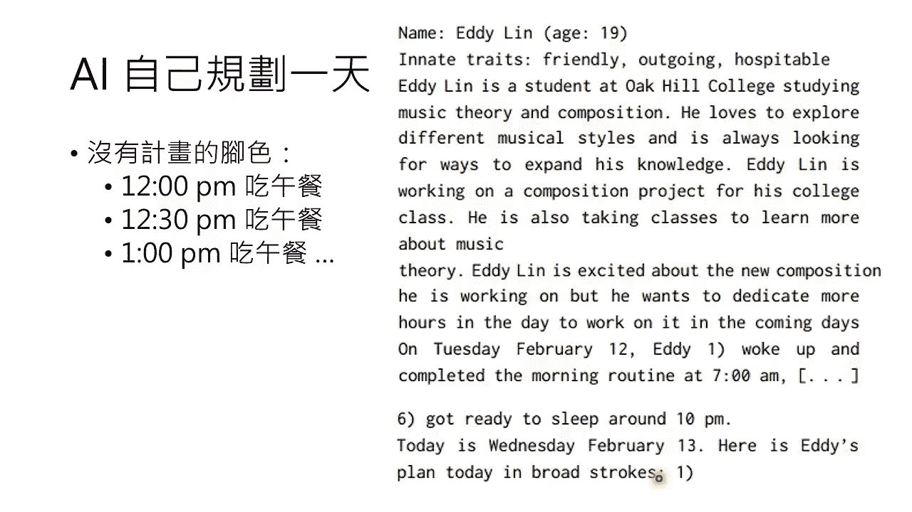

### 分层规划

AI不能只根据当前时刻做决定，否则可能出现不合逻辑的重复行为（例如一直吃午餐）。因此，系统让AI先为自己规划一整天的粗略日程，再逐步细化。


以下是规划过程的分解：

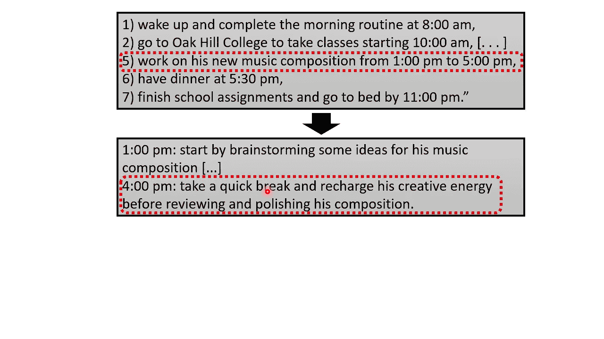

1.  **生成每日概要计划**：AI根据其角色设定（如“19岁的大学生”）和过往记忆，生成一天的主要活动时间表。
    > **示例计划**：8:00起床，10:00上课，13:00-17:00音乐创作，17:30晚餐，23:30睡觉。

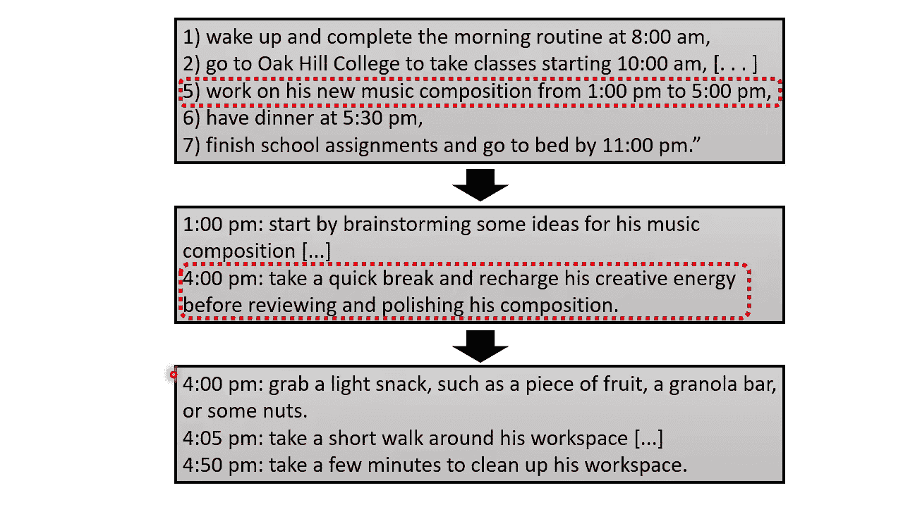

2.  **细化至小时计划**：将概要计划中的每个大块活动，分解为以小时为单位的更具体任务。
    > **示例细化**：13:00-14:00 头脑风暴作曲灵感，16:00-17:00 休息并回顾作曲思路。

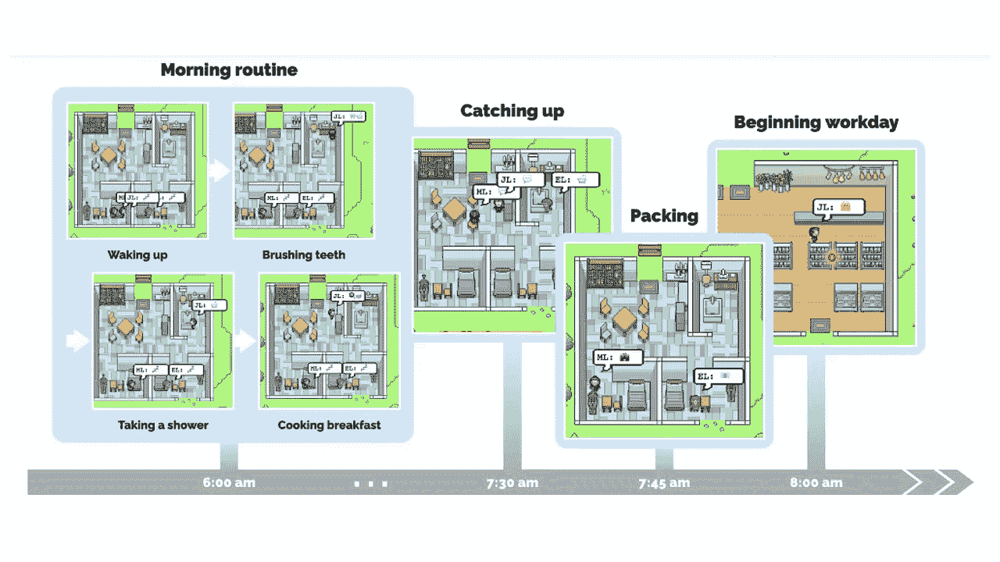

3.  **细化至分钟计划**：对于即将执行的任务，进一步规划未来几分钟内的具体动作。
    > **示例细化**：16:00 拿点心，16:05 散步，16:50 打扫工作区。

通过这种分层规划，AI能够有条理地安排自己的时间，并按计划行动。

### 反思机制

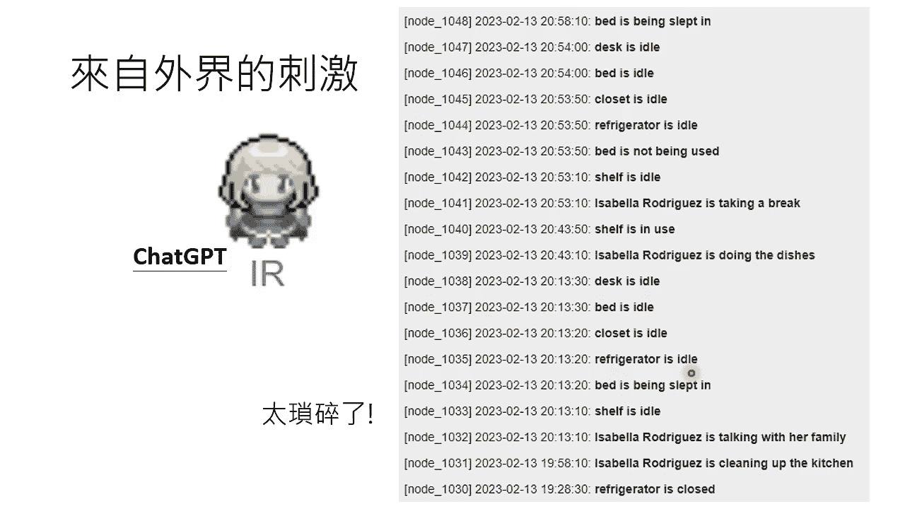

如果AI只会按计划行事，那么每天都会重复相同的行为，缺乏趣味性。因此，系统引入了“反思”机制，让AI能够处理外部刺激，并据此调整计划和形成新的认知。

反思机制主要解决两个问题：**何时反思**以及**反思什么**。

*   **何时反思**：AI会持续接收环境信息（如“看到一张桌子”）。系统使用语言模型为每个事件的重要性打分（1-10分）。当累积的重要性分数达到阈值时，便触发一次反思。
    *   **重要性评估提示词示例**：“请以1-10分评估以下事件的重要性，1分为‘刷牙’这类日常琐事，10分为‘分手’或‘被大学录取’这类重大事件。事件：‘看到克劳斯和玛利亚在一起散步’。请打分。”

*   **反思什么**：触发反思后，AI会执行以下步骤：
    1.  **提出问题**：根据近期重要事件，向自己提出几个问题（例如：“克劳斯和玛利亚是否在交往？”）。
    2.  **检索相关记忆**：从海量记忆中搜索与问题相关的片段。检索依据三个标准：记忆本身的重要性、时效性（是否近期发生）、以及与问题的相关性（通过语义相似度计算）。
    3.  **生成高层见解**：基于检索出的记忆，生成几个概括性的“见解”或结论，并标注这些结论来源于哪些具体记忆。这些见解会被存入AI的长期记忆。

**反思的本质**：可以理解为AI对琐碎观察进行归纳总结，形成主观认知的过程。这类似于人们根据一些迹象（如“学妹常让我修电脑”）产生某种想法（如“她可能喜欢我”）。这种认知不一定符合事实，但会深刻影响AI后续的行为。

---

## AI的记忆与决策构成

上一节我们了解了AI如何规划和反思，本节中我们整合来看AI村民的“大脑”里到底有什么，以及这些信息如何最终影响其行为。

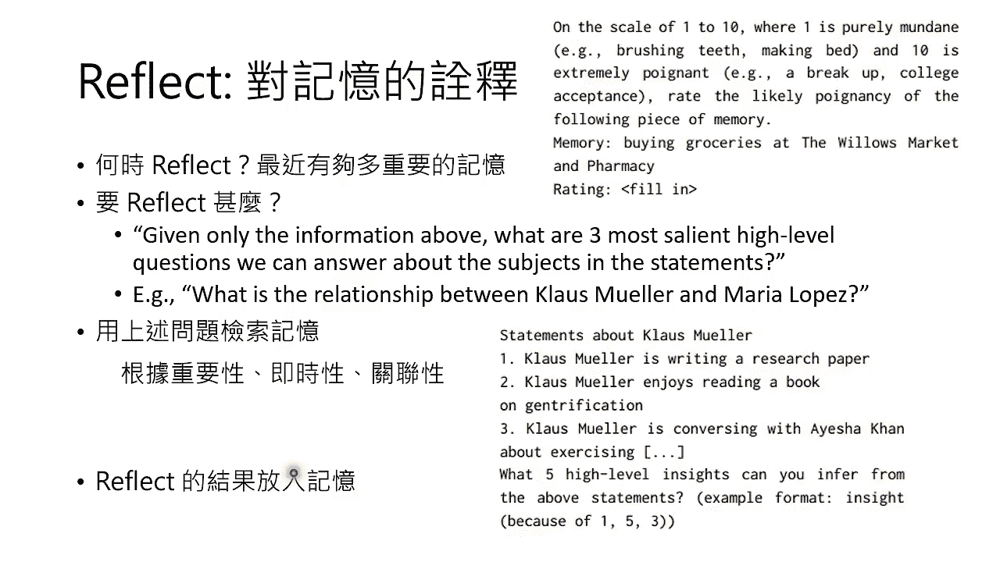

每个AI村民的内部记忆包含以下三类信息：
1.  **观察**：从环境直接感知到的原始信息。
2.  **计划**：通过分层规划产生的日程安排。
3.  **反思**：通过反思机制产生的高层见解和结论。

AI的决策是一个动态过程。每天早上，它会制定初始计划。但在执行过程中，每当感知到新事物（如遇到另一个村民），它会进行如下评估：
1.  这个事物与我的关系是什么？（例如：他是我的儿子。）
2.  这个事物当前的状态是什么？（例如：他正从我面前走过。）

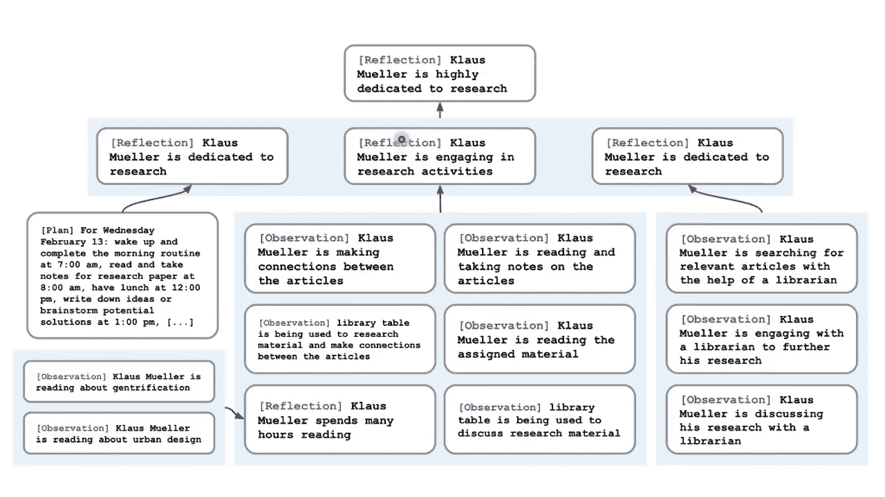

基于这些评估，AI会检索相关记忆（包括观察、计划和反思），生成一份当前情境的摘要报告。然后，AI会自问是否需要根据这份报告**调整现有计划**。如果需要，则生成新的行动计划并执行。

例如，约翰看到儿子艾迪走过，经过上述过程，可能决定“想和艾迪说话”，从而中断原有动线，转向与儿子交谈。

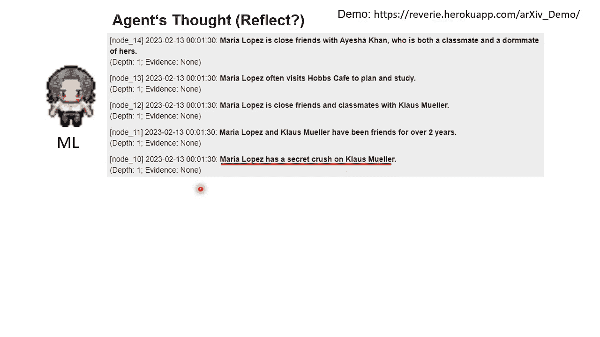

---

## 村民互动与社会关系演化

当AI决定与其他村民互动（如对话）时，会触发专门的交流流程。

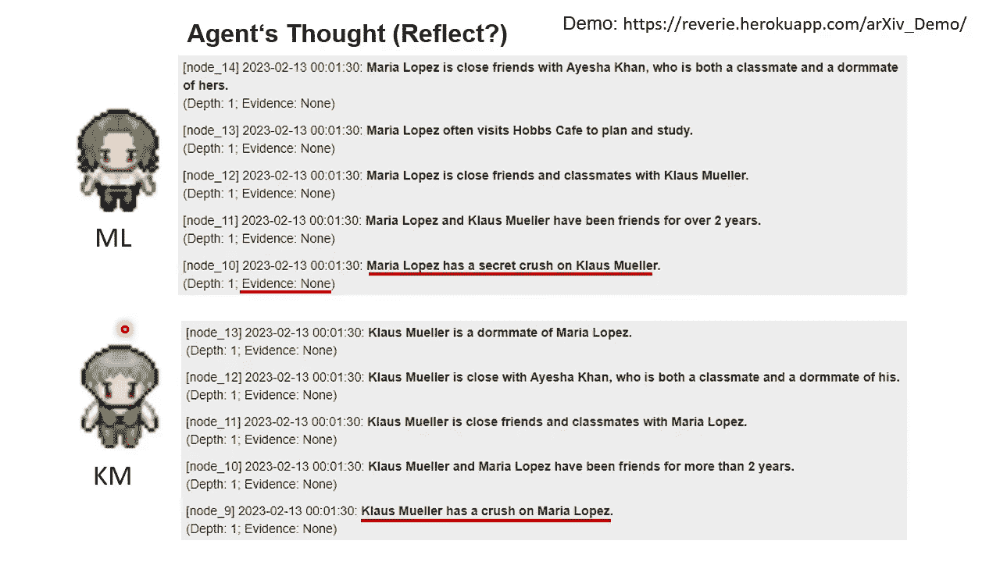

1.  **生成对话摘要**：发起对话的AI会从其记忆中提取与目标村民相关的信息，生成一个对话背景摘要。
    > **示例**：约翰知道艾迪最近在作曲，摘要可能包含：“艾迪正在推进他的音乐创作计划。”

2.  **生成具体问题**：基于摘要，AI形成一个具体的对话开场。
    > **示例**：约翰问：“儿子，你的作曲计划进展得怎么样了？”

3.  **接收与回复**：目标村民（艾迪）收到问题后，会结合自己的全部记忆生成回复。
    > **示例**：艾迪答：“爸爸，进展得很顺利。”

研究者指出，由于底层是经过对齐训练的语言模型，这些AI村民的对话通常非常礼貌、正面，缺乏戏剧性的冲突或“洒狗血”的剧情，整体氛围“父慈子孝”。

尽管如此，AI之间仍能发展出有趣的社会关系。在实验演示中，研究者通过“反思”机制，为村民玛利亚和克劳斯分别植入了“暗恋对方”的想法（这些想法缺乏具体的观察证据，因此被认为是研究者手动添加的剧情种子）。这使得他们之间的关系变得微妙。

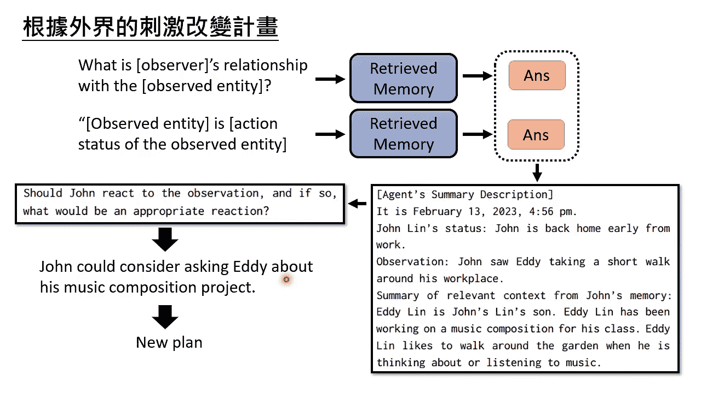

---

## 关键事件：情人节派对

实验的高潮发生在2月14日。计划举办派对的伊莎贝拉开始邀请村民。信息通过AI之间的对话网络传播开来，形成了一张“信息传播图”，反映了村民间的人际关系。

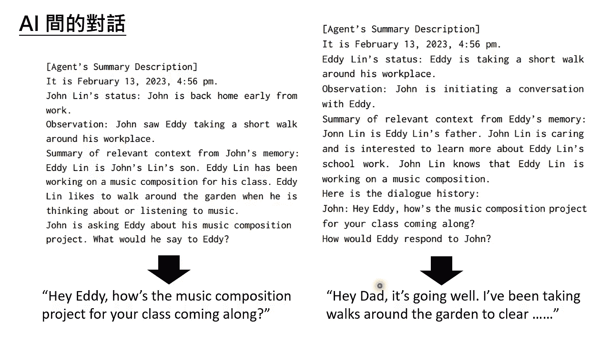

情人节当天的情况颇具现实意味：虽然多人表示会参加，但最终实际到场的人数有限。然而，暗恋彼此的玛利亚和克劳斯恰巧都来到了派对。在派对上，玛利亚邀请克劳斯同坐，为他们的关系发展创造了机会。根据研究者的叙述，在后续的互动中，两人最终互相告白并成为情侣。

这个简单却完整的故事线，展示了多个具备规划、记忆、反思和社交能力的AI，如何在预设规则和初始种子的引导下，演化出具有一定连贯性和情感色彩的社会叙事。

---

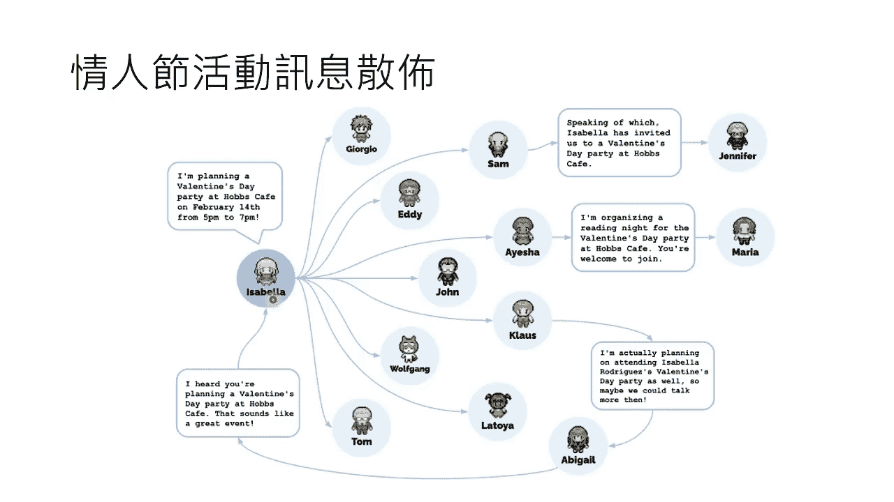


## 总结

本节课中我们一起学习了“AI村民虚拟村庄”这项前沿研究。我们了解到：

1.  **核心架构**：每个村民由大型语言模型驱动，通过“生成行为描述 -> 翻译为环境指令”的流程行动。
2.  **关键技术**：采用**分层规划**（从日计划到分钟计划）使AI行为有条理；引入**反思机制**让AI能从琐碎观察中提炼重要信息，形成主观认知并调整行为。
3.  **决策过程**：AI综合**观察**、**计划**和**反思**三类记忆，在遇到刺激时动态评估并可能修改计划。
4.  **社交互动**：AI能进行基于记忆的对话，并在群体中传播信息。虽然互动风格偏正面，但仍能发展出复杂的社会关系网络。
5.  **叙事潜力**：通过植入初始“反思”作为剧情种子，AI群体可以演绎出如“暗恋-告白”这样的简单社会故事。


这项研究不仅有趣，其采用的分层规划、基于重要性触发的反思、记忆检索与融合等技术，为构建能够处理复杂、长期任务的AI智能体提供了有价值的参考框架。