# 14：(延申)机器学习模型的可解释性 (Explainable ML) (上) – 为什么类神经网络可以正确分辨宝可梦和数码宝贝呢 🤔

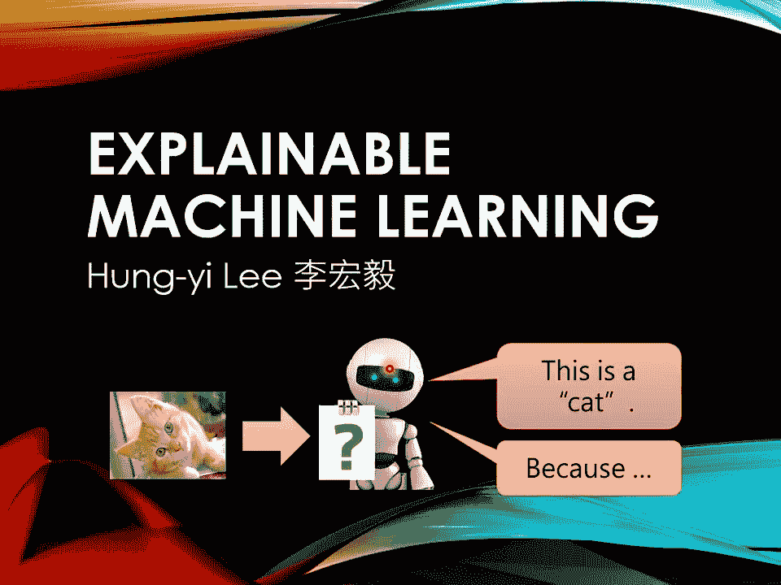

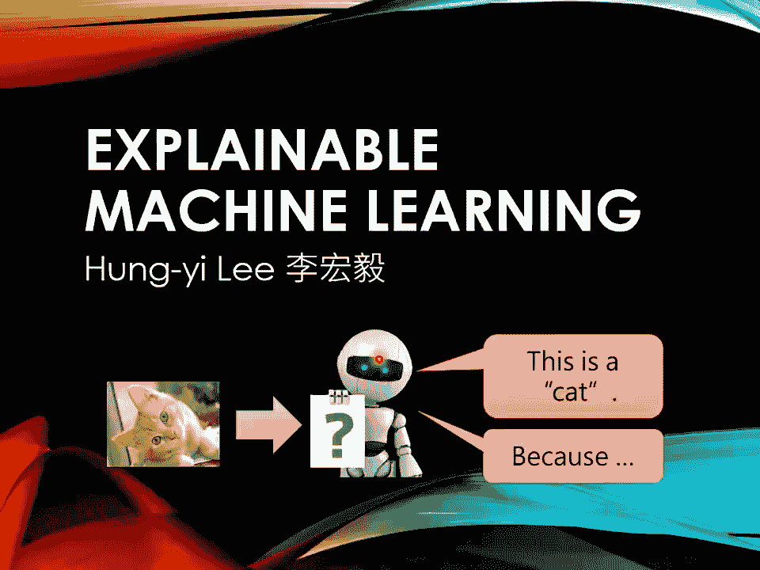

在本节课中，我们将要学习机器学习模型的可解释性。到目前为止，我们已经训练了很多模型，例如图像分类模型，给它一张图片，它会给出答案。但我们并不满足于此。接下来，我们希望机器能告诉我们它得到答案的理由。

这就是可解释机器学习。

## 为什么可解释性很重要？🔍

在开始介绍具体技术之前，我们需要讲一下，为什么可解释机器学习是一个重要的议题。本质上的原因是，即使机器可以得到正确的答案，也不代表它一定非常聪明。

举个例子，过去有一匹叫“神马汉斯”的马。这匹马会做数学问题。例如，你问他根号九是多少，他会用马蹄跺地板来回答，答案是三就敲三下。后来人们发现，只要没有人围观，汉斯就答不出问题。它其实只是侦测到旁边人类微妙的情感变化，知道什么时候该停下马蹄以获得胡萝卜，并非真的学会解数学题。

今天我们看到种种人工智能的应用，有没有可能跟神马汉斯是一样的状况呢？

在很多真实的应用中，可解释性的模型往往是必须的。举例来说：
*   银行用机器学习模型判断是否贷款给客户。根据法律规定，银行使用模型做自动判断时，必须给出理由。因此，我们不仅需要训练模型，还需要模型具有解释力。
*   机器学习未来可能用于医疗诊断。人命关天，如果模型只是一个黑箱，不会给出诊断理由，我们又如何相信它做出的是正确判断？
*   也有人想把机器学习模型用在法律上，例如帮助法官判案或决定假释。但我们怎么知道模型是公正的？怎么知道它在做判断时没有种族歧视等问题？

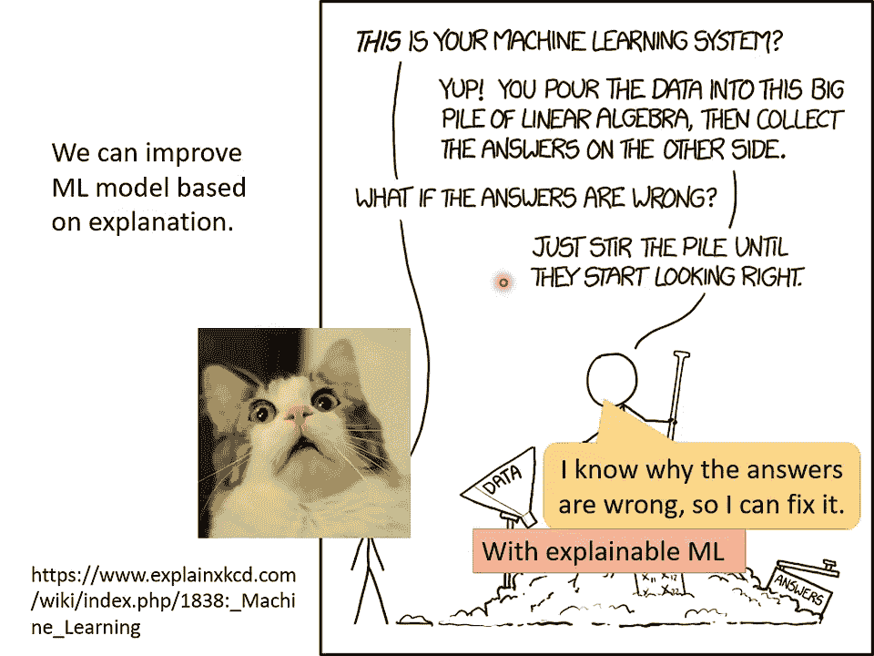

因此，我们希望机器学习模型不止得到答案，还要给出得到答案的理由。

更进一步，未来自动驾驶汽车满街跑时，如果它突然急刹导致乘客受伤，这取决于它急刹的理由。如果是因为看到有老太太过马路而急刹，那也许是正确的；但如果只是无缘无故发狂，那模型就有问题。我们希望知道其决策背后的理由。

此外，如果机器学习模型具有解释力，未来我们或许可以凭借解释的结果去修正模型。今天在使用深度学习技术时，往往是这样的：把数据丢进去，经过很多矩阵相乘，跑出结果。如果结果不如预期，就多调一下参数，改个学习率，调一下网络架构。我们往往不知道自己在做什么，只是把一堆数学、线性代数重新打乱，看看结果会不会比较好。

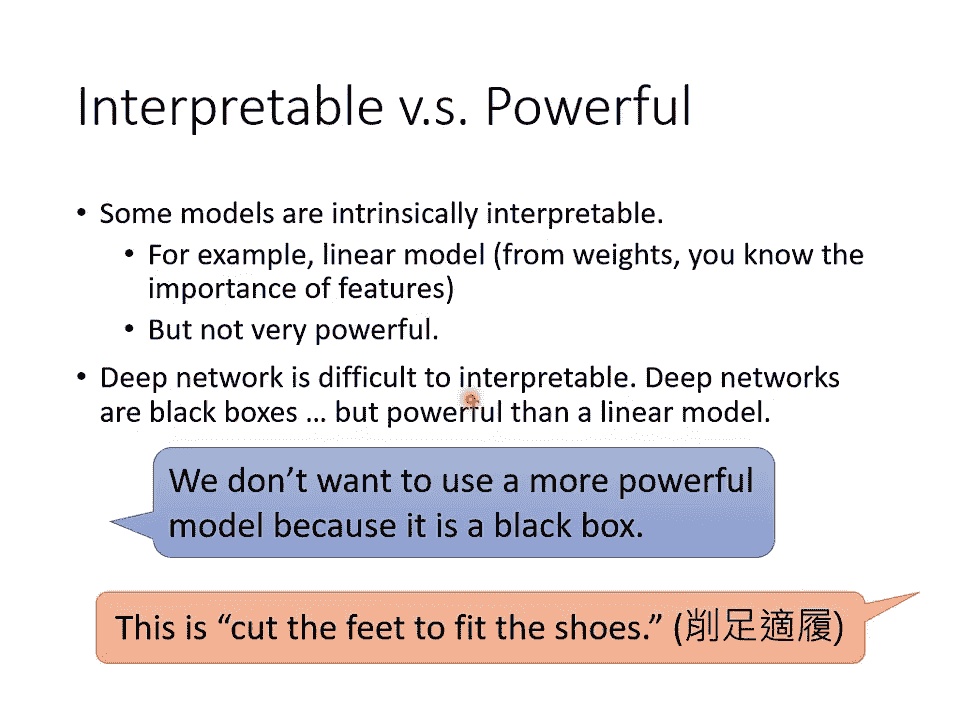

我们期待，未来当我们知道深度学习模型犯错的原因时，也许可以有更好、更有效率的方法来改进模型。当然，这是未来的目标，今天用可解释机器学习来实现上述改进模型的想法还有很长的距离。

## 为什么不用更易解释的模型？💡

讲到这边，有人可能会想：我们之所以这么关注可解释机器学习，也许是因为深度网络本身就是一个黑箱。那我们能不能用其他更容易解释的机器学习模型呢？例如，假设我们都采用线性模型。

线性模型的解释能力比较强，我们可以轻易地根据模型里每个特征的权重，知道它在做什么。但线性模型的问题就是它不够强大，有巨大的限制，所以我们才很快进入了深度模型。深度模型的坏处就是它不容易被解释，它是一个黑盒子，里面发生了什么我们很难知道。

很多人会因此得出结论：我们不应该用这种强大的深度模型，因为它们是黑盒子。但在我看来，这样的想法是因噎废食。我们不应该因为一个模型非常强大但不容易被解释，就放弃它。我们应该想办法让它具有可解释的能力。

我听过杨立昆讲了一个故事：有一个醉汉在路灯下找钥匙。别人问他：“你的钥匙掉在路灯下吗？”他说：“不是，但因为这边有光。”我们坚持一定要用简单但容易被解释的模型，就好像坚持一定要在路灯下面找钥匙一样。真实的、强大的模型也许根本在路灯的照明范围之外。我们现在要做的事情就是改变路灯的范围，改变照明的方向，看能不能让这些比较强大的模型可以被置于“路灯”之下，变得可解释。

“可解释”和“可理解”这两个词汇在文献上常常被混用，但有一点差别：
*   **可解释** 通常指一个东西本来是黑箱，我们想办法赋予它解释的能力。
*   **可理解** 通常指一个东西本来就不是黑箱，我们本来就可以知道它的内容。

不过这两者在文献上也常常被混用，所以我们不特别强调差异。

## 决策树是好的选择吗？🌳

讲到既强大又可理解的模型，也许有人会说，决策树会不会是一个好的选择？决策树相较于线性模型更强大，而相较于深度学习，它非常容易理解。你看决策树的结构，就可以知道模型是凭借什么样的规则做出最终判断。

决策树做的事情就是有很多节点，每个节点都会问一个问题，让你决定向左还是向右。最终走到叶节点时，就可以做出最终决定。因为在每个节点都有问题，你看那些问题以及答案，就会知道整个模型是如何做出决断的。

从这个角度看，决策树既强大又可理解。但决策树真的就是我们所需要的吗？你再仔细想一下，决策树也有可能是很复杂的。例如，网上有人问了一个关于复杂决策树的问题，他完全看不懂这个决策树在干嘛。

另外，你再仔细想想，实际使用决策树技术时，你是只用一颗决策树吗？其实不是。你真正用的技术叫做随机森林，其实是好多棵决策树共同决定的结果。一颗决策树，你可以知道它是怎么做出判断的，但当你有500棵决策树时，你就很难知道这500棵树合起来是怎么做出判断的。

所以，决策树也不是最终的答案，并不是用了决策树就解决了可解释机器学习的问题。

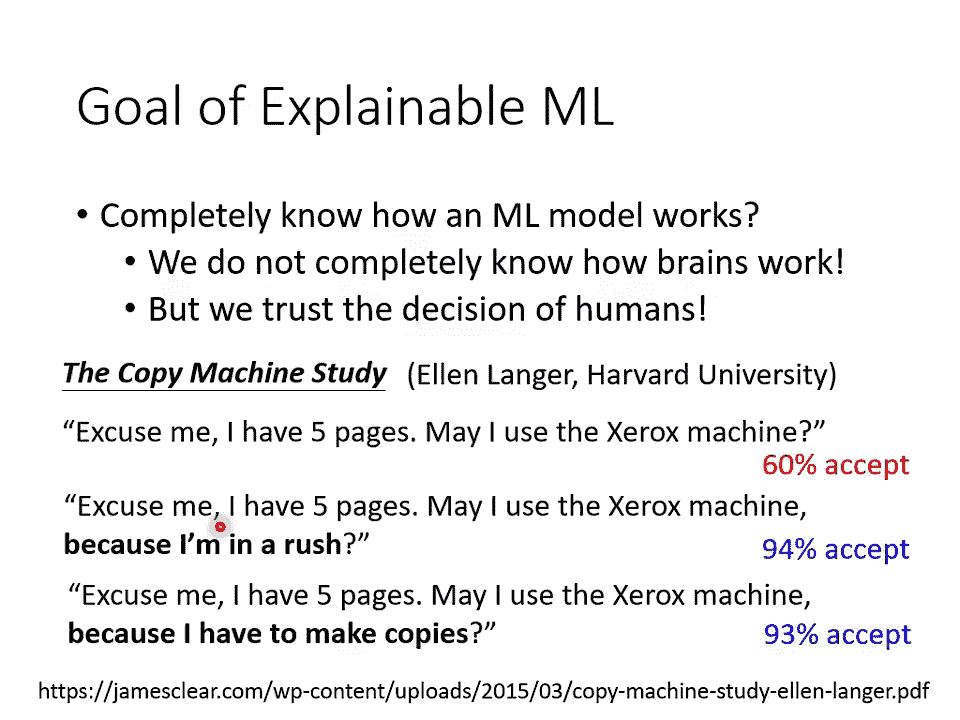

## 可解释机器学习的目标是什么？🎯

在继续深入讲可解释机器学习的技术之前，还有一个问题：可解释机器学习的目标是什么？在我们之前的每一个作业里，我们都有一个明确的目标，要么是降低误差，要么是提升准确率。但可解释的目标到底是什么？什么才是最好的解释结果？它的目标其实非常不明确。

很多人对于可解释机器学习会有一个误解，觉得一个好的解释，就是要告诉我们整个模型在做什么事，我们要完全了解它是怎么做出一个决断的。但想想看，这件事情真的是有必要的吗？我们说机器学习模型、深度网络是一个黑盒子，所以我们不能相信它。但世界上有很多黑盒子正在你身边，人脑不也是黑盒子吗？我们其实也并不完全知道人脑的运作原理，但是我们可以相信另外一个人做出的决断。人脑其实也是一个黑盒子，你可以相信人脑做出的决断，为什么深度网络是一个黑盒子，你就没有办法相信它做出来的决断呢？

对人而言，也许一个东西能不能让我们放心、能不能够让我们接受，理由是非常重要的。以下是一个跟机器学习完全无关的心理学实验：在哈佛大学图书馆，打印机前排着长队。如果一个人跟他前面的人说“拜托请让我先印，我就印一页而已”，有60%的人会让他先印。但如果你把问话的方法改成“能不能让我先印，因为我赶时间”，接受的程度就变成94%。神奇的是，就算理由改成“因为我需要先印”，接受程度也变成93%。神奇的事情是，人就是需要一个理由。

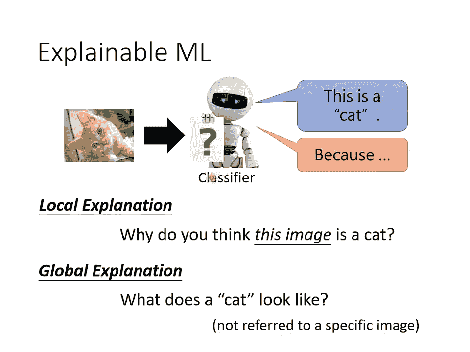

所以，会不会可解释机器学习也是同样的道理？我们需要可解释机器学习。

所以我觉得，什么叫做好的解释？好的解释就是人能接受的解释。人就是需要一个理由让我们觉得高兴。这个高兴的人可能是你的客户、你的老板，或者是你自己。今天他可以给你一个做出决断的理由，你就高兴。所以我觉得，什么叫做好的解释？就是让人高兴的解释就是好的解释。

其实你在各种研究的发展上会发现，我们在设计这些技术的时候，确实跟我现在讲的“什么是好的解释”这个想法是蛮接近的。

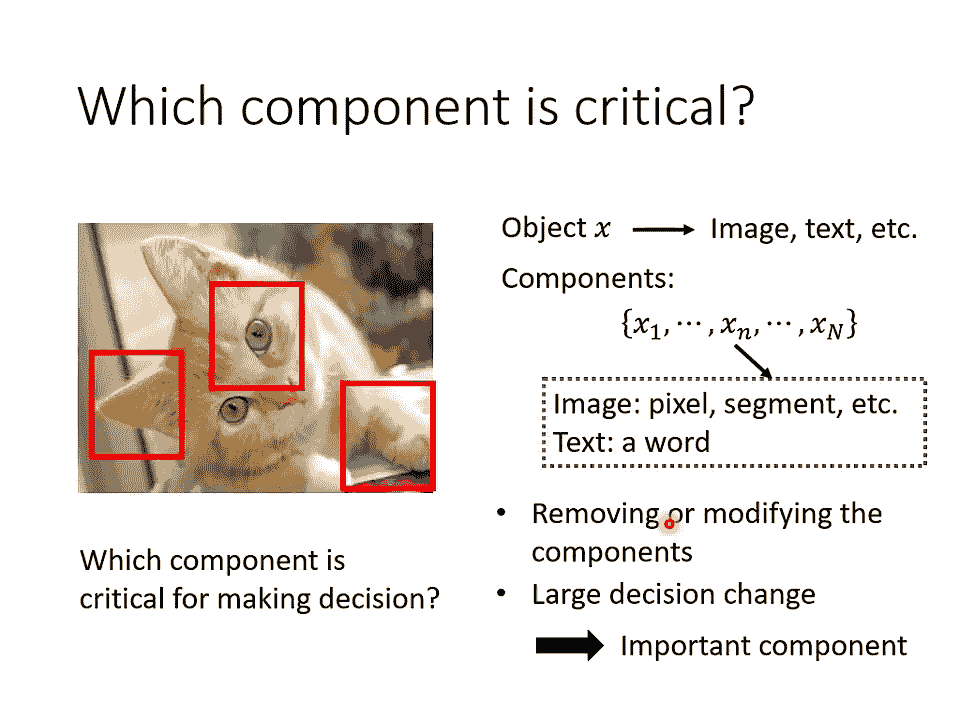

## 可解释机器学习的分类 📂

可解释机器学习的目标就像我刚才讲的，就是要给我们一个理由。可解释机器学习又分成两大类：
*   **局部解释**：假设我们有一个图像分类器，我们给它一张图片，它判断说这是一只猫。我们要问的问题是：为什么你觉得这张图片是一只猫？根据某一张特定的图片来回答问题，这叫做局部解释。
*   **全局解释**：意思是现在还没有给分类器任何图片。我们要问的是：对一个分类器而言，什么样的图片叫做猫？我们并不是针对任何一张特定的图片来进行分析，我们是想要知道，当我们有一个模型，它里面有一堆参数的时候，对这堆参数而言，什么样的东西叫做一只猫。

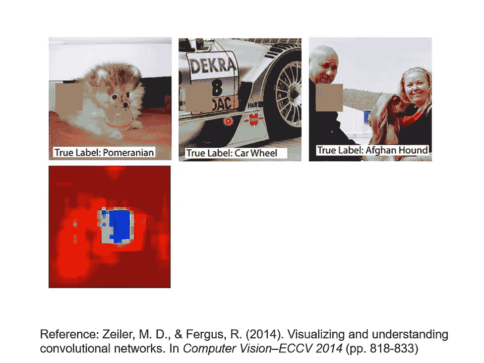

## 局部解释：哪些部分最重要？🔎

我们先来看第一大类：为什么你觉得一张图片是一只猫？我们可以把这个问题问得更具体一点：给机器一张图片，它知道它是一只猫的时候，到底是这个图片里面的什么东西，让模型觉得它是一只猫？是眼睛、耳朵，还是猫的脚？

讲得更一般化，假设现在我们模型的输入叫做 **X**，这个 **X** 可能是一张影像，可能是一段文字。**X** 可以拆成多个组成部分 **X1** 到 **XN**。对于影像而言，可能每个组成部分就是一个像素；对于文字而言，可能每个组成部分就是一个词汇或一个词元。

我们现在要问的问题是：这些组成部分里面，哪一个对于机器现在做出最终的决断是最重要的呢？怎么知道一个组成部分的重要性呢？基本原则是这个样子：我们把组成部分都拿出来，然后把每一个组成部分做改造或者删除。如果我们改造或删除某一个组成部分以后，网络输出有了巨大的变化，那我们就知道这个组成部分没它不行，它很重要。

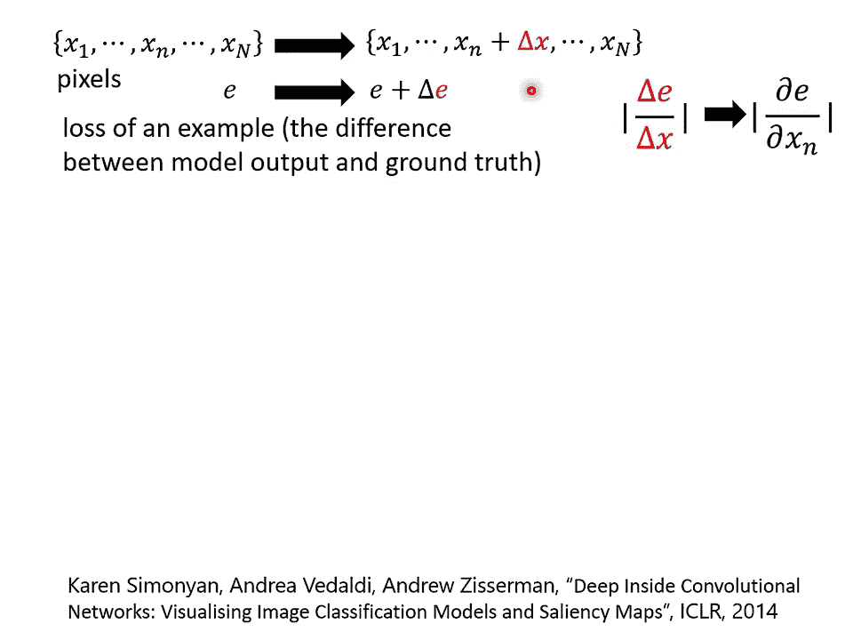

讲得更具体一点，想要知道今天一个影像里面每一个区域的重要性时，有一个非常简单的方法：给一张图片，丢到网络里，它知道这是一只博美狗。接下来在这张图片里不同的位置放上灰色的方块。当方块放在不同地方时，你的网络会输出不同的结果。下面的图中，颜色代表网络输出“博美狗”这个类别的概率，蓝色代表概率低，红色代表概率高。每一个位置代表灰色方块的位置。

当我们把灰色方块移到博美狗脸上时，图像分类器就不觉得它看到一只博美狗。如果把灰色方块放在博美狗四周，机器就觉得它看到的仍然是博美狗。所以它知道，不是看到球、地板或墙壁觉得看到博美狗，而是真的看到狗的脸。

用一样的例子，把灰色方块在图片上移动，你会发现当灰色方块移到轮胎上时，机器就不觉得它有看到轮胎了。所以机器知道轮胎长什么样子。

或者，有一张图片里面有两个人，还有一只阿富汗猎犬。机器到底是真的看到了阿富汗猎犬，还是把人误认为狗呢？这时你可以把灰色方框在图片上移动。你会发现灰色方框放在人的脸上时，机器仍然觉得它有看到阿富汗猎犬；但是当你把灰色方框放到狗的位置时，机器就觉得它没有看到阿富汗猎犬。所以它是真的有看到阿富汗猎犬。

这是最简单的知道组成部分重要性的方法。

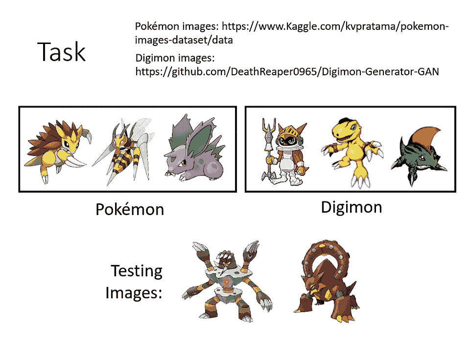

## 更进阶的方法：计算梯度 📈

接下来还有一个更进阶的方法是计算梯度。这个方法是这样子的：假设我们有一张图片，我们把它写作 **X1** 到 **XN**，这边的每一个 **X** 代表了一个像素。接下来我们去计算这张图片的损失，我们这边用小 **l** 来表示。这个小 **l** 是把这张图片丢到你的模型里，模型输出的结果跟正确答案的交叉熵。**l** 越大就代表现在辨识的结果越差。

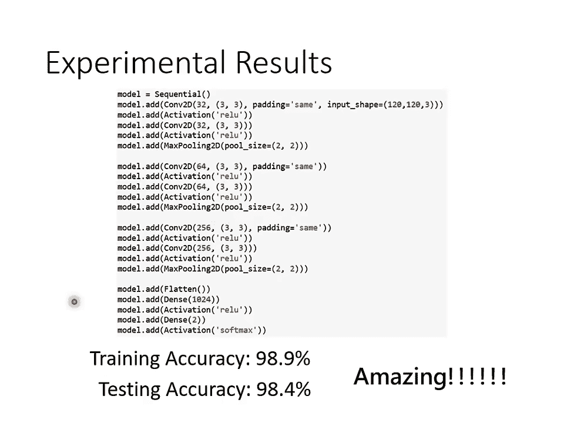

接下来，我们知道某一个像素对于影像辨识这个问题的重要性，你就把某一个像素的值做一个小小的变化，加上一个 **ΔX**，然后你看一下你的损失 **l** 会有什么样的变化 **Δl**。如果今天把某一个像素做小小的变化以后，损失就有巨大的变化，代表这个像素对影像辨识是重要的。反之，如果加了 **ΔX**，**Δl** 趋近于零，损失完全没有反应，就代表这个位置的像素对于影像辨识而言可能是不重要的。

我们可以用 **Δl** 和 **ΔX** 的比值，来代表这个像素 **Xn** 的重要性。而事实上，**Δl/ΔX** 这一项，就是把 **Xn** 对你的损失 **l** 做偏微分。如果不知道偏微分是什么也没有关系，反正就是 **Δl/ΔX** 的比值，就代表了 **Xn** 的重要性。这个比值越大就代表 **Xn** 越重要。

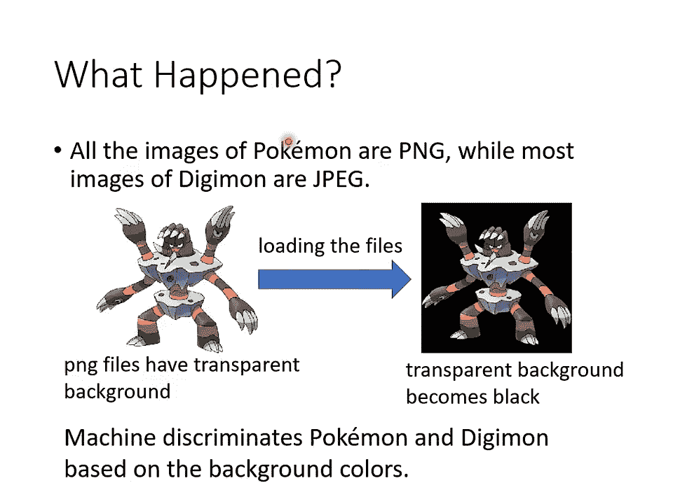

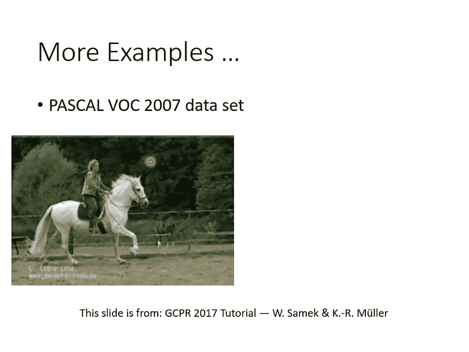

## 显著图 📊

你把图片里每一个像素的这个比值都算出来，就得到一个图叫做**显著图**。在我们的作业里，你会有很多机会画各式各样的显著图。下面这个图，上面是原始图片，下面黑色背景上有亮白色点的是显著图。在显著图上，越偏白色就代表这个比值越大，也就是这个位置的像素越重要。

举例来说，给机器看水牛的图片，它并不是看到草地或竹子觉得看到牛，而是真的知道牛在这个位置。它判断这张图片是什么类别时，最重要的是出现在这个位置的像素。机器看到猴子图片，知道猴子在树梢上面，并不是把叶子判断成猴子。它看到鹅的图片，知道鹅是出现在这个位置。

这个技术叫做显著图。显著图技术我们等一下来举一个实际的应用，这个应用跟宝可梦和数码宝贝有关。

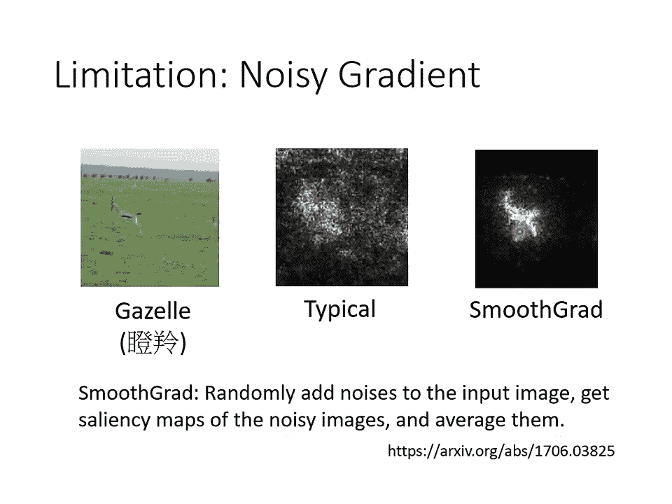

## 案例：宝可梦 vs. 数码宝贝 🐾 vs. 🤖

左边是宝可梦，右边是数码宝贝。在网络上看到有人说，他训练了一个数码宝贝和宝可梦的分类器，正确率非常高。所以我决定自己也来做这个实验，看看为什么可以得到这么高的正确率。

你可以在网络上找到宝可梦的图库和数码宝贝的图库。有一堆宝可梦的图，一堆数码宝贝的图。这就是一个二元分类问题。训练完以后，要用机器没有看过的图去测试它。所以你要特别留一些宝可梦和数码宝贝是训练时没有看过的，看看机器看到新的宝可梦和数码宝贝，它能不能得到正确的结果。

我们先来看一下，人类能不能正确判断宝可梦和数码宝贝。你觉得这只是宝可梦还是数码宝贝？可见宝可梦和数码宝贝是很难分辨的，今天就算是人类，也很难判断一只动物到底是宝可梦还是数码宝贝。

机器的表现如何呢？这边随便训练了一个模型，训练准确率高达98.9%。但不要高兴太早，这也许是过拟合。测试资料上没看过的图正确率是98.4%。这不可思议，人类都没有办法判断宝可梦和数码宝贝的差异，但机器可以。

接下来我就很好奇，想知道机器到底是凭借什么样的规则判断宝可梦和数码宝贝的差异。所以我决定来画一下显著图。

这边有几只动物，它们是数码宝贝。接下来我在这些图片上画显著图，让机器告诉我为什么它觉得这几张是数码宝贝。机器给我的答案是这样：亮亮的点代表它觉得比较重要。有点怪怪的，好像亮亮的点都分布在四个角落。

接下来分析宝可梦，这个情况更明显。你发现机器觉得重要的点，基本上都是避开宝可梦的本体，都是在影像的背景上。为什么呢？因为我后来发现，宝可梦都是PNG档，数码宝贝都是JPG档。PNG档读进来以后背景都是黑的。所以机器只要看背景，就知道一张图片是宝可梦还是数码宝贝了。

这个例子告诉我们，可解释AI是一个很重要的技术。我刚才举的例子可能你觉得有点荒谬，也许在正常的应用中不会发生这种事情，但真的不会发生吗？

## 真实案例：Pascal VOC 2007 📸

有一个真实的例子，有一个基准数据集叫做Pascal VOC 2007，里面有各式各样的物件，机器要学习做影像分类。机器看到这张图片，他知道是马的图片。但如果你画显著图的话，你发现结果是这个样子的：机器觉得左下角对马是最重要的。为什么？因为左下角有一串英文。这个图库里马的图片，很多都来自某个网站，左下角都有一样的英文。所以机器看到左下角这一行英文就知道是马，它根本不需要学习马长什么样子。

今天在这个真实的应用中，在基准数据集上类似的状况也是会出现的。所以这告诉我们，这种可解释机器学习技术是很重要的。

## 如何画出更好的显著图？✨

有没有什么方法把可解释机器学习的显著图画得更好呢？第一个方法就是助教刚才也提到的**平滑梯度**。什么意思呢？这张图片是一只玳瑁猫，你期待今天做显著图时，机器会把它主要的精力集中在猫身上。但如果你用刚才我们讲的方法直接画显著图，得到的结果可能是这个样子，在其他地方也有一些杂讯，让人看起来有点不舒服。

平滑梯度这种方法，会让你的显著图上面杂讯比较少。在这个例子上，你就会发现，多数的亮点真的都集中在猫身上。

平滑梯度这种方法怎么做呢？非常简单，说穿了也不值钱：你在你的图片上面加上各种不同的杂讯。加不同的杂讯就是不同的图片了。每一张图片上面都去计算显著图，你有加100种杂讯，就有100张显著图，平均起来就得到平滑梯度的结果。

当然有人会问：你怎么知道平滑梯度这样的结果一定就比原来的结果好呢？也许对机器来说，它真的觉得这些草很重要，真的觉得这个天空很重要，真的觉得这个背景很重要。但就像我一开始说的，可解释机器学习最重要的目标就是要让人看着觉得爽。你画了这个图，你的老板就会觉得不爽，觉得模型有点烂，解释性好像很低。所以你就把它画成平滑梯度不会这个样子，然后告诉别人说：你看这个模型不错。

## 梯度的局限性 ⚠️

但是，光看梯度并不完全能够反映一个组成部分的重要性。怎么说呢？这边就举一个例子给大家参考：横轴代表大象鼻子的长度，纵轴代表这个生物是大象的可能性。我们都知道大象的特征就是长鼻子，所以一个生物它的鼻子越来越长，它就越有可能是大象。但是当它的鼻子长到一个极限的时候，再变更长一点，它也不会变得更像大象。鼻子很长的大象，就只是鼻子特别长的大象。

所以，鼻子长度跟是大象的可能性，关系也许一开始在长度比较短的时候，随着长度越来越长，这个生物是大象的可能性越来越大。但是当鼻子长度长到一个程度以后，就算是更长，也不会变得更像大象。这个时候如果你计算鼻子长度对“是大象可能性”的偏微分，那你在这个地方得到的偏微分可能会趋近于零。

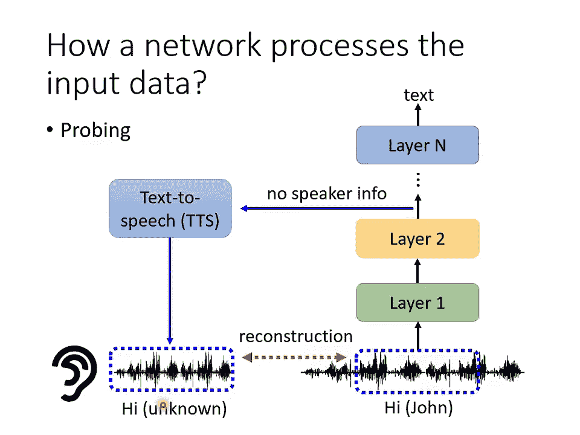

所以如果你光看梯度，光看显著图，你可能会得到一个结论：鼻子的长度对是不是大象这件事情是不重要的。鼻子的长度不是判断是否为大象的一个指标，因为鼻子长度的变化对“是大象可能性”的变化是趋近于零的。但事实上是这样吗？事实上你知道不是这个样子。

所以光看梯度、光看偏微分的结果，可能没有办法完全告诉我们一个组成部分的重要性。

## 积分梯度 📐

所以有其他的方法，有一个方法叫做**积分梯度**，它的缩写叫做IG。这边我就不打算详细讲IG是怎么运作的，我们就把文献留在这边。助教的程式码里也有实作IG，如果你有兴趣，可以自己研究看看IG是怎么运作的。如果你没有兴趣，反正你按个Enter就跑出IG的分析结果了。

## 观察网络内部发生了什么？🔬

刚才我们是看一个输入，它的哪些部分是比较重要。接下来我们要问的下一个问题是：当我们给网络一个输入的时候，它到底是怎么去处理这个输入的呢？它到底是怎么对输入做处理，然后得到最终答案的呢？

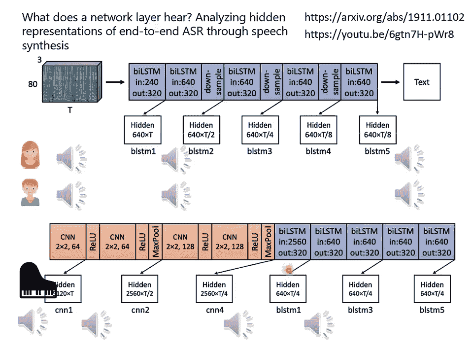

有不同的方法。第一个方法最直接的就是人眼去看，今天网络里面到底发生了什么事情。在作业里