# 24：（延申）Transformer (下) 🧠

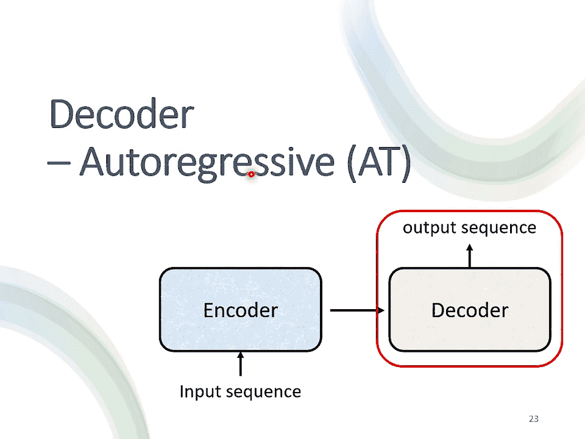

在本节课中，我们将要学习Transformer模型中的解码器（Decoder）部分，了解其工作原理、内部结构、与编码器的交互方式，以及训练这类序列到序列（Sequence-to-Sequence）模型时的一些关键技巧和挑战。

---

## 解码器（Decoder）概述

上一节我们介绍了编码器（Encoder），本节中我们来看看解码器（Decoder）。解码器主要有两种类型，我们将花较多时间介绍其中更常见的一种：自回归解码器（Auto-Regressive Decoder）。

### 自回归解码器的工作原理

我们以语音识别任务为例来说明其运作方式。语音识别的输入是一段声音信号，输出是一串文字。这个过程与作业中的机器翻译任务原理相同，只是输入和输出的内容不同。

1.  声音信号输入编码器后，会输出一排向量（vector sequence）。
2.  解码器的任务就是读取编码器的输出，并生成最终的识别文字。

解码器如何生成文字呢？以下是其逐步生成过程：

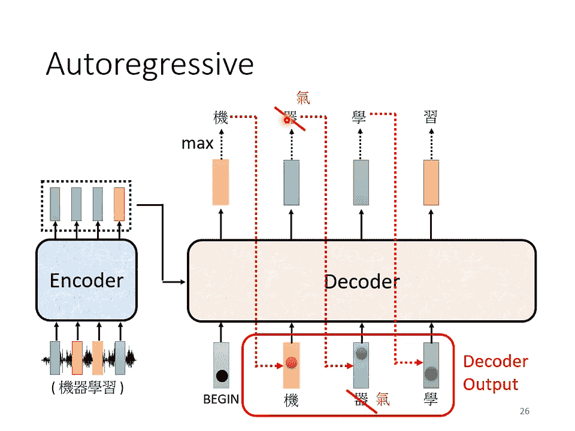

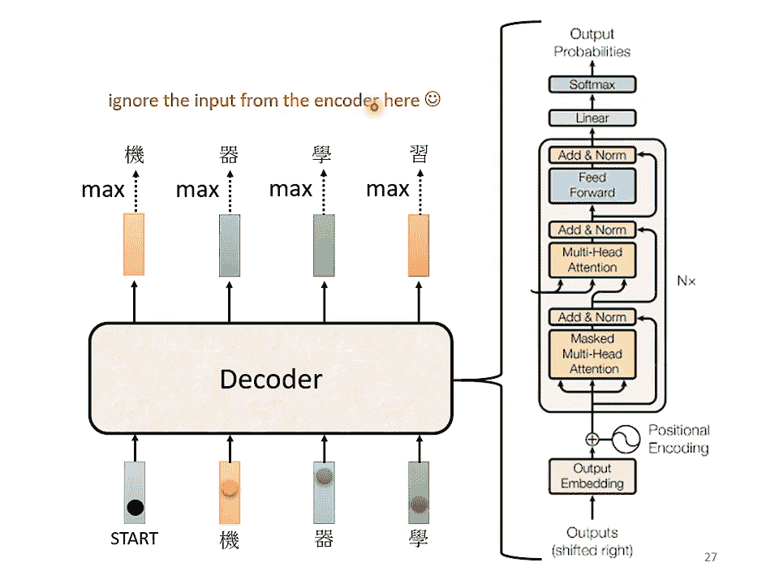

*   **起始符号**：首先，需要给解码器输入一个特殊的起始符号（例如 `BOS`，代表句子开始）。这个符号用一个独热编码（one-hot vector）表示。
*   **首次预测**：解码器接收到 `BOS` 后，会输出一个向量。这个向量的长度等于词汇表的大小（例如，3000个常见汉字）。在输出前，通常会经过一个 **softmax** 层，使得向量中的数值成为一个概率分布，总和为1。
*   **选择输出**：取概率最高的那个字作为第一个输出。例如，输出“机”。
*   **迭代生成**：接着，将上一步的输出（如“机”）也作为解码器新的输入（同样用独热向量表示）。现在解码器的输入是 `[BOS, 机]`，它根据这些输入预测下一个字（如“器”）。
*   **循环过程**：这个过程反复持续：解码器根据已有的所有输入（`BOS, 机, 器, 学...`）预测下一个字，并将自己的输出作为下一步的输入，直到生成完整的句子。

**关键点**：解码器在生成时，看到的是自己在前一个时间步产生的输出。这可能导致错误传播（error propagation）问题，即一个错误可能导致后续输出全部错误。我们稍后会讨论如何处理这个问题。

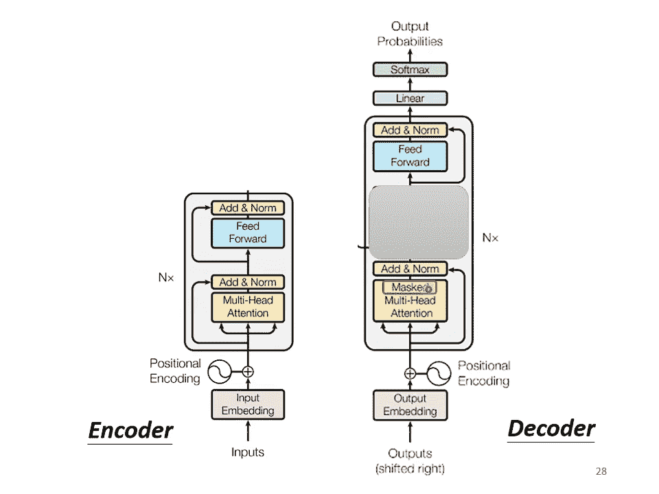

---

## 解码器的内部结构

现在，我们来看看Transformer中解码器的内部结构。它看起来比编码器稍复杂一些。

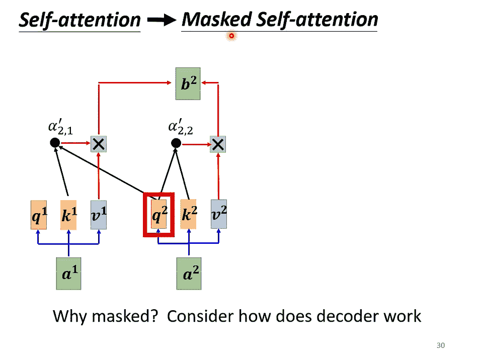

### 与编码器的对比

如果我们暂时忽略解码器中间的一个特定模块，会发现编码器和解码器的结构非常相似。

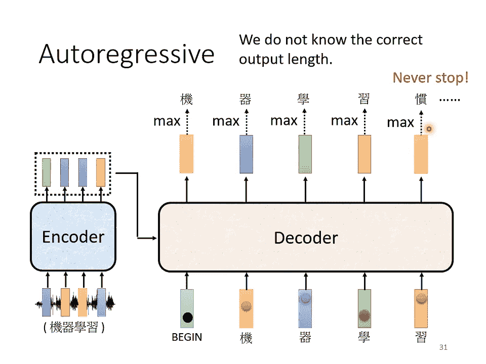

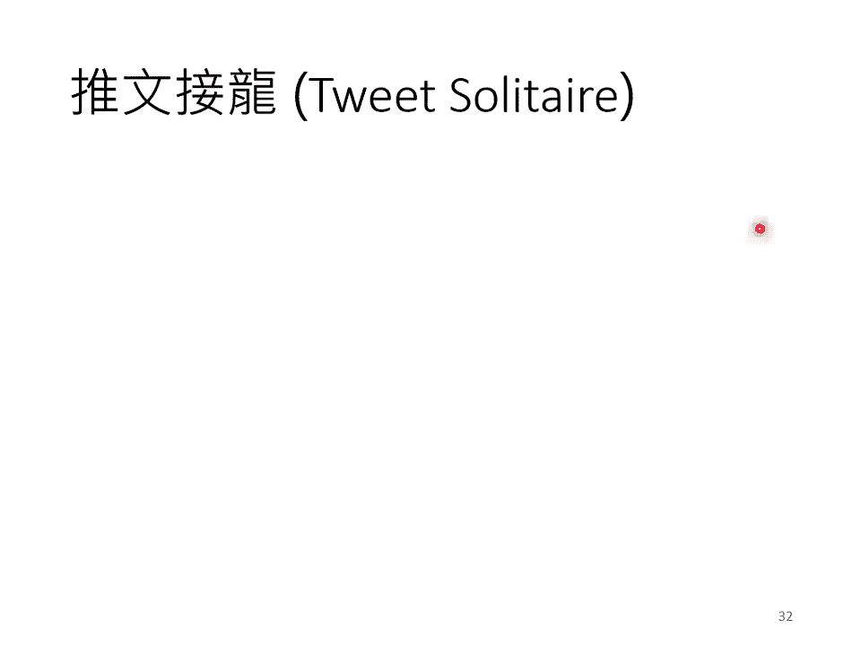

*   两者都包含多头注意力（Multi-Head Attention）和前馈网络（Feed-Forward Network）模块，并重复N次。
*   主要区别在于解码器的第一个多头注意力模块上有一个 **掩码（Mask）**。

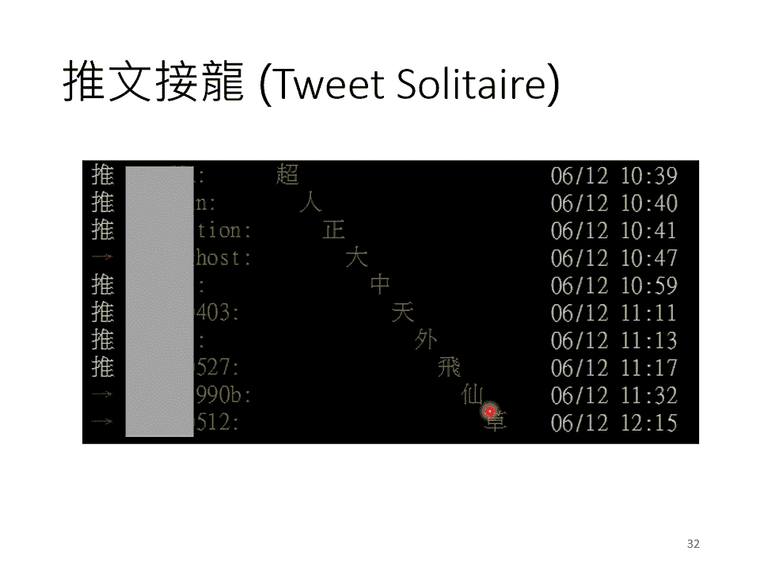

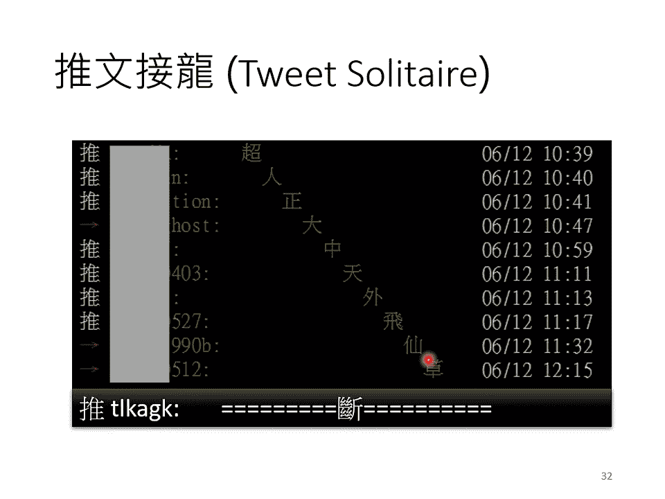

### 掩码自注意力（Masked Self-Attention）

这个“掩码”是什么意思呢？

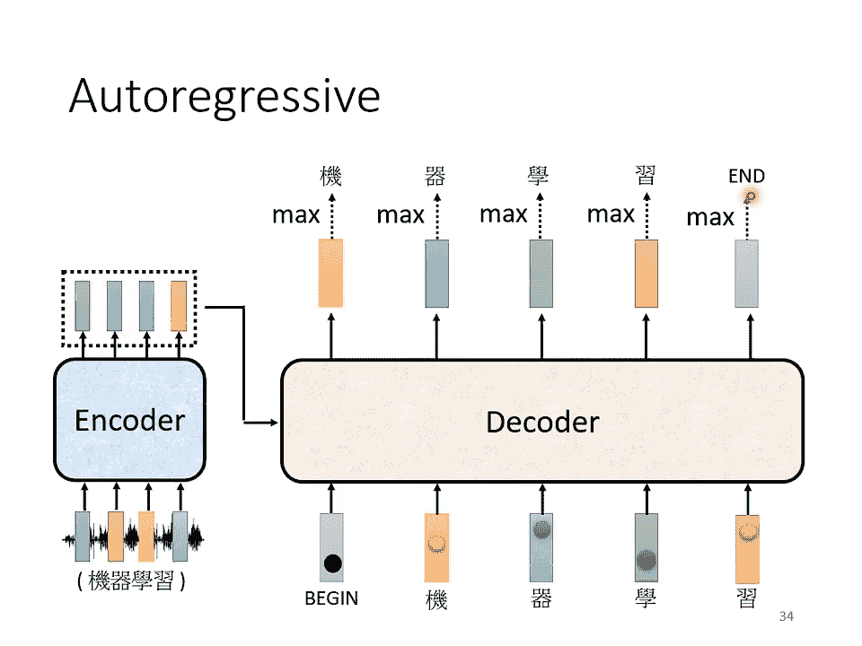

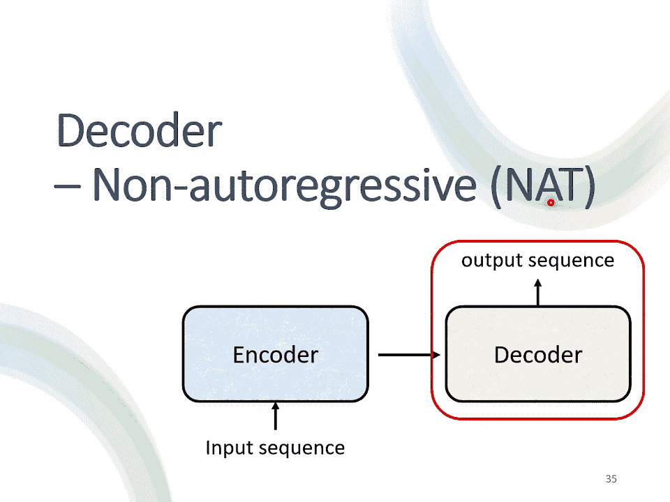

*   在标准的自注意力中，每个输出向量（如 `b1`）在计算时，会考虑**所有**输入向量（`a1, a2, a3, a4`）的信息。
*   在掩码自注意力中，计算输出时**只能考虑当前及之前位置**的输入信息。
    *   例如，计算 `b2` 时，只能考虑 `a1` 和 `a2`，不能看 `a3` 和 `a4`。
    *   计算 `b3` 时，只能考虑 `a1, a2, a3`。

**为什么需要掩码？**
这非常直观。因为解码器的输出是**逐个生成**的。当生成第二个字时，第三个及之后的字根本还不存在，因此自然无法在计算时考虑它们的信息。掩码确保了这一点，使训练和推理过程一致。

---

## 决定输出序列的长度

解码器必须自己决定何时停止生成。我们无法简单地从输入序列长度推断输出长度。

在当前的机制下，解码器不知道何时应该停下来。它可能会像“推文接龙”游戏一样，一直生成下去。

**解决方案**：引入一个特殊的结束符号（例如 `EOS`，代表句子结束）。除了起始符号和所有词汇外，我们还需要准备这个符号。

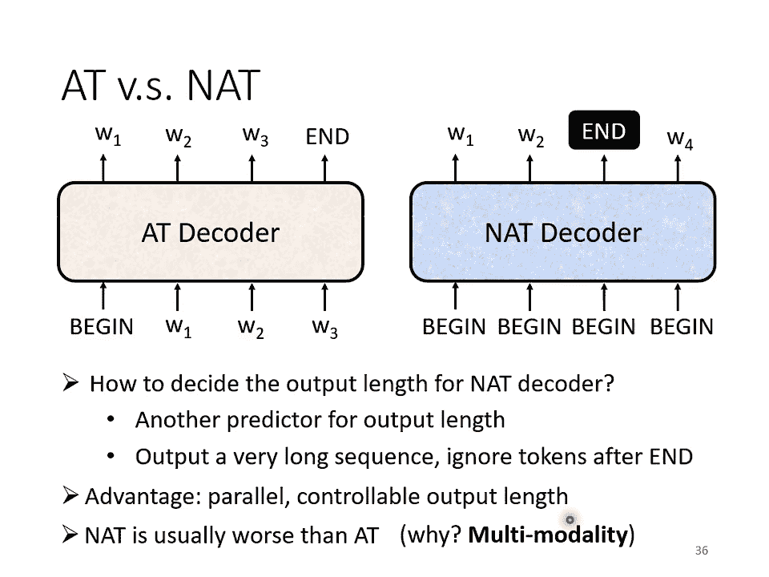

*   在训练时，我们告诉解码器，在生成完所有正确字词后，下一个输出应该是 `EOS`。
*   在推理时，当解码器输出 `EOS` 符号时，整个生成过程就终止了。

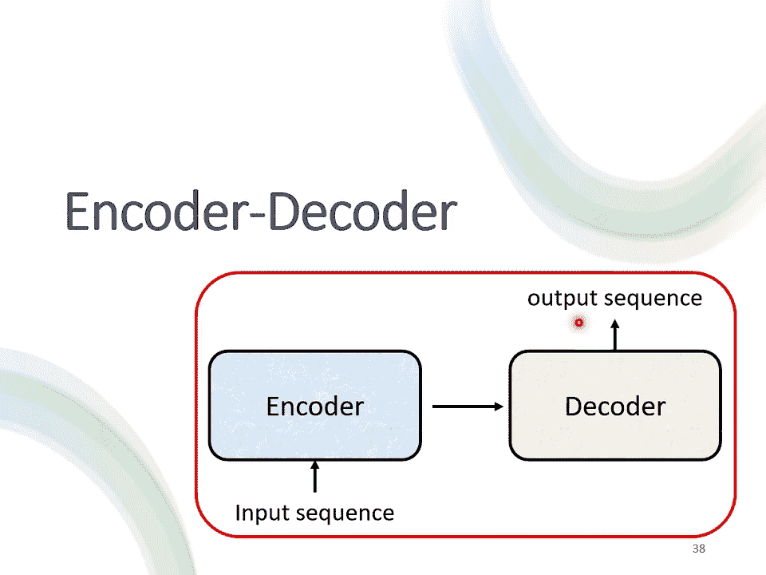

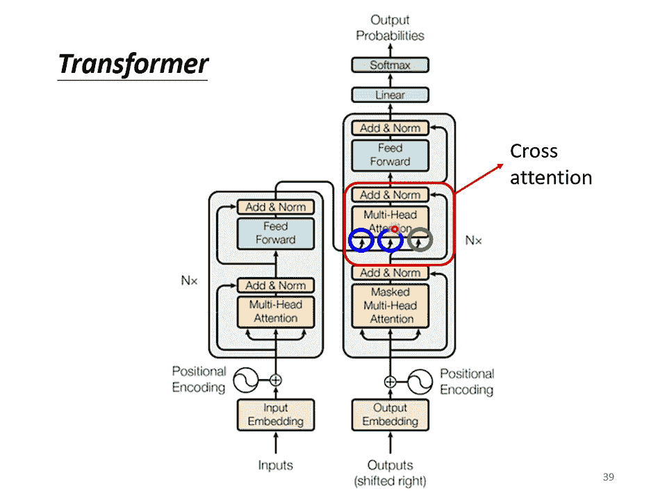

---

## 非自回归解码器（NAT）

除了自回归解码器，还有一种非自回归解码器（Non-AutoRegressive Decoder, NAT）。

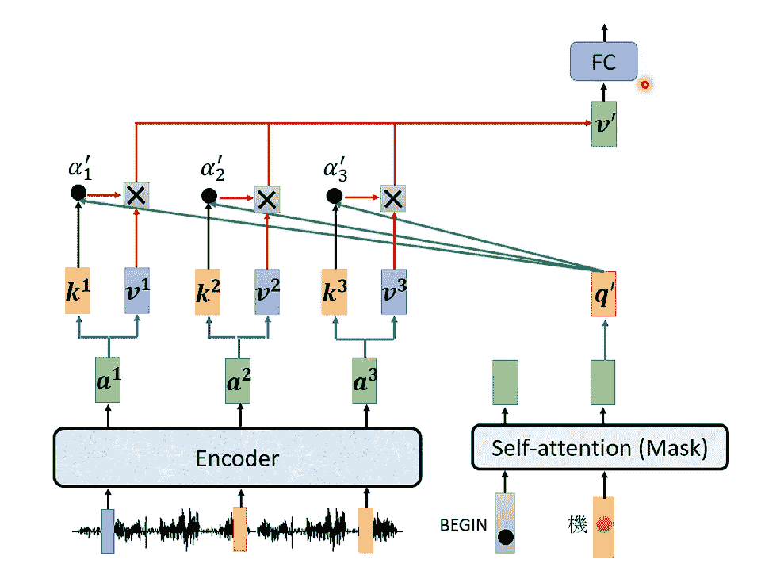

### NAT 的工作原理

*   **AT解码器**：逐个生成字词，需要多次解码步骤。
*   **NAT解码器**：一次性生成整个句子。它接收一整排的 `BOS` 符号作为输入，然后直接输出一整排字词。

### NAT 的关键问题与优势

**如何确定输出长度？**
由于NAT一次性输出，我们需要预先知道输出句子的长度。有两种常见方法：
1.  训练一个额外的分类器，读取编码器输出，预测应该输出的长度 `N`，然后给NAT解码器 `N` 个 `BOS`。
2.  直接给一个很大的上限（如300个 `BOS`），生成后再忽略 `EOS` 之后的部分。

**NAT的优势**：
1.  **并行化**：无论句子多长，一步就能生成所有输出，速度远快于AT解码器。
2.  **长度可控**：通过控制预测的长度 `N`，可以灵活控制输出（例如，在语音合成中调整语速）。

**NAT的挑战**：
NAT解码器的性能通常不如AT解码器，需要很多技巧才能逼近AT的效果。其中一个核心问题是“多模态性”（Multi-Modality）问题。

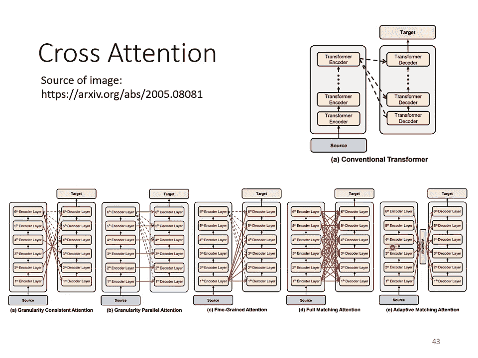

---

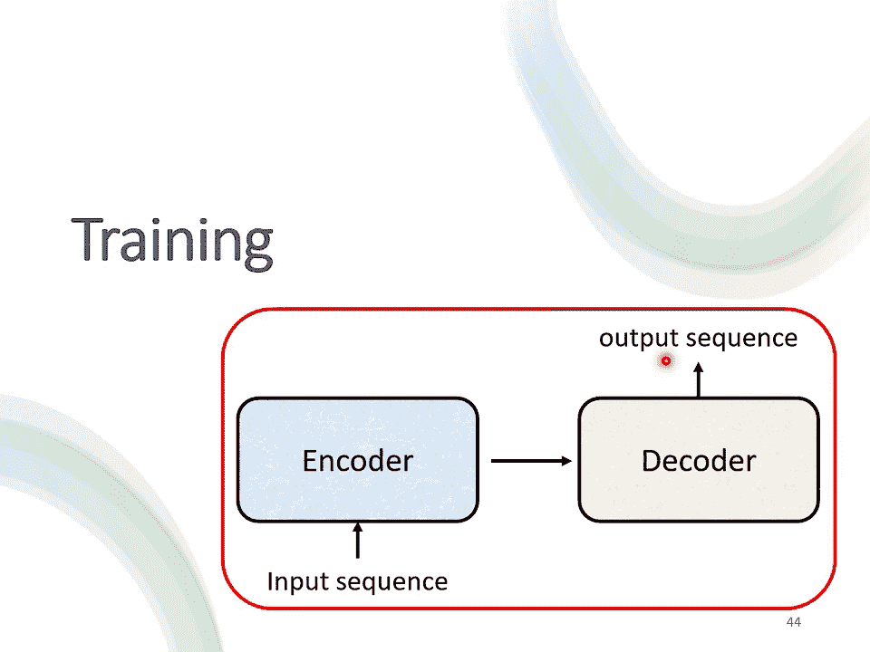

## 编码器与解码器的交互：交叉注意力

现在，我们来讲讲之前被刻意遮住的部分——编码器和解码器之间如何传递信息。这通过 **交叉注意力（Cross Attention）** 模块实现。

### 交叉注意力的运作过程

1.  编码器输出一排向量（`a1, a2, a3...`），并为每个向量生成键（K）和值（V）。
2.  解码器在生成每一个字时，其自注意力层会输出一个向量，将该向量变换后得到查询（Q）。
3.  进行交叉注意力计算：用解码器产生的 **Q**，去与编码器输出的所有 **K** 计算注意力分数，得到权重。
4.  用这些权重对编码器输出的所有 **V** 进行加权求和，得到一个汇总的上下文向量（V’）。
5.  这个上下文向量 V‘ 包含了从输入序列中提取的相关信息，会被送入解码器的前馈网络进行下一步处理。

**简单来说**：解码器通过产生一个 **Q**，到编码器的输出中“查阅”相关信息，并将其作为自己生成下一个词的依据。

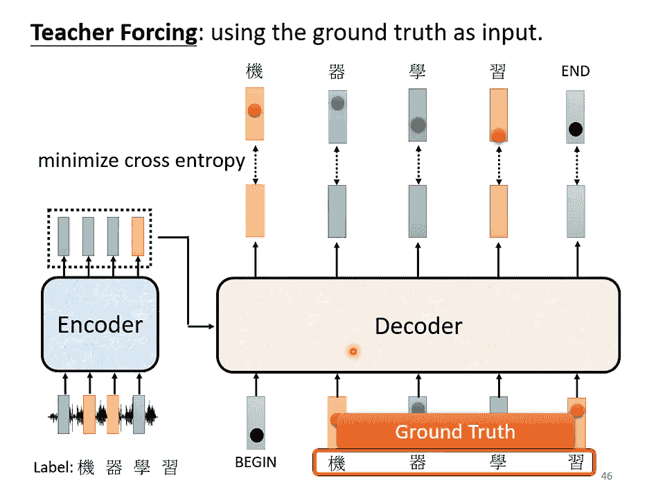

---

## 训练 Transformer

以上我们讲解了模型在推理时如何工作。接下来，我们看看如何训练它。

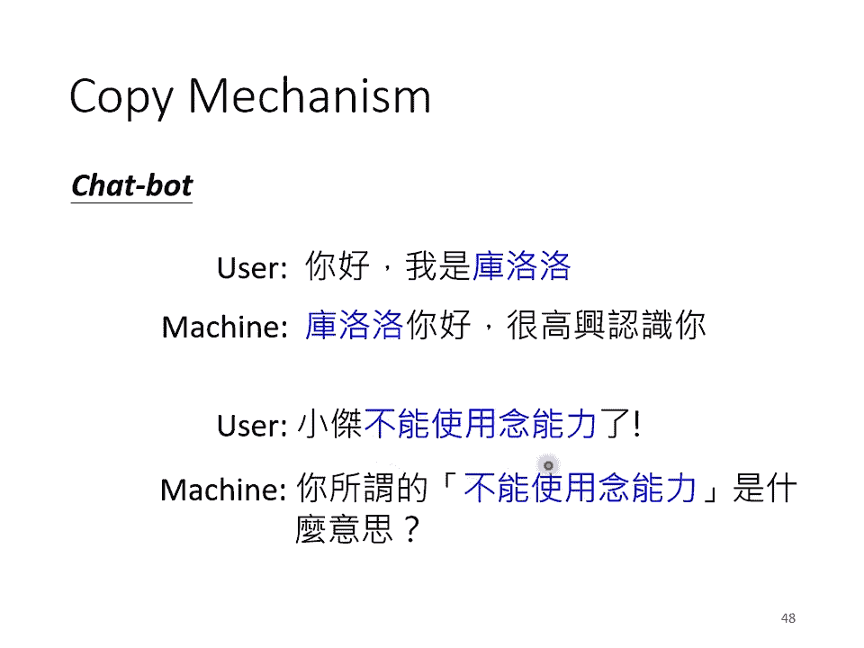

### 训练数据与目标

以语音识别为例，我们需要成对的数据：声音信号和对应的正确文字（如“机器学习”）。

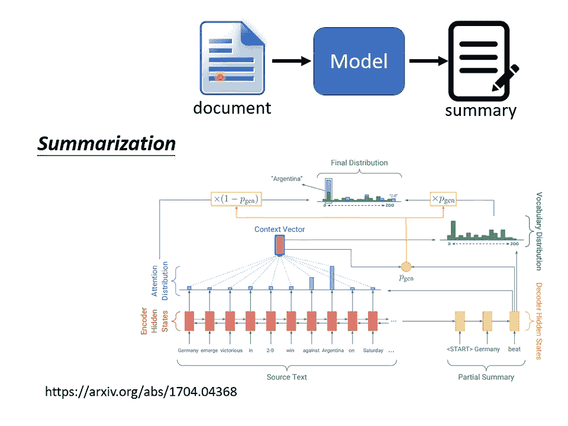

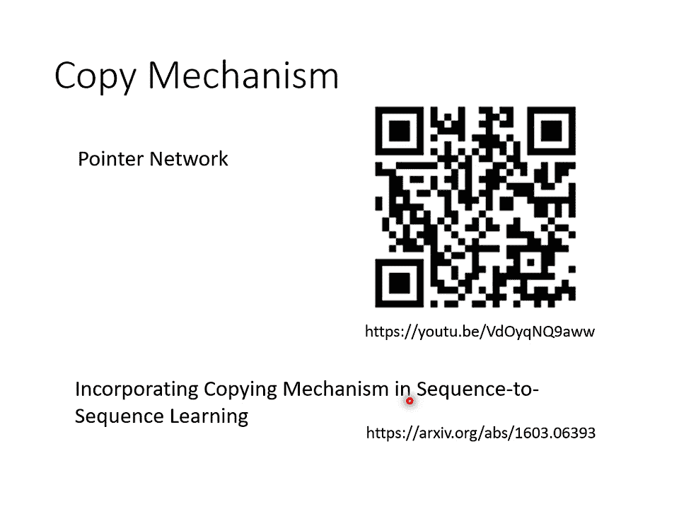

训练目标是让解码器的输出尽可能接近正确答案：
1.  解码器第一次输出应接近“机”的独热向量。
2.  第二次输出应接近“器”的独热向量，以此类推。
3.  最后，在输出所有正确字词后，还应输出 `EOS`。

这可以看作一系列分类问题（词汇表大小即类别数）。我们计算每个输出位置与对应正确答案独热向量之间的交叉熵（Cross Entropy），并希望所有交叉熵的总和最小化。

### 教师强制（Teacher Forcing）

在训练时，我们有一个关键技巧：**教师强制**。
*   即解码器在每一步的**输入**是**真实的、正确的**上一个词（或 `BOS`），而不是它自己上一步的预测输出。
*   这加速了训练，但导致了**训练与测试的不匹配**：训练时看到的是正确答案，测试时看到的却是自己的（可能有错的）预测。这个问题称为“曝光偏差”（Exposure Bias），我们稍后会讨论解决方案。

---

## 训练技巧与挑战

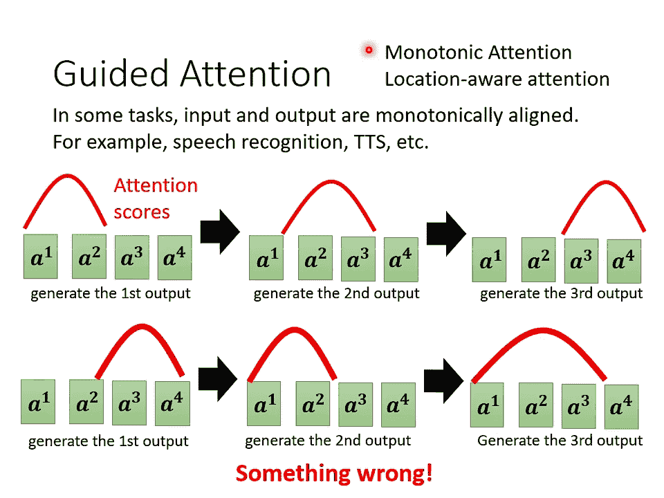

以下是训练序列到序列模型时的一些重要技巧。

### 1. 复制机制（Copy Mechanism）

对于某些任务（如聊天机器人、摘要生成），解码器不需要“创造”所有词汇，而应该学会从输入中“复制”部分内容。
*   **例子**：用户说“我是库洛洛”，机器可以回复“库洛洛你好”，其中“库洛洛”直接从输入复制而来。
*   实现此机制的模型有 Pointer Network、Copy Network 等。

### 2. 引导注意力（Guided Attention）

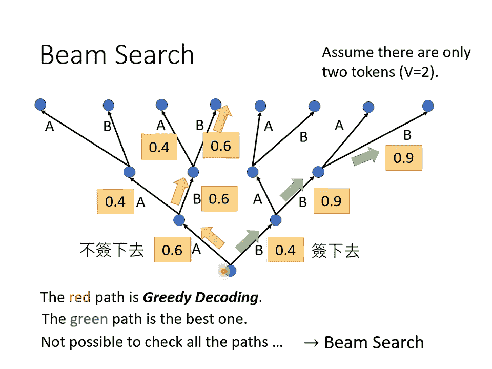

对于语音合成、语音识别等任务，我们期望模型的注意力权重是单调、有序的（从左到右）。如果注意力混乱，结果往往很差。
*   **引导注意力**：在训练时加入先验约束，强制注意力遵循预期的模式（如从左到右）。
*   相关技术包括 Monotonic Attention、Location-Aware Attention 等。

### 3. 集束搜索（Beam Search）

在推理时，贪婪解码（Greedy Decoding，每一步只选概率最高的词）不一定能得到全局最优的句子。
*   **集束搜索**：一种启发式搜索算法，在每一步保留多个（k个）概率较高的候选序列，最终选择整体概率最高的序列。
*   **注意**：对于需要创造性的任务（如故事续写、诗歌生成），集束搜索可能导致重复、乏味的输出，此时加入一些随机性（如采样）反而效果更好。

### 4. 优化目标与强化学习

我们训练时最小化交叉熵，但评估时可能使用 BLEU 等句子级指标。两者并不直接等价。
*   一个进阶思路是使用**强化学习**，将 BLEU 分数作为奖励（Reward），直接优化生成句子的整体质量。但这实现起来更为复杂。

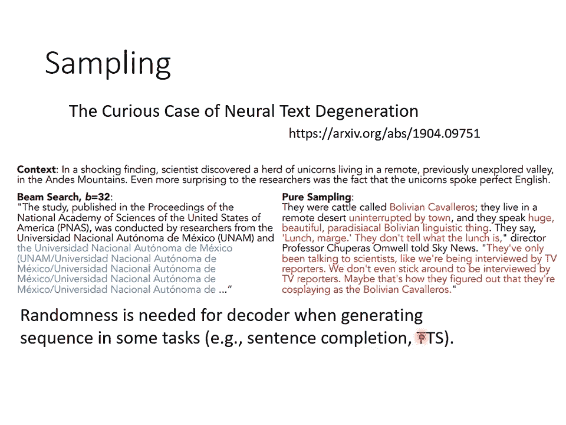

### 5. 处理曝光偏差：计划采样（Scheduled Sampling）

为了解决训练（教师强制）与测试（自回归）不一致导致的曝光偏差问题，一个直观想法是：在训练时，偶尔给解码器输入一些它自己之前生成的（可能错误的）词，而不是永远输入正确答案。
*   这种方法称为**计划采样**。它让模型在训练时就能接触到错误，从而增强其鲁棒性。
*   对于Transformer，有适应其并行化特性的改进版计划采样技术。

---

## 总结 🎯

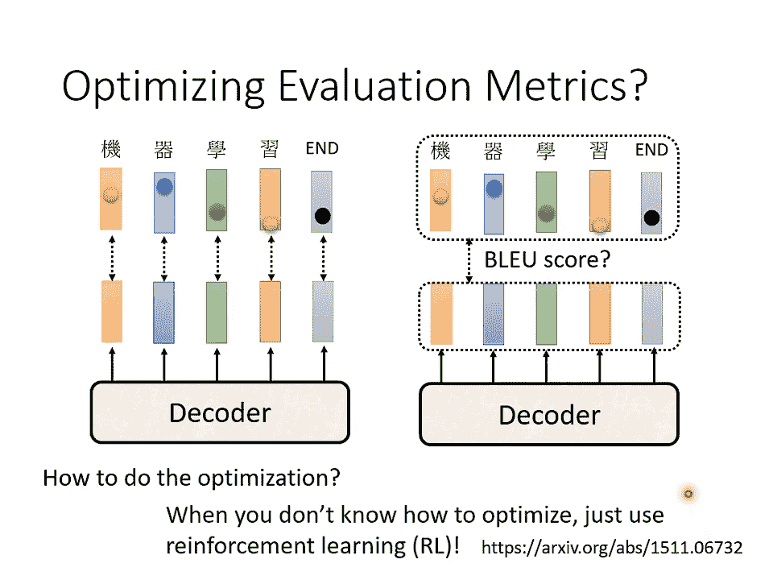

本节课中我们一起学习了Transformer解码器的核心内容：

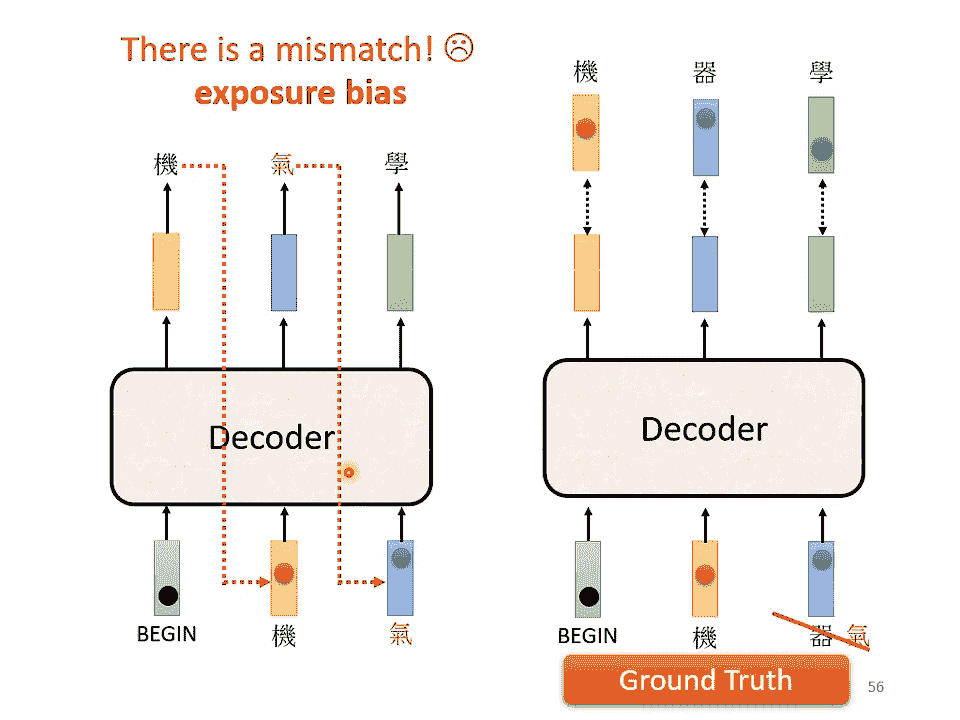

1.  **自回归解码器**的工作原理：逐个生成词，并将自身输出作为下一步输入。
2.  解码器的**内部结构**，特别是**掩码自注意力**的作用。
3.  通过引入 **`EOS` 符号**来控制生成序列的终止。
4.  了解了**非自回归解码器**的概念及其并行化的优势。
5.  深入剖析了连接编码器和解码器的**交叉注意力**机制。
6.  掌握了Transformer的**训练方法**，包括教师强制和交叉熵损失。
7.  探讨了多种高级**训练技巧与挑战**，如复制机制、引导注意力、集束搜索、曝光偏差及计划采样等。

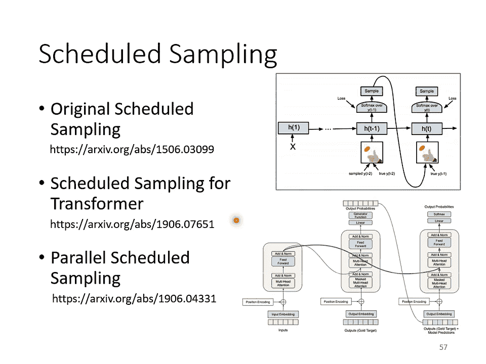

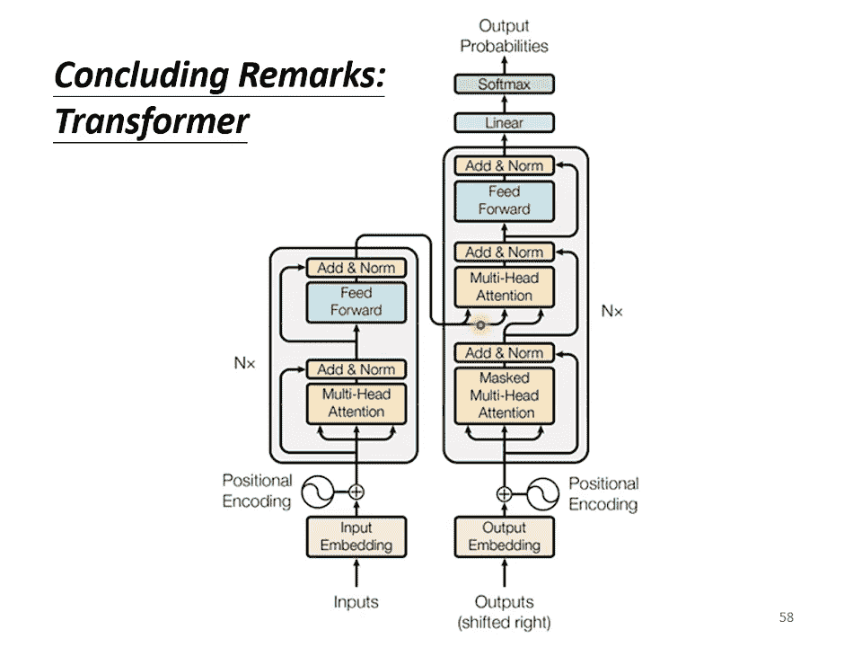

这些知识构成了理解和使用现代生成式AI模型（如GPT、T5等）的重要基础。