# 25：（延申）用语言模型來解释语言模型 (上) 👨‍🏫🤖

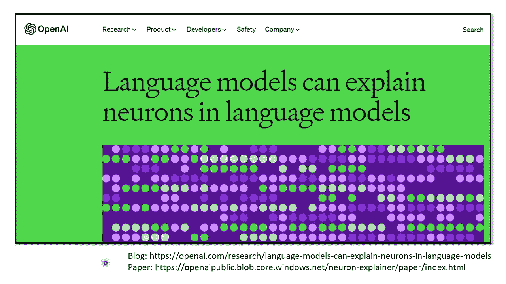


## 概述
在本节课中，我们将要学习一种新颖的技术：使用一个语言模型（如GPT-4）来解释另一个语言模型（如GPT-2）内部神经元的行为。这是OpenAI近期一篇论文的核心内容，旨在提升人工智能模型的可解释性。

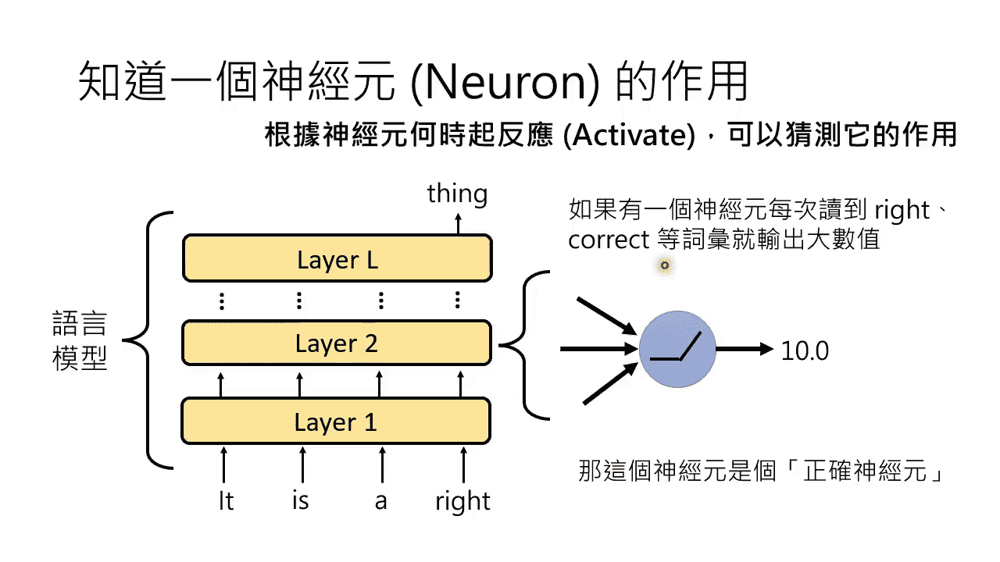

## 可解释性AI的目标 🎯
上一节我们提到了可解释性AI，但需要明确的是，它并非单一技术。根据不同的解释目标，存在多种方法。

本节中我们来看看OpenAI这篇论文的具体目标：它试图解释语言模型内部**单个神经元**的功能。具体来说，研究者希望通过观察一个神经元在不同输入下何时被“激活”（即输出较大的数值），来推测该神经元的作用。

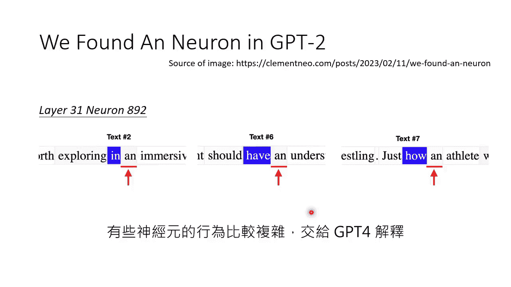

例如，如果一个神经元每当读到“right”或“correct”等词汇时就输出高值，我们便可推测它是一个“正确神经元”，负责检测与“正确”相关的概念。


## 神经元真的有明确功能吗？🤔
一个自然的问题是：神经网络中的神经元真的都代表某种特定含义吗？实际上，大多数神经元的行为并不清晰。然而，确实存在一些功能独特的神经元。


一个著名的例子来自一篇2023年2月的博客，研究者发现GPT-2模型第30层第892号神经元有一个神奇的特性：它会在模型**预测下一个词是“an”**时被强烈激活。无论当前词是“in”、“have”还是“how”，只要下一个词是“an”，该神经元就会输出高值。

对于那些行为更复杂、人类难以直观理解的神经元，OpenAI的解决方案是：**交给GPT-4来解释**。这就是“用语言模型解释语言模型”的核心思想。

## 方法揭秘：如何用GPT-4解释神经元 🛠️
这个技术的原理出人意料地简单。以下是其核心步骤：

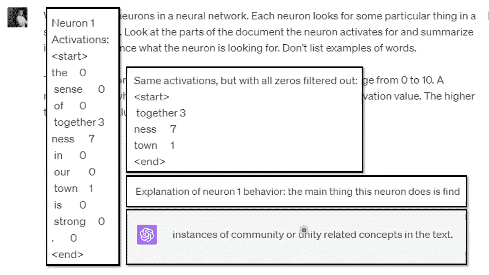

1.  **收集数据**：让待解释的模型（如GPT-2）阅读大量文本，并记录目标神经元在每个词（token）处的激活值。
2.  **格式化数据**：将神经元的激活模式整理成特定格式，准备输入给GPT-4。格式通常为：`[词汇]：[激活值]`。激活值会被归一化到0-10之间（10代表最大激活）。
3.  **构建提示（Prompt）**：设计一个提示词，向GPT-4说明任务背景，并提供格式化后的激活数据。
4.  **请求解释**：直接询问GPT-4该神经元的功能是什么。


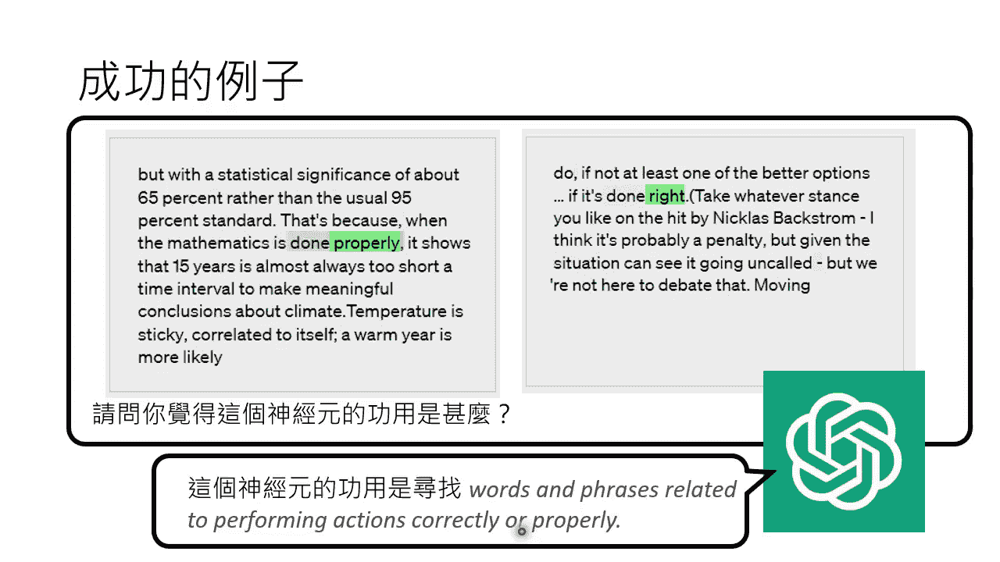

以下是OpenAI论文中使用的一个提示词示例：
```text
我们正在研究神经网络中的神经元。我会给你一个神经元的激活情况。
格式是：[词汇]：[激活值]，激活值范围在0到10之间。
请根据以下数据，解释这个神经元在寻找或检测什么。


示例数据：
sense:0
of:0
togetherness:7.2
in:0
our:0
town:0
is:0
strong:0

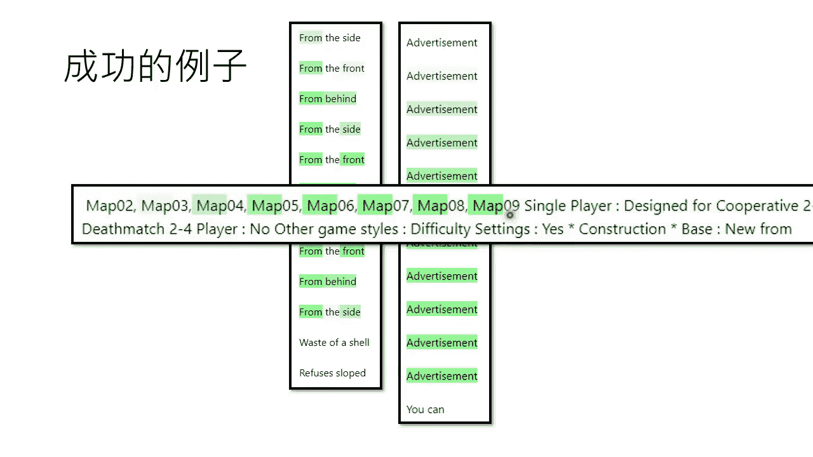

请解释神经元#1的行为：这个神经元在寻找什么？
```
为了提高解释质量，一个关键技巧是：**过滤掉激活值为0的词汇**，只将非零激活的词汇及其数值提供给GPT-4。这样可以减少噪声，让模型更专注于关键模式。

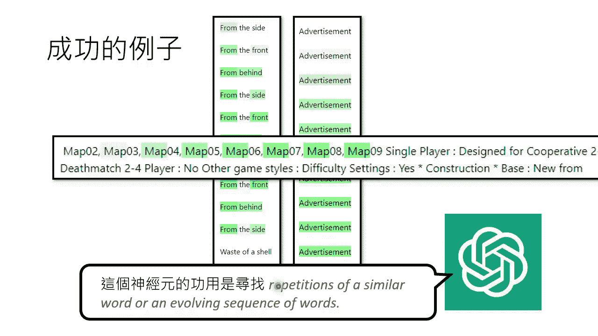


## 成功与失败的案例 📊
上一节我们介绍了方法，本节中我们来看看GPT-4解释神经元的具体表现。以下是几个典型案例：


### 成功案例
以下是GPT-4能够成功解释的神经元例子：

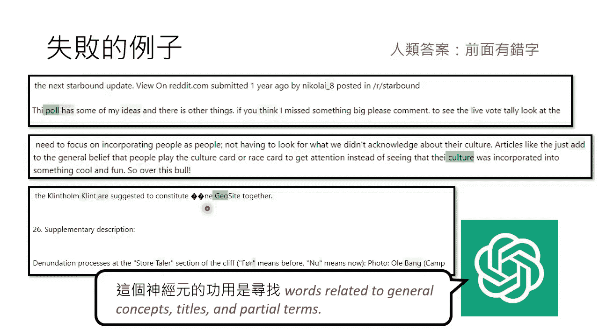

*   **“正确”神经元**：当看到“done properly”、“done right”时被激活。GPT-4解释为：该神经元寻找与“把事情做对”相关的词汇或短语。
*   **“比喻”神经元**：当看到“like water mix with water”、“like a child ride a bike”等句子时被激活。GPT-4解释为：该神经元检测包含比较和比喻的叙述。
*   **“重复模式”神经元**：当文本中出现重复词汇（如“advertisement”重复多次）或重复模式（如“map01, map02…”)时，激活值逐渐升高。GPT-4解释为：该神经元对反复出现的模式做出反应。


### 失败案例
当然，也存在许多GPT-4无法合理解释的神经元：

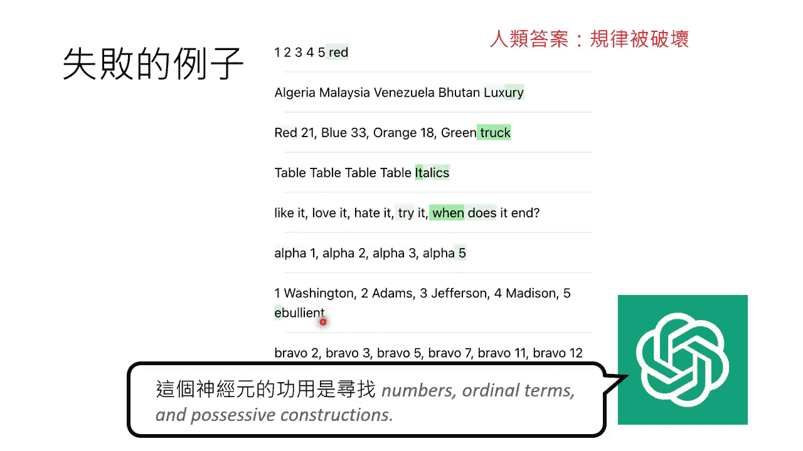

*   **“错字/罕见词”神经元**：该神经元在看到“poret”（portrait的错字）、“JILL”等时激活。规律难以捉摸。GPT-4给出了一个模糊且不准确的解释。实际上，该神经元可能主要对拼写错误或罕见词汇敏感。
*   **“规律破坏”神经元**：这是一个功能非常抽象的神经元。例如，在序列“1, 2, 3, 4, 5, red”中，它在“red”处激活；在“Washington, Adams, Jefferson, Madison, ebullient”中，它在“ebullient”（非总统名）处激活。GPT-4未能发现规律。根据人工分析，该神经元的功能是**检测一个正在进行的模式被破坏的时刻**。


## 如何评估解释的好坏？📈
我们如何判断GPT-4给出的解释是否准确呢？OpenAI设计了一个巧妙的评估方法：**让GPT-4角色扮演该神经元**。

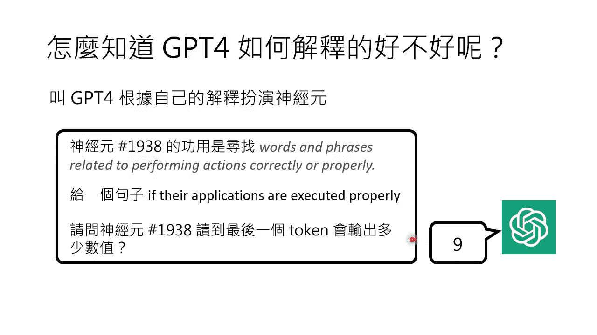

具体步骤如下：
1.  将GPT-4自己对神经元的解释（例如：“该神经元检测以‘ing’结尾的动词”）作为角色设定。
2.  给GPT-4一个新的句子，问它：“如果你是那个神经元，读到句子的最后一个词时，你会输出多大的激活值？”
3.  将GPT-4“扮演”输出的预测值，与**真实神经元**在相同输入下的实际激活值进行比较。
4.  根据预测值与真实值的接近程度，计算一个**解释分数（Explanation Score）**，范围在0到1之间。1表示预测完美，0表示完全不匹配。

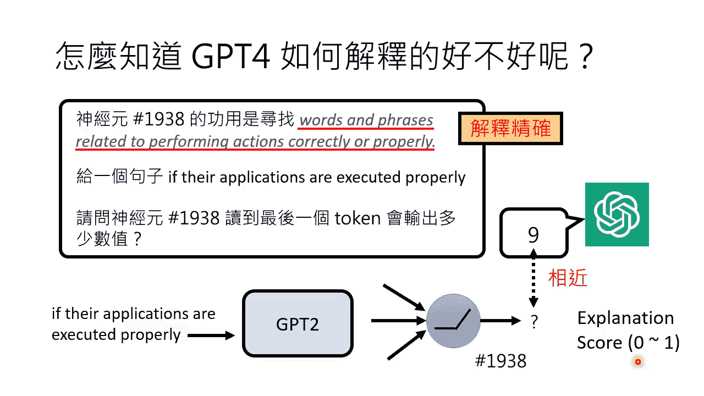

以下是一个评估示例的提示词：
```text
神经元#4的功能是：检测以‘ing’结尾的动词。
现在有一个句子：“I am running”
请问，当这个神经元读到最后一个词‘running’时，你认为它的激活值会是多少？（请输出一个0-10之间的数字）
```
如果解释准确，GPT-4应该能正确预测高激活值（如10）。如果句子是“I am run”，它则应预测低激活值（如0）。

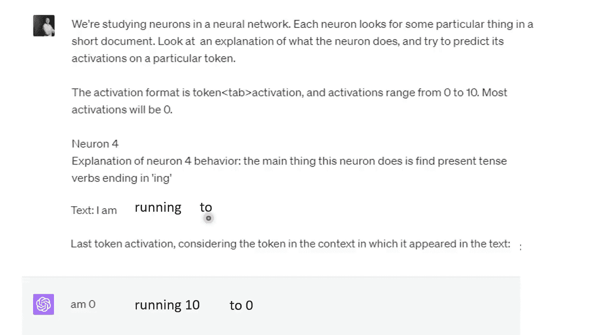

## 研究发现与趋势 📉
应用上述评估方法后，研究者发现了一些有趣趋势：

*   **模型大小**：较小的语言模型中，神经元更容易被解释；较大的模型中，神经元行为更复杂，更难解释。
*   **网络层次**：在同一网络中，**较低层（浅层）**的神经元通常比**较高层（深层）**的神经元更容易解释。这符合直觉：底层神经元可能负责检测具体词汇或简单模式，而高层神经元负责更抽象、复杂的组合概念，其功能更难以用单一描述概括。

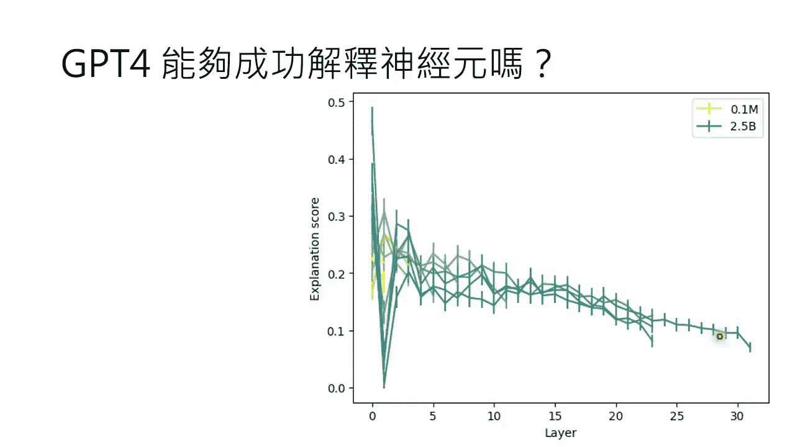

关于解释分数的绝对值，研究显示：
*   像“正确神经元”这样功能明确的神经元，其解释分数约为0.42。
*   多数神经元的平均解释分数仅为0.15左右。
*   一个关键对比是：即使由**人类专家**来提供对神经元的解释，并用同样的“角色扮演”方法评估，得到的平均分数也只有0.18，并不比GPT-4的解释好太多。

这暗示了一个重要结论：在大型神经网络中，**大多数神经元可能并没有清晰、单一、人类可理解的功能**。它们的意义可能在于与其他神经元协同工作。GPT-4的方法能够有效地帮我们筛选出那些少数具有明确功能的“可解释”神经元。

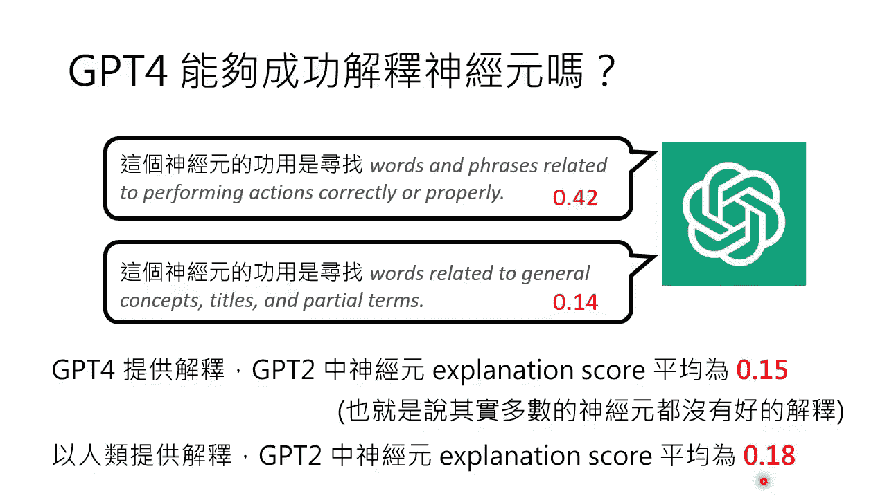

## 总结
本节课中我们一起学习了如何使用强大的语言模型（如GPT-4）来解释另一个语言模型内部神经元的行为。我们了解了该方法的核心流程：收集激活数据、构建提示词、请求解释。我们还探讨了评估解释质量的方法——“角色扮演”评估法，并分析了研究揭示的趋势：并非所有神经元都易于解释，但GPT-4能有效识别出那些具有明确功能的神经元。这项技术为探索AI模型“黑箱”内部提供了新的自动化工具。