# 26：（延申）用语言模型来解释语言模型 (下) 🧠

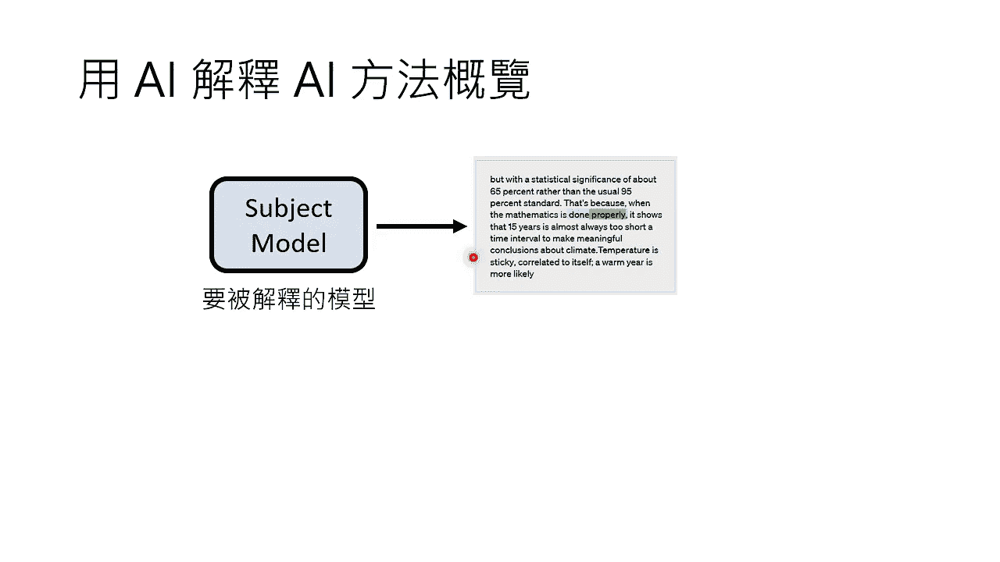

在本节课中，我们将学习一种使用大型语言模型（如GPT-4）来解释另一个语言模型（如GPT-2）内部神经元工作机制的方法。我们将了解该方法的整体框架、验证机制、数据选择策略以及该方法存在的潜在局限性。

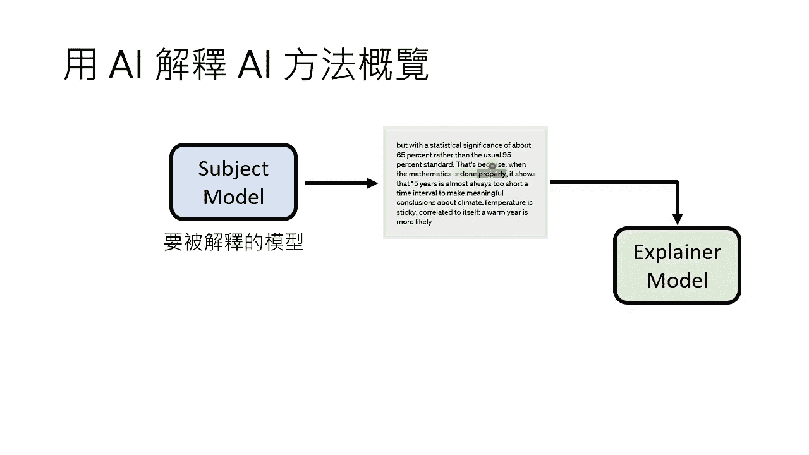

## 方法概览 🧩

上一节我们介绍了可解释AI的基本概念，本节中我们来看看使用AI解释AI的具体流程。

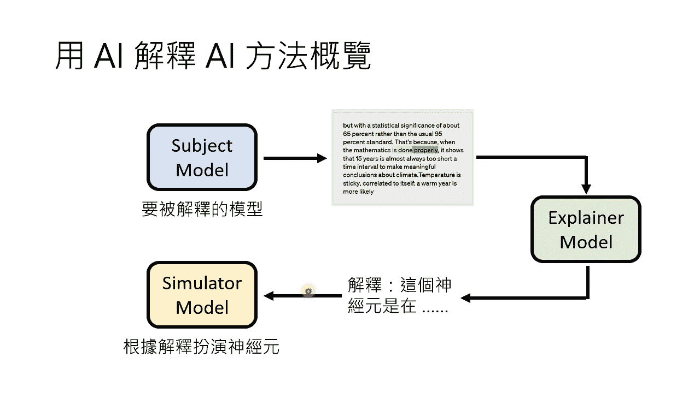

整个方法包含三个核心组件：
1.  **被解释模型**：需要被分析内部工作机制的模型。
2.  **解释模型**：负责观察被解释模型神经元的激活模式，并生成文字解释。
3.  **模拟器模型**：根据解释模型生成的文字描述，尝试“扮演”或模拟被解释模型中特定神经元的行为。

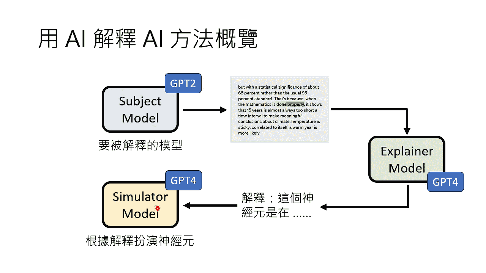

流程如下：首先，我们有一个需要被解释的模型（Subject Model）。

然后，从这个被解释的模型中，我们可以选定某一个特定的神经元进行分析。

我们记录该神经元在不同输入句子下的激活值。将这些信息（句子和对应的激活值）输入给负责解释的模型。

解释模型会产生一段文字解释。接着，这段解释会被交给一个负责角色扮演的模型（Simulator Model）。模拟器模型根据这段解释来模拟该神经元的行为。最后，通过比较模拟结果和真实神经元的行为，我们就可以判断这个解释是否准确。

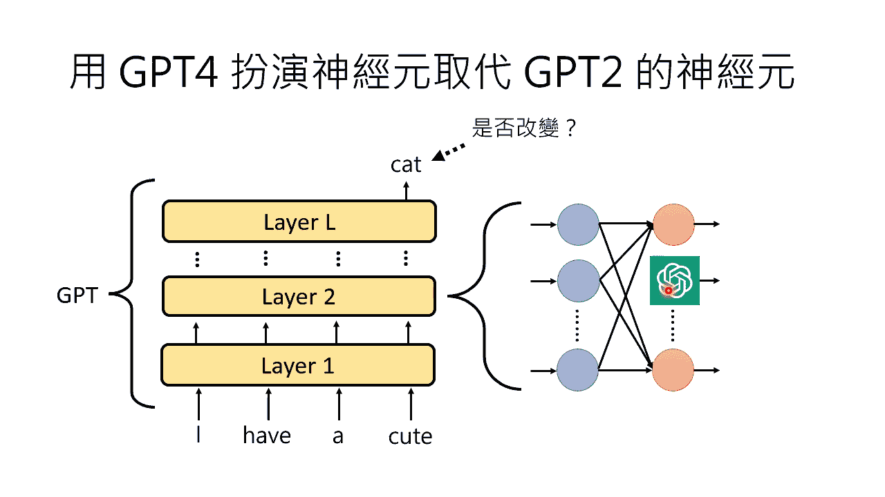

## 实验设置与验证 🔬

在OpenAI的研究中，被解释的模型是GPT-2，而负责解释和角色扮演的模型都是GPT-4。但这三个模型并不必须是同一个，理论上任何有能力的语言模型都可以担任解释模型和模拟器模型。

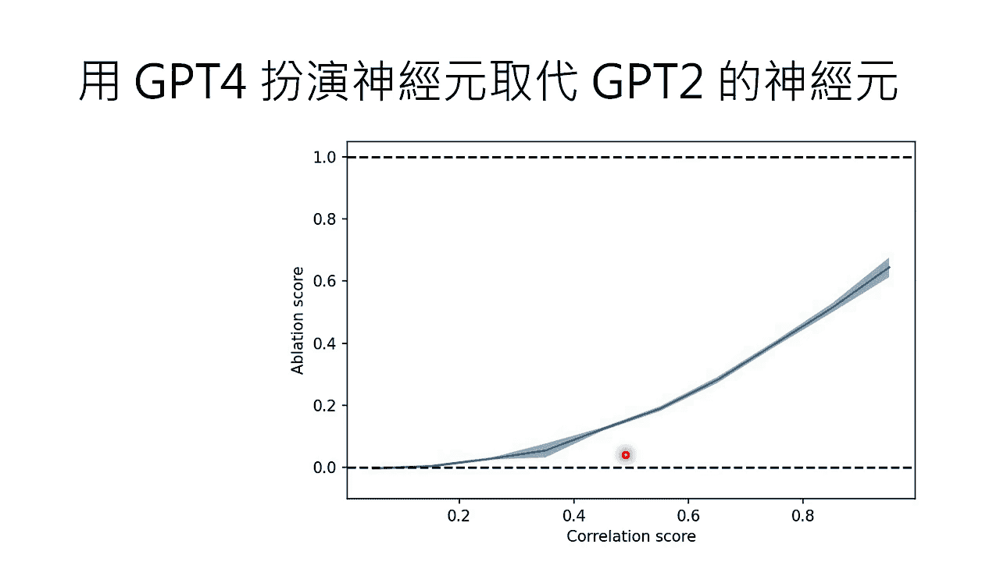

那么，如何判断GPT-4模拟的神经元像不像真实的神经元呢？最初的方法是直接比较两者的输出。

**核心验证方法一：比较输出**
计算模拟神经元的输出与真实神经元输出的相似度（如相关系数）。公式可以简单表示为：
`相似度 = correlation(模拟输出, 真实输出)`

但仅看输出可能不够。因为一个神经元的重要性不仅在于其输出值，更在于它对整个网络最终输出的影响。一个输出变化很大的神经元，如果处于不重要的位置，对最终结果影响可能很小；反之，一个输出变化细微但处于关键位置的神经元，可能对结果有巨大影响。

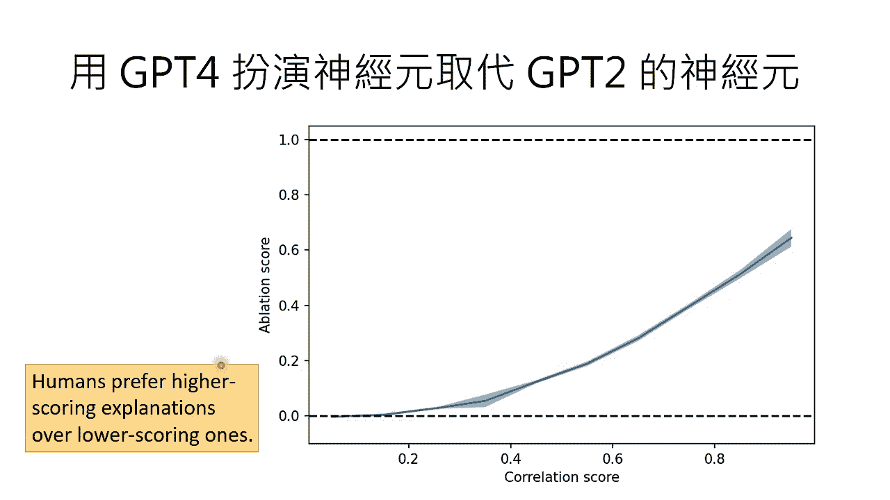

因此，引入了第二种验证方法。

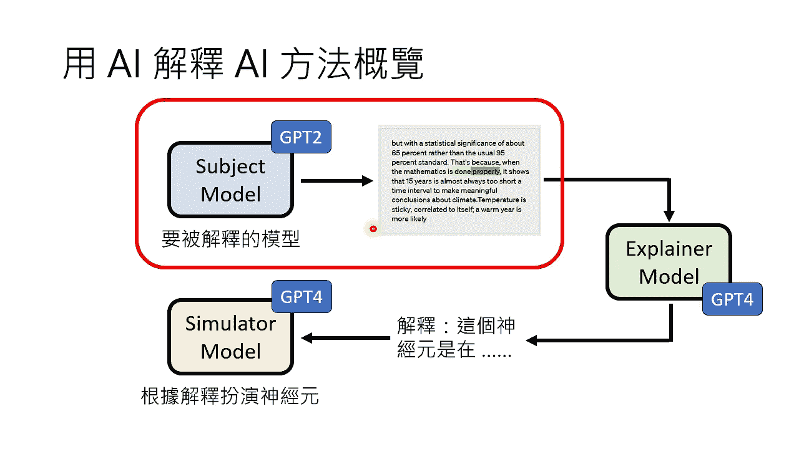

**核心验证方法二：替换测试**
用GPT-4模拟的神经元直接替换GPT-2中的真实神经元，然后观察整个GPT-2模型的输出变化程度。变化越小，说明模拟得越好，该神经元的解释也可能更准确。这听起来有些奇特——一个拥有海量参数的模型（GPT-4）被用来模拟另一个模型中一个小小的神经元。

OpenAI的研究表明，这两种评估方法的结果是高度一致的。

上图中，横轴是第一种方法（输出相关系数），纵轴是第二种方法（替换后的输出变化）。两者呈现显著正相关。因此，在实践中只需选用其中一种方法进行评估即可。

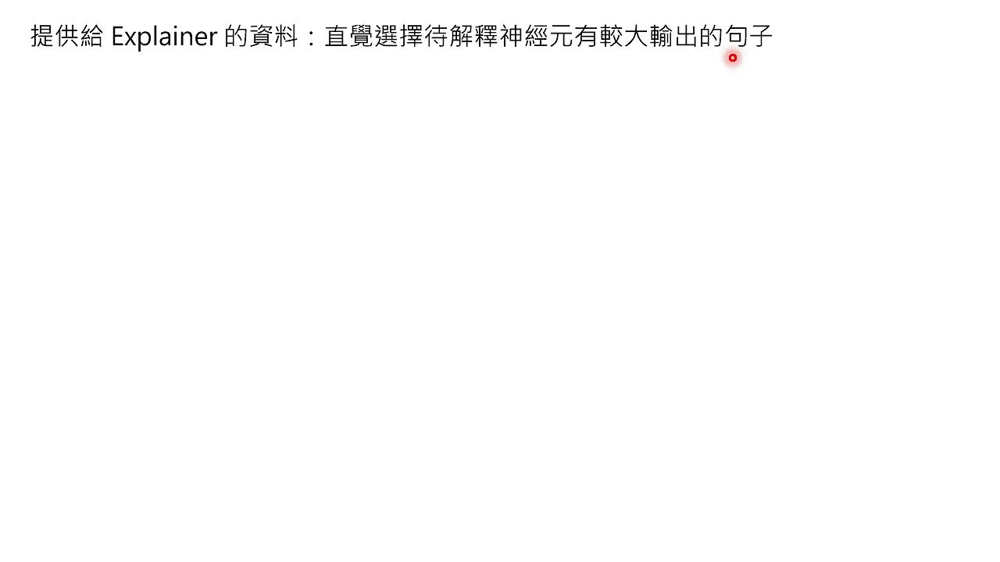

另一个关键问题是：模拟的好坏是否真的反映了文字解释的好坏？OpenAI通过人工评估进行了验证，发现人类认为质量越高的解释，其对应的“解释力分数”也越高，说明两者是正相关的。

## 数据选择策略 📊

要让模型解释一个神经元，必须给它看一些句子，以观察该神经元的激活模式。但选择哪些句子会极大影响解释结果。

一个直观的方法是：让被解释模型（如GPT-2）处理大量句子，然后挑选出目标神经元激活值特别高的那些句子，交给解释模型分析。这是因为解释模型（如GPT-4）的输入长度有限，无法处理所有句子。

然而，这种方法存在盲点。

请看以下例子：假设我们给解释模型看了三个句子，发现目标神经元在看到“all”时被激活。

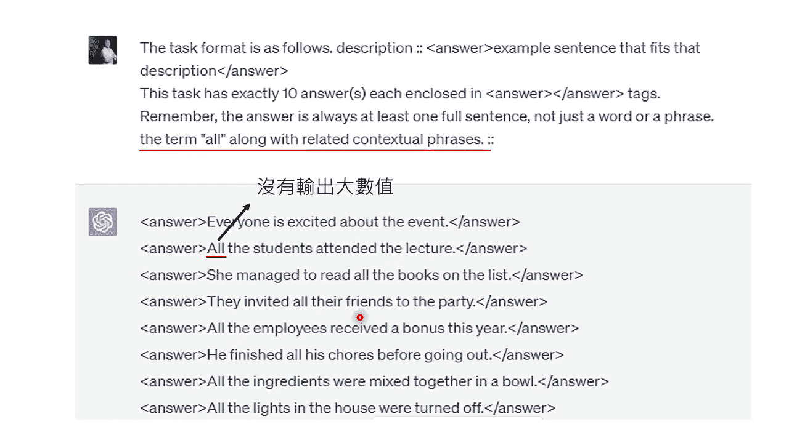

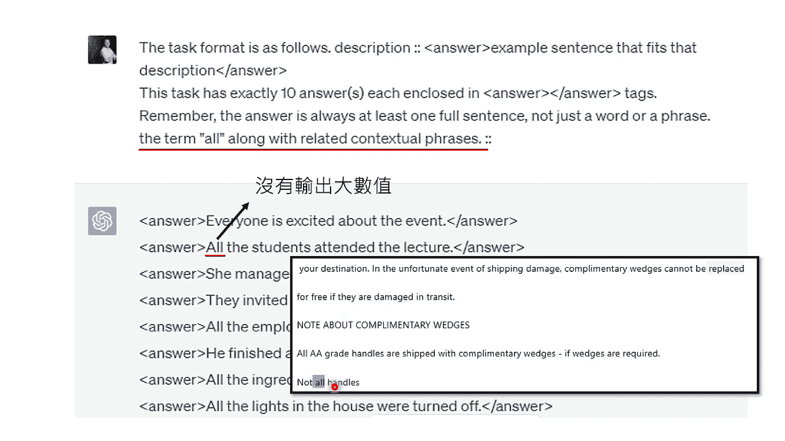

解释模型可能会得出结论：**该神经元的功能是检测单词“all”**。但真相可能并非如此。实际上，这个神经元可能是在检测“not all”这个短语，而不仅仅是“all”。由于提供的句子中“all”前面恰好都有“not”，但数据没有包含反例（只有“all”没有“not”的句子），解释模型无法做出更精确的判断。

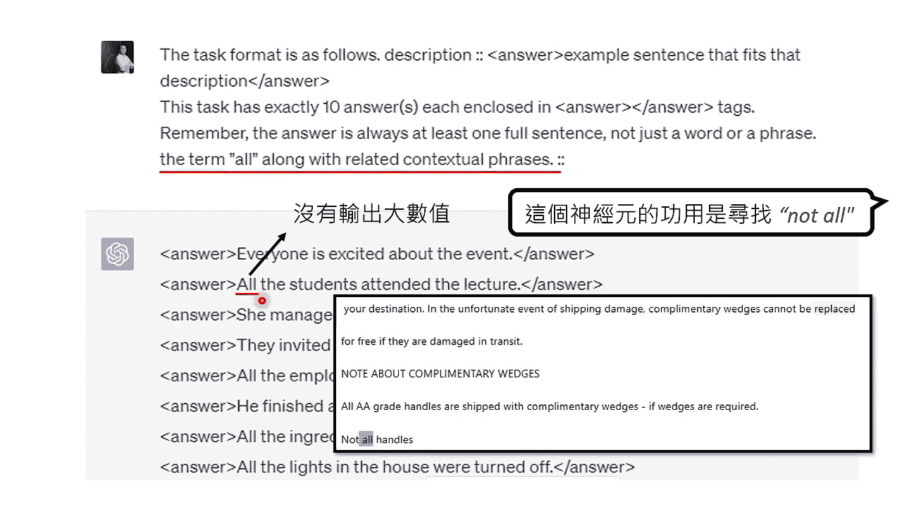

为了解决这个问题，研究者提出了一种迭代修正的方法。

## 迭代修正法 🔄

该方法的核心是让解释模型自己生成关键的测试句子。

1.  **初始解释**：首先，基于初始数据，解释模型给出一个初步解释（例如：“检测all”）。
2.  **生成反例**：我们将这个初步解释输入给解释模型，让它生成更多可能激活该神经元的句子（例如，生成大量包含“all”的句子）。
3.  **测试验证**：将这些新生成的句子输入被解释模型（GPT-2），观察目标神经元的真实激活情况。
4.  **修正解释**：如果发现新句子（如“All the students”）并未激活神经元，就将这些新数据（句子和激活值）与旧数据一起，再次交给解释模型进行分析。

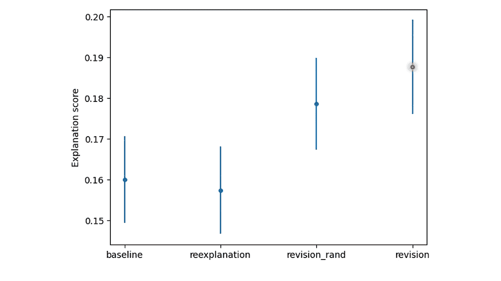

通过这个过程，解释模型能够发现规律：之前看到“not all”时神经元激活。

但现在看到只有“all”时神经元不激活。

从而修正解释为：**该神经元的功能是检测“not all”**。

实验证明，这种迭代修正的方法是有效的。

上图中，纵轴代表解释力分数（越高越好）。“Baseline”是直接挑选高激活句子的方法。“Revision Random”是随机补充更多句子，性能有所提升。而“Revision”是使用GPT-4生成针对性句子的迭代修正法，性能提升最显著。因为GPT-4生成的句子能提供更关键的信息，从而得到更好的解释。

## 方法总结与讨论 💭

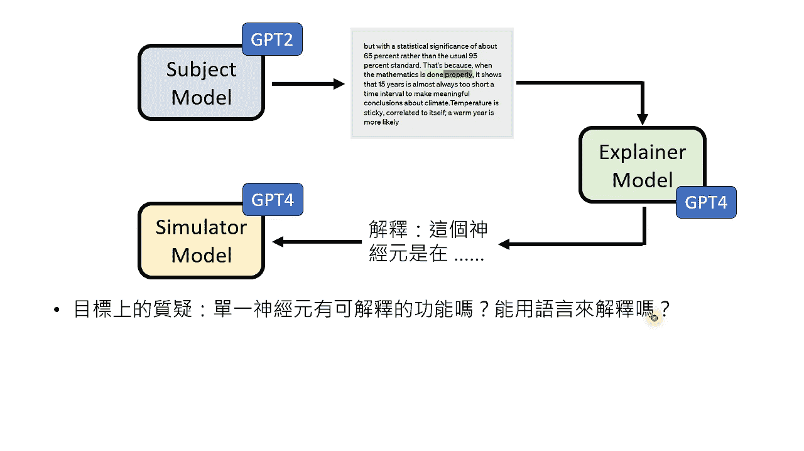

以上就是“用AI解释AI”方法的全部内容。总结流程如下：有一个待解释的网络和其中某个神经元；解释模型观察该神经元的激活模式并生成文字解释；模拟器模型根据该解释扮演该神经元；通过评估扮演效果的好坏来判断解释的质量。

然而，这个框架存在许多值得讨论和质疑的地方：

以下是几个主要的质疑点：

*   **目标的合理性**：解释单个神经元的行为是否有意义？神经网络的功能很可能由神经元群体协同完成，单个神经元可能没有明确或独立的功能。OpenAI的论文中也提到，他们尝试过解释一组神经元，这或许是更有前景的方向。
*   **描述的局限性**：我们试图用人类语言描述神经元的行为。但神经元的行为可能非常复杂，超出了人类现有语言的描述范围。也许它有明确且重要的工作，但无法用我们熟悉的词汇和概念来刻画。
*   **框架的内部缺陷**：该方法依赖于“解释模型”和“模拟器模型”的协作。如果模拟器模型能力很弱，即使解释很好，它也无法正确模拟，导致评估分数低。反之，高分也可能源于两者之间存在“人类无法理解的暗语”——解释是人看不懂的，但模拟器能看懂并正确执行。目前的框架难以区分这些情况。

## 课程总结 📝

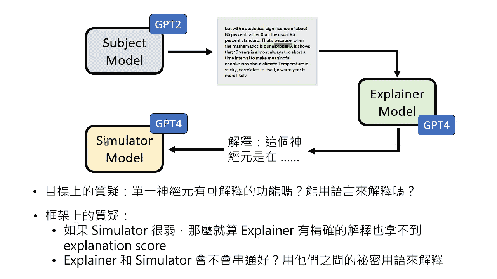

本节课中，我们一起学习了使用大型语言模型（如GPT-4）来解释另一个语言模型（如GPT-2）内部工作机制的创新方法。我们详细探讨了该方法的三大组件（被解释模型、解释模型、模拟器模型）、两种核心验证策略（输出比较和替换测试），以及通过迭代生成数据来提升解释准确性的关键技术。最后，我们也客观分析了该方法在目标设定、描述能力和评估框架等方面存在的潜在局限性。这种方法为探索神经网络黑箱提供了一种新思路，但其有效性和可靠性仍需进一步研究和完善。