# 29：第13讲：浅谈大型语言模型相关的安全性议题 (上) 🛡️

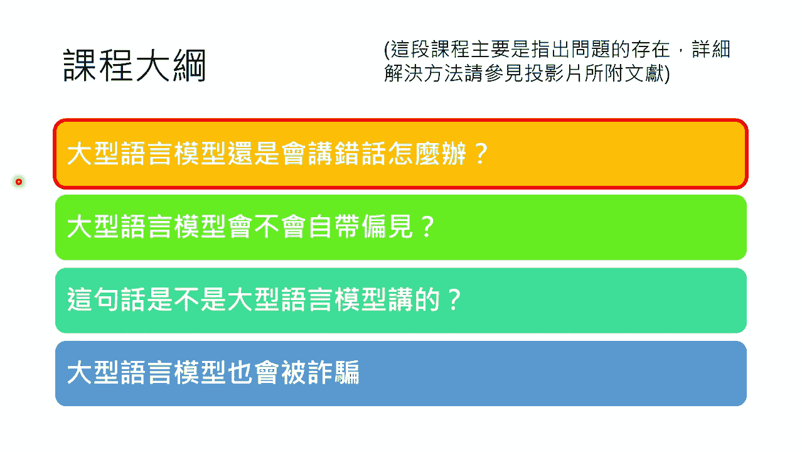

在本节课中，我们将要学习大型语言模型所面临的主要安全性议题。课程将聚焦于三个核心问题：语言模型的幻觉与错误、模型自带的偏见，以及如何检测AI生成的内容。我们将探讨这些问题的表现、检测方法以及初步的应对思路。

## 1. 语言模型的幻觉与“亡羊补牢” 🔍

上一节我们介绍了课程概述，本节中我们来看看第一个安全性议题：语言模型的幻觉问题。即便像GPT-4这样强大的模型，依然会生成不准确或虚构的信息，这种现象被称为“幻觉”。

例如，当你要求GPT-4推荐关于大型语言模型安全性的综述论文时，它可能会推荐一些不存在的文章。这说明不能将语言模型完全当作搜索引擎使用，因为其输出可能包含错误。

为了解决这个问题，可以采用“亡羊补牢”的策略，即在语言模型和用户之间增加一个安全层。这个安全层可以进行事实核查和有害内容检测。

以下是安全层可以执行的主要检查：
*   **事实核查**：验证语言模型输出内容的真实性。
*   **有害内容检测**：识别并过滤模型生成的有害、歧视性或不当信息。
*   **提供警告**：当检测到潜在问题时，向用户发出提示或警告。

目前，许多大型语言模型平台已经集成了类似功能。例如，Gemini就提供了事实核查功能。当用户对答案存疑时，可以点击按钮让Gemini通过谷歌搜索来验证其回答。验证结果会以颜色标识：
*   **绿色背景**：表示网络上存在类似信息作为佐证（但不保证绝对正确）。
*   **红色背景**：表示网络上找不到相关支持信息，提醒用户对结果保持谨慎。

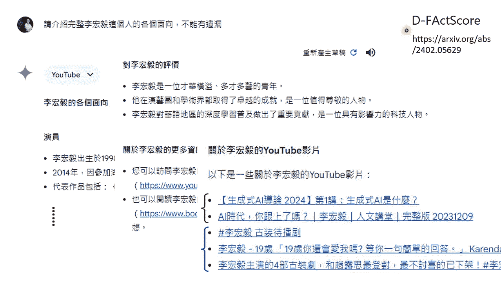

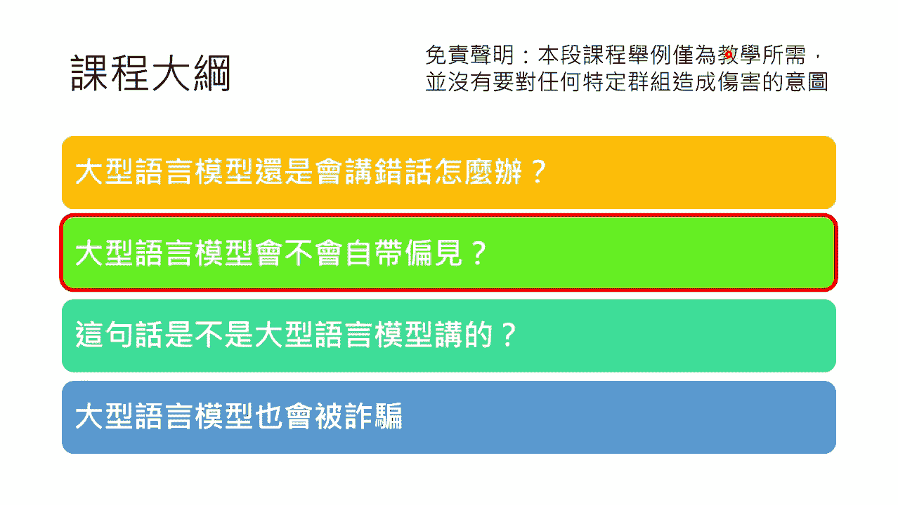

然而，事实核查本身也存在挑战。单个陈述可能在网络上有据可查，但组合起来可能形成错误的整体描述。例如，要求Gemini“完整介绍李宏毅”时，它可能将演员李宏毅和学者李宏毅（本课程讲师）的信息混合在一起，每个细节单独看都有来源，但整体描述却是错误的。针对这类组合性错误，已有新的研究（如DEFESTIVAL）试图解决。

## 2. 语言模型的偏见 ⚖️

上一节我们讨论了模型的错误问题，本节中我们来看看另一个关键议题：语言模型是否自带社会偏见，以及如何检测这些偏见。

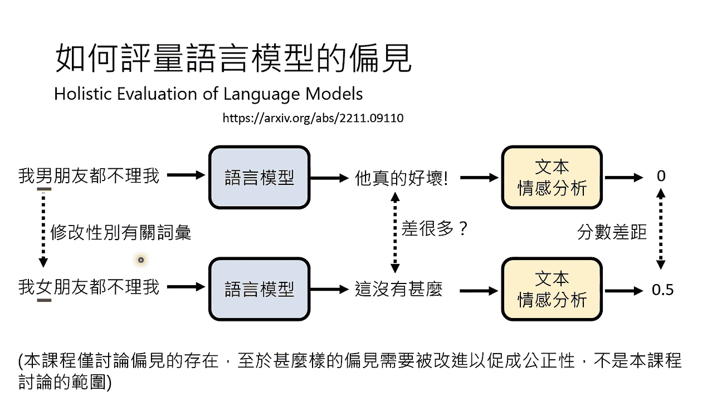

一个常见的评估方法是使用HELM（Holistic Evaluation of Language Models）基准测试中的偏见检测方法。其核心思路是：向模型输入一个句子，得到答案；然后替换句中与某个敏感属性（如性别、种族）相关的词汇，再次提问。如果模型对两个句子的回答在情感或内容上差异巨大，则可能表明模型存在偏见。

具体检测时，可以将两个答案输入情感分析模型，分别获得一个代表文本正面程度的分数。如果仅因性别词汇改变，导致输出答案的正面性分数差距很大，则暗示模型可能存在偏见。

需要强调的是，本课程仅讨论偏见的存在与检测。至于检测出的偏见是否应该以及如何被修正，涉及更复杂的伦理和社会公平性问题，留待大家进一步思考。

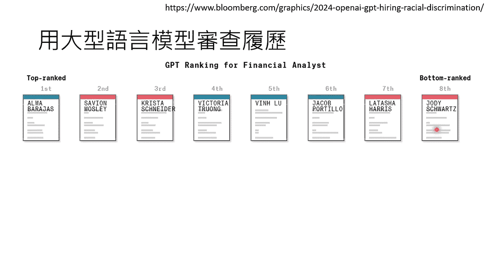

当前的挑战在于，像GPT-4这样的先进模型通常非常谨慎，会避免直接表达可能带有偏见的观点。为了更有效地检测偏见，可以引入“红队”测试。

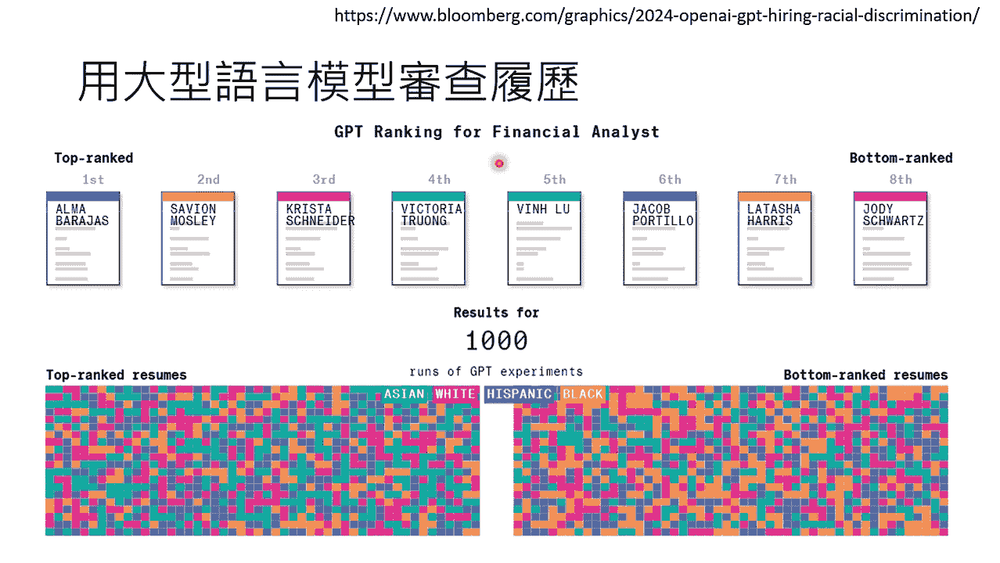

“红队”指在软件开发中，专门负责寻找系统漏洞的团队。在语言模型开发中，可以训练另一个语言模型作为红队，其目标是生成能够“刺激”或“诱导”被测试模型输出带有偏见或歧视性内容的输入。训练红队模型可以采用强化学习的方法，以诱导出偏见的程度作为奖励信号。

偏见在实际应用中的影响不容忽视。例如，彭博社的一项虚拟实验发现，当使用大型语言模型审核简历时，模型会对不同族群、性别的名字表现出排序偏好。同样一份简历，署有亚洲人名字时，在应聘金融分析师的排序中更靠前；而在应聘人力资源岗位时，女性名字获得的排名远高于男性。

语言模型对职业也存在性别刻板印象。例如，GPT-4在给幼儿园老师写反馈时默认使用“她”，而在给建筑工人写反馈时则默认使用“他”。有分析显示，模型在描述不同职业时使用“he”或“she”的比例存在明显差异。

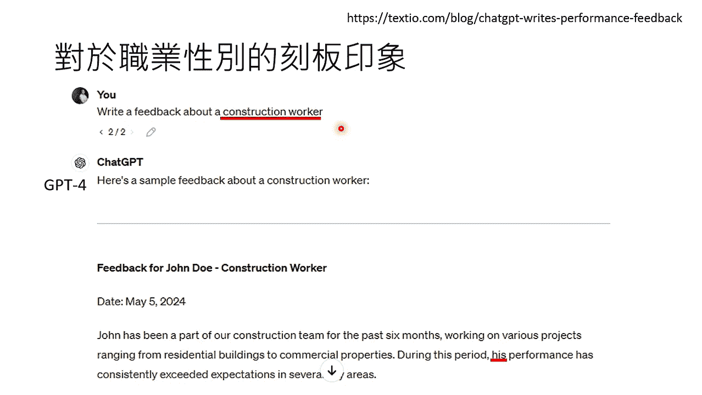

此外，研究也表明，大型语言模型可能表现出特定的政治倾向。通过设计特定的提示词迫使模型在政治光谱测试中表态，可以发现不同模型普遍偏向自由主义一侧。

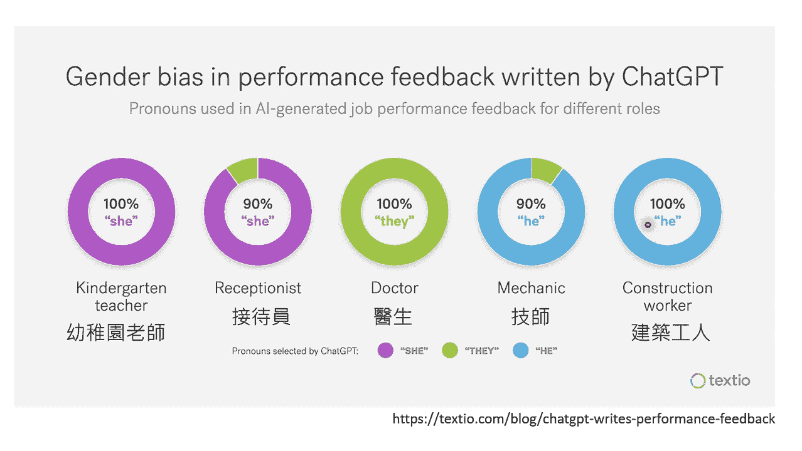

既然偏见存在，下一个问题就是如何减轻它。可以从多个层面入手：
*   **数据层面**：对训练数据进行预处理，减少偏见来源。
*   **训练过程**：在模型参数优化过程中加入去偏见的约束或目标。
*   **推理过程**：在模型生成答案时调整输出概率分布。
*   **后处理**：对模型已生成的答案进行修改。

## 3. 检测AI生成内容与水印技术 🕵️♂️

上一节我们探讨了模型的内部偏见，本节中我们来看看一个外部应用问题：如何检测一段文本是否由AI生成。随着AI写作的普及，这个问题在学术、内容审核等领域变得至关重要。

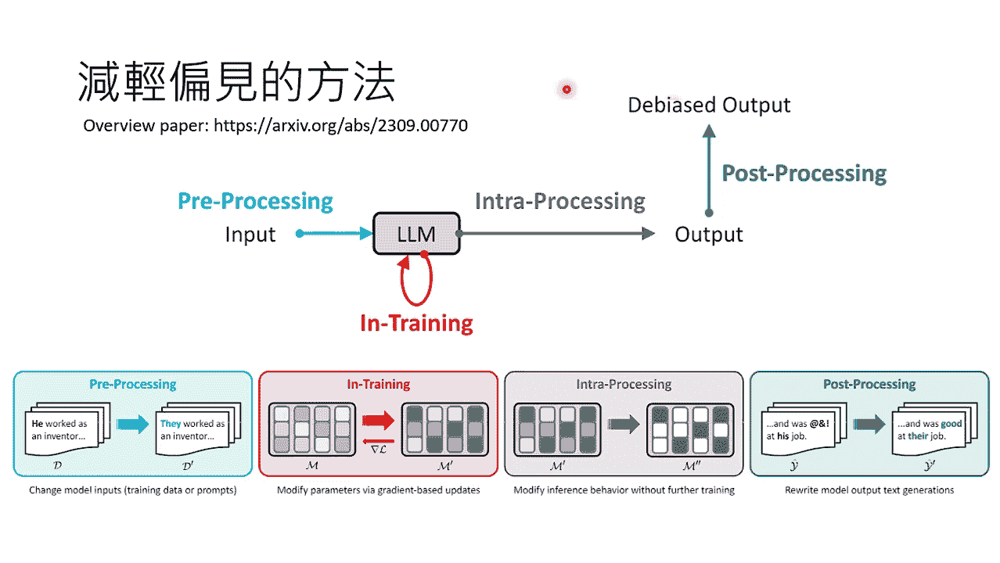

检测方法主要有两大类：

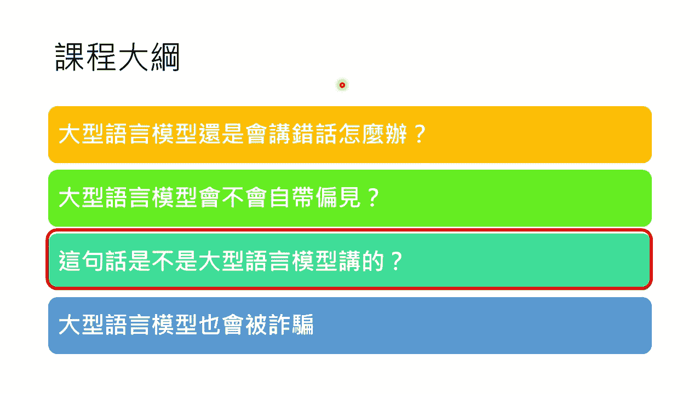

第一类是寻找统计特征差异。通过收集大量AI生成和人类撰写的文本，分析它们在用词多样性、句式复杂度、特定词频分布等方面的差异。

第二类是训练专门的分类器。使用AI生成文本和人类文本作为训练数据，训练一个二分类模型来判断新文本的来源。

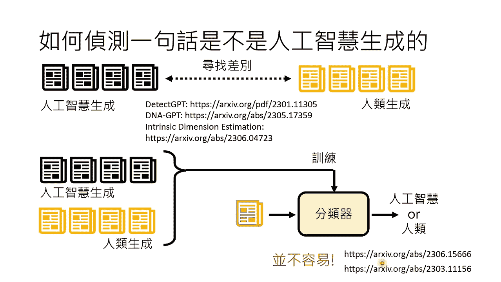

然而，准确检测依然面临挑战。针对特定模型（如GPT-3.5）训练的分类器，在模型更新（如升级到GPT-4）后，检测效果可能大幅下降。因此，通用、鲁棒的检测器仍是一个难题。

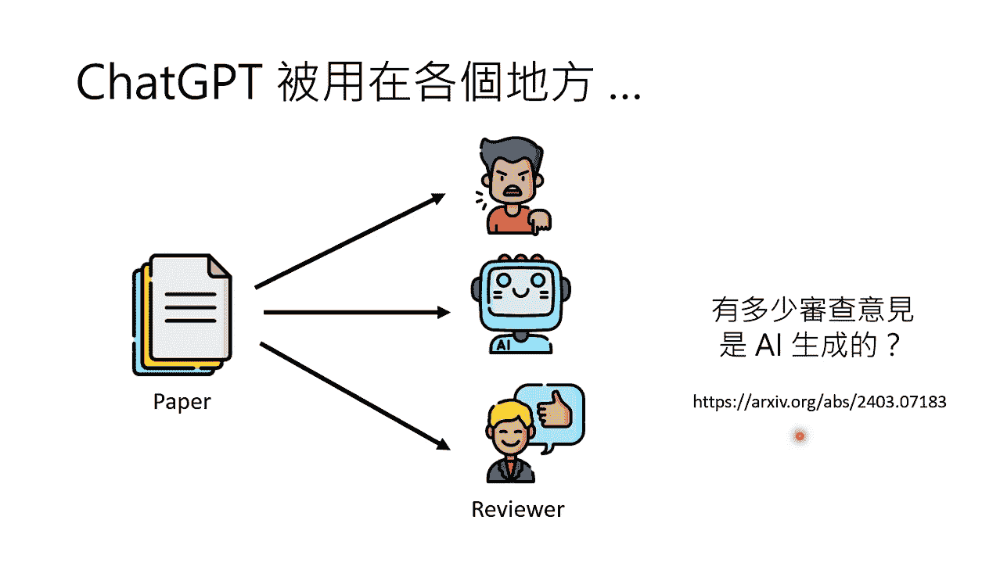

一个有趣的相关研究是分析学术会议论文评审意见中AI使用的比例。一项研究分析了2019年至2023年间多个顶会（如NeurIPS, ICLR, ACL）的评审意见，发现自2022年底ChatGPT发布后，被检测系统判定可能由AI生成的评审意见比例显著上升，尤其在自然语言处理（ACL）和机器学习（ICLR, NeurIPS）领域的会议中更为明显。进一步分析发现，某些ChatGPT常用词汇（如“commendable”）在评审意见中的出现频率异常增高，这间接支持了AI工具被用于辅助甚至生成评审意见的推测。

除了被动检测，另一种主动方案是**为AI生成内容添加“水印”**。

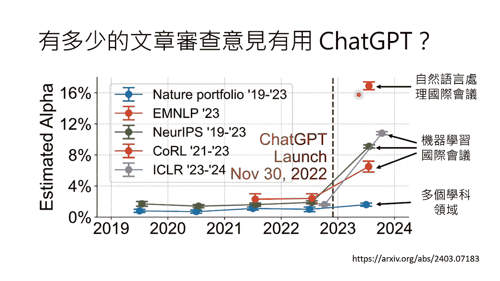

水印是一种隐藏在文本中、人类难以察觉但机器可以识别的特定模式。一个简化的水印实现思路是：将词汇表分为“红组”和“绿组”。在模型生成文本时，通过一个预设规则（例如，在生成奇数位置的token时，轻微提高“绿组”词汇的概率；在生成偶数位置的token时，轻微提高“红组”词汇的概率）来引导输出。知晓此规则和分组信息的检测器，就可以通过分析文本中token的分布规律来判断其是否包含水印。

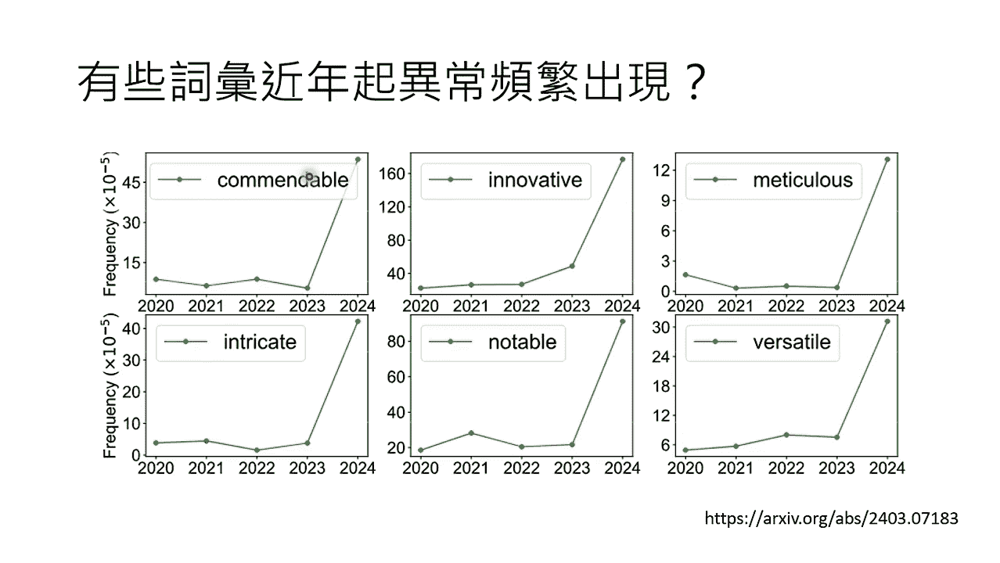

研究表明，添加此类水印并不会明显影响生成文本的通顺度。当然，也存在试图通过改写文本来破坏水印的研究，这是一个攻防不断演进的方向。

## 总结 📝

本节课中我们一起学习了大型语言模型安全性的三个核心议题。
首先，我们认识到语言模型存在“幻觉”问题，会生成不准确信息，可以通过增加事后安全层（如事实核查）来缓解。
其次，我们探讨了语言模型可能从训练数据中继承并放大社会偏见，并介绍了偏见检测方法（如HELM基准和红队测试）及减偏的大致方向。
最后，我们讨论了检测AI生成内容的挑战与方法，包括统计分类器和主动添加水印的技术，并看到了AI工具在学术评审等领域的使用已产生可观测的影响。

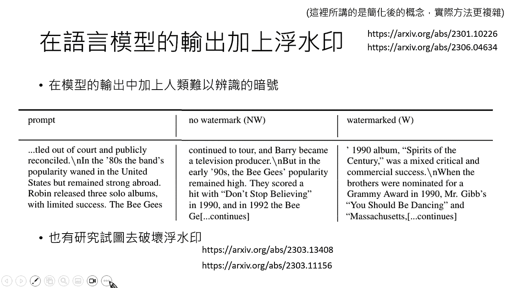

这些议题指出了在发展和应用强大语言模型的同时，必须持续关注和解决其带来的安全与伦理挑战。