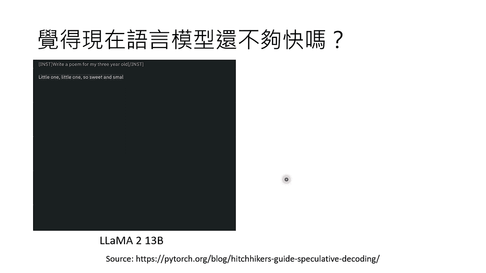
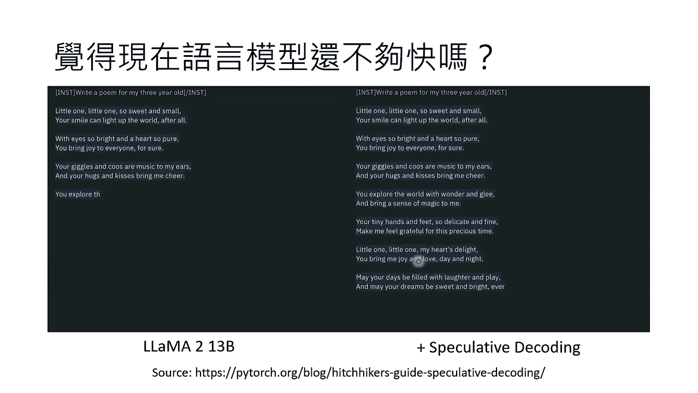
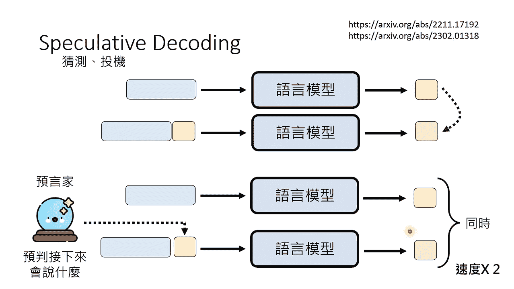
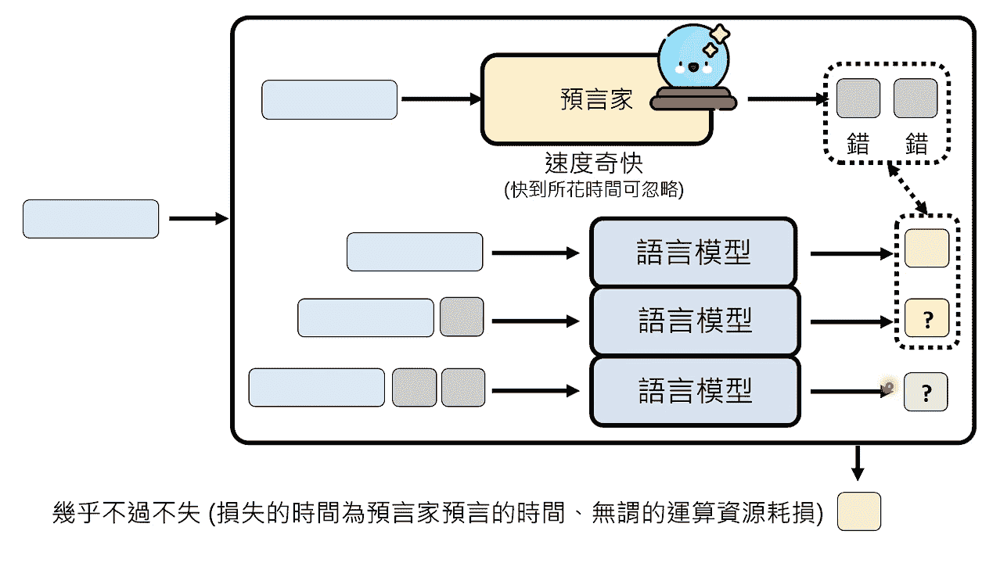
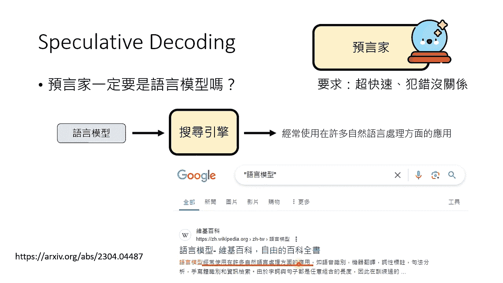
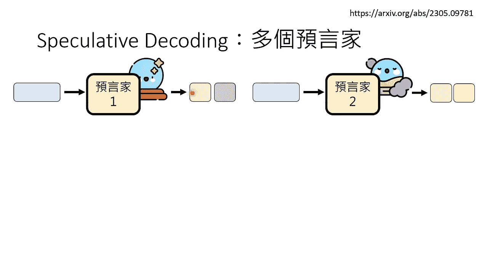
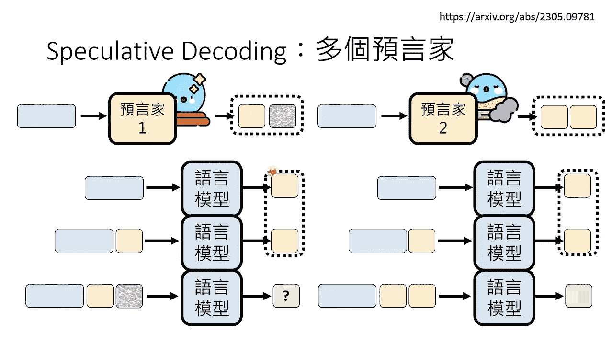
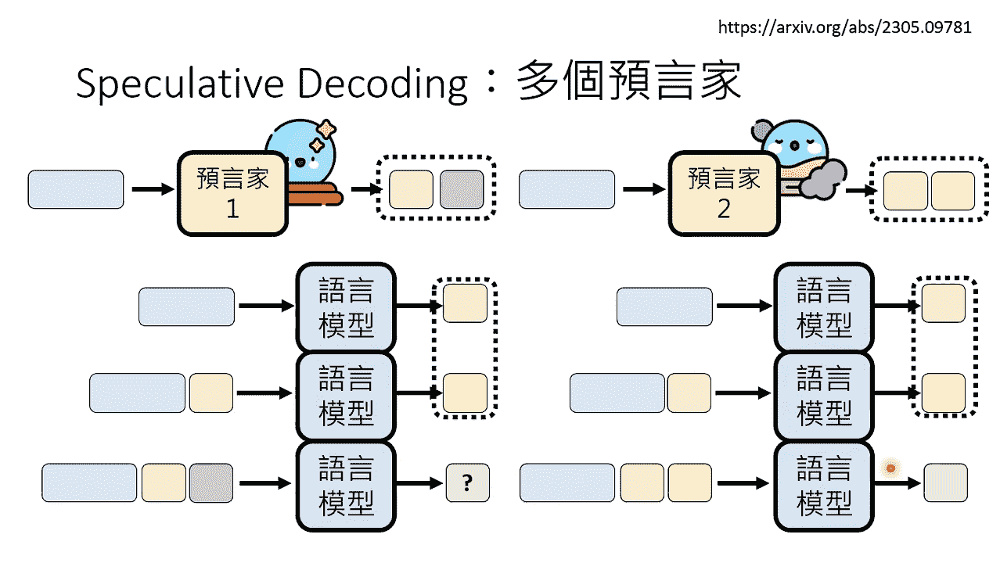
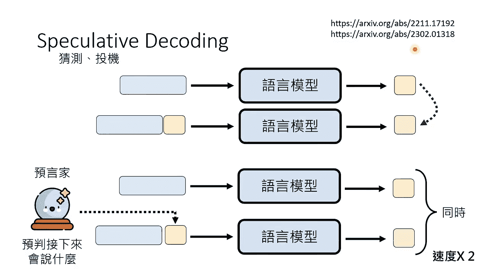

# 33：第16讲：可以加速所有语言模型生成速度的神奇外挂 — Speculative Decoding 🚀



在本节课中，我们将要学习一种名为 **Speculative Decoding** 的新技术。这项技术可以显著加快任何语言模型的文本生成速度，且无需对模型本身进行任何训练或修改，就像一个即插即用的“外挂”。

## 概述：为何需要加速生成？



虽然语言模型在生成较短文本时，使用自回归（Auto-Regressive）方式可能已经足够，但在需要生成长篇内容时，等待时间会变得非常漫长。Speculative Decoding 正是为了解决这一痛点而提出的方法。

## 核心概念：引入“预言家”



上一节我们提到了自回归模型的局限性，本节中我们来看看 Speculative Decoding 的核心思想。其关键在于引入一个“预言家”（Speculator）。

自回归模型的痛点是必须按部就班地生成：第一个token未生成前，无法生成第二个token。Speculative Decoding 的想法非常神奇：**我们能否找一个“预言家”来预判语言模型接下来的输出？**

如果预言家能根据当前输入，预判出语言模型接下来会生成“黄色”的token，我们就可以将“输入”和“输入+黄色token”同时丢给语言模型进行**并行计算**。这样，模型就能一次生成两个token，跳过了必须先生成第一个才能生成第二个的限制。

**公式/代码描述核心流程：**
```
输入: X
预言家预测: 下一个token为 Y1, 下下个token为 Y2
语言模型并行计算:
    - P(下一个token | X)
    - P(下下个token | X + Y1)
    - P(下下下个token | X + Y1 + Y2)
输出: 验证后正确的token序列
```

这样做的好处是显而易见的：生成速度理论上可以翻倍。原本一次只能生成一个token，现在可以同时生成多个。

## 运作机制详解

以下是 Speculative Decoding 的具体运作步骤。

1.  **预言阶段**：当蓝色输入进入系统后，首先交给“预言家”。预言家快速预测语言模型接下来会生成的token序列（例如，先红色，再黄色）。
2.  **并行验证阶段**：系统将“输入”、“输入+红色token”、“输入+红色token+黄色token”同时输入给原始语言模型，让它并行计算这些情况下各自的输出概率。
3.  **验证与输出阶段**：将语言模型并行计算出的第一个结果（即基于原始输入的下一个token）与预言家的第一个预测进行比对。如果一致，则接受该token，并继续比对下一个；一旦发现不一致，则丢弃从此处开始所有基于错误前缀的预测结果，只输出已验证正确的部分。

即使预言家部分预测错误，只要有一个预测正确，我们就能在一次计算中输出多个正确token，从而提升速度。最坏情况是预言家全部预测错误，此时系统退化回标准的自回归生成，速度上没有损失（但浪费了计算资源）。



## 谁能担任“预言家”？

那么，谁可以来担任这个关键的“预言家”角色呢？预言家需要具备两个特性：**速度极快**、**允许犯错**。

以下是几种常见的预言家选择：

*   **非自回归模型（Non-Auto-Regressive Model）**：这类模型生成速度快，所有输出可同时产生，但生成质量通常较低。不过，作为预言家，允许犯错，因此它是一个合适的选择。
*   **压缩后的小模型**：通过对大型语言模型进行量化、知识蒸馏等压缩技术，得到一个小而快的模型。压缩模型虽然精度下降，但速度提升，正好符合预言家的要求。
*   **非模型系统（如搜索引擎）**：有研究使用搜索引擎作为预言家。根据当前输入，在大型语料库中检索最常出现的后续片段作为预测。这要求检索速度必须非常快。
*   **多个预言家组合**：系统可以部署多个预言家，各自做出预测。最后选择与语言模型验证结果匹配度最高的那个预言家的预测路径，从而增加预测正确的机会，最大化加速效果。



## 总结与特点





本节课中我们一起学习了 **Speculative Decoding** 这项技术。我们来总结一下它的关键特点：




*   **通用外挂**：适用于任何自回归语言模型，无需重新训练。
*   **用计算换时间**：通过引入预言家进行并行计算，用额外的计算资源换取生成延迟的降低。
*   **加速效果显著**：理想情况下，生成速度可提升数倍。
*   **核心是猜测与验证**：其本质是“大胆猜测，小心验证”，利用快速但不精确的预言家来突破自回归的顺序限制。



这项技术已被应用于许多现代大语言模型中，可能是提升你所用模型生成速度的“幕后功臣”。