# 36：第18讲：有关影像的生成式AI (下) — 快速导读经典影像生成方法 (VAE, Flow, Diffusion, GAN) 以及与生成的影片互动 📽️

在本节课中，我们将要学习几种经典的影像生成方法，包括变分自编码器（VAE）、流模型（Flow）、扩散模型（Diffusion）和生成对抗网络（GAN）。我们还将探讨如何与生成的影片进行互动。通过学习这些模型，我们可以理解生成式AI在影像生成领域的核心挑战与解决方案。

---

## 经典影像生成方法概述 🧠

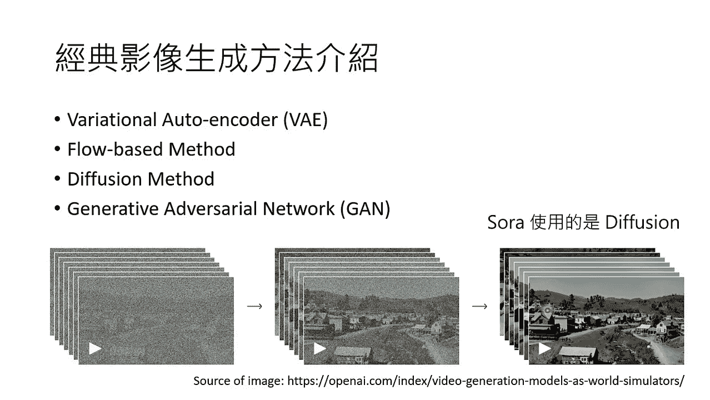

上一节我们介绍了影像生成的基本概念，本节中我们来看看几种具体的经典方法。这些方法旨在解决一个核心问题：如何让模型根据一段模糊的文字描述，生成一张清晰且符合语义的图片。

当前常用的神经网络架构是Transformer。其概念非常简单：输入一段文字，模型输出一系列图像块（patch），这些patch最终组合成一张图片。

然而，在训练过程中会遇到一个问题。例如，训练数据中“一只奔跑的狗”可能对应许多不同的图片：它可能是在草原上奔跑的哈士奇，也可能是在都市里奔跑的柴犬。对于Transformer模型来说，当输入文字“一只奔跑的狗”时，它有时被要求输出哈士奇的patch，有时又被要求输出柴犬的patch。这会让模型感到困惑，导致生成的图片可能是各种奇怪生物的混合体。

这就像在工作中，如果老板的指令时而向东、时而向西，员工就会无所适从。对于Transformer来说，学习影像时也有同样的问题，因为文字通常无法完整描述图片的所有细节。

---

## 解决方案：引入额外信息 💡

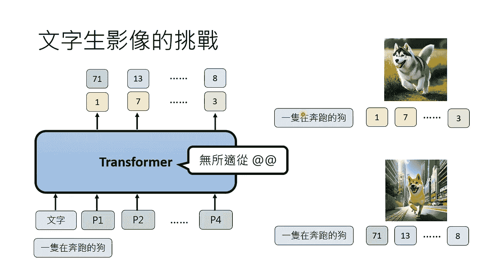

为了解决上述问题，一个可能的方案是：我们主动为模型补充那些文字描述中缺失的信息。

具体来说，我们不只是告诉模型“生成一只奔跑的狗”，而是明确告诉它“生成一只在草原上奔跑的哈士奇”或“生成一只在都市里奔跑的柴犬”。我们将这些额外的、原本文字未提及的信息标注出来，一并提供给图片生成模型。

这样，模型就能理解为什么同样的文字输入会对应不同的图片输出，因为它读取了这些额外的信息。模型就不会再为“同一输入对应不同输出”的问题所困扰。

但接下来的问题是：这些额外的标注信息从哪里来？

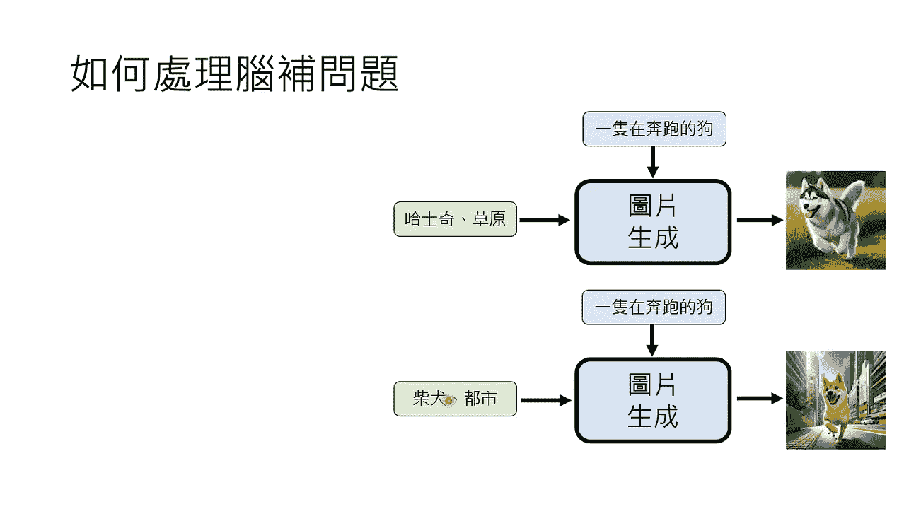

---

## 训练信息抽取模型 🔍

我们可以训练一个“信息抽取模型”。这个模型的任务是：给定一张图片和一段文字描述，它能抽取出文字中未描述到的额外信息，然后将这些信息传递给图片生成模型。

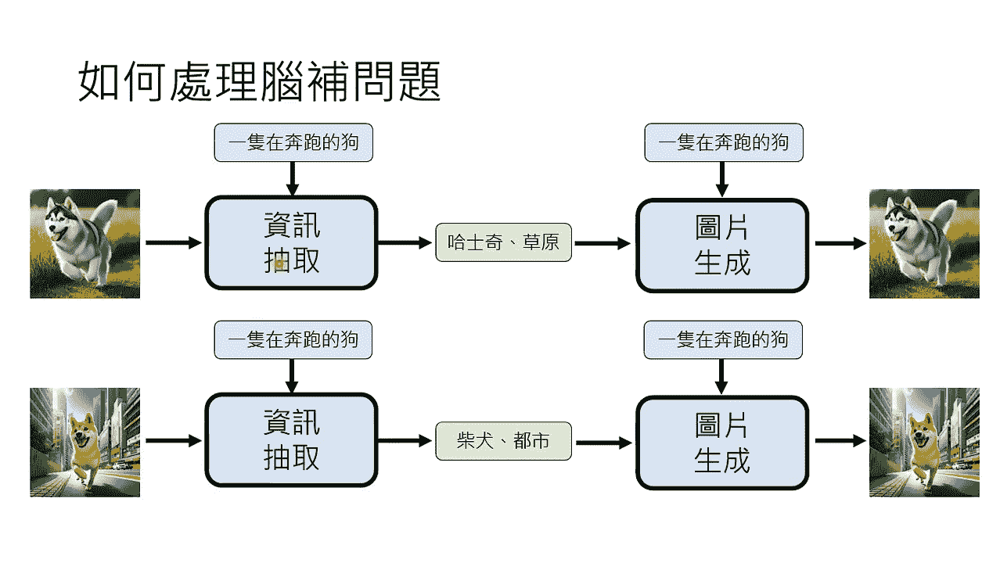

如果我们有这样的信息抽取模型，就可以为训练数据中的所有图片都抽取出额外信息，从而让图片生成模型的学习变得更加容易。

但如何训练这个信息抽取模型呢？训练任何模型都需要大量成对的输入和输出数据。我们如何获得这些“图片-额外信息”的配对数据呢？人工标注成本高昂且困难。

这里有一个巧妙的方法，可以在不需要额外标注数据的情况下，训练出信息抽取模型。

---

## 自编码器（Autoencoder）框架 🤖

这个方法的核心是：**图片生成模型**和**信息抽取模型**可以**一起被训练**。

它们有一个共同的目标：
1.  信息抽取模型读取一张训练图片及其文字描述，抽取出文字未描述的额外信息。
2.  图片生成模型接收这些额外信息和文字描述，生成一张图片。
3.  整个系统的目标是：最终生成的图片要尽可能与原始的输入图片接近。

信息抽取模型具体抽取了什么信息，我们并不知道，也没有标准答案。但只要它抽出的信息能帮助图片生成模型还原出原始图片，那它就是成功的。

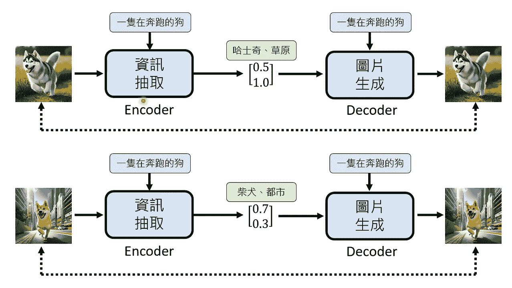

这个框架被称为**自编码器（Autoencoder）**。其中，信息抽取模型叫做**编码器（Encoder）**，图片生成模型叫做**解码器（Decoder）**。编码器和解码器一起训练，目标是让输入和输出越接近越好。

编码器的输出不一定非得是文字。对于机器来说，它只需要能传递一些它能理解的“密码”即可。因此，编码器的输出通常是一串数值，也就是一个**向量（Vector）**。这个向量的不同维度可能对应着不同的语义特征。例如，第一个维度的数值可能代表狗的品种，第二个维度的数值可能代表背景环境。

---

## 变分自编码器（VAE） 🎲

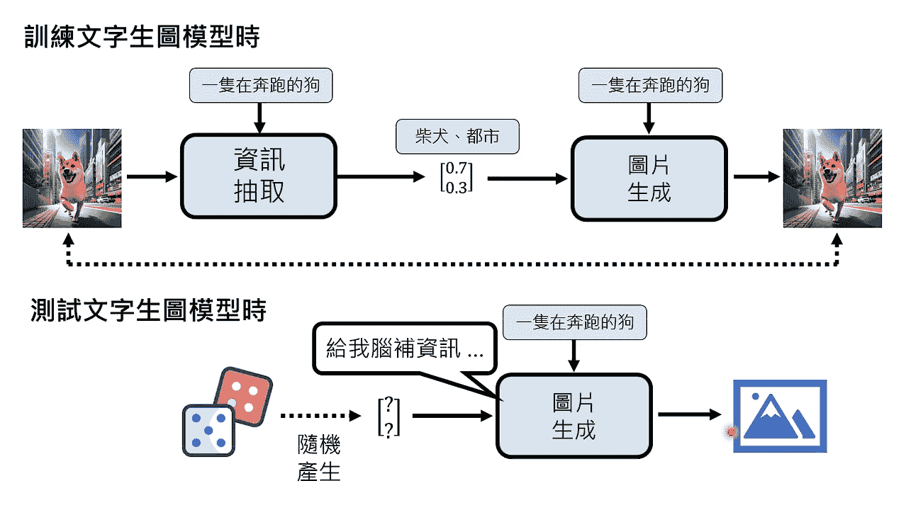

上一节我们介绍了编码器和解码器。但在实际生成图片时，我们只有一段文字描述，并不知道那些需要“脑补”的额外信息是什么，因为图片还没生成出来。

我们已经知道，这些需要脑补的信息是用一个向量来表示的。因此，在使用模型生成图片时，我们会先“掷骰子”——随机生成这个向量中的每一个数值。然后，图片生成模型（解码器）根据这段文字描述和随机生成的“脑补”向量，来产生最终的图片输出。

这个模型就是**变分自编码器（Variational Autoencoder, VAE）**。VAE包含一个编码器（用于抽取信息）和一个解码器（用于根据信息和文字还原图片），在生成时通过随机采样向量来引入多样性。

---

## 流模型（Flow-based Model） 🔄

流模型与VAE非常相似，但有一个关键区别。

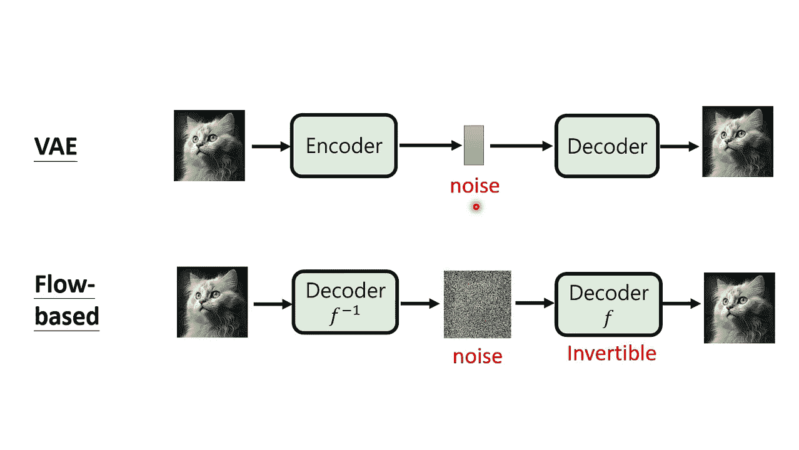

VAE需要分别训练一个编码器和一个解码器。而流模型认为，编码器（从图片中抽取信息）和解码器（将信息还原为图片）做的事情正好相反，那么有必要训练两个不同的模型吗？

流模型的解决方案是：**只训练一个解码器**，但强制要求这个解码器必须是**可逆的（Invertible）**。也就是说，这个解码器本身存在一个反函数，而这个反函数正好可以充当编码器的角色。

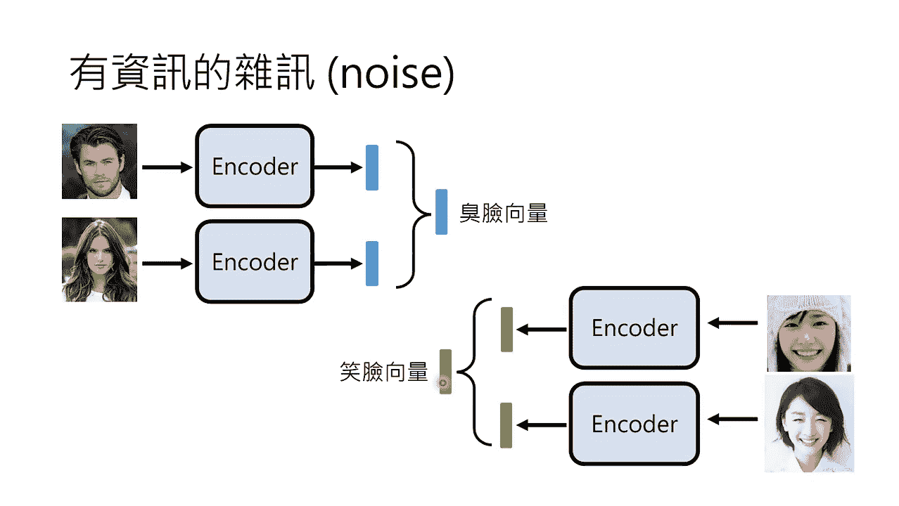

在文献中，通常把编码器抽取出来的这个向量（也就是解码器用来“脑补”的信息）称为**噪声（Noise）**。这个词可能会让人误解，认为噪声里的信息都是无用信息，但其实并非如此。这个噪声向量中往往包含了非常重要的、与图片生成相关的语义信息。

---

## 噪声中的语义信息 🎭

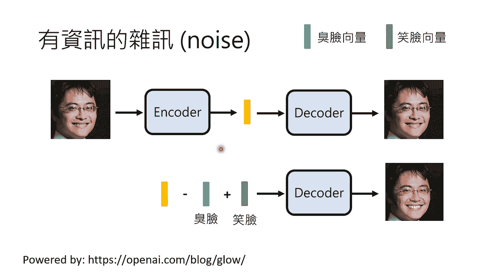

有一个实验可以说明噪声向量中包含重要信息。

例如，收集许多“臭脸”的人像图片，通过编码器得到它们的噪声向量，将这些向量平均，就得到了一个代表“臭脸”特征的向量。同理，可以得到一个代表“笑脸”特征的向量。

知道这些特征向量后，我们可以对噪声向量进行改造。例如，有一张人像图片对应的噪声向量，我们从中减去“臭脸”特征向量，再加上“笑脸”特征向量。然后将这个改造后的新向量输入给解码器，生成的图片中的人就会笑得更开心。

这说明，噪声向量（或称为潜变量）中蕴含着丰富的语义信息，直接调整这些向量就能达到编辑输出图片的效果。

---

## 扩散模型（Diffusion Model） 🌫️

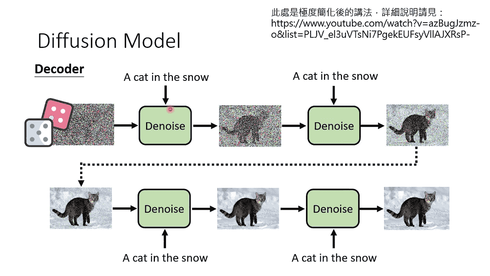

接下来我们介绍扩散模型。我们已经介绍了VAE和流模型，现在来看看扩散模型。

扩散模型的解码器，其输入和输出与之前几个模型类似：都需要输入一个包含“脑补”信息的噪声，然后输出一张图片。

扩散模型的不同之处在于：它会**反复多次使用同一个解码器**。这个解码器每次只做一件简单的事情：**去噪（Denoise）**。

以下是扩散模型的工作流程：
1.  开始时，输入一个完全随机的噪声图片。
2.  这个噪声图片和文字描述一起输入给一个“去噪模块”。
3.  去噪模块尝试去除一点噪声，让图片看起来更接近文字描述（例如，“一只坐着的猫”）。
4.  第一次去噪可能不会很成功，只去除了少量噪声。
5.  然后，将第一次去噪的结果再次输入给同一个去噪模块，进行第二次去噪。
6.  这个过程通常会反复进行很多次（例如500次或1000次），最终生成一张清晰的图片。

扩散模型的一个痛点就在于，去噪步骤需要进行很多次才能得到好结果。当前的研究趋势也集中在如何用更少的去噪步骤（例如10次、5次甚至1次）来获得清晰的图片。

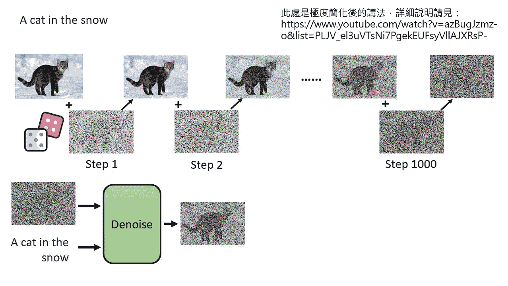

---

## 如何训练去噪模型？ 🏋️

那么，如何训练这个去噪模型呢？你可以自己制造训练数据。

去噪模型需要学习如何把有噪声的图片变回干净的图片。虽然你的训练数据里都是干净的图片，但你可以自己为这些干净图片添加噪声。

具体方法是：通过“掷骰子”的方式随机生成一些噪声，将这些噪声多次添加到训练图片上。第一次加一点噪声，第二次再加更多……直到图片完全看不出原本的内容。

这样，你就有了“加噪前”和“加噪后”的图片对。然后，你就可以训练去噪模型了：给它看加噪后的图片和文字描述，让它学习还原出加噪前的干净图片。

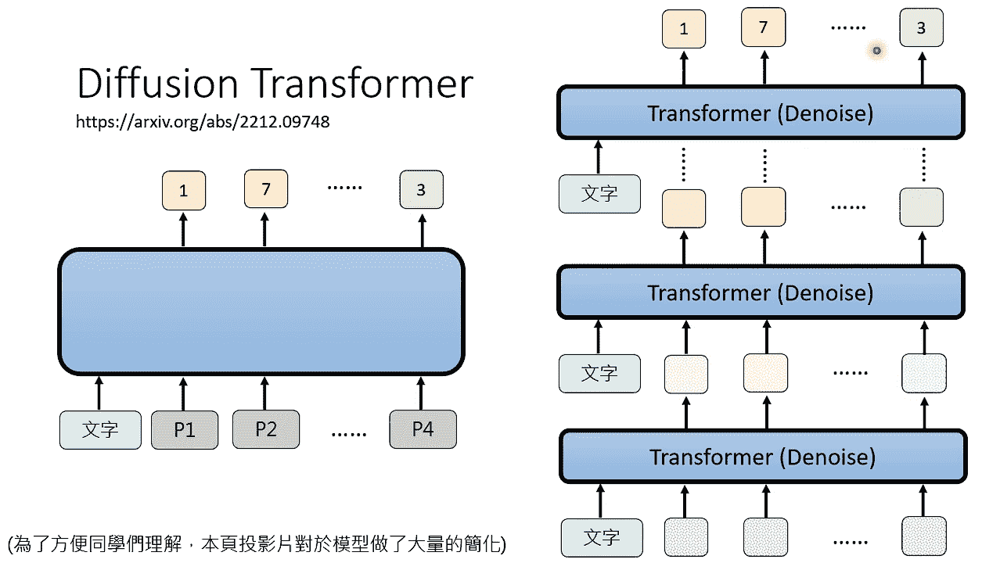

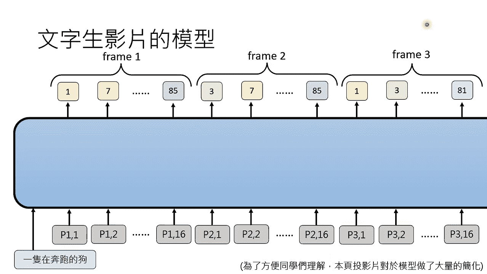

---

## 扩散模型与Transformer的结合 🤝

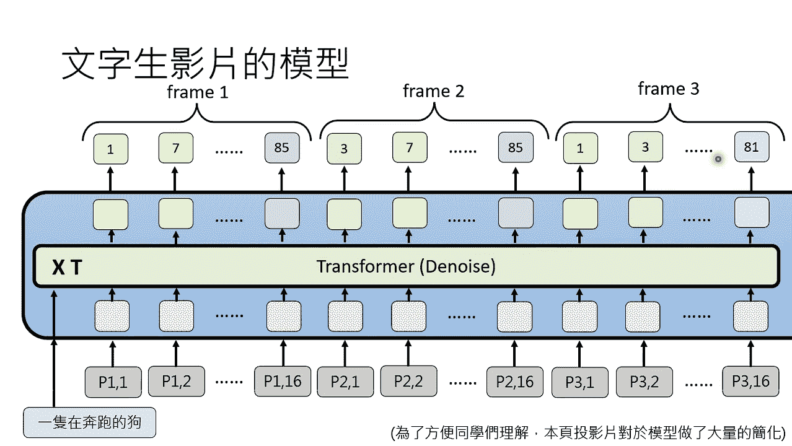

实际上，去噪模块的神经网络架构也常常是Transformer。因此，当今非常常用的技术就是将扩散模型与Transformer结合起来，这被称为 **Diffusion Transformer**。

在SORA的技术报告中就提到了他们使用了这种方式。

具体来说，传统的Transformer是接收一些输入，直接输出一系列图像块（patch）来组成图片。而在扩散模型中，每次Transformer执行的任务是“去噪”。

流程如下：
1.  初始输入的patch全是噪声。
2.  第一个Transformer执行一次，去除一些噪声。
3.  将结果输入给第二个Transformer（通常是同一个模型，参数相同），再去除更多噪声。
4.  这个过程重复数百上千次。
5.  最终产生干净的patch，这些patch可以被解码器还原成图片。

这就是SORA中可能用到的Diffusion Transformer技术。

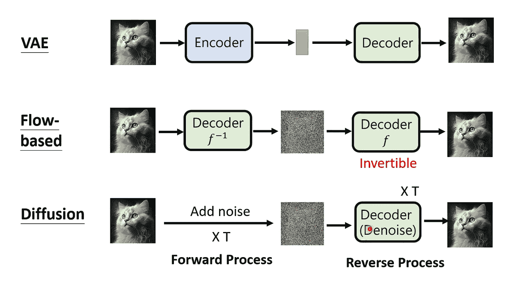

---

## 从图片生成到影片生成 🎬

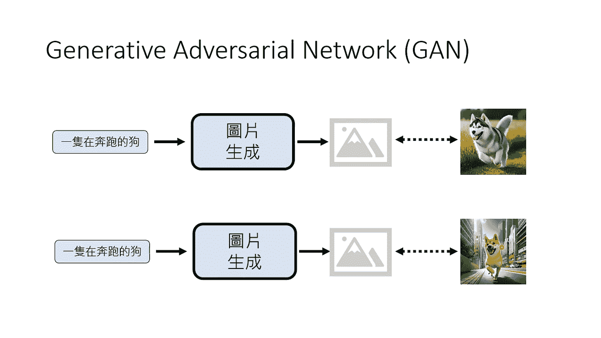

虽然上面的例子以图片为例，但其原理可以很容易地推广到影片生成。

在影片生成模型中，你会有大量的Transformer。在影片生成过程中，你会不断地进行“去噪”。这个去噪工作是由一个Transformer模型完成的：它的输入是有噪声的patch序列，输出是更干净的patch序列。

这个Transformer会执行数百上千次去噪，期望最终产生一系列干净的patch，这些patch随后被还原成连续的影像帧。根据SORA的技术博客，他们很可能就是用类似的技术来生成影片的。

---

## 方法对比与总结 📊

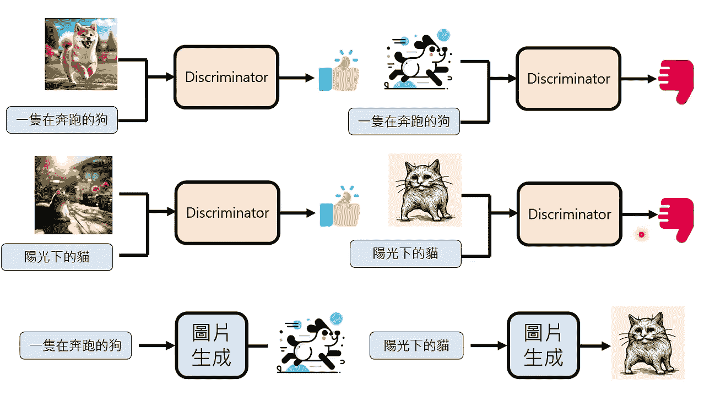

现在，我们来对比一下扩散模型与之前的VAE和流模型。

VAE和流模型都有一个编码器和一个解码器。对于扩散模型来说：
*   它也有一个解码器，其内部通过多次去噪来工作。
*   至于编码器（即如何把一张图片变成噪声），扩散模型没有专门训练一个模型来做这件事，因为噪声是你自己主动加进去的。这个“加噪过程”在其他模型中对应编码器的工作，在扩散模型的文献中通常被称为**前向过程（Forward Process）**。
*   解码器所做的去噪过程则被称为**反向过程（Reverse Process）**。

至此，我们快速介绍了VAE、流模型和扩散模型这三种经典方法。

---

## 生成对抗网络（GAN） ⚔️

另一个非常知名的模型是**生成对抗网络（Generative Adversarial Network, GAN）**。我们没有把它和其他模型放在一起讲，是因为GAN与其他模型有本质上的差异，它更像是一个额外的“外挂”。

为什么这么说？让我们回顾一下图片生成的难点：同一段文字可以对应许多不同的图片，这会让模型在学习时无所适从。

一个思路是：我们不应该直接用这些真实的、多样的图片来教导生成模型，而是应该先训练出另一个AI模型，让它先理解“奔跑的狗应该是什么样子”，然后再由这个AI来教导我们的图片生成模型。

---

## 判别器（Discriminator）的训练 🧑⚖️

如何训练这样一个AI呢？这里用到的概念与我们之前讲过的CLIP模型基本一模一样。

回忆一下CLIP：它是一个模型，输入一张图片和一段文字，输出一个分数来衡量图文是否匹配。

在GAN中，也会训练一个类似的模型，它换了个名字叫**判别器（Discriminator）**。判别器做的事情就是：给一张图片和一段文字，给出一个评价，看它们有多匹配。

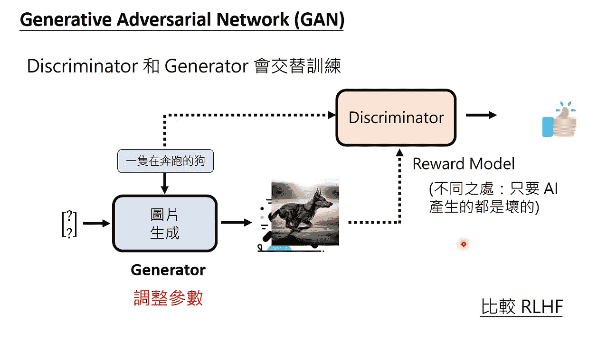

但如果训练判别器时只给它“好”的例子（即图文匹配的例子），那么它在测试时即使看到“坏”的例子，也可能给出高分。因此，在训练时必须同时提供“坏”的例子。

在CLIP中，“坏”的例子是通过将图片和文字随机打乱配对来制造的。而在GAN中，用的是另一种方法：

假设你已经有一个（可能还不太好的）图片生成模型。你可以先用这个模型生成一些图片（例如，根据“奔跑的狗”生成一张很抽象的狗）。然后你告诉判别器：看到这种抽象的狗，你要说它“不好”。通过提供正面和反面的例子，判别器就能学会如何评价一张图片与文字是否匹配。

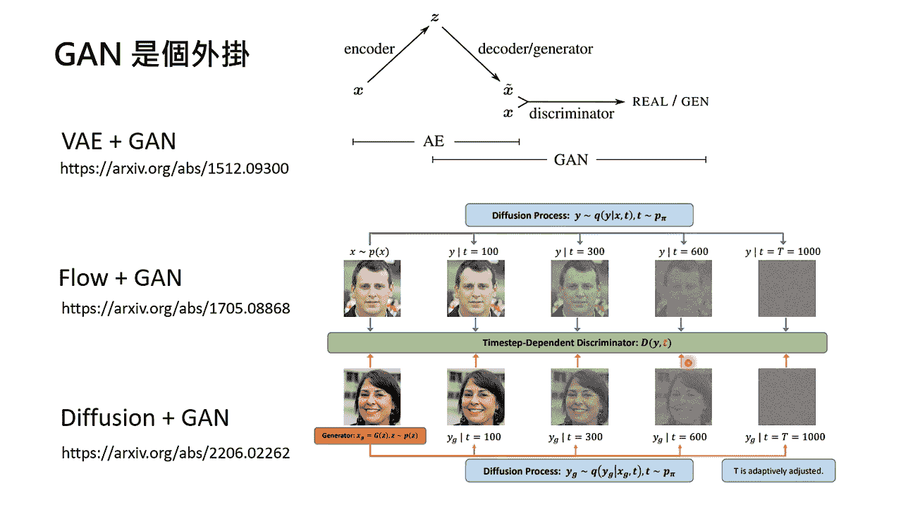

---

## 生成器（Generator）的训练 🎨

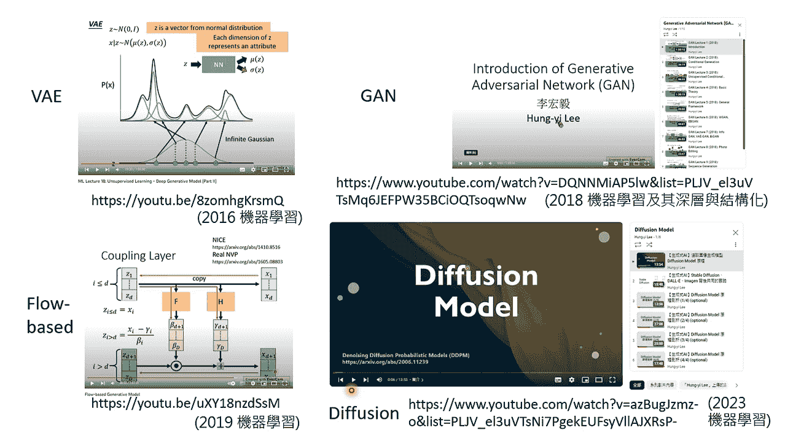

有了判别器之后，生成器（即图片生成模型）就不再直接向真实的图片学习，而是向判别器学习。

生成器的目标是：它生成一张图片，然后把这张图片和文字描述丢给判别器打分。如果判别器觉得这张抽象的狗画得太差，给了低分，那么生成器就会调整自己的参数，以期“骗过”判别器——即生成一张让判别器觉得非常好的图片。

这与向单一“标准答案”学习不同。现在是由判别器来评价好坏，因此没有唯一正确的答案。只要生成器能产生一张让另一个AI（判别器）觉得好的图片，就算成功了。

在实际操作中，生成器和判别器会**交替训练**：
1.  先有一个初始生成器，用它来训练判别器。
2.  然后用训练好的判别器来训练生成器，让生成器产生判别器觉得好的图片。
3.  同时，判别器也会更新参数，让自己变得更厉害，不易被欺骗。
4.  两者不断博弈，共同进步。

在GAN的框架下，图片生成模型通常被称为**生成器（Generator）**。

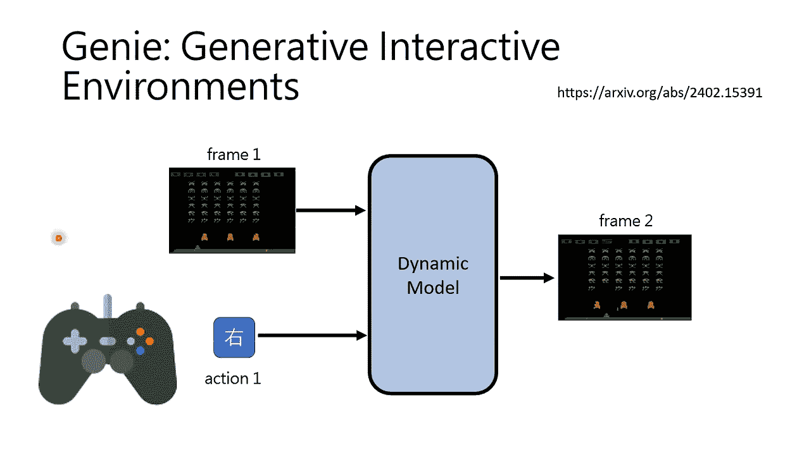

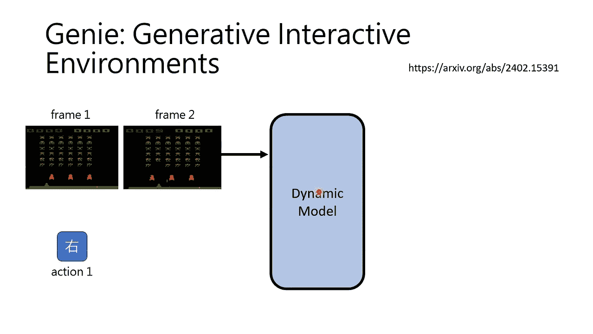

---

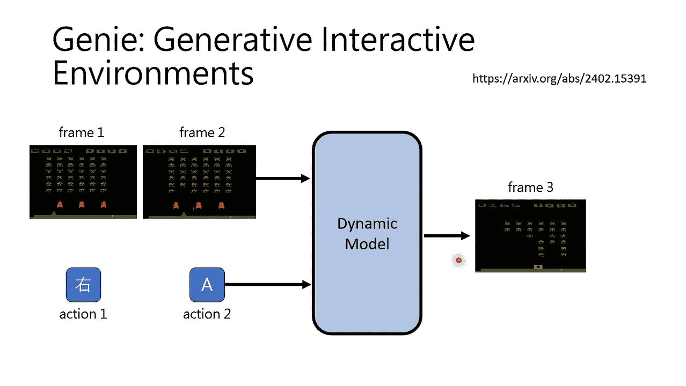

## GAN与其他方法及RLHF的关系 🔗

有人可能会问：对于GAN的生成器，还需要输入一个噪声向量吗？我们之前说输入噪声是为了让模型能根据它来“脑补”，从而知道该生成什么。

在拥有判别器的情况下，其实是可以不需要这个噪声的。虽然文献中大多数GAN模型仍然会输入噪声，但实际经验表明，在图文生成任务中，有判别器的情况下，不加噪声也能训练出生成器。

我们也可以把GAN的训练和**基于人类反馈的强化学习（RLHF）** 对比一下。还记得在讲大语言模型训练的第三阶段时提到的RLHF吗？

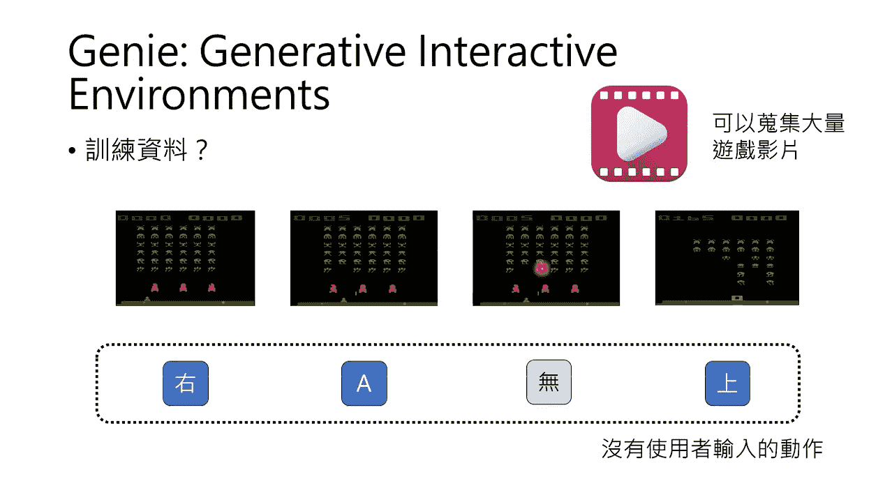

在RLHF中，我们会训练一个奖励模型（Reward Model），然后语言模型向这个奖励模型学习。对应到GAN的框架：
*   **判别器（Discriminator）** 就相当于 **奖励模型（Reward Model）**。
*   它们唯一的不同在于：奖励模型在学习时，有人的标注告诉它哪个答案好、哪个答案差；而判别器在学习时，不需要人的直接介入，它只是假设“AI生成的图就是差的，原始训练数据中的图就是好的”。

所以，判别器其实就是RLHF中的奖励模型，只是它们学习所用的数据来源略有不同。

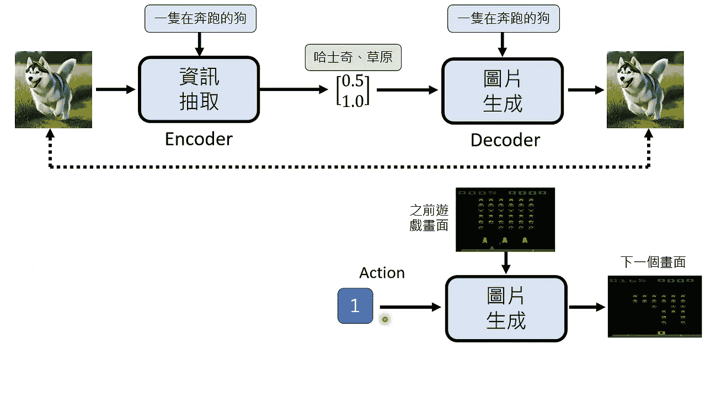

---

## GAN：一个强大的“外挂” 🛠️

常有人问：GAN和扩散模型哪个更强？其实这不是一个好问题。

因为就像RLHF是一种可以增强语言模型能力的方法一样，GAN也是一种“外挂”式的方法。这个外挂可以挂在VAE上，可以挂在流模型上，也可以挂在扩散模型上。

之前介绍的VAE、流模型或扩散模型，你都可以在它们的解码器（在GAN框架中叫生成器）后面，再挂接一个判别器，用GAN的对抗训练思想来强化这些生成器的能力。

因此，GAN是一个可以与其他生成方法结合使用的强大工具。

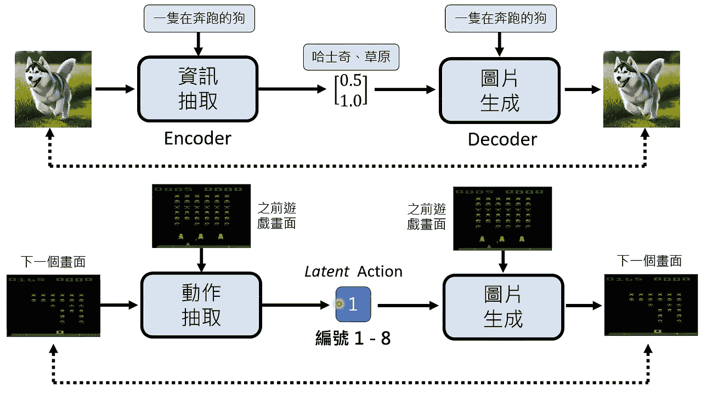

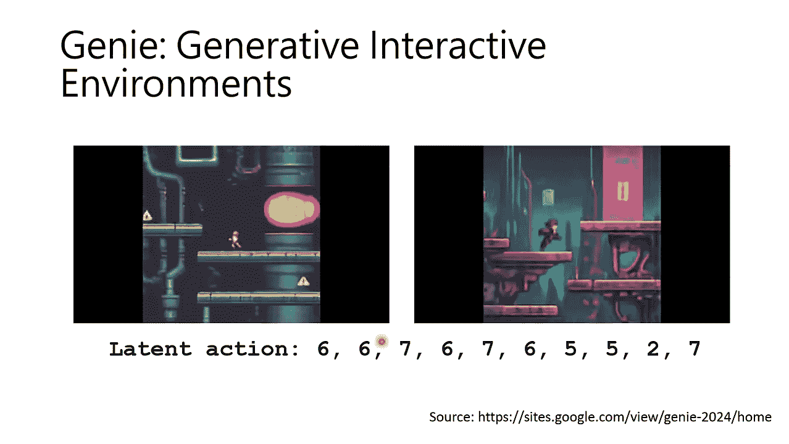

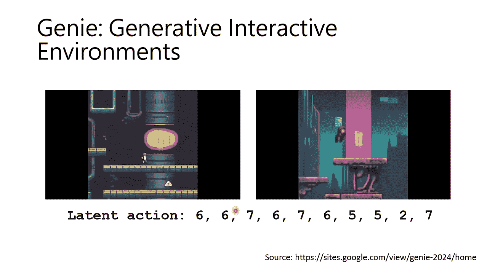

---

## 与生成影片的即时互动 🎮

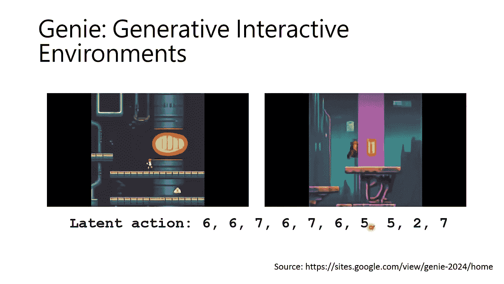

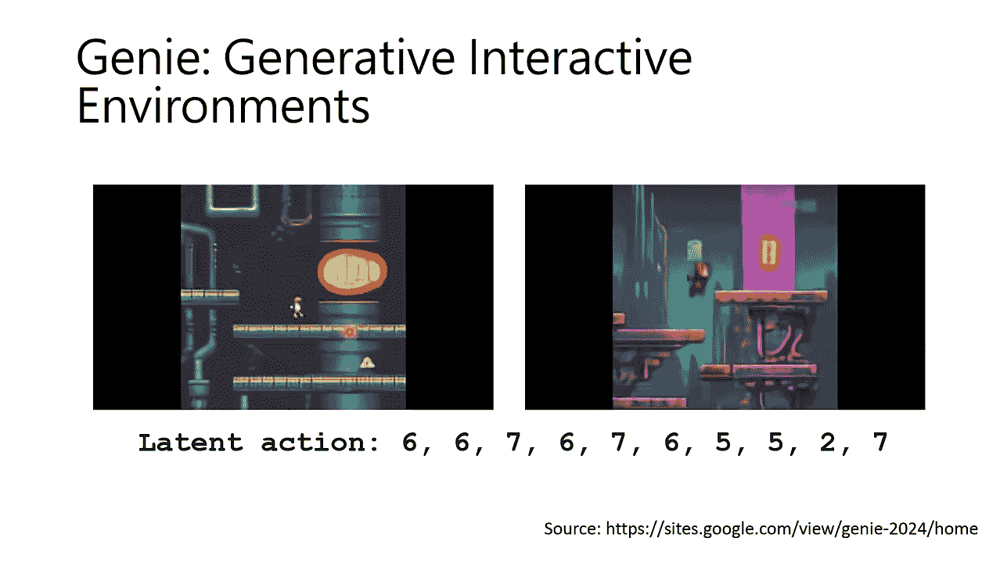

最后，我们来探讨一个有趣的话题：现在AI可以生成影片，但有没有可能让人类与这些生成的影片进行更即时的互动呢？

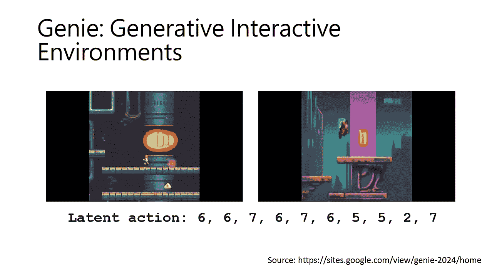

例如，在展示SORA时，常会播放一段“一位女士在东京街头行走”的影片。有没有可能我们直接用键盘的上下左右键来控制这位女士走哪条路呢？这就像是操控一个虚拟角色在开放世界的3D游戏中漫游。

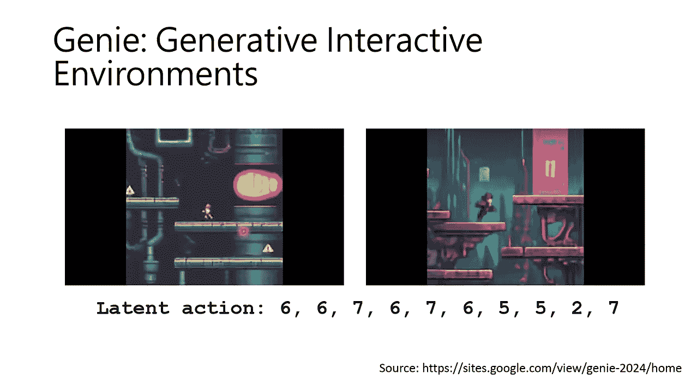

这是有可能的。有一篇名为《生成式交互环境》的论文就在做类似的事情。需要说明的是，它做的不是3D游戏，而是2D横向卷轴游戏。

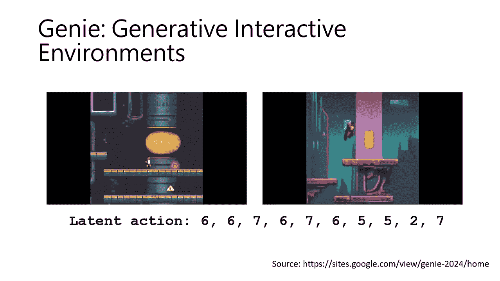

这个模型可以读取一个游戏画面作为输入，同时还能读取玩家输入的动作（如按上下左右键）。玩家的动作会影响模型的输出：同样的输入画面，按下不同的按钮，就会输出不同的下一个画面。这样，游戏就可以一直进行下去。

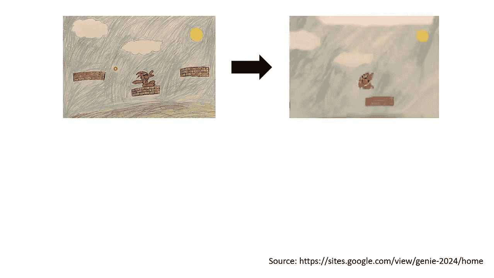

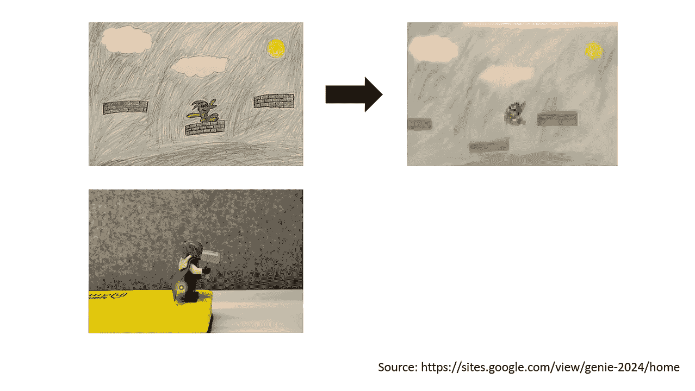

---

## 如何训练互动模型？ 🧩

那么，如何训练这样的互动