# 37：（延申）变分自编码器 (VAE) 🧠

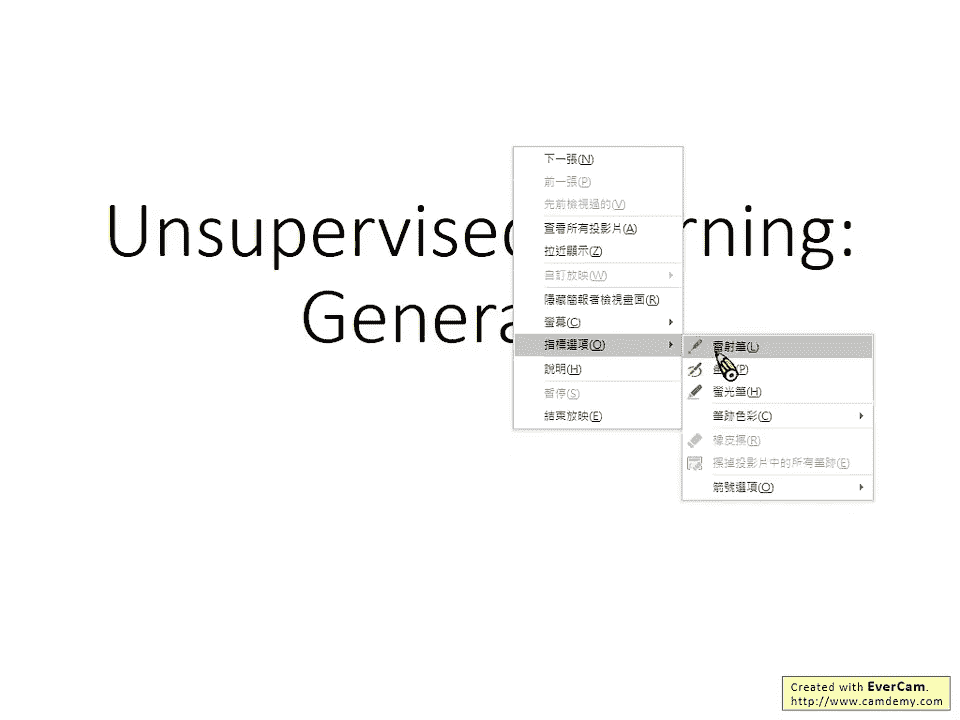

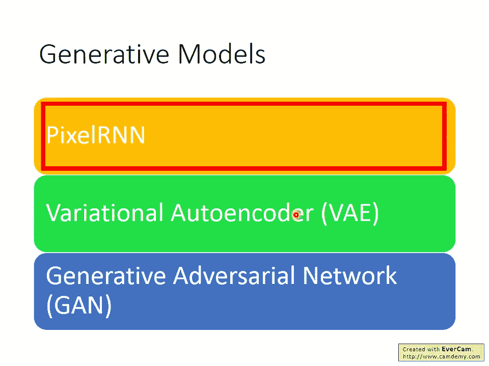

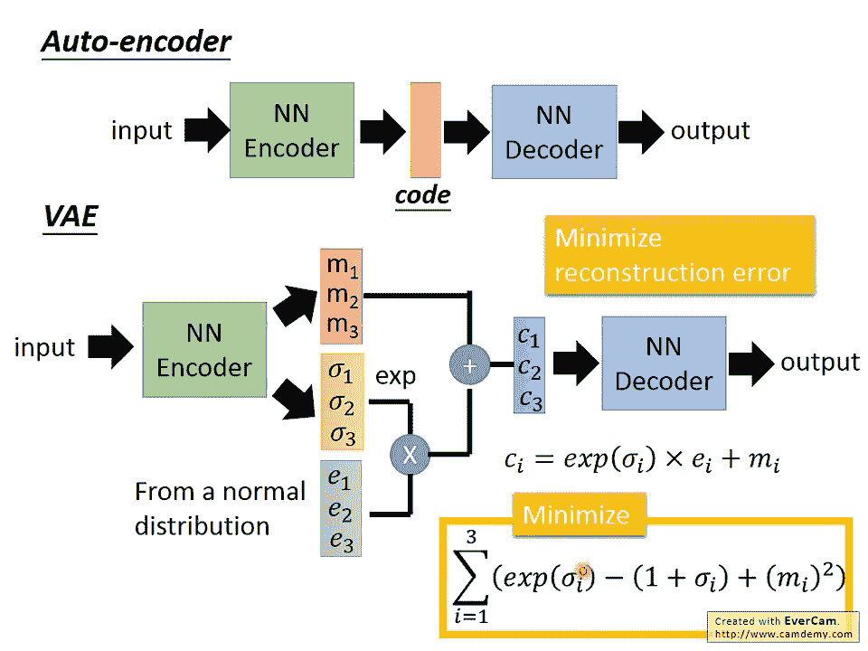

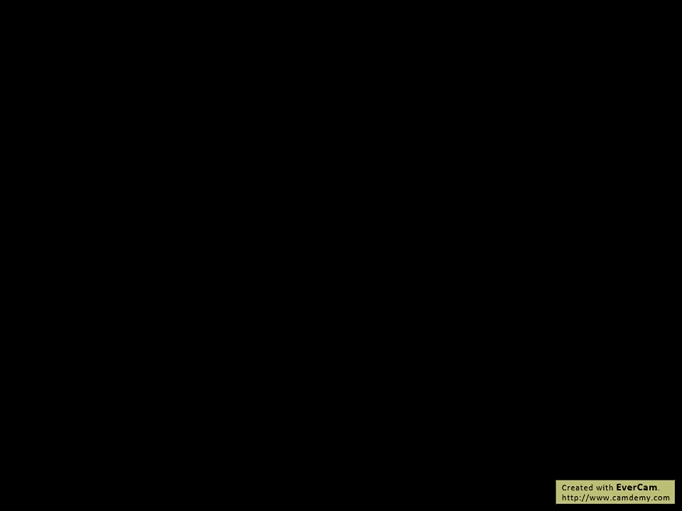

在本节课中，我们将要学习变分自编码器（VAE）的核心原理、直观理解、数学推导，并了解其局限性以及后续提出的生成对抗网络（GAN）的基本概念。

## 概述 📋

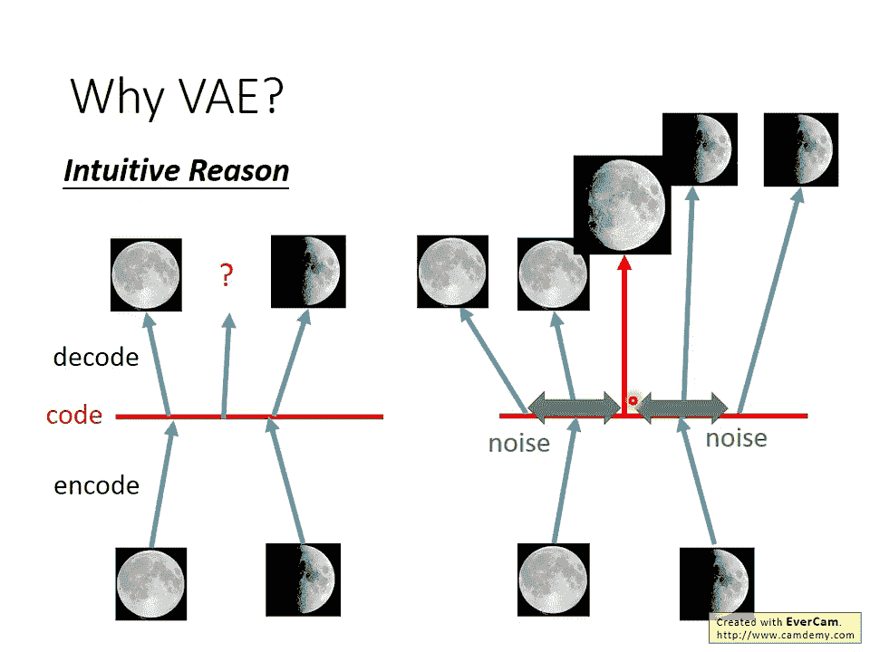

我们上次介绍了生成（Generation）任务，并提到了可以用 Pixel RNN 来完成。我们还简单介绍了 VAE，但没有深入讲解其原理。本节我们将复习 VAE 的工作机制，探讨其相比传统自编码器的优势，并从直观和数学两个层面理解其设计思想。最后，我们会简要介绍 VAE 的局限性以及 GAN 的基本概念。

## VAE 的工作原理回顾 🔄

VAE 的结构包含一个编码器（Encoder）和一个解码器（Decoder）。编码器会输出两组向量：一组是均值向量 **M**（例如 M1 到 M3），另一组是方差向量 **σ**（例如 σ1 到 σ3）。

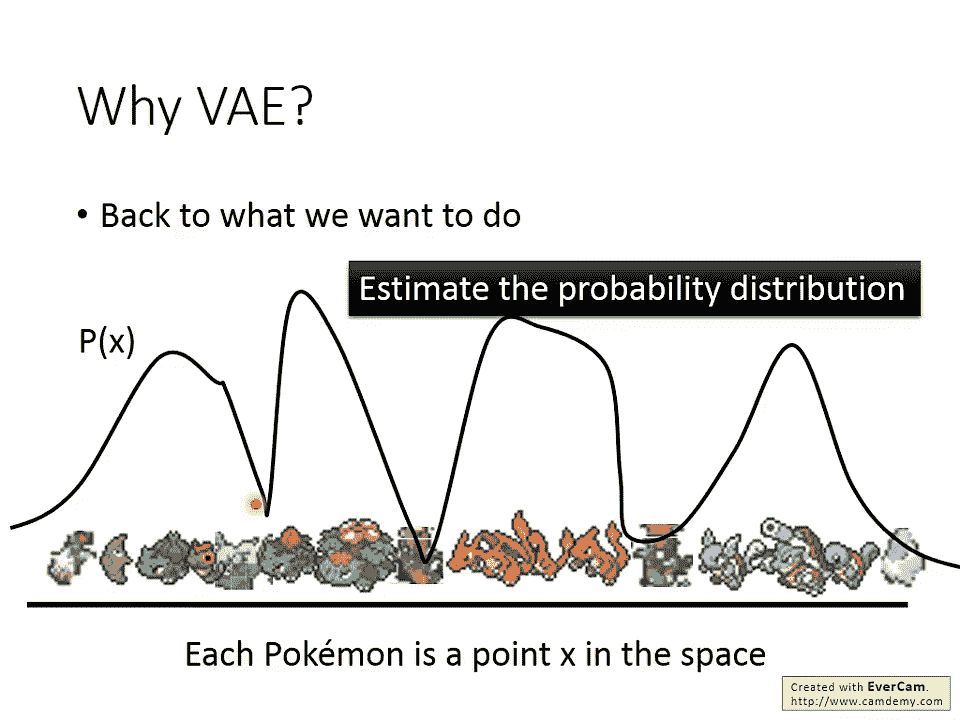

接下来，模型会从一个标准正态分布中采样出一个向量 **ε**。然后，将方差向量 **σ** 与采样出的 **ε** 逐元素相乘，再加上均值向量 **M**，得到最终的隐变量编码 **C**。公式如下：

`C = M + σ ⊙ ε`

其中，`ε ~ N(0, I)`。

最后，将编码 **C** 输入解码器，以重建输入的图像。VAE 的训练目标是最小化重建误差，同时还要最小化一个额外的正则化项。这个正则化项是 VAE 的核心，它鼓励编码器输出的分布接近标准正态分布。

## 为什么需要 VAE？ 🤔

上一节我们回顾了 VAE 的基本流程，本节中我们来看看为什么要使用 VAE，传统的自编码器存在什么问题。

如果使用传统的自编码器，它将每张图像（例如满月或弦月）编码为隐空间中的一个点。当你在这个隐空间中两个点（如满月和弦月对应的点）之间采样时，解码器生成的图像可能并不是你期望的中间状态（如半月）。因为编码器和解码器都是复杂的神经网络，其行为难以预测。

VAE 通过引入噪声解决了这个问题。对于每张输入图像，VAE 的编码器不仅输出一个点，还输出一个方差，从而定义了一个分布。训练时，要求从这个分布中采样出的任何编码，解码后都能较好地重建原图。这意味着，在隐空间中，满月和弦月对应的分布会产生重叠。在重叠区域采样出的编码，解码时必须同时像满月又像弦月，其最优解就是产生一个介于两者之间的图像（如半月）。因此，VAE 的隐空间连续性更好，从中采样更容易得到合理、平滑过渡的图像。

以下是 VAE 相比传统自编码器的核心优势：
*   **连续性**：通过在编码上添加噪声，强制解码器对隐空间小邻域内的点都能正确解码，使得隐空间更平滑。
*   **可解释性**：隐变量 **z** 的每个维度可以对应数据的某种语义属性（如笔画的粗细、旋转角度等）。
*   **生成能力**：从先验分布（如正态分布）中采样 **z**，再通过解码器可以生成新的、数据集中未见过的样本。

## VAE 的数学推导 🧮

上一节我们从直观上理解了 VAE，本节我们将从概率生成模型的角度进行更正式的数学推导。

我们的根本目标是估计真实数据的概率分布 **p(x)**。如果我们能知道 **p(x)**，就可以从中采样生成新的数据。一种经典的方法是使用高斯混合模型（GMM），它用多个高斯分布的加权和来拟合复杂分布。然而，GMM 是离散的，每个数据点只属于一个高斯分量。

VAE 可以看作是 GMM 的“分布式表示”版本。在 VAE 中：
1.  我们从一个简单的先验分布（如标准正态分布）中采样一个连续向量 **z**：`z ~ p(z) = N(0, I)`。**z** 的每个维度代表数据的某种潜在属性。
2.  给定一个 **z**，我们用一个函数（即解码器神经网络）来决定一个条件分布 **p(x|z)**，通常假设这是一个高斯分布，其均值和方差由神经网络输出：`p(x|z) = N( μ(z), σ(z) )`。
3.  这样，数据分布 **p(x)** 就可以通过对所有可能的 **z** 积分得到：`p(x) = ∫ p(z) p(x|z) dz`。这相当于有无穷多个高斯分布，每个 **z** 对应一个，由神经网络灵活地映射。

我们的目标是最大化观测数据的对数似然 `log p(x)`。直接计算这个积分是困难的。VAE 通过引入一个近似后验分布 **q(z|x)**（即编码器）来解决。利用詹森不等式，我们可以得到对数似然的一个下界（Evidence Lower Bound, ELBO）：

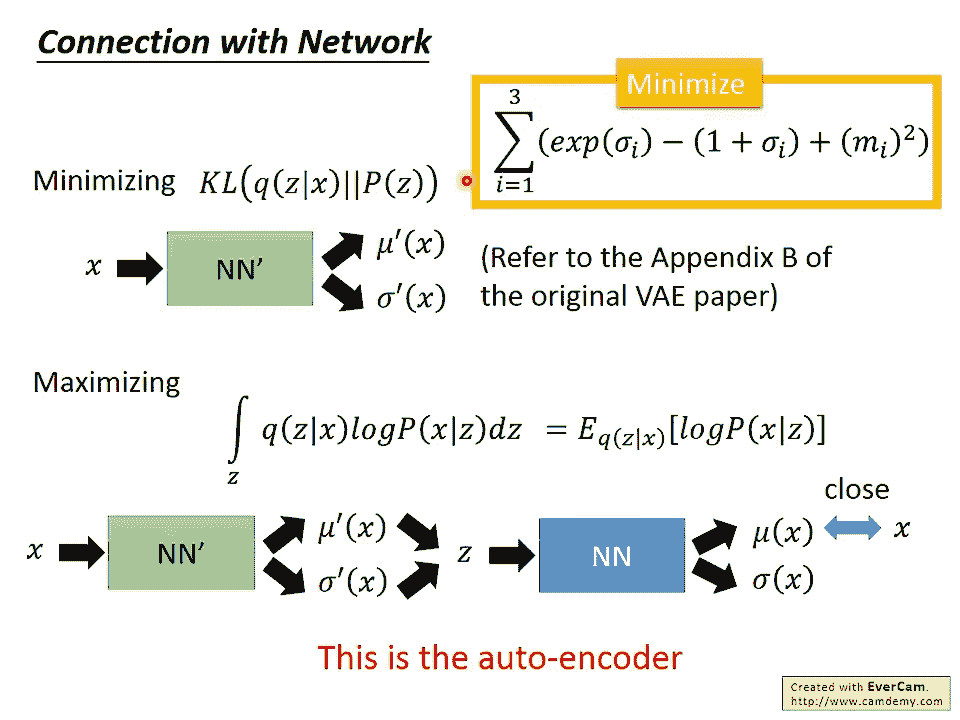

`log p(x) ≥ ELBO = E_{z~q(z|x)}[log p(x|z)] - KL( q(z|x) || p(z) )`

我们需要同时优化编码器 **q(z|x)** 和解码器 **p(x|z)** 来最大化这个 ELBO。

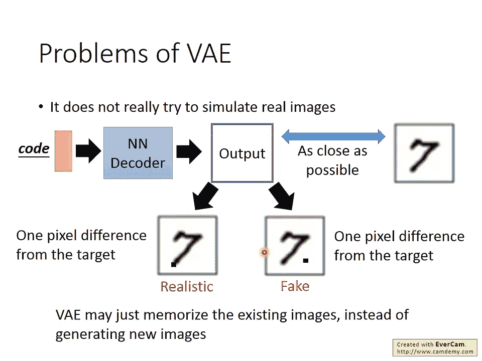

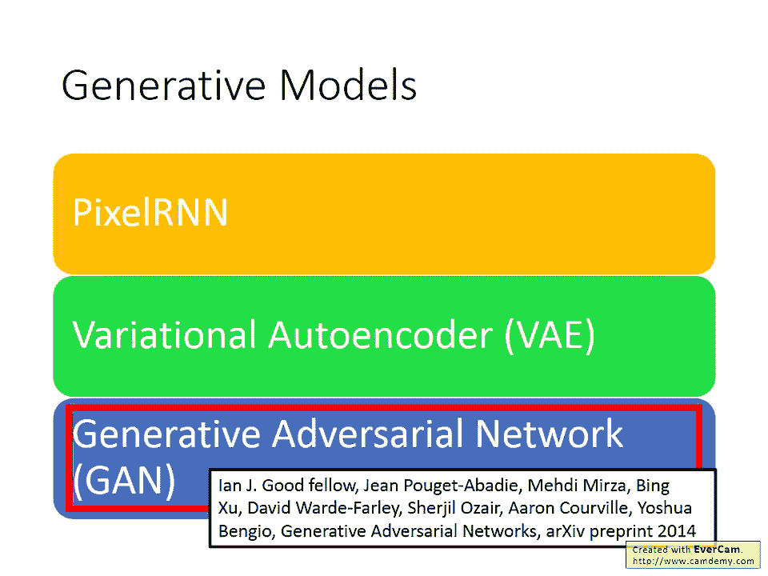

这个下界由两项组成：
1.  **重建项**：`E_{z~q(z|x)}[log p(x|z)]`。这项鼓励解码器能够从编码 **z** 很好地重建输入 **x**。在实现中，这通常简化为最小化输入图像与重建图像之间的均方误差（MSE），这正是自编码器在做的事情。
2.  **正则化项**：`-KL( q(z|x) || p(z) )`。这项是 **q(z|x)**（编码器输出的分布）与先验分布 **p(z)**（标准正态分布）之间的 KL 散度。它鼓励编码器输出的分布接近标准正态分布，从而规范隐空间，使其具有良好结构。

最大化 ELBO 就等价于同时最小化重建误差和 KL 散度，这正是 VAE 的损失函数。

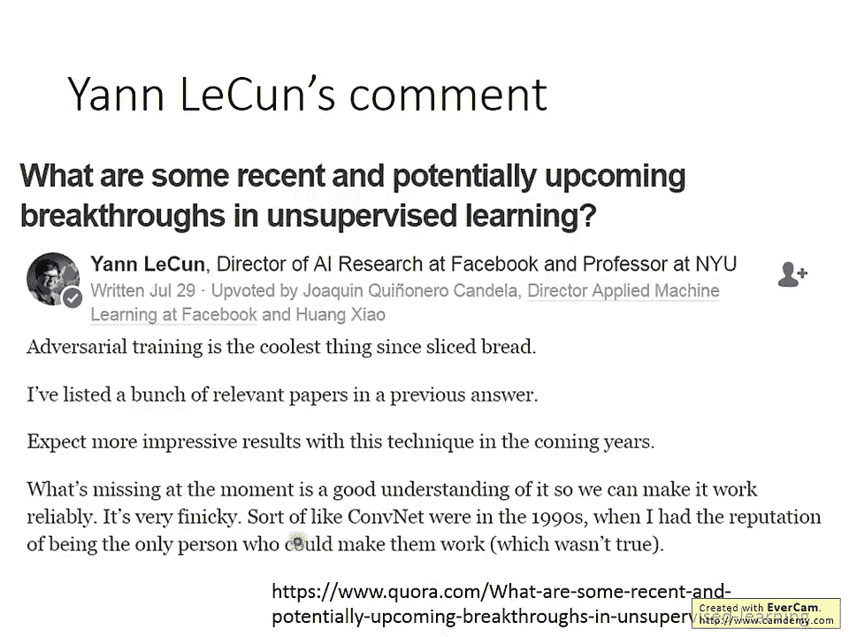

## VAE 的局限性及 GAN 的引入 🚀

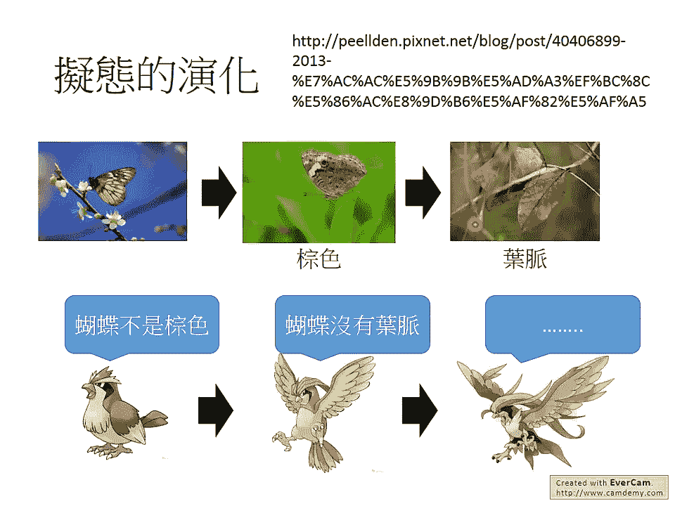

上一节我们深入探讨了 VAE 的数学本质，本节我们来看看 VAE 存在的一个主要问题，并由此引入更强大的生成模型——生成对抗网络（GAN）。

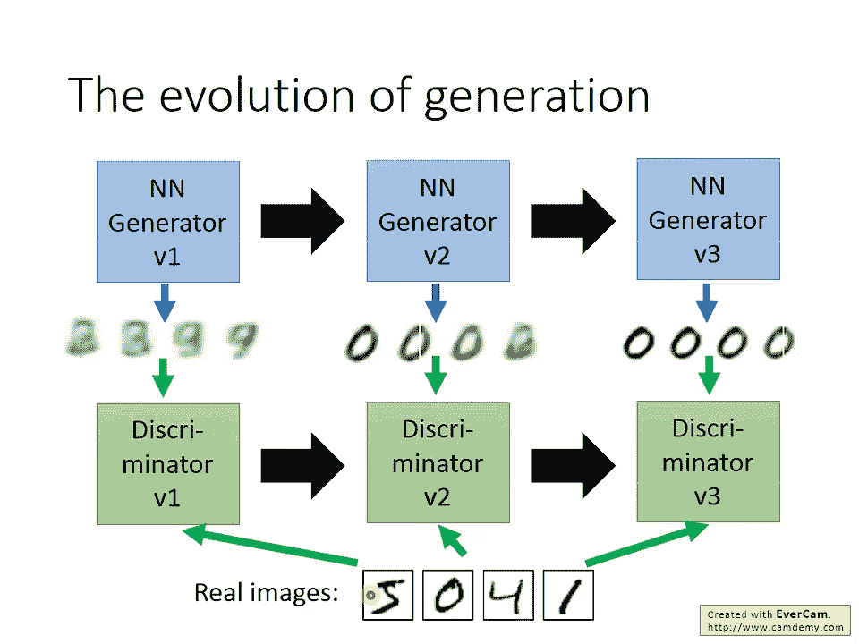

VAE 的一个严重问题是：它从未真正学习如何生成一张“逼真”的图像。它学习的目标仅仅是生成一张与数据集中某张图像尽可能相似的图像，并使用像均方误差（MSE）这样的像素级差异来衡量相似度。

然而，像素级的微小差异在不同位置可能带来完全不同的感知效果。例如，一个像素的差异如果落在数字“7”的笔画末端，只是让笔画稍长一点，图像看起来仍然正常；但如果这个差异让“7”的拐角变得奇怪，人眼立刻就能看出这是机器生成的。但对 VAE 来说，这两种情况的损失是一样的。因此，VAE 学到的更多是模仿和组合数据库中的现有图像，难以创造出真正新颖、以假乱真的图像。

为了解决这个问题，Ian Goodfellow 等人在 2014 年提出了生成对抗网络（GAN）。Yann LeCun 曾评价其为“过去十年间机器学习领域最有趣的想法”。

GAN 的核心思想是“对抗训练”。它包含两个网络：
*   **生成器（Generator, G）**：输入一个随机噪声向量 **z**，输出一张合成图像 **G(z)**。它的目标是生成足以乱真的图像。
*   **判别器（Discriminator, D）**：输入一张图像，输出一个标量，表示该图像是真实图像的概率。它的目标是准确区分真实图像和生成器产生的假图像。

这两个网络在训练中相互竞争、共同进化：
1.  固定生成器 **G**，训练判别器 **D** 使其能更好地区分真实图像和当前 **G** 生成的假图像。这是一个二分类问题。
2.  固定判别器 **D**，训练生成器 **G** 使其生成的图像能骗过当前的判别器 **D**。即调整 **G** 的参数，使得 **D(G(z))** 的值尽可能接近 1（被判别为真）。

这个过程反复进行，就像捕食者（判别器）和猎物（生成器）之间的军备竞赛。理想情况下，最终生成器能产生极其逼真的图像，使得判别器无法区分（即判断概率始终为 0.5）。

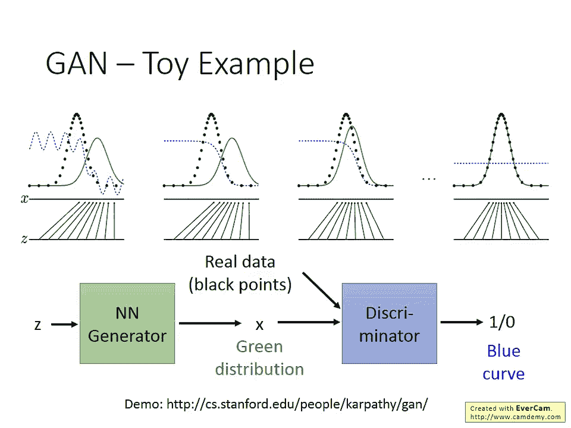

GAN 的优点是能生成非常清晰、逼真的图像。但其训练过程非常不稳定，需要精心调整生成器和判别器的能力平衡，让它们始终保持“势均力敌”的竞争状态，否则容易导致模式崩溃（生成器只产生少数几种图像）或训练失败。

## 总结 🎯

本节课中我们一起学习了：
1.  **VAE 的原理**：通过编码器引入噪声并输出分布，解码器进行重建，同时用 KL 散度正则化隐空间，使其连续、结构化。
2.  **VAE 的直观理解**：通过强制解码器对隐空间局部区域都能正确解码，实现了比传统自编码器更好的隐空间插值特性和生成能力。
3.  **VAE 的数学推导**：从最大化数据似然出发，推导出证据下界（ELBO），其包含重建损失和 KL 散度正则项。
4.  **VAE 的局限性**：其优化目标基于像素级重建误差，可能导致生成图像模糊，且缺乏创造“逼真感”的直接目标。
5.  **GAN 的基本概念**：引入生成器和判别器的对抗框架，通过两者动态博弈直接学习生成逼真图像，但训练过程更具挑战性。

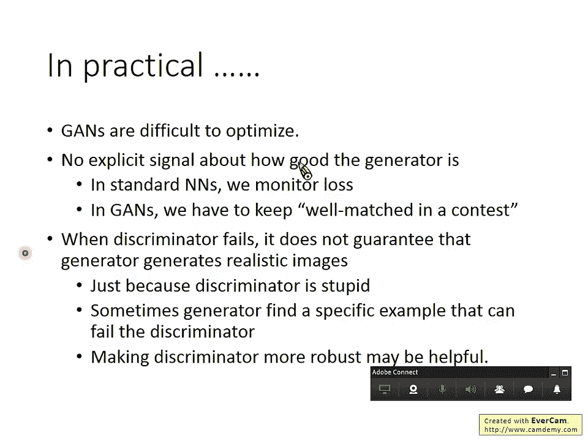

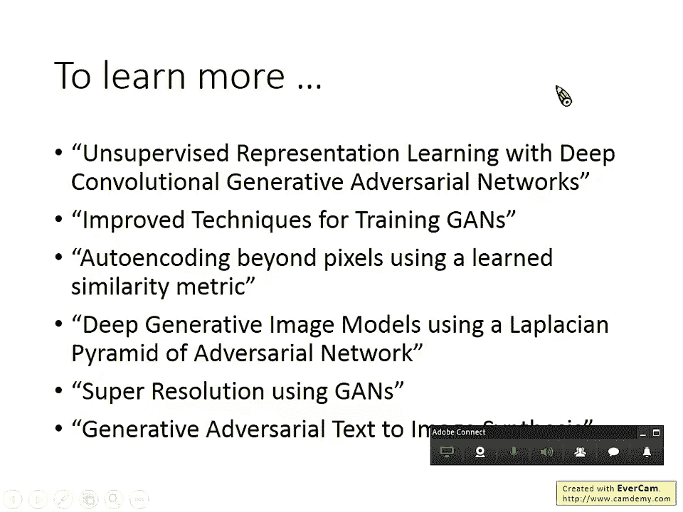

VAE 和 GAN 都是强大的生成模型，它们从不同角度解决了数据生成的问题，为后续更先进的生成式 AI 模型奠定了基础。