# 39：（延申）Flow-based Method 🌀

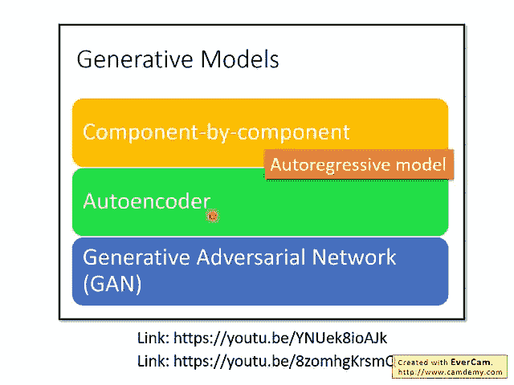

在本节课中，我们将要学习一种名为“流模型”的生成式人工智能技术。流模型是一种与GAN、VAE不同的生成模型，它能够直接优化数据的似然函数，具有独特的数学原理和架构设计。

## 生成模型的回顾与问题

上一节我们介绍了三种主流的生成模型。本节中我们来看看它们各自存在的问题，并引出流模型要解决的问题。

我们之前介绍过三种生成模型：自回归模型、变分自编码器和生成对抗网络。实际上，还有第四种模型，就是我们今天要介绍的流模型。

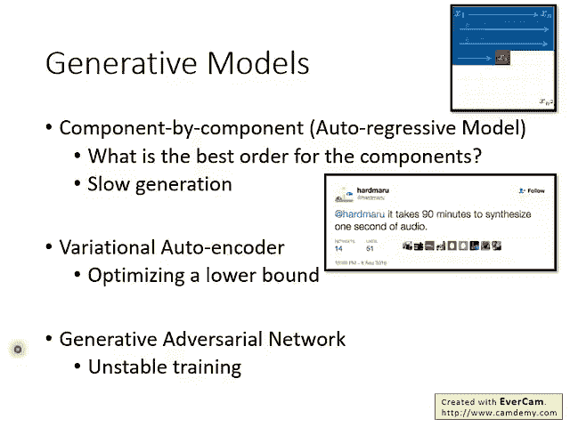

之前讲过的三种生成模型各自有各自的问题：
*   **自回归模型**的问题是生成顺序难以确定，并且逐分量生成速度很慢。
*   **变分自编码器**的问题是优化的是似然函数的下界，而非似然函数本身。
*   **生成对抗网络**虽然生成质量高，但训练过程不稳定。

流模型可以解决VAE的问题，它直接优化概率本身，而不是一个近似下界。当然，流模型也有它自己的问题，我们稍后会看到。

## 生成问题的数学表述

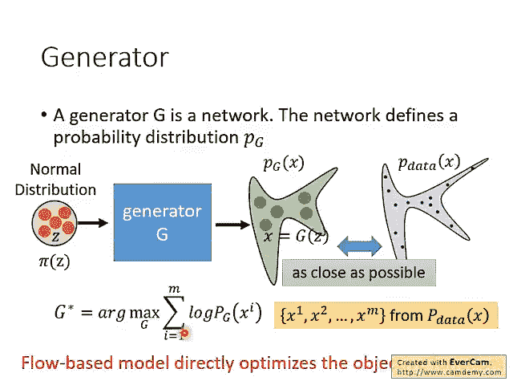

在深入流模型之前，我们先来回顾生成问题的数学定义。本节中我们来看看如何用数学语言描述一个生成器。

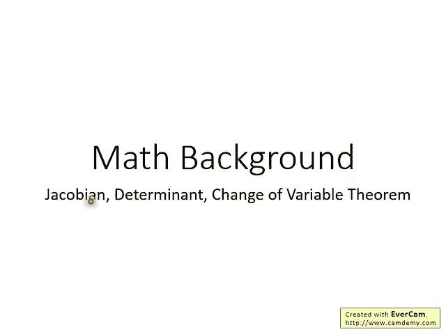

生成器G是一个神经网络，它定义了一个概率分布 \( p_G \)。我们给生成器输入一个从简单分布（如正态分布）中采样的向量 \( z \)，它会输出一个复杂的数据 \( x \)（如图像）。一个好的生成器，其定义的分布 \( p_G \) 应该与真实数据分布 \( p_{data} \) 越接近越好。

常见的训练目标是最大化似然函数。具体来说，我们从真实数据中采样出 \( N \) 个样本 \( \{x^i\}_{i=1}^N \)，希望这些样本在 \( p_G \) 下的似然概率越大越好。这等价于最小化 \( p_G \) 和 \( p_{data} \) 之间的KL散度。

流模型的厉害之处在于，它提供了一种方法可以直接优化这个目标函数，直接最大化似然。

## 流模型的数学基础：雅可比矩阵、行列式与变量变换

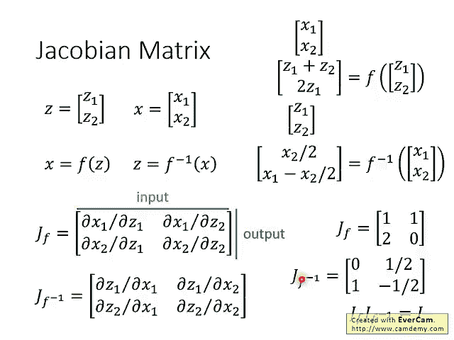

流模型需要较多的数学基础。本节中我们来看看理解流模型必须掌握的三个核心概念。

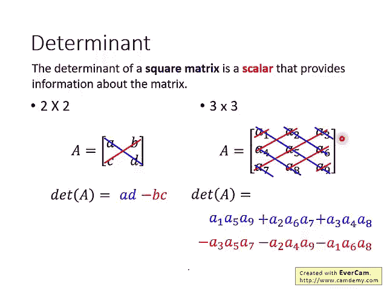

要理解流模型，你需要知道三件事：雅可比矩阵、行列式和变量变换定理。

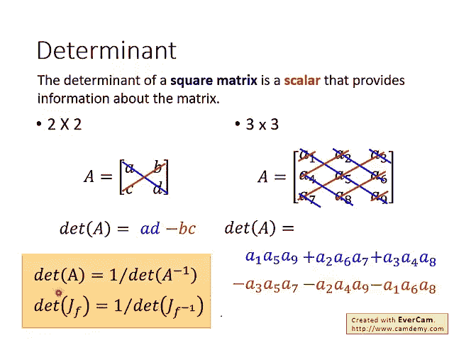

### 雅可比矩阵

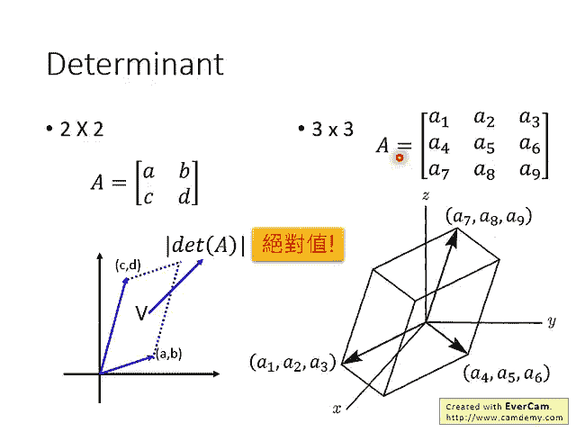

雅可比矩阵描述了一个多元函数的输入与输出分量之间的偏导数关系。对于一个函数 \( f: z \rightarrow x \)，其雅可比矩阵 \( J_f \) 定义为：

\[
J_f = \begin{bmatrix}
\frac{\partial x_1}{\partial z_1} & \frac{\partial x_1}{\partial z_2} \\
\frac{\partial x_2}{\partial z_1} & \frac{\partial x_2}{\partial z_2}
\end{bmatrix}
\]

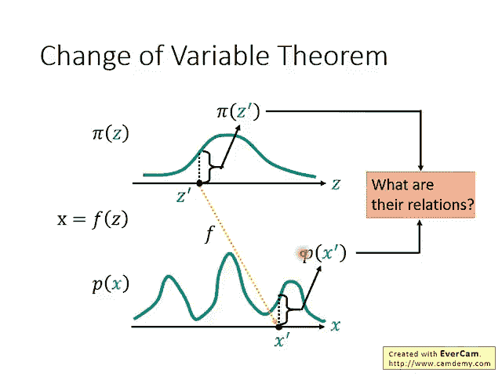

如果函数 \( f \) 有逆函数 \( f^{-1} \)，那么它们的雅可比矩阵互为逆矩阵：\( J_{f^{-1}} = (J_f)^{-1} \)。

### 行列式

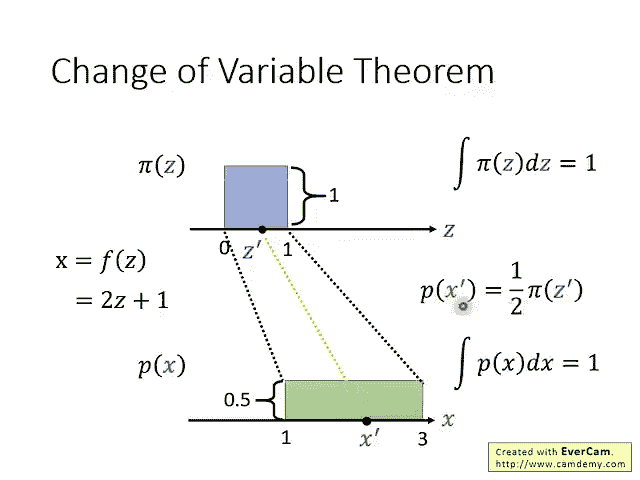

行列式是一个将方阵映射到一个标量的运算。对于2x2矩阵 \( \begin{bmatrix} a & b \\ c & d \end{bmatrix} \)，其行列式为 \( ad - bc \)。行列式的绝对值有几何意义：对于2x2矩阵，它代表其行向量张成的平行四边形的面积；对于3x3矩阵，则代表其行向量张成的平行六面体的体积。高维情况可以类推。

一个重要性质是：矩阵 \( A \) 的行列式与其逆矩阵的行列式互为倒数：\( \det(A^{-1}) = 1 / \det(A) \)。

### 变量变换定理

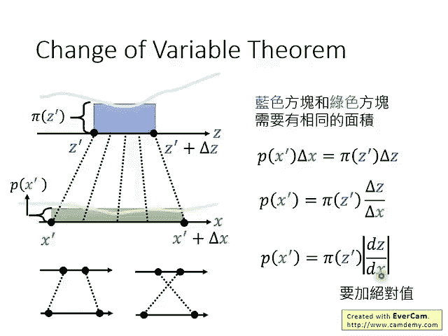

变量变换定理是流模型的核心。它描述了当随机变量 \( z \) 通过一个可逆函数 \( f \) 变换为 \( x \) 时，两者概率密度函数之间的关系。

对于一维情况，关系很简单：
\[
p(x) = p(z) \cdot \left| \frac{dz}{dx} \right|
\]

对于高维情况，关系为：
\[
p(x) = p(z) \cdot \left| \det(J_{f^{-1}}) \right| = p(z) \cdot \frac{1}{\left| \det(J_f) \right|}
\]

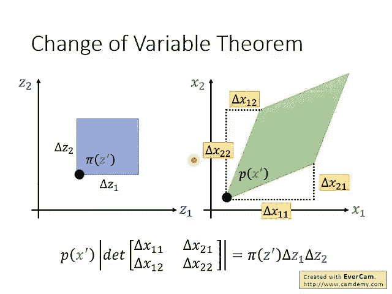

其中，\( z = f^{-1}(x) \)。这个公式告诉我们，变换后的概率密度等于变换前的概率密度乘以变换函数雅可比矩阵行列式绝对值的倒数。

## 流模型的核心思想

掌握了必要的数学工具后，我们现在可以进入流模型的部分。本节中我们来看看如何将变量变换定理应用到生成模型中。

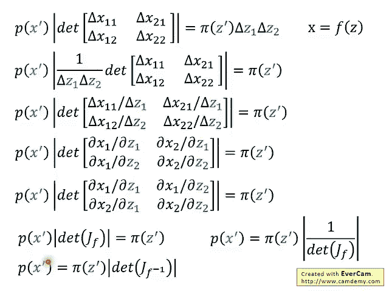

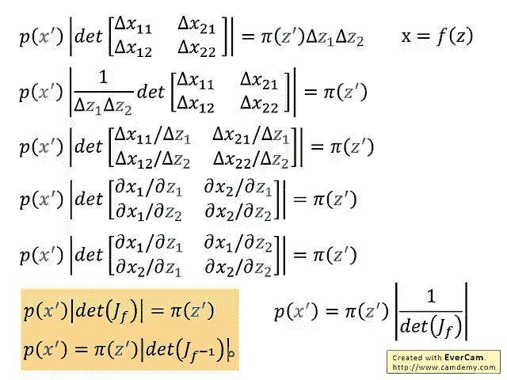

我们将变量变换定理的式子写在旁边。回到生成问题，生成器 \( G \) 的训练目标是最大化 \( \log p_G(x^i) \)。利用变量变换定理，我们可以将 \( p_G(x^i) \) 写出来：

\[
p_G(x^i) = p(z^i) \cdot \left| \det(J_{G^{-1}}) \right|，\quad 其中\ z^i = G^{-1}(x^i)
\]

两边取对数：
\[
\log p_G(x^i) = \log p(G^{-1}(x^i)) + \log \left| \det(J_{G^{-1}}) \right|
\]

现在我们知道要最大化的目标函数长什么样了。但要优化它，我们需要满足两个条件：
1.  能够高效计算雅可比矩阵的行列式 \( \det(J_{G^{-1}}) \)。
2.  能够计算生成器的逆 \( G^{-1} \)，并且 \( G \) 必须是可逆的。

这意味着我们必须精心设计生成器 \( G \) 的网络架构，使其可逆且雅可比行列式易算。这也意味着在流模型中，输入噪声 \( z \) 和输出数据 \( x \) 的维度必须相同。

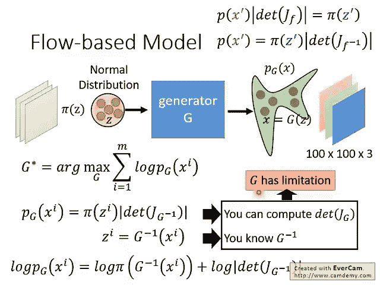

## 从单层到流：叠加变换层

单个生成器的能力可能有限。本节中我们来看看如何通过叠加多个简单的变换层来构建强大的生成模型。

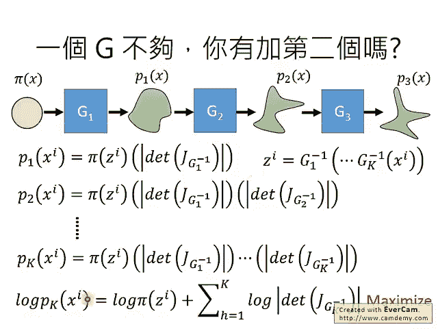

一个 \( G \) 的能力可能有限，但我们可以叠加多个 \( G \)，形成“流”。设我们有 \( K \) 个生成器 \( G_1, G_2, ..., G_K \) 串联，则最终的分布 \( p_K \) 为：

\[
p_K(x^i) = p(z^i) \cdot \prod_{k=1}^{K} \left| \det(J_{G_k^{-1}}) \right|
\]
\[
其中\ z^i = G_K^{-1}(G_{K-1}^{-1}(...G_1^{-1}(x^i)...))
\]

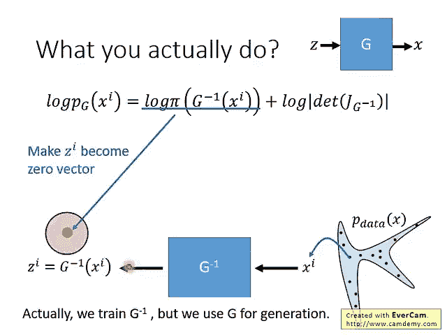

取对数后，连乘变连加：
\[
\log p_K(x^i) = \log p(z^i) + \sum_{k=1}^{K} \log \left| \det(J_{G_k^{-1}}) \right|
\]

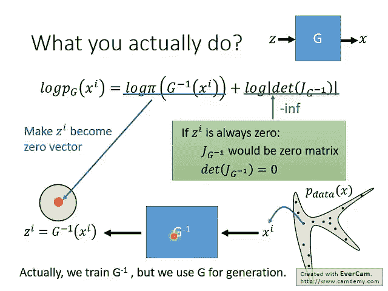

这样，我们就可以通过叠加多个简单、易处理的可逆变换层，来构建一个表达能力强大的复杂生成模型。

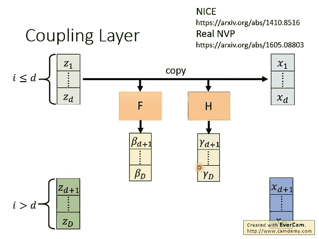

## 流模型的训练与实际设计

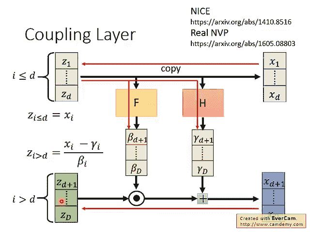

了解了流模型的原理后，本节中我们来看看如何实际训练它，以及如何设计满足条件的网络层。

在实际训练时，我们训练的是 \( G^{-1} \)。我们从真实数据采样 \( x^i \)，输入 \( G^{-1} \) 得到 \( z^i \)。我们的目标函数有两项：
*   第一项 \( \log p(z^i) \) 希望 \( z^i \) 接近先验分布（如标准正态分布）的峰值（原点）。
*   第二项 \( \log \left| \det(J_{G^{-1}}) \right| \) 对 \( G^{-1} \) 施加约束，防止它将所有输入都映射到原点。

训练过程就是同时优化这两项，找到一个平衡点。

### 耦合层

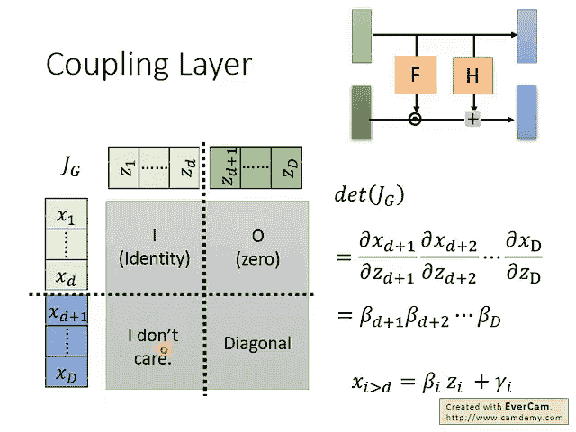

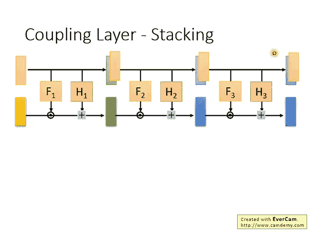

一个经典的设计是**耦合层**，被用于NICE和Real NVP等模型。它将输入 \( z \) 分成两部分 \( (z_{1:d}, z_{d+1:D}) \)，输出 \( x \) 按如下规则计算：
\[
x_{1:d} = z_{1:d}
\]
\[
x_{d+1:D} = z_{d+1:D} \odot \exp(\beta) + \gamma
\]
其中 \( \beta, \gamma = \text{NN}(z_{1:d}) \)，`NN`是任意复杂的神经网络，`⊙`表示逐元素相乘。

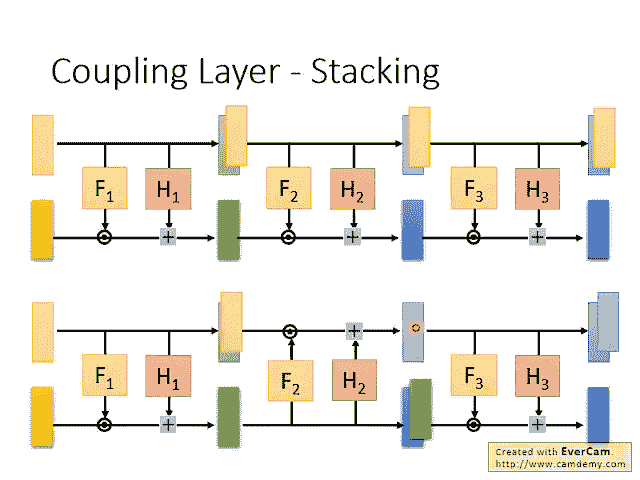

**逆变换**很容易计算：
\[
z_{1:d} = x_{1:d}
\]
\[
z_{d+1:D} = (x_{d+1:D} - \gamma) \odot \exp(-\beta)，\quad 其中\ \beta, \gamma = \text{NN}(z_{1:d})
\]

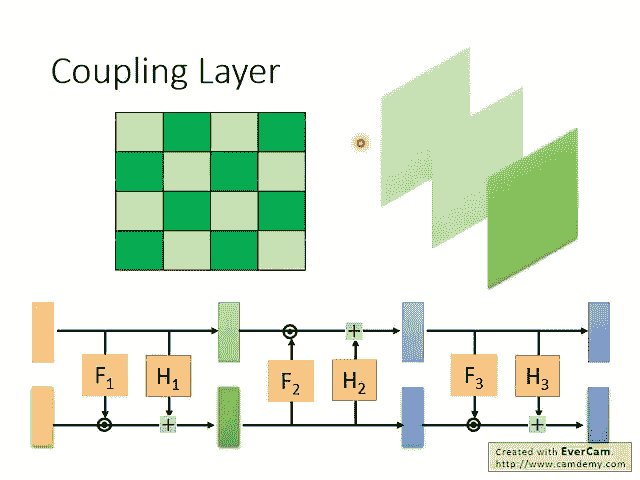

**雅可比行列式**也非常容易计算。由于其特殊结构，整个变换的雅可比矩阵是分块三角阵，其行列式等于右下角对角矩阵的行列式，即 \( \exp(\sum \beta) \)。

在叠加耦合层时，需要交替交换被复制和被变换的部分，以确保所有维度都能得到充分处理。

### 1x1 可逆卷积

另一个重要设计是**1x1可逆卷积**，用于Glow模型。对于图像的每个像素（一个3维RGB向量），左乘一个3x3的权重矩阵 \( W \) 得到输出像素。
\[
x^{i,j} = W \cdot z^{i,j}
\]

其**逆变换**就是乘以 \( W^{-1} \)。只要 \( W \) 是可逆矩阵即可。
其**雅可比行列式**是 \( \det(W)^{h \times w} \)，其中 \( h, w \) 是图像的高和宽，计算也很容易。

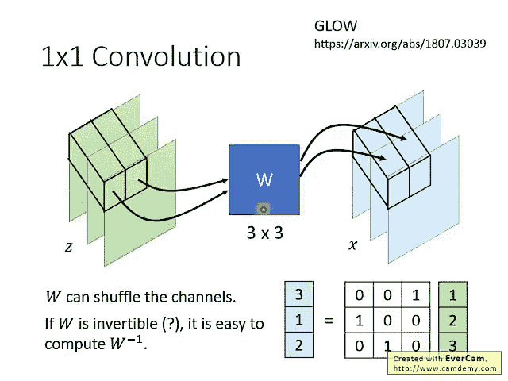

1x1卷积的作用可以理解为学习通道之间的置换，与耦合层配合使用。

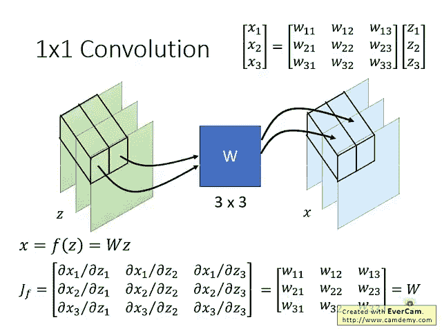

## 流模型的应用实例：Glow

理论需要实践验证。本节中我们来看一个著名的流模型——Glow，及其有趣的应用。

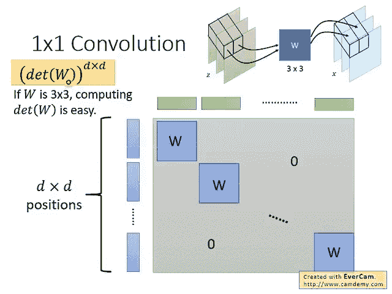

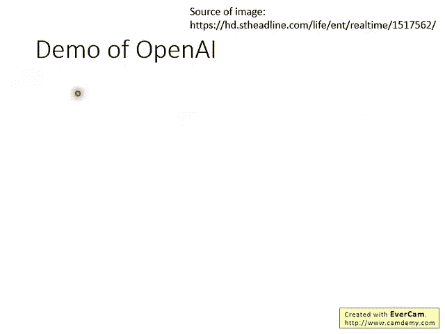

Glow模型结合了耦合层和1x1可逆卷积，在图像生成上取得了很好的效果。OpenAI提供了Glow的在线演示，可以完成一些有趣的操作：
*   **图像插值**：将两张人脸图像分别映射到隐空间 \( z \)，对 \( z \) 向量进行插值，再映射回图像空间，可以得到两张人脸的平滑过渡。
*   **属性编辑**：例如“让人脸笑起来”。收集“笑”和“不笑”的人脸图像集，分别计算它们在隐空间 \( z \) 的平均值，相减得到“笑容方向”向量 \( \Delta z_{smile} \)。对于任何一张人脸，先映射到 \( z \)，然后加上 \( \Delta z_{smile} \)，再映射回图像，就能让这张脸笑起来。

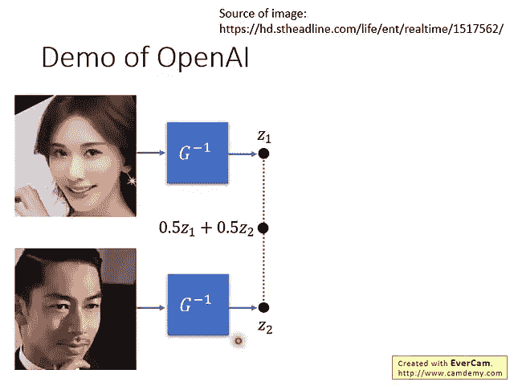

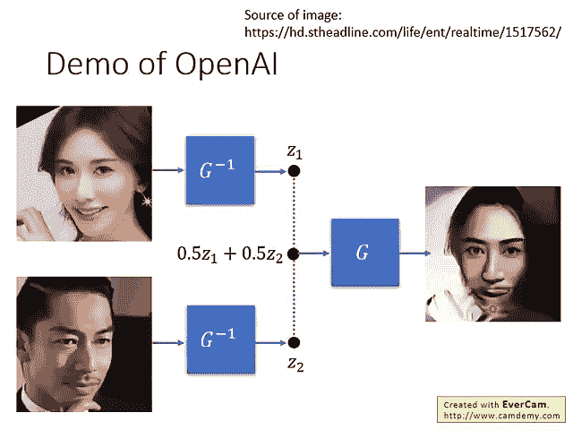

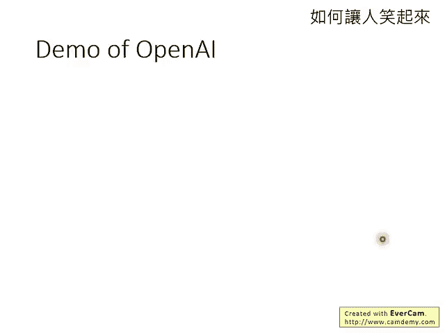

此外，流模型（如Parallel WaveNet，WaveGlow）在语音合成领域也表现出色，解决了自回归模型合成速度慢的问题。

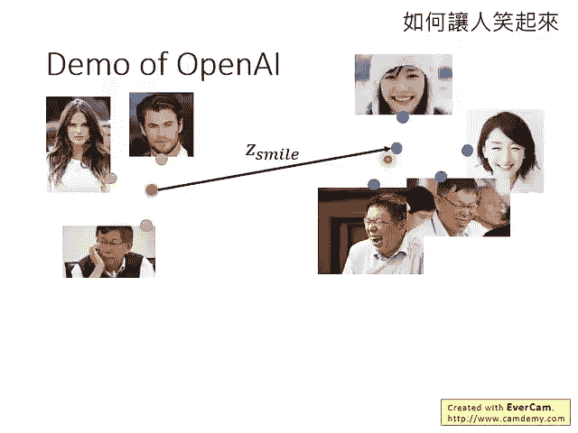

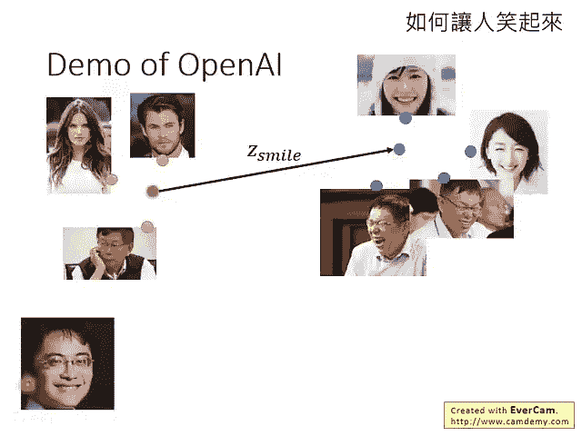

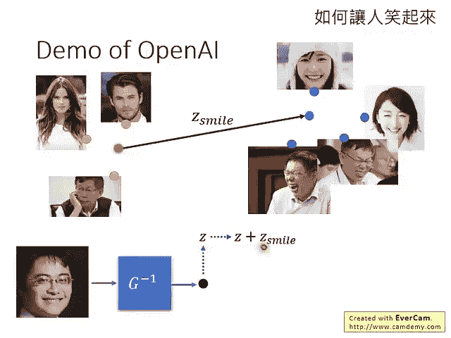

---

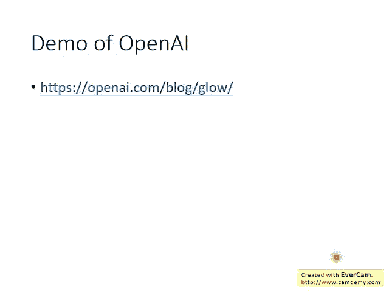

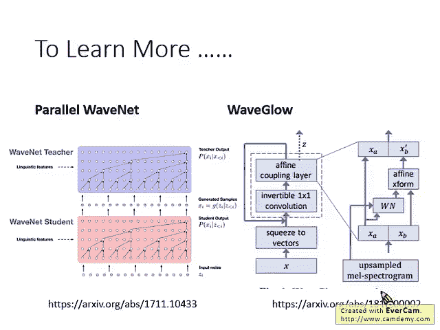

本节课中我们一起学习了流模型。我们首先回顾了其他生成模型的问题，然后从数学基础（雅可比矩阵、行列式、变量变换定理）出发，逐步推导出流模型的核心思想：通过叠加一系列可逆且雅可比行列式易算的变换层，来直接优化数据的似然函数。我们还介绍了耦合层和1x1可逆卷积这两种关键的网络层设计，并以Glow模型为例展示了流模型的应用。流模型提供了另一种强大且训练稳定的生成模型思路。