# 40：（延申）Diffusion Method 🧠

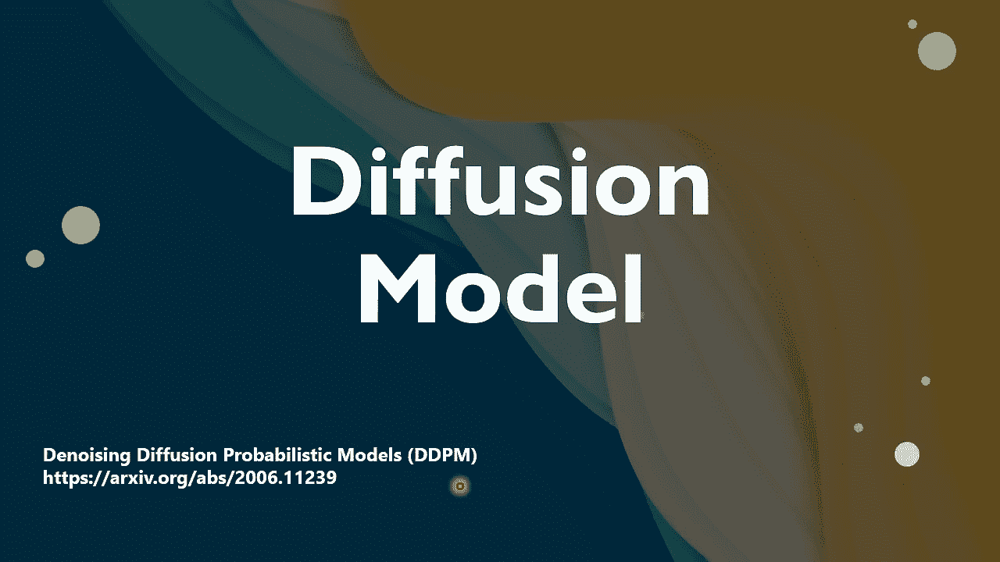

在本节课中，我们将要学习扩散模型的基本概念。扩散模型是当前图像生成领域的核心技术之一，我们将以最知名的去噪扩散概率模型为例，介绍其核心思想、工作原理以及如何结合文本生成图像。

## 概述 📖

扩散模型通过一个逐步去除图像中噪声的过程来生成新图像。这个过程类似于雕塑家从一块大理石中“释放”出雕像，模型从纯噪声开始，通过一系列去噪步骤，最终得到一张清晰的图片。本节课将详细拆解这一过程。

## 扩散模型如何运作？ 🎨

上一节我们介绍了扩散模型的基本概念，本节中我们来看看它的具体运作流程。

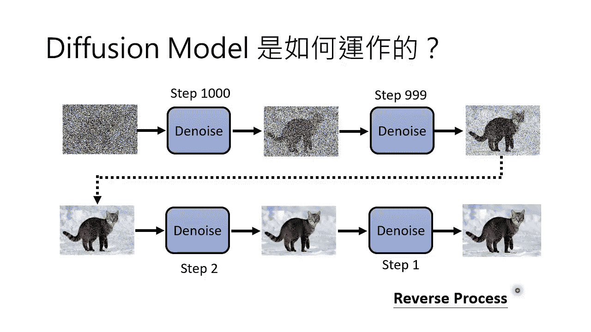

扩散模型生成图片的第一步，是从一个标准正态分布中采样出一个向量。这个向量的维度与要生成的图片大小完全相同。例如，要生成一张256×256的图片，就采样一个维度为256×256的向量，并将其排列成图片的形状。

接下来，有一个去噪模块会处理这张充满噪声的图片。输入一张全是噪声的图，输出会滤掉一部分噪声，可能显现出一些物体（如猫）的轮廓。这个过程反复进行多次，噪声逐渐减少，最终得到一张清晰的图片。

这个从噪声到图片的步骤，被称为**逆向过程**。

在概念上，这就像米开朗基罗所说的：雕像本来就在大理石中，他只是把不要的部分拿掉。扩散模型做的事情是一样的，图片“本来”就在噪声里，模型只是把被视为噪声的部分滤掉。

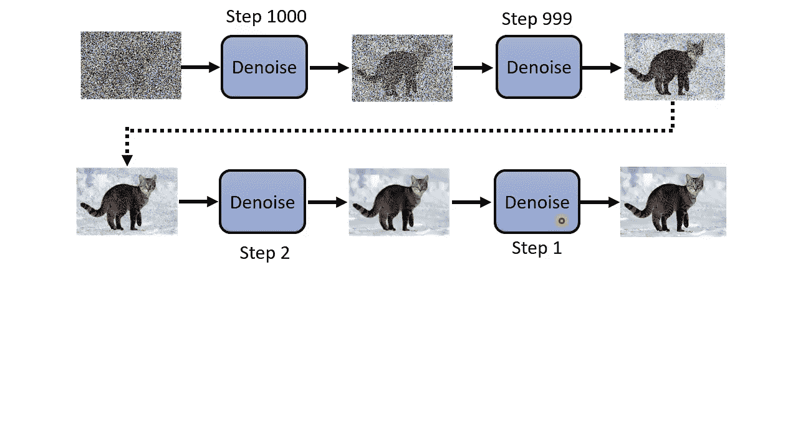

## 去噪模块详解 🔧

从上面的流程看，你可能会问：反复使用的去噪模块是同一个吗？答案是，我们确实使用同一个去噪模型，但每次输入的图片差异巨大。一开始输入的是纯噪声，最后输入的是接近完整的图片。为了让同一个模型能应对不同阶段的输入，我们需要给它额外的信息。

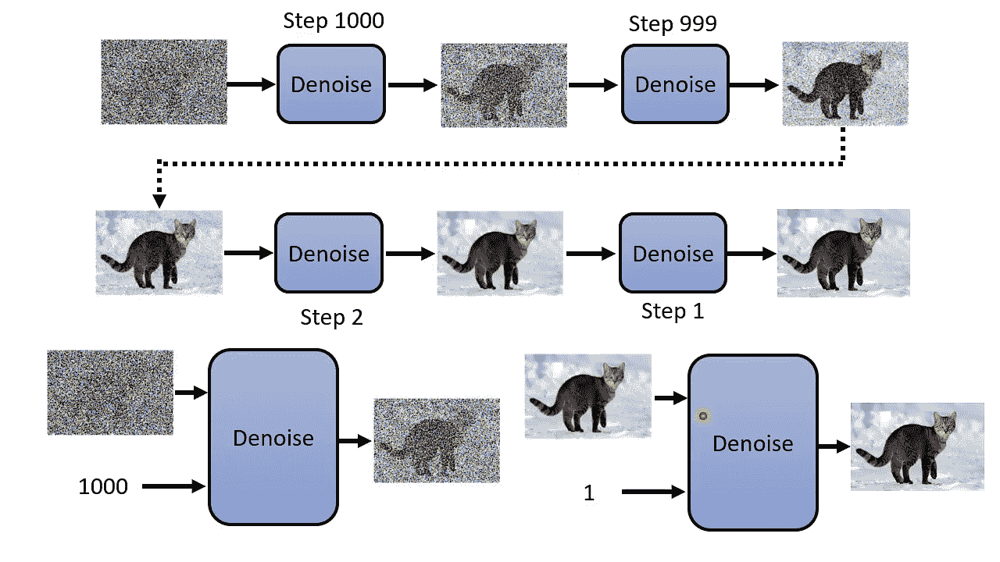

以下是去噪模块的关键设计：

去噪模块除了接收待去噪的图片，还会接收一个额外的输入，这个输入代表了当前噪声的严重程度。例如，用1000代表刚开始去噪（噪声大），用1代表最后一步去噪（噪声小）。这样，去噪模块就能根据当前所处的步骤，做出不同的响应。

## 噪声预测器：去噪模块的核心 🎯

上一节我们介绍了去噪模块需要步骤信息，本节中我们来看看模块内部的具体结构。

在去噪模块内部，实际工作的是一个**噪声预测器**。它的任务是预测输入图片中的噪声长什么样子。

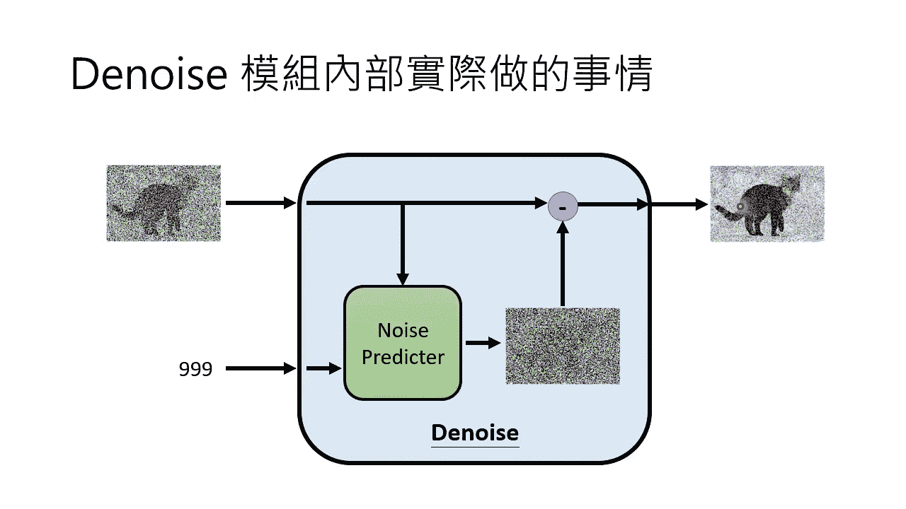

噪声预测器接收待去噪的图片和代表当前步骤的编号，然后输出一张预测的噪声图。最后，将输入的图片减去预测出的噪声，就得到了去噪后的结果。

你可能会问，为什么不直接训练一个端到端的模型，输入有噪声的图片，直接输出干净的图片呢？理论上可以，但直接预测噪声比直接生成一张清晰的图片要简单。预测噪声的难度更低，因此目前多数论文选择使用噪声预测器。

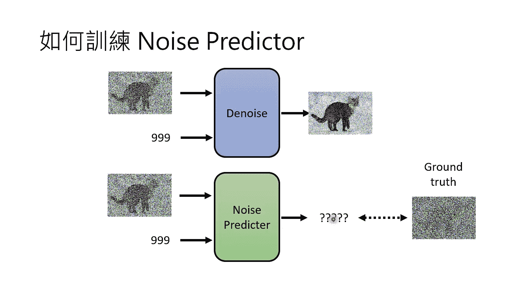

## 如何训练噪声预测器？ 🏋️

我们已经知道去噪模块的核心是噪声预测器，但训练它需要成对的监督数据。我们需要告诉模型，对于某张有噪声的图片，其中的噪声“应该”长什么样。这些数据是如何创造出来的呢？

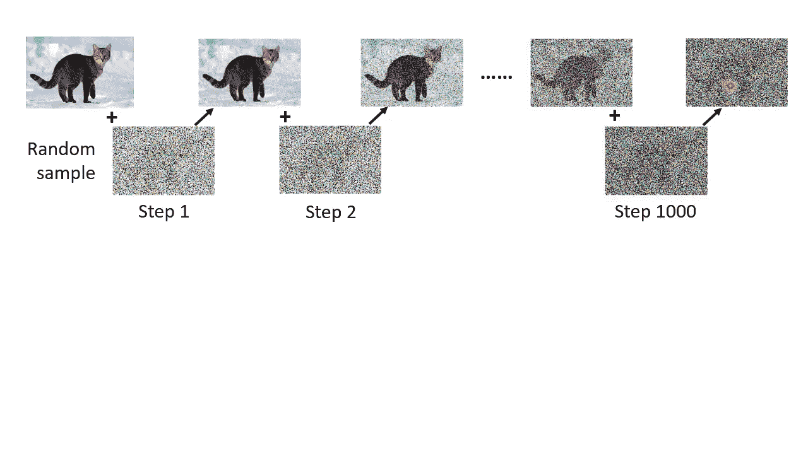

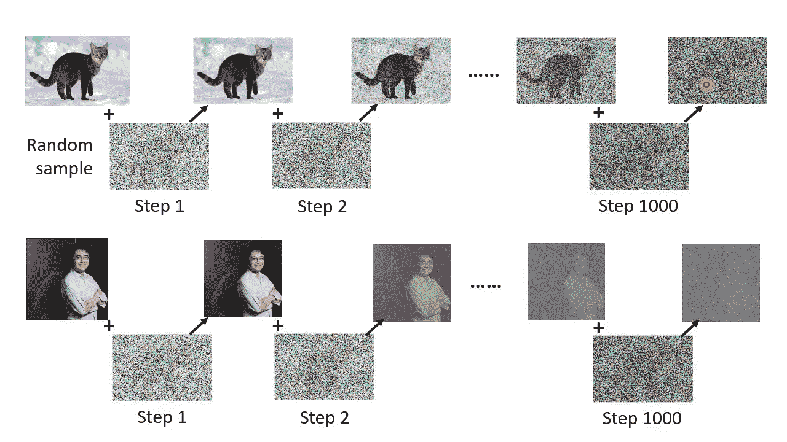

噪声预测器的训练资料是人为创造的。创造方法如下：

1.  从你的图片数据库中取出一张干净的图片。
2.  从标准正态分布中随机采样一组噪声，加到图片上，得到一张带噪声的图片。
3.  可以重复采样和添加噪声的过程，得到噪声程度不同的多张图片，直到原图完全被噪声掩盖。

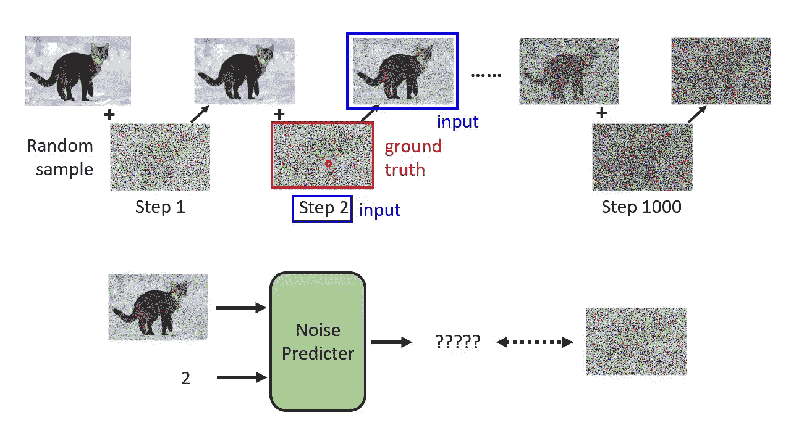

这个向图片逐步添加噪声的过程，被称为**前向过程**或**扩散过程**。

完成这个扩散过程后，你就有了噪声预测器的训练数据。对于噪声预测器来说：
*   **输入**：加噪后的图片，以及这是第几次加噪的步骤编号。
*   **目标输出**：我们加入的那张噪声图。

接下来，就可以像训练一般的神经网络一样训练这个噪声预测器了。

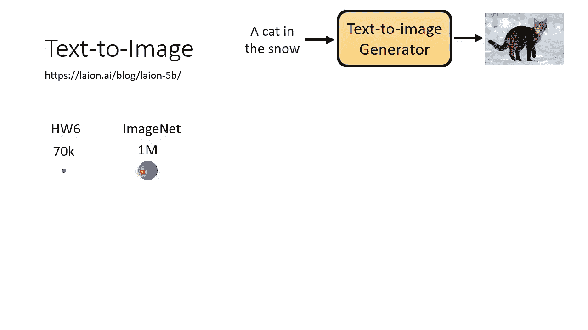

## 结合文本生成图像 📝

到目前为止，我们讨论的还只是从噪声生成任意图片。那么，如何根据特定的文字描述来生成图片呢？在实现这一点之前，需要了解一个前提：训练一个文生图模型，仍然需要海量的“图片-文字”成对数据。

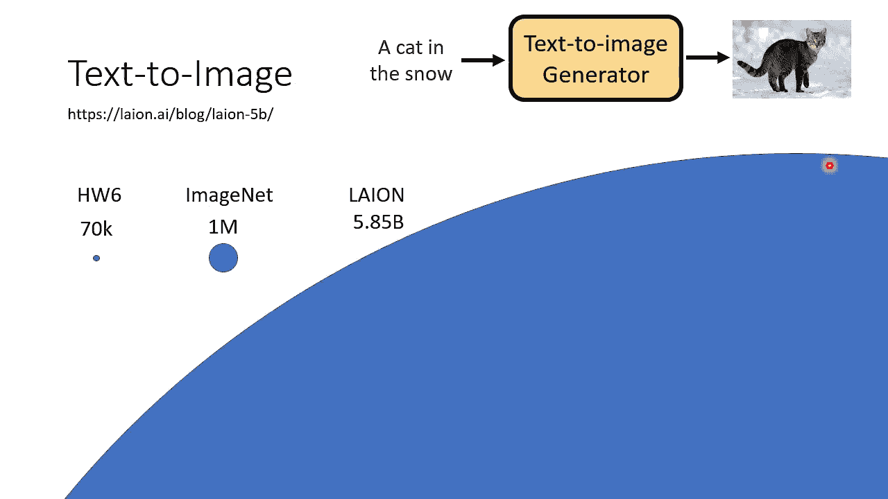

例如，ImageNet有约100万张带类别标签的图片。而当前顶尖的文生图模型（如Stable Diffusion）的训练数据往往来自LAION-5B数据集，它包含了约58.5亿张带有文字描述的图片。如此庞大的数据量，是模型能理解多种语言并生成高质量图片的基础。

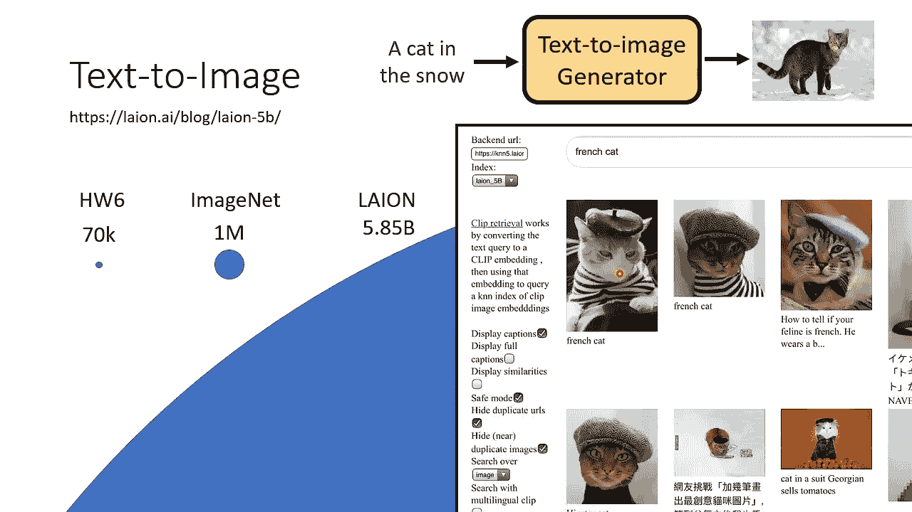

有了图文成对数据后，如何修改模型以结合文本呢？方法非常简单直接。

在去噪时，去噪模块现在不仅接收输入的图片和步骤编号，还会额外接收一段文字描述。这样，模型在每一步去噪时，都会根据这段文字描述来指导图片的生成。

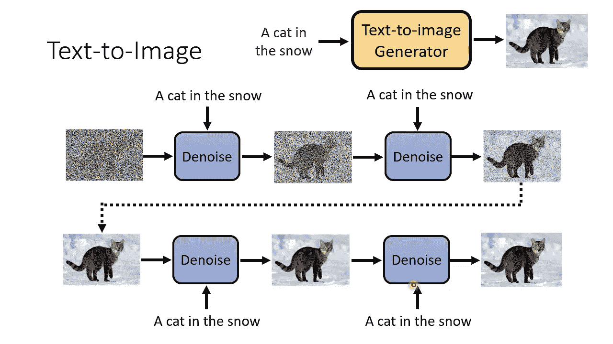

相应地，噪声预测器也需要进行修改。在训练时，噪声预测器的输入变为三部分：
1.  加噪后的图片
2.  当前的步骤编号
3.  该图片对应的文字描述

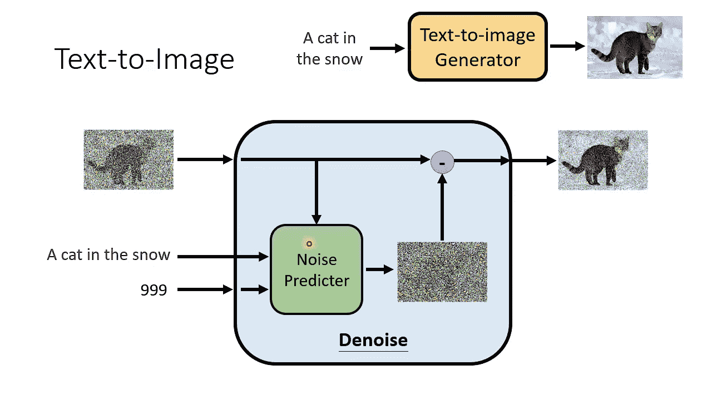

它的任务仍然是预测加入的噪声，但这次预测会同时受到图片、步骤和文字的三重约束。这就是DDPM结合文本进行图像生成的完整算法核心。

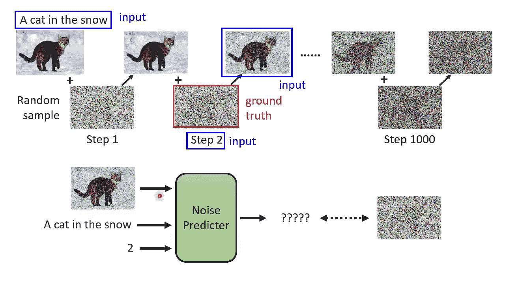

## 总结 ✨

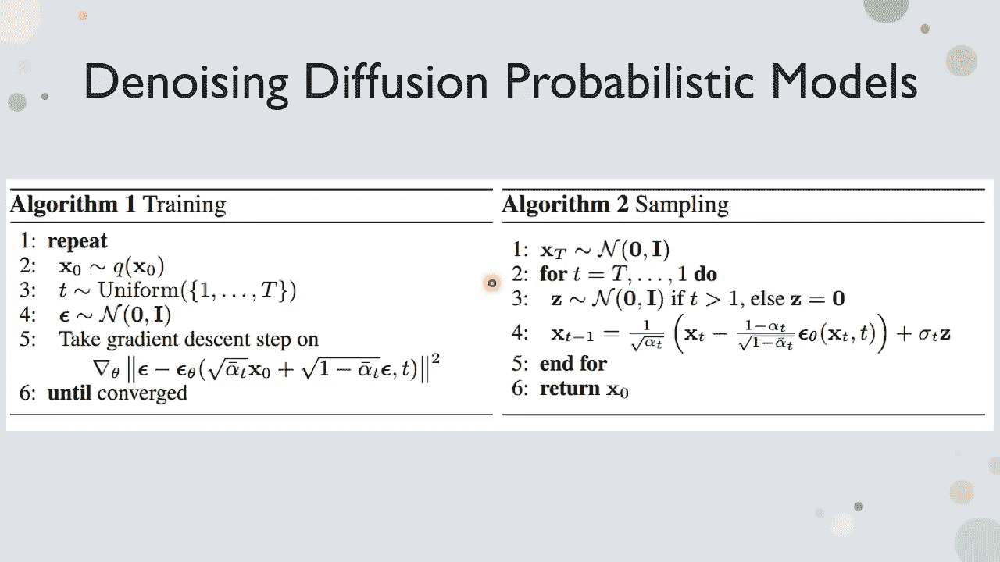

本节课中我们一起学习了扩散模型的核心原理。我们了解到，扩散模型通过一个逆向的去噪过程从噪声中生成图像，其核心组件是一个能根据步骤信息预测噪声的噪声预测器。模型的训练依赖于人为构造的“加噪图片-噪声”对。最后，通过在海量“图文对”数据上训练，并让噪声预测器额外接收文本输入，模型便具备了根据文字描述生成对应图像的能力。整个流程概念清晰，但背后依赖强大的数据与计算支撑。