# 42：额外课程：GPT-4o - 啥都会一点的研究生 🎓

在本节课中，我们将探讨GPT-4o语音互动模式背后可能的技术原理。我们将从语音技术的基本概念入手，分析GPT-4o语音模式的独特之处，并基于现有技术推测其可能的实现方式。课程内容旨在让没有语音技术背景的同学也能理解其核心思想。

---

有很多同学询问我对GPT-4o的看法，因此我今天来讲解一下GPT-4o背后可能的语音技术。这部影片的目标听众是没有语音技术背景的同学。

如果你已经是语音领域的专家，这部影片讲的内容对你来说可能过于科普。首先说明一下，我假设观看这部影片的同学是修过《深度学习人工智慧导论》的。

如果你还没有看过这堂课的影片，你可以在这个链接找到。如果你看过这堂课的影片，可以让你更了解我现在这部影片所要讲的内容。GPT-4o其中一项特别令人瞩目的技术，就是语音互动的功能。

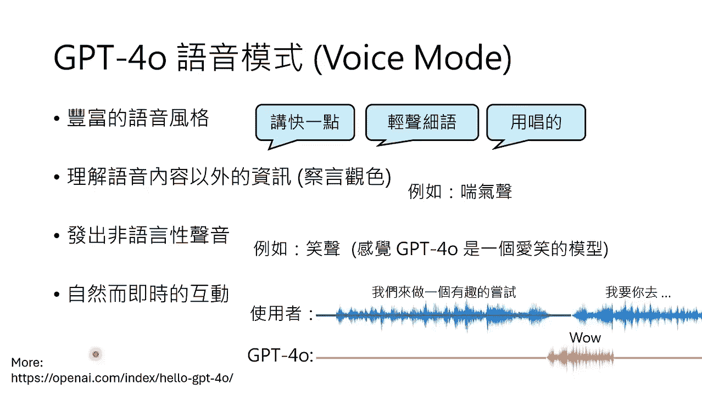

谷歌也推出了Project Astra的结果。在Project Astra里面也打造了语音互动的技术。这代表现在语音互动的技术，是各个大厂都非常重视的一块。

那么，GPT-4o的语音模式有什么特别的地方呢？第一个是它有很丰富的语音风格。讲到语音合成，大家往往想到的就是谷歌小姐。谷歌小姐就是一种语调。

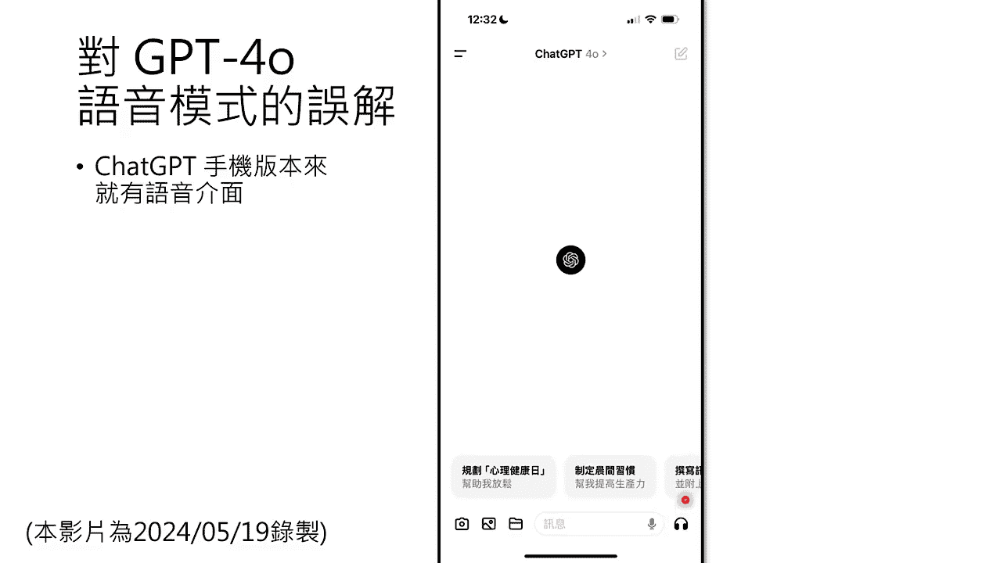

但是GPT-4o，你可以用文字的指令，要求他用不同的语调来说话。比如叫他讲快一点，叫他轻声细语，或甚至叫他用唱的方式把他想要讲的事情表达出来。另外，GPT-4o好像可以理解语音内容以外的资讯。

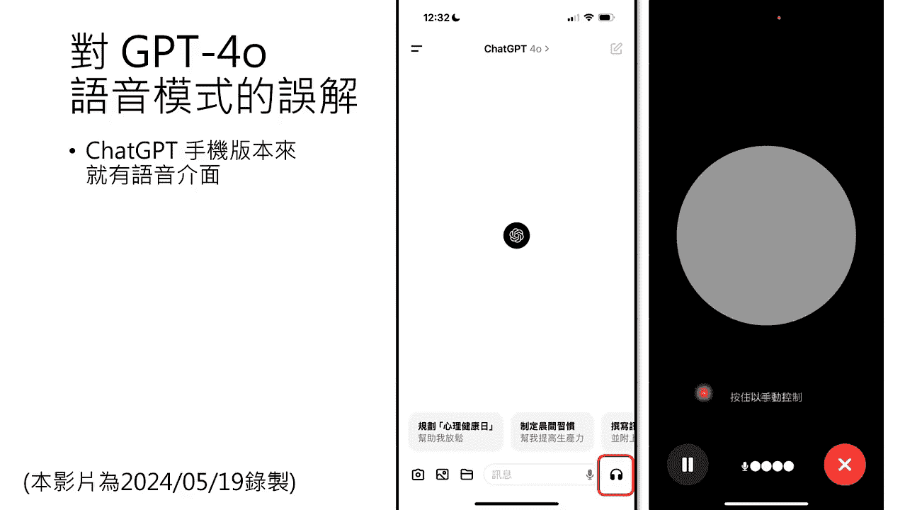

用比较白话的讲法，就是他能够察言观色。举例来说，他可能可以听得到一个人的喘气声，知道一个人气喘如牛。他可以发出非语音性的声音，例如笑声。

如果你有看GPT-4o的演示，你会发现这是一个非常爱笑的模型，它动不动就会笑。另外，GPT-4o有自然而及时的互动。在其中的演示里面，有一个人说“我们来做一个有趣的尝试”，话还没有说完，GPT-4o居然说了一声“哇哦”。

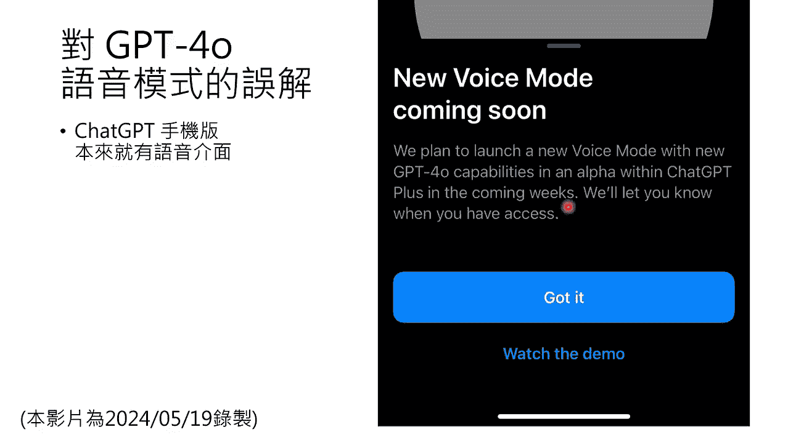

如果还没有看过OpenAI的演示，你可以先看一下OpenAI的演示，再来继续这部影片。

首先，我想要澄清一个很多人对GPT-4o语音模式的误解。我这部影片是在5月19号的晚上录制的。其实到5月19号的晚上为止，多数人都没有GPT-4o的语音模式。

很多人会想说我有啊，我可以用语音跟我的ChatGPT互动。那个语音互动是ChatGPT手机版本来就有的语音界面。ChatGPT的手机版本来就可以用语音互动。它的互动方式是说，这是你的ChatGPT的页面。

GPT-4o已经推出了，你可以在右下角点这个语音的按钮。

然后你就会看到一个这样的画面。你确实可以透过这个界面跟ChatGPT用语音沟通。但是如果你有实际尝试的话，你会发现这一个语音的界面并没有你在GPT-4o语音模式的演示里面看到的种种神奇功能。

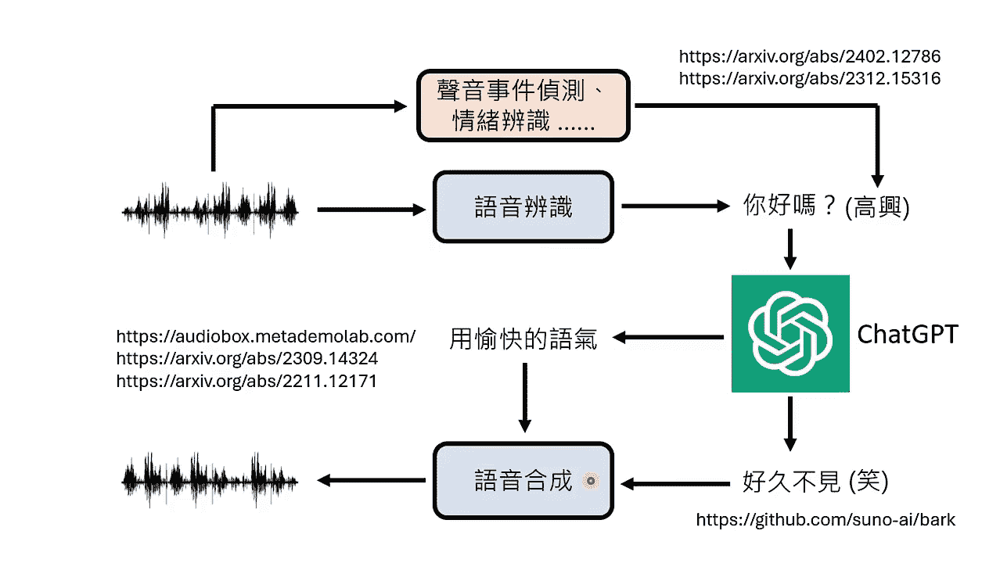

比如用不同的语气讲话，比如你可以打断他说话等等。

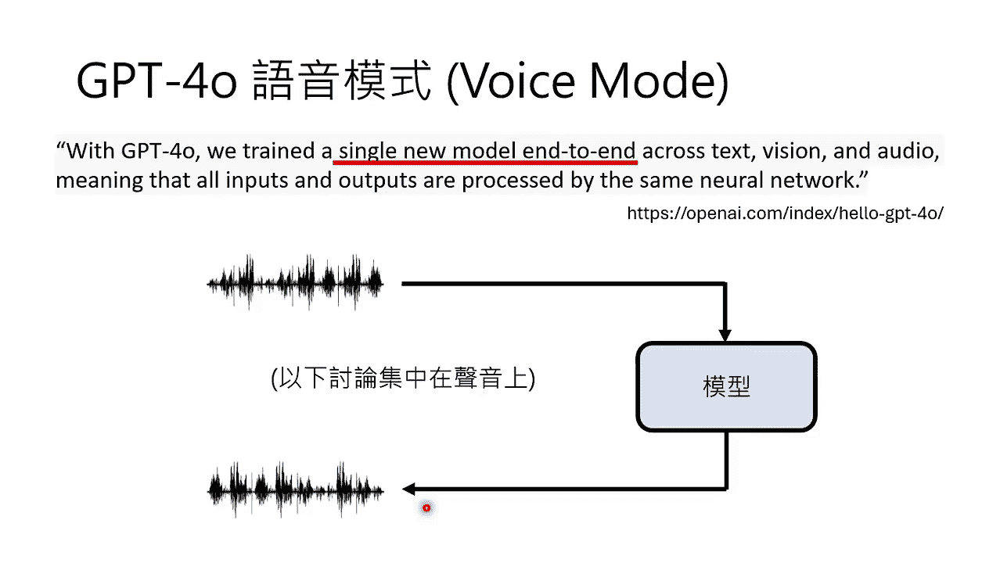

事实上，大家可能都有收到一则OpenAI给的讯息，就是voice mode还没有真的释出，他只是coming soon。他会在接下来的数周慢慢地被推出。所以大家所使用的手机版的语音界面，其实可能还不是GPT-4o的语音模式。

上一节我们介绍了GPT-4o语音模式的独特表现，本节我们来看看旧版语音界面是如何工作的。

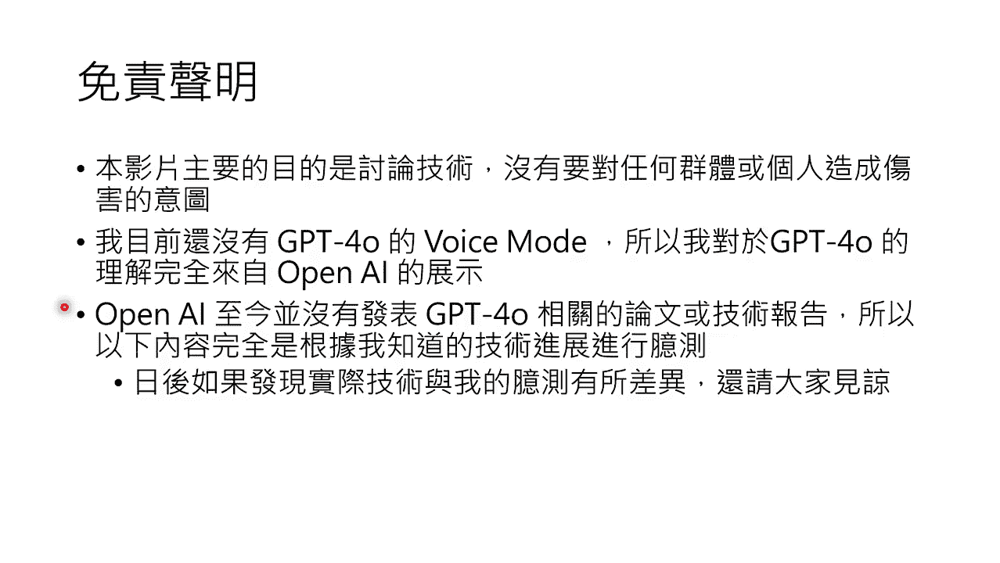

旧版的语音界面是先把语音讯号，透过语音辨识变成文字。再把文字丢给语言模型，比如ChatGPT。然后语言模型会给一个回应，这个回应透过语音合成产生语音讯号。

如果语音辨识跟语音合成跑得够快的话，其实这个界面也可以达到蛮自然、及时的互动功能。但是跟OpenAI GPT-4o语音模式的演示比起来，还是有一段差距。

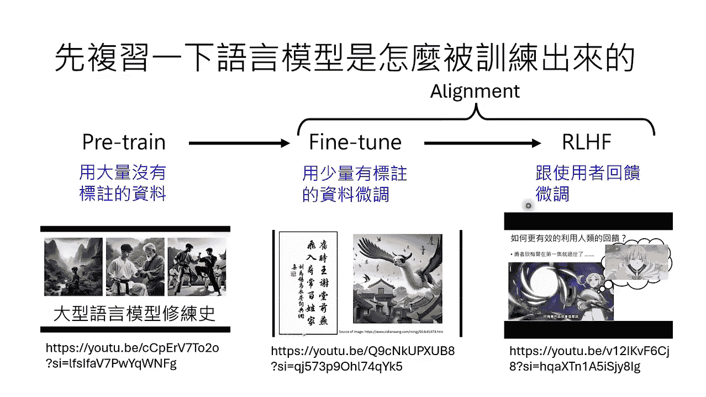

比如，如果是透过语音辨识把声音讯号转成文字，那语言模型可能会不知道说话者的情绪。语音合成如果只是把语言模型的输出转成声音讯号，那语音合成就只有某一种说话的风格而已。

我在看GPT-4o语音界面的演示的时候，我在想，他会不会只是把原来的系统加上了一些额外的模组。比如在语音辨识之外，我们可以加一些语音事件侦测或情绪辨认的模组。

所以我们也有机会透过情绪辨认的模组，把声音讯号的情绪侦测出来。你可以把侦测出的情绪放在语音辨识的结果后面，再丢给语言模型。那语言模型也有机会知道这句话的情绪。

我这边引用一些论文。这些论文是说你可以加一些额外的模组，来帮助语言模型了解现在输入语音的情绪。另外，你也可以让语言模型除了文字之外，多输出一些符号。

比如语言模型在他的输出的文件后面加一个括号“笑”，再丢给语音合成系统。搞不好语音合成系统就可以产生笑声。你可能会问，说这个语音合成系统可以看到这个括号“笑”，就产生笑声吗？

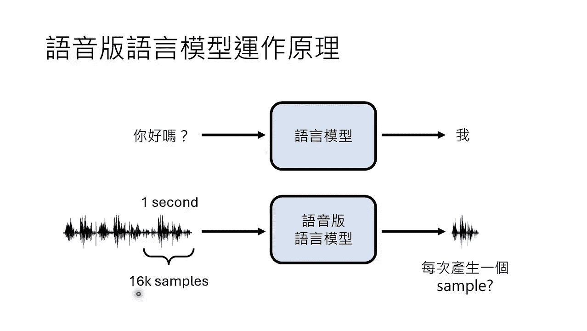

有一些语音合成系统是真的可以的。比如SOOAI所开发的bug，你在你的文具里面打一个“笑”，这个语音合成模型的结果是真的可以产生笑声的。另外一方面，ChatGPT可能也可以产生一段指令，告诉语音合成系统说现在应该要用什么样的语气来进行合成。

语音合成系统可以看得懂这些文字的指令吗？其实很多语音合成系统是可以看得懂文字指令的。举例来说，一个具代表性的例子就是Meta开发的AudioBus。

所以用很多现有的技术串接起来，其实也不是没有可能打造GPT-4o的语音界面。只是说把很多系统串接起来，那可能及时性不是非常好，需要透过大量工程的手段来加快模型运作的速度，来达到真正及时的回应。

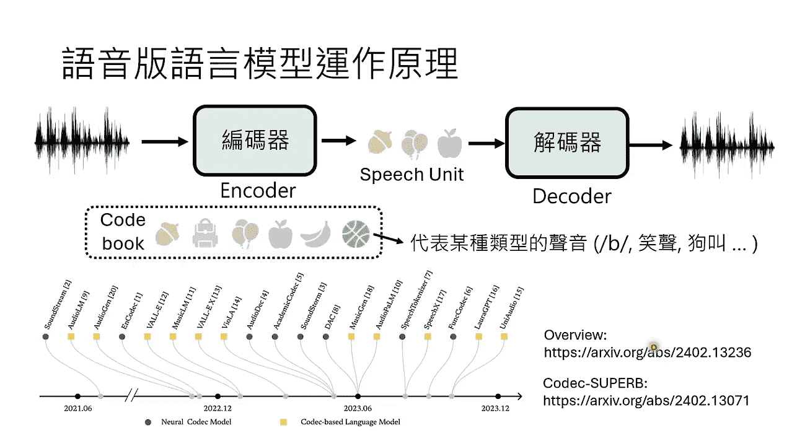

不过，GPT-4o的博客已经告诉我们，他的语音模式是一个端到端的模型。也就是它只用了一个模型来处理所有的事情。也就是说他用的不是像上一页投影片一样一个非常复杂的架构，而是只有一个单一的模型。

这个单一的模型听语音讯号作为输入，然后产生对应的输出。这个模型其实是一个多模态的模型，也就是它可以看图片、看影像的。但以下的讨论我们只集中在声音的部分。

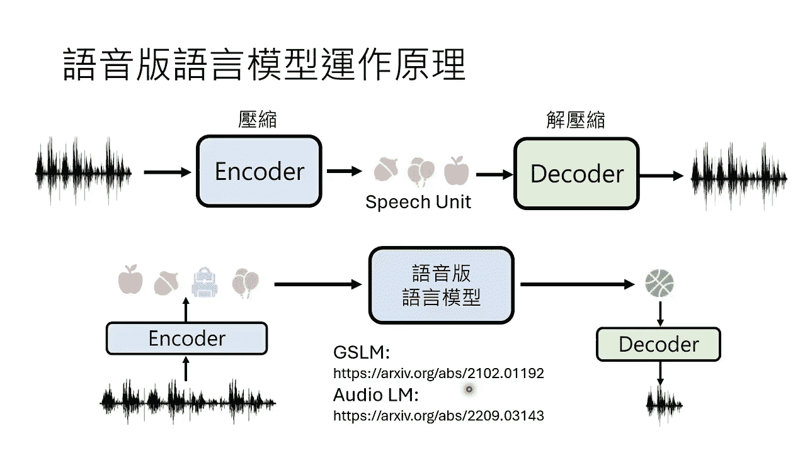

这边先说一个免责声明。本影片主要的目的是讨论技术，没有要对任何群体或个人造成伤害的意图。我目前还没有GPT-4o的voice mode，所以我对GPT-4o的理解完全来自OpenAI的展示。

至于实际上真的voice mode推出以后，有没有展示那么厉害，我们就拭目以待。OpenAI到目前为止都没有发表跟GPT-4o相关的论文或者是技术报告。以下的内容完全是根据我知道的技术进行预测。

所以以下我对于GPT-4o背后技术的猜想，是完全没有根据的，并没有任何的论文可以佐证我的猜测。我只是想要跟大家讨论一下，根据今天语音技术的发展，有什么样可能的技术可以达到GPT-4o这样的效果。

如果日后发现实际技术跟我的预测有差异，还请大家见谅。

在开始讲这个端到端的语音模型之前，我们先来复习一下文字的语言模型是怎么被训练出来的。我们知道文字的语言模型，它的训练有三个步骤。

以下是文字语言模型训练的三个核心步骤：
1.  **预训练**：用大量没有标注的资料进行训练。
2.  **微调**：用少量有标注的资料微调。
3.  **基于人类反馈的强化学习**：用使用者回馈的资料进行微调。

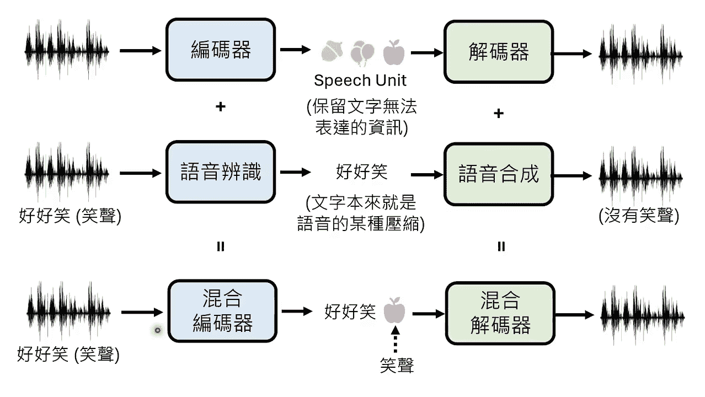

微调和基于人类反馈的强化学习也合起来，又叫做对齐。如果你对于这三个步骤还不熟悉的话。

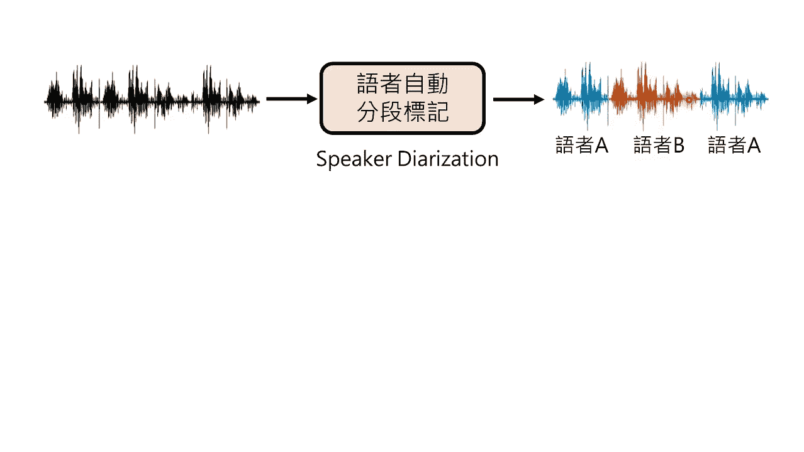

你可以看一下过去我上课的录音。你也可以看一下我最近释出的影片，讲这个《生成式人工智慧的生存策略》，了解生成式人工智慧的基本原理。

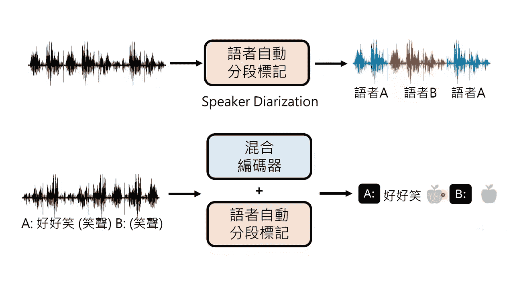

再进行以下的课程。那么，语音版的语言模型，它可能的运作原理是什么样子的呢？我们知道语言模型就是做文字接龙，给他一个未完成的句子，他猜接下来应该输出哪一个文字的token。

语音版的语言模型可以听一句话给你一个回应。它背后运作的逻辑可能也非常类似。他做的事情可能就是听一段声音，然后去猜接下来应该产生什么样的声音。也就是他做的事情是声音接龙。

虽然从表面上看起来，语言模型跟语音版的语言模型，它们的运作可能非常类似，但是语音版的语言模型有它独特的挑战。第一个挑战就是这个语音相较于文字，它更为复杂。

对一段声音讯号而言，如果他的采样率是16K赫兹的话，意思就是一秒钟的声音讯号里面有1万6000个取样点所构成。也就是一秒钟的声音讯号，是由1万6000个数值所构成的。所以声音讯号非常复杂。

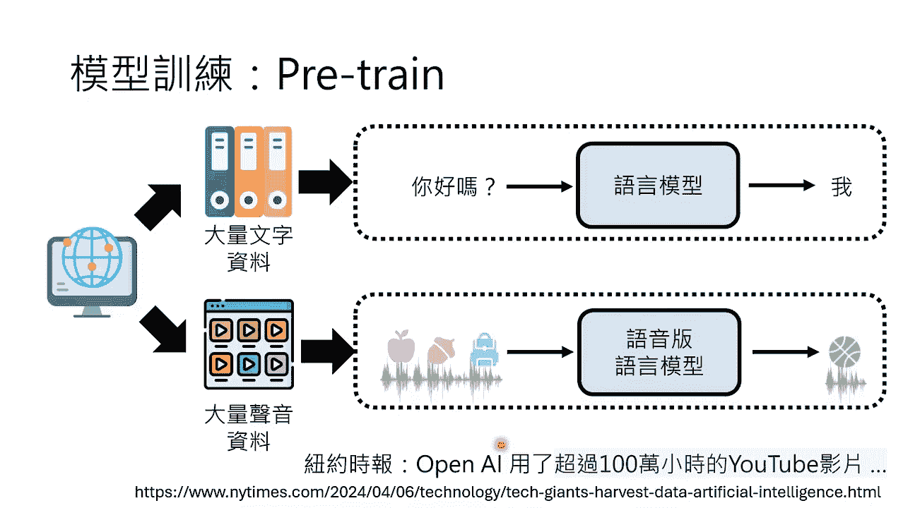

如果我们今天在做这个声音接龙的时候，是让声音讯号一个一个取样点跑出来，那你要产生一秒钟的声音讯号，你就要跑1万6000次的声音讯号接龙。这显然会非常花时间。

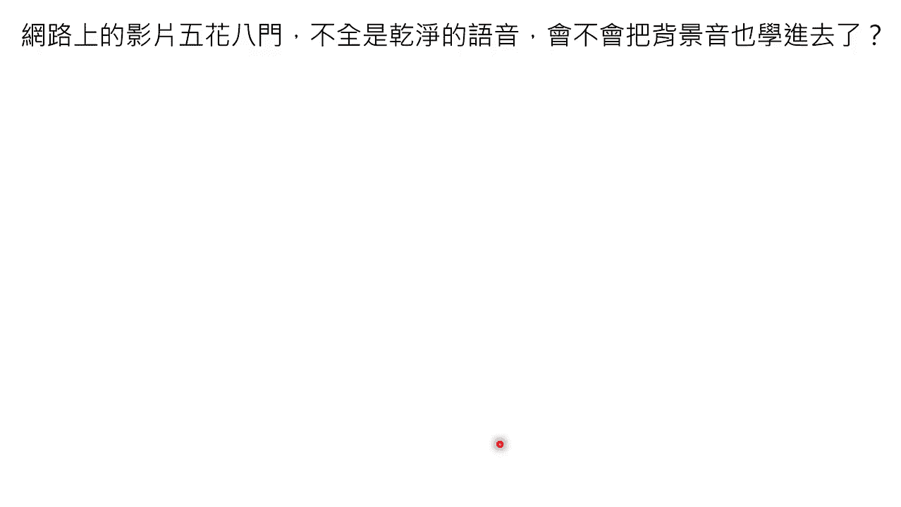

所以现在在做这一种语音的接龙，通常不是直接在语音的讯号上面做接龙。

比较常见的做法是，先把声音的讯号进行压缩。你会有一个编码器，它的英文是encoder。这个编码器里面可能会有一个codebook。这个codebook里面是一大堆的code。

每一个code代表某种类型的声音。可能某个code代表人类发的“B”这个声音，有个code代表人类的笑声。有的code甚至代表不是人类的声音，比如狗叫声等等。所以一段声音讯号输入给编码器。

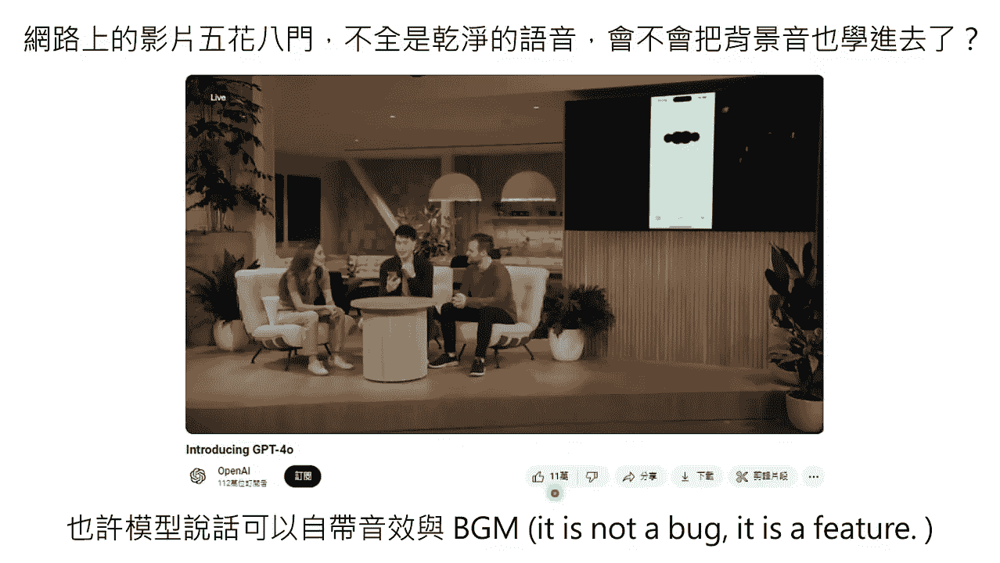

编码器会用它里面的codebook来表示这一段声音讯号。所以一段声音讯号会被表示成一个code的序列。这些code又被叫做speech unit，它们可以被看作是声音的单位。

你还会训练一个解码器，这个解码器可以读这些speech unit，把这些speech unit转回声音讯号。一般这些编码器跟解码器也是类神经网络，也是需要透过训练资料来进行训练的。

如果你想要知道更多有关这种把声音讯号变成speech unit，再把speech unit解回来相关的技术的话，可以阅读以下这两篇文章。

那么，语音版的语言模型是运作在这些speech unit上面的。也就是说当一段声音讯号进来的时候，语音版的语言模型并不是直接对这段声音讯号去做语音接龙。

这些声音讯号会先通过编码器变成一串unit。然后这些unit会变成语音版语言模型的输入。语音版语言模型要做的事情是，预测下一个unit会是什么。然后下一个unit会再通过解码器产生声音讯号。

所以语音版语言模型没有必要产生复杂的声音讯号，它只需要产生unit，然后由解码器把unit转回复杂的声音讯号。所以语音版的语言模型是运作在speech unit这种压缩过的东西上面。

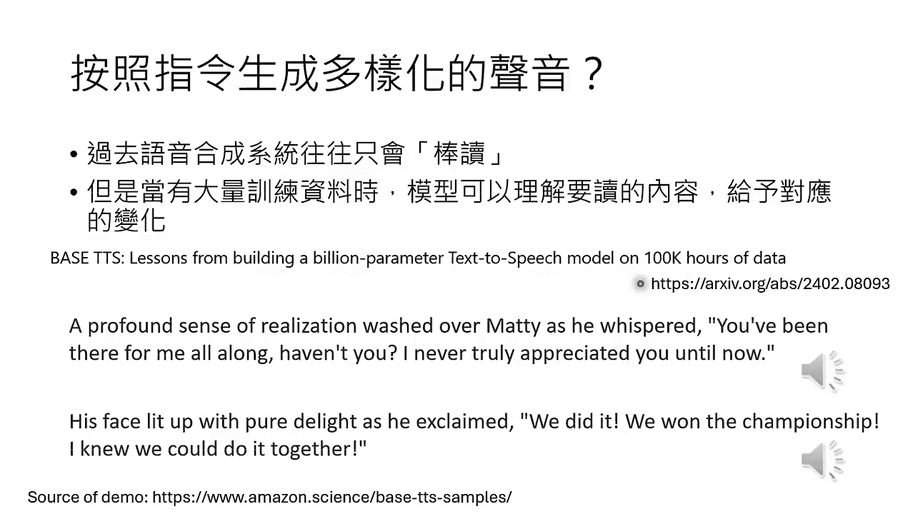

有很多具代表性的语音版的语言模型，比如Meta的GSLN，还有Google的Audio LM。这其实不是非常新的技术，GSLN是在21年的年初的时候就已经有的。

我们也可以把编码器看作是一种非常特殊的语音辨识，只是它的输出不是文字，而是speech unit。我们也可以把解码器看成是一种特殊的语音合成，只是它的输入不是文字，而是speech unit。它不是把文字变成语音，而是把speech unit变成语音。

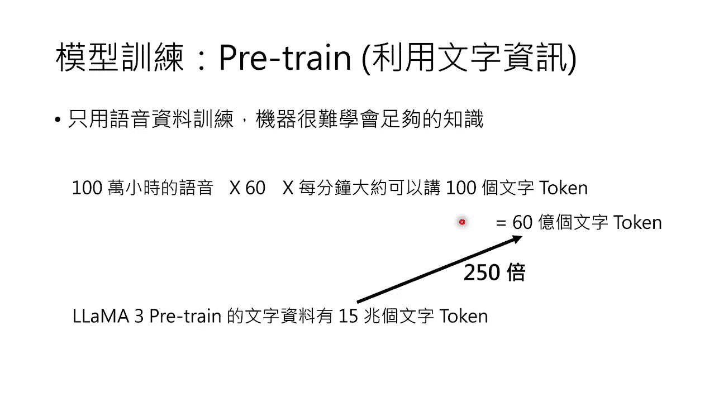

你可能会想说，那为什么我们不直接套用语音辨识跟语音合成，当做编码器跟解码器呢？其实我们确实可以把语音辨识想成是一种非常特别的压缩方式。当我们把声音讯号变成文字的时候，其实也是在做某种压缩，文字本来就可以看作是语音的浓缩版。

但是这边的问题是，文字只代表了语音里面某个面向的资讯。文字只代表了语音里面内容的资讯。假设今天输入的声音讯号是有一个人说“好好笑”，然后接下来“哈哈哈”了几声。那语音辨识系统可能只能够把代表文字的“好好笑”辨识出来，那笑声就不见了。

接下来你用语音合成把“好好笑”还原回声音的时候，你其实笑声的资讯就丢掉了。用speech unit的好处是，它可能可以保留文字所无法表达的资讯。但是另外一方面，用这种speech unit也有一个坏处。

speech unit里面可能很多unit，它本来就是对应到某个文字的token。那你等于是要编码器去重造轮子。本来就已经有文字可以表示语音里面的某些讯号。编码器需要再用另外新的符号来表示这些我们本来就有文字符号可以描述的语音资讯。那这样感觉是重造了轮子。

所以另外一个可能的做法是，把编码器跟语音辨识结合。我们这边把它叫做混合编码器。把解码器跟语音合成结合，这边叫做混合的解码器。也就是对一段声音讯号而言，能够做语音辨识的部分，能够辨识成文字的部分，把它用文字来表示。

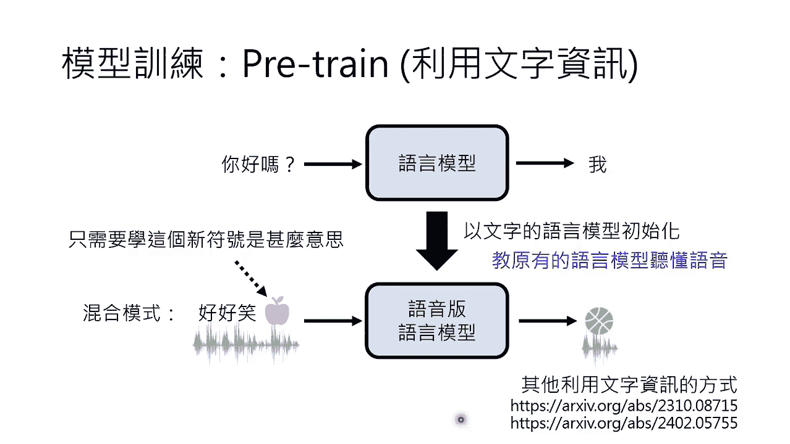

那无法用文字来表示的部分，就用speech unit来表示。我这一段声音讯号“好好笑”，后面接了“哈哈哈”。那“好好笑”的部分可能可以用文字来表示，那笑声的部分就拿一个特殊的符号来表示。

那混合解码器可以看文字跟特殊的符号，把它转回声音讯号。我不知道GPT-4o会不会采取这样混合的策略，也许GPT-4o也是使用编码器而已，并没有用语音辨识。我只是觉得用混合的编码器有它额外的好处。

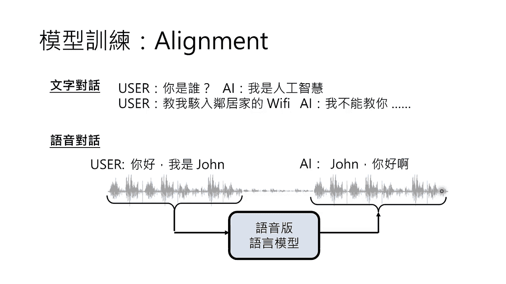

这个部分我们等一下会再提到。另外，我们这边还需要一个说话者自动分段标记的技术。这样的技术叫做说话者日志。如果你看GPT-4o的演示的话，当有两个以上的人跟他说话的时候，其实他是知道的，他可以知道谁是谁。

所以他应该需要用到说话者日志的技术。说话者日志的系统，说话者自动分段标记的系统，就给他一段声音讯号，他可以知道哪些段落是某一个同一个说话者讲的。他可以知道说，这一段跟这一段都是说话者A讲的，这一段是说话者B讲的。

所以我猜测一段声音讯号，对于一个语音版的语言模型来说，他的表达方式应该是这个样子的。就可能同时使用了混合的编码器，跟说话者自动分段的标记。有一段声音讯号进来，会标出说哪一个段落是说话者A说的。

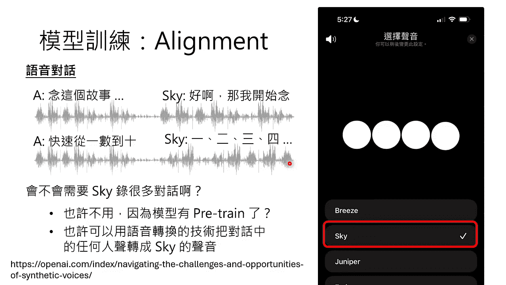

他可能会用“A:”一个特殊的符号来代表这是A说的话。然后可以用文字表示的地方，可能用文字表示。那不能用文字表示的地方，可能就拿特殊的符号用speech unit来表示。这是对于语音版的语言模型看到一段声音讯号的时候，他实际上输入的猜想。

接下来怎么训练这种语音版的语言模型呢？我们已经知道，语言模型是用大量文字资料所训练出来的。那语音版的语言模型用同样的道理，也可以用大量声音的资料来进行训练。我们完全可以用大量的声音资料来训练一个语音版的语言模型来做speech unit的接龙。

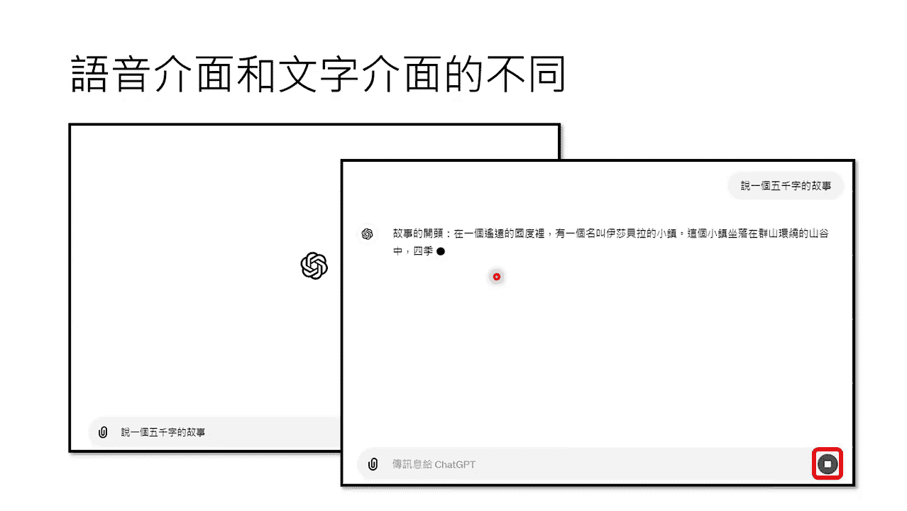

哪里去找大量的声音资料呢？这个想起来非常直觉。网络上有这么多的影音平台，从这些语音平台上，就可以收集到大量的声音资料。OpenAI显然在做这件事情，因为在4月的时候，纽约时报才说了，OpenAI用了超过100万小时的YouTube影片来训练他们的语言模型。

那时候我刚看这个报道的时候，我就很困惑。为什么要用YouTube的影片来训练语言模型呢？难道现在文字的资料已经全部都用完了，真的没有文字的资料可以用了吗？但是如果OpenAI是在训练语音版的语言模型，那用YouTube影片完全就说得通了。

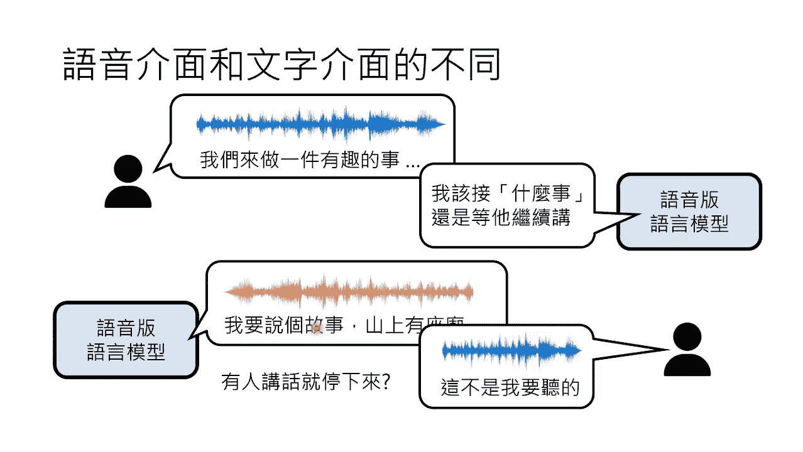

你可能会想说，可是网络上的影片五花八门，又不是全部都是干净的语音。那些语音很多背后是有音效、有背景音乐的。那我们拿这些声音讯号来训练我们的语音版语言模型，这个语音版语言模型会不会把音效、背景音乐通通都学进去了呢？非常有可能。

我们来仔细听一下，在GPT-4o演示里面，GPT-4o的声音。

大家仔细听一下GPT-4o的声音哦。

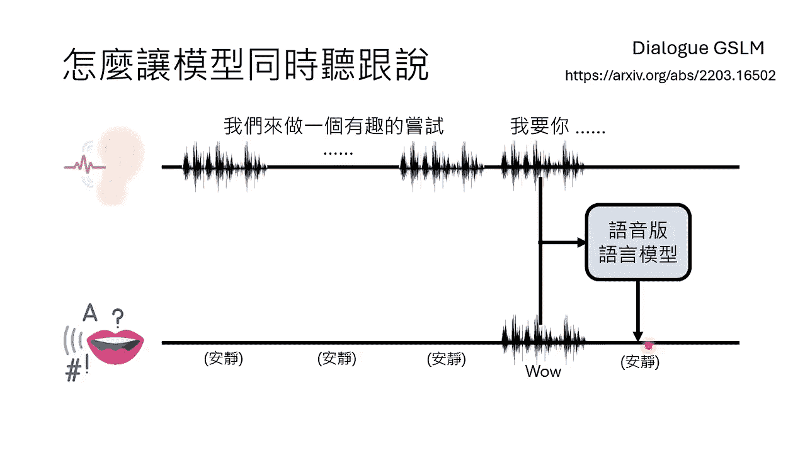

“Can you help me calm my nerves a little bit?” “Oh you're doing a live demo, right now. That's awesome just take a deep breath, and remember you're the expert.”

你有没有发现GPT-4o他讲话的时候背景是有一个钢琴声的。但我们不能排除现场正好有人在弹钢琴的可能。但是如果你告诉我，GPT-4o讲话的时候，就是有可能会产生一些音效或者是背景音乐，这我完全也不意外。

不过我觉得可以，如果今天一个语音模型，他在讲话的时候就是会自带音效或自带BGM，其实也是一个很酷的事情。他以后讲话都自带BGM，所以我们可以说这不是一个bug，这是一个feature。

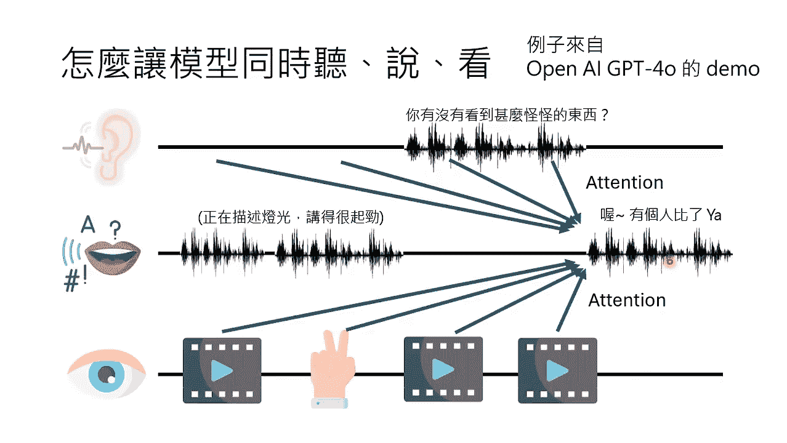

在演示里面我们也可以看到说，GPT-4o它可以产生非常多样化、非常戏剧性的声音，这是怎么办到的呢？有一些论文已经指出。这边引用了一个Amazon在今年2月所释出的论文。

他们用了超过10万个小时的语音讯号来训练他们的语音合成模型，应用的是一个参数有10亿等级的模型。当然这样大小的模型在文字领域并不是很大，但对于语音合成模型来说已经非常大了。

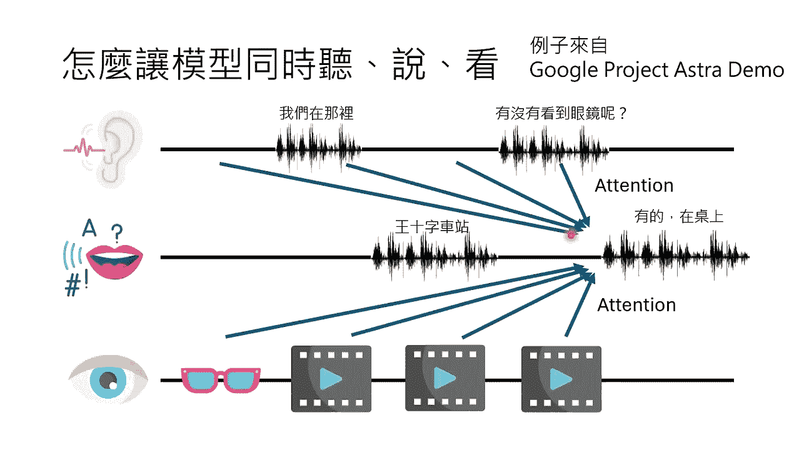

他们发现是说过去语音合成系统，因为他用的资料不够多，所以往往合出来的声音非常的平淡。这个如果你有看动漫的话，你知道这就叫做棒读，讲话不带情绪，非常的平淡。

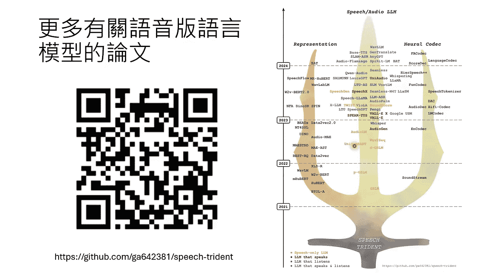

但是现在如果有大量训练资料的时候，这些语音合成的模型就可以理解要读的内容