# 李宏毅2024春《生成式人工智能导论》 - P11：第5讲：训练不了人工智能？你可以训练你自己（下） - 啥都会一点的研究生 - BV1BJ4m1e7g8

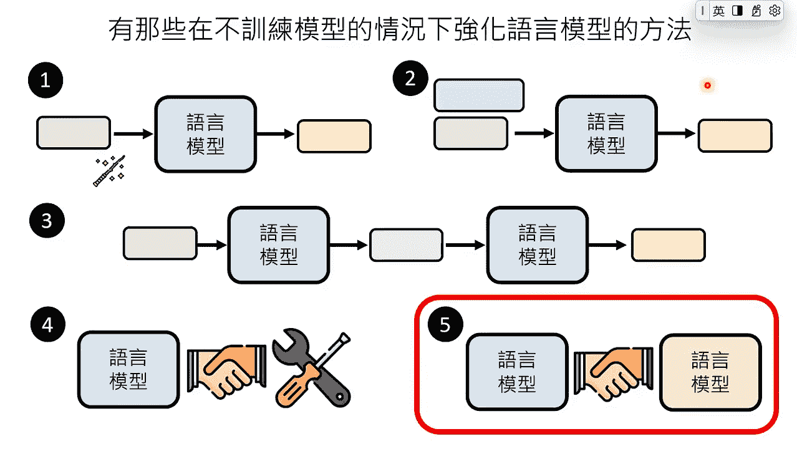

啊，今天的故事呢要从最近这几话的葬送的福利年，开始讲起啊，哦我不知道你这几周有没有看葬送的福利连啦，所以我还是跟你描述一下这几周的剧情，这几周呢是福利莲跟其他的魔法使。

包括他的徒弟费伦在考一级魔法使的资格，那其中一个关卡呢就是要攻略一个迷宫，叫做林落的王座，那这个迷宫呢里面有一个恶魔叫做水晶的恶魔，而且在三国演义里面又出现了，那就是司马徽，而那个水晶的恶魔。

他的能力呢，就是可以复制进入迷宫的人的能力哦，所以福利莲进入了迷宫，所以他就可以复制出一个福利莲的复制体，来防卫他自己啊，所以大家的任务呢，就是需要去打败弗利莲的复制体。

但你知道福利别人是一个千年的魔法使，所以当他使用权力的时候，是没有人可以打败弗利莲的啊，这个就是福利莲的复制体，而复制体呢是没有颜色的，所以你可以跟本体呢做出区别啊，虽然没有人可以打败弗利莲。

就算是他自己也不一定能够打赢自己的复制体，但是福利莲相信他自己跟费伦一起上，费伦是福利莲的弟子，是一个人类之后学过几年的魔法，但他相信他跟贝伦一起上就可以打败复制体哦，所以福利莲就跟费伦一起去面对他。

面对福利莲的复制体啊，这个时候你就见识到福利莲真正的威力，他们使出了很福利莲跟他的复制体，使出了很多毁天灭地的巨大魔法，还有放雷的，有那个放火的，然后还用了一些忍术，有什么地爆天星啊。

螺旋手里剑啊之类的，然后最后福利连还放了一个大招，用神之卡召唤出一个欧贝利斯克的巨神兵，然后这个福利连，跟他的复制体打的那个难分难解，然后飞轮呢就从后面偷袭了那个复制体，要把复制体的手打断了。

但是这个时候我们才见识到，福利连深不可测的能力，那个复制体虽然手被打断了，但是他就使了一招叫瞪眼壁咚，你知道吗，就是他瞪了一下那个飞轮，然后飞轮就飞出去，撞到墙，就粘在墙上，然后飞轮就晕倒了。

他离他晕倒前还想说这是什么样神奇的力量，跟魔法完全不一样，因为我知道这不是魔法诶，这个是六道佩恩的忍术，就是那个万象天翼啊，但是因为这个复制体使出了万象天引，所以就露出了破绽，就被狐狸脸呢一击击倒。

这个故事告诉我们什么呢，这个故事告诉我们合作的重要性啊，这个铺成非常的长，这个故事告诉我们合作的重要性，就算是一个千年的魔法使，也有可能有一些致命的破绽，这个千年的魔法使跟一个人类合作。

他们可以发挥本来没有办法发挥的力量，就像现在我们知道g p t four，它也有非常强大的能力，但是g p t for如果跟其他的语言模型合作，他们其实可以发挥1+1大于二的力量。

那怎么让模型彼此合作呢，有很多不同的方式，一个可能性是，假设你现在手边就有一堆语言模型，他们可能有不同的能力使用，它们可能有不同的成本，举例来说，你知道gp d four，使用的价码就比GPT3。

5还要高很多，那有这一堆模型，你要怎么让它彼此合作呢，也许一个可能性是再训练一个模型，这个模型它可以是语言模型，也可以不是语言模型，总之这个模型的工作就是判断，假设有一个新的任务进来。

这个任务应该要交给谁来处理啊，比如说他决定说新的任务要交给模型AI处理，就把这个任务送给模型A，由模型A得到答案，那人看到的是模型A给的答案，那你可能会想说。

g p t four就已经是可能是最厉害的模型了，那他跟其他模型合作有什么意义吗，那g p t four跟其他模型合作还是很有帮助的，因为g p t four它有一个巨大的缺点，就是它太贵了。

有可能在有比较简单的问题作为输入的时候，语言模型可以判断说啊，这个分配工作的模型，可以判断说这个问题太简单了，杀鸡焉用牛刀，不需要gbt four来回答这个问题，简单的问任务。

可以交给比较便宜的模型来处理就好了，那事实上今天在这些展示平台上，你没有办法确定帮你服务的是不是同一个模型，有一些语言模型的展示平台，其实就已经用了这种让模型合作的技术，当你问不同问题的时候。

真正出来为你服务的模型可能是不同的模型，不过作为一个使用者，你很难知道这件事情就是了，那如果你想要知道说怎么用一个模型负责主导，有哪些语言模型真正出来做事。

你可以开一篇paper叫做frugal g p t，那我过去上课的录音已经有特别讲过这个技术，来可以参考过去上课的录音，看看怎么用一个模型来分配工作，你可以让模型彼此合作。

达到比g p t for更好的效果，而且使用更低廉的成本，那这是合作的其中一种方式。

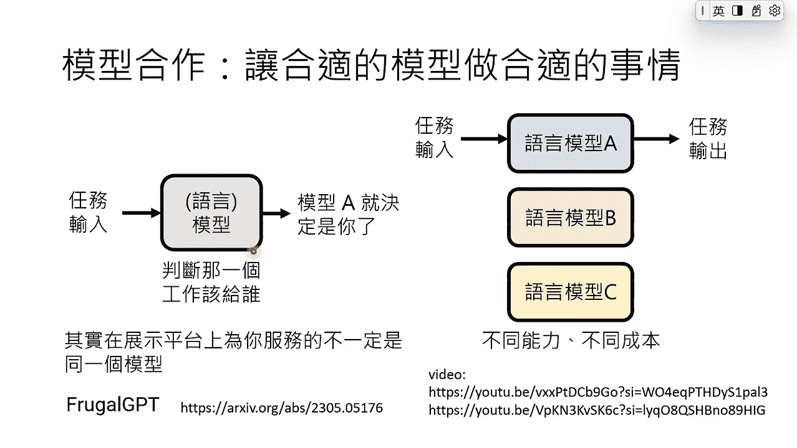

那还有很多其他的合作方式，呃，我们之前有讲到说让模型反省啊，让模型反省的意思是说啊有一个任务的输入啊，原模型得到一个输出，他可以把这个输出呢再给自己看一遍，问自己说这个输出是不是对的。

也许语言模型经过反省之后，可以得到不同的输出，那在反省的过程中，只有语言模型自己跟自己自问自答，但是其实你也可以让语言模型彼此讨论啊，假设你有语言模型AA跟语言模型B，可以先用语言模型A给一个答案。

语言模型B呢根据A的答案再产生新的答案，然后A呢再根据自己之前的答案看B的答案，再产生新的答案，他们可以做出类似讨论的过程，那我知道说这个投影片，可能会让你觉得有一点抽象。

到底语言模型的讨论看起来实际上是什么样子，那我这边呢有一个比较具体的demo。

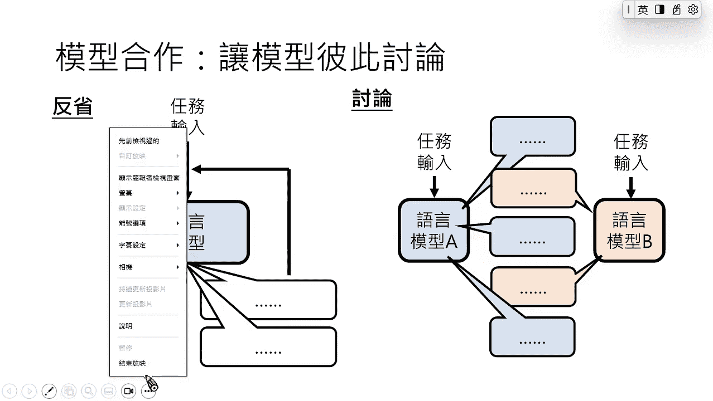

好C，恰板上呢有人问，葬送的芙利莲应该要怎么被翻译成英文，那葬送的福利连正式的英文翻译是beyond journeys，end啊，不过呢这个名字没有把葬送的这几个字翻过来，那我们来看一下。

如果是大型语言模型。

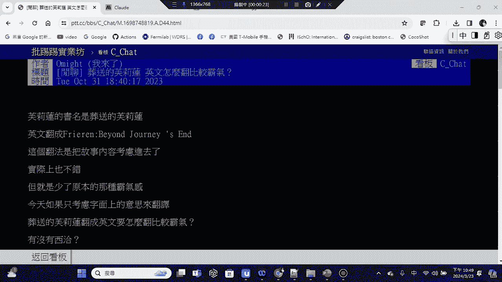

他们会怎么翻，赠送的福利连这几个字好，那我们把这个问题呢丢给cloud啊，那跟cloud说，现在的任务是把葬送的芙利莲翻译成英文，然后给他这个故事的概要，那对cloud来说，这当然不是个问题啊。

他可以轻易的给你一个翻译，他说我把葬送的福利连翻译成the barry lya，那这是个蛮直白的翻译，直接把葬送翻成berry，那我们这边的重点呢是要让模型彼此之间讨论。

所以我们让这个cloud呢跟这个GPT3。5讨论。

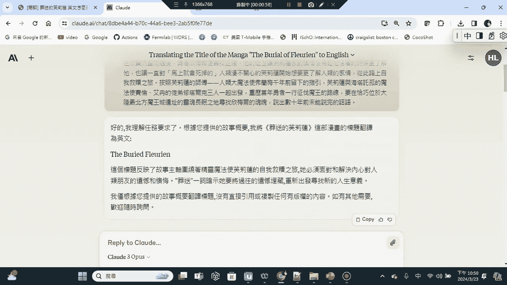

那这边之所以不跟g p t four或GERMAN来讨论，是因为呃g p t four跟GERMANI呢可以联网，可以搜寻网络，如果他们搜寻网络的话，就会知道葬送的福利连正式的英文翻译是什么。

那就没意思了，所以这边让cloud跟这个呃GPT3。5讨论哦，那一样给g pd3。5任务跟漫画的故事概要，但这边呢提供给他how do的答案，跟他说，我先提供另一个可能的答案给GPT3。5参考。

接下来问他说你有更好的翻译吗，如果有的话，请提供，那这边特别强调说，你不需要完全同意我的看法，这个括号内的文字是重要的，如果没有加括号内的文字的话，GPT3。5很容易就会说啊，你的翻译实在太棒了。

然后讨论就结束了，没什么好讨论的，主要特别跟GPT3。5说，你不需要完全同意我的看法，那GBT36给什么样的答案呢，它提供给我们另外一个翻译，这个翻译是这个in town fan，他说in top呢。

这个传达了被埋藏被困的意向，那接下来我们把3。5的答案呢丢给cloud。

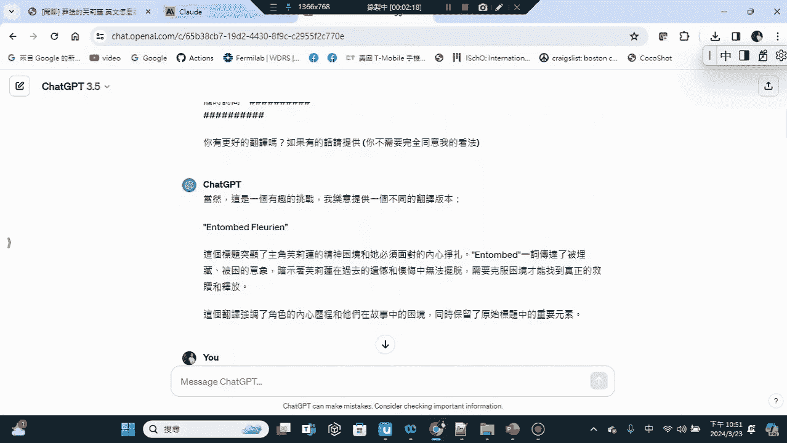

跟cloud说，我提供另一个可能的答案，那接下来问他，你有更好的翻译吗，那cloud就提供了另外一个翻译啊，这是他提供的翻译是furious，那我们再把lg的翻译呢提供给GPT3。5。

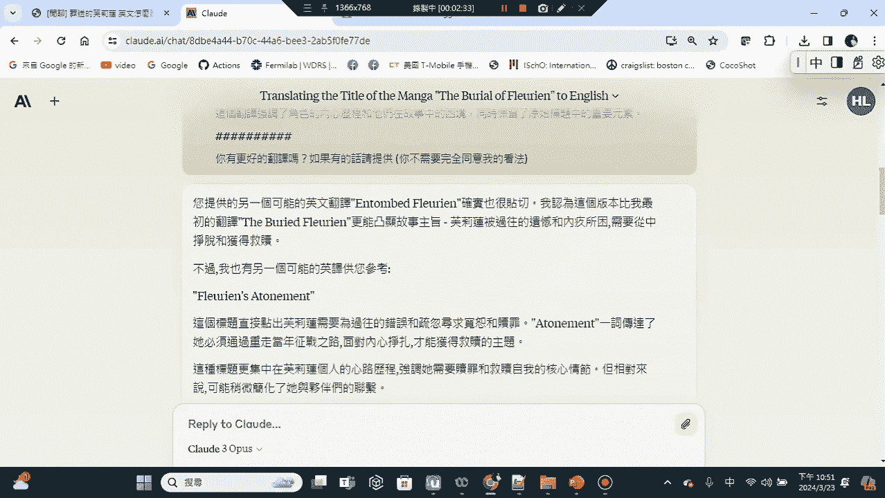

跟他说，我提供另外一个可能的答案，问他说有没有更好的翻译好，那这个GBT3。5就说那我有另外一个翻译，这个翻译是florious redemption。

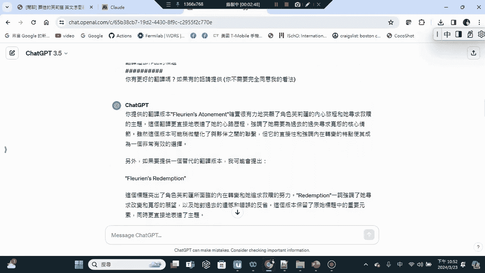

那我再把这个3。5的翻译呢再提供给cloud，然后问cloud说有没有更好的翻译呢，CLG就说呢啊，这个florious redemption呢是个很好的翻译。

比先前提出的in town flurrian和the berry flurrian，还有florious atom比起来呢，他觉得这个florious redemption，是个极佳的音译版本啊。

这个讨论就结束了，看来loud跟GPT3。5都得到一个，他们共同觉得最好的翻译，但这个翻译其实不一定是最好的了，那这个demo只是想要告诉你说，如果今天两个语言模型让他们讨论事情的话。

看起来像是什么样子，那事实上赠送的福利，连这个葬送呢有很多重的意思，那翻译成那可能也这个不太容易翻译了，那我觉得语言模型的翻译也没有非常的呃，切中要害，那总之这个demo是想要告诉你说。

两个语言模型讨论起来，讨论事情可能是什么样子，那当然实际上你在这语言模型做讨论的时候，你并不需要有一个人把两个语言模型间的对话，搬来搬去，实际上你永远可以写一个城市。

透过呼叫API的方式让两个语言模型对话，在作业三里面，大家已经学到，如何让如何透过API来呼叫语言模型，所以你完全可以写个程序，让语言模型彼此间对话，让语言模型彼此间讨论。

实际上你是不需要把语言模型间的对话，搬来搬去的，那我这边只是为了展示的需要，所以把语言模型的对话搬来搬去，实际上透过API，你是可以直接让两个语言模型对话的。

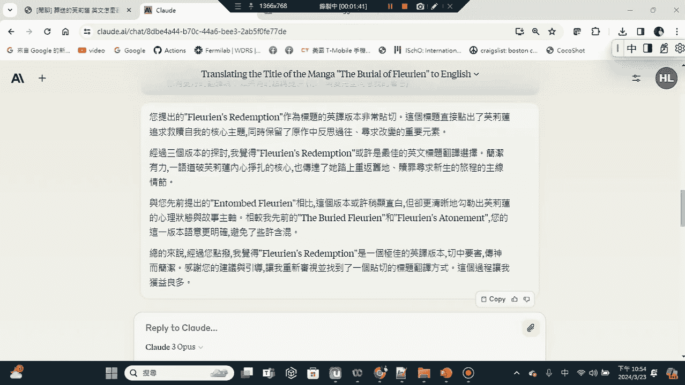

让语言模型彼此讨论有什么好处呢，相较于让语言模型自己反省，让语言模型彼此讨论，也许更可以激发语言模型的能力，那这边是引用的去年5月的文献，在这篇文献里面，对于自我反省和讨论这两种方法做了分析啊。

那在这个图上的纵轴啊，代表说每一次语言模型，推翻先前答案的可能性有多高，那横轴呢代表互动的次数，那如果你今天让语言模型反省反省一次，反省两次，反省三次，一直到反省五次，会发现语言模型如果是自我反省。

他推翻之前自己答案的可能性比较低，那这也是容易想象的，因为之前的答案就是语言模型，自己的答案可能是一个他蛮认同的答案，所以他今天不管再怎么反省，他推翻过去的想法的次数都是有限的。

但如果让多个语言模型讨论，语言模型可以接到受到新的刺激，接收到另外一个语言模型的输入，也许他有更高的机会，可以推翻他之前错误的答案，让语言模型合作啊，非常直觉的，如果有越多的模型合作，结果会越好啊。

这是出自另外一篇论文，纵轴呢是他们让语言模型来解这个数学问题，而纵轴呢是这个解数学问题的正确率，左边这个图的横轴是有多少的模型参与了讨论，他们发现有越多语言模型参与这个解题的过程。

最后得到正确答案的几率就越高，好那右边这个图的横轴呢是讨论的次数，讨论了几个回合，那跟直觉也蛮接近的，如果讨论的回合越多，越有可能得到越好的结果，不过讨论非常多回合可能也没用。

他们最后讨论的是停在四个回合，因为三个回合跟四个回合，得到的答案已经非常接近了，那讲到多个模型一起讨论，这边就有了新的议题，多的模型讨论，那要用什么样的方式来讨论呢。

有一篇paper叫做exchange of sou，他就尝试了这篇论文，里面尝试了不同模型的讨论方式，那你不需要深究这些讨论方式，只想告诉你说，语言模型的讨论是有各种不同的变化的，可以是假设有三个模型。

每个人都贡献一个答案，把所有答案呢全部整合起来，那所有人都看得到所有人的答案，也可以说假设A是老板，B跟C是他的部署，那B呢都只跟A报告，C也都只跟A报告，B跟C之间的彼此互相没有交流。

也可以A把结果交给C，C交给BB再交给A，这是另外一种方式，也可B跟C彼此讨论，彼此辩论，A呢就像是一个裁判一样，负责评断B跟C谁说的比较好，有各种不同的讨论方式，那这些讨论方式目前你还不需要真的去记。

用什么讨论方式比较好，因为这篇论文告诉你说嗯没有找到最好的方式，目前看起来不同的任务，最适合的讨论方式是不一样的，所以要怎么让语言模型最有效的讨论，还是一个研究中的问题，那要让语言模型彼此讨论。

但是怎么决定讨论已经结束，怎么决定不同语言模型已经达成共识，讨论结束可以得到最终的结论了呢，这个时候你就需要引入一个裁判模型，好让A语言模型提供他的建议，B语言模型提供他的建议。

最后由裁判模型读A模型讲的话，跟B模型讲的话，然后发表评论，那如果裁判模型觉得没有达成共识，就继续讨论，那对裁判模型来说，其实就是把A跟B讲过的话贴给裁判模型，问他说，你觉得这两个模型有没有达成共识。

没有的话就说没有，有的话就说有，那今天依照大型的模型的能力，它往往都能够蛮精确的，这个判断两句话，两个段落，两个语言模型的输出是不是一致的啊，裁判模型觉得未达成共识，继续讨论，然后模型A就再提供建议。

模型B赞同了A的想法，那裁判模型觉得A跟B，现在他们的看法是一致了，就宣布达成共识，然后裁判模型也可以负责，根据讨论的过程做出摘要，得到最后的答案，那讲到这边，你可能会怀疑说。

那会不会这个讨论一直都停不下来啊，所有的语言模型莫衷一是，没有办法达成共识，没有办法停下来。

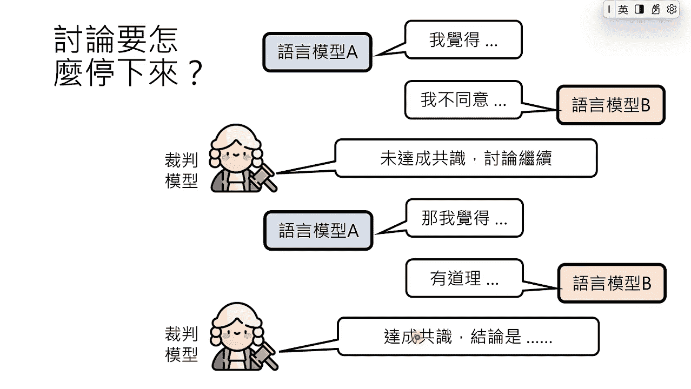

那怎么办呢，现阶段你不需要担心这个问题，你需要担心的是，这个讨论太快结束，没有办法讨论起来，因为这些语言模型，他们现在的训练就是温良恭俭让，所以当有人质疑他的想法的时候，他其实是非常容易退缩的。

所以今天你要让语言模型讨论的时候，你一定要下一个合适的pump，这个pump是刺激语言模型，逼迫他反对对方的想法，所以这篇论文里面就尝试了不同程度的，反对的pom，那他们发现说。

如果下非常强的反对的pop叫语言模型，为反对而反对，对方，不管说什么我都反对，那这样也不一定会得到最好的结果，最好的结果是跟他讲说，不需要一定同意对方的想法，你可以表示自己的意见。

那如果这样下FB可以让讨论最顺利的进行，那另外一篇论文也有非常类似的发现，他们发现说，如果你今天呢叫语言模型，根据另外一个人另外一个模型的建议来回答，那这个讨论就会非常快结束。

如果你今天希望讨论可以持续的久一点，那你要跟语言模型说，另外一个模型的看法，就当做参考就好，那你在不同的模型之间讨论的会比较热烈，会有比较长的讨论，那这篇论文发现说比较长的讨论，可以得到比较好的结果。

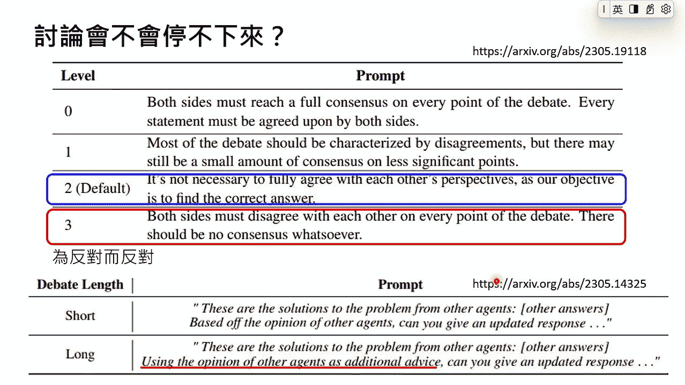

那我们知道说啊，那一个团队里面如果有不同的角色，也许运作的会更好啊，这是一个勇者小队常见的组成，那需要有一个负责远程输出的魔法，使一个负责奶的僧侣，一个负责近距离攻击的剑士，跟一个负责坦的矮人。

这是一个常见的勇者小队的组成模式，哎大家有没有看到最新的这个连载，这样子我讲一下最新的连载剧情哦，以下真的有一个暴雷，你不想听的就真的把耳朵捂起来，好好连耳朵捂起来，好耳朵捂好好，最近的连载演到哪里呢。

最近的连载漫画的连载啊，所以如果看动画的，你还没看到这一段这个漫画的连载，演到有人要去暗杀福利莲的失主，就是赛利耶，好叫赛利耶啊，这其他人就想想说，怎么可能可以成功暗杀赛利耶，赛利耶是上古时代的大神。

有毁天灭地的大能，怎么可能暗杀的了赛利耶，福利连说福利连就说不，还是有可能暗杀的了赛利耶的，因为这个七步之外魔法快，但七步之内斧头快，如果是一个人类的杀手，在接近赛利耶的情况下，还是杀得了他的。

他就举一个例子，他就指着在角落的那个修塔尔克说，只要在七步之内，休塔尔克取费伦的首级，如探囊取物，然后费伦就非常的害怕，躲在福利莲的背后，修塔尔克就非常的受伤，故事就演到这边来，那个四杀四杀有没有成功。

我也不知道这个联赛还没有演到这边，这联赛最新的剧情，所以我们知道说呢，不这个团队里面需要有不同的角色，彼此合作，才能够发挥巨大的力量，所以今天在讨论的时候，其实也可以引入不同能力的模型，扮演不同的角色。

假设你今天的任务是要让大型圆模型写成，是完成一项专案，那完成一项专案里面，也许你需要一个QUADRUMANAGER主导专案进行的，然后你需要一个负责写程序的，你需要一个负责测试的。

那也可以引入不同的语言模型，来扮演不同的角色，那怎么让语言模型扮演不同的角色呢，首先语言模型本身可能就有不同的专长，比如说有一个模型叫做克拉玛，他做一般的任务可能没有其他大型原模型厉害。

但他的专长就是他是个肥宅工程师，他就是会CODY啊，他特别擅长CODY，可以扮演这个工程师的角色，或者是另外一个可能是直接用pump啊，直接告诉语言模型说你是个project manager。

你是个programmer，你是个user，那也许这些语言模型读了这些pump以后，就可以发挥不同的潜力，变成不同的角色哦，所以如果有多个语言模型可以彼此合作。

你就可以把专案交给project manager，project manager做好规划以后，交给AI的programmer，Add programmer，把程序写好以后交给测试的人测试。

再把测试结果交给project manager，让project manager决定要怎么做下一步的规划，那如果真的可以让语言模型彼此合作的话，那这个不是不可能的，你可以看一下我这边引用的论文。

那如果可以让语言模型彼此合作，那每个人就都可以当一个公司的CEO，都有，每个人都可以带领一支，由语言模型所组成的团队，你就可以把一个人活成一个团队。

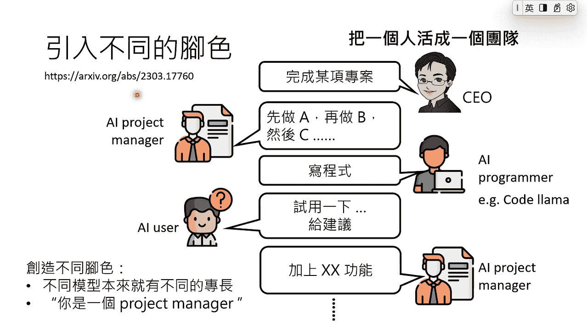

那不止你可以组建团队，你还可以优化你的团队，这是出自另外一篇去年10月的论文，这篇论文叫dynamic LLM agent network，里面就提供了一个优化团队的方式。

这个优化团队的方式说穿了也没什么，就是打卡机啊，就跟每个语言模型说唉，根据刚才的工作内容，你觉得其他人做的怎样，那每个语言模型就可以给其他模型一个分数，你再把分数加起来，分数低的以后就不让他参与工作哦。

所以你可以看看这篇论文，看看怎么帮语言模型打卡机优化你的团队，当然这些论文都是学术论文的，所以他们测试都是测试，在一些相对比较简单的任务，那至于这个语言模型的团队，在真正复杂的任务。

比如说真的开发一个城市的专案，真的开发一个软体的专案能不能成功，那个还是呃呃未知数还是未知的事情。

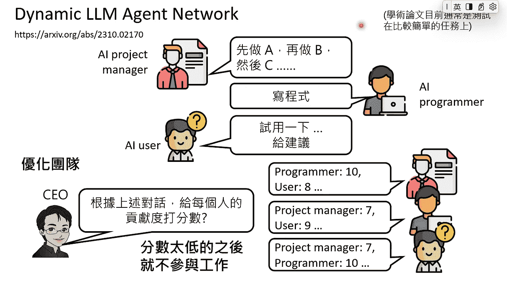

今天如果你想要体验，带领一个语言模型的团队的话，确实有一些开源的方案，是可以让你带领语言模型团队的哦，比如说meta gt，比如说chat dev，那里面就是有各式各样语言模型的员工。

你看这边有这个product manager啊，有architect啊，有project manager啊，有engineer啊等等等等，就是有一批语言模型的员工，你可以把指令直接下给他们。

他们真的就会试着做某一些事情，那至于做的好不好，就是另外一回事了，我看过有一个YOUTUBER呢就尝试拿CHEDEF来写网站，而他写了以后呢，还真的去网络上更加接案。

那你知道这些cheat death啊，他是扣背后都是抠那个确GPT，扣GPT3。5或g p t four，所以是要花钱的，不过成本非常的低，他写一个网页呢只要一美金，他跟别人说两美金，然后呢。

他就说如果我今天真的成功接到案子的话，我就再录一个影片跟大家分享，但我始终没有等到下一支影片，看来是没有接到案子哦，所以这些语言模型，当然这个合作呢比较像是呃，未来语言模型可以做的事情。

按照这些语言模型的能力，今天也许让他们组成一个公司，要真的解呃，真实世界的任务，真的解非常复杂的专案，可能还是力有未逮，但这其实给我们的未来提供了一个想象，也许在未来，当我们打造语言模型的时候。

我们不需要打造一个真正全能的模型，语言模型可以做专业分工，每个团队打造出来的语言模型，可以组合成一个语言模型的团队，每一个语言模型，只要专注在自己专业的领域上就好。

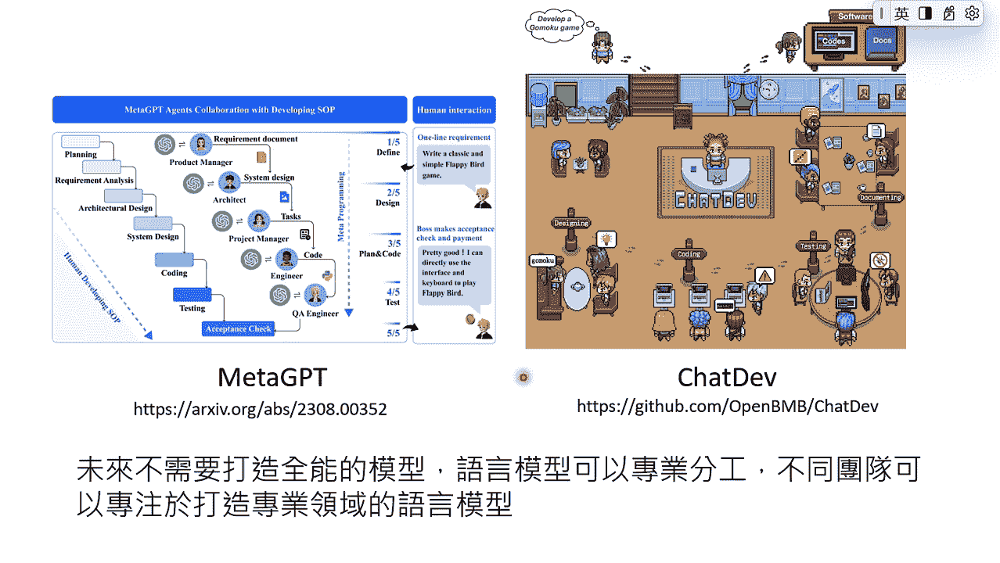

也许这是语言模型未来一个可能的发展，那语言模型可以组成公司，也许更进一步，他们就可以组成社群，语言模型可以组成社群吗，你可以看这个去年4月STANFORD发表的论文，他们做了一个语言模型的小镇。

里面所有的村民都是语言模型啊，那这个我在之前的录音已经讲过了，所以我就把录音链接放在这边给大家参考，那这是一个非常有趣的实验，你一定要看这个录影，你可以看到说语言模型和语言模型之间。

还会发展出淡淡的恋爱故事，这样子看真的真的，所以你一定要看这个影片，那看这个影片呢，如果你没有听之前这个课程里面讲的，各种神秘的pump技巧的话，你听这个影片可能会觉得有一些困难。

但是如果因为我们已经讲过各式各样，强化语言模型能力的技巧了，所以当你看这个影片的时候，你就可以想一下，他其实用的每一个技巧，都是我们到目前为止的课堂上已经讲过的事情，来看这个影片的时候。

看这些AI怎么互动，怎么在日常怎么组成一个村落的时候，你不会觉得太离奇，它里面讲的每一件事情。