# 李宏毅2024春《生成式人工智能导论》 - P12：第6讲：大型语言模型修炼史 — 第一阶段- 自我学习，累积实力 - 啥都会一点的研究生 - BV1BJ4m1e7g8

好那到目前为止的课程呢，我们都还没有训练过任何模型，我们都还没有讨论过模型的训练，我们之前讲的所有东西，都是基于一个已经训练好的大型模型，想要更强化他已有的能力，那从这堂课开始。

我们要讲大型语言模型的修炼史，我们来回顾一下这些语言模型是怎么修炼的，怎么练到像今天一样无所不能，那语言模型的修炼呢分成三个阶段，那在接下来的课程里面，我们就会一步一步的跟大家剖析，在这三个阶段。

语言模型都经过了什么样艰苦的修炼，但是在讲语言模型修炼的故事之前，还是要交代一些背景知识，那为了让你等一下听这个故事，可以真的知道这个故事背后所要表达的是什么，所以我们要讲一下大型语言模型的背景知识。

那有一些我们已经告诉过大家了，比如说我们再三的强调，大起源模型做的事情其实就是文字接龙，当它产生一个答案的时候，大型模型实际上做的事情就是做文字接龙，这件事，把答案里面的文字一个一个的产生出来。

我在做文字接龙的时候啊，每一次语言模型会产生出一个符号，这个符号就叫做token，那在这门课里面，我们会把一个中文的字当这个token，我们把中文的字当做每次大起源模型，做接龙的时候产生出来的符号。

但是实际上呃每一个语言模型它里面的token，它所产生的token是不一样的啊，对于像呃CHEGBT来说，其实它是两三个token才能够组成一个中文字，但是为了简化说明，在以下的课程里面。

我们都假设一个中文字就是一个token哦。

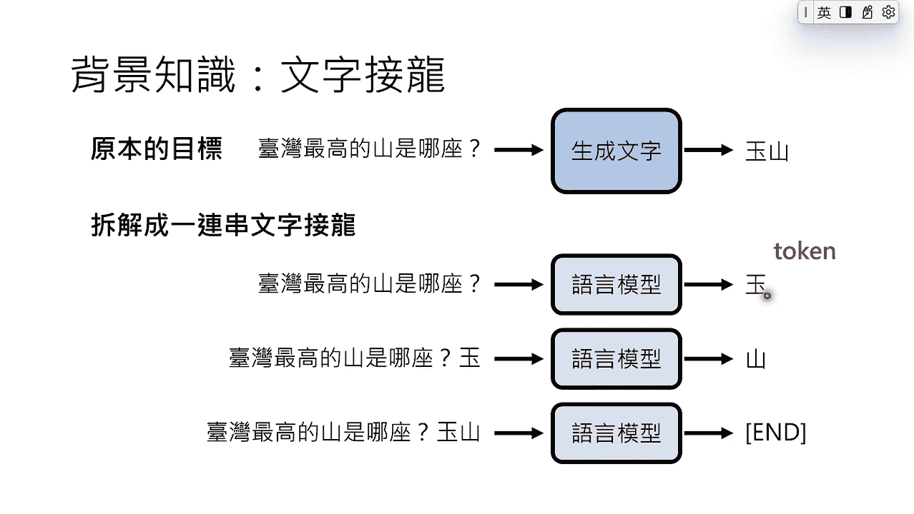

那机器怎么学会做文字接龙呢，机器学习，深度学习，在开学第一堂课就已经跟大家简要的介绍过了，那机器学习的概念怎么拿来做文字接龙呢，我们要怎么用机器学习来学出一个语言模型呢，我们知道一个语言模型。

就是输入一个未完成的句子，输出就是这个未完成的句子，接下来可以接的token，而一个圆模型其实就是一个韩式，这边写作F它的输入是未完成的句子，输出是这个句子后面可以接的token，那这个函式呢。

可以写成一个有数10亿个未知参数的函数，因为要做文字接龙是一件非常困难的事情，显然这个函式非常的复杂，它可能需要有数10亿个参数，才能完成文字接龙这个任务，那这个有大量未知参数的函数就叫做模型。

那这些大量的未知参数要怎么被找出来呢，我们需要训练资料，训练资料里面告诉我们的，就是当输入一个未完成的句子的时候，输出应该是哪一个token才是对的，比如说人工智后面该接会，不要忘了今天来开。

后面应该接会，床前明月，后面应该接光等等，我们收集了大量这种训练资料，机器学习就可以自动的帮我们，把数10亿个参数找出来，找数10亿个参数的这个过程呢，就叫做训练training或叫做学习。

把这数10亿个参数找出来以后，就可以带入这个函数里面，现在这些函式的这个，现在这个函数里面的未知参数，我们都知道数值是多少了，接下来我们就可以使用这个函式来做文字接龙，参数找出来以后。

使用韩式来做文字接龙这件事情叫做测试，Testing，或又叫做推论influence哦，所以在机器学习里面有两个步骤，找参数的部分叫做训练，叫做学习，那找完参数以后拿这组参数来使用。

叫做测试或者是叫做推论哦。

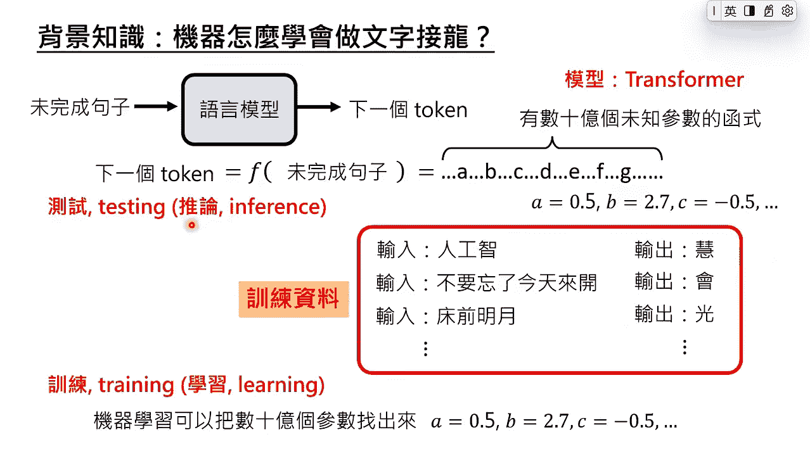

那等一下讲的语言模型，学习的三个阶段都是在学文字接龙，只是训练的资料不一样而已，很多很多人可能都在某些地方，听过语言模型学习的过程了，你可能会以为说语言模型学习的不同的阶段，学的是不同的事情。

其实不是所有的阶段都在学文字接龙，只是训练的资料不一样而已，好那在正式进入语言模型怎么训练之前，我们要来讲一下找参数的时候，会遇到什么样的挑战，那我们刚才讲说，机器学习就是找到一堆训练资料。

然后机器学习的过程，机器学习就可以帮我们根据训练资料，找出符合这个训练资料的参数，那这个找参数的过程又叫做最佳化哦，它的英文是optimization，那实际上最佳化是怎么进行的。

那我们在这门课就不会详谈，但是你可以把最佳化呢想成是一部机器，那这部机器使用前呢需要设定一些参数，那设定这个机器的参数呢叫做超参数，它的英文是HYPERPARAMETER，那你设定这些超参数以后。

你就决定了最佳化的方法，把最佳化的方法固定下来之后，你把这些训练资料丢到这个机器里面，这个机器经过一番运作以后，我就产生参数，就产生你要的结果，那呃但是呢，这个训练的过程不是每一次都会成功。

训练是有随机性的，有时候训练可能会失败，也就是你按下了这个机器的启动钮之后，把训练资料丢进去，经过一番运算得出来的参数结果不是你要的，所谓不是你要的，意思是说这些参数没有符合训练资料的内容。

你丢人工资进去啊，他出来的不是会他没有符合训练资料的内容哦，那如果遇到这种状况，如果遇到这个训练失败，得到的这个参数没有符合训练资料的时候，怎么办呢，通常常见的做法就是换一组超参数再上一次。

这样当然这些超参数对于训练结果的影响，还是有一些理路可循，但是中间的过程非常的复杂，你很难搞清楚，说为什么这组超参数就会给你这个结果，所以通常你的结果如果跟你预期的不一样，那怎么办。

换一组超参数再试一次，所以这就是为什么大家常常说这个训练模型呢，就需要算力啊，这个算力就是用在最佳化的过程，尤其是用在假设你的训练是有可能失败的，你需要换多组超参数，不断的尝试。

最后才可以找到一个你要的结果，那你就需要这个时候你就需要大量的算力，那可能常常听到有人说，做这个机器学习或做深度学习就是调参数，这个调参数指的并不是这里我们要找的参数，这边调参数指的是调超参数啊。

这边找出根据训练资料找出来的参数，是自动找到的，这些参数可能有上亿个，所以你也不可能用人的力量找出来，但是超参数还是需要人设定的，简单一做这个最佳化的过程的时候，你要去先调整这个超参数。

调整成你要的样子，再把这个最佳化的过程跑下去啊，期待你可以，然后就开始祈祷，说你最后跑出来的结果是你要的，那这个超参数往往你很难射一次就得到，你要的结果是需要调的，所以你才会常常听到有人说做深度学习。

做机器学习就是调参数，它的调参数指的是调超参数，让我们等于之后的作业，作业五，作业六都是要训练模型的，但超参数的部分呢，你就不需要特别担心，因为助教当然都是已经帮你调好了。

这个最佳化的这个机器都是帮你设定好了，你只要按下enter应该就会跑出不错的结果啊，但是假设助教没有给你超参数，要你自己找，你就会知道说，这个训练的过程真的是非常的痛苦，就1TOMO系列。

这样你就知道说，这个这个训练的过程真的是非常的痛苦好。

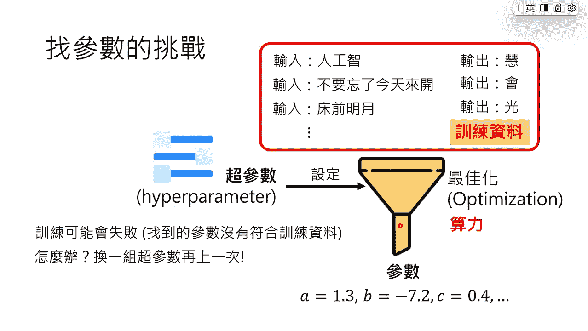

但是这不是找参数唯一的挑战，你还可能遇到另外一个状况，这个状况是训练成功，但是测试失败。

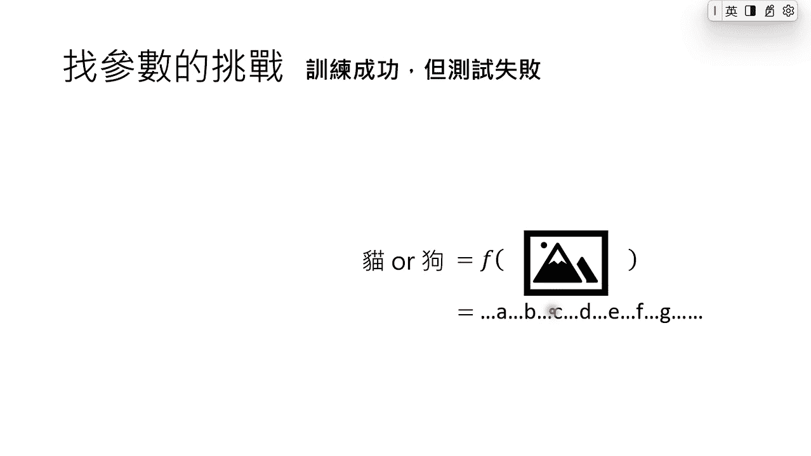

什么叫做训练成功，测试失败呢，假设我们现在呢是要做一个猫狗的分类器。

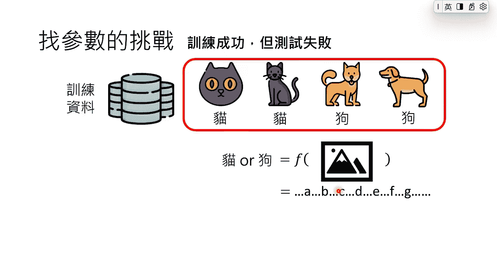

你就是要找一个函式，输入一张图片。

输出就是猫跟狗，这个函式里面有很多未知的参数，你收集了一些训练资料，这些训练资料告诉我们，这两只动物叫做猫，这两只动物叫做狗，接下来你设定一种超参数，开启最佳化的演算法，找出一种参数。

你实际测试了一下发现，那然后你再，然后你发现这组参数有符合训练资料，代表训练成功，也就使用这组参数呃，把这只把这个动物丢到韩式里面输出就是猫，把这个动物丢到函数里面，输出也是猫。

把这两个动物丢到韩里面输出就是狗，你找到一组参数，它是符合训练资料的，代表训练成功，但是你不要高兴的太早，训练成功的参数有可能代入韩式以后，给一张训练的时候没看过的图片，结果是错的，那在这个例子里面。

为什么结果有可能是错的呢，为什么看到这个在打电脑的黄色的猫，今天这个韩式的输出有可能会是狗呢，你检查一下训练资料，你会发现说在训练资料里面，这两只猫都是黑的，这两只狗都是黄的，对于这个最佳化的过程来说。

它可能会找到一组参数，这一组参数是认定只要黑色的东西就叫做猫，只要是黄色的东西就叫做狗，那这种训练成功，但测试失败的状况就叫做OVERFITTING。

还常常听到有人说我在训练过后遇到OVERFITTING，指的就是训练成功了，但是测试失败了，讲到这边，有人可能会想说，怎么会怎么会发生这种事情呢，难道机器没有办法判断说啊，颜色不重要。

重要的是它的外形吗，机器没办法判断这件事，不要用你自己人类的想法，来揣度机器学习的过程，今天最佳画的过程只认一件事，今天机器学习的时候只问一件事情，就是学出来的参数，有没有符合训练资料所给予的限制。

他完全不管找出来的参数是不是有道理的，找出来的参数是不是能够用在其他资料上的，所以大家要注意一下，不要用你自己的人类的想法来揣摩训练的过程，因为机器只认训练资料，他完全不会思考其他的事情啊。

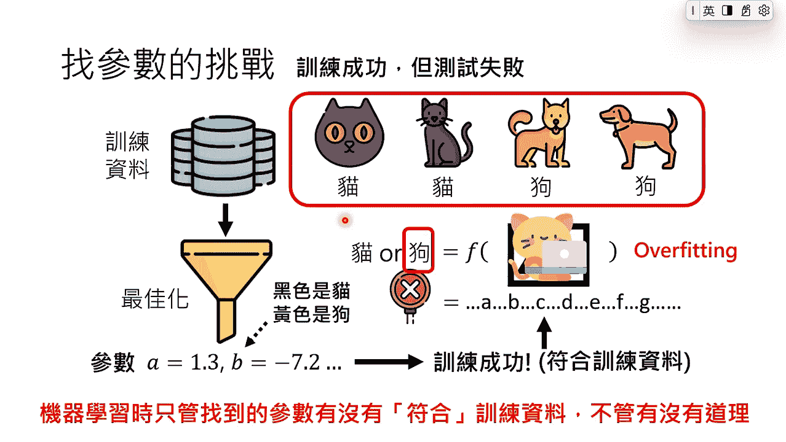

如果你想要听一个荒谬的训练，成功测试失败的故事的话，我留一个YOUTUBE的链接给你，在这个故事，在这个链接里面，我会讲一个机器成功分辨，宝可梦和数码宝贝的故事啊，一定要看。

你就可以知道说机器的想法是有多么的荒谬好，那怎么让机器找到比较合理的参数呢，那这个其实就是机器学习的核心问题，有很多不同的想法，而一个可能的想法是增加训练资料的多样性，刚才只根据这四个例子。

机器会觉得黑色的都是猫，黄色的都是狗，那怎么办，增加你的训练资料，加一只黄色的猫，加一只黑色的狗，强迫机器，让他知道说，如果你找出来的参数是黑色的，就是猫，黄色的，就是狗，那你没有办法符合训练资料。

要符合训练资料，你得想点别的办法，不能只平整颜色来分辨猫跟狗这两种动物，所以增加训练资料的多样性，可能是一个帮助训练的过程，找最终找到合理参数的方法。

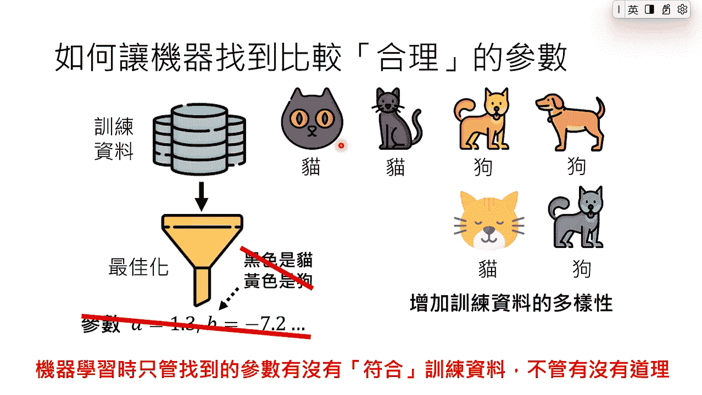

但这只是其中的做法，还有其他的做法呃，在最佳化的过程中，除了设定超参数以外，其实还有另外一个你需要设定的东西，这个东西叫做初始参数，你在使用这个最佳化的这个机器的时候，你一定要设置初始参数。

那你设设置完初始参数以后，最终找出来的参数，就比较有可能跟初始参数比较接近，因为这个最佳化的演算法呢会从初始参数开始，找群符合训练资料的参数，所以当你设置完初始参数以后。

你最终找出来的参数会跟初始参数比较接近，但怎么知道什么样的初始参数才是我们要的呢，怎么设定这个初始参数呢，通常你不知道怎么设定初始参数，所以常见的可能性是你只好随机产生初始参数。

初始参数里面每一个初始参数，每一个数值都是随机生成的，都是掷骰子生成的，这你在训练的时候，你的初始参数是纸骰子生成的，那这一种训练的方法，这种最佳化的方法叫做train france ratch。

但是有没有一种，可能就是我们找一组比较好的初始参数，所谓的比较好的意思，可能是，这种初始参数离我们所要的合理的参数，是比较接近的，如果我们从这组好的参数开始去做最佳化。

最终我们找出来的参数比较有可能是我们要的，那这种好的参数，你可以想成就是我们给模型的先验知识，你可以把这种好的参数，想成是机器学习的先验知识，在学习之前有一些知识，有一些能力是他与生就已经有的。

那期待透过设定这个先验知识，让我们最终学习的结果更接近我们想要的，但他真正面对的难题就是，那上哪找这个好的参数呢，上哪找这个鲜艳姿势呢，那我们的故事就从这里展开。

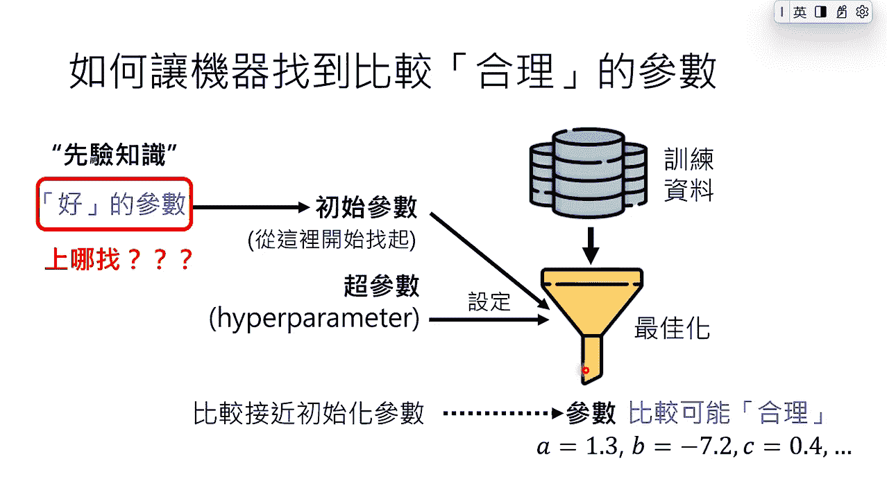

那我们就从语言模型训练的第一阶段开始讲起，我们都知道说，语言模型训练就是学习做文字接龙，但是需要多少文字，语言模型才能够学会做文字接龙呢，要正确的接触一个token，需要两个面向的知识。

第一个面向的知识是语言的知识，今天语言模型必须对人类语言的文法，有正确的了解啊，比如说给你一个未完成的句子，这个人突然就后面可以接哪一个词汇呢，也许可以直接跑啊，突然就跑起来，也许可以接飞啊。

这个魔法使，然后就飞起来了，但是你可能不会接的，因为这显然是一个不符合文法的奇怪句子，那需要多少文字，才能够让语言模型学会语言知识呢，根据过去的文献也许不用太多，不多多或少是相对的啦。

而要让机器学习语言知识，也许有一个词汇就够了，你收集的资料里面，也许有一个词汇就足以让语言模型，学会语言的知识，但是要正确做接龙，光是知道一个语言的文法，有语言知识是不够的，这个模型还需要世界知识。

还需要对这个世界有所理解，可能是对物理的世界有所理解，可能是对人类的社会有所理解，他才能够正确的做JO，举例来说，水的沸点是摄氏，后面接100度是符合文法的，接50度可能是符合文法的。

但你知道100度才是正确的接法，50度不是一个正确的解法，因为这不符合我们对这个物理世界的认识，那到底需要多少的文字量，才能够让语言模型学会世界知识呢，在这一篇比较古老的论文里面啊。

这个是2020年的论文，老师比较早的论文里面发现说，就算是你收集的资料量有300亿个文字，看起来还是不够让模型学会世界知识，为什么学习世界知识这么难呢，因为世界知识是有很多层次的，看这个例子里面。

也许设置后面接100度是合理的，但是这个只对小学生来说是合理的，水的沸点是会随气压而改变的，今天如果在低压下cs沸点设置100度，就不是一个正确的答案，反而摄氏50度是沸点，有可能是一个正确的答案。

所以世界知识是复杂，而且有很多层次的，需要真正非常大量的资料，才能让语言模型学会世界知识。

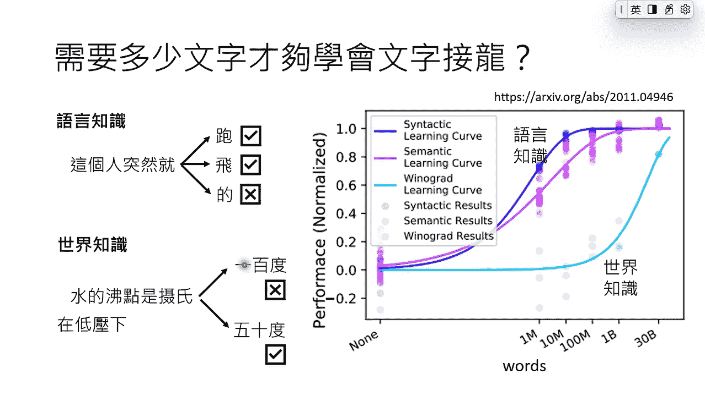

但是上哪里去找大量的资料呢，收集大量的资料并没有那么困难，其因为任何文字资料都可以拿来教语言模型，做文字接龙，哪里可以找到大量的文字资料呢，今天最常使用的来源就是网络，网络上可以说是有无穷无尽的网页。

里面有无穷无尽的文字，把这些文字拿出来，就可以教语言模型做文字接龙，那实际上的做法是这样哦，从网络上爬大量的文字资料，那从文字资料里面，你把一个一个的句子拿出来，然后把它整理成。

是可以让可以训练文字接龙的模式啊，比如说一个句子是人工智慧，真神奇，那整理成训练资料以后，就是人后面接工，人工后面可以接智，人工智后面可以接会人工智慧，后面可以接针，所以你从网络上可以找到大量的句子。

大量的句子可以产生大量的训练资料，有这些大量的训练资料，你就可以找出一组参数，这一组参数可以成功的做文字接龙，而在产生这个训练资料的过程中，人工的介入是非常少的，这种从网络上搜集到的训练资料。

你可以说真的是要多少就有多少，那这种只需要非常少人工介入，就可以取得训练资料的学习方式，它有一个名字叫做字都导式的学习，它的英文是self supervised learning，也就机器自己教自己。

不需要人工介入，只要不断的去网盘，就可以爬出大量的训练资料，语言模型就可以透过网盘的资料来学习，做文字接龙这件事情。

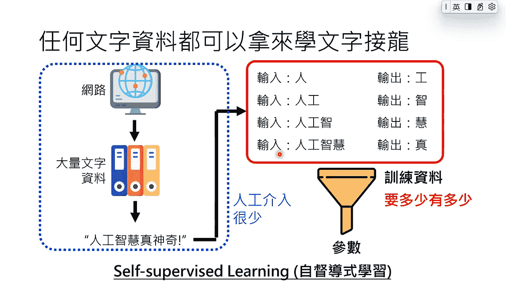

那刚才虽然说用网盘的资料呢，不太需要人工介入，但是稍微一点人工介入往往还是必须的，那这边呢是引用这个DeepMind的一篇论文，在这篇论文里面，他们讲解了他们训练他们的大型原模型。

叫做golf的这个过程，那他们说他们也做了一些资料的清理，上网盘的资料呃，随便爬俯拾皆是，但是爬下来的资料，还是居然需要做过一些处理的，什么样的处理呢，比如说第一个是过滤到有害的内容。

比如说色情暴力的内容，那为了避免他讲出这些话，不如在一开始的时候就不要让他接触，有色情或暴力内容的网站，所以应该要过滤掉有害的内容，那再来这些爬下来的网页里面，可能有很多HT l的符号。

那这些符号对语言模型的训练是没有必要的，所以通常会把这些符号去掉，你只要保留一些你觉得在文字接龙的时候，语言模型接出来会有用的符号，比如说今天语言模型蛮能够产生表情符号的。

那就现在我在在最后这个网盘资料，在清理的时候并没有把表情符号清掉，所以他还是可以学会接触表情符号，那再来也需要对这个资料的品质做一些控制，尤其是去除一些低品质的资料，但是什么样的资料叫高品质的资料。

什么样的资料叫低品质的资料，这就是一个见仁见智的问题，那现在这个GPT3，The pile pp a l y，他们都是一些知名的语言模型，在他们的训练过程中呢，都有使用到一个资料品质分类器啊。

就开发这些模型的团队，他们另外训练了一个分类器，这个分类器呢会去决定说一笔资料，它是高品质的资料还是低品质的资料，如果是高品质的资料，在训练的时候就会让语言模型看比较多次。

让他对最后训练的结果就会有比较大的影响力，那这些论文里面通常是把这种呃维基百科，比较像维基百科，或比较像教科书里面的句子的资料，当做是高品质的资料，那再另外一件要做的事情呢是去除重复的资料。

那最后一步呢呃testing set filtering，这个是为了实验的严谨性，那这边就不解释，那为什么去除重复资料也是一个重要的步骤呢。

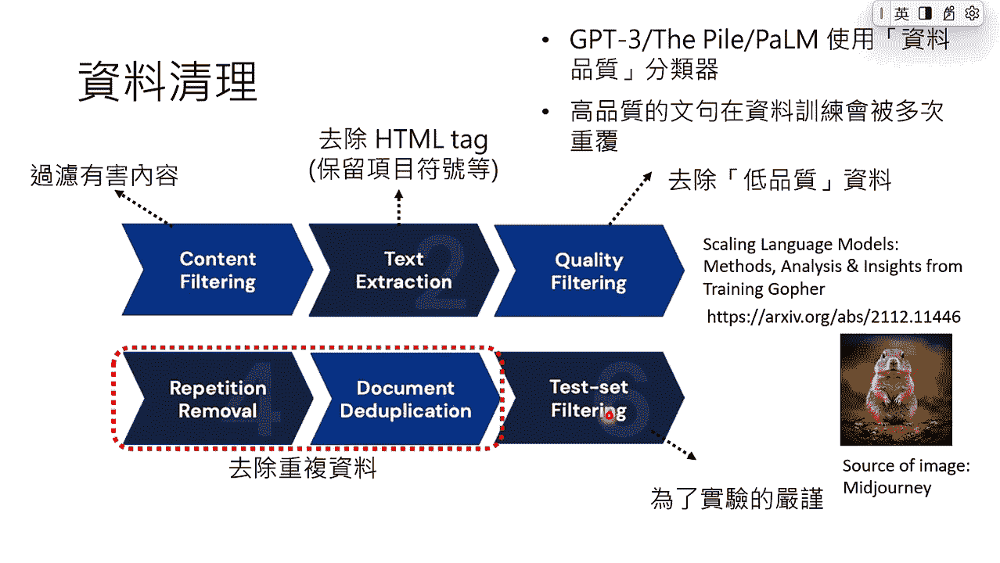

有一篇论文就告诉你说，往路上爬下来的资料真的是有很多重复的资料，这篇文章发现说以上这个很长的段落，居然在网盘的资料里面重复了6万多次，这个资料到底是什么呢，这个资料是一个婚礼公司的业配，他告诉你说。

你要把这些方案通通都用在你的婚礼上，旁边的人就会觉得你真是太棒了，这句话在网络上足足出现了6万次，所以如果你拿这样子的资料，来训练你的语言模型，它之后就会动不动帮这个婚礼公司叶配。

动不动就讲这个段落出来。

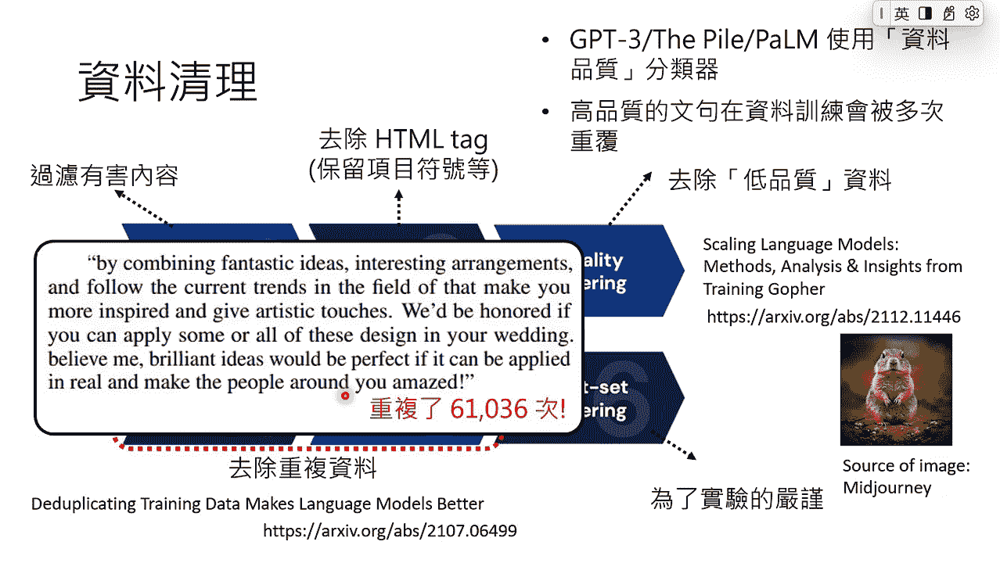

所以我们需要去除重复的资料，那所有的文字资料都能拿来学，让语言模型学做文字接龙吗，这就是一个见仁见智的问题了，呃最近有一个新闻，而是去年年底有一个新闻。

就是new york times告了OpenAI跟MICROSOFT，因为他们认为呃OpenAI拿了他们的新闻，而且可能是呃付费会员才读得到的新闻，来训练语言模型，至于谁是谁非，我不是法律的专家。

在这边就不做评论，只是想告诉你说，如果是任何资料都拿来训练，教机器做文字接龙，也有可能会让你惹上一些麻烦，不过今天其实多数的那个开发团队啊，在训练语言模型的时候，就是随便爬，随便爬，资料随便训练。

那就只要我看得到的资料，我爬得到的资料通通都是我可以拿来用的，我听到会很小心要求每笔资料都有授权的，而只有那个科技哥，只有博客会的那个台德计划有这样做为好。

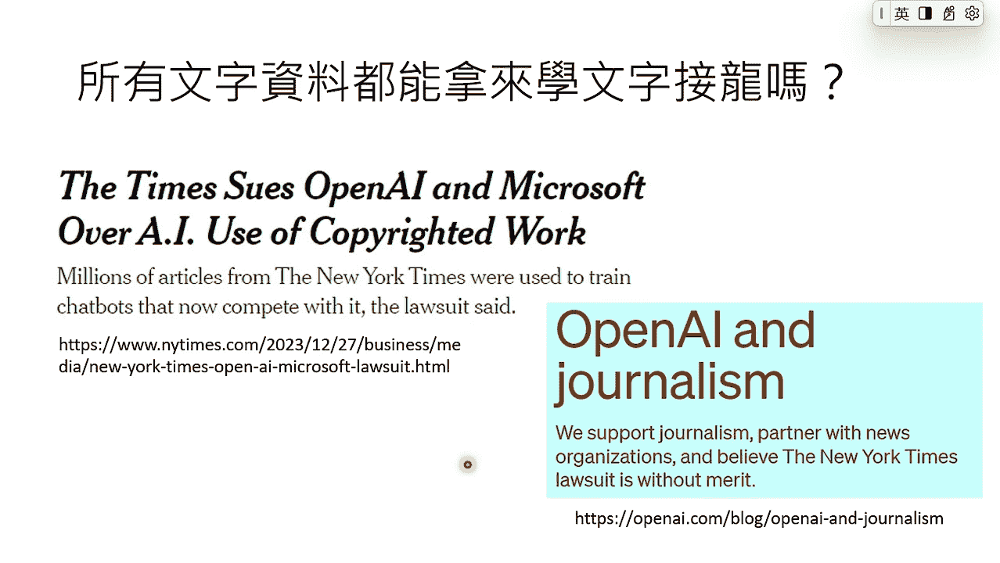

那这个确GPT呀，其实在确GBT之前，OpenAI就已经开发了一系列的gt模型，这些GPT模型就是用大量的网络上找到的，文字训练出来的，很多人以为OpenAI是这几年才开始开发，大型语言模型。

其实不是OpenAI，早在2018年的时候就试出了第一代的GBT，只是第一代的GPT模型非常的小，它只有117个million的参数，也就是这个呃1亿个参数，那1亿这个参数你可能觉得1亿这个数量很大。

但其实就模型而言，这不是一个特别大的模型，就放就算放在2018年，也不是一个特别大的模型，那他用的训练资料也不多，大概就是这个700本书左右的内容而已啊，那上面这个数字代表的是那个模型，里面的参数量。

那如果你没有办法想象参数量是什么意思的话，你就想成是模型的复杂程度，如果要做个比喻的话，这个参数量代表的就是人工智慧的天资，有这个参数量越大，就代表这个模型呢天生越聪明好，但是光是有天资是不够的。

还需要后天的努力，那下面这个数字代表的是资料量，也就是用了多少的资料来教人工智慧，做文字接龙，所以下面这个数字代表了后天的努力，所以要有天资，也要有努力，两者缺一不可，才能够训练出一个聪明的语言模型。

在2018年的时候，g p T1它不是个聪明的模型，也不是个努力的模型，他没有什么特别的攻击，所以就没有掀起任何的波澜，过了一年之后。

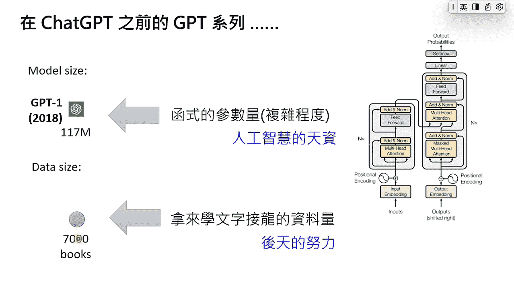

OpenAI试出了g p t two，g p t two是g b T1的十倍大，它有15亿个参数，15亿在当年看来是一个毁天灭地的巨大模型，但如同我在第一堂课就跟大家讲的。

今天g p t two只是一个小模型，你在做业务，要做的用的模型比g p t two还要大五倍左右，GBT2也用了很多的资料，用了40GB的资料来进行训练，那这个数字指的是它所使用的文字量的，档案大小。

g p t two有什么神奇的结果吗。

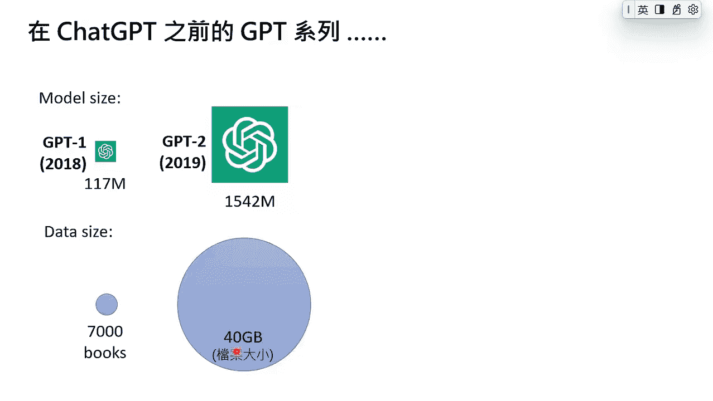

没什么神奇的结果，这是当年g p t two文章里面的一个数据，他说我们是OpenAI试了不同大小的模型，从GPTY一直到g p t two，纵轴呢是回答问题的正确率。

当然越大的模型回答问题的正确率就越高，这个正确率大概是55percent左右，但这个正确率就算放在2019年，也不是一个特别厉害的成果，这个绿色的虚线是其他模型的成果，有某一个模型可以得到。

远比g p t two还要更高的正确率，g p t two没有好的表现，怎么办呢。

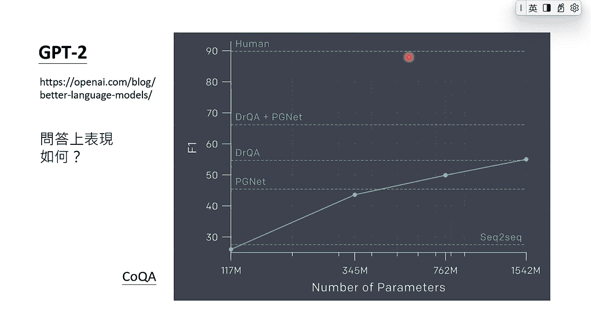

OpenAI并没有就此放弃，他们想说，也许是因为模型不够大，那我们就弄一个更大的模型，足足有g p t two的100倍。

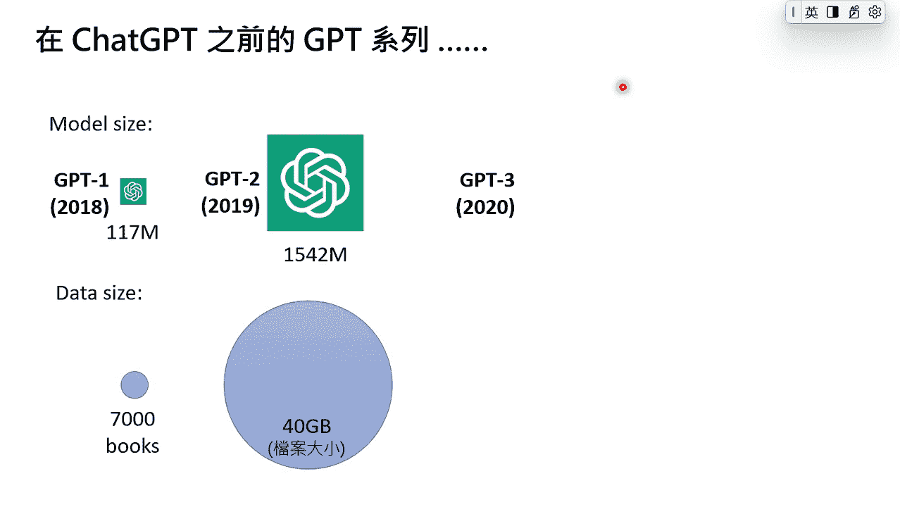

GPT32020年的时候发表的，他足足有g p t two的在100倍大，他的训练资料量也非常的惊人。

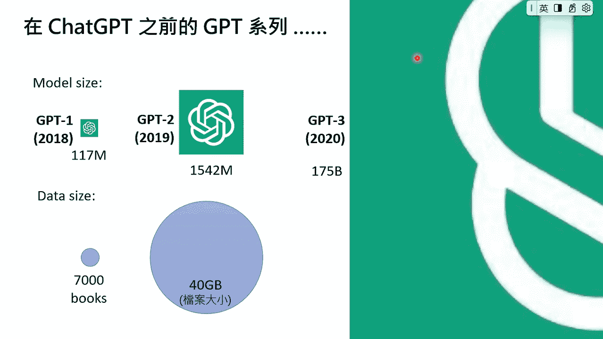

有580GB的文字量，如果你对580GB的档案大小没有什么概念，我告诉你，580GB的文字量，里面大概有3000亿个token那么多，如果你对3000亿个token也没有什么概念的话，我会告诉你。

这差不多相当于哈利波特全集阅读了30万遍，所以这个巨大的模型，它用哈利波特全集30万遍的资料量来学习，做文字接龙，它知识它的背后的知识储备应该是非常的惊人，但这个巨大的模型用了巨大的资料。

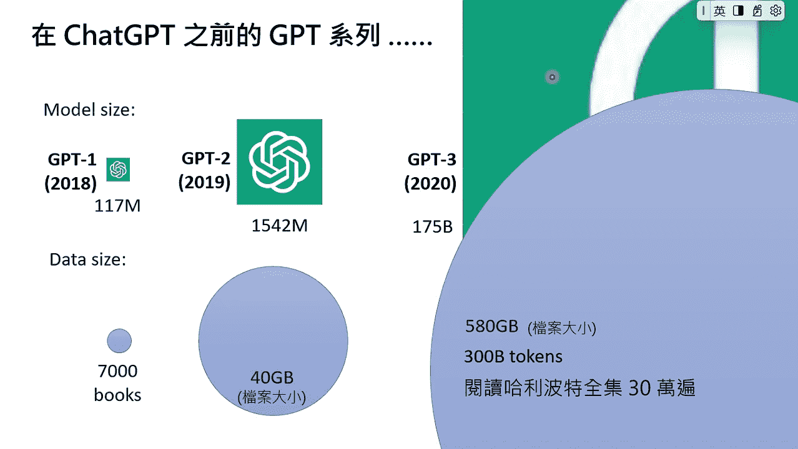

训练的结果怎么样呢，还是不怎么样，这个是GPP3的论文，这个横轴呢是模型的大小，从最小的模型一直到最大的GPP3，随着模型越大，做这正确率呢，回答问题的正确率呢当然是越来越高。

但是最高也不过高到50几percent而已，所以当年很多人觉得这个OpenAI就是走错方向了，做文字接龙不断的接，怎么可能接触人工智慧来，到底这个GPT3用起来它是什么样的感觉呢。

其实现在在OpenAI的playground上面，你还是可以玩到GPT3的某一个版本的，那我这边就操作一下，让你感受一下，当年我们看到GPT3的时候，他的感觉。

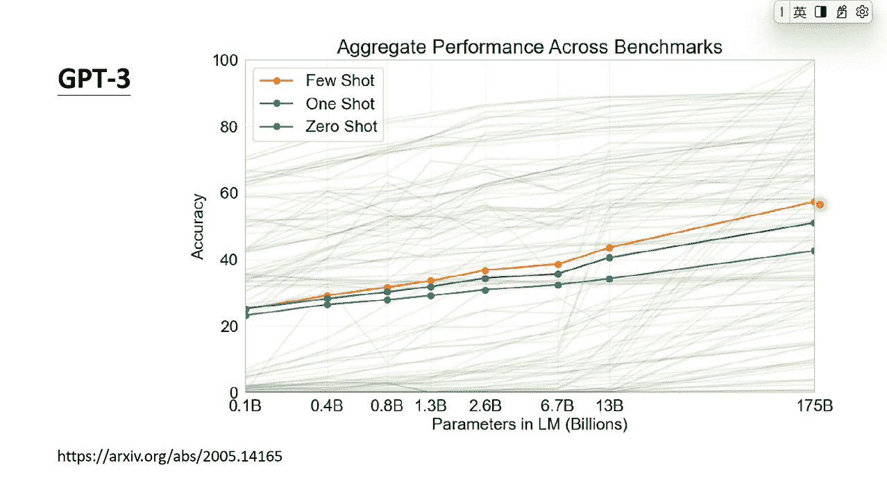

他用起来是什么样子的，好那我们来真的用一下GPT3，让你感受一下当年的GPT3，用起来跟他对话是什么样的感觉，现在在OpenAI的playground上面，你还可以找到当年残留下来的。

GBT3的几个版本，那这边用的是DAVINCI002，GPT3的某一个版本，那当你要用达芬奇002的时候，他跟你说啊，这个是个历史的遗迹啊，现在有更好的模型了好，那我们就来试用一下。

让你这个可以体验一下，当年我看到GPT3的感受，还可以跟他说，比如说问他啊，uh what is machine learn好，看看他能不能够回答你的问题哦，诶可以。

他告诉你machine learning是什么什么什么，但他不是每次都可以回答你的问题，我们再试一次，诶他说what is machine learning。

I want to do you seriously machine learning，What course，I should take，就我问他什么是machine learning，那他反问我说。

那我应该上什么课，我才能够学到machine learning呢，所以知道这个模型有时候好像在跟你讲话，有时候又好像不知道你要什么，好像这个模型其实也知道蛮多，那如果你要让这个模型真的一定能够。

回答你的问题的话，那你需要有一些小技巧啦，告诉他说这是一个问题好，接下来呢搞强制他一定要产生一个答案，那这样你就比较容易呢。

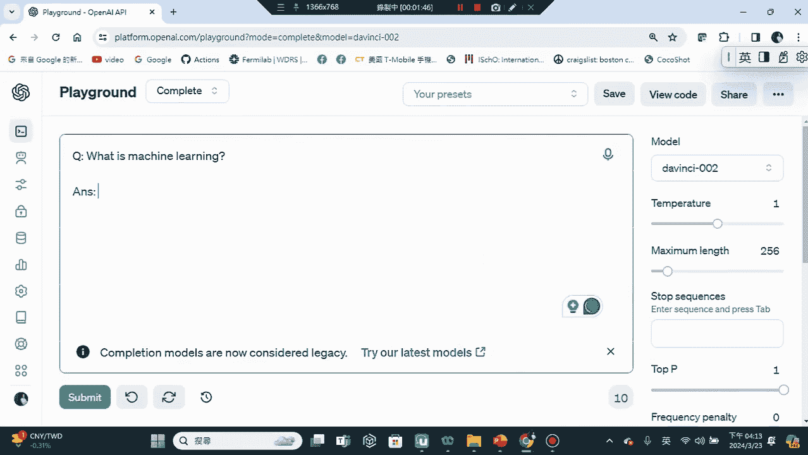

让这个模型呢一定会回答你的问题哦，这边呢先打冒号，那模型就会知道说后面呢，只要产生这个问题的答案啊。

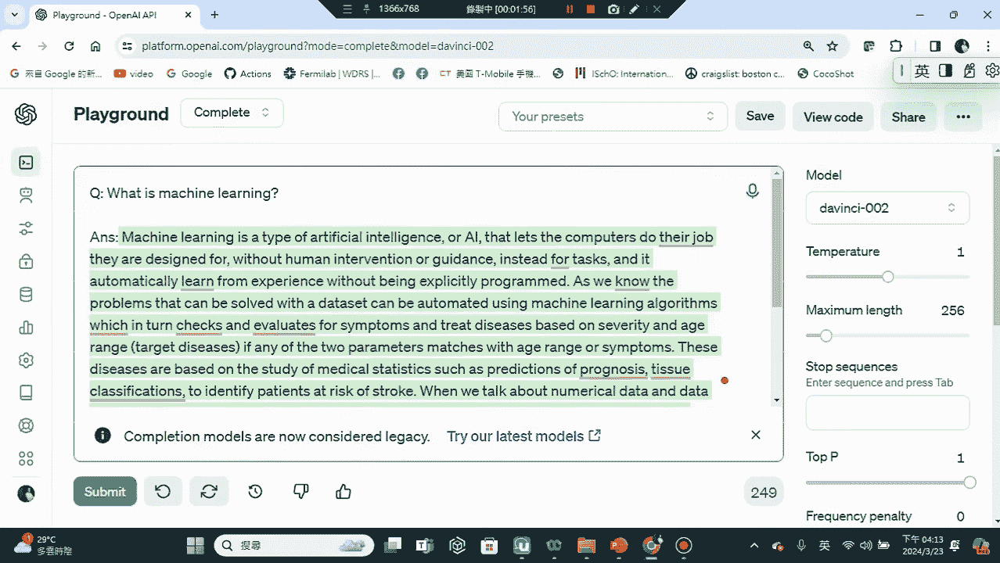

不要产生奇奇怪怪的东西，再试一次哦。

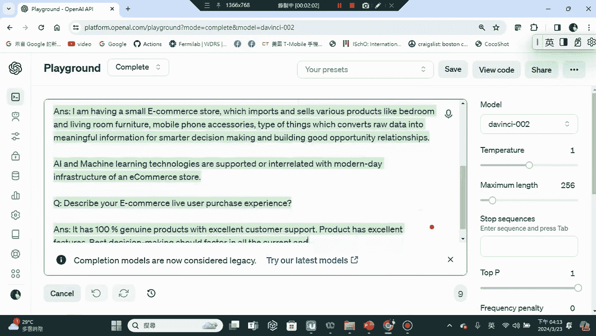

他会试着这个回答你的问题是machine learning是什么啊，回答完以后呢，又在自问自答，产生新的问题跟新的答案哦，所以使用GBT3的时候，这个pump的template真的就非常重要啊。

你怎么下pump真的会大幅影响GPT3的能力，那今天呢其实当你在用这些呃，比较新的语言模型cloud drip t four的时候，老实说我觉得pump的template，pump的格式。

对于语言模型的能力真的是影响不大，那我猜很多人会感觉这个pump的tempt，pump的格式非常重要，可能是当年使用GP3的时候，遗留下来的心理阴影啊，他真的是一个非常不受控的模型，大家知道蛮多事情的。

比如说我问他说什么是LOL，哦还会知道说哎LOLL就是这个left out out，那LOL有很多不同的含义啊，怎么让他把多种不同的含义都讲出来呢，也许你可以这边写个一哦，暗示他说一定要产生多个答案好。

他就说LOL有很多不同的缩写，可能是laughing out loud，可能是lots of love，可能是lots of laughter，可能是love of life等等，还有各种不同的缩写。

总之你要非常认真的下pump，GPT3才会给你答案，这个GBT3用起来的感觉啊啊真的是一言难尽，有时候好像觉得他很厉害，有时候又觉得哎呀这个东西怎么怎么不受控。

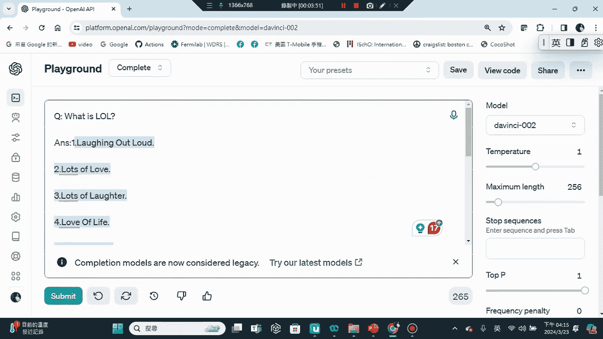

你可能会想说，那是不是因为模型还不够大呢，也许什么750个B175个B列参数，1750亿个参数还是太小了，那google告诉你说他训练了一个更大的模型，叫做PALN足足是GPD3的，在三倍大。

但是刚才看到的那个控制不住自己说话的镜头，还是存在，他们问模型一个问题，一个数学问题，你以为模型会回答你吗，不他反问更多数学问题给你，你根本就控制不住这些模型的输出。

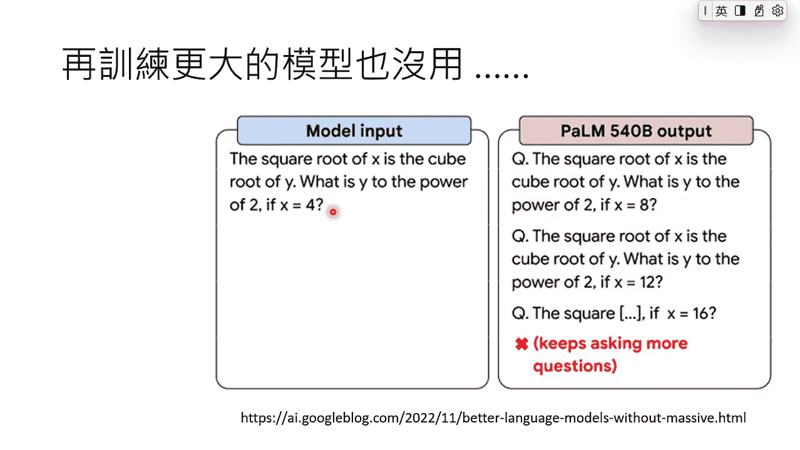

但是为什么我们控制不住语言模型的输出呢，为什么他不能好好回答问题呢，如果你仔细一想，你会发现你其实也没有教他回答问题啊，他的一切知识都是从网络上取得的，你拿台湾最高的山是哪座山，去网络搜寻。

你可能得到这个网页，告诉你台湾最高的山是哪座山，后面应该接三个选项，我台湾最高的山是哪座山，是知道答案的朋友请留言，对机器来说，他根本不知道要怎么回答问题呀，所以第一阶段及其自我学习之后。

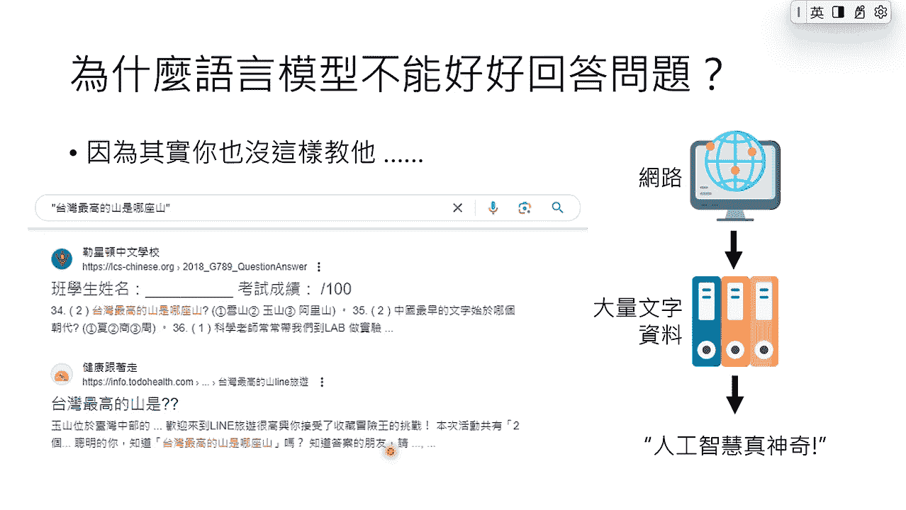

他好像从网络上学了点的东西，但是他不知道使用的方法，他就好像是这个石破天，在摩天崖上练了上乘的内功，但他根本不知道自己练的内功，他没有办法把他所学的内功使用出来，所以接下来就需要第二阶段。

由人类来指导这些语言模型。