# 李宏毅2024春《生成式人工智能导论》 - P15：作业四：Become an AI Hypnosis Master - 啥都会一点的研究生 - BV1BJ4m1e7g8

那个我注意很对，有一点问题，就是那个我那个什么大冰期，那个就是那种感觉对我们下手，所以我诶好等一下好诶，瑞超，那你可以帮扶一下，做一下，他问打工去坐好，嘿诶对对对对对，因为我刚刚看了。

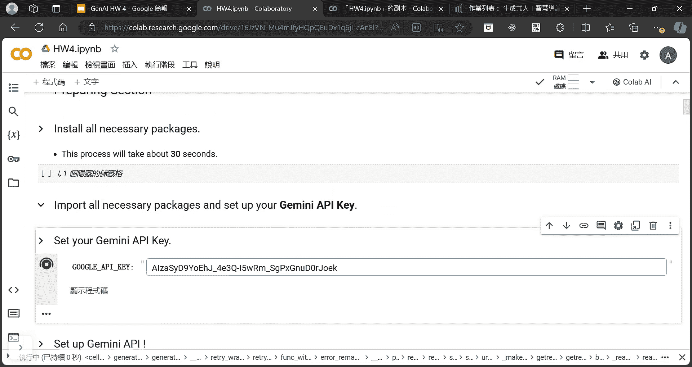

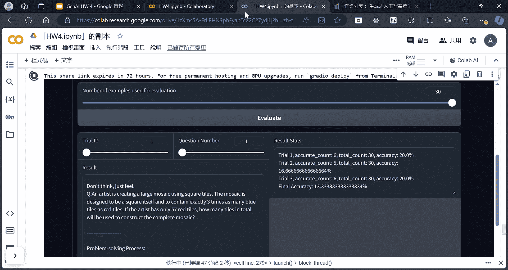

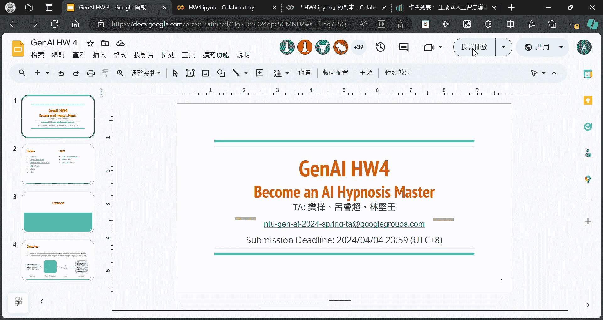

喂喂喂好啊，因为3分钟过了，所以我们就来讲啊，这次的作业呃，第四次作业，那第四次作业，我们要做的是叫做成为这个AI的催眠大师，那这是啊这也是这次作业的online，所以我们会稍微讲一下这次作业在做什么。

然后再就是会跟大家讲啊，这次作业你们实际上要做什么，那再就是呃这次的评分还有角角的一些规定，那还有就是前面做的也有的一些规则，然后还有call lab，还有一些呃hint对，那旁边就是这次的啊。

你可能会用得到连接，那第一个就是JS的讨论区，那再就是这次作业是我们全部都是用COLAB，我们不会用大兵器，再就是这次我们也会用到GERMAN来，所以你们可能也会需要对好，那就如这次作业的题目所说的。

我们要成为一个AI催眠大师，那我们要把AI什么样的AI，催眠成什么样的东西呢，那在这次作业里面，我们要做的就是催眠，就是GERMINI这个AI模型，我们要把它催眠成一个很会解数学问题的模型。

那怎么催眠呢，这里我们就是使用下prompt的方式，也就是给他一个提示词，跟他说，哎你现在要很会解数学题哦等等的prompt，那我们希望透过这个prompt，能够让模型更会去解数学题，那在这次作业中。

就是你们也可以去看说诶，给模型看不同的prompt，那再让他去解数学题的时候，到底不同的prompt，会对模型的输出产生什么样的影响，这都是这次作业可以去试着去发现的好，那在进入作业之前。

我们可以先来看一下实际的例子啊。

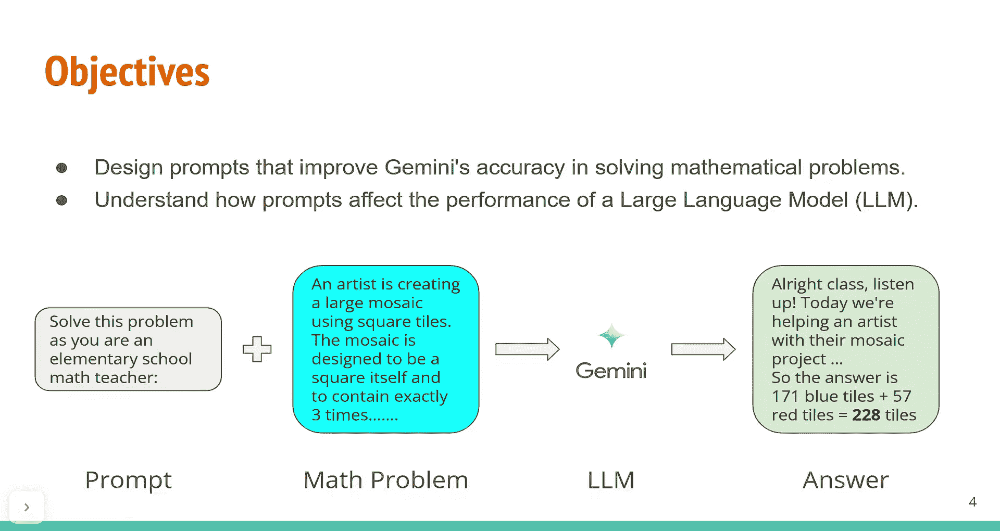

这边就是一个实际，我们可能生活中会遇到的例子，对就是啊我们想要问GERMAN一个数学问题，那底下就是这次啊我们想要问的问题，那假如我们今天什么PRT都不给他，我们就直接丢这个问题给他。

那我们想要知道他会回答什么，那我们先来看一下这个问题，这个问题叫做有一张长方形B报纸，长36，宽40，老师想要把它切成多个一样大的正方形，不要剩下，请问有无，请问无法切除下列哪一种边长的正方形。

那这个大家其实稍微想一下，它其实就是在问公因数的问题，所以只要这个模型懂得什么叫公因数，它应该就能够正确地解决这个问题，但我们现在发现诶。

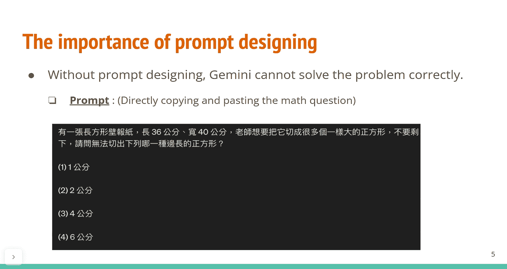

如果我们什么胖都不给他，那GERMANI他其实他回答不出来，我们可以看到它底下会有给一些呃，他的解决方法，那其实很明显的看出来，他的解决了这个解题的过程是有问题的，所以导致他最后给的答案其实是错的好。

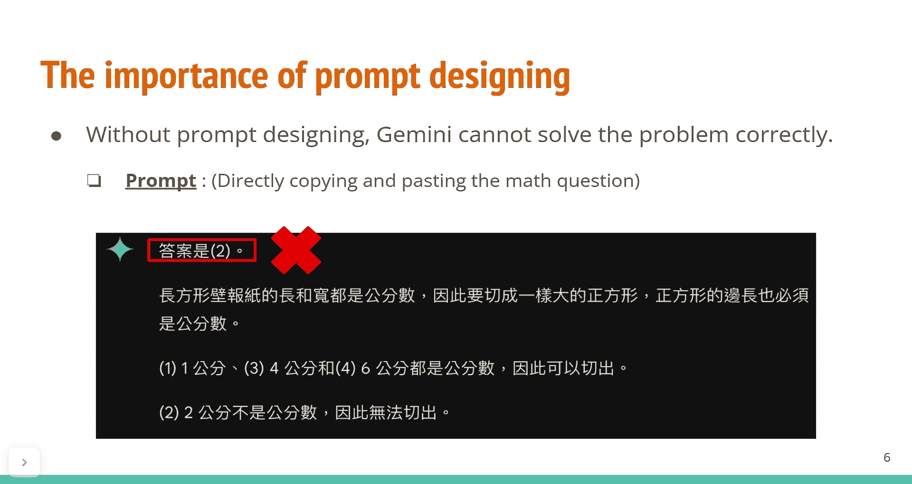

那如果我们在原本的问题底下，我们多给他了一个prompt，也就是底下这个红色框框，这边我们给它叫做呃，请根据公因数的概念观察题目，并一步一步小心计算答案，并注意题目要选择的是无法切除的边长。

那我们希望透过这个pro能够让JY来回答正确。

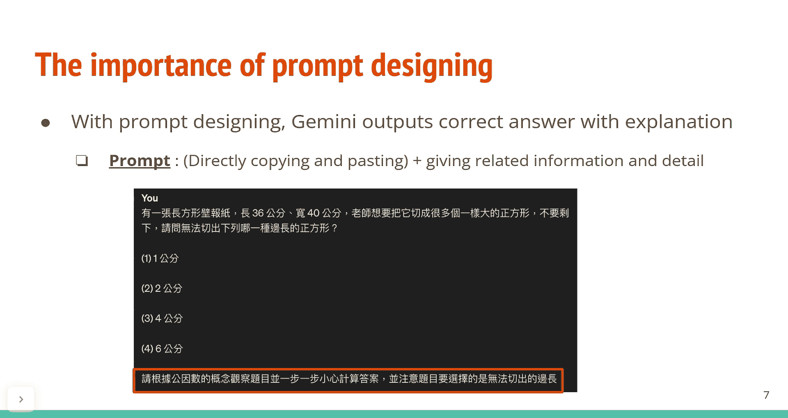

那确实我们给它加热pro之后，GERMINI确实就用公因数的概念去解决这个问题，那最后他也发现诶六公分其实是切不出来的对，所以这就是我们平常可能想要用这种AI模型的，去解决问题的时候，可能会遇到的就是。

我们可能要给他某个特定的pro，才有可能去解决某个特定的问题。

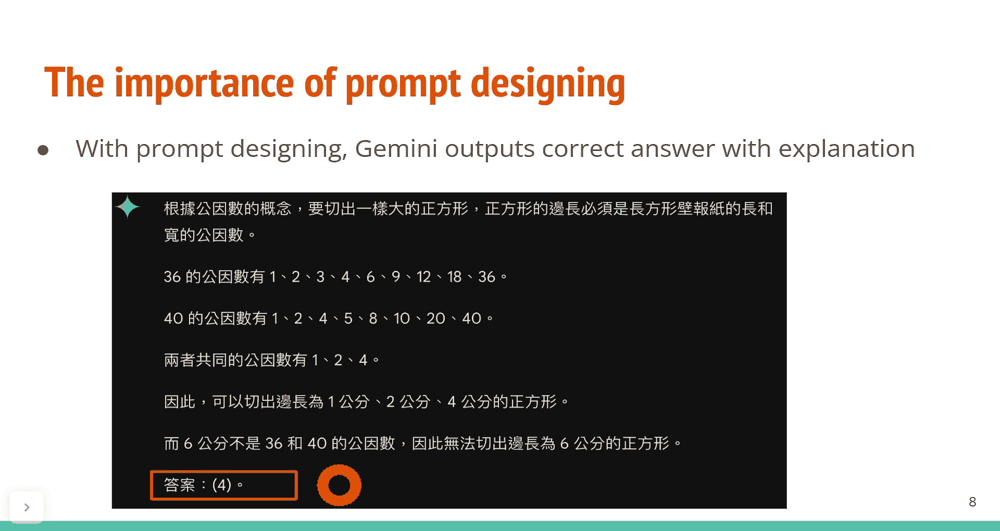

这样好，那再就是这次作业就是我们到底要做什么。

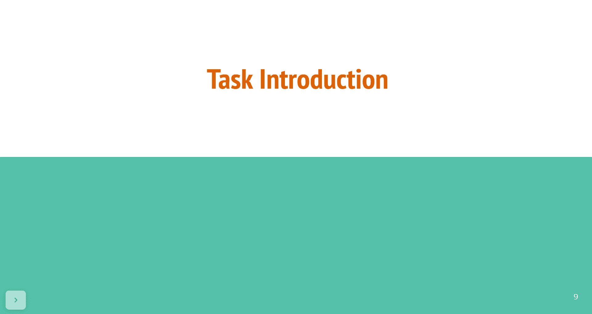

那就如同刚刚我们讲到的这个作业，就是要去设计一个prop，那这个prop它能够帮助GERMINI去解决数学问题，那你们实际会做的事情，就是我们会提供各位30道数学问题。

那各位就是想尽办法去生出好的prom，让GEMINI能够更好地去解决这30道数学问题，这就是啊各位这次作业总会要做到的事情，所以啊我们这次要做的事情，其实都是focus在我们要怎么去下prop。

怎么去下一个好的prop，那至于这数学问题，然后怎么给怎么丢给GERMANI，然后再怎么请GERINE深处回复，这些都是啊，各位不用去担心的，就是各位会遇到的就只有就是啊把prompt写好。

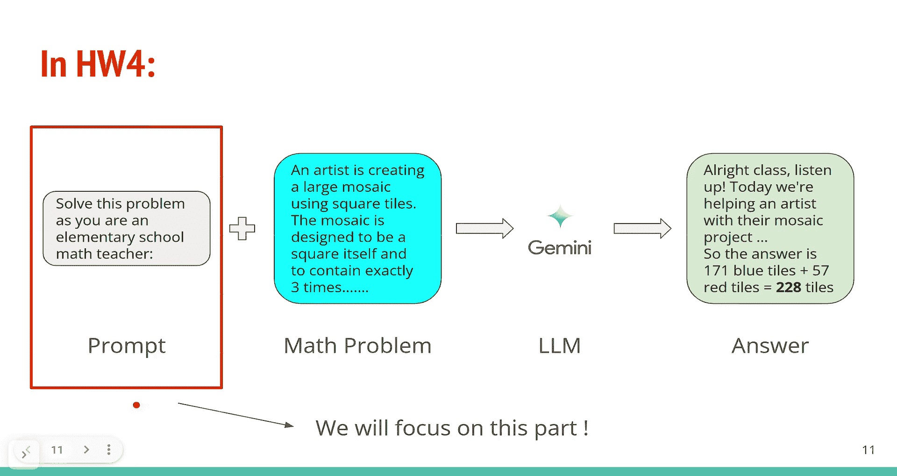

这样子好，那再就是呃这是作业我们实际上要做的东西，那这里啊这之后的投影片比较像是啊，这是作业的这个图文的说明，就是我们会要用到COLLAB，然后一步一步跟你们讲说要怎么去操作它。

那旁边有一个要注意的小地方，就是就是有人在之前的作业，那就会导致你的这个免费的GPU额度，就会慢慢的被你用光，但要注意的是，这次的作业我们并不需要用到GPU，所以当你们在使用COLAB的时候。

请记得不要开到GPU，对那作业的这个说明。

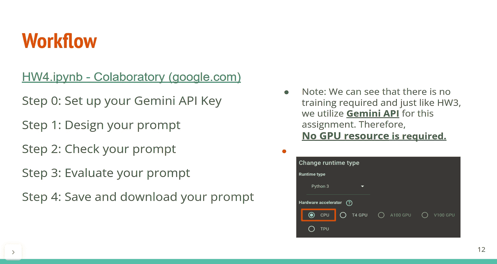

我们就实际操作给大家看一下。

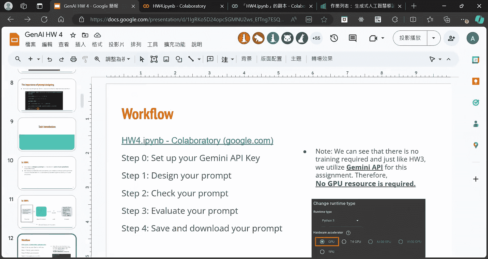

好那这就是这次作业我们会用到的COLLAB，那你们一点进来可能会长这样，那首先要注意的就是呃作业上有提到这件事情，就是我们要先在云端硬碟中储存一个副本，因为你们一点进来这个作业式的col里面。

你们是没有权限更改里面的东西，所以你们更改了之后并不会存起来，所以你们一定要先嗯点档案，然后在云端中储存副本，那你们才能在你们的副本里面做修改，然后再就是嗯要怎么看，你们是连到CPU，不是GPU。

你们可以点右上角这个rain和磁铁的按钮，然后就点一下，然后可以点啊，你们其实从这就可以看到它有没有GPU的使用，那如果还是看不出来，你们可以点变更执行阶段类型。

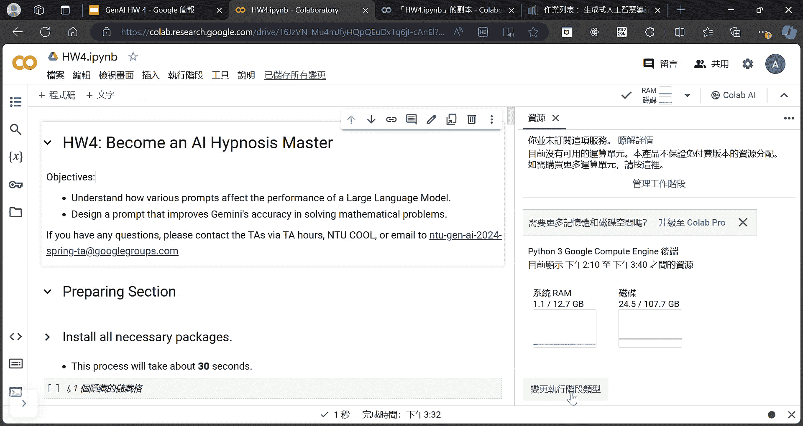

那这时候你们就会看到诶，这里有硬体加速器的这个选项，那你们确保你们是用CPU就可以了。

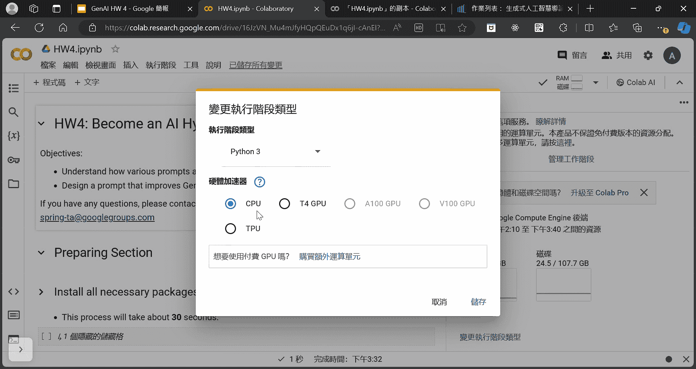

这样子哦，然后这次的作业主要有四个section，第一个就是做一些前置处理，就是像是我们要下载一些必要的套件，然后引入一些必要的套件等等，那再就是嗯嗯再就是设计prompt的section。

那我们有提供了，就是你可以用GRADIO，那你也可以不用GRADIO，那最后有一个小的block，就是可以直接下载，就是你有存下来的pro这样，那我们就一个一个带大家看。

那首先就是preparing section，这边就是这边就是呃要安装啊等等，那我们可以，所以这preparing section基本上你就把每个set，你就把每个block都执行过一遍。

就好像是第一个block，就是我要安装一些必要的套件，那你们这边就按执行就可以了，那再来就是要设定你们的GERMINI的API key，因为这次作业我们就是要用到GERMAN来。

所以你没有API key，你就没有办法做这次的作业，所以你们把你们的API key打在这边之后，按一下执行，那他应该就会跟你说啊，你的API key是否是呃正常的，那如果是正常的。

就是正常就是指你没有打错，那你没有打错，它就会显示那它有设定成功，那再就是要设定JMIAPI，那这个你们不用管它就执行就好了，那再就是啊我们这次有提供了30道问题，我们必须要点这个执行。

它才会存取这30道问题，那要注意的是呃，请不要更改这个block里面的任何东西，因为你一更改里面的问题，你最后测出来的正确率就会不对，那如果你想要知道这个问题到底有什么，我们这边有个连接。

各位可以点进去看，里面就有负我们这次的啊，这30道数学的问题好，好，那再就是呃，接下来就是要去设计你们自己的pro了，那我们这边点开嗯，基本上我们有提供大家就是这个radio的使用方式。

还有就是执行GRADIO的城市嘛，那首先就是要确保就是你有填你的API key，你没有填API key，那就没有办法执行，所以这点很重要，那再来就是我们要写prompt。

那到底这个prompt要写什么呢，基本上我们没有限制，但是有一个特别要注意的，就是我们必须要在里面加上这个这个啊，挂号挂号，PRESSION挂号挂号，这是一个叫做press holder的东西。

也就是呃用中文讲，他就需要一个占位符，那为什么，这是你们的prompt里面一定要有这个press holder呢，那就是因为我们今天会遇到很多不同的数学题，那不太可能你每一题你都去想个prompt。

去解决它，所以写这个press的好处，就是当我遇到一个新的问题的时候，我想要用你这个pro，那我就只要把这个place holder的部分，替换成你现在遇到的问题。

那我们就可以一直重复使用你设计的prom，那详细的图，我们可以看底下这边这个左边这张图，就是一个符合规定的prop，因为里面有这个啊挂号挂号PRESSION，挂号挂号的这个press holder。

那设计好这样子一个prompt的时候，我们去看这个我们如果遇到一个数学问题，像是上面这一部分，它是一个啊我们要解决的数学问题，那实际上会做的事情，就是我们会把这个LEEHOLDER这个嗯。

我会把这个位置的这个press holder呢，替换成我们实际上要解决的数学问题，所以就会变成右边这个形式，那你会发现这个place holder不见了，取而代之的就是我们要解的数学问题。

所以这次作业这个设计的一个重点，就是嗯一定要放placeholder，你没有PLAYEHOLDER，我们就不知道我们要把问题放在prompt的哪里，那就导致嗯我没有办法去执行，去评分。

去对你的prompt进行评分，所以啊要注意的点就是一定要加placeholder，那其他东西你想写什么，基本上没有什么关系，但还有另外一个点就是我们有长度限制，你不能超过1024个token好。

那底下就是一些嗯关于radio的一些操作的说明，那我们就实际操作给大家看一下，那我们执行了这个呃这个block的扣子之后，我们往下拉应该就会看到底下会有COLLAB。

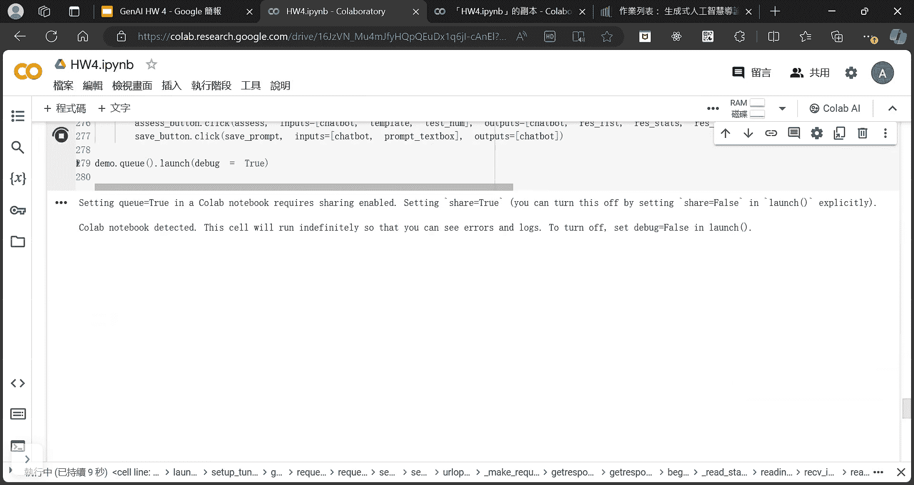

底下会有个GRADIO的界面出现对。

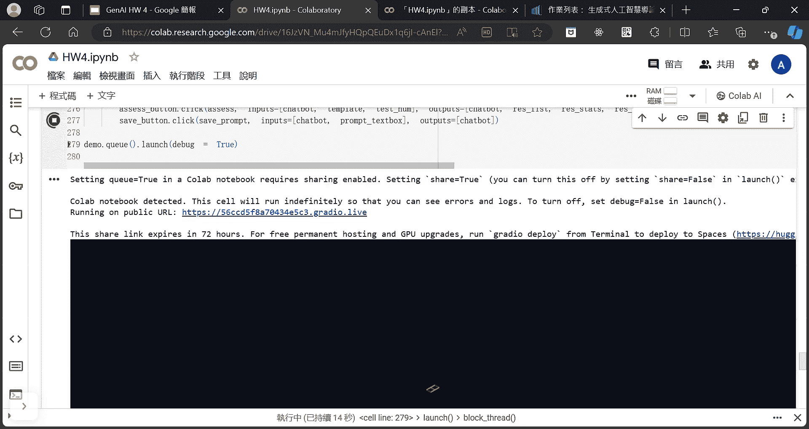

那当然你也可以点这个链接，那他就会额外开一个分页去，他就会额外开个分页，然后让你也是GRADIO。

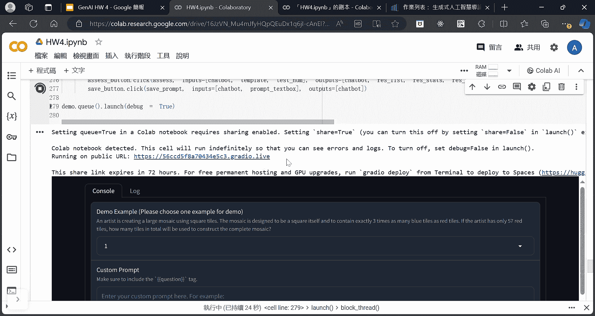

但是底下其实也可以直接用，那我们这次prompt，我们这次GRAU界面大概长这样，那我们实际上要输入prompt的地方，是这个custom prompt的这个这个文字框，那里里面已经有。

里面已经有一些字，就是跟大家讲说哎这里面就是一个范例，那你的prom应该要有像里面这样子的形式。

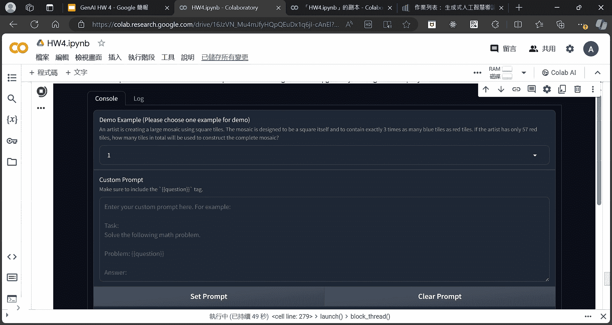

也就是要有这个place holder，那我们今天就来啊，实际写一个pro给大家看，那我想要写的就是，假设我希望GERMAN就是比较思考，就去用感觉的去回答这个数学问题。

好那这样子一个problem大致上都设计完了，那可以看到啊，我第一行就叫don't think just feel，那后面我就给他一个问题的这个Q，然后冒号，那我希望这个我的遇到的问题。

我就放在这个Q冒号后面，那我就在Q冒号后面，我就会加上这个placeholder，那这样子遇到问题的时候，他就会把这个place holder替换成就是遇到的问题。

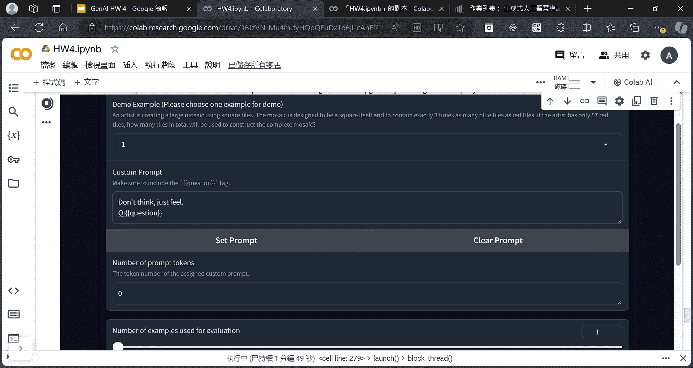

那如果你想知道说哎，但是现在这样还是plus hold，我想要看真正的问题放进去之后，它会长怎样，那也没问题，我们可以看上面有个叫demo example。

这里面就是啊这个就是我们可以从里面选，就是这次提供的30道问题，我们可以选一题喜欢的，但是我想要第二题好了对。

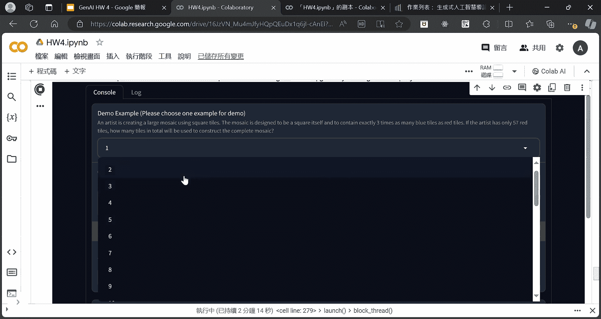

那我选到第二题之后，我想要看它放到这个prompt里面，它的效果长怎样，那我就按一下set pro对好，那这样基本上就是设定好了，那上面会有一个呃，会有一个这四个information。

这样那要怎么看呢，我们可以看这个logo。

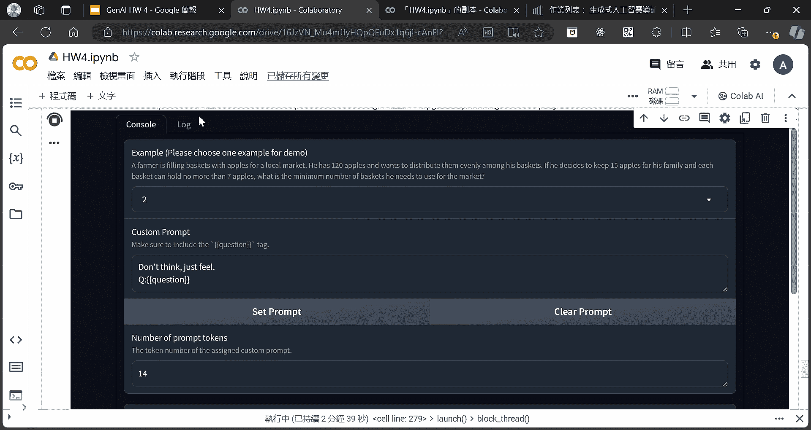

这个栏位我们就点下去，那我们可以发现在这个logo里面我们可以看到诶，这是我们刚刚写的pro，叫don't think just feel，但是我们会发现这个placeholder部分被换成。

就是我们刚刚选的那一道数学的题目，那底下这个文字框里面的这个文字呢，就是我们到时候会直接拿去给GERMAN来看的形式，就不会再有其他的变化，这样子好。

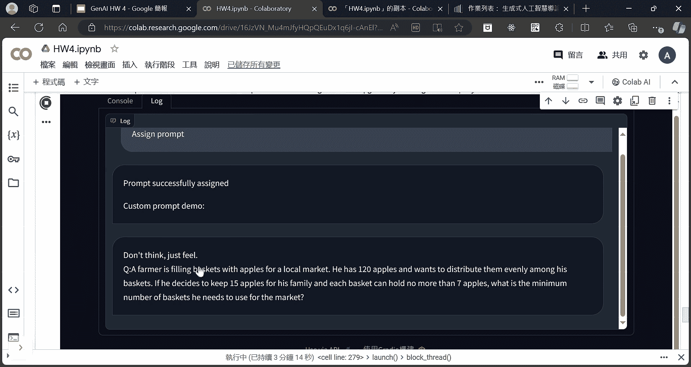

我们再回到界面好，那我可以再往底下看，这有个叫number of protokens，就刚刚我们有跟大家说，这次的长度限制就是1024个token，那这里我们就跟大家讲说诶。

你现在这个pro总共是多少个token，那像是啊，我刚输入这个pro，它只有14个token，所以基本上你不要真的就是贴一大串，非常非常长的文字，基本上你是不会超过这个长度的限制，这样子好。

那嗯旁边有个叫clear prop，也就是说当你按下set prop之后，你想要换，你觉得这个prompt可能不太好，那你想要换，那这时候我们就点一下clear prompt，那这时候又要回来。

那就代表他把这个prompt给清掉了，那这时候你又可以再输入其他的prompt，这样子，那我再把刚刚输入一下。

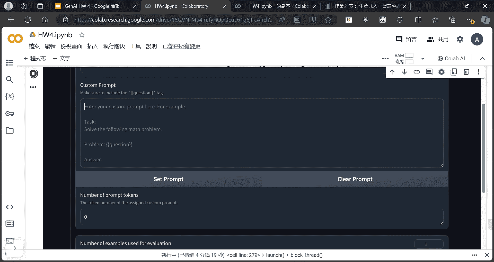

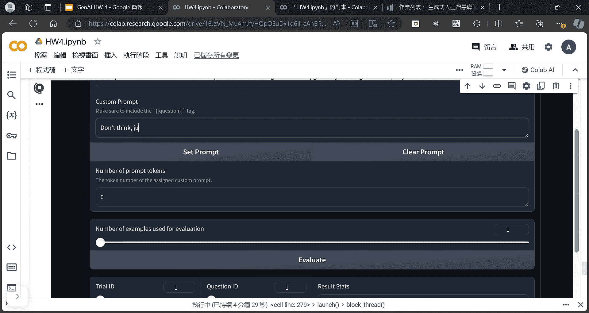

好那当你要输入一个新的pro之后，请确保你要就是你有set pro，这样他才会把你目前写的pro给啊。

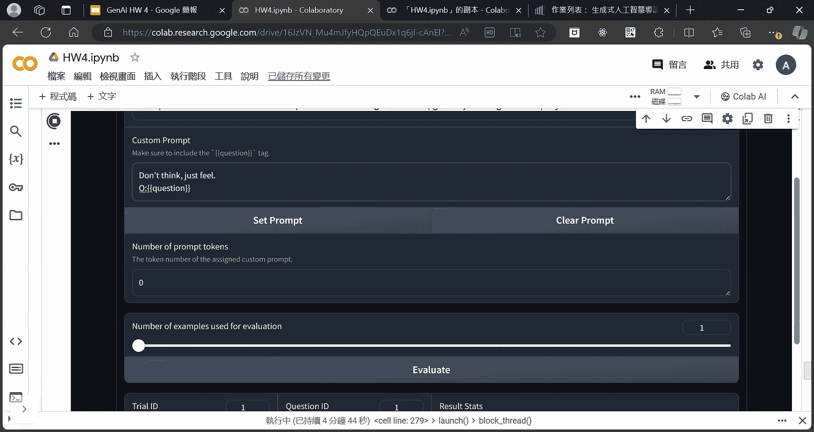

这个设定好，对嘶好。

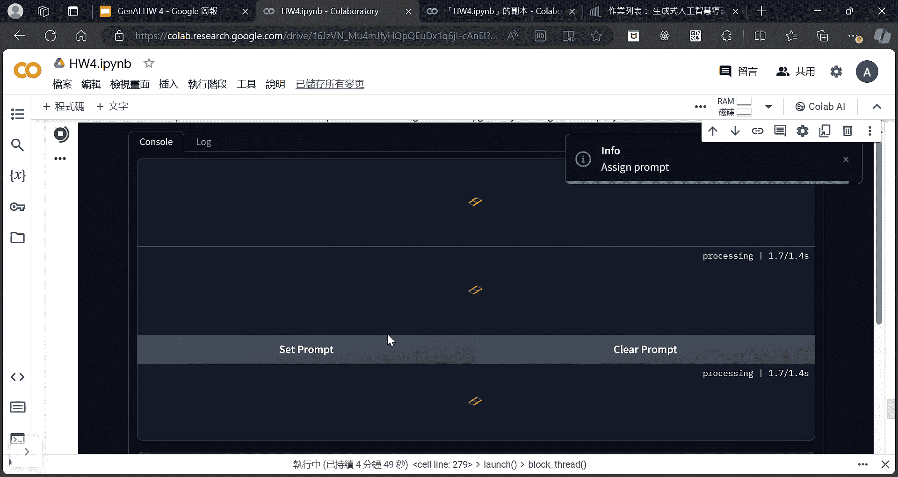

那当你设定好PROMPP，你也觉得这个格式是你要的。

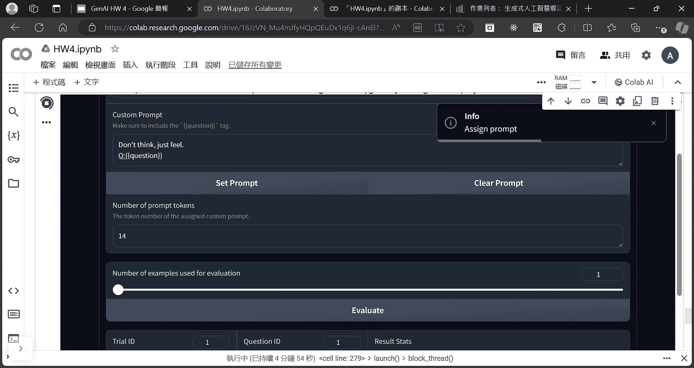

那我们就可以开始来执行，就是EVA的部分。

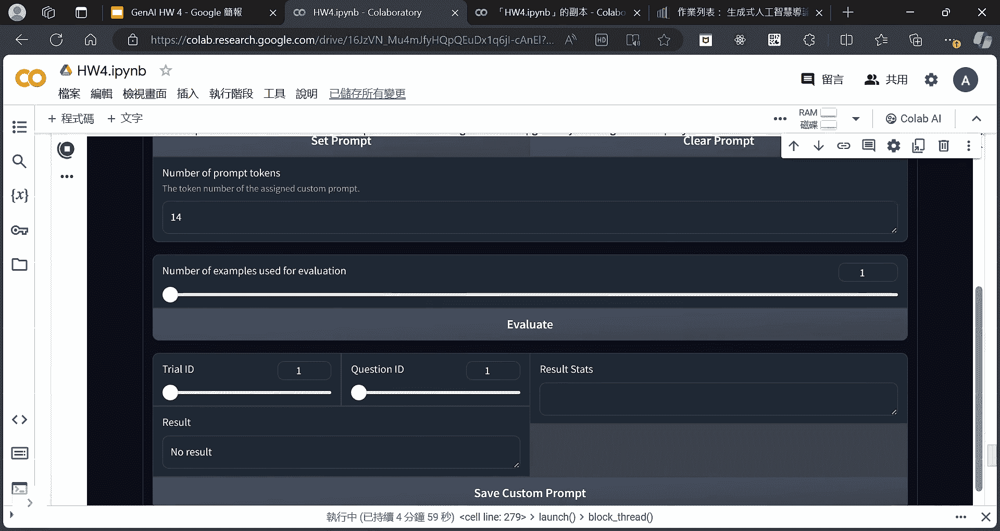

那在EGA之前，我们可以先选择说哎我们到底要测试几题，因为测试如果要把这30题都测试完，可能要花个你啊，大概20分钟左右，所以你可以选我们有提供选项，让大家就是可以选择你要测试多少题。

所以你可以在这边拉呃，你可以在这边选你要做多少题，像是你可以选一题17题或是20几题，那我们这边就选全部全部都是30题，那选好之后，我们就按下EVA。

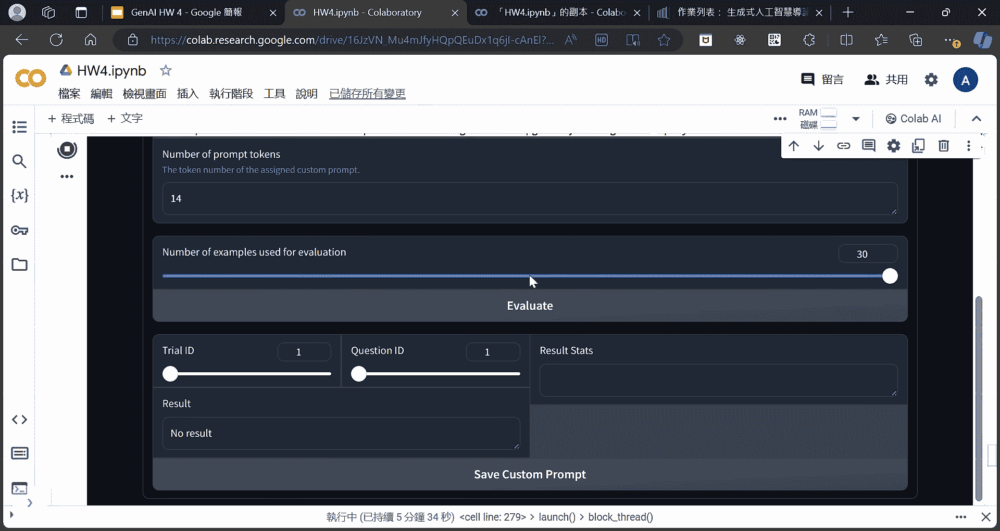

那这时候他就会开始执行，那要注意的就是你在执行的过程中，如果COLLAB它突然断线了，那这东西又断线了，所以你们就要再重开一次，然后再让他重跑一次，所以在要确保就是你们在EVA的时候。

尽量不要让这个网页断线，要不然你们可能就要全部重跑一次，对好。

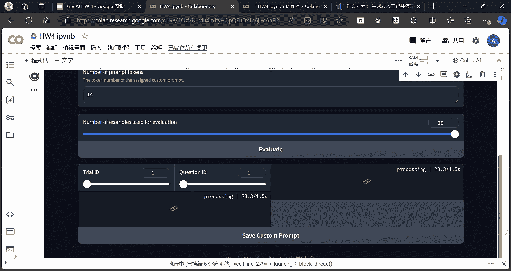

那因为我这有跑过的，我们就先看就是跑完的结果。

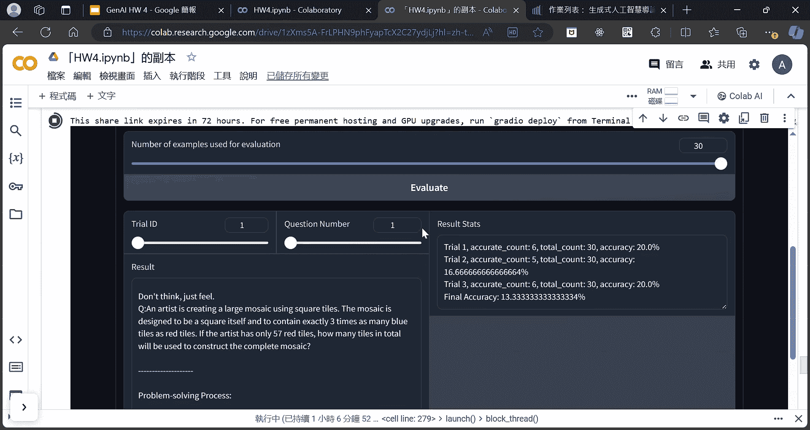

那跑完的结果大概就会像底下的这个样子，就是你可以看到诶，底下好像有个像是啊某一道题的这个它的结果，然后还有看到旁边这种啊，他要给一些accuracy啊，然后对了多少啊等等。

那我们可以下来看这个trial id，那这trial id的意思就是我们每一道题目，我们都会执行，我们都会测试三次，所以这trail id你可以选一二或者是三，就是你要看他第几次的执行的结果。

那question number就是嗯，我今天刚刚如果是选了30道题目，那creation number就是看你要第几道题目的结果，所以我们今天可以选，24题，然后我想要看二第24题，第二次的结果。

那我们就可以看到它上面有写trial two，然后question24，那底下我们就会看到一些结果。

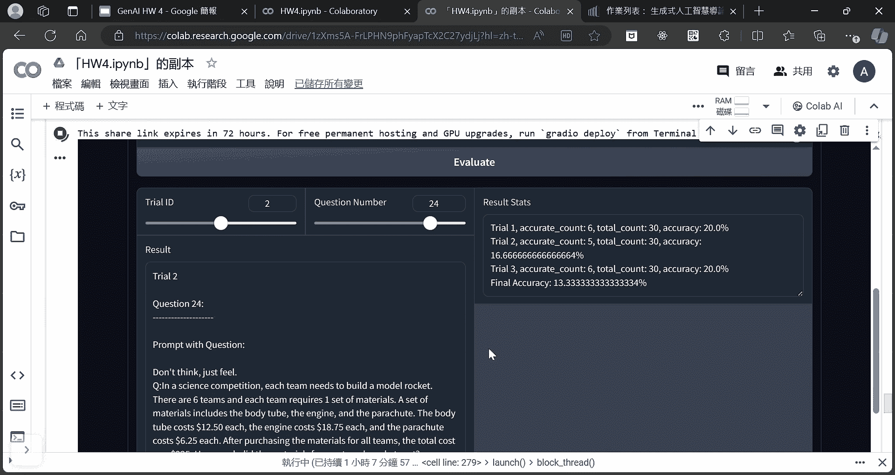

像是呃你的prop，然后还有他的question应该会长这样，那还有他的解题的过程会列在这边，然后还有最后呃它的答案会显示在下面这样子。

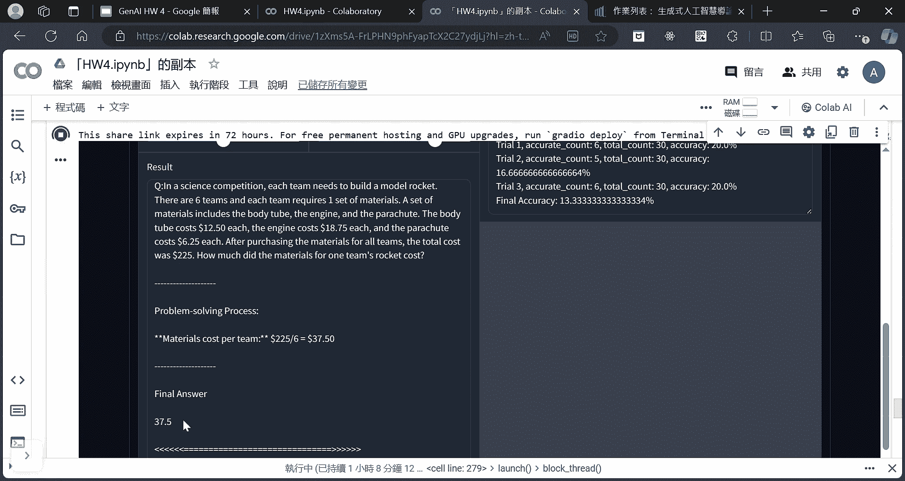

所以你可以透过这个界面去看，说诶我今天到底他哪一题有是对，哪一题是错的这样子，那旁边这个result states，就是跟大家就是可以让大家看说诶，执行第一次的时候，这30题里面我只对了六题。

所以正确率是28，那第二次的时候30题里面我答对了五题，所以我的正确率大概是16。78，那第三次的时候我是30题，面对了六题，所以正确率还是28，那最后这个final accuracy是13。338。

那这final accuracy怎么算的，我们就我投影片，待会跟大家说明，但是你们应该要关心的，其实就只有这个final accuracy，就让这个final accuracy是越高越好就可以了。

好那我们GRADIO的部分大概就讲到这边。

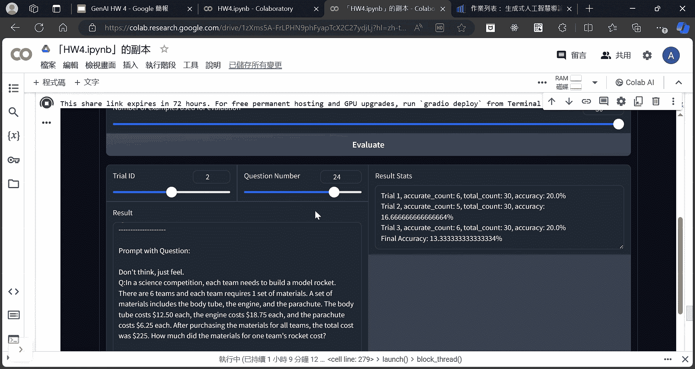

那我们就继续往下面讲哦。

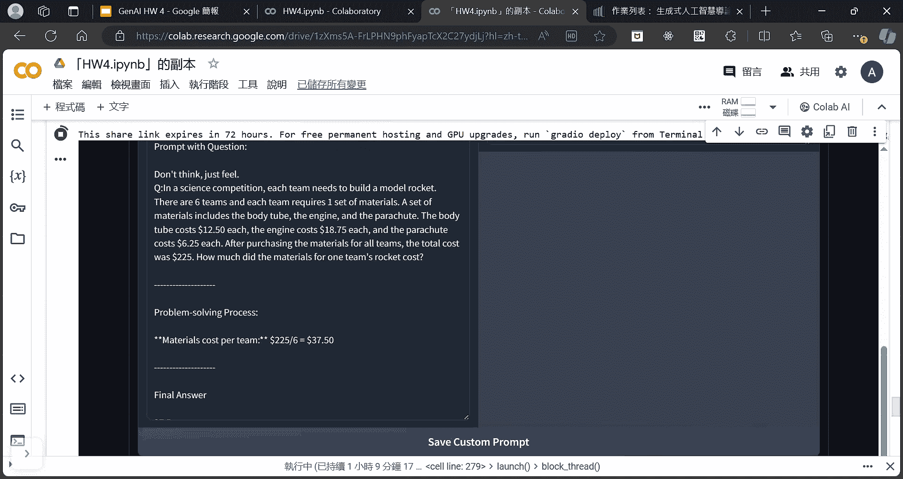

那要注意的一点是，当你们想要往下面的这个code，你们想要执行下面的code的时候，呃，上面的扣要记得先暂停，要不然下面的扣是执行不了的，所以如果你们GRADIO在跑，那你们想要执行下面的东西。

那就要先把radio按暂停好，那我们就可以往下看。

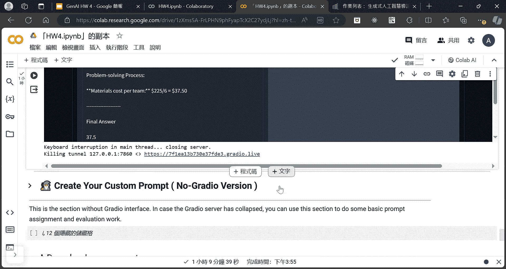

那再就是呃这个也是一样，就是写pro，但是这个没有radio的部分，那我们就带大家来看，那首先就是这部分我们也需要去import1些，引入一些我们需要的套件，那就执行一下。

那这里就是我们写prompt的地方，那我们就执行，那我们会发现诶底下有个小框框，那你就可以在这个框框里面去打这个呃，我们要的pp，那在这里如果我什么pro都不想要，我只想要问，只要给问题就好呢。

那应该怎么打，那其实我们就只要加一个press holder进来就好了，对那这样子就是代表我什么prompt都不要，我只要放creation就好，那当你觉得好了之后，你就按set prompt。

那这样子就没问题了，那如果你想要换另外一个pp，那你就要按clear prop，然后重新写，然后再set这样子，那这里也是就是你想要看你的prop，它到底这个把正确把题目加到这个框里面。

长这样你也可以在这边选，就是你的demo的，你要用哪一题，那这里我们就用第七题，那这里我们就可以按执行对，那我们可以看到底下这一行它就会吐出来，就是我们把题目放到pp里面会长怎么样。

那因为我什么prompt都没有加，我就只有问题本身，所以他输出的东西也会有问题本身哦，那下面的地方就是刚刚的EVA的部分也是一样，我们可以先选择啊，要用多少的题目，那选好之后，我们就按执行。

那作为他就会开始啊，开始用你的pro去做测试，那我们这边就不跑了，给大家看，好那在底下也是就是我跑完之后，我想要看他跑第几次，然后又要看他第几题，就你们可以在底下去呃，设定这样子，那底下就会显示出诶。

这第几题第几次的结果这样，那哦对，就刚刚radio里面其实最下面有个save prom的部分，那这边我们也有提供一个set pp本，就是当你觉得你的pro是没问题的，然后你想把它储存下来的时候。

就是我们只要在radio里面，我们就点safe prompt的那个按钮，那在这边我们就执行这个格子，那就没有问题了，那这边大概就是呃这个没有radio版本，就有radio版本跟没有radio版本。

它的功能是一模一样的，就只是你你喜欢用哪一个就对，就看你们那最后有一个blog叫做downloyal pro，就是当我们按了safe之后，我们可以看到这个档案栏，这边应该会有个叫做prompt。

点JASON的档案，那这里面就会存着，就是你们设计好的prompt，那如果你们会自己下载，就是你们知道怎么从这边下载，那那可以直接从这边下载，把这个pro点JASON下载下来。

然后就可以直接缴交到这个NT库上了，那如果你觉得你不想，那你可以直接点这个啊，你可以直接点这个储存格，那他就会帮你把这个problem给下载下来，这样子，那以上就是这次作业的COLLAB讲解的部分。

这样好，那我们再回到投影片。

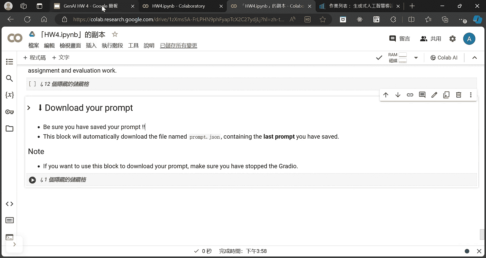

哦那底下投影片基本上就是讲。

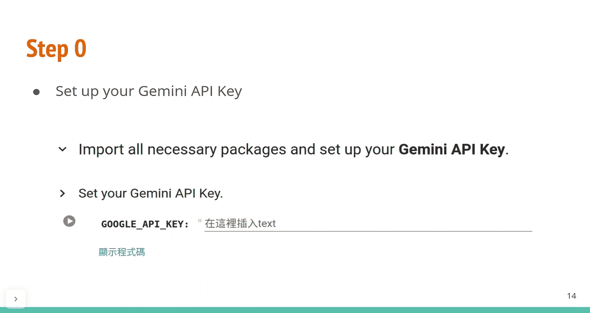

就是刚刚我们做过的各种操作，然后同时有分有GRADIO跟没有radio的。

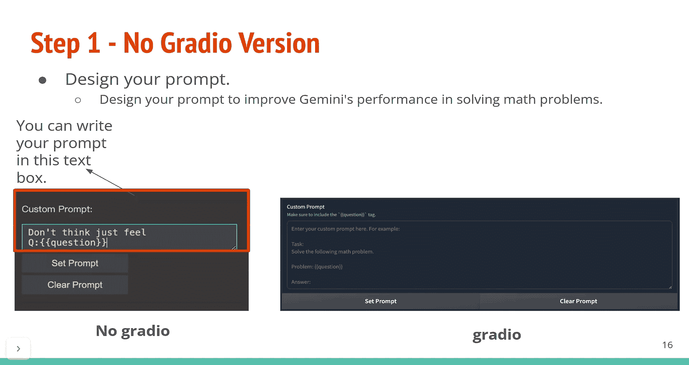

这样哦，那这边我们就跳过。

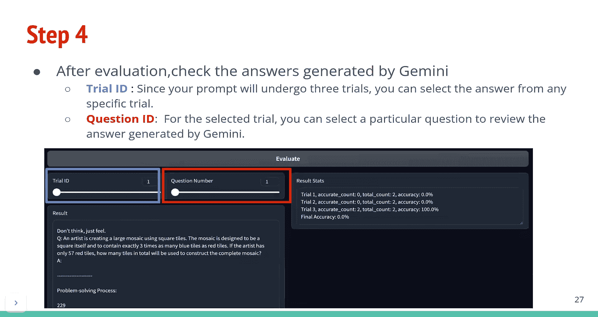

再来就是因为这次会用gradient，然后应该说这次会用COLLAB，然后嗯我们也会用radio，还有GERMAN来，所以可能你们会遇到一些，你们作业中可能会遇到一些问题这样子。

那首先就是你们要怎么知道你们的问题是什么，那这个COLLAB它里面他的这个error的显示的地方，就会是你的那个执行栏底下，应该你的执行的那个栏位底下，它会显示出error是什么。

所以如果你发现有error，或是它突然停下来了，或是你发现底下有印出一堆东西，那可能就会是某个error，所以这时候你可能就要去特别注意一下，到底这个error有没有可能造成你作业没有成功对。

所以就是你们在执行radio的时候，或是没有硅油版本也一样，就是一定要特别留意底下这个部分，因为这个地方他会去印出各式各样的error，他有可能会印出各式各样的error。

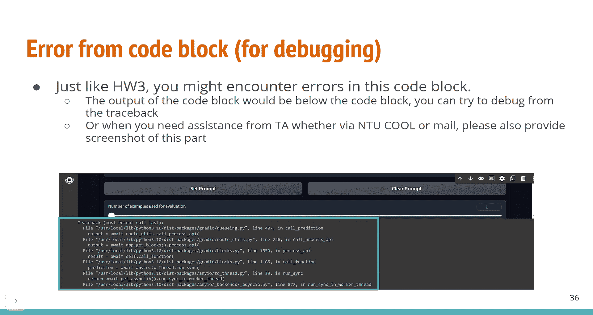

那首先第一个error叫做cast content，Must not be mt，这你们会这个error的原因其实很简单，就是你没有set你的prop。

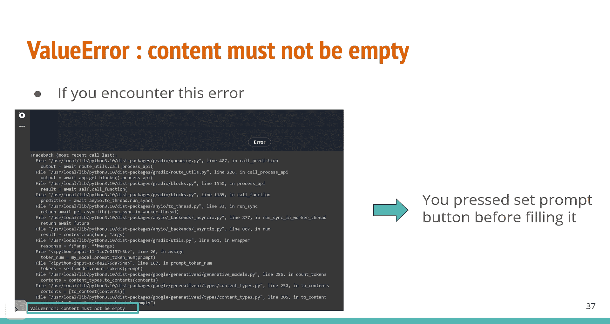

也就是说你的prompt里面应该是要打东西，你才能按set prompt这个按钮，但是如果你向右边这样子空空的，那也就是按set prop。

那你就会遇到啊这个content mar nb mt的这个error这样子。

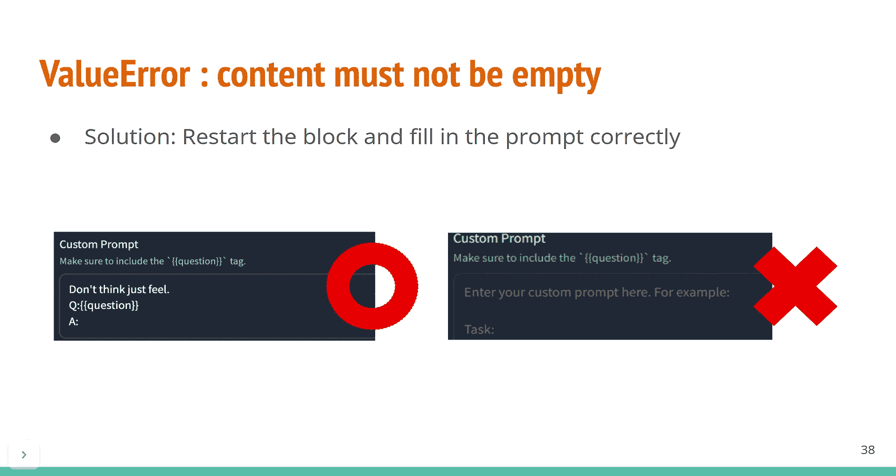

那再来就是呃，另外一个可能你们会有机会遇到的叫read time out，那这个东西比较像是GERMANI，它本身的问题就是你跟他去发出请求，希望他能够回复你些什么，但这个过程太长了。

那这个就会发生这个time out的这个error，那呃这个东西它其实我们是把它写成说，他不会把城市停住，但他不会回传东西给你，所以就有可能导致说，你可能某一题发生了贪污了。

那你可能那一题他是没有给你回复的，那这时候再算最后的正确率的时候，你那一题就会被当做是错误的，所以遇到这error的时候，最好就是想办法就是先把它停下来。

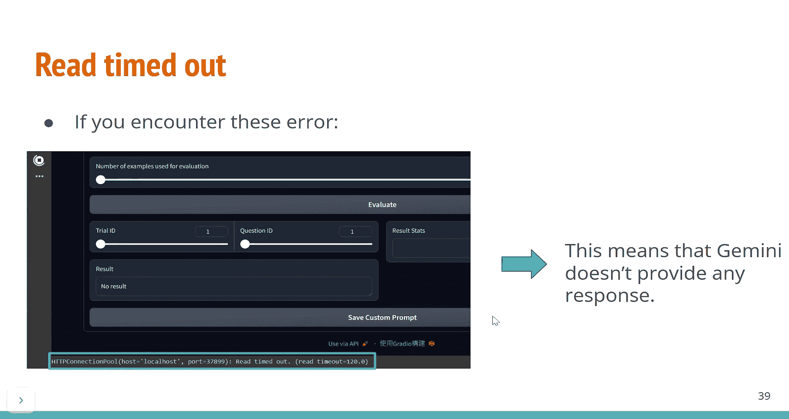

然后去解决掉它，这样子，那解决的办法嗯，这个error它比较长，会发生的情境是这样子的，就是当你在执行GERMANI的时候，然后你想说诶我现在想要出门，但所以我想要先把cola关掉回来再跑。

你就直接把那个COLLAB的radio，那个COBLOCK呢给停下来了，你直接点那个执行键拉停下来，那这时候就有可能导致你GERMANYI它并没有，就是呃，你可能就有点像是没有好好的去结束掉，这件事情。

那没有结束掉这件事，没有好好的结束这件事情之后，你之后又回去再重新执行，你没有重启口袋，你反而就只有去重新执行我们的coo block的话，那就会产生这个error，就会产生tango的error。

这是比较常出，这种情境之下是很容易出现time out error的，然后出现time out error之后，基本上你后面再去发request，就是在去请求GERMINI给你回复的时候。

基本上他也都还是会time out，所以遇到这个问题，你的处理方法就是直接把COLLAB重开，那重开之后应该这个问题就能解决，那如果又重开之后还是发现同样的问题，那可能就是嗯你的prompt。

他可能真的要花很多时间去给你回复，那这时候你可能就得需要换个prompt。

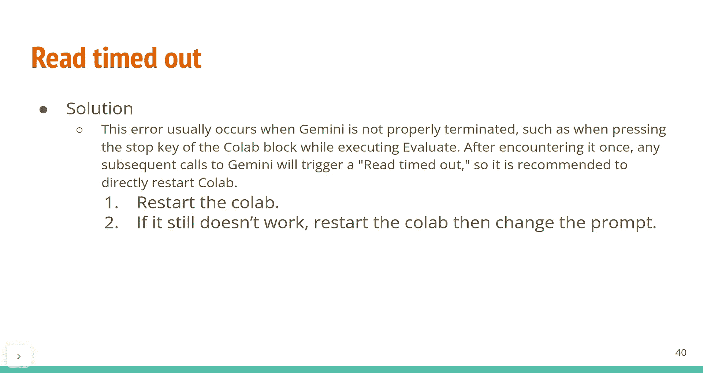

那这也是一个GERMAN，他的问题叫做NVRETURN，那这个就如同字面意思，就是他什么东西都没有回传给你。

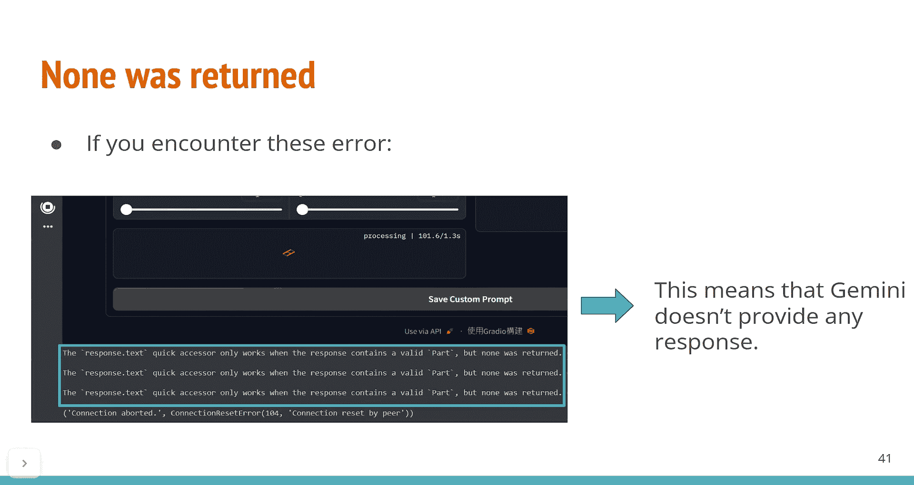

那解决的方法也是一样，就是呃你们可能就要先重开cola，那如果重开cola也没有用呢，那你就换个pro，因为代表这个pro，它可能他是没有办法去做回传的好。

那再来就是叫做connection aborted。

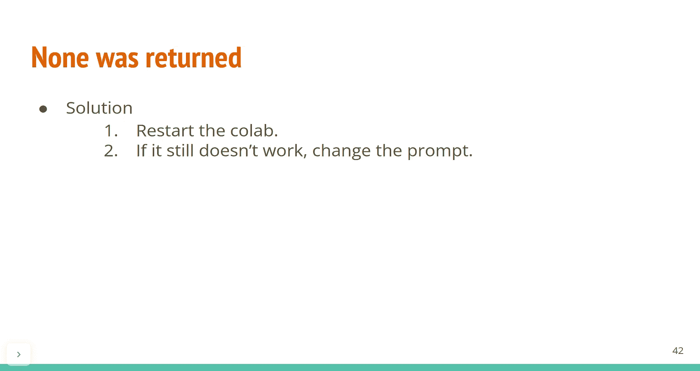

那遇到这个问题的时候，就基本上你们最会遇到的应该就是这个东西，就你们会看到底下，它就会一直不断的印出connection的bt connection prote，但是遇到这个问题的时候。

你们就忽略掉它就好了，它不会造成任何的影响，就是它还是可以正常的去，去执行完这个EVA这件这个功能这样好，那就是目前可能遇到问题，大概就以上几个对。

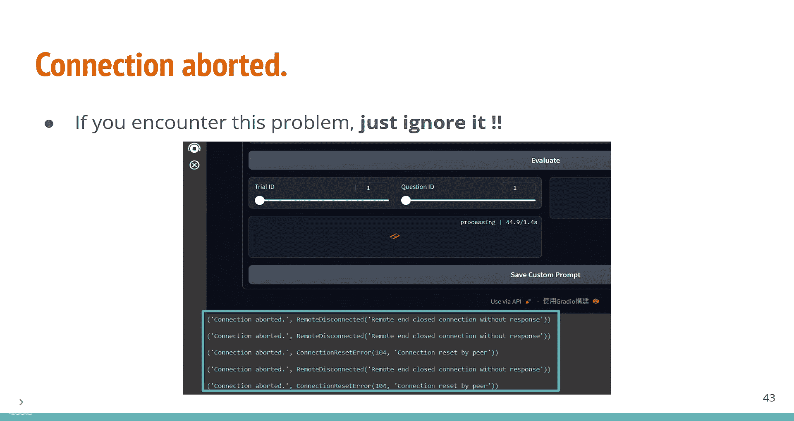

那再来就是讲我们这次的评分。

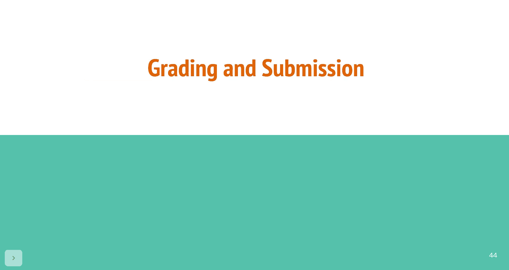

还有我们娇娇的事项，那在这次作业呢，就是各位会需要去缴交两个prop，就是我们会需要各位去设计两个pp，那这两个pro都要请各位讲究，那再就是我们最后在评估的时候，我们会用的模型是german pro。

那我们会测试的题目就是有我们刚刚有提到的，就是我们会提供各位30道数学题，也就是我们的public set，我们叫它public set，就是我们有公开出来的，除了这个30笔的public set以外。

我们还有额外准备了100笔的private set，那你们的prompt都就会被测试在这个public set，还有private set上，然后我们会分别去配分这样子。

那再来就是模型生成的这个temperature，我们是用1。0，这样，那在这是我们这个请GERMANI做回复的，这个过程呢，其实我们是有分两个阶段的，那首先第一个阶段就是。

我们会把问题放到你们的prompt里面，然后劝起GERMAN来做回复，那这时候GERMINI的回复，他可能就比较会像是一个嗯解题的过程，对那在第二阶段的时候，我们就会把第一阶段生出来的解题过程。

再加上原本的问题，我们会再去请知我们会在丢给GERMANI，然后呢去跟GERMAN来说，哎，这个请告诉我这个问题，他最终的答案应该是什么，那之所以会用这呃两段式的这个回复，其实啊就是这样子做的话。

可以比较好的去自动化的得到这个模型，它到底他给的答案是谁，这样子，那底下就是一个示意图，就是首先，好首先就是第一阶段的部分，就是我们会把一个问题放到你们的prompt里面，那放进去之后。

我们会再丢给GERMANI，那GERMANI应该要回答一个像是啊，解题过程的东西给我们，那这时候我们会再把原本的问题跟他的输出的，解题过程给接在一起，然后我们就会再用底下这个红字的这个problem。

去请GERMINI去抽出这个问题的答案，然后我就我们希望这样子抽出来之后，就只会有这个呃数字而已，就是这个答案，所以我们就会像这样子，我会丢给GERMINI，那GERMINI应该就会回给我们一个数字。

那这个数字我们就会把它当做是这一道题目，GERMINI生出来的答案，那在这次作业里面，我们考虑到GERMAN有没有解对某一道题目，我们只看第二阶段他抽出来的答案是不是对的。

我们不会考虑你第一阶段它的解题过程的内容，是不是正确的，我们只会考虑第二阶段，他抽出来的答案是不是对的，好在嗯，对于每道问题我们都会去请GERMANI回复三遍。

也就是把刚刚那个two stage的过程执行三次，那一个问题他要怎么样才算对呢，就是他这三次里面他要回答至少正确两次以上，那这道题目我们才会算他对，有底下这张图，我们问1+1是多少。

那GERMANI回202，那这时候他会满足我们的要求，就是至少要答对两次，那所以这道题目我们就会算答对哼，那最后我们算final EPIC的时候，就是去看说诶他在public set上。

它分别他答对了几题，以及他在private set上他答对了几题，来当做这个final的accuracy，比如说他要先经过就是生成三次，然后去判断这个问题有没有对，然后再去把所有的问题去看。

说诶到底有几题是答对的，那因为有请各位交两个problem，所以最后啊作业式的成绩，我们只会取你拿最高分的那个prompt，来当最后的分数来计算最后的成绩，那这也是我们最后呃怎么给成绩。

那这就是在刚刚这个公开的30道题目上，只要你有你的正确率大于六成，你就可以拿到这次作业的五分，那在我们这个非公开的的问题上，的100道问题上，如果你的正确率大于等于0。62，那就是加一分，那大于等于0。

67，那就是拿三分，那大于等于0。72，那就是拿五分，也就是说你在private set上就拿满了，这样子哦，那在这边我们要跟大家稍微讲一下这个嗯，嗯这个免责声明啊，就是大家就是知道。

就是我们有提供两个DATASET，作为最后计算成绩的部分吗，那一个叫做public set，那一个叫做private set，今天各位能在作业里面看到的，也能测试到的就只有public set。

但是这个private set就是是我们藏起来的，就是各位是看不到，也不知道里面到底有什么，那我们能确定的就是public和private set是没有重叠的，他们基本上是他们完全是长得不一样的。

两份资料，所以因为是两份完全不同的data，所以最后算出来的分数，算出来的accuracy就是是完全不一样的，应该说基本上是会不一样的，好那这边我们就再次强调，就是我们提供的public set。

和我们藏起来的这个private set是完全不一样的，所以呢你在public set上得到的分数，得到的正确率跟我们就是你作业交上来之后，我们会测在PVC上。

那你的这个part public set上的accuracy，不一定会等于这个private set上面的accuracy，就这点请大家务必要就是能够啊记住这样子，然后我们这次的作业就是我们不接受。

就是大家来跟我们说诶，为什么我在public set上零零就很高分，但是我在PVC上却拿得非常低分，或者是说没有达到你的预期对，就是因为这两件事，这两个DLC就是不一样的，那这也比较符合。

就是呃机器学习中就是真实的情况，就是我们会训练在我们training set上，但是我们会测在testing set上，那这两个本来就不可能就是表现都一样好吗，对所以就是我们这次的作业就是我们不会接受。

就是各位来说哎，为什么PY上分数名就很高，但是到这个private set上，我就连嗯我可能就拿不到五分等等，这样子好，那这边再跟大家强调一次，这样好，那再就是一些角角的部分，那我们这些角角也是一样。

在NT库有上，因为我们这次要缴交两个pro，所以我们开了两个作业角教区，那每一个作业角角区呢，就是请各位只要交一个prompt就好了，如果你交了两个，那我们就会当做哎。

你这份祝你在这个角教区里面你交了两次，所以我们就会取你最后缴交的那一次的prop，也就是说嗯不要在同一个角教区里面交两次，不要应该说，不要把两个prom都缴交到同一个角教区里面，因为我们只会拿一个出来。

所以如果你们要交两个的话，就分别交到两个，坐在角角区里面就好了，那你们档案的格式就是刚刚col里面看到了，它应该是一个点JASON档，然后这次作业是也不能迟交。

那这次作为daylight是2024的这个4月4号，然后这次作业的成绩，我们预计会在4月25号之前试出。

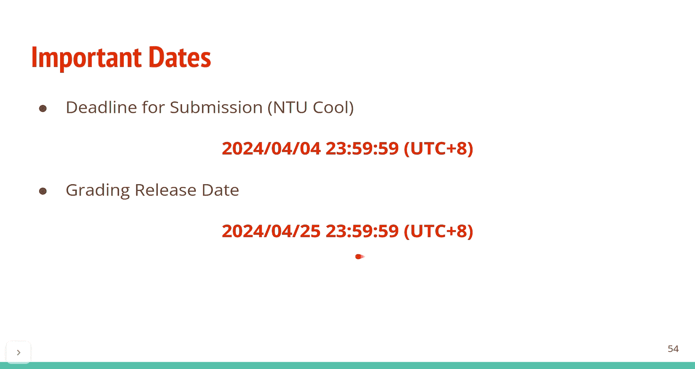

哦那再就是一些规定，这样那这是规定就是不能作弊，然后不要跟别人分享你的pro，然后第一次违反我们就作业零分，然后学习成绩成0。9，那第二次违反我们就是学习成绩，就是啊F然后教授还有助教们。

就是保有更改以上规定的权利，那如果你有问题，那首先就是哦，我还是建议同学先发问到这个作业室的讨论区，就是如果你有碰到一些奇怪的error，就是没有在上面刚投影片有讲到的error。

那你建议你都先发到作业室的角角区，那当然你也可以这个即兴到呃助教的信箱，但请务必要在前面加啊，这个蓝色的部分在这个新的title，那再来就是TL，TL就是嗯今天的呃06：30到7。2，04：30到5。

20，然后再就是3月29号，也就是下周五上课前，还有这个下课后，那地点也都是在这个综合大讲堂这边。

那底下就是COLLAB的连接，那再就是讲一些啊，可能就你不知道怎么下pm的时候。

你可以稍微参考一下，应该多少有点帮助，那第一个叫做zero shot channel salt，那简单来说就是我们请模型，就是我们加一个PO叫let think step by step。

就是请模型去一步一步的思考，那获取模型就可以比较正确的回答这个问题，那第二个叫做in contest learning，那in contest learning，简单来讲。

就是我们给模型看一个例子或是多个例子，那希望模型在解题的时候能够参考这个呃，我们给他的例子去解答，那再就是这个情绪勒索，就你们可以想一些情绪勒索的字的句子，然后去跟模型讲。

或许他真的有可能会给你们更好的回复好，那这次作业我们就讲解到这边，谢谢大家，好诶，关于作业，有没有同学想要问问，来这边有两个问题，第一个问题我要跟你说，我们是用来抽出我们最后的他给他给出的答案。

那你有没有可能在抽抽出过程中，他抽出的东西不是这个答案，但是其他就不会那样说话，怎么办，好这部分我们就算错了，因为只要我们没有在第二阶段的答案里面，发现你有正确答案，那我们就会算错，所以你要证明模型。

把那个答案写清楚，对面来说你抽不到，好孩子说，第二个问题是可以，请问一下你们，这就是在这边的数学问题里面，他们能够讲一下他们数学问题，是我描述使用的，看看你的大小或者放大好啊，都是英文。

然后都是国小等级的题目，好好来这边，请问你们是不是就加了一体，他给的标准可能是2。0，那就接模型输出是二分之，这样会是对的，嗯嗯我们后面也会有一些处理的部分，所以我们会尽量把就是你刚刚讲的5/2。

还有2。5，尽量把它们对齐在一起，就你如果有疑问，你可以回去看我们十座的城市嘛，然后如果你还有疑问，欢迎在机器来反映啊，这边可以用三个以内的，是啊，我们就只是单纯的从头开始，好大家都好，有问题想问的呢。

有没有人物为什么要有一个privacy，为什么不就是直接让你手上的那个快递费就好，因为其实啊你那个puppy sin你要拿到全对，应该是蛮简单的，怎么做呢。

你把那puppy sin30几的答案之人首先算出来，然后你就全部把它写在pop跟模型中，看到这个题目就回答这个答案，那你就选对了，所以如果让你手上有private sense，这种作文就没有什么意思了。

所以一定要你手上有没有没看过第一才行，那如果只会导致说话，不要因为臭打，因为多数人都不会不知道说出来会，我们在抽答案的时候，刚刚那张图应该，呃这张图我们是只有把问题跟解题过程拿去做。

第二阶段并没有包含你们的pro，问题不抽烟，导师会进行两次的，每一个针对考虑，然后如果说我现在排位赛直接把手搭上去，然后在发布赛场可以得到所有问题，但是另外一个，我觉得可以对他的身上这样子的吗。

他的上下可以可以给两个头，可以给两个头，哎我太清楚他的问题是这个样子，就是假设他有两个不同的炮，一个是puppy c，可以拿到满分的POPUPPY赛会比较高分的报，那他可以给两个炮。

可是上交作业可以交两个PO，我不太我不太懂，就是什么叫，就是他们就是为什么可以知道在party上会高分，还是是指我们分数出来之后，应该就是讲说的是用最高分那个蚌本来打分数，那高分范本是在宽带上。

次高分在PC上号高，他需要有版本吗，还是就说歌曲的嗯好我了解一点问题嗯，这边我们应该就是分别是不同的point，就是你可以在public他怕怕比赛排位赛的号，就是因为现在可以上传两个炮。

那我们如果说这两个炮，在privacy和PY身上分出很大的差异，我们是看这个同一个框框的分数，还是哦可以看不懂，看不懂的，top粉丝会去让大家比较高的那个分数的可能性，对不对对对，让你更了解。

可以看看不同的pop，因为可以上传两个pop，所以会看不同的画小点，他的问题是说，如果他自己测的PC，他拿到非常高的分数，但是实际上这个大学模型都是些rendering测试，没有那么高。

他可以argue吗，呃基本上你测多高，我们测出来应该不会差太远，而且在PC上只要超过六层，他就会拿满分，因为这边是主播，但我想如果他回来一个暗示，比对应该不会差那么多，但真的有差到那么多。

那可能就是我们在个别处理这样，啊还有还拍这个，感觉这个party赛的难度是一样的吧，基本上是，嗯好还有哎还可以，在最后会提供这个这个你们测试的数数，就是看一下怎么死的之类的，我们最后应该会只会提供。

就是最后各位十分拿几分，那如果你想要看的话，可以给大家快，别在这个作业结束之后就只提供资料，我还是要给他们的所回复，因为可能会很多啊，大家都要提，可能没有办法提供给所有人，但是如果题目练习想练习。

好还有问题吗，好如果没有的话，现在我跟大家细说一下，现在规划就有一组同学想要有一个活动，想跟大家分享，你知道现在正下课对，然后你有事情都可以离开啊，如果你想你也可以去，但是我看到这个线上。

还有个问题是需要回复一下好，这个问题是怎么样啊。

