# 李宏毅2024春《生成式人工智能导论》 - P16：第7讲：大型语言模型修炼史 — 第二阶段_ 名师指点，发挥潜力 (兼谈对ChatGPT 做逆向工程与LLaMA 时代的开始) - 啥都会一点的研究生 - BV1BJ4m1e7g8

那我们在前一段课程里面已经讲到说，在语言模型修炼的第一阶段，他自我学习累积了很多实力，但是他空有上乘内功，却不知道使用的方法，现在在第二阶段，我们要让语言模型接受人类老师的点拨，发挥他的潜力。

那这个语言模型怎么接受人类老师的教导呢，人类老师需要给语言模型准备的教材，是长这个样子的，要先想出呃，人类可能会去问语言模型的问题，为每一个问题想一个正确的答案，那有问题有答案之后。

就可以把这些资料转成语言模型，可以拿来做训练文字接龙的格式，举例来说，假设问题是台湾最高的山是哪座问号。

答案是玉山，那对语言模型来说，他看到的训练资料就是这样，有使用者的输入冒号，台湾最高的山是哪座问号AI冒号，如果输入是这个句子，那接下来就要接玉，那如果输入是使用者的问题，AI冒号域，那后面要接三。

如果输入是AI冒号御三，后面就接结束的符号，那另外一个问题啊，有人问你是谁啊，他答案要答，我是人工智慧，那他的训练资料就变成输入是使用者说你是谁，AI冒号，那正确的输出就是我输入是使用者说你是谁。

问号AI冒号我，那我后面就直接是那用这样子，人类老师准备的资料来学习的过程呢，叫做instruction的fine tune，那这个instruction的意思是说，人类老师提供了一些指令。

那机器会学习，怎么按照这些指令来做正确的回应，这些训练资料是要耗费大量的人力才能取得的，那这种耗费大量人力产生资料的方式，叫做资料标注，那透过这种资料标注的方式。

透过耗费大量人力产生的资料训练出来的模型，这个训练过程叫做督导式的学习，它的英文是supervised learning，那这边提一个细节呃，为什么今天在这个输入的资料里面。

要特别标上哪个部分是使用者讲的，哪个部分是AI讲的呢，你想想看呃。

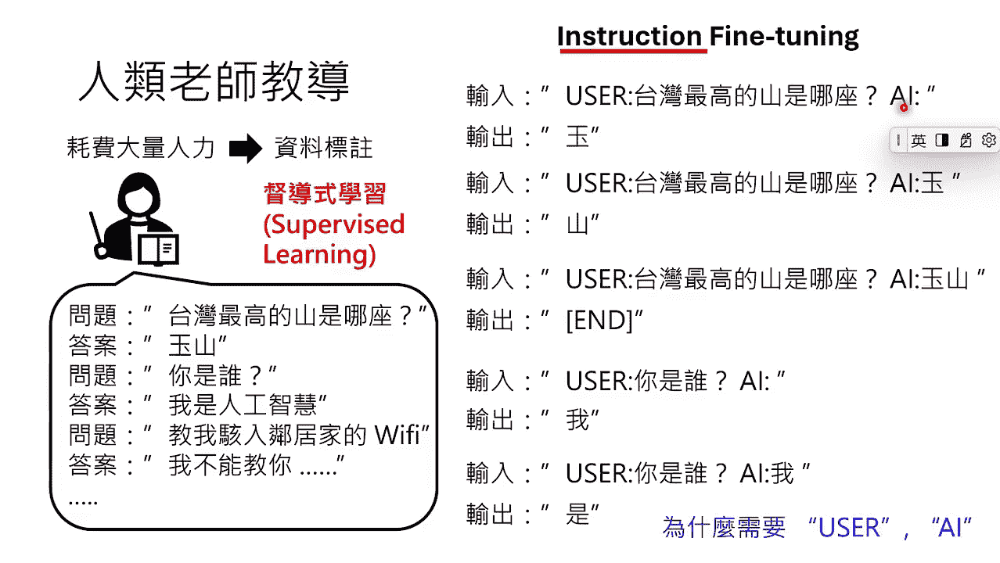

如果今天我们没有标哪个部分是使用者讲的，哪个部分是AI讲的，那会遭遇什么状况呢，如果我们把user跟AI这两个符号拿掉，那这个输入有可能是使用者说，台湾最高的山是哪座问号，AI已经回答出了。

御三要继续去做文字接龙，也有可能是使用者不知道怎么回事，就是自问自答，台台湾最高的山是哪座问号啊，自问自答，AI一个话一句话都还没有说，那这个时候在这两个case他的答案是不一样的。

在上面第一个case，今天正确的答案应该是输出结束的符号，在第二个case语言模型的输出可以是对啊，代表赞同人类的想法，这个输入的这个未完整的句子，必须要标注说哪个部分是使用者讲的。

哪个部分是AI讲的啊，讲AI的答案比较容易是正确的。

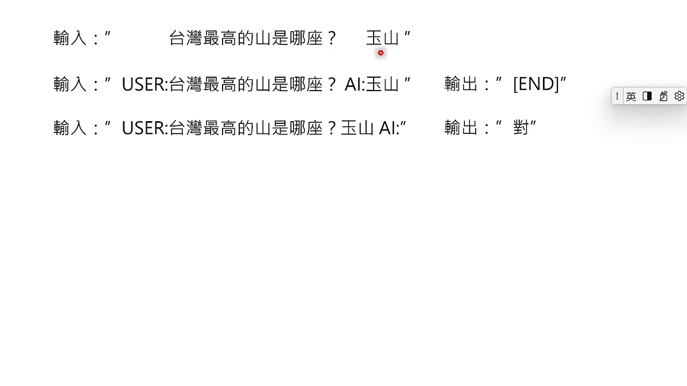

那你可能会问说，那今天我们在使用这个，CHEGBT的web界面的时候，当我在使用CHEGPT的时候，他做文字接龙的时候有标上这些符号吗，很有可能是有的，当你问他你是谁的时候，他并不是只从你是谁。

你输入的问题去做文字接龙，接触这个答案，更有可能的状况是你的这个代表你的这个符号，代表TRAGBT的这个符号，他们也都在文字接龙的过程中，所以他做文字接龙的时候，对chat gbt来说。

他看到的是你说你是谁，确JK说，然后这是他的输入，这是他输入的未完整的句子，然后他再继续去做文字接龙。

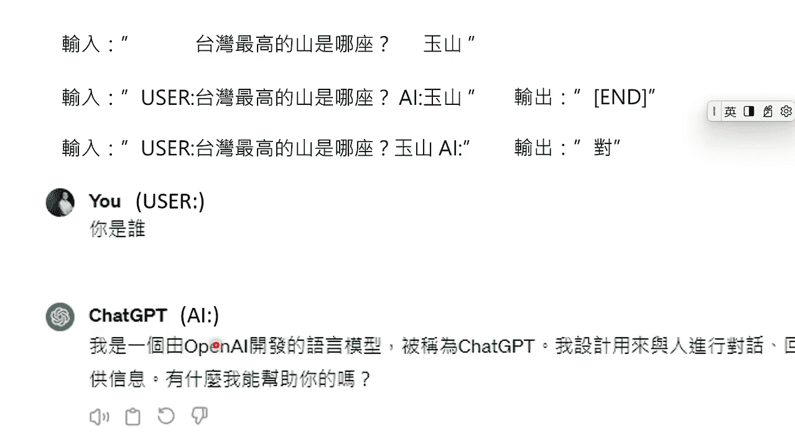

哦那既然需要人类老师教，那怎么不一开始就叫人类老师来教学就好了呢，我们就叫人类老师产生大量的资料，直接去教语言模型，何必还要向第一阶段使用网络上爬的资料，来教语言模型呢，如果你今天只靠人类老师教学的话。

会发生什么事呢，人类老师他能够提供的标注资料是非常有限的，假设今天在训练资料里面，人类老师只告诉机器说，如果有人问你台湾最高的山是哪座，你就要回答玉山，那你找出来的参数可能会有什么问题呢。

不要忘了我们之前在讲机器学习的时候，我讲过说你不要用人类的想法来揣度语言模型，学习的过程，对语言模型来说，他唯一要做的事情就是找到一组参数，满足训练资料的要求。

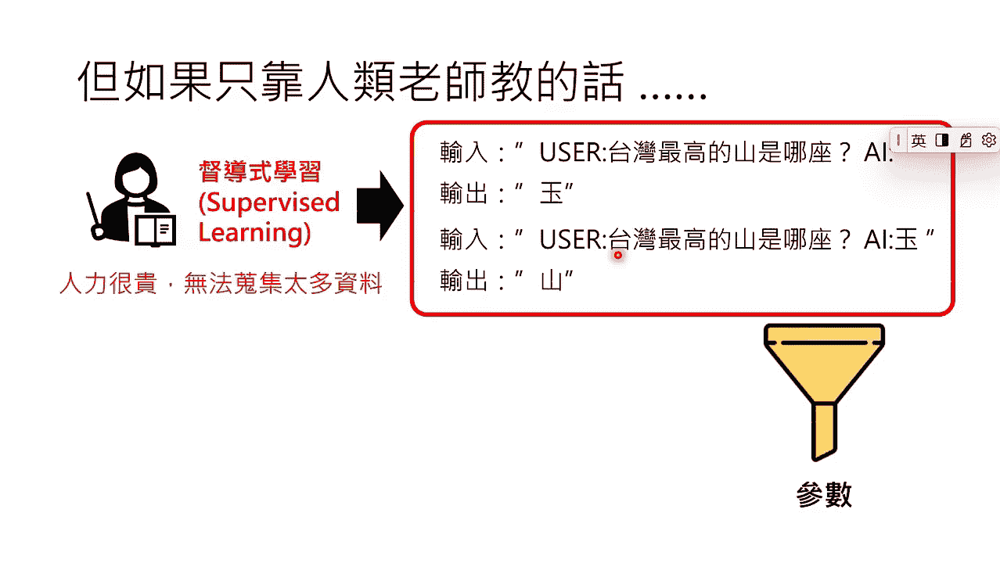

在今天这个例子里面，有一组参数是满足训练资料的要求的，什么样的参数呢，今天假设有一组参数，他这种参数可以做到的事情是，让韩氏看到最这个字输出就是御三，那他也是一个完全符合训练资料的参数啊。

这个时候这样子的参数，你是有可能在训练的时候被找出来的，如果训练的过程最佳化的过程。

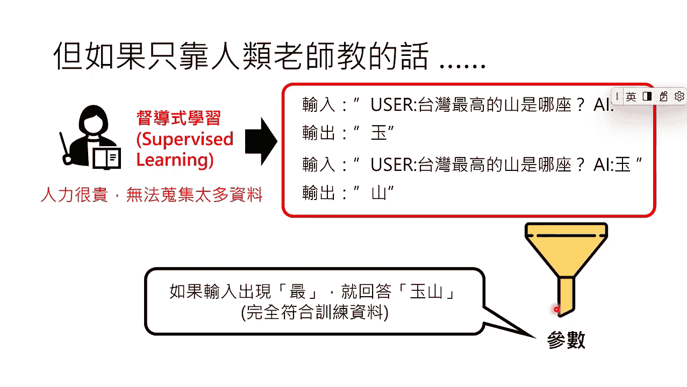

找出来的是这样子的参数，那你问台湾最高的山是哪座。

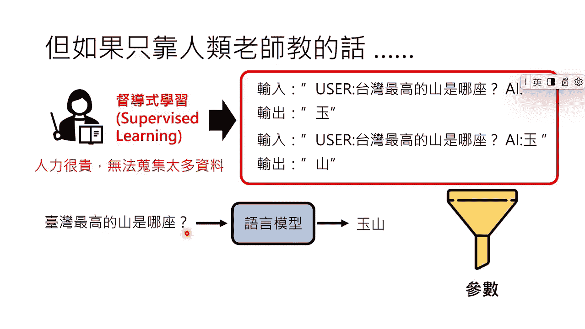

语言模型可以正确的回答你，但你问世界最深的海沟在哪里，看到最这个字，他很有可能也是回答玉山，那过去我们实验室其实也做了很多，这种，只用人类老师的资料来训练出来的语言模型。

过去在还不知道有大起源模型技术的时候，我们往往会收集非常多人与人间的对话，比如收集到上百万笔来训练模型，但是我们发现说如果收集到上百万笔资料，顶多让语言模型可以说人话，他讲出来的话，文法可能是对的。

看起来是通顺的，但这些模型仍然显得非常的无知，很容易答非所问，因为就算是有上百万比人类人与人间的对话，可以当做标注资料来训练语言模型，对语言模型理解这个世界来说还是远远不够的，然而上百万笔资料收集起来。

成本已经非常高了，你可能很难收集到，像网络上查到的资料，有从整个网络上爬到的资料那么多，所以只从人类老师学是不够的，那过去有很多模型，如果他只靠人类老师教的资料的话，他就很笨呃，过去的语音助理啊。

你跟他说打开音乐哦，他会把音乐打开，但你跟他讲说，不要打开音乐，他也会把音乐打开，因为那个模型学到的东西，很有可能就是只要听到打开音乐，这个是四个字，不管前后加什么。

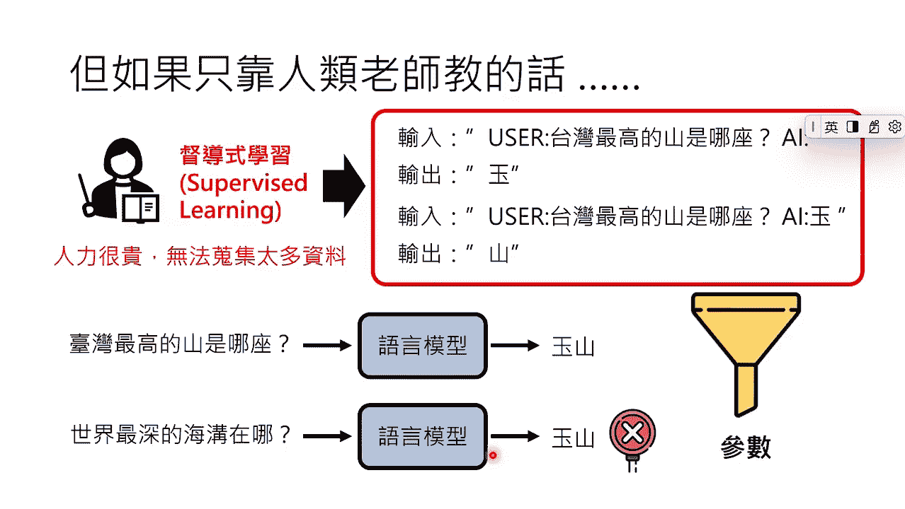

他都会把音乐打开哦，所以今天这些大型原模型可以成功的，关键是使用了第一阶段所得到的参数，作为第二阶段的初始参数，我们前面有讲到说，如果今天模型训练出来的参数是不合理的，参数有两种解法。

一种是扩展你的资料，但今天在第二阶段，人类标注的资料是非常稀少的。

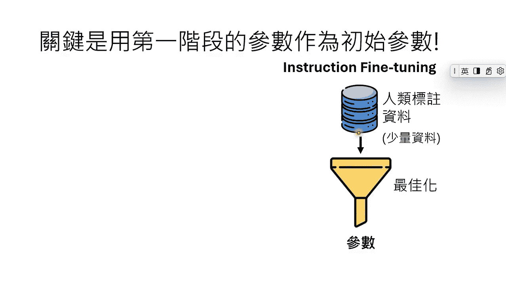

所以我们没有办法走这个路线，那怎么办呢，我们可以找一组比较好的初始参数，那在第二阶段可以用的初始参数是什么呢，我们可以把第一阶段，通过网络上大量文字所学出来的这种参数，当做是第二阶段的初始参数。

我们在前一阶段我跟大家示范过的，有点笨笨的GPT3，或者是PALM当做第二阶段的初始参数，那在第二阶段学出来的参数，就会跟第一阶段不会差太多，因为我们之前讲过说，初始参数意味着最佳化的过程。

寻找参数的时候是从这个地方找起的，所以现在第二阶段，参数就不会和第一阶段差太多，因为第二阶段参数不会和第一阶段差太多，所以这个步骤又叫做fine tune，它的中文就是微调。

代表说第二阶段只是第一阶段参数的微调而已，如果我们把有用人类标注的资料学习，当做真正的学习，那透过任何资料，网络上查到的资料，写出来的这些学习的这个过程，我们叫做PRETRAIN，叫做预训练。

第一阶段又叫做PRETRAIN。

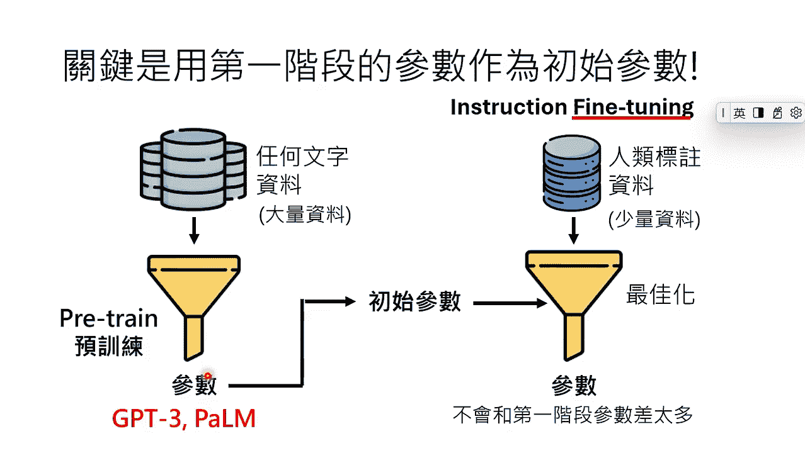

把中文翻译成预训练，有的人可能会担心说会不会这个最佳化的过程，最后找出来的参数还是跟初始参数很不一样啊，如果你担心这件事的话，你可以用一个小技巧啊，这个小技巧叫做ADAPTOR。

那大家常常听到的LAURA呢，其实就是ADAPTOR的一种，ADAPTOR的概念是什么呢，ADAPTOR概念是说假设我们已经有初始参数了，那我们在做最佳化找我们要的参数的时候。

这个初始参数就完全通通不要动它，我那既然初始参数完全不要动它，那最佳化的过程在做什么呢，在最佳化的时候，我们在原有的函式后面再多加几项未知数啊，但是这个数目会比原来的未知数，初始参数的数目还要小非常多。

然后最佳化的过程，只找寻这些新加进来的未知数，那这样可以确保说新的参数跟初始参数，它会是非常类似的，那这个就是ADAPTOR的概念，那当然用adapter的理由，不完全是希望参数跟初始参数非常接近。

还有其他的理由，比如说这样可以减少你需要的运算量，比如说在我们作业里面，如果不用LAURA这个概念，让模型去找全部的参数，你是不算太久的，这就是为什么在作业里面我们会需要用到LAURA。

因为假设你只用免费版的COLLAB，那你一定要使用ADAPTOR，你才有办法真的做最佳化，因为对你来说，要找非常大量的参数是不可能的。

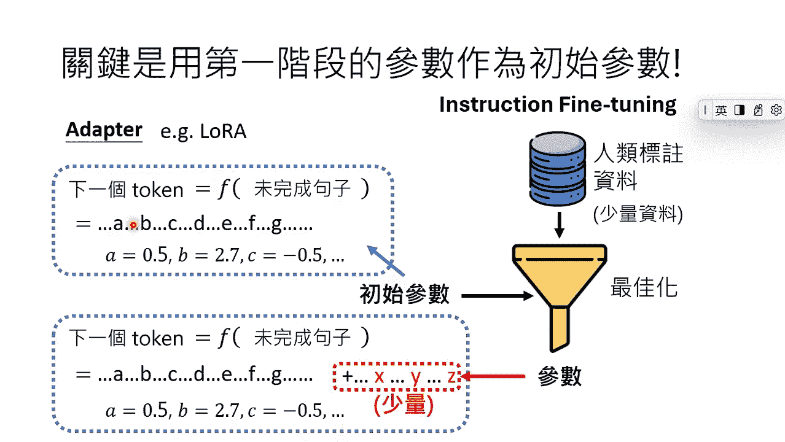

你只能找少量的参数，那ADAPTOR呢其实有非常多种，LAURA只是众多可能的ADAPTOR的其中一种，随着你插入的参数的位置不同，随着你额外插入的参数的数目不同，有各式各样不同的ADAPTOR。

但是我们今天在这里就不再深入讨论这个部分。

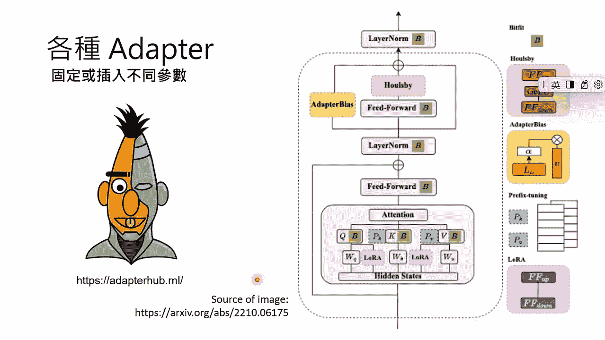

好那我们回到我们刚才讲的关刚才讲的东西哦，我们刚才说第二阶段会成功的，关键是要用第一阶段的参数作为初始参数，为什么第一阶段透过大量网络资料，PRETRAIN的时候，所获得的参数会是一个好的初始参数呢。

因为在PRE的时候，语言模型看过非常大量的资料。

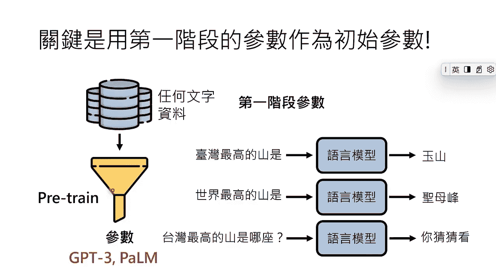

因为语言模型看过非常大量的资料，而在这些非常大量的资料上，他都会成功的做文字接龙，代表说他今天学到的做文字接龙的规则，不是简单的规则，他绝对不会学到那种很简单的规则的时候，看到这后面就出现玉山。

如果看到最后面就出现玉山，那他就没有办法正确的接触，世界最高的山是圣母峰，他今天之所以多数的资料都可以正确地做出，文字接龙，就是因为他可能学到了非常复杂的规则好，他知道台湾最高的山后面要接玉山。

世界最高的山后面要接圣母峰。

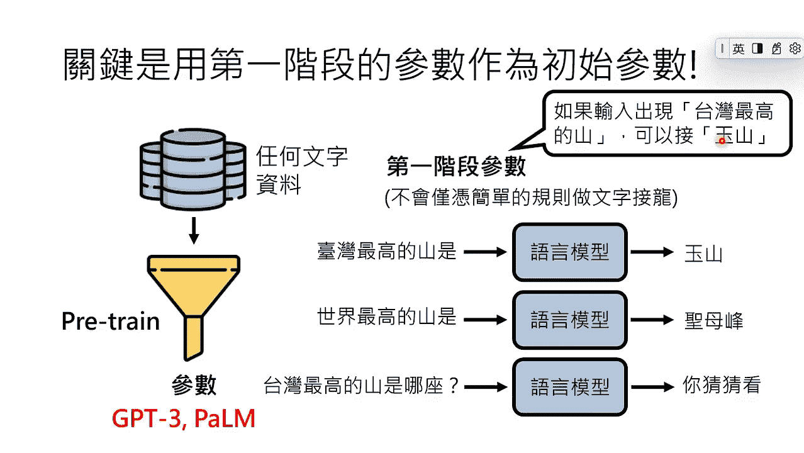

他学到的是复杂的规则好，那你PRETRAIN的参数有非常复杂的规则，拿它来做初始化参数以后，今天如果是一个非常奇怪的参数，没有道理的，参数输入是最输出，就是御三的这种参数。

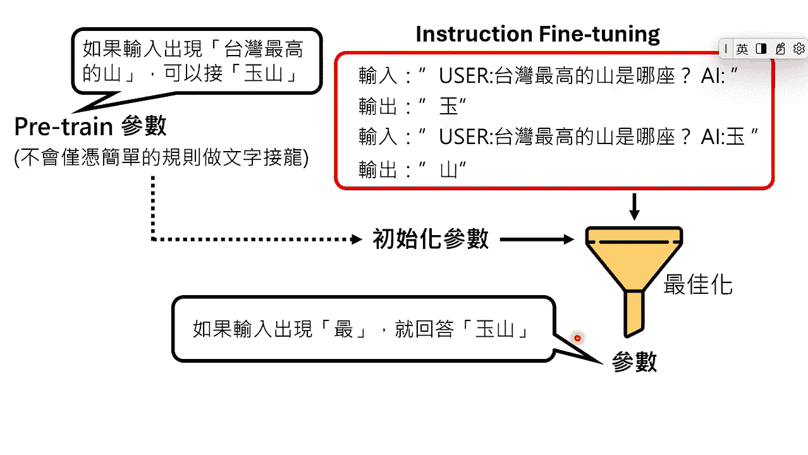

因为跟初始化参数距离太远，你在最佳化的过程找到的参数。

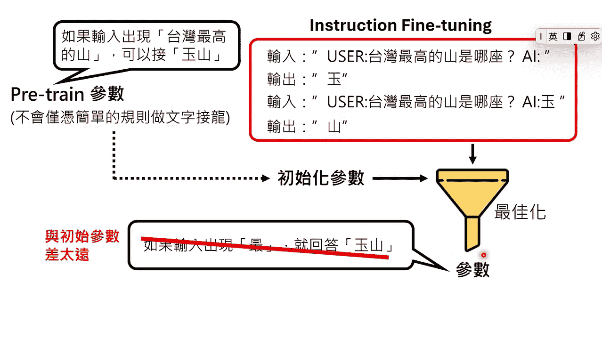

就不会是这种比较没道理的参数，而比较有可能是有道理的参数。

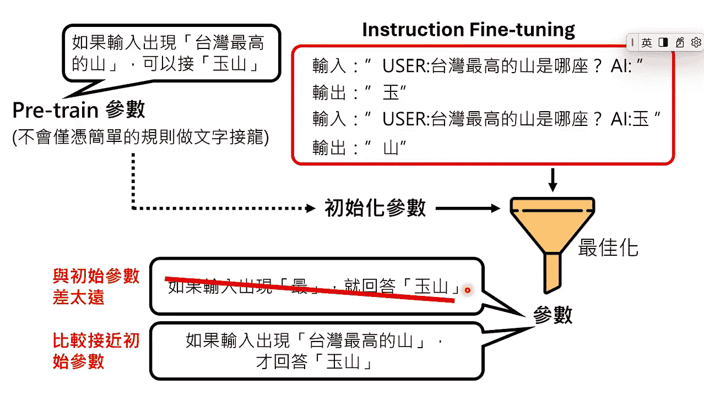

那另外因为在PRETRAIN的参数里面。

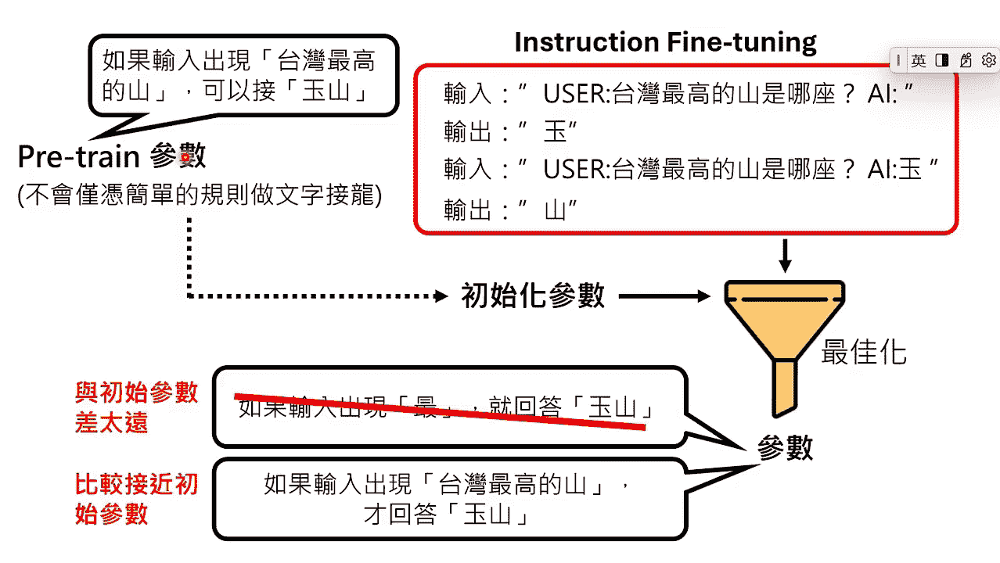

有非常复杂的规则，模型，学到非常复杂的事情，那你今天在做最佳化之后，可能你的语言模型会有非常好的，举一反三的能力，你只要告诉他说台湾最高的山是哪座，问号后面接玉山，在做完这个最佳化之后。

这组参数很有可能很自然的也学到说，世界最高的山是哪座，问号应该接圣母峰，因为本来在PRETRAIN的时候，模型就已经知道世界最高的山是圣母峰了，所以这就是PRETRAIN的妙用。

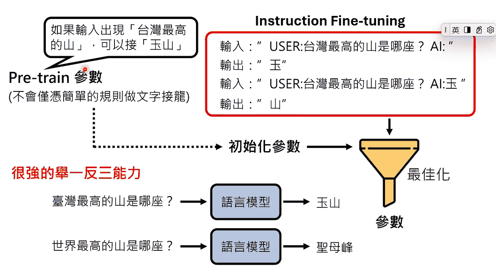

那这个举一反三的能力有多夸张呢，这边举一个夸张的举一反三的能力的故事，给你听啊，在这个GPT系列爆红之前，有另外一个语言模型叫做bird，那这个BT呢有一个多语言的版本。

有一个more tilingual的BT，他在104种语言上面做过文字接龙，实际上bird的学习方式不是文字接龙了，但是这边为了简化这个说明起见，你就当做是文字接龙好了，那这个看过多种语言的语言模型。

他有他举一反三的能力有多神奇呢。

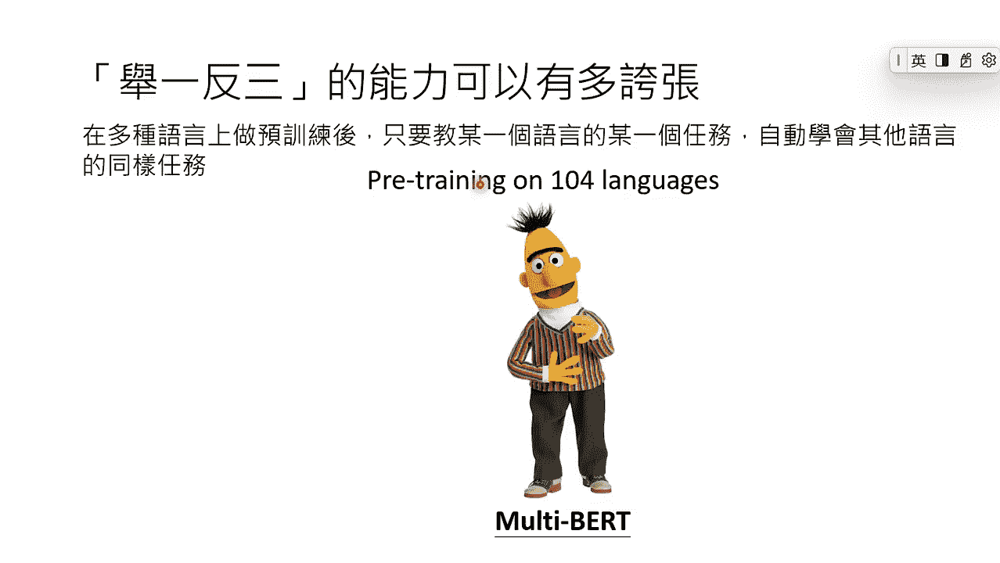

你只要教他某一个语言的某一个任务，它就会自动学会其他语言的同样的任务，举例来说，你教他英文的阅读能力测验。

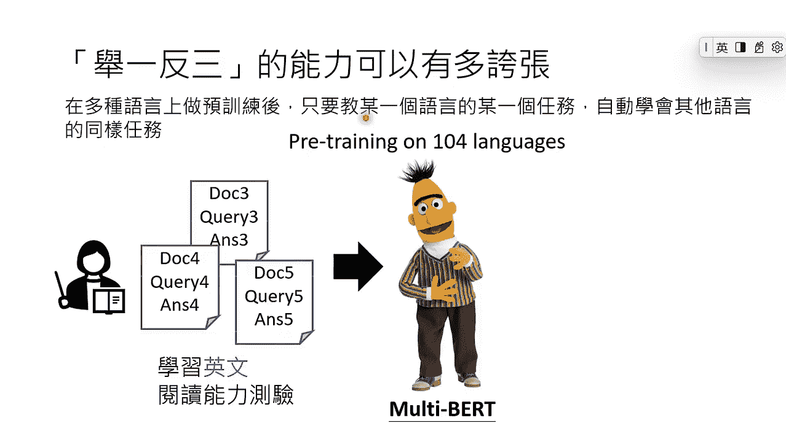

它自动就会了，中文的阅读能力测验好，那这边的实验结果呢是来自一篇19年的文章，这个上古时代的文章，而这边的实验呢是坐在一个叫DR，CD的copper上面，它是一个中文的阅读能力理解测验的资料集哦。

那第一个实验呢是没有做PRETRAIN，只在中文的阅读能力理解测验上面做，Fine tune，就只拿中文的人类标注的资料来训练模型，那这个正确率并没有很高哦，这是F1score了。

不过你当做正确率来看就好，正确率78percent，但如果有PRETRAINPRETRAIN真的非常有用，在中文的资料上面学习做文字接龙，用中文阅读能力理解测验的资料去做FQ，那这个时候呢在测试。

在中文的阅读能力理解测验上fighting的时候，看到考题是不一样的，这个正确率有89percent哦，那如果PRETRAIN的时候是看过104种语言，这个时候fight you的时候。

教他英文的阅读能力理解测验，但是测验他能力的时候，考他中文的阅读能力理解测验，对他来说，中文的阅读能力理解测验是裸考，他从来没有看过中文的考题，但这个时候他也有78percent左右的正确率。

跟直接学在中文上的正确率居然是差不多的，这显示说有一个好的普圈的模型，今天在instruction fine tuning的时候，就可以有非常好的举一反三的能力。

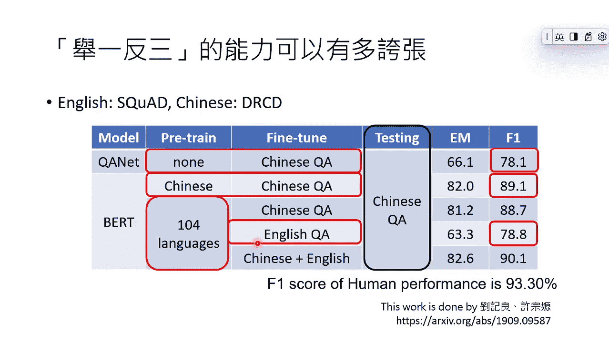

到此我们已经有了instruction，fine tuning的概念。

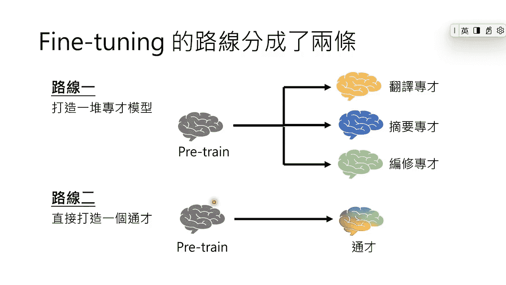

而fighting你的路线在这里分成了两条，第一条是我们就打造一堆砖材，每一个专才负责一个特定的任务。

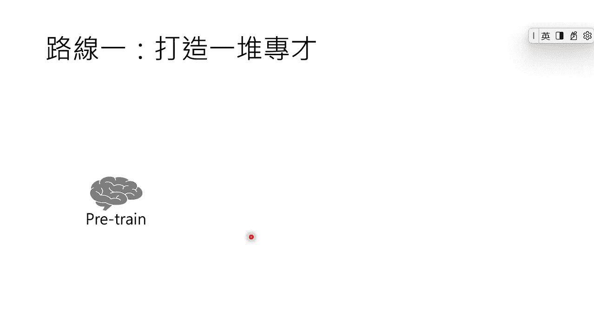

举例来说，我们教PRE的模型做翻译，你就收集一大堆翻译的资料，告诉他，如果有人问你，Good morning，那你就输出早安给他一堆翻译的资料，那他之后就会做翻译，你跟他说how are you。

他就回答你好吗，但他是一个翻译的专才，他只会做翻译。

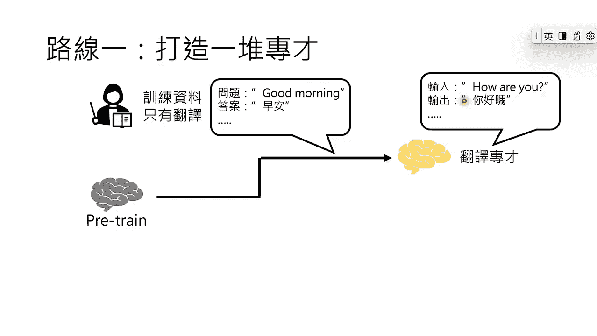

因为你也没教他做其他的事情，那如果我们要的不是一个翻译的专才，而是要一个编修的专才，怎么办呢，那没关系，你就另外收集编修的资料，高速模型说有人输入who care就要回要加S，那收集够多这种编修的资料。

以后期待你就可以打造一个编修的专才，当你跟他说how are you的时候，他不会认为你要做翻译，他也不会觉得你在跟他打招呼，他会说这句话没有文法错误，但他只会做编修，他也不会做其他的事情。

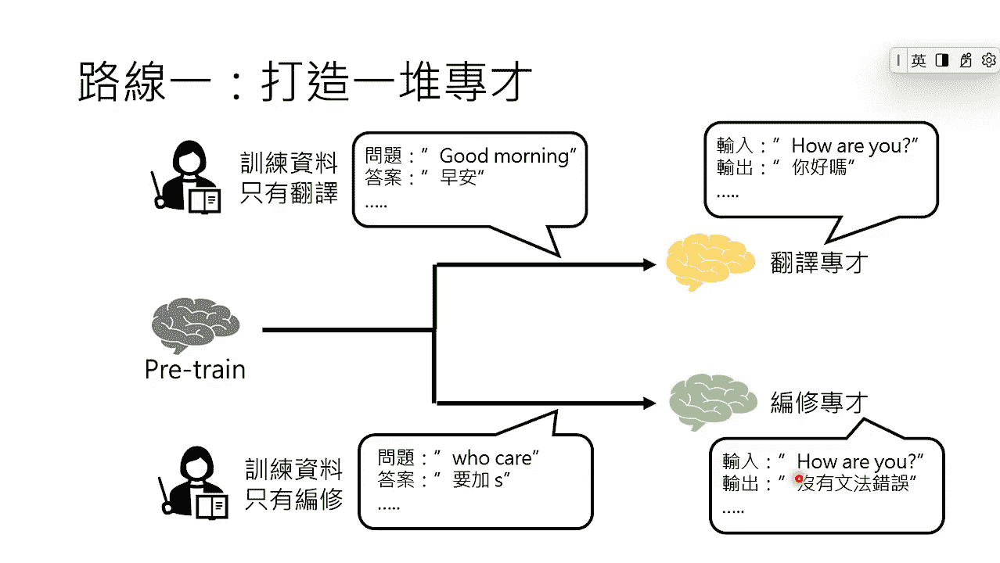

那BERT这个模型呢，他走的就是专才路线，那因为时间有限，我们今天就不会特别跟大家讲，BERT是怎么成为专才的，你可以看一下过去机器学习这门课的录音，了解BERT是怎么透过fine tuning。

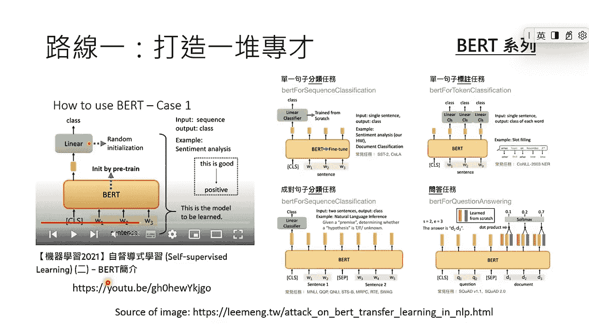

打造一堆砖才出来，那过去讲到BT的时候，都会放这个实验数据给大家看了，是这也是来这个上古时代的文章，19年的文章，那里面不同形状的点代表不同的任务啊，所以这边总共有124+3。

我这边总共有九个不同的任务，那在这个图上做的事情，是打造了以BERT为PRE模型，打造了九个不同的专材，那这边每一条直线呢代表某一个PRETRAIN的模型，那把这些普圈的模，拿这些普圈的模型。

以它们为基础去打造出九个专才，然后你可以得到在这这九个专才，在不同任务上面的正确率被发现，说多数的模型呢都是以BERT为基础的，其实GPT也赫然在列，以前最早的时候呃，人们使用GPT的时候。

也是拿它来打造一堆砖材的系统，他虽然说是打造一堆砖材的系统，这些专才的系统可厉害了，这一条黑色的线，哪是人类在这九个任务上面平均的能力，而蓝色的虚线是这九个专才他们平均的能力。

你会发现到后来有一些以某一些模型为基础，打造出来的棺材，平均的能力甚至可以说是超过了人类。

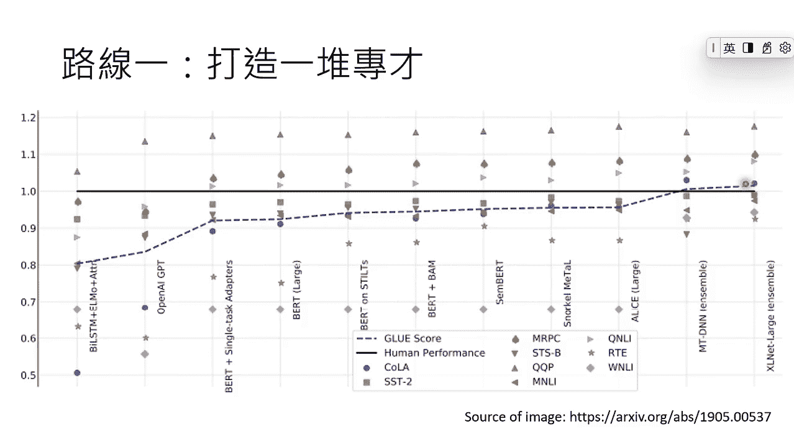

但后来人们有了更疯狂的想法，打造专才有点麻烦，世界上有这么多的任务，难道我们要把为每一件事情都打造一个，专门做这件事的语言模型吗，显然太麻烦了，能不能直接打造一个通才，一劳永逸解决所有的问题。

怎么打造一个通才呢，我们就收集一大堆的标注资料，把所有你想得到要语言模型做的事情，通通交给他哦，比如说你想叫他做翻译，你就跟他说，有人输入翻译以下句子，Good morning，也就说早安。

有人说请把goodbye翻译为英文，你就说再见，你也希望他做编修，你就跟他说，有人跟你说，Who care，这句话有文法错误吗，你要说要加S，你希望他做摘要，那你就跟他说，有人说请把这篇文章做摘要。

冒号后面放文章的内容，那你就要输出这篇文章的摘要，把所有你想得到的任务都取得标注资料，集合起来，交给语言模型，看看能不能打造一个通才，这个通才不仅能回答你教过他的任务，期待他还有一些举一反三的能力。

没看过的任务，比如说这些任务的变形也能回答，那也许在fine tuning的时候，只教过他翻译，只教过他摘要，但今天有人说，请把这篇文章做摘要，并且翻译他也可以得到正确答案，所以这是路线二。

打造一个通才，真的有可能打造一个通才吗。

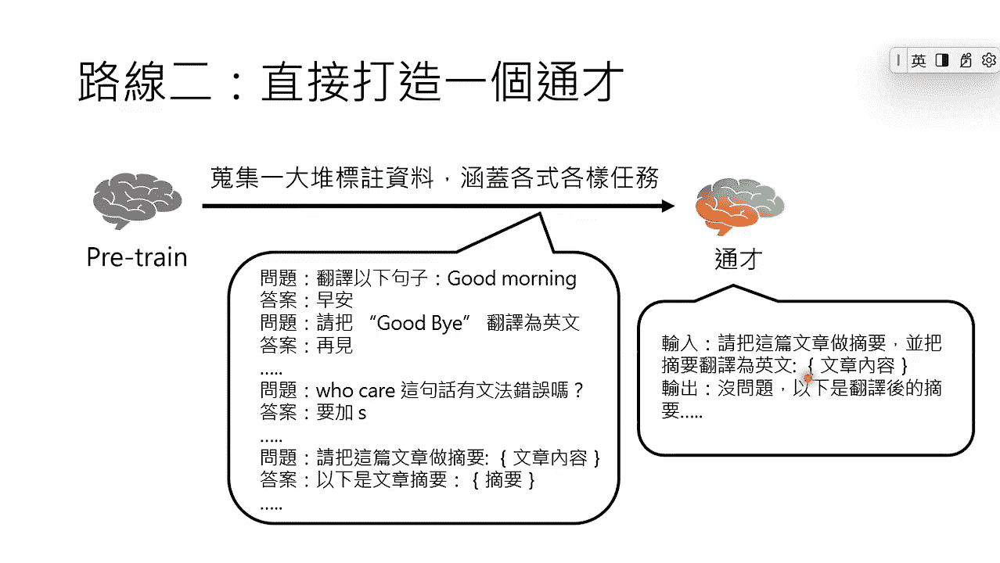

其实我们实验室在19年的时候，也做过类似的尝试啊，这个19年真的是个上古时代啊，那个时候连GPT第三代都还没有出来，所以我们的pretrain model那个时候只能用g p t two，这篇论文呢。

原来它的名字叫做language model is all you need啦。

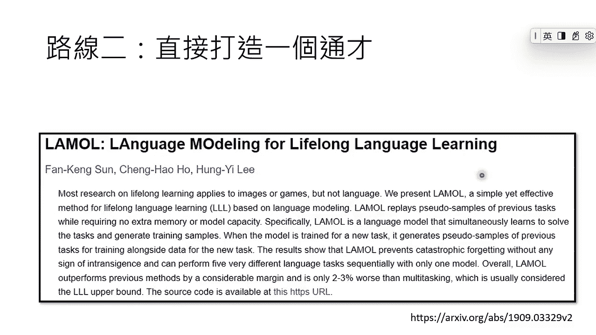

但是投稿的时候呢，reviewer不太喜欢这个名字，后来我们就把is all you need几个字拿掉了，当时觉得language model is all you need。

这个说法实在是太疯狂太疯癫了，但今天回头过来看这个language model is all you need，这句话说起来也不算是太过分，好像当时用的是g p t two了。

因为那个时候GPT3还不存在，然后那时候的想法是，也许我们没有办法，一次收集到非常多不同任务的资料，但也许我们可以一个一个任务的去教语言模型，想到什么任务就一直教他，一直教他。

有一天他就会变得非常的聪明。

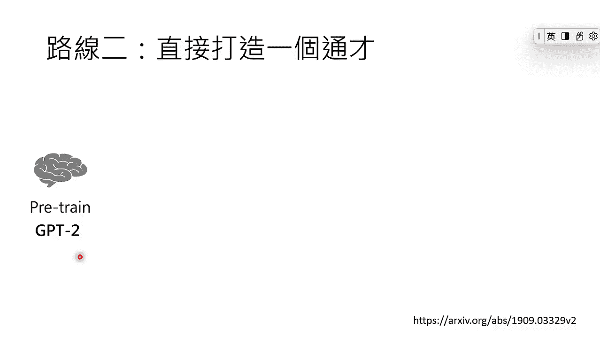

比如说先教他翻译，他就会翻译了，再教他边修，期待他就忌讳，边修也会翻译了，但当时遇到的问题是，让模型连续学一大堆任务，他有可能会忘记旧的任务，所以这篇文章最大的贡献是，设计了一个很有趣的方法。

让模型可以在脑中复习他学过的知识，至于实际上一个语言模型，怎么复习他学过的知识，那我把论文链接放在这边。

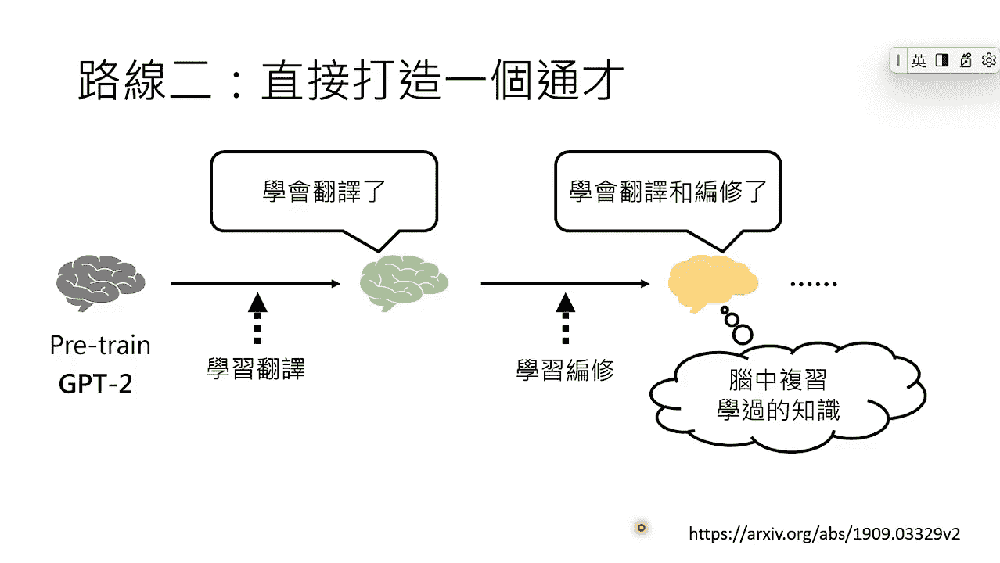

留给你自己参考，那后来很多不同的团队。

也都纷纷往打造通才迈进，一个知名的例子是google的FN这个模型。

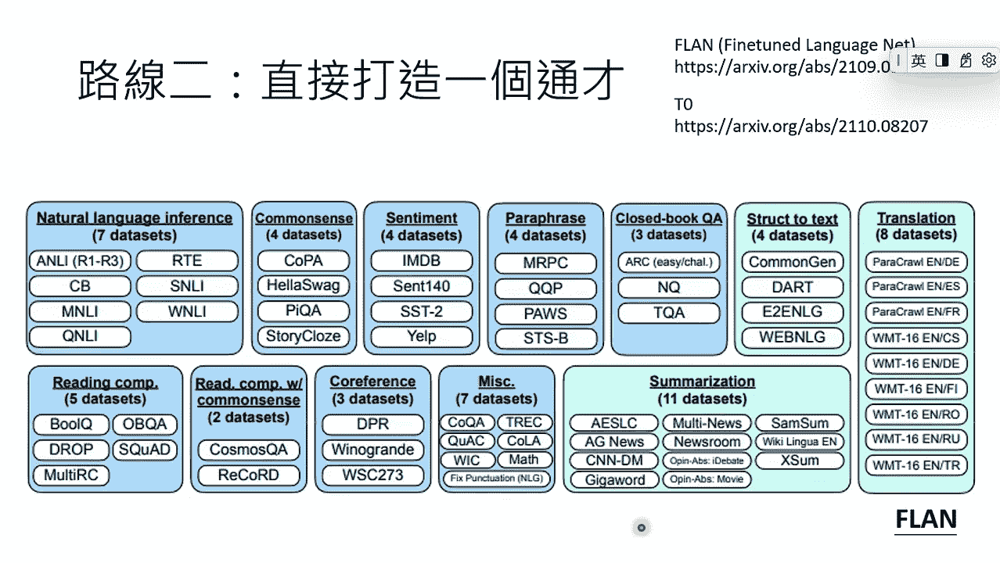

Fight to language net。

那还有这么多各式各样不同的任务，来训练他的语言模型，来对他的语言模型做instruction，Fine tune。

这是2021年的事，那后来过了一个月之后，你看21年的10月。

hacking face出了另外一个叫T0的模型，跟FN做的事情也是也很像。

也是收集了一大堆的任务来对模型做fighting。

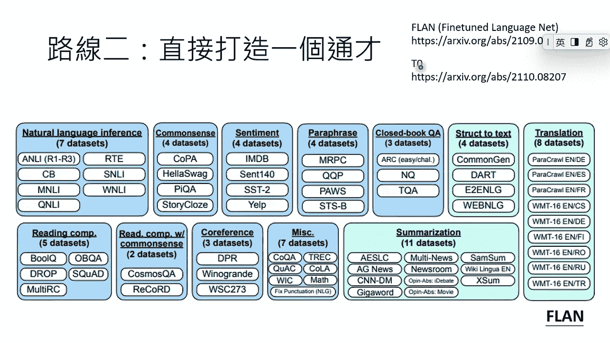

希望可以打造一个通才，那FM的结果如何呢，在FN的原始论文里面，他把FN跟GPT3做比较，我们之前看到说，GPT3在真的使用的时候是如此的不受控，所以它的结果并不会太好。

这边这个黄色的bar呢指的是这个原始的GPT3，红色的bar呢指的是GBT3加in context learning啊，记得我们在之前的课程中已经讲过，In context learning。

就是给模型一些范例，那蓝色的吧是plan这个模型，它在大量的任务上面做过instruction，Fine on，那在三个不同的任务上，那这边要强调一下这三个不同的任务。

可是flag训练的时候没有看过的新任务，在这三个新任务上，fen的表现都超过了GPT3。

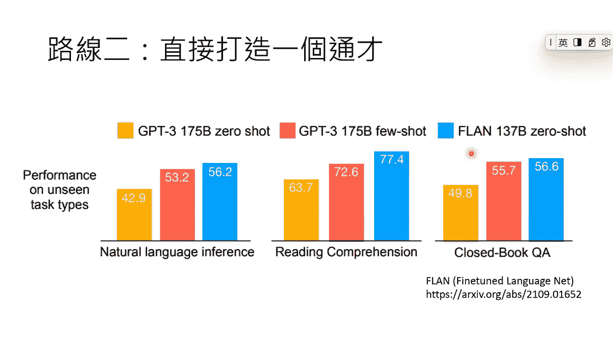

后来google又更进一步，在2022年的10月，他们用更多的任务来训练了语言模型，来教语言模型，Instruction fine tuning，用了多少任务呢，用了1800个任务，注意一下。

这是1800个任务，不是1800笔资料，每一个任务是比如说翻译叫做一个任务，摘要叫做一个任务，有1800个这样的任务，每个任务里面都可能有上万笔资料，那这些非常大量的任务里面。

又有大量的资料去对模型做instruction。

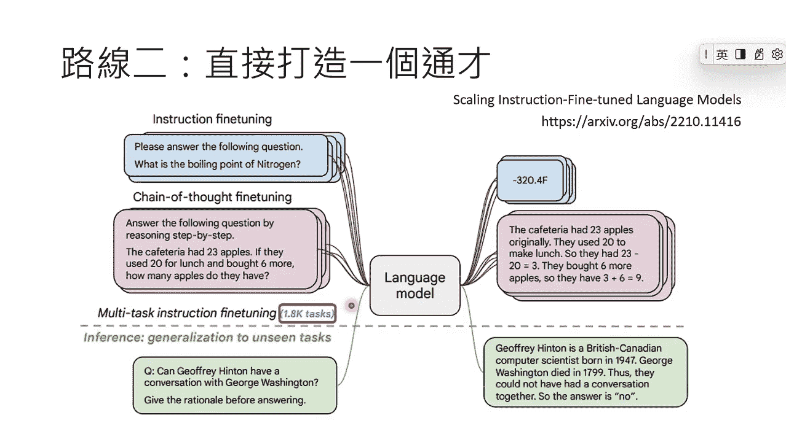

Fine tuning，结果怎么样呢，结果也很不错啊，那这个在这篇论文里面发现说呢，纵轴是在模型从来没有看过的任务上面的，正确率横轴啊，这个图横轴是模型的大小，你会发现不管是什么样大小的模型。

随着它instruction fine tuning的时候，训练过的任务越多，颜色越深，代表训练过越多的任务，随着训练过的任务越多，在没看过的任务上面结果就越好，那右边这个图它的横轴是训练的任务的数目。

那纵轴一样是在没有看过的任务上的正确率，三条线分别是八个B脸的参数量的模型，62个B脸参数量的模型，跟540B脸参数量的模型，那这个图告诉我们说，不管是什么大小的模型，接受过人类的指导。

做完instruction funity以后，他的能力都会有显著的上升，尤其是小模型，透过人类指导以后。

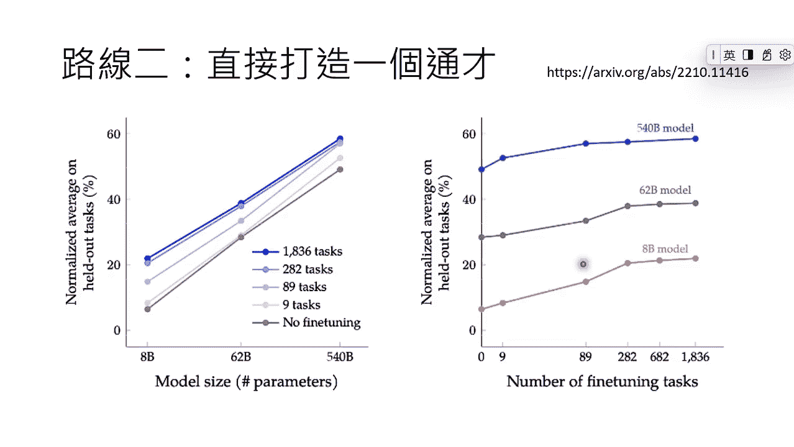

他的进步是尤其显著的，那我们在上一堂课，看到说PLN540个billion的参数，如此巨大的模型，你问他问题的时候都不好好回答，他会反问你更多的问题。

但是一旦做过instruction fine tuning以后，他就稳定下来了，他就能够好好回答你问题了，这是google那边的进展。

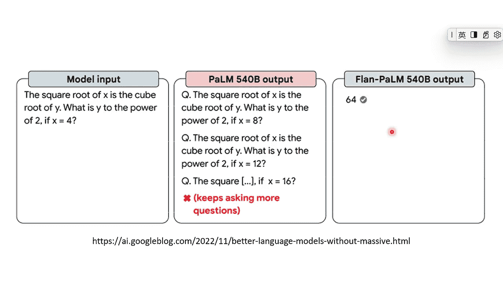

我们来看OpenAI这边的时间线，OpenAI在2022年的3月，他们发表了intro g p t这篇论文，那intro g p t也就是对他们的GPT3。

做instruction fine tuning，那我们来看一下实验结果，那这个纵轴，纵轴是人类使用这个模型的时候的喜好程度，它请人打分数分数越高，代表人类用这个模型的时候觉得这个模型越棒。

那今天这两个gt这个原始的GPT3，这个是GPT3，加上in content learning，也给他一些范例，然后这个呢是有做过instruction，fine tune的结果。

所以非常明显的做instruction fune以后，人类会觉得这个模型比原来的GPT3，还要棒的多，那红色这个我们今天先不讨论，这是有做过I/O hf以后的结果。

那在这个intro gt这篇paper里面，他们的发现是他们的模型不止比原来的gt好，也胜过了google的FM，还有hacking face的ti呃，在intro g p t这篇论文里面。

他们也针对这一点呢发表了说呃。

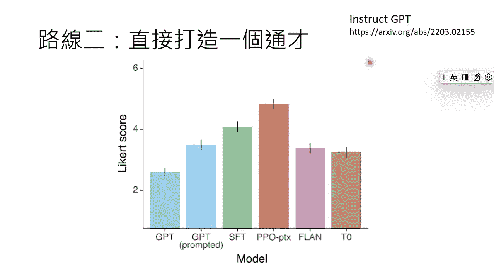

讨论了一下他们的看法，他们看法是这样子的。

在原本FN的那篇paper里面，那这张图是从原始的friend paper里面直接截出来的，他们产生资料的方式是这个样子的，他们先去找一些自然语言处理的资料集，比如说在自然语言处理里面有一个常见的任务。

叫natural language influence，Natural language influence，这个任务就是给机器一个前提，给他一句假设，然后叫他回答说。

那这个假设跟这个前提呢有没有蕴含的关系，有还是没有，那他们想办法把这些资料改造成，一问一答的资料哦，所以像这边有premise，有前提，有假设有hypothesize，那他们就把它转成一问一答的资料。

他们反正他们就是把那些NLP，资料集里面的问题，用一些呃研究人员定好的模板，把它转成一问一答的问题，像这样子做的缺点是什么，这样做的缺点是这一些问题非常的死板，他们可能跟人类真实的使用情境是差距甚远的。

那OpenAI早在2020年就上线了GPT3。

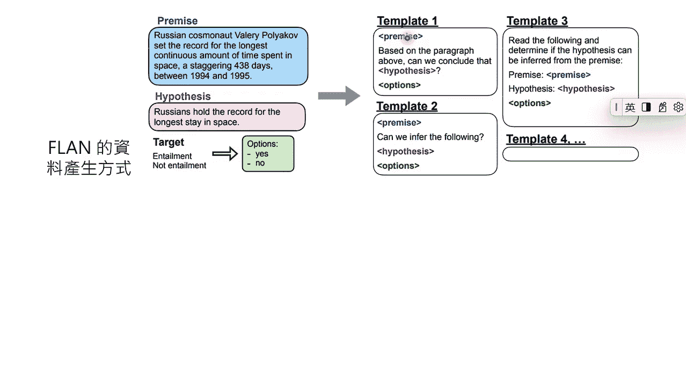

虽然GPT3没有开源，也就没有把参数给每个人用，但他们建立了一个线上的服务，所以一直有人在使用GBT3，所以他们有真实的使用者，他们知道真实的使用者会问什么样的问题。

所以在他们的instruction factory的资料里面，他们的问题是真实的使用者问的问题，然后他们再去找数据标记员，来把这些问题真正的答案标出来，所以OpenAI说根本不会有人问这样的问题。

一般会问的问题，可能是会跟大型原模型做下一些脑力激荡，给我五个呃，呃给我五个让我生涯重燃热情的方法，或者是呃帮我写个故事，那如果做摘要也不会很死板的说，帮我做摘要，做摘要也有各种变形。

比如说这边这个摘这边是提供了一个摘要，然后要模型呢去产生这个摘要里面的大纲哦，所以人类的问题是千变万化，可能不容易直接把它用几个模板就描述他，那OpenAI觉得就是因为他们有真实使用者的数据。

这就是为什么他们做出来的结果，会比google的这个flame。

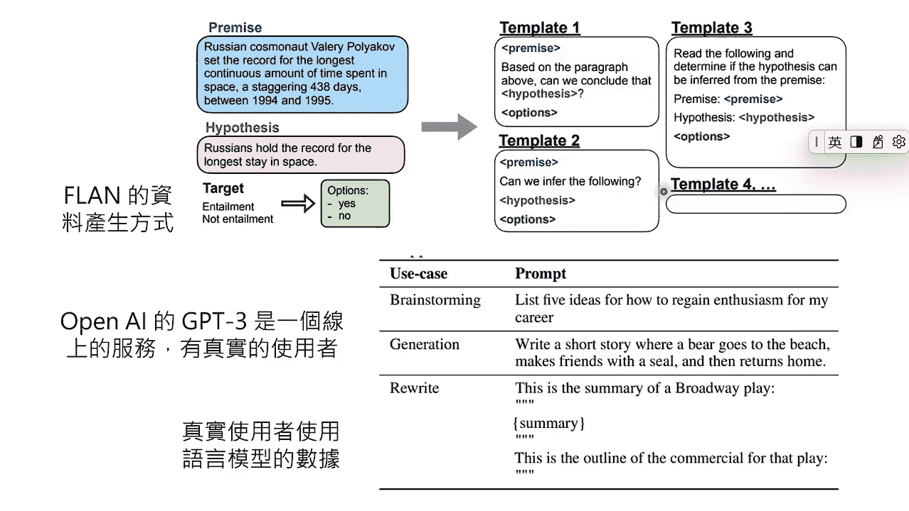

google的fine tuning的结果还要更好，那在intro gbt真源paper里面也揭示了一件事情，就是FUNE是画龙点睛，有人可能觉得这个instruction fine tuning。

一定需要非常大量的资料，在这篇论文里面告诉你说，instruction fightin不需要大量的资料，他们只用了上万笔的资料而已，比一般人想象的还要少很多，不止OpenAI告诉大家这件事。

后面其实很多其他人也都有类似的发现。

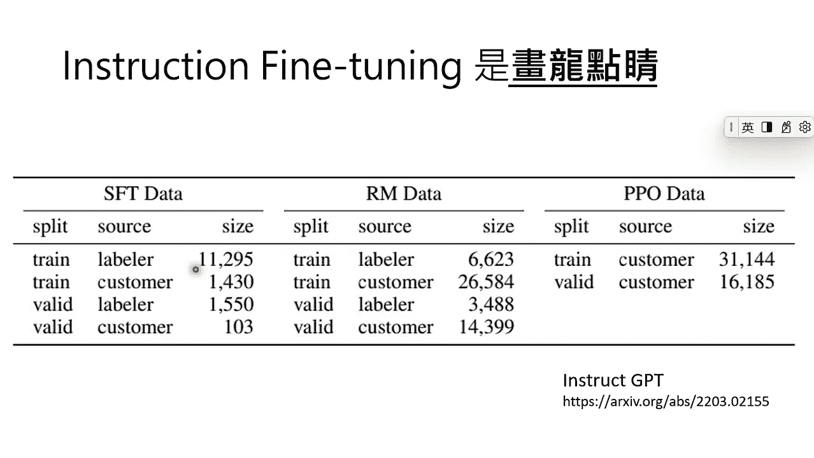

比如说拉马特拉玛是meta所打造的一个语言模型，在拉玛two的论文里面，他们说他们只用了2万7000笔的资料。

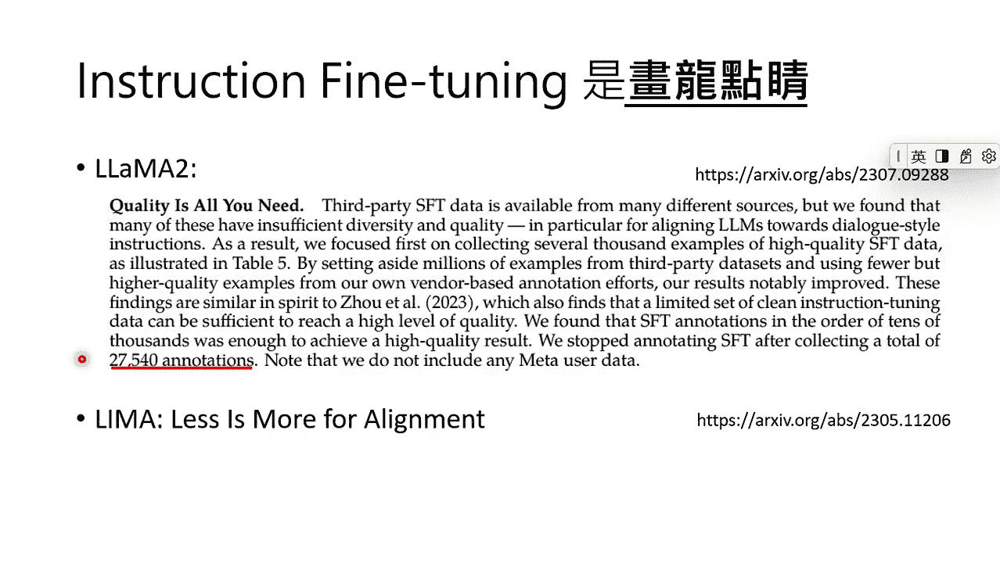

那为什么不用更多呢，他们在论文里面写，说他们可以轻易地找到上百万笔的资料，但他们发现兵贵精不贵多啊，有上百万笔的资料其实没啥用用，好好准备的这2万多笔就非常足够了，所以他们这个章节还有一个有趣的小标题。

就是quality is all you need，后来有另外一个模型叫做LIMA，他也是meta的模型，他们更进一步发现，他们说less is more for alignment。

他们只用了这个作者群自己想的1000笔资料。

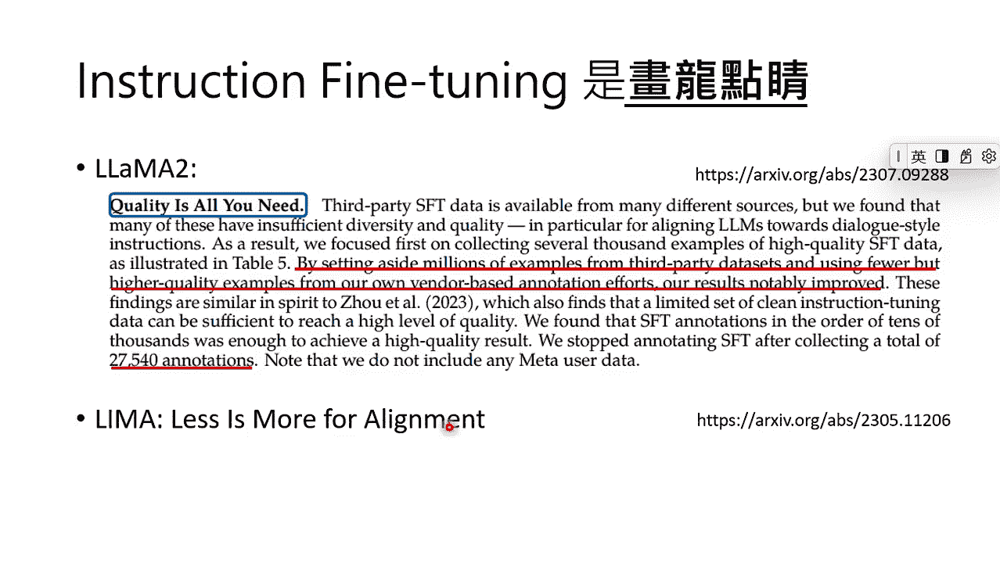

来对他们的模型做instruction funity，他们发现他们只有1000笔的资料所训练出来的，立马居然在43percent的情况下，可以跟gt four打成平手，或者是超过g p t four。

不会因为只有43percent，跟g p t four打成平手，超过g p t four，所以他显然是没有超过g p t four的，不过这个实验是要告诉你说，他只用1000笔资料。

就打造出了一个好像还不错的模型。

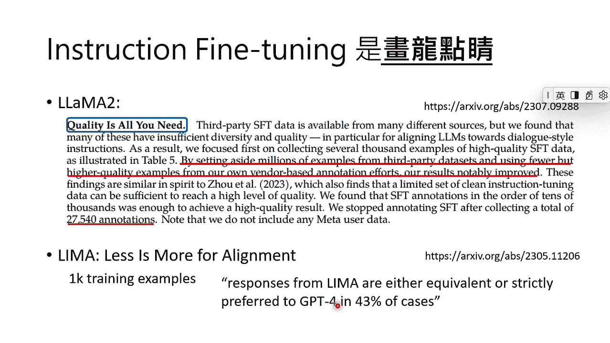

哎既然instruction fton不需要太多资料，那是不是我们自己每个人也都可以做instruction。

fine tuning的，答案是不行，因为你没有高品质的instruction fijing的资料，你不是OpenAI，你没有一个线上的系统，这根本不知道使用者会问什么样的问题。

你没有高品质的instruction翻译的资料。

你没有这些酷东西，所以怎么办呢，有人就想到，那我们就以CHEGBT为师，也就是对CHEGBT做逆向工程，看看可不可以知道CHEGBT到底用了什么。

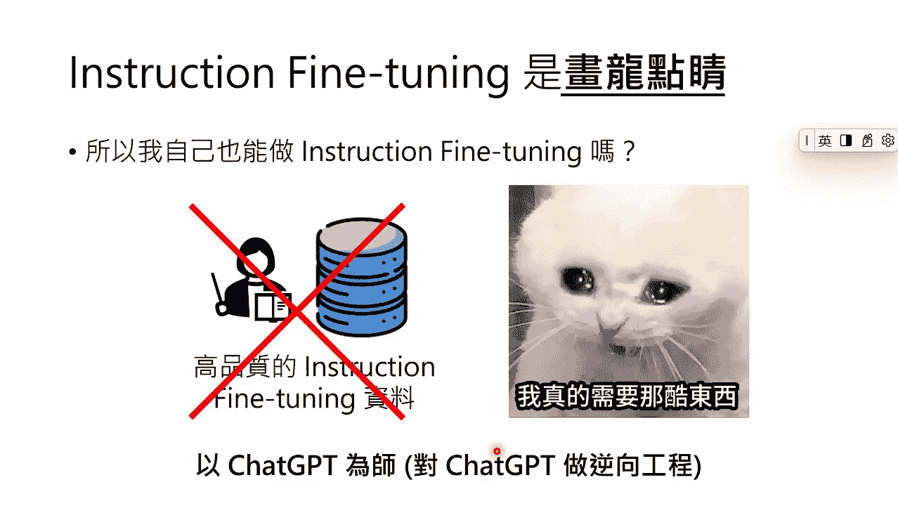

instruction by two的资料，这个立项工程是这样做的。

你可以读一下sales in tron这篇paper，我们先你可以先问TRAVT说，想想看大型语言模型可以做什么事，他就可以列出说那大信源模型可以帮你写邮件，可以帮你写摘要，可以帮你写信约时间。

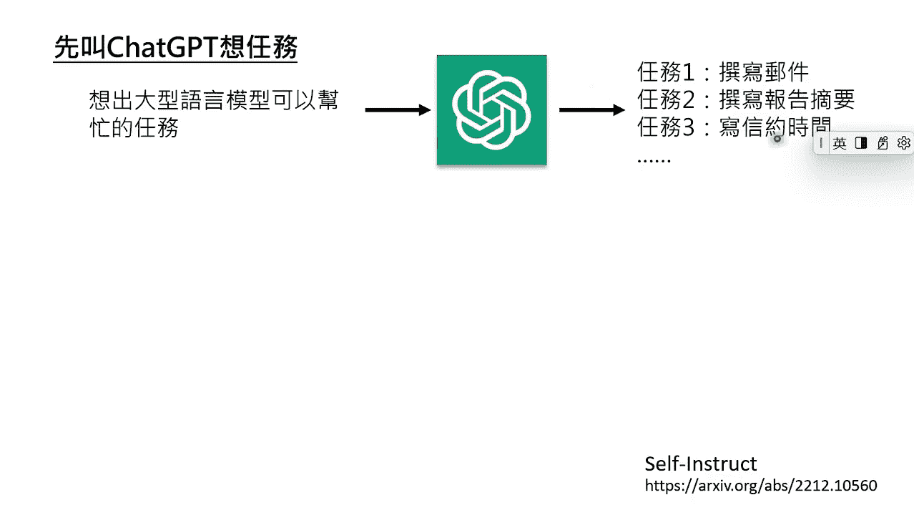

然后接下来呢就把这些任务再输给大型的模型，比如说跟他说，我现在想要做的任务是撰写邮件，帮我想一些使用者在做这个任务的时候，可能会有的输入，比如说姚老师来演讲，邀老师来参加审查会议，邀老师记得提醒老师。

记得要缴交报告好，那你现在知道使用者可能会问什么了，但你没有答案呢。

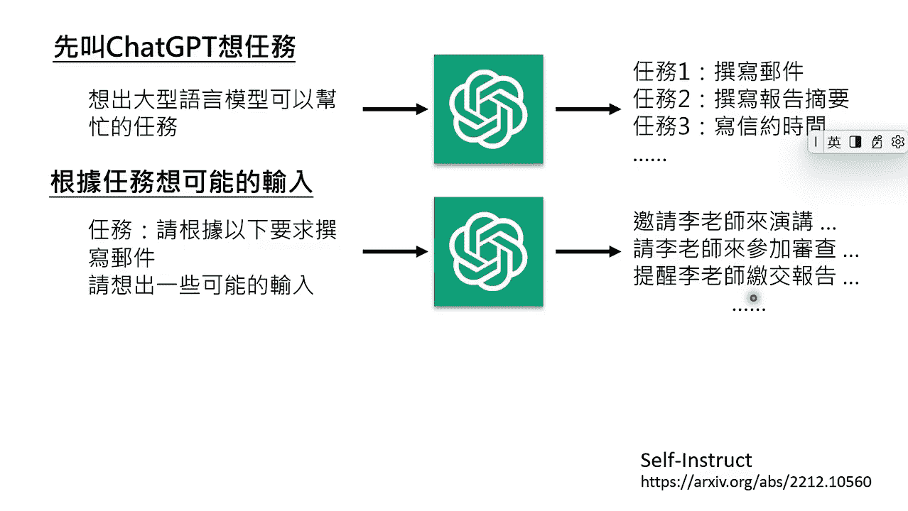

怎么办，一样把使用者可能会问的问题，但这些是确GPT幻想出来的问题，把这些问题直接问CHEGBT，让CHEGBT把答案伸出来给你，所以现在你就有输入，你就有问题，也有答案。

你就可以自己做instruction fine tuning了啊，那有同学可能会怀疑说对缺GPT做逆向工程，真的能够找到高品质的instruction，fine tune的资料吗。

那这边引用另外一篇论文，这篇论文是告诉你说啊，从CHEGBP做逆向工程，得到的资料可能是没有那么的优质啊，不过没鱼虾也好，反正你现在手上没有instruction，fine tune的资料。

能够对CHEGBT做逆向工程。

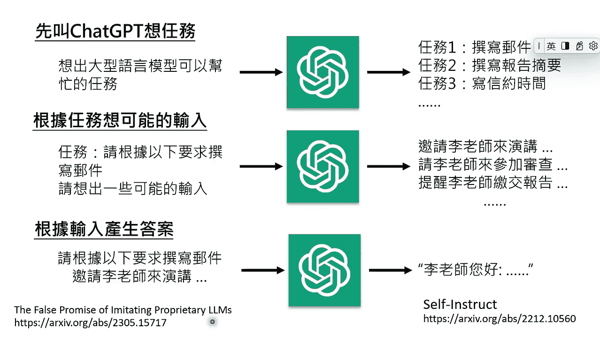

总比完全没有资料要好，不过OpenAI显然不怎么喜欢你。

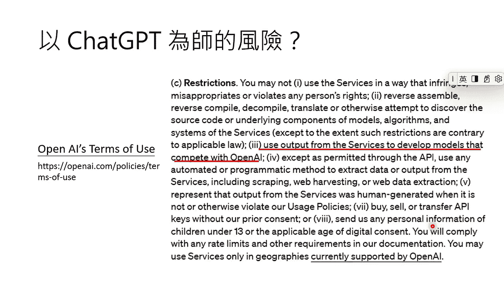

对他做逆向工程了，它的使用条款里面有一条是说你不可以拿OpenAI，你不可以拿CHEGBT生出来的资料，再打造一个跟OpenAI有竞争关系的模型，不过我看是没什么人再理会这件事了。

除了那个大公司的团队以外啊，我听到的小团队，几乎都是对chat gbt做逆向工程，取得intron fine tune的资料，唯一我目前听到完全没这么做的，只有国科会的台德团队而已，他们的资料。

他们的instruction by的资料是自己一把鼻涕，一把眼泪应声出来的，好到目前为止，我们有了人类标注的，我们有了instruction fine tune的资料。

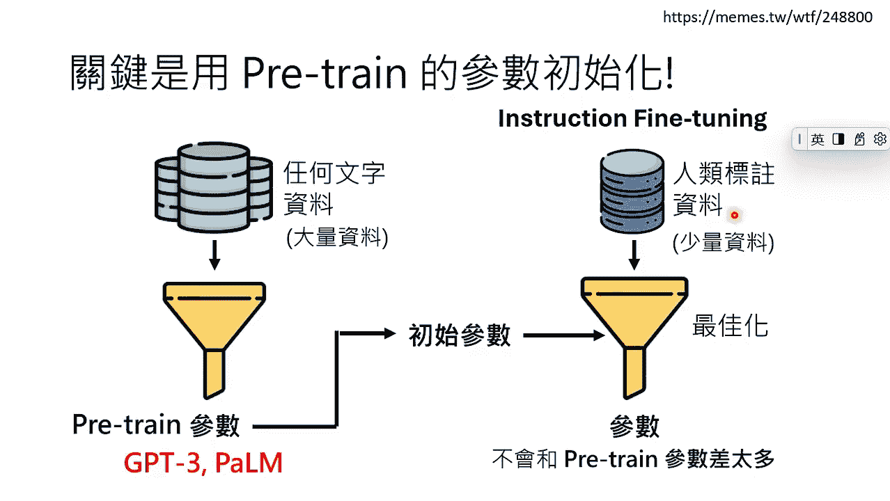

不是不是人类标注的，是从TRAGEVITY那里取得的，那我们可以开始做instruction fune了吗，还不行，因为你手上没有那些P圈的参数啊，OpenAI有GPT3。

google有PALM你，但是你没有PRETRAIN的参数，你也没有这些酷东西，那怎么办呢，于是这整个世界就卡住了，没人可以打造自己的大型语言模型。

直到有一天，meta使出了拉马，meta可能是因为在这个大型语言模型的竞赛，眼看赶不上OpenAI跟google心一横直接翻桌，打算改变整个生态系，是meta试出了拉马。

meta试出了他自己的大型原模型，你可以拿拉玛作为你的初始参数，来打造自己的模型了，拉马的第一代是在去年的，2023年的2月4出，第二代是在2023年的7月4出呃，拉马第一代在2月底释出之后。

整个世界就突然被解放了，两周之后，STANFORD打造了l pcl pa是怎么打造的呢，就是先从CHEGBT的API取得5万笔左右的资料，然后再以拉玛为PRETRAIN的模型就训练了LPA，再过了两周。

美国其他的另外一群学校联合起来打造了VIKA，Vika，他是从一个分享人跟CHEGBT对话的网站，取得了7万笔的资料，拿这些资料做instruction，Fine tune。

对拉玛做RUCTIONFUNITY。

打造了VCA，一时之间只能说是旧时王谢堂，前燕飞入寻常百姓家，每个人都可以训练自己的大型语言模型，右边这个图是一个飞入寻常百姓家的拉玛，现在拉玛的子子孙孙已经开枝散叶到满坑满谷，于是有了拉马之后。

人人都可以翻译成大型语言模型的时代，就开始了，这个就是我们在作业五跟作业六要做的事情，你们也可以自己翻译，听喇嘛。

