# 李宏毅2024春《生成式人工智能导论》 - P1：第0讲：课程说明 - 啥都会一点的研究生 - BV1BJ4m1e7g8

好那个各位同学大家好啊，感谢大家来生成式人工智慧导论这门课捧场，那我们就开始上课啊，我是李宏毅，那在开始上课之前呢，我们先讲一下，为什么我会想要开生成式人工智慧导论这门课。

那我从2014年开始在台大任教，然后2015年呢，每年都开机器学习相关的课程，那在去年的春季班啊，在机器学习这门课的下课后呢。

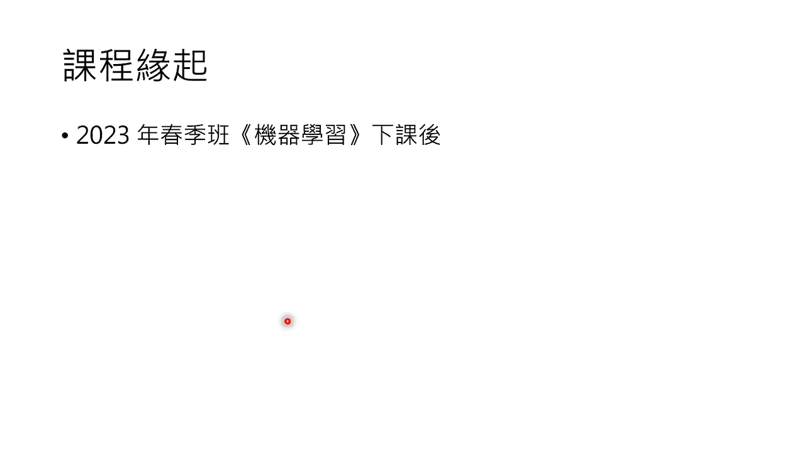

有一个同学来问我这样一个问题，他问说怎么让机器自动对一篇文章做分类，那这是机器学习的课程，我就从机器学习的角度来回答，他告诉他说这是一个很标准的分类问题，你要先准备一些标注资料。

然后你就可以训练一个自己的模型，讲到这边，我脑中突然响起了一个声音，我突然获得了一个天启，我问他说，你是真的想要学机器学习的原理吗，还是你只是想要知道怎么做到文章分类这件事，你为什么会想要做文章分类呢。

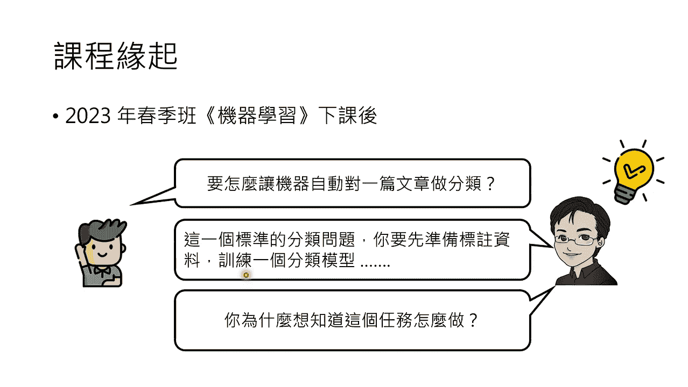

他说这是我新创需要的服务，那我说你还浪费时间学机器学习吗，别管我刚才说的那些，直接call tragivt就好了，那这句话到底是什么意思呢，当我说直接用CHEGVT就好的时候。

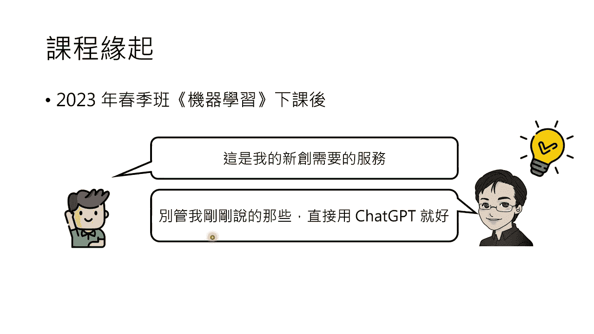

到底是什么意思呢，也许我直接操作一下，大家会比较能够想象。

好这个是CHEGT的页面，那我这边用的是GPT3。5啊，GPD3。5是免费的，GPT4呢是需要付费的，所以我等一下展示的功能是免费版的功能，是每一个人都可以唾手取得的功能。

那第一次看到这个切GBT的页面的人呐，往往会不知所措啊，这个页面上就只有一个对话框来，在这个对话框里面可以输入任何的文字，但这样一个可以跟我们对话的人工智慧，到底有什么样的作用呢。

我会无聊到需要每天跟CHEGBT说话吗，我有寂寞到需要跟人工智慧不断的聊天吗，可能没有啊，所以很多人觉得说哎呀，这不过是一个聊天机器人，它能有什么作用，但事实上呢CHEGBT可以是你的好助理。

你有什么要求，你就直接告诉他，举例来说呃，我们今天想要对新闻做分类。

那你直接把你的指令贴给他，跟他说啊，新闻就分成以下的类别啊，这边呢就简单定义一下，新闻分成政治社会，财经生活，影视娱乐，体育等等好，那接下来呢跟他说，以下我会给你一篇新闻，请告诉我这篇新闻属于哪一类。

只给我类别就好，接下来就贴一段新闻的内容给他啊。

比如说这边随便找一个新闻啊，元宵逢最小满月，随便贴一段新闻给他贴在这边，然后输入，他就告诉你说啊，这则新闻呢属于生活，或者我们再试另外一个例子吧。

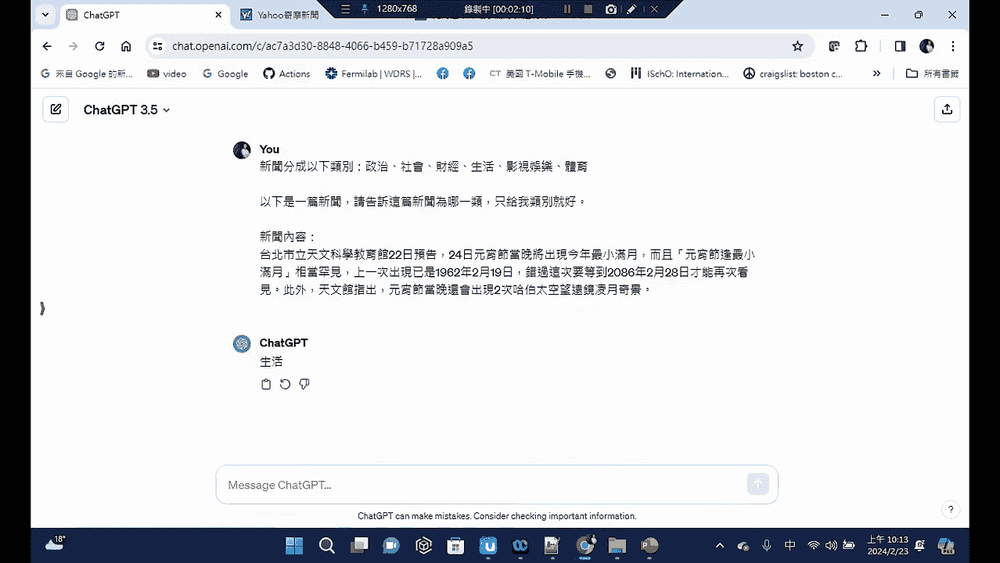

我这边这个是跟AI有关的新闻，啊那我们把这段新闻呢直接贴到这里，哦那GPT知道说这个是影视娱乐哦，所以你可以轻易的用CHEGBT，打造你想要的AI应用，但是有人可能会想说，哎这个是一个demo的网页啊。

我要怎么把这个功能嵌入我的呃，呃应用里面，嵌入我的服务里面，那在这门课的作业上，会告诉你，怎么在你自己的城市中呼叫，像CHEGBT这样的人工智慧出来帮你做事。

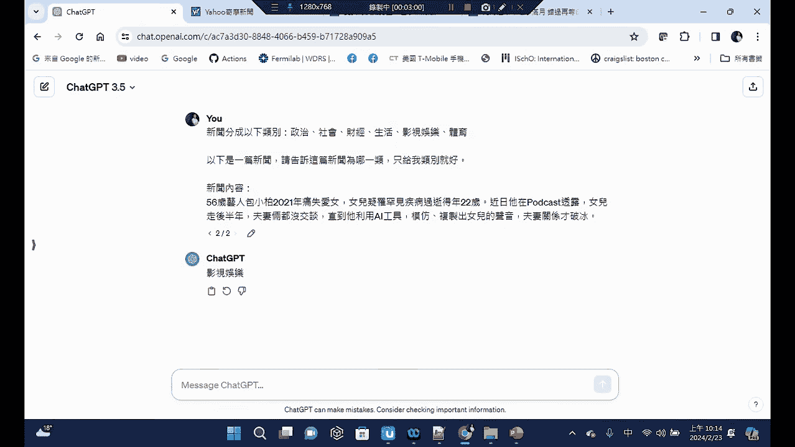

啊总之我的想法是哈大人时代变了啊，过去呢在做这个人工智慧有关的应用的时候，我们往往都是自己开发人工智慧的模型，自己训练机器学习的模型，这就像是在决斗的时候用剑一样，今天有人可以直接掏出一把枪。

在瞬间就完成人工智慧的应用哦，所以也许呃作为一个人工智慧的基础的课程，我想要开一门新的课，告诉大家，今天这个世界，如果你想做人工智慧相关应用的话，可能是什么样子哦，当然有能力自己开发模型仍然非常重要哦。

所以并不是说机器学习这门课就不重要，也并不代表我以后就不会开机器学习这门课，那我只是想告诉大家说，了解今天生成式AI的趋势，了解今天生成式AI的技术发展到什么地步，可以帮助你更精确的判断。

什么时候你应该自己开发模型，什么时候你可以用一个现成的人工智慧好，那在开始课程之前呢，我来讲一下这门课的定位，那因为这个课呢一开场呢就跟你讲了，确GVD可能会给你带来一个误解，我看到网络上有很多同学说。

这是一门教大家怎么用change g p t的课，但其实这不是一门教大家怎么用change vt的课。

确，VT只是众多深层次人工智慧的其中一个例子，当然他是今天最具有代表性的应用，所以我们课堂上一定会反复的提到，确GVT这一个人工智慧，但它只是生成式AI的一个例子而已，而这门课要讲的是。

期待能够带给大家生成式AI的全貌，那其实确GBT非常容易上手，很多人都会问说我要怎么学习用CHEGT呢，用欠GBT这件事情是不用学的，你只要能够跟另外一个人沟通，你大概就有办法跟CHEGT沟通。

所以学习用CHEGBP这件事，其实不需要花一整个学期的时间来学，怎么用全GBT，而且另外一方面，确GBT的学习资源真的非常多，你要在YOUTUBE上面打确GPT，满坑满谷的网红通通在教你怎么用券GBT。

在这个去年年初CHEGBT刚火的时候，只要是个网红，通通在讲CHEGBT历史的频道，就让TGPT伪装成历史的古人跟他对话，一个打游戏王的频道，也要逼迫TRIGBT跟他玩游戏王，明明确GP更玩不了游戏王。

然后逼迫确实去跟他玩游戏网，总之已经有太多人提供CHEGBT的教学资源，所以这门课要讲的并不是，教你怎么使用CHEGBT这个人工智慧的应用。

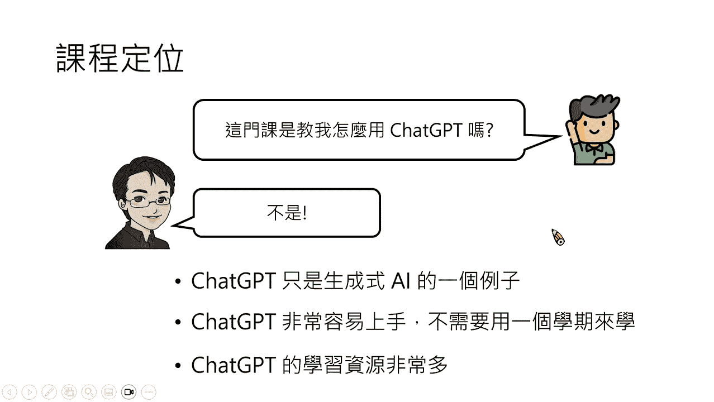

那这门课要讲的是什么呢，这门课呢我预设的目标受众是，假设你已经用过CHEGBT这类的生成式AI，你知道他们可以做什么，你知道他们有多厉害，但是你想要更进一步了解这些生成式AI，背后的原理。

他们到底是怎么来的，怎么被训练出来的，怎么变得像今天一样这么厉害，以及你想要知道这一些人工智慧，未来有什么样的可能性，还有哪些可能的发展，那这一门课就是为你开的，那为什么这门课不会特别着重某一个应用。

比如说CHEGT的使用呢，因为今天这个技术啊真的是日新月异，而如果你在这个2022年年底，确GPT上线的时候就有用它的话，你会发现确GPT现在它的界面啊，跟他刚上线的时候界面已经有很大的差异。

他能做的事，他的能力也有非常多的不同哦，所以这个应用是日新月异哦，所以你在某一门课，就算你学到了怎么使用CHEGBT，可能同样的技巧，在几个月甚至几周之后就已经不适用了，那我们在大学开一堂课。

是希望可以教你，你也许在往后数年，甚至一辈子都可以用得上的东西，所以这门课真正想要传达的，并不是教你怎么用TGP这一个应用，而是告诉你生成式AI背后概念和原理哦，那这门课呢我没有预设需要任何的预修课程。

也就是如果你想要修这门课的话，你不需要修过任何人工智慧相关的课程，不需要有任何数学跟城市的背景，也不需要修过任何机器学习相关的课程，这门课可以是你人生的第一堂，人工智慧相关课程。

那有人可能会问说我已经会用CHEGPT了，用切GBT就是如此的简单，只要你会说话，只要你会打字，你知道怎么跟另外一个人沟通，你就可以用CHEGT，我已经会用了，那会用就好啦。

我干嘛知道它背后的原理是什么，那确实就算你不知道欠gt的原理，你也有机会打造人工智慧的应用，但是了解它的原理。

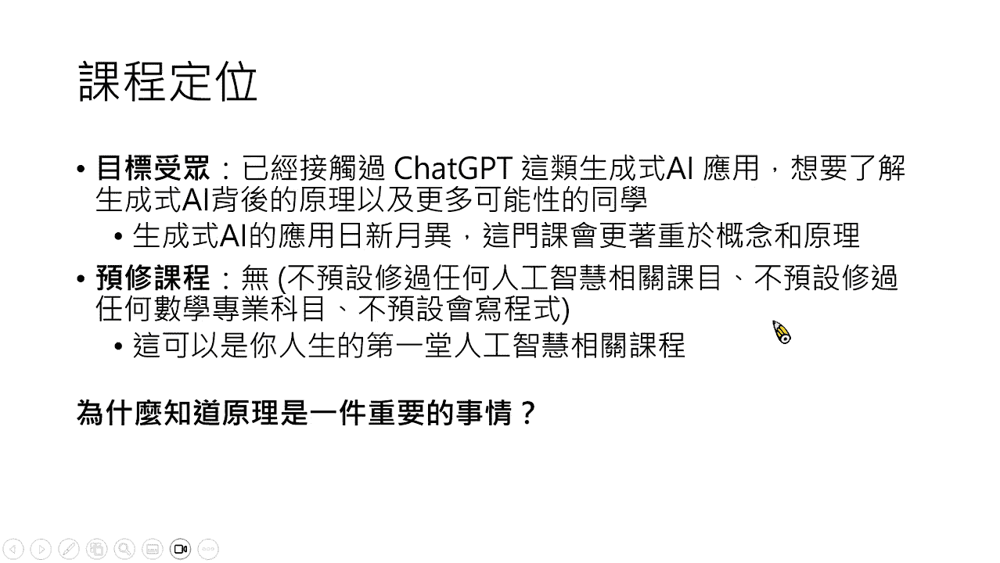

可以带你走向另外一个层次，就像说啊魔术非常的神奇啊，今天的人工智慧也像是魔术一样，但是如果你又知道魔术背后的手法的话，你在观看魔术的时候，你可以更能够欣赏魔术师他厉害的地方。

你看到魔术师把一个人锯成两半，再粘在一起的时候，你不会觉得他是真的把人锯成两半，然后用念能力把它粘在一起，你会知道说这是一个手法，你不会觉得魔术师是一个有超能力的人，或者是一个念能力者。

你知道这是魔术的手法，那对于生成式AI也是一样的，今天生成式AI展现出非常神奇的能力，但是假设你可以正确了解它背后的概，念和原理的话，那就好像是了解了魔术背后的手法，你可以更精确地认识它。

至少你不会对他的能力有错误的误解。

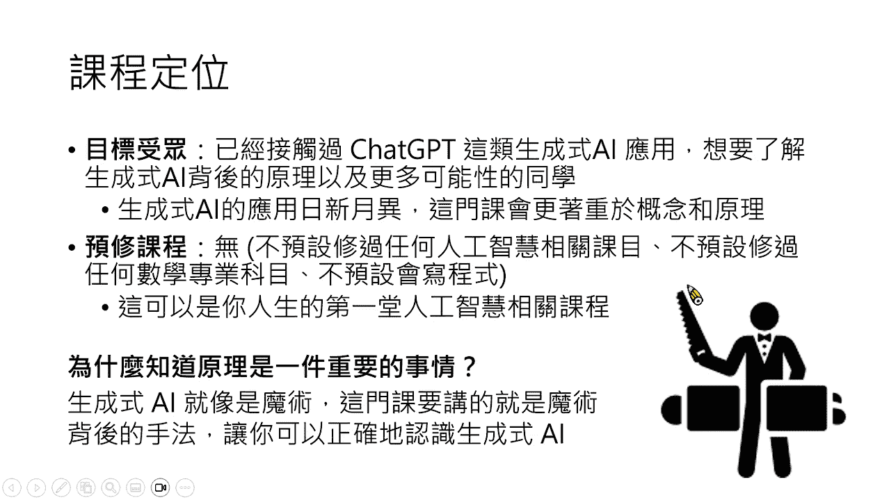

或有错误的期待，那有同学问我说，这门课跟机器学习，我自己开机器学习这门课有什么重叠的地方吗，呃你应该要问说还有什么一样的地方，基本上就是没有什么一样的地方哦，所以就算是你修过我的机器学习。

或者是修过其他老师开的机器学习，我相信这门课也可以带给你很大的帮助，那我刚才有说，这门课可以作为你的人工智慧的第一堂课，你可以把这门课作为你学人工智慧的基础，未来再去学其他机器学习相关的课程。

那要在声明一下，在这门课你不会学到什么啊，因为这是一门入门的课哦，所以如果我们继续用魔术这个比喻的话，这门课会手把手带你变几个魔术，但是可能不足以训练你成为魔术师，也没有办法带你创造新的魔术。

但这并不代表说啊这门课是没有用的，这门课可以作为假设你的目标，未来是要成为顶尖的魔术师，要做些大变活人之类的，那这门课可以作为你成为魔术师的开始啊，那上课因为时间有限啊，然后把这门课设定为是两学分的课。

所以我们上课时间只有两个小时而已，因为上课时间有限，所以我们无法深入提到所有的技术，所以很多地方可能会让你觉得，我什么都什么都脱了，就只给我看这个这样子，所以很多地方可能没有办法讲的非常的深入。

但是这是你的第一门人工智慧的课，他不会是你最后一门人工智慧的课，未来你可以修其他相关的课程，或者是假设你想要深入研究，上课所提到的一些技术背后的原理的话，你可以看投影片上引用的论文啊。

那讲到引用这件事啊，我讲一下说啊，在我们这门课啊，我们的投影片上，多数的论文呢都是引用，来自一个叫做阿泰的网站，好像也看到说上课引用的论文链接，它上面会写这个IPAD点o r g ark是什么呢。

那如果是这个呃电脑科学领域的同学，一定都知道AK是什么，但我知道从这门课的同学呢，来自于各个不同的领域，所以我介绍一下什么是AK，我知道说一般我们在做这个研究的时候啊，你知道说你做研究有了一个新的想法。

那你会把你的想法呢写成论文，发表在国际会议跟国际期刊上，但是这个国际会议，国际期刊论文往往一审都是个一年半载，对于AI的领域而言，技术变化实在是太快了，一年半载的时间往往就会有翻天覆地的变化。

往往你头一篇文章六个月之后被国际会议接受，那个技术已经不行了，所以怎么办呢，有一个网站叫做阿凯，今天往往你有新的想法，尤其是电脑科学，人工智慧相关的新的论文，往往不先投国际会议。

先直接放IPAD抢先公开出来哦，所以在arc上比较容易找到最新的研究，那这边教大家怎么看ARCAVE文章上传的时间，那ARCAVE的文章呢后面都会有一个数字啊，这个数字的前两个呢代表的是年份。

后面两个数字呢代表的是月份，所以2205的意思就是，这篇文章是在2022年的5月被公开来，放在阿凯上之后，你在我们的课程的投影片上会看到很多文章，这些文章往往是几个月前。

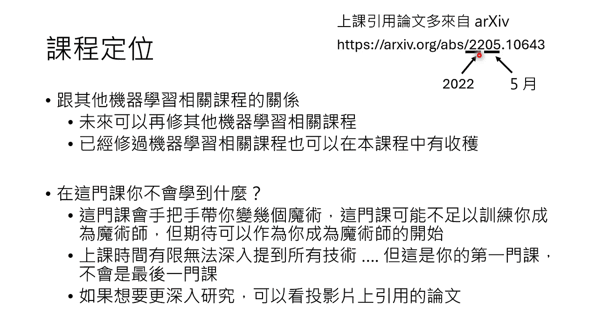

甚至是几周前才被放在IPAD上的。

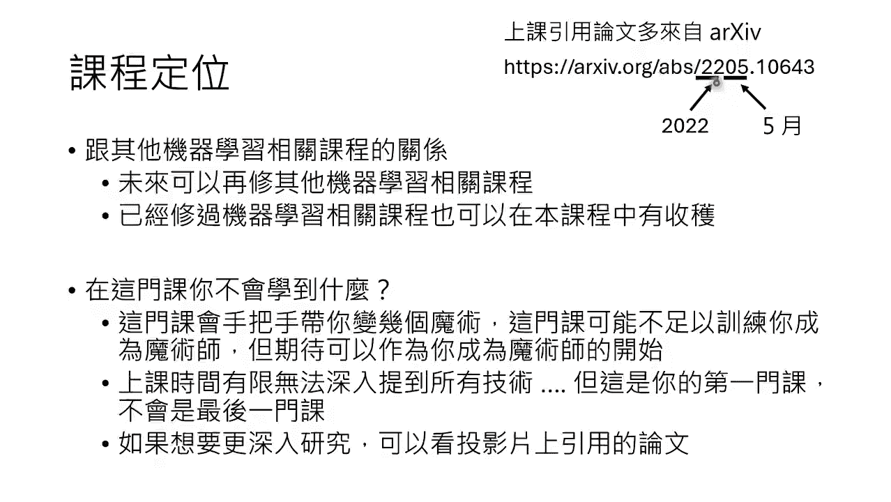

那讲到这个技术迅速的变化这件事啊，我就想分享一件事情，在这门课里面，我们的作业会教大家训练一个有70亿个哦，七个b lion，那缩写是7B7B这么多参数的模型哦，虽然说是训练，但实际上是微调了啊。

不过我们还没有讲到训练和微调差异，这个我们之后再讲，现在就当做你要训练一个7B的模型，那这个70亿的参数到底是什么意思呢，哦我们还没有讲到参数的概念，我们下一堂课会讲参数的概念。

但是现在就想成参数量越多，就代表这个模型越厉害，但实际上影响模型能力的这个因素还有很多，不是只有参数的数量，不过今天大家往往把参数的数量来当做，夸耀模型能力的一个指标，那有70亿个参数的模型。

70亿听起来是一个很大的数字，跟地球的人口差不多多，其实一个参数的模型，它是一个很大的模型吗，它显然不是一个特别大，特别厉害的模型，因为这是我们课堂的一个作业，你可以想见，修完这堂课以后。

有上千人都能够训练70亿个参数的模型，而且你这今天用免费的运算资源，就可以训练一个70亿参数的模型，但是所以它显然不是一个特别厉害的模型，但是要是你穿越到5年前，穿越回2019年，2019年的时候。

发生什么事呢，2019年的时候，OpenAI使出了第二代的GPT。

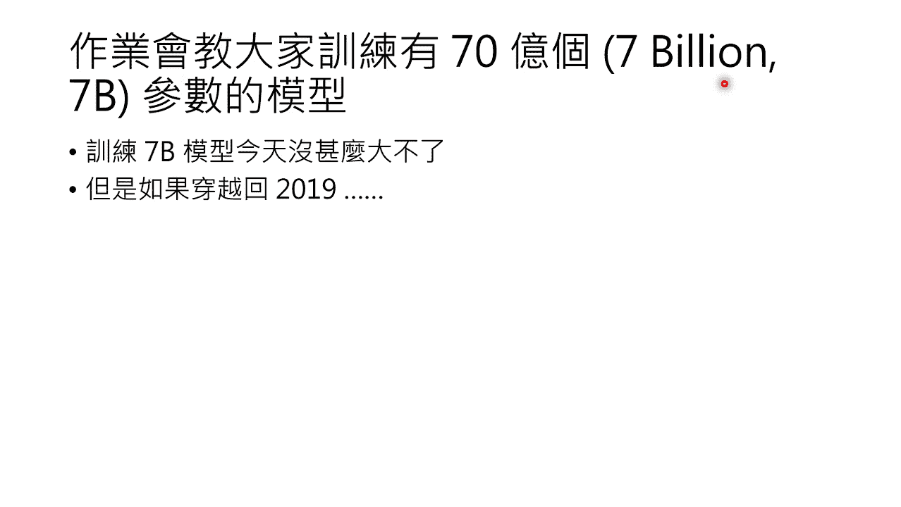

那个时候网络上各种文章也是拼命的吹捧，比如说史上最强NLP模型GPT2。0。

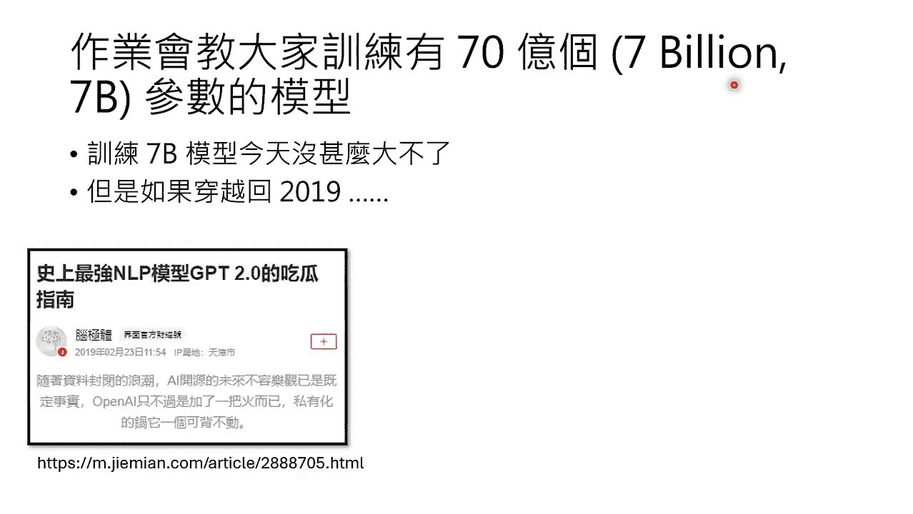

或者是逆天语言模型GPT2。0。

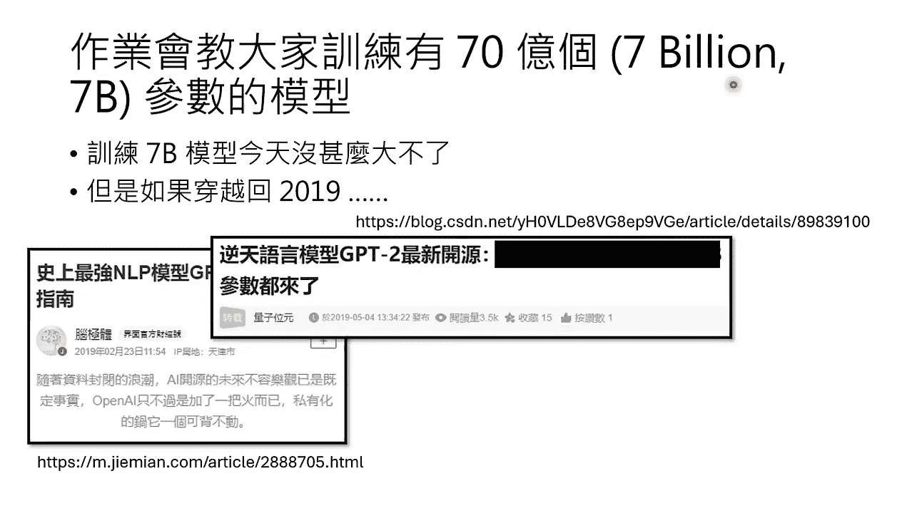

最大的模型GPT2。0。

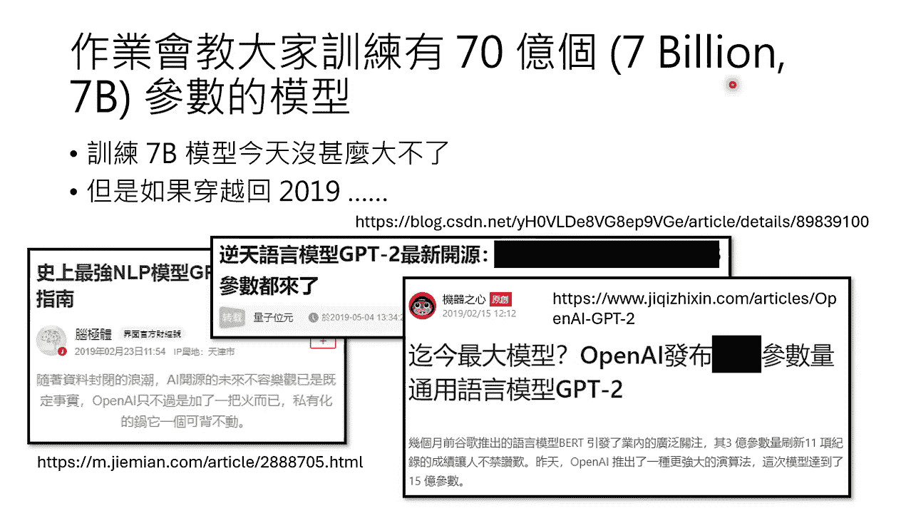

那这个GBT2到底有多大呢，它只有15亿个参数，它大概是你今天作业要用的模型的，1/4到1/5，所以今天假设你带着我们的作业穿越回5年前，你手上有的是一个毁天灭地的巨大模型。

OpenAI跟google能看到你都得下跪，你知道吗，这是一个当时最大。

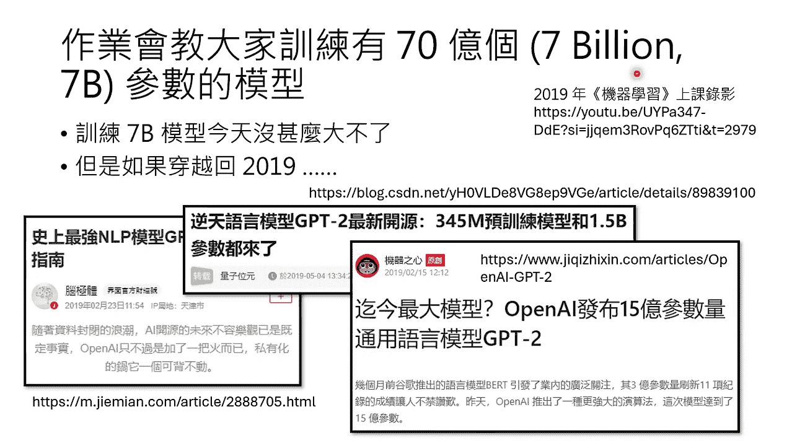

大家没有办法想象的巨大模型，这让我想到什么呢，我想到葬送的芙利莲啊，哈这个是福利莲那个动画的第三话了，呃这个福利点经播很久了，所以讲福利点剧情不算爆雷了吧，那如果你怕被雷的话，就把耳朵捂起来。

我讲的那个葬送的芙丽莲里面的故事啊，这个福利年呢它是一个精灵，他在80年前曾经参加勇者小队去讨伐魔王，在魔王手下有一个很厉害的干部，叫做普贤库瓦尔，普贤库瓦尔非常的厉害，他发明了一个杀人魔法。

可以穿透任何的防御，所以没有人可以挡住他的一击，所有的勇士都被他杀了，连福利连都没有办法打倒他，只能够把它暂时封印起来，过了80年之后，他的封印松动了，库瓦尔复活了。

弗利莲就带着他的弟子费伦想要来干掉库瓦尔，一开始费伦非常的紧张，想说库瓦尔他的杀人魔法是没有办法防御的，我们要怎么样才能够打倒库瓦尔呢，福利莲说啊，到时候就知道了，然后库瓦尔呢对费伦死了一记杀人魔法。

福利连登，就是这个费伦说你就把房地展开枪就挡住了，然后费伦就说这什么杀人魔法，不过就是普通攻击而已啊，对就是杀当80年前的杀人魔法，过了80年后就只是普通攻击而已，因为80年对人类来说实在是太长了。

人类已经钻研了库瓦尔的魔法，已经寻找到了防御的方法，而在生成式AI的领域也是一样，当年的g p t two就像是库瓦尔一样，当年一个毁天灭地的巨大模型，今天在你的眼中也已经不算什么了。

那这个例子是要告诉你说，深层次AI技术的变化是非常的快，不要说是5年，有时候五个月五个星期都会有很大的变动啊，这边呢讲到作业，就跟大家说一下这个作业的规划啊，那作业的目标是要让大家体验生成式AI。

那这个体验呢分成两个面向，第一个层面的体验是体验，我们怎么用生成式AI来打造某些应用，那另外一个层面呢是教大家怎么用身子，怎么训练出自己的生成式AI模型啊，当然啊城市助助教都已经写好了。

你要做的事情往往就是一直按enter，但是你可以体验，怎么训练出一个自己的生成式AI模型，那在这门课里面呢，我保留了一些负面的体验，什么样负面的体验呢，比如说训练模型很花时间啊。

当然是今天所谓的很花时间，在作业里面可能就是两三个小时那么久，你知道这个痛苦是比较出来的，你可能觉得训练两三个小时很花时间，事实上如果你要训练真正的大模型，往往他的时间都是用周做单位来进行计算的。

那另外你可能还会有什么负面的体验呢，你可能会发现说，就算你完全按照重要的指示按enter，你得到的结果，可能也会跟助教得到的结果不一样，很多第一次训练模型的同学会觉得非常的惊奇。

想说训练模型不就是写个程序吗，它是电脑啊，他怎么每次还会得到不一样的结果呢，我告诉你这个训练模型呢，你不要用城市来想他，你要想成好像是在养小动物，好像是在种花食草一样，它的结果往往是有可能无法预测的。

当然我们可以把这些负面的体验拿掉，就不让你自己训练模型就好，但是我仍然把好几个训练模型的这个呃工作，保存在作业中，为了让你得到一些负面的体验。

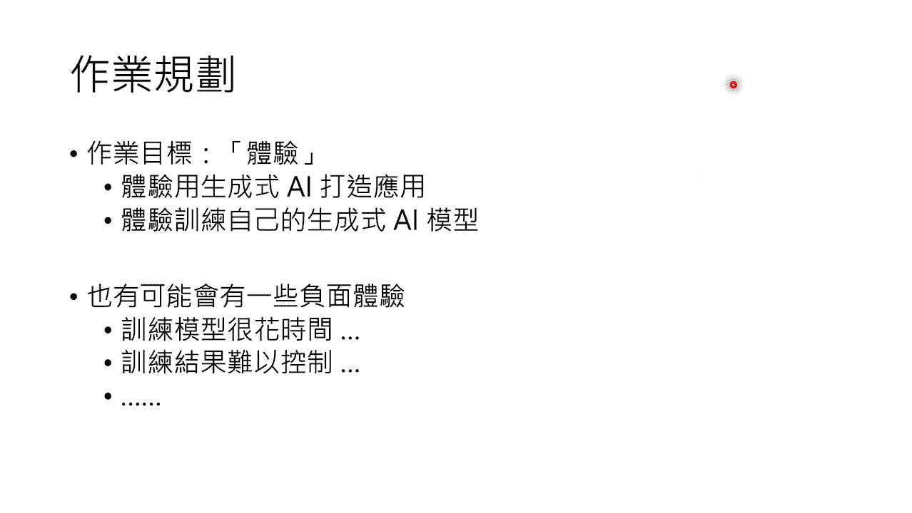

期待这些负面的体验可以像是疫苗一样，为帮助你在未来面对更大的挑战，我知道说在座各位，不是每一个人未来都会成为工程师，不是每一个人都会训练模型，但也许透过这堂课的体验。

你可以知道说训练模型是可能很花时间的，是可能很难预测的，有一天你当了大老板，也许你可以对你手下的肥宅工程师多一些宽容。

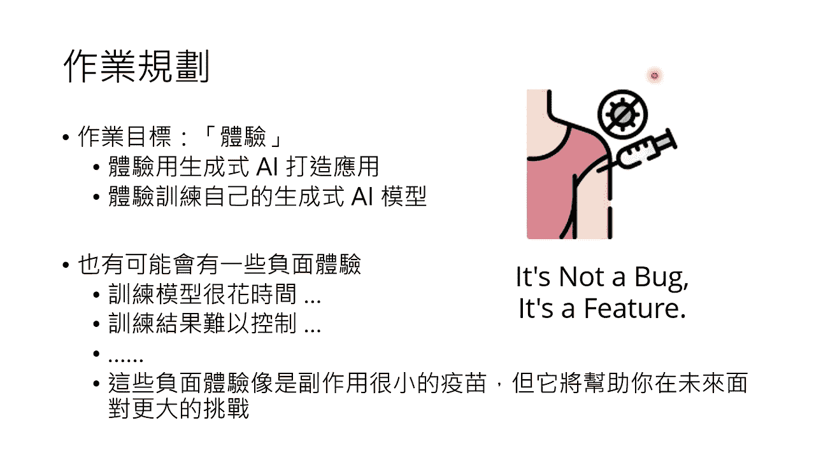

啊这个是作业内容的规划了，这门课呢总共有十个作业，那公告的日期呢我都已经写在投影片上，那每一个作业呢如果没有特别说明，预设它的截止日期就是在两周后。

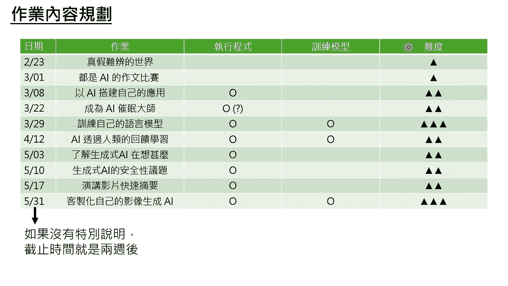

那这些作业呢有好几个是需要写程式，甚至是训练模型的，那有同学就会问说，那要训练模型，我需要准备什么东西呢，我需要买自己的GPU吗，你什么都不用准备，那在执行程序训练模型的部分。

我们都会用COLLAB或者是cargo，那你不知道COLLAB或cargo是什么也没有关系，总之你只要记得你什么都不用准备好，那这边呢我稍微估算了一下作业的难度啊，在这个作业里面呢，如果打一个三角形。

就是送分给你好，所以等下作业一，还有下周讲的作业二，基本上就是送分给你，这个开局就先送大家20分好，但是后面的作业呢会逐渐的有一些难度，那如果两个三角形就是代表说，假设你不在意分数的话。

这个作业也可能可以非常快完成，但是假设你想要拿到满分，你还是需要花一些时间自己努力的，那三个三角形代表说，这个作业是需要训练模型的，所以你至少需要好几个小时才能完成，然后再强调一次，痛苦是比较出来的。

好几个小时已经算是非常快了，过去2015年，我刚开机器学习这门课的时候，有好几个作业呢，他的训练时间大概是比如说三天，我就跟同学讲说这个作业就是要训练三天，所以今天假设离作业的截止日期不到三天。

你唯一能做的事情就是放弃这样子，还，因为因为你已经不可能把模型训练出来了，但今天啊训练模型最多就是几个小时，你在前一晚作业带来的，前一晚再赶也许还来得及哦，所以有关这门课的分量呢，我这边给一个注解了。

因为有十个作业，几乎每周都会公布个作业，所以就通式来看，就假设你把这门课当做一个通式，因为毕竟这门课的名字里有导论，这两个它不会是一个太难的课程，但是如果把它当做公式来看，它可以是一个非常充实的通式。

当然如果把它看作是选修课，那他可能是一个比较轻松的负担，没有那么重的选修课。

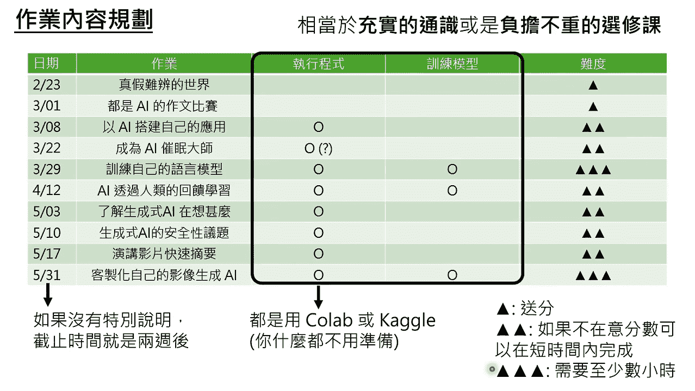

来跟大家讲一下作业可能的负担，给大家参考，有关上课内容规划的部分。

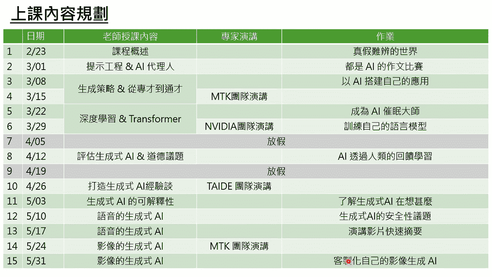

这个我们下一节再讲好，那这边大家常常会问的一个问题，就是这门课能不能够用人工智慧，比如说JHVT来写作业呢，答案都是可以，这个是生成式AI导论，这门课当然应该可以用生成式AI来写作业。

但是同时老师也要用人工智慧来改作业，到时候我们的作业，基本上能够用大型语言模型改的，我们都会用大型语言模型来批改啊。

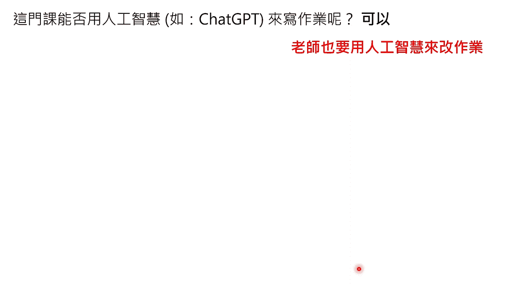

这边特别感谢MTK的打兵器达哥团队，提供给我们打兵器的平台，提供给我们算力跟提供给我们平台，让我们可以透过打兵器的平台来批改作业，就算他们知道说，我们这堂课可能会有超过1000人选修。

他们也愿意无条件的大力支持，所以在此特别感谢NPK的打歌团队好，那这个3月15号的时候呢，MTK的团队会来跟大家分享，他们是怎么使用生成式AI，他们对生成式AI在业界有什么样的看法，那5月24号的时候。

NTK自己也有开发大型原模型，所以技术团队会来跟大家分享。